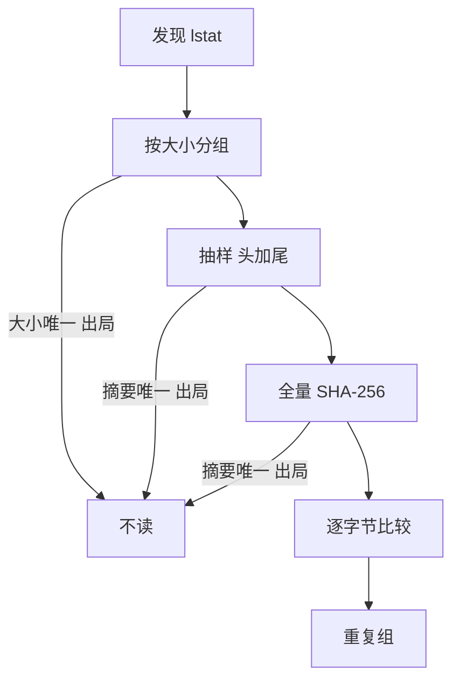
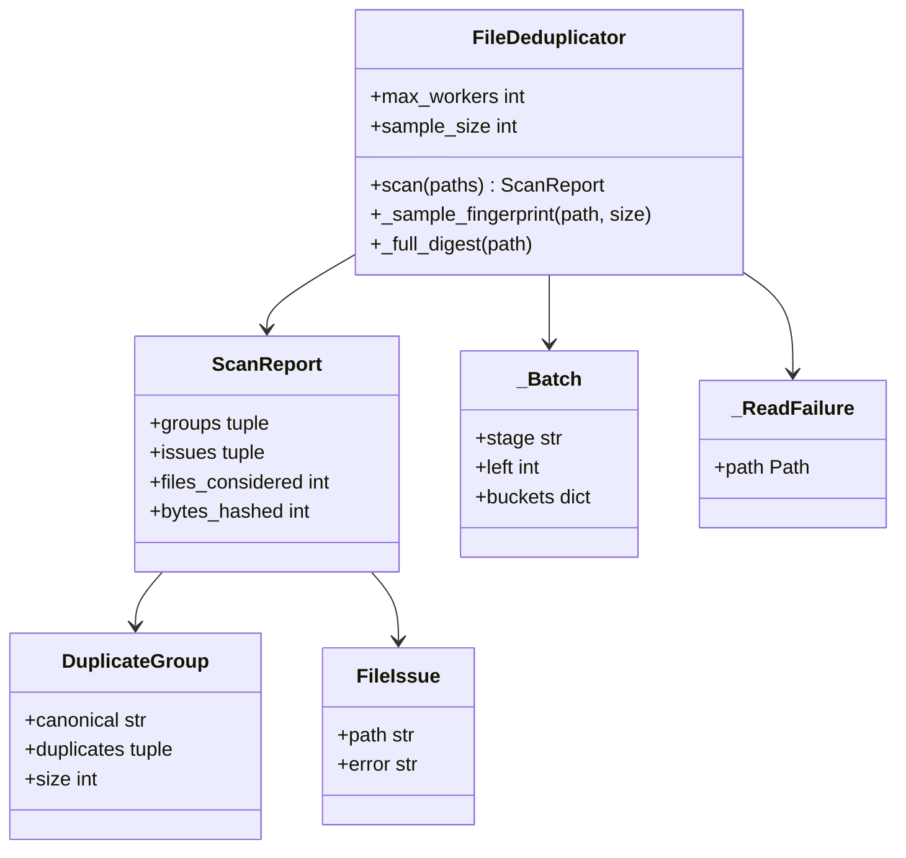

# 设计题解：文件去重流水线（File Deduplication）

## 题目与澄清

一个归档摄取服务在入库之前要做去重：调用方给出一批文件或目录路径，去重器递归地走下去，找出"内容逐字节相同"的文件，按组报告。
难点不在"算哈希"，而在三件事同时成立：磁盘读得越少越好（大多数文件根本不该被读）、结论绝不能错（哈希碰撞时也不能把不同的文件判成相同）、
单个文件出问题（不存在、没权限、中途被删）不能拖垮整次扫描。你要写的是 `FileDeduplicator.scan(paths)`，返回一个 `ScanReport`；
数据类、构造函数和两个测试钩子 `_sample_fingerprint(path, size)`、`_full_digest(path)` 的签名是给定的，测试会在这两个钩子处观察和替换行为。
经典版本见 [[problems.components.in-memory-file-system|内存文件系统（In-Memory File System）]] 与分级机考里的文件存储与去重题；
这个项目把"先大小、再抽样、最后全量"的漏斗、碰撞安全、失败隔离和并发上限放进同一份合同里。

先把合同写成十四条，这是开工前的第一件事：

1. **输入**：`paths` 可以是只能迭代一次的可迭代对象，只迭代一次；每一项是文件或目录的根路径。
2. **路径身份**是 `str(Path(path))`：`./a//b/` 和 `a/b` 是同一个身份，`a/../a` 与 `a` 是两个身份。同一身份只处理一次，根路径重叠也一样。
3. **遍历**：目录递归，不跟随软链接。缺失的路径、软链接（包括断链和指向目录的链接）、特殊文件（管道、套接字）、遍历出错的目录，各产生一条 `FileIssue`，不影响别的文件。
4. **`FileIssue.error` 必须含底层异常的消息**；前缀格式不评分。
5. **`files_considered`** 是发现的互不相同的普通文件数；之后某一级失败的文件照样计入。
6. **大小先行**：按发现时记下的大小分组；大小唯一的文件不进入抽样与全量哈希，也不做任何"能不能读"的预检查。
7. **抽样**：先读开头最多 `sample_size` 字节，再读结尾最多 `sample_size` 字节，两段不重叠、同一区域不读两遍；返回 SHA-256 十六进制摘要和实际读到的字节数。
8. **全量哈希**：流式增量计算，内存有界，不把整个文件读进内存。
9. **碰撞安全**：摘要相同不证明内容相同；用有界内存的逐字节比较确认。人为制造的碰撞可以让同一个摘要桶里有好几组内容各自相同的文件，每组独立成组。
10. **输出顺序**：每个重复组里字符串最小的路径是 `canonical`，其余重复项升序；组按 `canonical` 排序；问题按 `(path, error)` 排序。
11. **失败隔离**：元数据、抽样、哈希、逐字节比较的失败各自隔离；比较失败记在打不开或读不动的那个路径上；无关的重复组照常返回。
12. **同一路径的重复问题只留一条**，保留最近一个必要阶段的那条。
13. **`bytes_hashed`** 只累加成功完成的抽样钩子与全量钩子返回的字节数；抛异常的钩子记 0，哪怕它读到一半才失败；逐字节比较读的不算。
14. **并发**：抽样与全量哈希并发进行，同时活动的钩子不超过 `max_workers`；只要有至少 `max_workers` 个符合条件的钩子被阻塞，就必须能让 `max_workers` 个同时运行。构造函数的两个上限必须为正，空输入合法。

开口前值得问的澄清问题，每一个都会改变代码：

- **两个空文件算重复吗？** 算：大小同为 0，内容逐字节相同。抽样和全量钩子对它们各读 0 字节，所以 `bytes_hashed` 仍是 0。
- **两个硬链接算重复吗？** 路径身份是字符串，不是 inode，所以它们是两个成员，会成一组。这和"能省多少空间"是两回事，见 `## 扩展与追问` 里的书面回答。
- **抽样失败的文件，它的同大小伙伴怎么办？** 伙伴独自留在原来的大小组里，没有可比较的对象，也就不再被读；失败的那个有一条问题，伙伴没有。
- **要不要信任 SHA-256？** 不信：合同要求逐字节确认。哪怕真实世界里碰不到碰撞，测试会用钩子人造碰撞，让所有文件返回同一个摘要。
- **一次 `scan` 之间文件变了怎么办？** 合同不要求检测，只要求"不因此崩、不判错"。检测变化是书面回答的内容。

范围之外：跨次扫描的缓存、增量扫描、把重复文件替换成硬链接、分布式存储、`REFLECTION` 里的三个问题只写回答，不写代码。

## 需求与分级

漏斗是整个项目的骨架：每一级只处理上一级留下的同组文件，越往后越贵，越往后文件越少。



**第 1 关（约 15 分钟）：发现与大小分组，不并发。** 一个显式栈，对每个路径做 `lstat`：普通文件记下大小，目录列出子项压栈，软链接和特殊文件记问题，出错记问题。
根路径和子项走同一段代码，所以"软链接不跟随"这条规则只写一遍。到这一关为止，`files_considered`、问题、排序、空输入都能被测试覆盖。

**第 2 关（约 15 分钟）：抽样、全量哈希、逐字节确认。** 先写两个钩子：抽样读 `head = min(sample_size, size)` 个字节，再从 `max(head, size - sample_size)` 读到末尾，
两段永不重叠；全量按块读。再写"摘要桶 → 等价类"的逐字节拆分。这一关决定了正确性，所以碰撞测试（钩子返回常量摘要）在这一关就要写。

**第 3 关（约 15 分钟）：失败隔离与记账。** 每个钩子的异常转成按路径记录的问题，抛异常的钩子不计字节；比较失败要看清是哪一边出的错；
同一路径多条问题只留一条。这一关最容易出现"改一处、坏另一处"，所以每个失败测试都要同时断言"别的组还在"。

**第 4 关（约 15 分钟）：并发。** 抽样与全量哈希跑在同一个 `max_workers` 大小的线程池里，一批抽样全部回来就立刻提交这一批的全量任务。
这一关只动 `_narrow` 一个方法，前三关的类和函数一个字都不用改，这就是分级设计要证明的事。

## 核心对象与职责

对象很少，因为这个问题的复杂度在"阶段之间的数据怎么流"，不在"有多少种东西"。



- **`FileDeduplicator`** 只持有两个配置上限，没有任何跨 `scan` 的状态：每次扫描的字典、队列、线程池都是局部变量，所以同一个实例可以被多个线程同时用来扫描。
  它拥有的不变量是"每个 ScanReport 里的任意两个成员字节相同，而且每个字节相同的成员都在同一组里"。
- **`ScanReport`、`DuplicateGroup`、`FileIssue`** 是冻结数据类，字段全是元组和字符串：调用方拿到的东西改不动内部状态。
- **`_Batch`** 记录"一批文件还有几个钩子没回来、已回来的按摘要分了哪些桶"。它只在协调线程里读写，所以是一个普通数据类，不带锁。
- **`_ReadFailure`** 是逐字节比较里的内部异常，携带"哪一个路径出的错"，让问题记在对的头上。它不出现在公开接口里。
- 发现、抽样、比较都是普通函数或方法，没有 `Stage` 基类、`Hasher` 接口、`Scanner` 单例：见决策六。

## 关键设计决策

### 决策一：四级漏斗，每一级只读上一级留下的文件

**问题**：怎样用最少的磁盘读取找出相同的文件？

- **方案 A：全部文件算全量哈希**，再按摘要分组。简单，但每个文件都被完整读一遍，包括大小独一无二、根本不可能重复的那些。
- **方案 B：先按大小分组，再对同大小的算全量哈希。** 大小唯一的文件免读，这一步最便宜（`lstat` 已经给了大小），也是收益最大的一步。但同大小的大文件仍要整个读。
- **方案 C（采用）：大小 → 抽样 → 全量 → 逐字节。** 抽样只读首尾各 `sample_size` 字节，把"大小相同但开头或结尾就不同"的文件在读几 KB 之后淘汰。

用实际输出看每一级省了什么。下面五个场景都用默认 `sample_size=4096`，文件大小 1 MiB：

```
场景                               files groups bytes_hashed
大小各不相同（三个文件）              3     0            0
同大小，开头不同                      2     0        16384
同大小，只有正中间一个字节不同        2     0      2113536
内容完全相同（两个）                  2     1      2113536
内容完全相同（三个）                  3     1      3170304
```

第一行：三个文件一个字节都没读。第二行：两个文件各读抽样的 8192 字节，共 16384，淘汰。第三行：抽样一样，进入全量哈希，共 2 × 8192 + 2 × 1048576 = 2113536，
最后摘要不同，不成组。第四行同样的字节数，但成了组：抽样淘汰不了的，只能靠全量。
漏斗的代价也要说清：真正重复的文件被读了抽样加全量，比方案 B 多读 `2 × sample_size` 字节，这是用"重复文件多读一点"换"不重复的文件少读很多"。

**抽样的边界**是最容易写错的地方，用输出确认（`sample_size=4096`）：

```
size   0 -> 读到 0
size 100 -> 读到 100
size 4096 -> 读到 4096
size 5000 -> 读到 5000
size 8192 -> 读到 8192
size 8193 -> 读到 8192
size 100000 -> 读到 8192
```

规律：头部读 `head = min(sample_size, size)`，尾部从 `max(head, size - sample_size)` 开始读到末尾。
文件不超过 `sample_size` 时头部就读完了整个文件，没有尾部；大小在 `sample_size` 与 `2 × sample_size` 之间时，尾部只读"头部之后剩下的部分"，两段首尾相接，没有重叠；
更大的文件才读满两段。上限因此是 `2 × sample_size`，而不是"每次读 `sample_size`"。

模式：这是"漏斗／过滤器链"，不需要模式类。每一级是一个返回（摘要，字节数）的钩子，加上"按摘要分桶、桶大于 1 才往下走"这一个共同动作。

### 决策二：摘要只能缩小候选，决定相等的是逐字节比较

**问题**：SHA-256 相同就能报重复吗？

- **方案 A：摘要相同即重复。** 实际上几乎不会错，代码最短。但合同要求碰撞安全，测试会让钩子对所有文件返回同一个摘要；而且"几乎"在归档系统里意味着一次错判就是一次数据丢失。
- **方案 B（采用）：每个摘要桶再用逐字节比较拆成等价类。** 桶里按路径升序依次取文件，只和每个类的第一个成员（代表）比较：相同就加入，不同就试下一个类，都不同就自成一类。

用人造碰撞看效果：六个文件 `a b c d e f` 内容分别是 `one two one two six one`，钩子对所有文件返回同一个摘要。输出：

```
DuplicateGroup(canonical='a', duplicates=('c', 'f'), size=3)
DuplicateGroup(canonical='b', duplicates=('d',), size=3)
e：不成组，也不是问题
issues=()  bytes_hashed=18（六个文件各读 1 + 2 字节，钩子返回的数）
```

比较的代价要诚实：一个由 n 个相同文件组成的桶，每个新成员都要和代表完整比较一次，共 n − 1 次，每次两边各读一遍。实际测得（每个文件 3 MiB）：

```
n=2: 逐字节比较读了 6291456 字节 = 2 × (n-1) × 3 MiB
n=3: 逐字节比较读了 12582912 字节
n=5: 逐字节比较读了 25165824 字节
```

也就是 `2 × (n − 1) × size`，和 `bytes_hashed` 无关（合同规定比较读的不计入）。这是把"正确性"买下来的价格；需要更省时，可以一边读一边对一个桶里的所有文件做"逐块分裂"，见 `## 扩展与追问`。
比较时逐块读、遇到第一处不同就停，任何时刻内存里只有两块（各 1 MiB）。

**不要用 `filecmp`**：标准库的 `filecmp.cmp(a, b, shallow=False)` 看起来正好，缓冲区也是有界的（`BUFSIZE` 为 8192），
但它按 `(类型, 大小, 修改时间)` 缓存结果。实测：先比较 `a`、`b` 得到 `True`；把 `b` 改成同样长度的不同内容并把修改时间设回原值，再比较，仍返回 `True`，而真实字节并不相等。
一个去重器要的是"现在读到的字节"，不是"上次的结论"。

### 决策三：协调线程独占所有汇总状态，工作线程只返回值

**问题**：线程池里的钩子完成后，谁来更新 `bytes_hashed`、问题表和分桶？

- **方案 A：每个工作线程拿一把共享锁，直接改字典和计数。** 能用，但每个汇总动作都要小心锁的范围；`issues[path] = …` 是否覆盖、计数是否漏加，都变成并发问题，测试也难写。
- **方案 B（采用）：工作线程只返回（摘要，字节数）或抛异常，完成通知放进一个队列，协调线程循环取出并独自更新全部状态。**
  `bytes_hashed`、`issues`、`_Batch.buckets`、`in_flight` 只有一个写者，所以整个类里没有 `Lock`。

后果有两条。第一，"抛异常的钩子记 0"自然成立：只有 `future.result()` 正常返回才累加。第二，结果的内容与完成顺序无关：桶里成员的顺序是完成顺序，
但后面的 `_verify` 先按字符串排序再处理，输出又统一排序，所以 `max_workers=1` 和 `max_workers=5` 的报告完全相同（测试用八个随机种子对拍暴力解验证了这一点）。
完成通知用 `queue.SimpleQueue` 加 `add_done_callback`，而不是在循环里反复 `wait(pending, FIRST_COMPLETED)`：后者每轮扫描全部未完成的任务，文件数大时是平方级。

模式：这是"单写者／消息传递"。线程安全靠"不共享"，不靠"共享并加锁"。

### 决策四：一个线程池，按批流水线；不用"先抽样完再全量"的整体分段

**问题**：怎样满足"抽样与全量哈希并发"和"同时活动的钩子不超过 `max_workers`"？

- **方案 A：两个阶段各自一个线程池。** 两个池加起来最多 `2 × max_workers` 个钩子同时活动，直接违反上限。
- **方案 B：一个池，先把所有抽样做完，再提交所有全量。** 上限守住了，但一个慢文件会让所有别的组的全量哈希都等着。
- **方案 C（采用）：一个池，按"大小组"为批；一批的抽样全部回来，就立刻提交这一批的全量任务。** 一个大小组的全量与另一个大小组的抽样自然重叠。

测试 `test_stages_overlap…` 把差别变成可执行的断言：大小组 X 的一个抽样钩子一直等到"别的组的全量钩子开始"才返回；把全量推迟到所有抽样完成之后的变体，只有这一个测试失败，等满 10 秒超时；方案 C 立刻通过。
至于上限，线程池本身保证：`max_workers=3` 时，三个钩子互相等待的屏障被打开，同时活动数的峰值恰好是 3，永远不是 4。

### 决策五：失败按路径记一次，逐字节比较的失败记在出错的那一边

**问题**：比较 `a` 和 `b` 时抛了异常，记谁？

- **方案 A：笼统地记 `(a, b)` 两个，或者记第二个。** 无辜的文件被牵连，别的重复组也可能被丢掉。
- **方案 B（采用）：打开和读取都包一层，抛出带路径的 `_ReadFailure`。** 记在出错的路径上；如果出错的是类的代表，就把它从类里去掉，由下一个成员接任代表，然后继续比较，新来的文件不会因为代表坏了而被冤枉。

输入输出：`a`、`b`、`c` 内容相同，`a` 在全量哈希之后、比较之前被删掉。结果是 `DuplicateGroup(canonical='b', duplicates=('c',), size=4)` 加一条问题 `("a", "FileNotFoundError: [Errno 2] No such file or directory: 'a'")`。
最小路径 `a` 不再是 `canonical`，因为它已经读不了；这是"问题记在出错的路径上、别的重复组照常返回"的直接结果。
问题表是 `dict[str, str]`，键是路径：同一路径的后一条覆盖前一条，这就是"同一路径只留一条、留最近一个必要阶段的"的全部实现。

### 决策六：不建 `Stage` 接口、`Scanner` 类、策略对象（拒绝模式）

流水线有三级，很容易想写 `class Stage(Protocol)`、`SizeStage`、`SampleStage`、`FullStage`，再让 `Pipeline` 依次调用它们。三级的输入输出类型各不相同
（路径与大小、路径与摘要、桶与路径），共同接口只能是 `Any`，换来的只是"多了五个文件"。真正会变的是"抽样怎么读"和"全量怎么读"，
这正是两个测试钩子的位置：子类覆盖钩子即可替换行为，不需要接口。同样，发现不需要 `Walker` 类：它只是一个方法加一个栈。
一个类只转发一次调用，就是 Java 习惯；这里的类要么拥有不变量（`FileDeduplicator`、`_Batch`），要么是纯数据。

### 决策七：身份用路径字符串，不用 inode

**问题**：硬链接是同一个文件，要不要在发现阶段按 `(st_dev, st_ino)` 合并？

合同说得很清楚：路径身份是 `str(Path(path))`，每个身份处理一次；没有说 inode。按 inode 合并会让两个硬链接只剩一个成员，和"两个路径内容相同"的测试直接矛盾。
所以在去重器里保持最简单的定义（字符串），把"这些路径其实占同一份存储"当作报告的后处理，由调用方决定怎样统计节省的空间（见书面回答）。
在这个项目里，简单的答案是对的。同样，`Path` 对象的比较是按路径分量的，不是按字符串的：`sorted([Path('a/b'), Path('a.txt')])` 把 `a/b` 排在前面，
而字符串 `a.txt` < `a/b`（点比斜杠小）。合同说"字典序最小的路径"，所以所有排序都对 `str` 做，测试 `test_ordering_is_by_string…` 专门守这一条。

## 代码走读

先看 `_discover`：根路径和子项放进同一个栈，对每个路径只做一件事——`os.lstat`。普通文件记下 `st_size`（大小阶段不再碰文件），目录列出子项压栈，
软链接和特殊文件记一条问题，任何异常记一条问题。`seen` 集合以 `str(Path)` 为键，所以重叠的根和重复的输入自然只走一遍。
"软链接不跟随"靠的是 `lstat` 而不是 `stat`：把它改成 `stat`，指向目录的链接就会被走进去、指向文件的链接会被当成普通文件。

再看 `_narrow`：这是全文最长的方法，却只有三个动作。`launch(stage, size, paths)` 为一批文件各提交一个钩子，并登记完成回调；
主循环 `while in_flight` 从队列取一个完成的任务，成功就累加字节、按摘要放进桶，失败就记问题；一批的 `left` 减到 0，就看每个桶：
不足两个成员的丢弃，抽样阶段的桶提交全量，全量阶段的桶交给后面的比较。`hashed`、`issues`、`buckets` 都只在这个循环里改，所以不用锁。

然后是 `_place` 与 `_same_content`：`_place` 对每个等价类取代表比较，相同加入，不同试下一个类；`_same_content` 一次开两个文件，
每次读一块，用 `_ReadFailure` 标明哪一边出了错。`_place` 里 `members.pop(0)` 那一行就是"代表读不了，下一位接任"。

最后看两个钩子：`_feed` 是共用的小函数，按块读并喂给摘要，`limit` 为 `None` 就读到尾。抽样钩子 `_sample_fingerprint` 先读头，
再 `seek` 到 `tail_start` 读尾；全量钩子 `_full_digest` 就是 `_feed` 不带上限。

%% code:begin solution.py %%
```python
"""文件去重流水线（ArchiveSweep）的参考解。

设计五句话：
1. 发现：一个显式栈走遍所有根路径，用 lstat 判类型，不跟随软链接；路径身份是 str(Path(p))，每个身份只处理一次。
2. 逐级缩小候选：先按大小分组，再比首尾抽样，最后算流式全量摘要；每一级只处理上一级留下的同组文件。
3. 抽样与全量哈希共用一个 max_workers 大小的线程池，一组抽样全部回来就立刻提交这一组的全量哈希，两级流水线重叠。
4. 摘要相等不等于内容相等：每个摘要桶再用有界内存的逐字节比较拆成内容完全相同的等价类。
5. 每个文件的失败只记一条问题（以路径为键，后写覆盖先写），不影响别的文件；最后统一排序，结果与调度顺序无关。
"""

from __future__ import annotations

import hashlib
import os
import queue
import stat
from collections import defaultdict
from concurrent.futures import Future, ThreadPoolExecutor
from contextlib import ExitStack
from dataclasses import dataclass, field
from functools import partial
from pathlib import Path
from typing import BinaryIO, Iterable

CHUNK = 1 << 20  # 每次最多读 1 MiB：内存上界与文件大小无关


@dataclass(frozen=True)
class DuplicateGroup:
    canonical: str
    duplicates: tuple[str, ...]
    size: int


@dataclass(frozen=True)
class FileIssue:
    path: str
    error: str


@dataclass(frozen=True)
class ScanReport:
    groups: tuple[DuplicateGroup, ...]
    issues: tuple[FileIssue, ...]
    files_considered: int
    bytes_hashed: int


def describe(exc: BaseException) -> str:
    """问题文本：异常类型加底层消息，消息必须保留。"""
    return f"{type(exc).__name__}: {exc}"


class _ReadFailure(Exception):
    """逐字节比较时某个文件打不开或读不动；path 指出是哪一个，问题记在它头上。"""

    def __init__(self, path: Path, cause: Exception) -> None:
        super().__init__(describe(cause))
        self.path = path


@dataclass
class _Batch:
    """同一大小（或同一抽样摘要）的一批文件：全部回来之后才知道哪些桶值得进下一级。"""

    stage: str  # "sample" 或 "full"
    size: int
    left: int
    buckets: dict[str, list[Path]] = field(default_factory=lambda: defaultdict(list))


def _feed(stream: BinaryIO, digest: "hashlib._Hash", limit: int | None = None) -> int:
    """把流按块喂给摘要，最多 limit 字节（None 表示读到尾）；返回实际读到的字节数。"""
    total = 0
    while limit is None or total < limit:
        want = CHUNK if limit is None else min(CHUNK, limit - total)
        chunk = stream.read(want)
        if not chunk:
            break
        digest.update(chunk)
        total += len(chunk)
    return total


def _open(path: Path) -> BinaryIO:
    try:
        return open(path, "rb")
    except Exception as exc:
        raise _ReadFailure(path, exc) from exc


def _read(stream: BinaryIO, path: Path) -> bytes:
    try:
        return stream.read(CHUNK)
    except Exception as exc:
        raise _ReadFailure(path, exc) from exc


def _same_content(a: Path, b: Path) -> bool:
    """逐块比较两个文件，遇到第一处不同就停；任何时刻内存里只有两块。"""
    with ExitStack() as stack:
        left = stack.enter_context(_open(a))
        right = stack.enter_context(_open(b))
        while True:
            chunk_a, chunk_b = _read(left, a), _read(right, b)
            if chunk_a != chunk_b:
                return False
            if not chunk_a:
                return True


def _place(path: Path, classes: list[list[Path]], issues: dict[str, str]) -> None:
    """把 path 放进第一个与它字节相同的等价类；每个类只和它的代表（第一个成员）比较。"""
    for members in classes:
        while members:
            try:
                same = _same_content(members[0], path)
            except _ReadFailure as failure:
                issues[str(failure.path)] = str(failure)
                if failure.path == path:
                    return  # 新来的文件读不了：丢掉它，别的类不必再比
                members.pop(0)  # 代表读不了：从类里去掉，下一个成员接任代表
                continue
            if same:
                members.append(path)
                return
            break  # 内容不同：试下一个类
    classes.append([path])


class FileDeduplicator:
    def __init__(self, max_workers: int = 4, sample_size: int = 4096):
        if max_workers < 1 or sample_size < 1:
            raise ValueError("limits must be positive")
        self.max_workers = max_workers
        self.sample_size = sample_size

    # ---- 两个测试钩子：各自只读文件、只返回（摘要，读到的字节数） ----

    def _full_digest(self, path: Path) -> tuple[str, int]:
        """流式全量 SHA-256：每次读一块，内存与文件大小无关。"""
        digest = hashlib.sha256()
        with open(path, "rb") as stream:
            nread = _feed(stream, digest)
        return digest.hexdigest(), nread

    def _sample_fingerprint(self, path: Path, size: int) -> tuple[str, int]:
        """开头最多 sample_size 字节，加结尾最多 sample_size 字节；两段不重叠。"""
        head = min(self.sample_size, size)
        tail_start = max(head, size - self.sample_size)
        digest = hashlib.sha256()
        with open(path, "rb") as stream:
            nread = _feed(stream, digest, head)
            if tail_start < size:
                stream.seek(tail_start)
                nread += _feed(stream, digest, size - tail_start)
        return digest.hexdigest(), nread

    # ---- 流水线 ----

    def scan(self, paths: Iterable[str | Path]) -> ScanReport:
        issues: dict[str, str] = {}
        files = self._discover(paths, issues)
        by_size: dict[int, list[Path]] = defaultdict(list)
        for name, size in files.items():
            by_size[size].append(Path(name))
        repeated = {size: group for size, group in by_size.items() if len(group) > 1}
        candidates, hashed = self._narrow(repeated, issues)
        groups = [g for size, bucket in candidates for g in self._verify(size, bucket, issues)]
        groups.sort(key=lambda g: g.canonical)
        ordered = sorted((FileIssue(p, e) for p, e in issues.items()), key=lambda i: (i.path, i.error))
        return ScanReport(tuple(groups), tuple(ordered), len(files), hashed)

    def _discover(self, roots: Iterable[str | Path], issues: dict[str, str]) -> dict[str, int]:
        """返回 {路径身份: 大小}，只含普通文件；根和子项用同一套处理，所以软链接、缺失、特殊文件的规则只写一遍。"""
        files: dict[str, int] = {}
        seen: set[str] = set()
        stack = [Path(root) for root in roots]  # 输入只迭代这一次
        while stack:
            path = stack.pop()
            key = str(path)
            if key in seen:
                continue
            seen.add(key)
            try:
                info = os.lstat(path)  # lstat：不跟随软链接，大小也在这里一并取到
            except Exception as exc:
                issues[key] = describe(exc)
                continue
            if stat.S_ISREG(info.st_mode):
                files[key] = info.st_size
            elif stat.S_ISDIR(info.st_mode):
                try:
                    stack.extend(path / name for name in os.listdir(path))
                except Exception as exc:
                    issues[key] = describe(exc)
            elif stat.S_ISLNK(info.st_mode):
                issues[key] = "symbolic link is not followed"
            else:
                issues[key] = "not a regular file (special file)"
        return files

    def _narrow(
        self, repeated: dict[int, list[Path]], issues: dict[str, str]
    ) -> tuple[list[tuple[int, list[Path]]], int]:
        """抽样、全量哈希两级共用一个线程池；返回（大小, 摘要都相同的路径）候选桶和 bytes_hashed。"""
        survivors: list[tuple[int, list[Path]]] = []
        hashed = 0
        in_flight = 0
        done: queue.SimpleQueue[tuple[Future[tuple[str, int]], _Batch, Path]] = queue.SimpleQueue()
        with ThreadPoolExecutor(max_workers=self.max_workers) as pool:

            def launch(stage: str, size: int, paths: list[Path]) -> None:
                nonlocal in_flight
                batch = _Batch(stage, size, left=len(paths))
                for path in paths:
                    if stage == "sample":
                        job = partial(self._sample_fingerprint, path, size)
                    else:
                        job = partial(self._full_digest, path)
                    future = pool.submit(job)
                    in_flight += 1
                    future.add_done_callback(lambda f, b=batch, p=path: done.put((f, b, p)))

            for size, paths in repeated.items():
                launch("sample", size, paths)
            while in_flight:  # 只有这个线程改 hashed、issues、桶，所以不需要锁
                future, batch, path = done.get()
                in_flight -= 1
                try:
                    digest, nread = future.result()
                except Exception as exc:
                    issues[str(path)] = describe(exc)  # 抛异常的钩子不计字节
                else:
                    hashed += nread
                    batch.buckets[digest].append(path)
                batch.left -= 1
                if batch.left:
                    continue
                for bucket in batch.buckets.values():
                    if len(bucket) < 2:
                        continue  # 唯一的摘要：不可能重复，不再读它
                    if batch.stage == "sample":
                        launch("full", batch.size, bucket)
                    else:
                        survivors.append((batch.size, bucket))
        return survivors, hashed

    def _verify(self, size: int, bucket: list[Path], issues: dict[str, str]) -> list[DuplicateGroup]:
        """把一个摘要桶按字节拆成等价类；代表是最小路径，所以结果与完成顺序无关。"""
        classes: list[list[Path]] = []
        for path in sorted(bucket, key=str):
            _place(path, classes, issues)
        groups = []
        for members in classes:
            if len(members) > 1:
                names = sorted(str(p) for p in members)
                groups.append(DuplicateGroup(names[0], tuple(names[1:]), size))
        return groups


if __name__ == "__main__":
    import sys
    import tempfile

    with tempfile.TemporaryDirectory() as tmp:
        root = Path(tmp)
        for name, data in {"a.txt": b"same", "c.txt": b"same", "b.txt": b"other!", "d.txt": b"other!"}.items():
            (root / name).write_bytes(data)
        report = FileDeduplicator().scan([root, root / "missing.txt", *map(Path, sys.argv[1:])])
        for group in report.groups:
            print(group.canonical, "->", group.duplicates)
        print(report.issues, report.files_considered, report.bytes_hashed)
```
%% code:end %%

## 测试与自检

测试文件有 31 个测试函数、48 个用例（含参数化），按"合同条目"组织，每一类都配了会失败的反例：

- **发现**：README 的例子原样跑一遍；一次性迭代器；字符串根与 `Path` 根同一身份；目录加文件加重复根只处理一次（用记录钩子调用的子类断言没有路径被抽样两次）；
  软链接（文件、断链、目录）都是问题且不被走进去；管道文件是问题而且不会被打开（打开没人写的管道会永远阻塞，测试靠"不打开"通过）；不可读目录是一条问题，兄弟文件不受影响。
- **漏斗**：大小唯一的文件不触发任何钩子；抽样读到的字节数按上面的表断言，摘要等于首尾字节的 SHA-256；同大小不同抽样不进入全量；同抽样不同中段由全量淘汰；
  全量哈希对 24 MiB 的文件用 `tracemalloc` 断言峰值小于文件大小的四分之一（对 48 MiB 的文件实测峰值约 2 MiB）。
- **碰撞**：钩子返回常量摘要，逐字节比较拆成两组；哈希之后文件内容变了，比较仍然读真实字节。
- **失败与记账**：抽样、全量失败各一条问题且字节数不计；比较失败记在出错的路径上；代表读不了时由下一位接任；`bytes_hashed` 不含比较读的字节；三个字符串排序用例。
- **并发**：`max_workers` 取 1、2、3，前 `max_workers` 个钩子进入一个屏障互相等待，断言同时活动的峰值恰好等于 `max_workers`；阶段重叠的断言；
  四个线程同时用同一个实例扫描，报告完全相同。
- **对拍**：八个随机种子、`max_workers` 取 1 和 5，三十个文件的随机目录树，与"按内容分组"的暴力解逐项比较。

用变异检验过这些断言有牙齿：把尾部起点改成重叠、去掉尾部、信任摘要、改用 `stat`、失败也计字节、大小唯一也进抽样、代表失败就丢弃、线程池固定为 1 或 `max_workers + 1`、
按 `Path` 排序，每一种变异都至少让一个测试失败。

两分钟演示：建一个临时目录，放 `a.txt`、`c.txt`（内容相同）、`b.txt`、`d.txt`（另一份相同内容），再多传一个不存在的路径，调用 `scan`。
`a.txt`、`c.txt` 各 4 字节，`b.txt`、`d.txt` 各 6 字节。应得到两个组，`canonical` 分别是 `a.txt` 和 `b.txt`，一条缺失文件的问题，`files_considered` 为 4，`bytes_hashed` 为 40（抽样 4+4+6+6，全量再来一遍）。再把钩子换成常量摘要，演示"摘要相同也要逐字节确认"。

## 扩展与追问

### 新需求

- **"报告每组能省多少空间"**：`DuplicateGroup` 已有 `size`，省的空间是 `size × (成员数 − 1)`；但要先处理硬链接，见下面的书面回答。只加在报告上，不动前面的阶段。
- **"忽略某些目录／按扩展名过滤"**：只改 `_discover` 里"子项是否压栈"一处。
- **"按内容拆分碰撞时更省读取"**：`_verify` 现在对每个新成员读一遍代表。对大桶可以改成"一块一块同时读桶里所有文件，按本块内容把桶拆开，直到每个子桶读完"，读取量从 `(n − 1) × 2 × size` 降到 `n × size`。改动只在 `_verify` 里。
- **"把重复文件替换成硬链接"**：在 `ScanReport` 之后再写一个函数，输入报告，对每个 `duplicates` 路径做原子替换（先建临时链接再 `os.replace`）。扫描类本身不动。

### 并发与线程安全

- **同一个实例并发扫描**：安全，因为没有跨 `scan` 的状态。测试里四个线程同时调用，报告相同。
- **哈希能并行吗？** 能，`hashlib` 在处理较大的数据块时会释放全局解释器锁。实测：八个 64 MiB 的文件，一个工作线程 0.17 秒，四个工作线程 0.05 秒，约 3.7 倍（12 核机器，数据在系统缓存里，绝对数字随机器变化）。
- **在途任务的数量是无界的**：`_narrow` 一开始就为每个符合条件的文件提交一个抽样任务。实测 500 个文件、`max_workers=4`，第一个钩子还在运行时，500 个任务已经全部提交。内存是 O(文件数) 个小对象。
  要给提交加上界，用一个信号量限制"已提交未完成"的数量：

  ```python
  slots = threading.BoundedSemaphore(2 * workers)

  def run(item):
      try:
          return fn(item)
      finally:
          slots.release()

  for item in items:
      slots.acquire()          # 在途任务到上限就在这里等
      futures.append(pool.submit(run, item))
  ```

  1000 个任务、4 个工作线程、上限 8 时，"已提交未完成"的峰值恰好是 8，结果与顺序执行一致。流水线版本要把这个信号量放进 `launch`。

### 持久化与规模

- **文件在扫描途中变化**（书面回答一）：逐字节比较是最后一道防线，所以变化只会让文件"不再重复"，不会让不相等的文件被判成相等；
  要把它显式化，在读之前和读之后各 `lstat` 一次，比较 `(大小, 修改时间纳秒, inode)`，不同就记一条"读取期间被修改"的问题并把文件排除出去：

  ```python
  def snapshot(path):
      st = os.lstat(path)
      return (st.st_size, st.st_mtime_ns, st.st_ino)

  def read_stable(path, digest_fn):
      before = snapshot(path)
      result = digest_fn(path)
      if snapshot(path) != before:
          raise RuntimeError("file changed while being read")
      return result
  ```

  测过：读期间追加一个字节会触发；同样长度的重写也会被修改时间发现（修改时间纳秒不同）。它防不住"修改时间被人为设回去"的重写，这类文件只能靠比较时再读一遍兜底。
  更强的做法是对快照卷（文件系统快照）扫描，让所有读取看到同一个时刻。
- **硬链接与 inode**（书面回答二）：路径身份避免"同一路径被处理两次"，但两个不同路径可以指向同一个 inode。它们内容当然相同，会成一组，可是删掉其中一个**不省空间**。
  节省量按不同 inode 的个数算，同一文件系统里 inode 才唯一，所以键要带上设备号：

  ```python
  by_inode = {}
  for p in group_paths:
      st = os.lstat(p)
      by_inode.setdefault((st.st_dev, st.st_ino), []).append(p)
  saving = size * (len(by_inode) - 1)
  ```

  三个路径、其中两个是硬链接：不同 inode 数是 2，省 6 字节而不是 12 字节（文件大小 6）。更好的做法是在抽样之前就按 inode 合并，同一个 inode 只读一次，最后再把它的所有路径分回各组。
- **队列、打开文件数、worker 上限**（书面回答三）：先算资源，再选数字。每个钩子同时只开一个文件，比较阶段同时开两个，所以同时打开的文件数是 `max(max_workers, 2)`。
  实测 `max_workers` 取 1、3、8，同时打开的文件峰值分别是 2、3、8。内存是 `max_workers × 块大小` 加队列里的小对象。
  本地固态盘：哈希是处理器密集，worker 数接近核数；机械盘随机读很慢，1 到 2 个就够。网络文件系统：延迟主导，可以开得更多，但要有上限，保护服务端并避免句柄耗尽，读块要大。
  对象存储：每次读是一个请求，抽样改成范围请求（只取首尾），尽量用对象自带的校验和免读，worker 数受限速与计费约束。三种情形的在途任务数都要有界，用上面的信号量。
- **规模变大**：文件数千万时，字典放内存装不下，改成按大小分片到磁盘（先把 `(size, path)` 写到按大小取模的分片文件里，每个分片单独去重）；跨次扫描缓存 `(路径, 大小, 修改时间, 摘要)`，下一次只重算变了的文件。

## 常见错误

- **只比较摘要不比较字节**：合同点名要碰撞安全，钩子被换成常量摘要时，所有文件被判成同一组。
- **抽样尾部与头部重叠**：小文件（大小在 `sample_size` 到 `2 × sample_size` 之间）被读了两遍，`bytes_hashed` 偏大；测试的字节表会立刻发现。
- **大小唯一的文件也被打开或预检查**：合同说不预检查可读性，任何多余的 `open` 都是浪费，也会让权限错误提前冒出来。
- **直接用 `Path.rglob` 或 `os.walk` 的结果当文件列表**：软链接（包括断链）也在结果里，`os.walk` 把指向目录的链接列在 `dirs` 里、指向文件的链接列在 `files` 里；`followlinks=True` 更会走进目录链接，可能绕圈。先 `lstat` 再决定。
- **`os.path.exists` 判断存在**：断链返回 `False`，指向文件的链接返回 `True`，两者都是"软链接"，应当得到同一种处理；直接 `lstat` 并捕获异常。
- **按 `Path` 对象排序**：按路径分量比较，和字符串顺序不同，`canonical` 会选错。
- **在钩子里边读边累加字节**：钩子读到一半抛异常时，已读的字节已经被计入，违反"抛异常的钩子记 0"；只在钩子正常返回之后累加。
- **工作线程直接改共享字典**：`issues[path] = …` 与计数 `+=` 没有锁就是竞争；让线程返回值，由一个线程汇总。
- **两个线程池**：抽样一个、全量一个，活动钩子数翻倍，超过 `max_workers`。
- **比较失败记在两个文件头上，或者代表读不了就放弃整个桶**：无辜的文件被牵连，别的组被丢掉。
- **用 `filecmp` 的缓存结果**：同样长度、同样修改时间的不同内容会被判成相同。
- **构造函数的限制只检查一个**：`max_workers` 与 `sample_size` 都必须为正。

## 45 分钟怎么分配

项目本身给 60 分钟、可以和编程智能体一起做；下面按 45 分钟排，多出的 15 分钟加给测试和书面回答。

- **0–5 分钟：读合同，列规则。** 把十四条规则逐条写成注释或清单，圈出五个会被隐藏测试盯的点：路径身份、软链接、抽样不重叠、碰撞安全、`bytes_hashed` 口径。对智能体说的第一句话是这份清单，不是"实现它"。
- **5–15 分钟：第 1 关。** `_discover` 加大小分组，先写"README 例子"、缺失路径、软链接三个测试，再让智能体写实现。你自己决定：身份用字符串、根与子项同一套处理。
- **15–27 分钟：第 2 关。** 两个钩子加 `_verify`。先写字节表测试和常量摘要的碰撞测试；让智能体写 `_feed`，你检查抽样的两个边界表达式。
- **27–35 分钟：第 3 关。** 失败隔离：每个测试都同时断言"别的组还在、字节数不计"。让智能体改代码，你读它是不是在工作线程里改了共享状态。
- **35–42 分钟：第 4 关。** 把串行改成线程池加完成队列；用屏障测试验证"恰好 `max_workers` 个同时活动"。
- **42–45 分钟：书面回答。** 三个问题各写三行：文件变化靠前后 `lstat` 加比较兜底；硬链接按 `(设备, inode)` 合并、节省量按不同 inode 算；上限按设备的并发能力选，在途任务加信号量。
- **时间不够时先砍：** 第 4 关的并发（先交串行版，说明线程池怎么接），其次逐字节比较的等价类（至少做"摘要相同再比较一次"），最后才是失败隔离。不要砍抽样边界和路径身份，它们是隐藏测试最爱查的地方。

## 延伸阅读

- [[problems.components.in-memory-file-system|内存文件系统（In-Memory File System）]]：路径与目录树的建模，这个项目把真实文件系统当作"只读的树"。
- 并发模式（Concurrency Patterns）与测试并发代码（Testing Concurrency）：生产者消费者、单写者汇总、用屏障构造"同时发生"的测试。
- [Python 文档：hashlib](https://docs.python.org/3/library/hashlib.html)：哈希对象接口，以及"较大数据块会释放全局解释器锁"的说明。
- [Python 文档：os.lstat](https://docs.python.org/3/library/os.html#os.lstat)：不跟随软链接的元数据。
- [Python 文档：filecmp](https://docs.python.org/3/library/filecmp.html)：文件比较模块和它的缓存行为。
- [Python 文档：concurrent.futures](https://docs.python.org/3/library/concurrent.futures.html)：线程池与完成回调。
