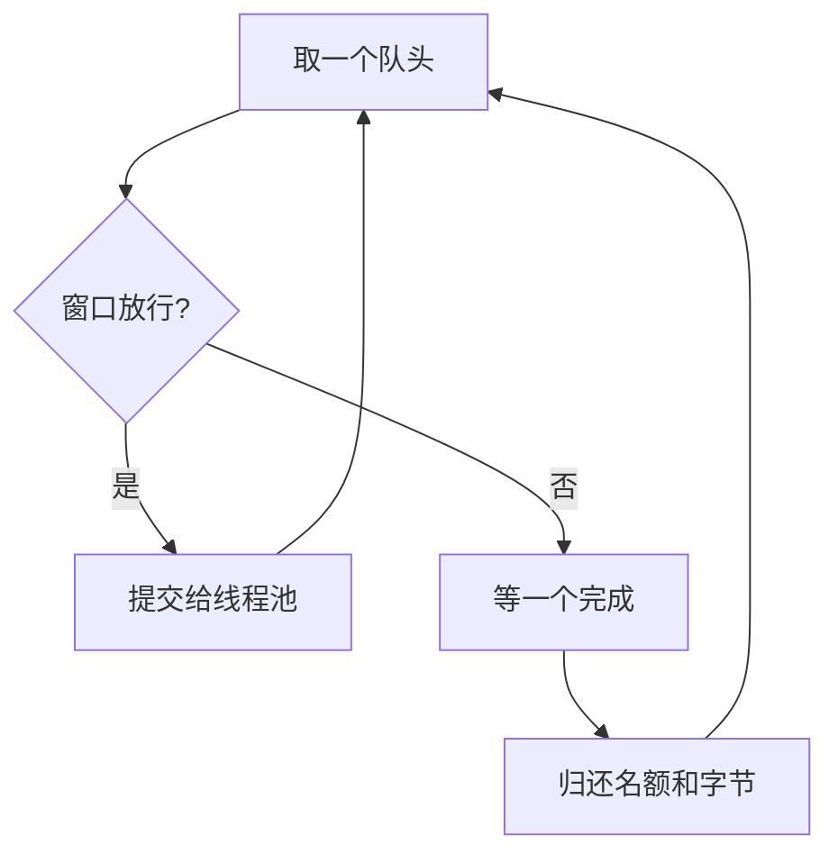
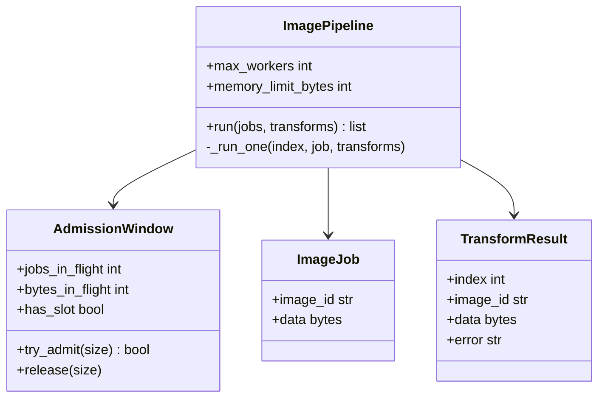

# 设计题解：图片变换流水线（Image Transform Pipeline）

## 题目与澄清

一个批量图片服务要把一批原图依次过同一条变换链（缩放、去噪、压缩……），每张图的变换必须按顺序做，不同的图可以同时做。
你要写 `ImagePipeline.run(jobs, transforms)`，返回一个按输入顺序排列的 `TransformResult` 列表。数据类、构造函数的校验和方法签名是给定的。
难点不在"开线程"，而在四件事同时成立：结果顺序不随完成顺序变、一张图坏了不拖累别的图、同时在途的原图字节不超过预算（队头放不进去时不许插队）、输入是只能读一遍的迭代器而且不能一次读完。
线程池的基本用法见 [[problems.components.thread-pool|线程池（Thread Pool）]]，有界队列与背压见 [[problems.components.bounded-blocking-queue|有界阻塞队列（Bounded Blocking Queue）]]；
同样要"保序、隔离失败、有并发上限"的另一个项目是 [[solution-lcp-tool-call-agent|可靠的工具调用智能体（Reliable Tool-Calling Agent）]]，同样要"并发扫描加上限"的是
[[solution-lcp-file-deduplication|文件去重流水线（File Deduplication）]]。这三个项目的共同骨架是"一个协调线程加一个有界池"；这个项目多出来的是按字节记账的准入和惰性取用。

开工前先把合同写成十三条，这是第一件事：

1. **变换链**：每个变换恰好调用一次，严格按给定顺序，上一个的输出是下一个的输入；链为空时结果就是原数据。
2. **结果**：每个被取出的输入恰好一个结果，列表按输入顺序；`index` 从 0 起；`image_id` 原样复制，允许重复。
3. **失败**：变换抛出 `Exception`，这张图立即停止，后面的变换一个都不调用，`data=None`，`error="类型名: 消息"`，空消息和多行消息原样保留；别的图照常。
4. **`BaseException`** 不捕获，从 `run` 里原样抛出。
5. **worker 上限**：同时在跑的链不超过 `max_workers`；而且只要有 `max_workers` 张符合条件的图阻塞在变换里，就必须真能同时跑 `max_workers` 张——串行执行不合格。
6. **先进先出准入**：按输入顺序放行；队头太大放不进去时，不许越过它放后面更小的。
7. **字节预算**：每张已提交或在途的图（含排在执行器队列里的）的原始 `data` 长度计入 `memory_limit_bytes`，一直计到整条链成功或失败；放行会超预算就不放行。
8. **超大队头**：单张超过预算的队头仍要有进展，但只在没有别的图在途时放行。
9. **口径**：变换输出、解码缓冲、执行器开销都不计入预算。
10. **惰性**：`jobs` 可能只能迭代一次，一次取一个，不得先读成列表。
11. **取用上限**：已提交或在途的图不超过 `max_workers`；全部阻塞时已经向迭代器要过的输入不超过 `max_workers + 1`（已放行的加一个等待放行的队头）。
12. **空批合法**，构造函数的两个上限必须为正。
13. **同一个实例可以反复使用**，每次 `run` 互不干扰。

开口前值得问的澄清问题，每一个都会改变代码：

- **预算要不要把输出也算上？** 不算。口径是原图字节，输出大小事先不知道，所以没法用来决定"能不能放行"。生产里真正占内存的恰恰是解码后的缓冲，见 `## 扩展与追问`。
- **恰好等于预算算不算超？** 不算超：5 字节加 5 字节，预算 10，两张可以同时在途。比较用 `>`，不是 `>=`。
- **0 字节的图在超大图在途时能进吗？** 合同的字面读法是不能：总数已经超过预算，"放行会使总数超过预算就不放行"。这是一个需要自己拍板的边界，写进规则清单。
- **超大图在途时，后面的图是全部等着吗？** 是。它在途时窗口里的字节已经超过预算，任何一张（哪怕 1 字节）进来都会让总数更超。
- **迭代器本身抛异常怎么办？** 合同没说。保守做法：异常从 `run` 里冒出，已经在跑的链等它们结束再冒（不留下还在跑的线程）。
- **变换链是列表还是生成器？** 类型是 `Sequence`，可以反复遍历；`run` 开头取一份快照，所有任务共用。

范围之外：取消、超时、重试、进程池、持久化；`REFLECTION` 里的三个问题只写回答，不写代码。

## 需求与分级

整个项目的骨架是一个循环：取队头、问窗口、放行就提交、不放行就等一个完成。



**第 1 关（约 15 分钟）：单张图与有序结果，不并发。** 写 `_run_one`：循环套用变换，`except Exception` 转成错误文本，返回 `TransformResult`。
`run` 先用最笨的写法：逐个取、逐个调用、收进列表。这一关就能覆盖 README 的例子、空链、空批、重复 id、失败后不再调用后面的变换、`BaseException` 冒出去。
错误文本是 `f"{type(exc).__name__}: {exc}"`；不能用 `str(exc)`（丢类型名），也不能用 `repr(exc)`（`ValueError('x')` 带了引号和括号）。

**第 2 关（约 10 分钟）：线程池与保序。** 把调用换成 `pool.submit`，按下标把结果放进字典，最后按 `0..n-1` 取出。顺序与完成顺序彻底无关。
这一关要证明"能同时跑 `max_workers` 张"：用屏障让 `max_workers` 张图同时在场，串行实现在这里就挂住。

**第 3 关（约 15 分钟）：先进先出准入与字节预算。** 引入 `AdmissionWindow`：在途数、在途字节、`can_admit(size)`、`try_admit(size)` 和 `release(size)`。
`run` 的循环只负责"队头放不进去就等"，窗口负责"放不放"。这一关最容易写错三处：恰好等于预算、超大队头、失败路径上忘了还字节。

**第 4 关（约 10 分钟）：惰性取用与有界提交。** 取队头只在窗口有名额时发生，所以已提交的任务不超过 `max_workers`，池自己的队列永远是空的；
迭代器只在需要时 `next` 一次。这一关只加了一个条件（`while not exhausted and window.has_slot` 里的 `window.has_slot`），前三关的类一个字都没动，这就是分级设计要证明的事。

## 核心对象与职责

对象很少，因为这个问题的复杂度在"决定"和"执行"怎么分开，不在有多少种东西。



- **`ImagePipeline`** 只持有两个配置，没有任何跨 `run` 的状态：窗口、在途表、结果表、线程池都是 `run` 的局部变量，所以同一个实例可以被多个线程同时用。
  `_run_one` 是静态方法，不碰 `self`：一张图的处理只依赖它的输入。
- **`AdmissionWindow`** 拥有两条不变量：在途任务数不超过 `max_jobs`；在途字节不超过预算，唯一的例外是窗口里只有那一张超大的图。
  它不碰线程，不碰迭代器，只回答"能不能放"并记账，所以可以不开任何线程直接单元测试。
- **`ImageJob`、`TransformResult`** 是冻结数据类：结果一旦产生就不会被改，可以安全地从工作线程交给协调线程。
- 没有 `Stage`、`Transform` 基类，也没有 `Scheduler`、`ResultCollector`：见决策五。

## 关键设计决策

### 决策一：准入判断做成不带线程的 `AdmissionWindow`，不用信号量

**问题**：怎样同时执行"在途不超过 `max_workers`"和"在途字节不超过预算，但超大的队头可以独自进"？

- **方案 A：`threading.Semaphore(max_workers)` 管名额，再用一个计数加条件变量管字节。** 名额那部分很自然；字节那部分是"等到放得下，或者窗口为空"，
  这是两个量上的条件，要在条件变量的 `wait` 里写 `while not (fits or empty)`，名额和字节两把锁还得保持一致。信号量表达不了"空了就放行"这个例外。
- **方案 B：把所有准入逻辑内联在 `run` 的循环里。** 能用，但"恰好等于预算""超大队头""失败要还"三个边界和线程池、迭代器、结果表缠在一起，测一条边界就得开线程。
- **方案 C（采用）：一个单线程拥有的纯逻辑类。** `can_admit(size)` 只判断；`try_admit(size)` 判断为真就记账，不放行什么都不改；`release(size)` 归还。协调线程是它唯一的调用者，所以没有锁。

用实际输出看它的规则（3 个名额、预算 10 字节）：

```
admit( 4) True  1j  4B
admit( 4) True  2j  8B
admit( 4) False 2j  8B
admit( 2) True  3j 10B
admit(25) False 3j 10B
release 4, 4, 2: 0 jobs 0 B
admit(25) True  1j 25B
admit( 1) False 1j 25B
admit( 0) False 1j 25B
```

第三行：8 加 4 等于 12 超了。第四行：8 加 2 恰好等于 10，放行。第五行：超大的 25 在有别的图在途时进不去。
全部归还、窗口空了之后，25 独自进去；进去以后连 1 字节和 0 字节都进不去，因为在途字节 25 已经超过预算。

代价要说清：窗口只在协调线程里用，所以它不是线程安全的；谁想在别的线程里调它，就要自己加锁。这是有意的：把"线程安全"这件事的范围缩到零。

模式：这是"决策与机制分离"。决策（放不放）是纯函数式的状态机，机制（线程、迭代器）围着它转。不需要策略模式：准入规则只有一条，没有第二个实现。

### 决策二：严格先进先出，队头放不进去就不取后面的

**问题**：队头太大放不进去时，后面有放得下的小图，能不能先放它们？

- **方案 A：越过队头，放后面放得下的。** 吞吐高：窗口总是被填满。代价是队头可能永远等不到空窗口。
- **方案 B（采用）：队头不放行，后面的一律不取。** 队头前面最多有 `max_workers` 张图，这些图跑完，队头就一定轮到。等待有上界。

用一个纯逻辑的模拟看代价（3 个名额、预算 10；窗口里已有两张 3 字节的图；队头 8 字节，后面接着 40 张 3 字节的图；每一步完成最早的一张）：

```
FIFO: head in at step 2
skip-ahead: head in at step 42
```

先进先出下，两步之后窗口排空，8 字节的队头进去；越过队头的版本里，后面总有 3 字节的图补上空位，窗口永远不空，队头要等 40 张小图全部放完才进。
这个数字不是"调参"出来的：只要后面持续有小图，队头就等不到 `8 + 已在途 <= 10` 成立的那一刻。

吞吐的代价同样要说：超大队头独占窗口时，其余 `max_workers − 1` 个 worker 是空的。合同选了公平，这里就照做；折中办法（有界越过、大图单独队列）放在 `## 扩展与追问` 回答。
这个决策还有一个便宜的副作用：因为不放行就不取，"取用上限"（决策三）是同一个变量 `head` 自然给出的，没有额外的代码。

模式：先进先出队列，没有引入 `queue.Queue`——输入本来就是一个有序的迭代器，队头就是"已取出但未放行的那一项"。

### 决策三：只在窗口有名额时才向迭代器要下一项

**问题**：怎样做到"已提交的不超过 `max_workers`，全部阻塞时最多取过 `max_workers + 1` 个"？

- **方案 A：`pool.map(fn, jobs)` 或 `list(jobs)` 再提交。** 一行就能写，但 `Executor.map` 会立刻把整个输入迭代完并全部提交。输出：

  ```
  map pulled before 1st result: 1000
  queued behind 2 workers: 998
  ```

  1000 项输入在第一个结果被要求之前就全部被取出，池的内部队列里排着 998 个任务（2 个 worker）。

  每个排队的任务都带着它的原图字节，预算形同虚设。
- **方案 B：全部取出，但用信号量限制同时执行的数量。** 内存里已经是整批输入，"惰性"这一条违反了。
- **方案 C（采用）：取队头本身受窗口约束。** `while not exhausted and window.has_slot` 为真才 `next(source)`。名额满了就不取；队头放不进去，`head` 保持不空，也不再取。

输出（每个任务都阻塞在门上，`requested` 是此时已向迭代器要过的项数，50 项输入）：

```
workers=1: requested=1, results=50
workers=3: requested=3, results=50
workers=8: requested=8, results=50
```

全部阻塞时只取了 `max_workers` 个，比合同允许的 `max_workers + 1` 还紧一个：这个实现只在有名额时才取，所以不会出现"取了队头但没名额"。
允许的 `max_workers + 1` 对应另一种写法（先取队头再判断名额），两种都合规；紧的那种在预算放不下队头时仍会取一个队头（那时名额还有），所以仍然是 `已放行 + 1`。

`wait(in_flight, return_when=FIRST_COMPLETED)` 每轮要扫描所有在途的任务，听上去是平方级，但在途数被名额限制在 `max_workers` 以内，扫描是 O(`max_workers`)，不需要完成回调加队列那一套（见 [[solution-lcp-file-deduplication|文件去重流水线（File Deduplication）]]，那里在途数没有上界，所以用了队列）。

### 决策四：`Exception` 是值，`BaseException` 是出口；所有路径都等运行中的任务

**问题**：失败怎么隔离，退出怎么收拾？

- **方案 A：在 `run` 里 `try/except` 整个循环。** 一张图失败会中断整批。
- **方案 B：`future.exception()` 逐个检查。** 多一层绕：工作线程已经知道这是失败，它自己转成值最直接。
- **方案 C（采用）：`_run_one` 里 `except Exception` 转成 `TransformResult`，别的异常不碰。** 工作线程只返回值，所以 `future.result()` 只会在 `BaseException` 时抛，而它正是合同要求"原样冒出去"的。

```
raised: Halt('stop')
'ValueError: '
'ValueError: a\nb'
```

上面三行：自定义的 `BaseException` 子类原样从 `run` 冒出；空消息得到 `类型名: ` 加空；多行消息原样保留换行。

退出路径是 `finally: pool.shutdown(wait=True, cancel_futures=True)`：还没开始的任务被取消，已经开始的等它们结束。
这是诚实的取舍：一个正阻塞在变换里的任务会拖慢异常的传播，因为线程池关不掉正在跑的线程；换来的是 `run` 返回或抛出时，没有任何一个变换还在后台运行。
不等的话，后台线程可能在调用方已经处理完异常之后才改动调用方的数据。

安全不变量同样用异常而不是 `assert`：`release` 归还比放行多的字节时抛 `RuntimeError`。`python -O` 会去掉 `assert`，而这条检查去掉之后，一个记账的 bug 会悄悄变成预算漂移。

### 决策五：不建 `Stage` 类层次、`Scheduler` 接口、`ResultCollector`（拒绝模式）

变换链看起来像"责任链"或"管道"：很容易写出 `class Stage(Protocol)`、`class ResizeStage`、`class Pipeline` 把它们串起来。
但合同里的变换就是 `Callable[[bytes], bytes]`，函数本身已经是最小的接口；`for transform in transforms` 这一个循环就是"链"。再包一层只会多出一个只转发一次调用的类。
同理，没有 `Scheduler` 接口：调度策略只有一种（先进先出加预算），第二种出现时再抽象；没有 `ResultCollector`：结果表是一个字典，只有协调线程写，最后一行按下标取出。
`AdmissionWindow` 是例外，因为它拥有两条不变量，而且需要在没有线程的情况下被测试，这是它存在的两个理由；一个类说不出自己拥有哪条不变量，就是 Java 习惯。

### 决策六：预算的三个边界写进规则，不留给"差不多"

**问题**：恰好等于预算、超大队头、0 字节图，各怎么判？

- `<=`：放行条件是 `在途字节 + size <= 预算`，用 `>` 拒绝。写成 `>=` 的实现会把"5 加 5，预算 10"串行化。测试里用屏障要求这两张同时在场，`>=` 版本在屏障上等不到第二张而失败。
- **在途为空时无条件放行**：这是超大队头"有进展"的唯一出口。去掉它（只判字节），超大图永远进不去，`run` 在等一个永远不会发生的完成，也就是挂死。
- **在途超预算时 0 字节也不放行**：字面读法下，放行后总数仍然超预算。这是三个边界里最需要和面试官确认的一个；它不改变任何别的规则。

## 代码走读

先看 `AdmissionWindow.can_admit`：三个判断决定一切。名额满了就不行；窗口非空而且加上这张会超预算就不行；否则可以。
`if self._jobs and ...` 里的 `self._jobs` 就是"在途为空时无条件放行"的实现，只有这一个真值判断，删掉它超大图就永远进不去。
`can_admit` 只问不改，`try_admit` 在它为真时才记账；拒绝时一个字段都不改，所以调用方可以放心地"问了不放就等"。

再看 `run` 的外层循环：`while True` 里先"能放就放"，再"等一个完成"。内层 `while not exhausted and window.has_slot` 同时满足了三件事：名额满了不取（取用上限）；
`head` 不空时不再 `next`（先进先出）；`try_admit` 失败就 `break`（等完成）。`head = None` 只在提交成功之后执行，所以队头放不进去时它原地不动，下一轮继续试同一个。
`in_flight[future] = size` 记下这个任务占的字节，完成时按它归还，不重新计算：任务完成时 `job.data` 已经被工作线程用完，协调线程不需要再碰它。

然后是完成的处理：`done, _ = wait(in_flight, return_when=FIRST_COMPLETED)`，对每个完成的 future 先 `release` 再 `result()`。
先还账再取结果，是为了让 `BaseException` 从 `result()` 冒出来之前，窗口的状态已经是一致的。`results[result.index] = result` 按输入下标放进字典，完成顺序对输出没有任何影响。

最后是 `finally`：任何路径（正常、迭代器抛异常、`BaseException`）都先 `shutdown(wait=True, cancel_futures=True)`。
`return [results[i] for i in range(len(results))]` 在 `finally` 之后，所以只有全部完成才会走到；字典的键恰好是 `0..n-1`，缺一个就是 `KeyError`，不会静默地少返回一张图。

%% code:begin solution.py %%
```python
"""图片变换流水线（PixelFlow）的参考解。

设计五句话：
1. 单图路径 `_run_one` 是纯函数：按顺序套用变换，`Exception` 变成带类型名的错误文本，`BaseException` 一律不碰。
2. 准入判断放进一个不带线程的类 `AdmissionWindow`：同时在途的任务数不超过 `max_workers`，在途原图字节不超过预算，
   但在途为空时队头一张超大的图仍然可以进（只有它自己在途）。
3. 协调线程（调用 `run` 的线程）独占全部状态：从迭代器一次拉一个队头，窗口放行就提交，不放行就等一个任务完成，
   队头不放行时后面的任务不会被拉取，所以准入严格先进先出。
4. 线程池只用来执行 `_run_one`；任务数从不超过 `max_workers`，所以池自己的队列永远是空的，内存也不会多出一份。
5. 结果按输入下标放进字典，最后按下标取出，输出顺序与完成顺序无关；任何路径退出都等运行中的任务结束。
"""

from __future__ import annotations

from concurrent.futures import FIRST_COMPLETED, Future, ThreadPoolExecutor, wait
from dataclasses import dataclass
from typing import Callable, Iterable, Sequence

Transform = Callable[[bytes], bytes]


@dataclass(frozen=True)
class ImageJob:
    image_id: str
    data: bytes


@dataclass(frozen=True)
class TransformResult:
    index: int
    image_id: str
    data: bytes | None
    error: str | None


def describe(exc: Exception) -> str:
    """错误文本固定为 `类型名: 消息`；空消息和多行消息原样保留。"""
    return f"{type(exc).__name__}: {exc}"


class AdmissionWindow:
    """准入窗口：回答"这张图现在能不能提交"，自己不碰线程，所以可以直接单元测试。

    不变量：在途任务数不超过 `max_jobs`；在途字节不超过 `byte_limit`，唯一的例外是窗口里只有这一张
    超大的图（它独自在途，才有进展）。所有方法只由协调线程调用，因此没有锁。
    """

    def __init__(self, max_jobs: int, byte_limit: int) -> None:
        if max_jobs < 1 or byte_limit < 1:
            raise ValueError("max_jobs and byte_limit must be positive")
        self._max_jobs = max_jobs
        self._byte_limit = byte_limit
        self._jobs = 0
        self._bytes = 0

    @property
    def jobs_in_flight(self) -> int:
        return self._jobs

    @property
    def bytes_in_flight(self) -> int:
        return self._bytes

    @property
    def has_slot(self) -> bool:
        return self._jobs < self._max_jobs

    def __repr__(self) -> str:
        return f"AdmissionWindow(jobs={self._jobs}/{self._max_jobs}, bytes={self._bytes}/{self._byte_limit})"

    def can_admit(self, size: int) -> bool:
        """只判断，不记账：名额满了不行；窗口非空且加上这张会超预算不行；窗口为空时一律可以。"""
        if size < 0:
            raise ValueError("size must not be negative")
        if not self.has_slot:
            return False
        if self._jobs and self._bytes + size > self._byte_limit:
            return False
        return True

    def try_admit(self, size: int) -> bool:
        """放行就记账并返回 True；不放行什么都不改。"""
        if not self.can_admit(size):
            return False
        self._jobs += 1
        self._bytes += size
        return True

    def release(self, size: int) -> None:
        """一张图的整条链结束（成功或失败）后归还它的名额和字节。"""
        if self._jobs == 0 or size > self._bytes:
            raise RuntimeError("released more than was admitted")
        self._jobs -= 1
        self._bytes -= size


class ImagePipeline:
    def __init__(self, max_workers: int = 4, memory_limit_bytes: int = 16_000_000):
        """两个上限都必须是正数，否则 ValueError。"""
        for name, value in (("max_workers", max_workers), ("memory_limit_bytes", memory_limit_bytes)):
            if value < 1:
                raise ValueError(f"{name} 必须大于 0，收到 {value}")
        self.max_workers = max_workers  # 同时在跑的图片链上限
        self.memory_limit_bytes = memory_limit_bytes  # 同时在途的原图字节预算

    @staticmethod
    def _run_one(
        index: int,
        job: ImageJob,
        transforms: Sequence[Transform],
    ) -> TransformResult:
        """对一张图按顺序套用全部变换，返回它的结果；Exception 变成错误文本，别的异常不碰。"""
        data = job.data
        try:
            for transform in transforms:
                data = transform(data)
        except Exception as exc:  # 只吞 Exception：KeyboardInterrupt 之类要原样冒出去
            return TransformResult(index, job.image_id, None, describe(exc))
        return TransformResult(index, job.image_id, data, None)

    def run(
        self,
        jobs: Iterable[ImageJob],
        transforms: Sequence[Transform],
    ) -> list[TransformResult]:
        """按顺序、并发和内存合同处理全部任务；结果按输入顺序排列。"""
        chain = tuple(transforms)  # 只读一次，之后所有任务共用同一份
        source = enumerate(jobs)  # 惰性：每次 next 才从调用方的迭代器取一个
        window = AdmissionWindow(self.max_workers, self.memory_limit_bytes)
        in_flight: dict[Future[TransformResult], int] = {}  # 任务 -> 它占用的原图字节
        results: dict[int, TransformResult] = {}
        head: tuple[int, ImageJob] | None = None  # 已取出、还没放行的队头
        exhausted = False
        pool = ThreadPoolExecutor(max_workers=self.max_workers)
        try:
            while True:
                while not exhausted and window.has_slot:
                    if head is None:
                        head = next(source, None)
                        if head is None:
                            exhausted = True
                            break
                    index, job = head
                    size = len(job.data)
                    if not window.try_admit(size):
                        break  # 队头放不进去：后面的一律不取，先进先出
                    in_flight[pool.submit(self._run_one, index, job, chain)] = size
                    head = None
                if not in_flight:
                    break
                done, _ = wait(in_flight, return_when=FIRST_COMPLETED)
                for future in done:
                    window.release(in_flight.pop(future))
                    result = future.result()  # 只有 BaseException 会从这里原样抛出
                    results[result.index] = result
        finally:
            pool.shutdown(wait=True, cancel_futures=True)
        return [results[i] for i in range(len(results))]


if __name__ == "__main__":
    demo_jobs = [ImageJob("a", b"x"), ImageJob("b", b"y"), ImageJob("a", b"z")]

    def upper_unless_y(data: bytes) -> bytes:
        if data == b"y!":
            raise ValueError("invalid image")
        return data.upper()

    for item in ImagePipeline(2, 100).run(demo_jobs, [lambda d: d + b"!", upper_unless_y]):
        print(item)

    demo_window = AdmissionWindow(3, 10)  # 演示准入：4 + 4 放得下，再来 4 超预算，再来 2 恰好用满
    print([demo_window.try_admit(size) for size in (4, 4, 4, 2, 25)], demo_window)
```
%% code:end %%

## 测试与自检

测试文件有 29 个测试函数、31 个用例（含参数化），分三类：

- **合同条目**：README 的例子原样跑；空链是恒等、空批和空迭代器；每个变换恰好一次且按顺序（用记录调用的变换）；重复 id 与下标；失败后不再调用后面的变换且别的图完整；
  空消息、多行消息、自定义异常名；自定义 `BaseException` 原样冒出（用 `is` 比较同一个对象）；150 张随机图与顺序实现逐项对拍，`(workers, 预算)` 取 `(1, 1)`、`(3, 40)`、`(8, 10000)`；
  构造函数的限制；同一个实例连续运行并且两个线程同时运行。
- **真线程**：三张图的完成顺序被事件强制成 2、1、0，结果仍是输入顺序；`max_workers` 取 1、2、5，所有链进入同一个屏障，凑不齐就是 `BrokenBarrierError`，
  串行实现在这里失败；屏障配合峰值计数；取用上限（见下）；迭代器抛异常时 `run` 返回时没有还在跑的链；
  预算恰好用满的两张图用屏障要求同时在场；在途字节峰值恰好是 8（4 加 4 能进，12 超了）；队头不被越过；超大队头独自运行；单张超过整个预算的图也能完成；失败的图归还字节。
- **窗口的纯逻辑**：名额、`can_admit` 只问不改、预算边界（`<=`）、超大队头只在窗口空时进入并且排斥一切、拒绝不改任何状态、归还多于放行抛 `RuntimeError`、非法参数。

关于"最多"这一类规则，要老实说清测试能证明什么。所有等待都是事件和屏障，没有任何 `sleep`；等待带 10 秒上限，只为把挂死变成断言失败。

- **"至少"是确定的**：屏障要求 `max_workers` 张图同时在场，串行或过保守的实现一定凑不齐，一定失败，与调度无关。
- **"最多"对正确实现是确定的，对越界的实现不是**：峰值计数在每个变换入口和出口记账，正确实现永远通过；而一个越界的实现只有在越界发生在被拦住的任务放行之前才会被抓到，这取决于调度器，不能拿"在我机器上跑了很多遍没出错"当证明。
  测试因此把"最多"拆成两部分：纯逻辑的 `AdmissionWindow` 单元测试（没有线程，没有调度，规则本身确定地被证明），加上线程层面的计数当作接线检查。
- **有一类越界是确定抓得到的**：迭代器在取第 `k` 项时检查 `k <= 已完成数 + max_workers`，已完成数在变换返回之前增加，所以正确实现永远满足它；
  先把整批读成列表的实现在取第 `max_workers + 1` 项时已完成数还是 0，必然失败。它抓的是"整批读完"，不是"多取一个"。

用变异检验这些断言有没有牙齿：把线程池固定成 1 个 worker、去掉预算比较的 `>`、改成 `>=`、去掉"在途为空时放行"、失败不还字节、先 `list(jobs)`、去掉名额上限、
按完成顺序返回、捕获 `BaseException`，每一种变异都至少让一个测试失败。线程层面的接线变异——在 `run` 里把窗口的名额上限换成十亿、把预算换成 10 的 12 次方、
放行失败时顺手放行后面的一张——各重复运行 15 遍，每一遍都被抓住（抓住的测试包括取用数的检查、字节峰值、队头不被越过）。这是观测到的结果，不是证明：
线程层面的"最多"只在越界发生在任务放行之前才抓得到，所以窗口的纯逻辑测试才是确定的那一层。反过来，"有名额不够也取队头"这一种变异是合规的
（合同允许取过 `max_workers + 1` 个），它没有被抓住，这是对的。

两分钟演示：把 README 的三张图跑一遍，应得到 `data=b'X!'`、一条 `ValueError: invalid image`、`data=b'Z!'`；
再把预算改成 1，用两张 50 字节的图：它们各自独自运行，结果仍然齐全。

## 扩展与追问

### 新需求

- **"每张图加超时"**：改 `_run_one` 外面套一层，不改窗口：线程没法被杀，超时只能是"结果作废、名额不还直到线程真的结束"，否则预算会低估真实在途量。
  这正是线程池的限制，换成进程池才能终止。
- **"边完成边返回结果，保持顺序"**：把 `run` 的尾部换成生成器：维护 `next_index`，结果表里有 `next_index` 就 `yield`。需要一个重排缓冲区，它的大小由最慢的一张图决定，要给它也设上界（慢图在途时最多再放行 `K` 张）。
  窗口和 `_run_one` 不动。
- **"优先级"**：先进先出被打破，窗口规则不变，但"队头"变成优先队列的堆顶，同级仍按下标；要小心饥饿，见追问一。
- **"进度回调"**：在协调线程的完成处理里调用，不在工作线程里：回调不需要线程安全，也不会阻塞 worker。

### 并发与线程安全

- **GIL 给了什么**：线程里跑的是 Python 函数时，同一时刻只有一个线程在执行字节码，所以纯 Python 的变换并不会更快；
  `hashlib`、`zlib`、`bytes.upper` 和多数图像库的 C 扩展在处理大块数据时会释放 GIL，才有真正的并行。变换是 CPU 密集的纯 Python 时要换成进程池。
- **换进程池要改什么**：`_run_one` 本来就是顶层可序列化的静态方法，`ProcessPoolExecutor` 可以直接替换 `ThreadPoolExecutor`；变换必须是可序列化的顶层函数，不能是 lambda；
  原图字节要被复制到子进程，预算的口径要翻倍（父进程里一份、子进程里一份）。窗口、协调循环、结果表一个字都不动。
- **GIL 不保证什么**：`results[i] = r` 这类单步字典写入在一个线程里是安全的，但这里根本没有共享写：工作线程只返回值，只有协调线程改字典，
  所以不需要锁，也不需要依赖"GIL 让它碰巧正确"。依赖 GIL 的写法换一个解释器或者版本就失效，也没法用测试证明。
- **同一个实例并发使用**：安全，因为没有跨 `run` 的状态。测试里两个线程同时用一个实例，结果各自正确。

### 持久化与规模

- **追问一（吞吐与公平）**：先进先出牺牲吞吐换来有界等待：超大队头独占窗口时，其余 `max_workers − 1` 个 worker 空着；越过队头则相反，吞吐满了但队头可能饿死（上面模拟里是 2 步对 42 步）。
  折中有三种：预算留余量，让大图少出现；有界越过——队头最多被越过 `K` 次，之后强制排空，`K` 是公平度的旋钮；把大图分到单独的队列和单独的 worker 配额，小图不受影响。
  最小的有界越过只改"问窗口"那一处：

  ```python
  MAX_BYPASS = 8  # 队头最多被越过 8 次

  def next_admissible(head, rest, window, bypassed):
      if window.try_admit(len(head.data)):
          return head, 0
      if bypassed >= MAX_BYPASS:
          return None, bypassed  # 强制排空：不再越过
      for i, job in enumerate(rest):
          if window.try_admit(len(job.data)):
              return rest.pop(i), bypassed + 1
      return None, bypassed
  ```

- **追问二（一百万张图分布式处理）**：按输入下标切成区间，每片 5000 张就是 200 片；片是调度和重试的单位。幂等键是 `(批次号, 下标)`，不是 `image_id`（它允许重复）；
  输出写到 `批次/下标` 这个确定的键，重跑覆盖同一个对象，所以至少一次投递也是安全的。顺序不需要再排序：每片内部用这个流水线（保序），片之间按下标键取或按片号拼接。
  单图失败记进片的清单（下标和错误），片级重试只重做没成功的下标；清单最后写，所以半个片不可见：

  ```python
  def shard_ranges(total: int, size: int) -> list[range]:
      return [range(s, min(s + size, total)) for s in range(0, total, size)]

  def output_key(batch: str, index: int) -> str:
      return f"{batch}/{index:08d}"  # 确定的键：重跑覆盖同一个对象
  ```

  一百万张、每片 5000 张是 200 片，下标 999999 的输出键是 `batch/00999999`。协调者一次只给一台机器发一片，机器内部仍是预算准入，背压在两层上各有一个窗口。
- **追问三（生产要测的内存）**：预算只数了输入字节，真正占内存的是别的：解码后的缓冲（8000×6000 的 RGB 图是 144000000 字节，一个 4 worker 的池就是 576000000 字节，与原图的压缩大小几乎无关）、
  每个变换的输出和中间副本、协调线程的结果表（它在批结束前一直留着所有输出）、分配器的碎片和峰值。要测的指标：进程常驻内存（RSS）的峰值而不是平均、每个 worker 的峰值、结果表的大小、
  预算与真实峰值的比值（用它校准"每字节原图对应多少字节真实内存"，把预算改成按解码后大小估算）。
- **输出太大放不下**：结果表现在装着全部输出；批很大时改成边完成边写盘或对象存储，`run` 返回清单。窗口与循环不动，只换"收结果"这一处。

## 常见错误

- **`pool.map(fn, jobs)` 或 `list(jobs)`**：一次取完整个输入，惰性和有界提交同时被破坏（上面输出里 1000 项全被取出）。
- **把所有任务一次提交，再用信号量限制执行**：任务和它们的原图字节都已经在池的队列里，预算只管了"执行"没管"排队"，而合同明说排队的也计入。
- **`as_completed` 的顺序当结果顺序**：结果变成完成顺序。要按下标放进字典或预先开好的列表。
- **失败时忘了还字节**：这张图的名额和字节永远不回来，后面的图放不进去，`run` 挂死。把还账放在完成处理里，与结果是成功还是失败无关。
- **队头放不进去就取下一个看看**：越过队头，先进先出被破坏。
- **超大队头永远放不进去**：只判 `在途字节 + size <= 预算`，没有"窗口空了就放"，一张超大的图让整个批卡死。
- **`>=` 比较预算**：恰好用满预算的两张图被串行化。
- **`except BaseException`**：把 `KeyboardInterrupt` 和 `SystemExit` 吞成某张图的错误，用户按了 Ctrl-C 却什么也没停。
- **`error=str(exc)`**：丢了类型名；`repr(exc)` 多出引号和括号。要 `f"{type(exc).__name__}: {exc}"`。
- **用 `assert` 守记账不变量**：`python -O` 去掉之后，记账错误会变成静默的预算漂移。
- **用 `sleep` 写并发测试**：慢机器上挂，快机器上漏。用事件、屏障和带上限的等待。
- **工作线程里改共享字典**：不加锁是竞争，加锁又多一个要推理的地方。让工作线程只返回值。
- **在 `finally` 里不等运行中的任务**：`run` 返回之后后台线程还在改东西。
- **把执行器当成预算的一部分**：合同明确排除执行器开销，别为它多算字节。

## 45 分钟怎么分配

项目本身给 45 分钟，可以和编程智能体一起做。

- **0–5 分钟：读合同，列规则。** 十三条规则写成清单，圈出三个会被隐藏测试盯的边界：恰好等于预算、超大队头、取用上限。对智能体说的第一句话是这份清单加三个数字例子（README 的例子；预算 10 时 5 加 5 能同时在途；超大图独自运行），要求它先说每条规则落在哪个方法里，不写代码。
- **5–15 分钟：第 1 关。** 先写 README 例子和失败测试，再让智能体写 `_run_one`。你自己决定：错误文本的格式、`Exception` 与 `BaseException` 的分界。
- **15–25 分钟：第 2 关。** 线程池与保序，先写"完成顺序被强制反过来"的测试，再写屏障测试；你检查结果是按下标放进字典，不是按完成顺序追加。
- **25–38 分钟：第 3、4 关。** 先让智能体写 `AdmissionWindow` 和它的单元测试（边界都在这里），再接进循环。你自己守住：先进先出、超大队头的出口、失败路径还字节、只在有名额时取队头。
- **38–45 分钟：书面回答。** 三个问题各写三行：先进先出换公平、有界越过当旋钮；按下标分片加确定输出键；真实内存按解码后大小和峰值测。
- **时间不够时先砍：** 第 4 关的取用上限（先交 `list(jobs)` 的版本并说明会怎样改），其次预算的 0 字节边界，最后才是失败隔离。不要砍先进先出和"失败也还字节"，它们是最常被隐藏测试盯住的地方。

**和编程智能体一起练**时，让它故意把 `>` 改成 `>=`、把"窗口空了就放"删掉，各一次，确认你的测试会变红；这比让它再多写一个功能更能说明测试有没有牙齿。

## 延伸阅读

- [[problems.components.thread-pool|线程池（Thread Pool）]]：自己写一个线程池，才知道 `ThreadPoolExecutor` 的 `shutdown(wait=True, cancel_futures=True)` 替你做了什么。
- [[solution-lcp-file-deduplication|文件去重流水线（File Deduplication）]]：同样是"协调线程独占状态加有界池"，那里在途数没有上界所以改用完成队列。
- [[solution-lcp-tool-call-agent|可靠的工具调用智能体（Reliable Tool-Calling Agent）]]：同样是并发批量加保序加失败当结果。
- [[concurrency.patterns|并发模式]]、测试并发代码（Testing Concurrency）：生产者消费者、单写者汇总、用屏障构造"同时发生"。
- [Python 文档：concurrent.futures](https://docs.python.org/3/library/concurrent.futures.html)：`wait`、`FIRST_COMPLETED`、`Executor.shutdown` 的参数。
- [Python 文档：threading.Barrier](https://docs.python.org/3/library/threading.html#barrier-objects)：让 N 个线程同时到达的原语，以及 `BrokenBarrierError`。
