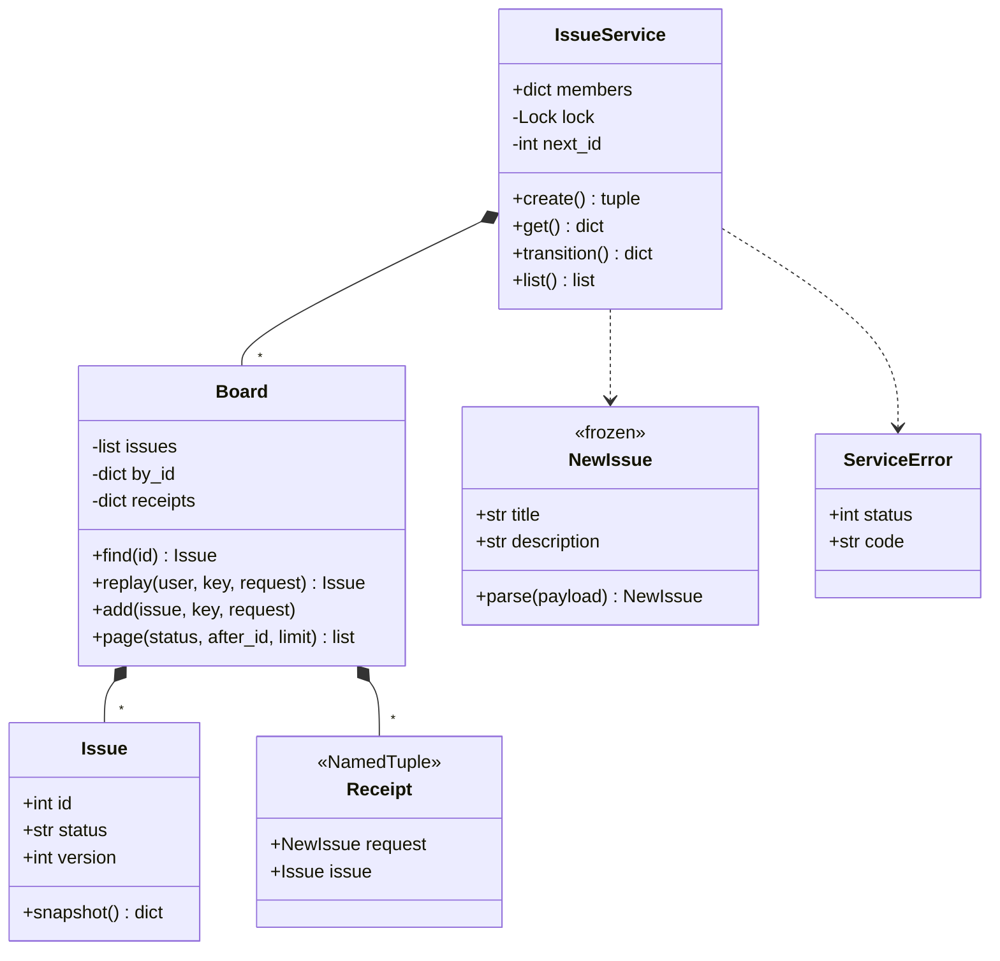
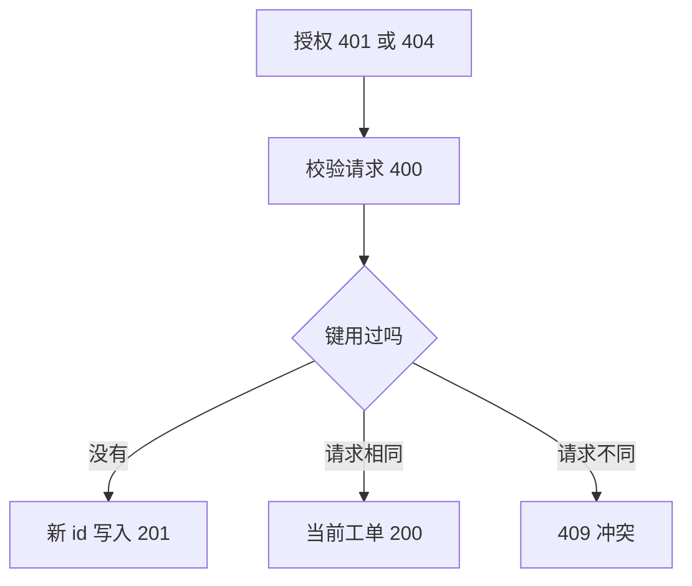

# 设计题解：可重试的工单服务（Retry-Safe Issue Service）

## 题目与澄清

一个项目管理产品需要一个工单接口：团队成员在某个项目里创建工单、查看工单、把工单在"打开"和"关闭"之间切换、按 id 翻页列出工单。
网络会失败，客户端会重试，同一张工单会被两个同事同时改。接口要在这两种情况下仍然正确：重试不能多建一张工单，同时修改不能互相覆盖；
一个项目的成员看不到别的项目的任何东西。你要写的是进程内的 `IssueService` 类，它背后的 HTTP 适配器（路由、请求头、JSON 解析、错误翻译）已经写好，只负责把四个方法接到四条路由上。

四个方法与它们的返回形状如下，**形状本身就是合同的一部分**，粗心的人最容易在这里丢分：

| 方法 | 成功返回 | HTTP |
|---|---|---|
| `create(user, project, payload, key=None)` | `(201, 工单字典)`；键重放时 `(200, 工单字典)` | 201 或 200 |
| `get(user, project, issue_id)` | 工单字典 | 200 |
| `transition(user, project, issue_id, status, version)` | 更新后的工单字典，**不是元组** | 200 |
| `list(user, project, status=None, after_id=0, limit=20)` | 工单字典的列表 | 200 |

失败一律抛 `ServiceError(status, code)`，`status` 是整数 HTTP 状态码，`code` 是稳定的字符串，适配器把它翻成 `{"error": code}`。

先把合同用你自己的话写下来，这是开工前的第一件事。按"一个粗心读者最容易漏掉"的顺序：

1. **授权先于一切**：四个方法都先检查身份，再检查自己的参数。`user` 缺失、不是字符串、全是空白 → `401 unauthorized`；
   项目不存在，或者用户不是成员 → `404 project_not_found`。注意是 404 而不是 403：对非成员来说，"项目不存在"和"你不能看"必须长得一样，否则接口会泄露项目是否存在。
2. **创建的输入**：`payload` 是字典，只允许 `title`（必填）和 `description`（可选）。标题是字符串，**去首尾空白之后**长度在 1 到 120 之间，存的是去空白后的标题；
   描述缺省为空串，是字符串，至多 2000 个字符，**原样保留**，连首尾空白也不动。`key` 是 `None` 或长度 1 到 64 的字符串，空白算内容。违反任何一条 → `400 invalid_input`。
3. **id 全局递增**：从 1 开始，整个实例共用一个计数器，不是每个项目一个。失败的创建和幂等重放都不消耗 id。
4. **幂等的范围是 `(user, project, key)`**：同一范围内再用这个键，规范化后的请求相同 → `200` 加工单**当前**的样子（即使它已经被关闭）；请求不同 → `409 idempotency_conflict`；
   换用户或换项目可以各自独立地用同一个键。
5. **版本**：`transition` 的 `version` 必须等于工单当前版本，**连"状态没变"的请求也要**，否则 `409 version_conflict`；状态真的变了版本加一，没变就不动。
6. **列表**：只返回本项目里 id **严格大于** `after_id` 的、状态匹配的工单，按 id 升序，再截断到 `limit`；`limit` 在 1 到 100 之间。
7. **隔离与原子**：成员表在构造时复制；返回值是快照；失败的操作什么都不留下；同一个实例上并发调用是安全的。

三个必须当场问清、答案会改代码的澄清问题：

- **校验和查找谁先？** 合同给了顺序：`transition` 是"授权 → 查工单 → 校验状态与版本的格式 → 比较版本"。所以对一个不存在的工单发一个乱写的状态，得到的是 404 而不是 400。
  `create` 则是"授权 → 校验请求 → 查键"，所以一个格式错误的请求，即使键已经用过，也得到 400 而不是 409。顺序决定的是同时违反两条规则时谁赢，要问清并写进测试。
- **`True` 算不算整数版本？** 在 Python 里 `isinstance(True, int)` 为真，`True == 1` 也为真。合同写的是"非布尔整数"，所以版本、游标、`limit`、工单 id 都要显式排除 `bool`；
  否则 `get(user, project, True)` 会悄悄取到 1 号工单。
- **幂等键要不要过期？** 合同不要求，实现里键永久保存。过期是 REFLECTION 的追问，答案在 `## 扩展与追问`。

范围之外：磁盘持久化（状态只在一个实例的内存里）、工单删除与编辑标题、多状态工作流（只有 `open` 和 `closed` 两个状态）、跨进程的幂等。

## 需求与分级

**第 1 关（约 20 分钟，授权与创建）**：构造时复制成员表；`create` 的输入校验；全局 id；`get` 的项目隔离。
这一关最重要的是把"授权先于校验"落成一个只有一份的私有方法（`_authorize`），四个公开方法的第一行都是它，而不是每个方法各写一遍。
示例：`create("mina", "orbit", {"title": " Rotate logs "})` 得到 `(201, {"id": 1, "project": "orbit", "creator": "mina", "title": "Rotate logs", "description": "", "status": "open", "version": 1})`；
再 `get("omar", "orbit", 1)`（omar 也是成员）得到同样的字典；`get("mina", "other", 1)` 抛 `404 issue_not_found`。

**第 2 关（约 15 分钟，幂等）**：键的范围、规范化比较、重放返回当前状态、失败不占用键。
示例：`create(..., {"title": "Rotate logs"}, "k1")` 第一次 201，第二次 200 同一个 id；换成 `{"title": "Rotate logs", "description": "x"}` 得到 `409 idempotency_conflict`；
bob 用同一个键 `k1` 与 `description: "x"` 得到全新的 `201`（id 为 2）。这一关决定了"请求规范化成一个可比较的值"这个结构（决策二）。

**第 3 关（约 15 分钟，版本与状态流转）**：`transition` 的校验顺序、版本比较、"状态没变版本不变"。
示例：工单 1 在版本 1 时，`transition("bob", "demo", 1, "closed", 1)` 返回版本 2 的字典；
接着 `transition("alice", "demo", 1, "open", 1)` 抛 `409 version_conflict`；"状态没变"的请求也一样核对版本：
`transition("bob", "demo", 1, "closed", 1)` 因为版本已是 2 而同样得到 409，换成版本 2 才返回原字典、版本仍是 2。这一关考的是你有没有把"比较版本"和"修改状态"放进同一个临界区。

**第 4 关（约 15 分钟，列表、并发、HTTP）**：游标分页；所有方法线程安全；用适配器跑一遍端到端。
示例：四张工单之后，`list("alice", "demo", after_id=1, limit=3)` 返回 id 为 `[2, 3, 4]` 的三条。并发部分用屏障让六十四个线程同时用同一个键创建同一张工单，结果必须是一个 201、六十三个 200、列表里恰好一条。

HTTP 合同（适配器已写好，你要知道它做什么，才能知道你的方法会收到什么）：

| 路由 | 调用 | 说明 |
|---|---|---|
| `POST /projects/{p}/issues` | `create` | 身份来自 `X-User-ID`，键来自 `Idempotency-Key`；请求体为空时 `payload` 是 `{}`，所以得到 400 |
| `GET /projects/{p}/issues` | `list` | 查询参数 `status`、`after_id`、`limit`；参数重复时取最后一个；整数解析失败由适配器直接回 400 |
| `GET /projects/{p}/issues/{id}` | `get` | `id` 已经被转成 `int` |
| `PATCH /projects/{p}/issues/{id}` | `transition` | 请求体恰好是 `{status, version}`，字段多一个少一个由适配器回 400 |

适配器还有三个固定行为：JSON 解析失败回 `400 invalid_json`，路由不存在回 `404 not_found`，方法不支持回 `405 method_not_allowed`。
这意味着**你的方法永远收不到类型错误的 `id`**，但仍可能收到类型错误的 `status`、`version`、`payload`（JSON 里可以是任何类型），所以校验不能只检查取值范围，必须先检查类型。

## 核心对象与职责

| 类 | 单一职责 | 它拥有的不变量 |
|---|---|---|
| `ServiceError` | 带状态码和稳定字符串的失败 | `status` 是整数，`code` 是字符串，适配器只靠这两个字段翻译 |
| `NewIssue` | 把创建请求规范化成一个只读的值 | 标题已去首尾空白且长度合法；描述原样；两个请求"相同"当且仅当两个 `NewIssue` 相等 |
| `Issue` | 一条工单的可变记录，并给出快照 | `version` 只在 `status` 真的变化时加一；对外只给 `snapshot()` 产生的字典 |
| `Receipt` | 一次成功创建的幂等回执：当初的规范化请求加那条工单 | 持有工单的引用，所以重放看到的是最新状态 |
| `Board` | 一个项目的全部状态：按 id 升序的工单、按 id 查找的字典、回执表 | 工单列表按 id 升序；回执的键只有 `(用户, 键)`，项目由 `Board` 自己表示；自己不加锁 |
| `IssueService` | 授权、加锁、把四个方法接到 `Board` 上 | 一把锁保护全部可变状态；全局 id 计数器只在真的建出工单时前进 |

`IssueService` 拥有所有 `Board`，`Board` 拥有它的工单和回执，生命周期一致，都是组合（composition）。外部拿不到任何 `Issue` 或 `Board`，只拿得到字典快照。
`Board` 不加锁是有意的：锁的范围由一个类决定，不是每个对象各管各的，原因在决策一。



一次 `create` 的路径（失败在哪一步，状态就停在哪一步之前）：



## 关键设计决策

### 决策一：一把锁罩住"授权之后的全部读写"，读也要锁

**问题。** 四个方法在多个线程里同时被调用，而每个写操作都是"读一些状态、判断、再写"的复合操作。
创建是"查键 → 分配 id → 追加 → 记回执"，状态流转是"读版本 → 比较 → 改状态 → 版本加一"。线程可以在任意两步之间被切走。

**选项 A：不加锁，指望 GIL。** CPython 的全局解释器锁保证单个字节码是原子的，但不保证一串字节码是原子的。
两个线程同时用同一个键创建，都执行了"查键，没有"，然后各自建一张工单，键只记住后一张，前一张成了孤儿：重试保护恰恰在重试风暴里失效。
`issue.version += 1` 也是"读、加、写"三步，两个线程可以都读到 1、都写 2，一次状态变化只加了一个版本，却被两个人都当成成功了。

**选项 B：每个项目一把锁，甚至每张工单一把锁。** 项目之间的写不再互相等待，吞吐更高。代价有两个。
一是 id 是整个实例全局递增的，创建仍要碰一个全局计数器，得再配一把锁（或 `itertools.count`，它在 CPython 里靠 GIL 才原子，是一个藏起来的依赖）；
二是锁一多，就要回答"一次操作同时碰两个项目会不会死锁"。这个接口目前没有跨项目的操作，所以看起来安全，但每加一个功能都要重新证明。

**选项 C：一把 `threading.Lock`，授权之后的全部状态访问都在它里面。** 授权只读构造时冻结的成员表，不需要锁，放在锁外，让 401 和 404 的请求不排队。
临界区里是纯内存操作，没有 I/O，持有时间是微秒级。

**选择 C。** 在这个规模上，吞吐不是瓶颈，正确性才是；一把锁容易证明：任何两个方法的状态访问都不会交错。
**读也要在锁里**：`get` 取快照时，如果另一个线程正在做 `issue.status = status; issue.version += 1`，读线程可能读到"状态已改、版本还没加"的半截。
测试 `test_readers_never_see_a_torn_issue` 就是断言这一点：版本为奇数的工单一定是打开状态。

**扩展方向。** 要让项目之间并行，把锁挪到 `Board` 里，并用一个只保护计数器的小锁取 id；这个改动只涉及 `IssueService` 与 `Board`，`Issue`、`NewIssue`、`Receipt` 不动。
**是什么模式。** 这是"一个监视器保护整个聚合"的做法（Monitor / Coarse-Grained Lock），不需要额外的模式类。

### 决策二：把请求规范化成一个值，"同一个请求"就是两个值相等

**问题。** 幂等要回答"这次请求和当初那次是同一个吗"。比较的东西不是原始的字典：`{"title": " Rotate logs "}` 和 `{"title": "Rotate logs", "description": ""}` 在合同里是同一个请求。

**选项 A：存原始字典，比较时临时规范化。** 每次比较都要重新写一遍"去空白、补缺省"的规则，规则会写在两个地方（创建时一次，比较时一次），迟早改了一处忘了另一处。
还有一个更隐蔽的问题：存下传入的字典本身，调用方之后改它，回执就跟着变了。

**选项 B：存请求的哈希或指纹。** 这是真实支付接口常见的做法（比较请求体的摘要），但这里没有必要：数据就在内存里，直接比较值既简单又没有碰撞。
哈希在存储很大、或者请求体很大不愿保存的场景才值得。

**选项 C：创建时一次性解析成 `NewIssue(title, description)`，冻结的数据类。** 解析只有一份（`NewIssue.parse`），既做校验又做规范化；
回执保存的是这个值，比较就是 `receipt.request != request`。`frozen=True` 同时给了不可变（调用方拿不到可改的引用）和自动生成的 `__eq__`。

**选择 C。** 规则只写一处，比较没有可疑的细节，也不会被调用方的后续修改影响。
**是什么模式。** 值对象（Value Object）；不需要策略或工厂。

另一个相关决定是**回执里放工单的引用，而不是首次响应的拷贝**。有些系统（常见于支付）会重放"第一次响应的原样内容"，客户端看到的永远是创建那一刻的样子。
这里的合同写的是"返回工单的当前状态，即使之后改过状态"，所以引用才对。如果存的是拷贝，工单被关闭之后重放仍会返回"打开"，与合同矛盾。
代价是回执和工单共享同一个可变对象，所以所有访问都必须在那一把锁里（决策一）。

### 决策三：先校验、后改状态——失败不留痕，也不耗 id

**问题。** 合同说失败和重放不消耗 id，失败的操作要是"原子的"。最常见的违反方式，是一个方法改了一半才发现要抛错。

**选项 A：先动手，出错再回滚。** 先把 `self._next_id += 1`，建出工单，写进字典，最后才检查键冲突；出错时再把这几步逐个撤销。
回滚要写得和前进一样严密，漏撤一步，就多出一个孤儿工单，或者 id 序列里有个洞；而且撤销本身也可能出错。

**选项 B：先做完所有可能失败的检查，再做不会失败的写。** 下面是 `create` 的顺序，每一步失败都发生在第一次写之前：

1. 授权（`_authorize`）：纯读。
2. 解析请求（`NewIssue.parse`）：纯函数，不碰状态。
3. 校验键：纯函数。
4. 进入锁，查回执：纯读；冲突在这里抛。
5. 构造 `Issue` 对象（此时还只是局部变量），**然后**才 `self._next_id += 1` 与 `board.add(...)`。

第 5 步的两个写之间没有任何会抛错的语句，所以"建出来"和"耗了 id"要么同时发生，要么都不发生。`transition` 同理：先查、先校验、先比较版本，最后才 `issue.status = status; issue.version += 1`。

**选择 B。** 原子性来自语句的排列顺序，而不是来自回滚机制。这也是写这类方法的一个好习惯：先在脑子里画一条线，线以上只读、只抛错，线以下只写、不抛错。
测试 `test_failed_creates_and_replays_do_not_consume_ids` 就是这条线的证明：中间穿插了校验失败、冲突、重放和 404，之后下一张工单的 id 仍然紧接上一张。

**什么时候需要真正的回滚。** 状态分散在多个存储（数据库加缓存），没法用一个临界区罩住时。那时才需要事务、补偿或"先写意图日志"这类机制，进程内的字典不需要。

### 决策四：版本号做乐观并发，且"状态没变"的请求也要核对版本

**问题。** 两个同事同时打开同一张工单的页面，一个想关掉它，一个想改成别的状态。他们各自读到版本 1，各自发 `PATCH`。第二个到达的人不知道工单已经变了。

**选项 A：最后一个写入的赢（last-write-wins）。** 实现最简单，但静默覆盖别人的修改，而且谁也不知道。

**选项 B：悲观锁（行锁）。** 读的时候就把行锁住，别人等着。在一次 HTTP 往返里没法这样做：读（GET）和写（PATCH）是两个独立的请求，锁没法跨请求持有；
用户去喝了杯咖啡，锁就一直占着。

**选项 C：乐观并发控制（Optimistic Concurrency Control）。** 每张工单带一个版本号，客户端带着"我读到的版本"来写；服务端比较，一致才写并把版本加一，不一致就回 409，让客户端重新读再决定。
没有锁跨请求，冲突少时几乎没有成本；代价是冲突时客户端要重试。

**选择 C，并且对"状态没变"的请求也核对版本。** 乍看，把已经关闭的工单再"关闭"一次是无害的，可以直接返回成功。
但客户端发来的版本是"我基于这个版本做的决定"，版本已经落后，说明它的视图是过期的，哪怕这一次的写恰好是空操作，也应该让它知道。
更实际的理由：如果"没变"的请求不查版本，客户端就可以用它探测工单是不是已经变过，却得不到一致的答案；规则统一为"版本必须匹配"，没有例外。

**为什么"没变"不加版本。** 版本表示"工单发生过几次真正的变化"。空操作如果也加一，两个客户端同时发空操作，就会让对方的版本过期，凭空制造冲突。
测试同时覆盖了这两点：同状态同版本返回原字典、版本不变；同状态错版本得到 409。

**并发语义的一个细节。** 六十四个线程在版本 1 上同时发 `closed`：第一个进入临界区的把版本改成 2；其余看到的版本是 2，都得到 409。
所以"同一版本上的并发写，状态只改一次"不需要任何额外机制，是"比较与修改在同一个临界区里"自然带来的。
**是什么模式。** 乐观锁（版本字段）；不需要另外的类。

### 决策五：游标分页用"id 大于"，按 id 升序，二分跳到起点

**问题。** 工单会不断增加；客户端分页读取，两页之间可能有新工单创建。

**选项 A：偏移分页（offset/limit）。** 客户端说"跳过前 20 条"。两页之间如果前面插入了工单，偏移就错位，重复或漏读；偏移越大，跳过的代价越高。

**选项 B：键集分页（keyset / cursor）。** 客户端说"id 大于 X 的前 20 条"。新工单的 id 一定更大，只会出现在后面，不会让已读的页错位；起点用二分查找，代价是 O(log n) 而不是 O(n)。

**选择 B。** `Board` 的工单列表按 id 升序追加，id 全局递增，所以追加即有序，不需要排序。`bisect_right(issues, after_id, key=lambda i: i.id)` 找到第一个 id 严格大于游标的位置，
然后顺着列表往后走，状态匹配的就收进来，收满 `limit` 条就停。注意**过滤在截断之前**：先找到状态匹配的前 `limit` 条，而不是先取前 `limit` 条再过滤，后者会在大量不匹配的工单后面返回空页。
测试 `test_filter_applies_before_the_limit` 钉的就是这条。用 `last id` 作为下一页的游标，遍历所有页恰好访问每条工单一次。

**局限。** 状态过滤很稀疏时，要往后扫很多条才能凑满一页，最坏是 O(n)。要保证 O(limit)，为每种状态各维护一个按 id 升序的列表（见 `## 扩展与追问`）。

### 决策六：这里不用状态模式，只有一个集合和一次比较

**问题。** 工单有状态、有流转，教科书会建议用状态模式（State pattern）或状态机：每个状态一个类，类里决定能转到哪里。

**为什么不用。** 合同里只有 `open` 和 `closed` 两个状态，两个方向都允许，没有"只有某些状态才能转到某些状态"的规则，也没有每个状态不同的行为。
这时状态模式的类数比规则数还多：两个状态类、一个接口、一个上下文，换来的是 `status in {"open", "closed"}` 这一个判断能做的事。
`STATUSES = frozenset({"open", "closed"})` 加一次 `if status != issue.status`，就是全部的状态机。

**什么时候该用。** 出现 `in_review` 这样的第三个状态，并且有"只有 `in_review` 才能转到 `merged`"这类规则时，才值得用一张转移表（`dict[status, set[status]]`），
仍然不需要状态类，除非每个状态的**行为**不同（比如 `closed` 状态下创建评论要拒绝、`open` 下接受）。规则变复杂了再加结构，而不是预先加。

## 代码走读

下面是完整的、被测试的实现。

%% code:begin solution.py %%
```python
"""可重试的工单服务（Retry-Safe Issue Service）：进程内、按项目隔离、带幂等键与版本号。
设计：`IssueService` 只管两件事——先授权（401 先于 404 先于其他一切），再在同一把锁里执行；
`NewIssue` 把创建请求规范化成一个可比较的值（幂等判断就是比较两个值）；`Board` 是一个项目的全部状态
（按 id 升序的工单、按 id 查找的字典、幂等回执），自己不加锁；`Issue` 是可变记录，对外一律给 `snapshot()` 快照。
所有写操作"先校验、再改状态"：最后一个可能抛错的语句之后才动状态，所以失败不留痕、不消耗 id。
"""

from __future__ import annotations

import threading
from bisect import bisect_right
from collections.abc import Iterable
from dataclasses import dataclass
from itertools import islice
from typing import Any, NamedTuple

STATUSES = frozenset({"open", "closed"})
TITLE_MAX, DESCRIPTION_MAX, KEY_MAX, LIMIT_MAX = 120, 2000, 64, 100


class ServiceError(Exception):
    """对外的错误：status 是 HTTP 状态码，code 是稳定的字符串。"""

    def __init__(self, status: int, code: str) -> None:
        self.status, self.code = status, code
        super().__init__(code)


def _invalid() -> ServiceError:
    return ServiceError(400, "invalid_input")


def _is_int(value: object) -> bool:
    """`True` 是 int 的子类，但不是合法的版本号或游标。"""
    return isinstance(value, int) and not isinstance(value, bool)


@dataclass(frozen=True, slots=True)
class NewIssue:
    """规范化后的创建请求：标题已去首尾空白，描述原样保留，缺省描述就是空串。
    frozen 带来 `==`：幂等键的"同一个请求"就是两个 NewIssue 相等。"""

    title: str
    description: str = ""

    @classmethod
    def parse(cls, payload: object) -> NewIssue:
        if not isinstance(payload, dict) or not payload.keys() <= {"title", "description"}:
            raise _invalid()
        title = payload.get("title")
        description = payload.get("description", "")
        if not isinstance(title, str) or not isinstance(description, str):
            raise _invalid()
        title = title.strip()
        if not 1 <= len(title) <= TITLE_MAX or len(description) > DESCRIPTION_MAX:
            raise _invalid()
        return cls(title, description)


@dataclass(slots=True)
class Issue:
    """一条工单。版本号只在状态真的变了的时候加一。"""

    id: int
    project: str
    creator: str
    title: str
    description: str
    status: str = "open"
    version: int = 1

    def snapshot(self) -> dict[str, Any]:
        """与内部记录脱钩的字典：调用方随便改，不影响存储。"""
        return {"id": self.id, "project": self.project, "creator": self.creator,
                "title": self.title, "description": self.description,
                "status": self.status, "version": self.version}


class Receipt(NamedTuple):
    """幂等回执：当初的规范化请求，和它创建出来的那条工单（引用，所以重放看到的是最新状态）。"""

    request: NewIssue
    issue: Issue


class Board:
    """一个项目的全部状态。不加锁：并发由 `IssueService` 的那把锁负责。"""

    def __init__(self) -> None:
        self._issues: list[Issue] = []  # 按 id 升序：id 全局递增，追加即有序
        self._by_id: dict[int, Issue] = {}
        self._receipts: dict[tuple[str, str], Receipt] = {}  # (用户, 键) → 回执；项目就是这个 Board

    def find(self, issue_id: object) -> Issue:
        issue = self._by_id.get(issue_id) if _is_int(issue_id) else None
        if issue is None:
            raise ServiceError(404, "issue_not_found")
        return issue

    def replay(self, user: str, key: str, request: NewIssue) -> Issue | None:
        """键用过：请求相同就返回原工单，不同就是冲突；键没用过返回 None。"""
        receipt = self._receipts.get((user, key))
        if receipt is None:
            return None
        if receipt.request != request:
            raise ServiceError(409, "idempotency_conflict")
        return receipt.issue

    def add(self, issue: Issue, key: str | None, request: NewIssue) -> None:
        self._issues.append(issue)
        self._by_id[issue.id] = issue
        if key is not None:
            self._receipts[(issue.creator, key)] = Receipt(request, issue)

    def page(self, status: str | None, after_id: int, limit: int) -> list[dict[str, Any]]:
        """二分跳到游标之后，按 id 升序收集，满 limit 条就停。"""
        start = bisect_right(self._issues, after_id, key=lambda issue: issue.id)
        rows: list[dict[str, Any]] = []
        for issue in islice(self._issues, start, None):
            if status is None or issue.status == status:
                rows.append(issue.snapshot())
                if len(rows) == limit:
                    break
        return rows


class IssueService:
    def __init__(self, members: dict[str, Iterable[str]]) -> None:
        # 构造时复制并冻结：之后改传入的集合，不影响授权
        self.members = {project: frozenset(users) for project, users in members.items()}
        self._boards = {project: Board() for project in self.members}
        self._lock = threading.Lock()
        self._next_id = 1

    def _authorize(self, user: object, project: object) -> Board:
        """每个方法的第一步：401 先于 404 先于该方法自己的校验。"""
        if not isinstance(user, str) or not user.strip():
            raise ServiceError(401, "unauthorized")
        if not isinstance(project, str) or user not in self.members.get(project, ()):
            raise ServiceError(404, "project_not_found")
        return self._boards[project]

    def create(self, user: str, project: str, payload: object,
               key: str | None = None) -> tuple[int, dict[str, Any]]:
        board = self._authorize(user, project)
        request = NewIssue.parse(payload)
        if key is not None and not (isinstance(key, str) and 1 <= len(key) <= KEY_MAX):
            raise _invalid()
        with self._lock:
            if key is not None:
                existing = board.replay(user, key, request)
                if existing is not None:
                    return 200, existing.snapshot()
            issue = Issue(self._next_id, project, user, request.title, request.description)
            self._next_id += 1  # 最后一个可能抛错的语句已经过去：只有真的建出来才耗 id
            board.add(issue, key, request)
            return 201, issue.snapshot()

    def get(self, user: str, project: str, issue_id: int) -> dict[str, Any]:
        board = self._authorize(user, project)
        with self._lock:  # 读也要锁：否则可能读到"状态已改、版本未加"的半截
            return board.find(issue_id).snapshot()

    def transition(self, user: str, project: str, issue_id: int,
                   status: str, version: int) -> dict[str, Any]:
        board = self._authorize(user, project)
        with self._lock:  # 比较版本与修改状态必须是同一个临界区
            issue = board.find(issue_id)
            if not isinstance(status, str) or status not in STATUSES or not _is_int(version) or version < 1:
                raise _invalid()
            if version != issue.version:
                raise ServiceError(409, "version_conflict")
            if status != issue.status:
                issue.status = status
                issue.version += 1
            return issue.snapshot()

    def list(self, user: str, project: str, status: str | None = None,
             after_id: int = 0, limit: int = 20) -> list[dict[str, Any]]:
        board = self._authorize(user, project)
        if status is not None and (not isinstance(status, str) or status not in STATUSES):
            raise _invalid()
        if not _is_int(after_id) or after_id < 0 or not _is_int(limit) or not 1 <= limit <= LIMIT_MAX:
            raise _invalid()
        with self._lock:
            return board.page(status, after_id, limit)


if __name__ == "__main__":
    service = IssueService({"orbit": ["mina", "omar"]})
    print(service.create("mina", "orbit", {"title": " Rotate logs "}, "nightly-1"))
    print(service.create("mina", "orbit", {"title": "Rotate logs"}, "nightly-1"))
    print(service.transition("omar", "orbit", 1, "closed", 1))
    print(service.list("mina", "orbit", status="closed"))
```
%% code:end %%

设计决定在代码里出现的四个地方：

**`_authorize` 与四个方法的第一行。** 授权只写一份，四个方法的第一条语句都是 `board = self._authorize(user, project)`，所以"401 先于 404 先于该方法自己的校验"不可能在某个方法里被漏掉。
注意它对 `project` 先判断 `isinstance(project, str)`：`project` 可能是列表这类不可哈希的值，直接拿去查字典会抛 `TypeError`，变成 500 而不是 404。
`user not in self.members.get(project, ())`：项目不存在和用户不是成员走同一个分支，得到同一个 404。

**`NewIssue.parse` 与 `create` 的顺序。** `parse` 在锁外，因为它是纯函数；键的格式检查也在锁外。进入锁之后第一件事是查回执，第二件事才是分配 id。
`self._next_id += 1` 紧挨着 `board.add(...)`，它们之间没有任何可能抛错的语句，这是决策三的那条线。

**`transition` 里的一个临界区。** `board.find`、格式校验、版本比较、状态与版本的修改，全在同一个 `with self._lock` 里。
`not isinstance(status, str) or status not in STATUSES`：先检查类型再检查成员，因为 `["open"] in frozenset(...)` 会抛 `TypeError`（列表不可哈希）。
`_is_int` 把 `bool` 排除掉，同样的理由用在 `version`、`after_id`、`limit` 和 `Board.find` 的 `issue_id` 上。

**`Board.page` 的二分与提前停止。** `islice(self._issues, start, None)` 不复制列表，`rows` 满了就 `break`。`snapshot()` 在锁内生成，返回的是字典列表，调用方怎么改都碰不到存储。

## 测试与自检

测试文件里有三十五个测试函数，参数化展开后是八十八个用例，没有一个 `sleep`、没有读任何私有属性。按合同条目分组：

- **授权**：六种坏 `user`（`None`、空串、全空白、制表符与换行、整数、列表）在四个方法上都得到 401；五种坏 `(project, user)` 组合在四个方法上都得到 404；
  授权先于校验，用格式错误的 `payload`、乱写的状态和版本去试，得到的仍然是 401 或 404；成员表在构造之后被改动，授权不受影响；成员之间互相读、改对方的工单。
- **创建**：合同示例逐字段断言；十八种非法请求体（`None`、列表、缺标题、标题类型错、全空白、121 个字符、去空白后仍超长、描述类型错、描述 2001 个字符、多余字段、非字符串的键）得到 400；
  长度边界两侧（120 与 121、2000 与 2001、64 与 65、空串键）；键首尾的空白算内容，所以 `"k"`、`" k"`、`"k "` 是三个不同的键。
- **id 与原子**：id 跨项目、跨用户递增；穿插了校验失败、冲突、重放、404 之后，下一张工单的 id 仍然紧接着；没有键时每次成功都新建；
  `get` 对别的项目的工单、不存在的 id、`0`、`True`、字符串 `"1"` 都是 `404 issue_not_found`。
- **隔离**：改传入的 `payload`、改返回的字典、改列表里的字典、清空返回的列表，都不影响存储，也不影响之后的幂等重放。
- **幂等**：工单被关闭之后重放，返回 `status: "closed"`、`version: 2`；规范化比较（`"  Rotate logs  "` 与 `"Rotate logs"` 相同，`"Rotate logs"` 与 `"fix login"` 不同，描述 `""` 与 `" "` 不同）；
  范围是 `(用户, 项目, 键)`；格式错误的请求即使键已经用过，得到的也是 400。
- **版本与流转**：`closed → open → closed` 的版本是 2、3；同状态同版本不变；同状态错版本是 409；十二组非法的 `(status, version)`（含 `True`、`1.0`、`"1"`、`0`、`-1`、`None`）都是 400 且不改任何东西；
  对不存在的工单发乱写的状态是 404。
- **列表**：过滤、排序、游标、`limit` 的组合；过滤在截断之前；用最后一个 id 翻页，二十五张工单恰好读一遍；十六种非法参数；`limit` 取 1、20、100 的边界。
- **并发**：全部用 `threading.Barrier` 让线程同时起跑。六十四个线程用同一个键创建同一张工单：恰好一个 201、六十三个 200、列表里一条，下一个新工单的 id 是 2；
  六十四个线程无键创建，id 恰好是 1 到 64 各一次；三十二个线程用同一个键发两种不同的请求，恰好一个 201，列表里一条；
  四十八个线程在版本 1 上同时发 `closed`，恰好一个成功、四十七个得到 409，版本是 2；"改成 closed"与"保持 open"同时到达，两种先后顺序的终态相同（`closed`、版本 2）；
  一个写线程不停地来回切换状态，读线程两千次读取，断言"版本为奇数当且仅当打开"从没被打破。

两分钟演示给面试官：模块底部的 `__main__` 依次执行合同示例，输出四行：

```text
(201, {'id': 1, 'project': 'orbit', 'creator': 'mina', 'title': 'Rotate logs', 'description': '', 'status': 'open', 'version': 1})
(200, {'id': 1, 'project': 'orbit', 'creator': 'mina', 'title': 'Rotate logs', 'description': '', 'status': 'open', 'version': 1})
{'id': 1, 'project': 'orbit', 'creator': 'mina', 'title': 'Rotate logs', 'description': '', 'status': 'closed', 'version': 2}
[{'id': 1, 'project': 'orbit', 'creator': 'mina', 'title': 'Rotate logs', 'description': '', 'status': 'closed', 'version': 2}]
```

然后说出：授权为什么在最前面、"同一个请求"为什么是两个值相等、版本比较和修改为什么在同一个临界区里。

另外，把 `solution.py` 复制成真实工作区里的 `service.py`（把里面的 `ServiceError` 换成工作区 `models` 模块里那个），点 Run，公开用例应当全过；
再自己写三个测试：键重放返回关闭后的状态、同状态错版本得到 409、屏障并发创建只建一条。不要只依赖公开用例，它只覆盖了合同的一小部分。

## 扩展与追问

**新需求**

- *编辑标题或描述*：在 `Issue` 上加两个字段的修改，复用 `NewIssue.parse` 做校验；版本规则与 `transition` 相同（真的变了才加一）。`Board`、授权、锁都不动。
- *更多状态（如 `in_review`）*：`STATUSES` 变成转移表，`transition` 里在版本比较之后多一次"能不能转"的检查，失败是 `409`（或新的错误码）。列表过滤不变。
- *按创建人或标题关键字过滤列表*：`Board.page` 加两个过滤条件；`bisect` 的起点和提前停止不变。
- *删除工单*：只在 `Board` 里加一个 `remove`，从 `_by_id` 与 `_issues` 里去掉，并决定回执怎么办：保留（重放返回 404）还是一并清理（重放会重新创建）。要把这个选择写进合同。

**并发与线程安全**（对应 REFLECTION 第一问：客户端重发同一个创建请求时，哪几步要合成一个不可分的动作）

- *必须原子的是"查键—分配 id—追加—记回执"这四步*。两个线程各自查到"键没用过"再各自创建，就会多出一条孤儿工单。
  同一个键的两个并发请求，在临界区里被串行化：先进的建，后进的查到回执，返回 200。回执的写入和工单的追加也必须不可分，否则第二个线程可能看到工单已存在但回执还没有，再建一次。
- *一把锁的代价与分片*：所有请求串行，在这个规模上没问题；要让项目之间并行，把锁挪进 `Board`，id 计数器单独一把小锁。同一个键只属于一个项目，所以分片后幂等仍然正确。
- *多个进程*：每个进程有自己的字典与锁，`threading.Lock` 管不到别的进程。幂等和 id 都必须下沉到共享存储里，靠存储的唯一约束与原子操作来保证（见下）。

**持久化与规模**

- *幂等键的过期*（对应 REFLECTION 第二问）：内存里永远保存键，会无限增长。给回执加上"创建时间"，超过保留期（比如 24 小时，必须大于客户端的最长重试窗口）之后删除。
  过期之后同一个键会被当成新键，所以保留期是写进接口文档的约定，不是实现细节：客户端的重试要在窗口内完成。
  清理有两种办法：访问时顺手检查（惰性），或者后台定期扫；惰性不会让内存回落，定期扫要和那把锁配合，批量删，而不是每次删一个。
  不能破坏客户端的是两点：第一，过期的键如果回来了请求内容不同，不应该报 409，而是当新键处理；第二，正在处理中的请求不能被清掉。
  存的内容也要考虑：只存请求的指纹和工单 id，不存整个请求体，可以让保留期变得便宜。
- *乐观版本检查与数据库行锁*（对应 REFLECTION 第三问）：乐观检查把版本放在行里，`UPDATE issues SET status=?, version=version+1 WHERE id=? AND version=?`，受影响行数为 0 就是冲突，不持有锁跨越请求，冲突少时几乎没有成本，冲突多时客户端不停重试，热点行会"饿死"。
  行锁（`SELECT ... FOR UPDATE`）在一个事务里先锁再改，别人排队等待；它保护的是事务内部的"读—改—写"，但一次 HTTP 往返是两个请求，锁没法在用户思考的时间里一直持有，长事务还会拖住别人、引发死锁。
  实际系统常常两者并用：版本字段管跨请求的"你读到的还是不是最新"，行锁（或单条带条件的 `UPDATE`）管单次写入内部的原子性。
- *迁到数据库*：幂等回执变成一张表，`(user, project, key)` 上建唯一约束；"查键—建工单"变成"插入回执，冲突就读出旧的"，由数据库的唯一约束做原子，应用层不再需要那把锁来保护这一步。
  工单的 id 用自增列，失败回滚时数据库序列可能产生空洞，要和"id 不留洞"的合同对一下。
- *状态过滤的分页*：每种状态维护一个按 id 升序的列表（或索引），分页的代价从 O(扫描) 降到 O(limit)；每次状态变化时在两个列表之间移动，这个移动放在 `Board` 里，在同一个临界区内完成。

## 常见错误

- **先校验后授权**：`create` 先 `NewIssue.parse` 再 `_authorize`，一个非成员发一个格式错误的请求得到 400，而合同要求 404。同样的错误出现在 `transition`：对非成员的请求泄露了工单是否存在。
- **项目隔离只在 `list` 里做**：`get` 和 `transition` 用全局的 `by_id` 字典查工单而不核对项目，另一个项目的成员能读到、能改别的项目的工单。把字典放在 `Board` 里，查找天然只在本项目内发生。
- **`isinstance(version, int)` 忘了 `bool`**：`version=True` 被当成 1 通过校验；`get(..., True)` 取到 1 号工单。
- **幂等只比较标题**：描述不同的两个请求用同一个键，被当成重放，第二次的描述被静默丢弃；合同要求 409。
- **幂等比较的是原始标题而不是规范化后的**：`" Rotate logs "` 与 `"Rotate logs"` 被当成不同的请求，重试得到的是 409 而不是 200，重试保护在最需要的时候失效。
- **键的范围写成全局**：两个用户用了同一个键，第二个人得到第一个人的工单；这既是错误也是信息泄露。
- **先 `self._next_id += 1` 再检查冲突**：每个失败或重放都在 id 序列里留下一个洞，合同明确说不耗 id。
- **重放返回首次响应的拷贝**：工单被关闭后重放仍是"打开"。合同要的是当前状态。
- **状态没变时仍然加版本**：重复点击"关闭"把版本推高，另一个客户端的合法写入因此冲突。
- **"状态没变"的请求不核对版本**：用旧版本发空操作得到 200，客户端不知道自己的视图已过期。
- **比较版本与修改状态分两个临界区**：中间被切线程，两个人都通过比较，各自把版本加一，版本变成了 3，但状态只被"改"了一次。
- **`get` 不加锁**：读到"状态已改、版本未加"的半截工单。
- **返回内部字典或列表**：调用方修改返回值，存储跟着变；把 `Issue` 对象直接返回也是同一个问题。
- **偏移分页或每次全表排序**：`sorted(issues)[offset:offset+limit]` 每页都是 O(n log n)，翻页中间有新工单还会错位。
- **先 `limit` 后过滤状态**：前 `limit` 条里没有匹配的，返回空页，客户端以为到底了。
- **成员表存引用**：`self.members = members`，之后调用方改了集合，授权悄悄变了。
- **用 AI 生成时只给一句"实现一个工单服务"**：没有合同里的七条规则和校验顺序，生成的代码会在其中几条上违反；把数字例子和错误顺序逐条交给它，再用你自己写的测试验收。
- **让智能体"把测试改成通过"**：测试失败时先判断是代码错还是测试错，合同例子是不能改的。

## 45 分钟怎么分配

- **0–5 分钟｜读合同**：不要先写代码。把上面七条用自己的话写成注释，逐条标出"哪一条会被隐藏测试针对"；特别标出校验顺序（授权、请求格式、键、版本）。
  对智能体说的第一句话也是这份清单，而不是"写个工单服务"。
- **5–10 分钟｜定骨架并分工**：口头说出结构——`ServiceError`、规范化请求值、工单记录、每个项目一个 `Board`、一把锁的 `IssueService`。
  让智能体起草 `NewIssue.parse` 与 `Board.page`（输入输出清楚，易验证）；授权顺序、锁的范围、"先校验后写"这三个决定自己定。
- **10–20 分钟｜授权、创建、`get`**：每写完一个方法就跑公开测试，再把合同里的例子写成自己的断言。每次只给智能体一个失败的用例。
- **20–30 分钟｜幂等与版本**：自己写"重放返回关闭后的状态""同状态错版本得到 409"两个测试，再让智能体实现；它最容易漏的是"比较的是规范化后的请求"和"空操作也核对版本"。
- **30–38 分钟｜列表与并发**：游标与过滤顺序；自己写屏障测试，六十四个线程同一个键。
- **38–45 分钟｜短文与 HTTP 冒烟**：留最后八到十分钟写 REFLECTION 的三个问题，各约一百五十字：哪几步必须原子、键怎么过期、乐观检查与行锁怎么比。
  最后用 `python3 server.py` 手发一个带 `Idempotency-Key` 的 POST，看 201 与 200。

时间不够时的取舍顺序：先砍分片与过期的口述，再砍"读线程"的并发测试，再砍列表的非法参数细项。
**绝不能砍的是**：授权在最前面、规范化后比较的幂等、比较与修改在同一个临界区、失败不留痕不耗 id、三篇短文。

## 延伸阅读

- [[problems.components.kv-store|内存键值存储（In-Memory Key-Value Store）]]：同样是"一把锁罩住读改写"的内存存储，可以对照锁的范围与过期。
- [[problems.social.task-management|任务看板（Trello / Jira）]]：同样有工单与状态流转，更侧重对象建模与观察者；这里的合同在授权顺序、幂等和版本上更细。
- [[problems.components.rate-limiter|限流器（Rate Limiter）]]：另一个"复合操作必须原子"的内存组件，对照"被拒不留痕"与"失败不留痕"。
- 重试与退避（Retry & Backoff）、接口的错误契约（Error Contract）、复合操作（Compound Actions）、大结果集接口（Pagination & Iteration）：这个服务依赖的四个知识点，见知识树对应的叶子。
- [RFC 9110 第 9.2.2 节：幂等方法](https://www.rfc-editor.org/rfc/rfc9110#name-idempotent-methods)：哪些 HTTP 方法天然幂等；`POST` 不在其中，所以才需要幂等键。
- [Stripe 文档：幂等请求](https://docs.stripe.com/api/idempotent_requests)：键的范围、相同请求与不同请求的处理、保留期，对照这里的 409 与过期讨论。
- [Python 文档：bisect](https://docs.python.org/3/library/bisect.html)：`bisect_right` 的 `key` 参数（3.10 起）。
- [Python 文档：threading.Barrier](https://docs.python.org/3/library/threading.html#threading.Barrier)：让线程同时起跑的标准工具。
