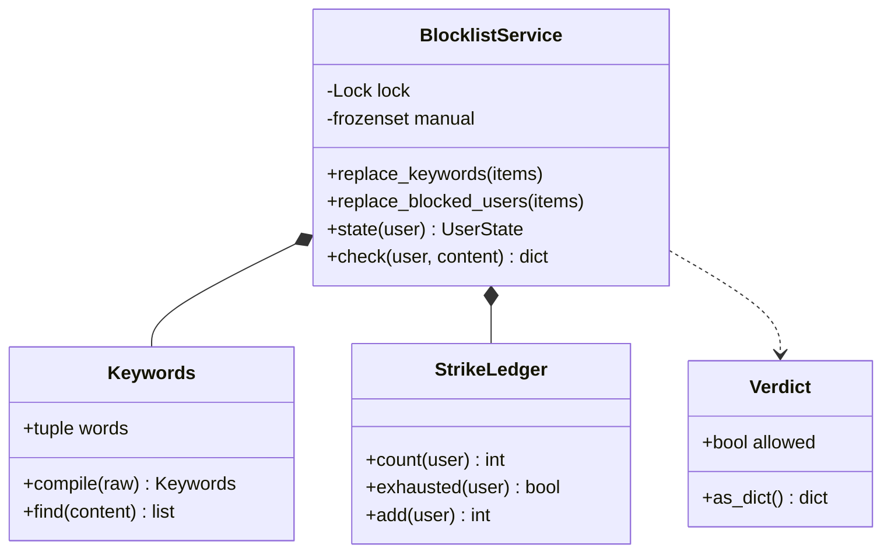

# 设计题解：关键词与用户拦截（Keyword & User Blocking）

## 题目与澄清

一个讨论区在每次发帖之前，先把"谁发的、发了什么"交给一个准入组件 ContentGate。组件回答一件事：放行还是拒绝，拒绝的话原因是什么。
它有两种拒绝：内容里含有被配置为敏感的关键词（`keyword`），或者发帖的人已经被封（`user_blocked`）。
封人有两条路：运营手动把某个用户加进封禁名单；或者用户累计被拒三次，系统自动封他。
这个组件和"请求频率限流"是两回事，它不看时间，也不看请求多快，只看内容与累计次数。
你要写的是一个类 `BlocklistService`，五个方法：构造函数、`replace_keywords`、`replace_blocked_users`、`state`、`check`。
没有 HTTP，没有磁盘，没有定时过期；状态存在实例里，多个线程会同时调用。

开工前，先把合同用自己的话写成十二条。按"一个粗心读者最容易漏掉"的顺序：

1. **配置是有限的字符串可迭代对象**：关键词和手动封禁名单各一份。裸字符串和 `bytes` 一律拒绝，因为它们遍历出来是单个字符或整数。
2. **配置先整体校验，再整体替换**：构造函数和两个 `replace_*` 走同一条校验路径；只要有一个条目不合格，整批作废，旧配置原样保留。
3. **配置只读一遍**：一次性迭代器（生成器）也要能用；读成快照之后，调用方再改原来的列表不影响服务。
4. **迭代中自己抛出的异常原样传出**：生成器里抛的 `IOError` 不应被改成 400，旧配置同样保持不变。
5. **关键词规范化**是 `strip().casefold()`，然后去重；**内容只做 `casefold()`**，不 `strip`，也不做别的 Unicode 规范化。
6. **匹配是字面子串匹配**：不是正则，不是按词匹配。同一个关键词在结果里最多出现一次，按 Python 字符串顺序排序；重叠的关键词都算命中；空内容合法，什么也匹配不到。
7. **用户 ID 区分大小写，原样保存**，两端的空白也是 ID 的一部分。
8. **`check` 先校验输入**：用户不是字符串或是空白、内容不是字符串，都抛 `(400, "invalid_input")`，并且发生在匹配和记账之前，被封的用户也不例外。
9. **被封的用户**（在手动名单里，或累计违规 ≥ 3）：返回 `{allowed: False, reason: "user_blocked", matches: [], strikes: 当前次数}`，不匹配内容，不加次数，优先于关键词拒绝。
10. **未被封的用户命中关键词**：`{allowed: False, reason: "keyword", matches: 排序后的命中, strikes: 原次数 + 1}`。一个被拒的请求恰好加一次，与命中几个词、同一个词出现几次无关。第三次被拒的 `reason` 仍是 `keyword`，之后才是 `user_blocked`。
11. **干净的请求**返回 `{allowed: True, reason: None, matches: [], strikes: 当前次数}`，不清零次数。
12. **替换配置**只替换自己那一份；空的可迭代对象表示清空；不清零次数，也不解除自动封禁；从手动名单里移除一个用户，只有他的次数 < 3 时才算解封。

合同里的例子：关键词表是 `[" SPAM "]`，`alice` 发 `"SPAM offer"`，得到 `keyword`、`matches=["spam"]`、`strikes=1`；再发 `"hello"`，得到放行，`strikes` 仍是 1。运行参考解得到：

```text
{'allowed': False, 'reason': 'keyword', 'matches': ['spam'], 'strikes': 1}
{'allowed': True, 'reason': None, 'matches': [], 'strikes': 1}
```

开口前值得问的澄清问题，每一个都会改变代码：

- **"匹配"是子串还是整词？** 合同选了子串，所以关键词 `ass` 会命中 `class`、`Classic assignment`。这会误伤，但是简单、可预测、没有分词歧义；换成整词匹配要先定义"词"（空格？标点？中文怎么办？），那是另一个问题。
- **"不区分大小写"用 `lower()` 还是 `casefold()`？** 两者在德语 `ß` 和希腊语词尾 `ς` 上结果不同，见决策三。合同写明用 `casefold()`。
- **要不要做 Unicode 规范化（NFC/NFD）？** 不要。预组合的 `é` 和 `e` 加组合重音符号是两个不同的字符序列，互相不命中；这是合同允许的边界，不是缺陷。
- **空白关键词怎么办？** 拒绝。空字符串是任何字符串的子串，一个空关键词会让所有内容都被拒；`strip()` 之后为空的条目一律视为空白。
- **用户 ID 要不要 `strip()` 或统一大小写？** 不要。`"Alice"`、`"alice"`、`" alice"` 是三个用户；名单里的 `" bob "` 只封带着空格的那个 ID。
- **被封用户的请求还要不要匹配内容？** 不要。被封之后既不匹配也不记账，次数就停在当时的值（自动封禁时是 3）。
- **空白内容算不算非法？** 不算。非法的只有"不是字符串"；`""` 和 `"   "` 都是合法内容，都不命中。
- **配置传了 `None` 或整数怎么办？** 合同没写。这里归入 `invalid_keywords` / `invalid_users`（400）：它不是"迭代中抛出的异常"，而是根本没有迭代；这是需要在开工前确认的一条。
- **要不要支持申诉、过期、持久化？** 不要，这些是追问，放在 `## 扩展与追问`。

## 需求与分级

机器编码轮会分关给出要求。这个项目大致是下面四关；每一关说明设计里哪一部分为它而存在。

**第 1 关（约 15 分钟，配置与匹配）**：构造函数接受关键词和手动封禁名单，校验、规范化、去重；`check` 只做"命中就拒绝"。
为这一关存在的是 `Keywords`：一份编译好的关键词表（规范化、去重、排序一次做完），查询时只剩 `casefold` 加子串查找。
公开测试里的 `SPAM offer` 例子在这一关就应该通过。

**第 2 关（约 15 分钟，用户与计数）**：`state`、手动封禁、违规累计、第三次仍是 `keyword`、之后是 `user_blocked`。
为这一关存在的是 `StrikeLedger`（违规次数）和 `Verdict`（三种返回形状）。输入校验的顺序在这一关定死：先校验，再判封，再匹配，最后记账。

**第 3 关（约 10 分钟，配置更新语义与隔离）**：两个 `replace_*` 各自整体替换；失败时旧配置不变；一次性迭代器；迭代中的异常原样传出；
替换不清零次数；返回的字典和列表是新的；两个实例互不影响。为这一关存在的是 `_snapshot`：读一遍、校验一遍、失败就整批作废。

**第 4 关（约 15 分钟，并发与原子替换，随后写三篇短文）**：同一个用户被两百个线程同时用关键词内容请求，恰好三次返回 `keyword`；
配置替换与正在进行的 `check` 并发，每个请求看到的是整份旧表或整份新表。为这一关存在的是那一把锁和"先在锁外读、再在锁内换引用"的写法。
最后留十分钟写 `REFLECTION.essay`：配置更新与进行中检查的先后顺序、怎样加申诉又不丢审计记录、关键词变成百万级怎么办。

## 核心对象与职责

| 类 | 单一职责 | 它拥有的不变量 |
|---|---|---|
| `ServiceError` | 对外统一的错误，带 `status` 和 `code` | 两个字段创建后不变 |
| `Keywords` | 一份编译好的关键词表，提供 `find(content)` | 每个词都已经 `strip().casefold()`、不重复、按字符串顺序排好；创建后不可变 |
| `Verdict` | 一次 `check` 的结果，三种形状的唯一出处 | 冻结的值对象；`as_dict()` 每次造新字典，`matches` 存元组 |
| `StrikeLedger` | 每个用户的违规次数 | 只记出过违规的用户；任何用户的次数不超过上限，超过就抛异常 |
| `BlocklistService` | 持有配置和账本，在一把锁里完成判封、匹配、记账 | 一次 `check` 对外表现为不可分割；配置替换整份可见 |

`BlocklistService` 拥有 `Keywords` 和 `StrikeLedger`，生命周期一致，是组合（composition）。
外部拿不到账本和关键词表：`state` 交出的是两个字段的新字典，`keywords` 和 `blocked_users` 属性交出的是副本。
`Verdict` 只被 `check` 创建、立即转成字典交出去，它存在的理由写在决策五。



## 关键设计决策

### 决策一：一把锁罩住"判封、匹配、记一次"

**问题**：多个线程同时调用 `check`，同一个用户的多个请求会同时到达。哪些步骤必须不可分割？

先看没有锁会怎样。`check` 的核心是三步：读出这个用户的次数，判断是否已封，命中就把次数加一。
两个线程同时读到 2 次，都判断"未封"，都命中，都写回 3，于是两个请求都得到 `keyword`，而合同要求第二个必须是 `user_blocked`。
把这个写法放进 40 个线程、每个线程连续发 5 个命中请求，重复 30 轮，每轮应该恰好 3 个 `keyword` 回复。运行得到的最坏一轮：

```text
keyword replies per round, expected 3; worst over 30 rounds: 6
```

Python 的 GIL 保证单条字节码不被撕开，但不保证"读次数、判断、写回"这一组操作不被切线程，这是典型的先检查后动作（check-then-act）。

可选的做法有三个：

- **每个字段各自加锁**：一把锁管次数，一把锁管配置。每一步单独看都对，但"读到次数"和"写回次数"之间别的线程可以插进来，等于没锁。
- **一把总锁**：`check` 的整个方法体、`state`、两个 `replace_*` 的交换那一步，都在同一把 `threading.Lock` 下。
  对外看，所有调用排成一个串行顺序，这就是合同说的"调用与替换是原子的"。
- **每个用户一把锁**：不同用户互不排队。但配置是全局的，`check` 要同时读配置和这个用户的状态，要么再引入读写锁，要么每个用户的锁里再嵌一把配置锁，复杂度远高于收益。

选一把总锁。临界区里只有一次集合查找、一次子串扫描、一次字典写入，规模再大也是微秒到毫秒级；
真正会让它变慢的是关键词表变成百万级，那时的解法是换匹配算法，而不是换锁（见 `## 扩展与追问`）。
这里不需要任何设计模式：一个类、一把锁、三个字段。

### 决策二：配置当不可变快照，整份替换；读用户的迭代器放在锁外

**问题**：`replace_keywords(["scam", 5])` 失败了，旧的关键词表必须原封不动。同时，迭代器是调用方给的，里面可能慢、可能抛错、可能只能读一遍。

选项一：就地修改。先 `clear()`，再逐个校验、逐个 `add`。校验失败时，旧表已经被清空：

```python
class InPlace:
    def __init__(self, kws): self.kws = set(kws)
    def replace(self, new):
        self.kws.clear()
        for k in new:
            if not isinstance(k, str) or not k.strip():
                raise ValueError(k)
            self.kws.add(k.strip().casefold())
s = InPlace(["spam"])
try: s.replace(["scam", 5])
except ValueError: pass
print(s.kws)
```

```text
{'scam'}
```

旧的 `spam` 没了，新的 `scam` 只加了一半：既不是旧配置，也不是新配置。并发的 `check` 还能在 `clear()` 之后、`add` 之前看到一张空表，那一刻所有内容都被放行。

选项二（选用）：**先把输入读成一份列表，校验全部条目，编译成一个新的不可变对象，最后在锁里只做一次引用替换**。
`Keywords` 是冻结的数据类，里面是元组；手动封禁名单是 `frozenset`。替换就是 `self._keywords = compiled`，一条赋值，要么发生要么没发生。
失败的路径上没有任何东西被修改过，所以"旧配置不变"不需要额外的回滚代码。

读迭代器放在锁外还有一个理由：迭代器是调用方的代码，可能阻塞、可能抛错、甚至可能反过来调用这个服务；
把它放在锁里，一个慢迭代器会让所有 `check` 排队，一个会重入的迭代器会让线程把自己锁死。

**裸字符串要先拒绝。** `list("spam")` 得到 `['s', 'p', 'a', 'm']`，`list(b"ab")` 得到 `[97, 98]`：
如果不先检查，`replace_keywords("spam")` 会悄悄把四个单字母当成关键词，几乎所有内容都会被拒。检查必须在遍历之前。

**迭代中的异常原样传出。** 校验失败是客户端的错，对应 400；迭代器自己抛出的 `IOError` 是调用方的缺陷或环境的故障，
包成 400 会把它伪装成"配置写错了"，排查的人会去看配置而不是看数据源。
只把"根本不是可迭代对象"（`iter(values)` 抛 `TypeError`）归为 400，因为那时还没有开始迭代。

这里是一个"不用模式"的决定：不做建造者（Builder），不做事务对象，不做版本号；一次引用替换就是全部需要的原子性。

### 决策三：字符串口径——`casefold` 加字面子串，不加别的

**问题**：关键词表里是 `"Spam"`，内容里是 `"SPAM"` 或 `"spam"`，怎么算匹配？

选项有四个：`lower()`、`casefold()`、规范化后再 `casefold()`（NFKC）、正则或整词。先运行，看它们在边界上怎么分叉（Python 3.11，Unicode 14.0.0）：

```text
'ß'.casefold() = 'ss'      'ß'.lower() = 'ß'
'ΟΔΟΣ'.casefold() = 'οδοσ' 'ΟΔΟΣ'.lower() = 'οδος'
'İ'.casefold() = 'i̇'  （两个码点：0x69 0x307）
```

- `lower()` 不把 `ß` 折成 `ss`，所以关键词 `straße` 抓不到全大写的 `STRASSE`；
  它对词尾 `Σ` 还会给出 `ς`（最后一个字母）而不是 `σ`，同一个词的大小写变体因此得到两种小写。`casefold()` 为"忽略大小写比较"设计，两个问题都没有。
- **折叠是双向的**：关键词 `ss` 会命中内容 `Straße`（折叠后是 `strasse`），关键词 `straße` 在建表时就被折成 `strasse`，
  去重时它和 `STRASSE` 是同一个词。这是 `casefold` 的语义，不是实现的缺陷。
- **土耳其语的带点大写 `İ`** 折叠成 `i` 加一个组合点：关键词 `i` 命中内容 `İstanbul`，关键词 `istanbul` 却不命中。
  "不做规范化"的代价就在这里，合同接受它。
- **不做 NFC/NFD 规范化**：预组合的 `é`（一个码点）与 `e` 加组合重音符（两个码点）互不命中；但关键词 `e` 会命中后者，因为基字符是子串。
- **正则和整词**都被拒绝。正则要处理转义（关键词里的 `(`、`^`、`.` 都是字面字符）、要防灾难性回溯，还可能因为运营写错一个括号让整个服务抛 `re.error`；
  整词要先定义"词"。字面子串的代价是误伤：关键词 `ass` 命中 `class`（Scunthorpe 问题）。这是合同选定的口径，产品想减少误伤应该改合同，而不是在代码里悄悄加词边界。

**一条等价关系可以省掉一次调用**：内容不需要 `strip()`。关键词已经 `strip()` 过，开头和结尾都不是空白，所以内容两端的空白不可能让子串关系发生变化。
对两万组随机关键词和内容分别运行"用原内容匹配"和"用 `strip()` 之后的内容匹配"，不一致的次数是 0。

**空白关键词必须在建表时拒绝**：运行 `"" in "anything"` 得到 `True`，`"" in ""` 也是 `True`。
一个空关键词会命中所有内容，包括空内容；而合同说空内容什么也匹配不到，所以空白条目是 400，而不是被默默丢掉。

**排序放在建表时**：`tuple(sorted(...))` 做一次，查询时 `[w for w in words if w in folded]` 按原顺序过滤，结果天然已经按 Python 字符串顺序（码点顺序）排好、没有重复。
码点顺序意味着 `"z" < "ß" < "é"`，与任何本地化排序无关；折叠之后的 `ss` 排在 `z` 之前。

这里也不需要模式：不是策略（只有一种匹配方式），不是责任链。

### 决策四：次数封顶，"是否被封"从次数和名单算出来，不单独存

**问题**：要记"这个用户有没有被封"吗？违规次数会不会无限涨？

选项一：每个用户存一条 `{strikes, blocked}`，次数到 3 时把 `blocked` 置真。问题是 `blocked` 有两个来源（手动名单、次数），
两个来源会各自变化：运营把用户从名单里移除，这个标志该不该清？它是不是因为次数而真的？标志与次数迟早对不上。

选项二（选用）：**只存次数；被封是算出来的**：`user in manual or ledger.exhausted(user)`。
手动名单只存在 `BlocklistService` 里，次数只存在 `StrikeLedger` 里，移除手动封禁之后"是否仍被封"是同一个表达式的结果，
刚好就是合同第 12 条："只有他的次数 < 3 时才算解封"。

**次数封顶是一个安全不变量**：被封的用户不再匹配、不再记账，所以次数最多是 3。
`StrikeLedger.add` 在用户已达上限时抛 `RuntimeError`，而不是 `assert`：`python -O` 会去掉断言，不变量不能依赖它。
如果有一天有人改动 `check`，让被封用户也走到 `add`，测试会立刻失败，而不是让计数悄悄涨到 7。

**没有违规的用户不占内存**：`count` 用 `dict.get`，不创建条目；`state` 只读，查询一百万个陌生用户不会让账本长大。
账本的大小等于"至少被拒过一次的用户数"，每个值不超过 3。

被拒不用状态模式（State pattern）建模：一个用户有"正常、被封"两个状态，由一个整数比较决定，
为它写 `NormalState`、`BlockedState` 两个类，是拿一个 `if` 换一套层次。只有当状态各自带不同的行为和迁移规则（警告、禁言、永久封禁）时才值得这样做。

### 决策五：三种返回形状放进 `Verdict`，边界上转成新字典

**问题**：`check` 有三种返回：被封、命中、放行。字段名固定四个，每种的取值规则不同。

选项一：在 `check` 里直接写三个字典字面量。简单，但同一个形状在代码里会被写三次，漏掉一个键或拼错 `user_blocked` 不会有任何东西报错。
选项二（选用）：一个冻结的 `Verdict` 值对象加三个类方法 `clean`、`blocked`、`keyword`，形状只有一个出处；`matches` 在对象里存元组，
对外用 `as_dict()` 每次新建字典和新列表，调用方改返回值不会碰到服务内部或下一次的结果。

代价是多一个类，而且它只在 `check` 的最后一行存在一瞬间。这个代价值得，因为合同里"返回的字典与服务隔离"是明文要求，
而最容易违反它的地方正是返回一个内部对象的引用。如果项目只有一种返回形状，这个类就应该删掉。

## 代码走读

%% code:begin solution.py %%
```python
"""关键词与用户拦截（ContentGate）参考解：一个放在讨论区发帖入口前面的准入组件。

设计五句话：
1. 配置先在锁外读成列表并整体校验，通过后在锁内一次换上；中途失败，旧配置一个字节都不变。
2. 关键词在换配置时就规范化、去重、排好序（`Keywords`），判定时只剩一次 `casefold` 加子串查找。
3. 违规次数由 `StrikeLedger` 保管：只记出过违规的用户，到上限（3）就不再增加。
4. 一次 `check` 的“是否被封、匹配、记一次违规”整体放在同一把锁里，所以并发下严格等价于某个串行顺序。
5. 返回值每次新建（`Verdict.as_dict`、`state`），外部改它不影响服务；时间过期、HTTP、磁盘都不在范围内。
"""

from __future__ import annotations

import threading
from collections.abc import Iterable
from dataclasses import dataclass
from typing import TypedDict

STRIKE_LIMIT = 3  # 累计这么多次被拒，就自动封禁


class ServiceError(Exception):
    """对外的统一错误：status 是 HTTP 状态码，code 是稳定的字符串。"""

    def __init__(self, status: int, code: str) -> None:
        self.status, self.code = status, code
        super().__init__(code)


def _snapshot(values: Iterable[str], code: str) -> list[str]:
    """把配置读成一份列表并校验全部条目；任何一条不合格，整批作废。

    迭代过程中自己抛出的异常（比如生成器里的 IOError）原样冒出去，不换成 400。
    """
    if isinstance(values, (str, bytes, bytearray)):  # 裸字符串会被拆成单个字符，必须先拒绝
        raise ServiceError(400, code)
    try:
        iterator = iter(values)
    except TypeError:  # 根本不是可迭代对象
        raise ServiceError(400, code) from None
    items = list(iterator)  # 只遍历一次，一次性迭代器也能用
    if not all(isinstance(item, str) and item.strip() for item in items):
        raise ServiceError(400, code)
    return items


def _require_user(user: object) -> str:
    """用户 ID 必须是非空白字符串；原样返回，不 strip、不改大小写。"""
    if not isinstance(user, str) or not user.strip():
        raise ServiceError(400, "invalid_input")
    return user


@dataclass(frozen=True, slots=True)
class Keywords:
    """一份编译好的关键词表：规范化、去重、按字符串顺序排好，创建后不可变。"""

    words: tuple[str, ...] = ()

    @classmethod
    def compile(cls, raw: Iterable[str]) -> Keywords:
        """校验并规范化：strip 再 casefold，然后去重、排序。"""
        normalized = {word.strip().casefold() for word in _snapshot(raw, "invalid_keywords")}
        return cls(tuple(sorted(normalized)))

    def find(self, content: str) -> list[str]:
        """内容只做 casefold；逐个关键词做字面子串查找，结果已按字符串顺序排好。"""
        folded = content.casefold()
        return [word for word in self.words if word in folded]


@dataclass(frozen=True, slots=True)
class Verdict:
    """一次 `check` 的结果；`as_dict` 每次造新字典，调用方随便改。"""

    allowed: bool
    reason: str | None
    matches: tuple[str, ...]
    strikes: int

    @classmethod
    def clean(cls, strikes: int) -> Verdict:
        return cls(True, None, (), strikes)

    @classmethod
    def blocked(cls, strikes: int) -> Verdict:
        return cls(False, "user_blocked", (), strikes)

    @classmethod
    def keyword(cls, matches: Iterable[str], strikes: int) -> Verdict:
        return cls(False, "keyword", tuple(matches), strikes)

    def as_dict(self) -> dict[str, object]:
        return {
            "allowed": self.allowed,
            "reason": self.reason,
            "matches": list(self.matches),
            "strikes": self.strikes,
        }


class UserState(TypedDict):
    strikes: int
    blocked: bool


class StrikeLedger:
    """每个用户的违规次数。只记出过违规的用户，次数永远不超过上限。

    它自己不加锁：并发由持有它的 `BlocklistService` 用一把锁保证。
    """

    def __init__(self, limit: int = STRIKE_LIMIT) -> None:
        self._limit = limit
        self._counts: dict[str, int] = {}

    def count(self, user: str) -> int:
        return self._counts.get(user, 0)  # 查询不创建条目，没违规过的用户不占内存

    def exhausted(self, user: str) -> bool:
        return self.count(user) >= self._limit

    def add(self, user: str) -> int:
        """记一次违规并返回新的次数；已到上限的用户不该再走到这里。"""
        if self.exhausted(user):
            raise RuntimeError("user already at the strike limit")  # 安全不变量，不用 assert
        self._counts[user] = self.count(user) + 1
        return self._counts[user]


class BlocklistService:
    """关键词匹配、手动封禁与累计违规封禁。"""

    def __init__(self, keywords: Iterable[str] = (), blocked_users: Iterable[str] = ()) -> None:
        # 两份配置都校验通过以后才赋值；构造和替换走同一条校验路径
        compiled = Keywords.compile(keywords)
        manual = frozenset(_snapshot(blocked_users, "invalid_users"))
        self._lock = threading.Lock()
        self._keywords = compiled
        self._manual = manual
        self._ledger = StrikeLedger()

    @property
    def keywords(self) -> list[str]:
        """当前规范化后的关键词（按字符串顺序）的副本。"""
        with self._lock:
            return list(self._keywords.words)

    @property
    def blocked_users(self) -> list[str]:
        """当前手动封禁名单（按字符串顺序）的副本。"""
        with self._lock:
            return sorted(self._manual)

    def replace_keywords(self, keywords: Iterable[str]) -> None:
        compiled = Keywords.compile(keywords)  # 在锁外读用户给的迭代器，慢的或会抛错的迭代器不会占着锁
        with self._lock:
            self._keywords = compiled  # 一次引用替换：并发的 check 看到整份旧表或整份新表

    def replace_blocked_users(self, users: Iterable[str]) -> None:
        manual = frozenset(_snapshot(users, "invalid_users"))
        with self._lock:
            self._manual = manual

    def state(self, user: str) -> UserState:
        _require_user(user)
        with self._lock:
            return {"strikes": self._ledger.count(user), "blocked": self._is_blocked(user)}

    def check(self, user: str, content: str) -> dict[str, object]:
        _require_user(user)
        if not isinstance(content, str):
            raise ServiceError(400, "invalid_input")  # 校验在任何匹配和记账之前
        with self._lock:
            strikes = self._ledger.count(user)
            if self._is_blocked(user):  # 封禁优先于关键词：不匹配、不加次数
                return Verdict.blocked(strikes).as_dict()
            matches = self._keywords.find(content)
            if not matches:  # 干净请求不清零次数
                return Verdict.clean(strikes).as_dict()
            return Verdict.keyword(matches, self._ledger.add(user)).as_dict()  # 不管命中几处，只记一次

    def _is_blocked(self, user: str) -> bool:
        """调用方必须已持有锁。"""
        return user in self._manual or self._ledger.exhausted(user)


if __name__ == "__main__":
    service = BlocklistService([" SPAM "])
    print(service.check("alice", "SPAM offer"))
    print(service.check("alice", "hello"))
    for _ in range(3):
        print(service.check("bob", "spam spam spam"))
    print(service.state("bob"))
```
%% code:end %%

先看 `_snapshot`：先拒绝裸字符串和字节，再尝试 `iter`（不可迭代归入 400），然后 `list(iterator)`，
这一行没有任何 `try`，所以迭代中的异常自然原样冒出；最后一次性校验所有条目。构造函数和两个 `replace_*` 都经过它，所以只有一份校验逻辑。

然后看 `BlocklistService.__init__` 和 `replace_keywords`：构造函数先把两份配置都编译完，再给属性赋值；
`replace_keywords` 在 `with self._lock` 之外编译，在锁内只有一行赋值。这两处就是决策二。

`check` 的骨架是决策一和四的落点：先校验输入（锁外，便宜、无状态），进入 `with self._lock` 之后依次是读次数、判封、匹配、记账，
`return` 都在锁里。注意"判封"在"匹配"之前：被封用户的内容根本不会被扫描。

最后看 `Keywords.find`：`content.casefold()` 只做一次，然后对有序元组做过滤。这就是决策三的全部：没有正则，没有排序，没有去重。

## 测试与自检

测试文件里有四十四个用例（参数化展开后是六十七个），没有一个 `sleep`。按合同条目分组：

- **合同例子**：`[" SPAM "]` 的两次调用逐项断言；手动封禁的例子。
- **配置校验**：裸字符串、`bytes`、`None`、整数、非字符串条目、各种空白条目（含 `　`、`\xa0`），对构造函数和两个 `replace_*` 都要抛对应的 400；
  零宽空格 `​` 不是空白（`strip()` 不去掉它），所以合法。
- **失败不留痕**：校验失败之后，旧的关键词、旧的名单、旧的次数全部还在；迭代器中途抛自定义异常，原样传出，旧配置还在；
  一次性迭代器可用；原列表在构造之后被修改不影响服务。
- **口径**：规范化与去重、关键词内部空格要原样出现、内容两端空白不影响命中、子串不是整词、`.` `^` `(` 都是字面字符、
  结果排序且无重复、重叠关键词、`ß`/词尾 `σ`/`İ`、NFC 与 NFD 互不命中。
  这些期望值是运行得到的，不是从记忆里写的。
- **用户与计数**：大小写和空白敏感；`state` 的形状与新字典；三次 `keyword` 之后是 `user_blocked`；一个请求命中三个词只加一次；
  干净请求不清零；手动封禁优先且不加次数；手动封禁之后已有的次数保留。
- **更新语义**：替换整份、空表清空、替换不清零次数也不解除自动封禁；移出名单只在次数 < 3 时解封。
- **隔离**：两个实例互不影响；返回的 `matches`、`state` 的字典、`keywords` 与 `blocked_users` 的列表都是副本。
- **并发**：线程用 `threading.Barrier` 同时起跑，并把线程切换间隔调到一微秒，让竞争更容易出现。
  四十个线程抢同一个用户，重复三十轮，每轮恰好三个 `keyword`（次数 1、2、3 各一个），其余全是 `user_blocked` 且次数为 3；
  配置在两张表之间来回切换的同时，八个线程各发三百次检查，每次的 `matches` 要么是整张旧表的结果、要么是整张新表的结果，没有混合。
- **扩展**：自动机（Aho–Corasick）和逐词扫描在五百组固定种子的随机输入上给出同样的结果。

把锁去掉，并发测试会失败；把 `casefold` 换成 `lower`，`ß` 与词尾 `σ` 的用例会失败；每个命中词各记一次，"一个请求只加一次"的用例会失败。
这些是写测试时要刻意检验的"能不能抓住"。

公开测试：把 `solution.py` 的内容放进工作区的 `service.py`，`ServiceError` 改用工作区 `models.py` 里的那个（测试里按它的类型捕获），
运行 `python3 -m pytest test_client.py`，三个公开用例应当全过：

```text
3 passed in 0.00s
```

再自己写并发测试和"合同数字逐项断言"的测试，公开用例只覆盖合同的一小部分。

两分钟演示：模块底部的 `__main__` 先跑合同例子，再让 `bob` 连发三次 `spam spam spam`，输出 `strikes` 依次是 1、2、3，随后 `state` 是 `{'strikes': 3, 'blocked': True}`；
然后说出三句话：锁罩住了什么、配置为什么整份替换、为什么 `casefold` 而不是 `lower`。

## 扩展与追问

**新需求**

- *违规次数会过期（滑动窗口、衰减）*：改 `StrikeLedger`，让它存时间戳而不是整数，注入时钟；`count` 仍返回整数，`BlocklistService` 一行不动。这也是 `StrikeLedger` 单独成类的理由。
- *分类关键词（辱骂、广告各自阈值）*：`Keywords` 存"词到类别"的映射，`find` 返回命中的类别集合；账本按类别记次数。`check` 的流程不变，只是判封的条件变成"任一类别达到自己的阈值"。
- *白名单（比如 `class` 不算命中 `ass`）*：在 `find` 之前先把白名单片段从折叠后的内容里挖掉；或者改用整词匹配，但那是改合同。
- *每个关键词一个权重*：账本里的 `add` 接受权重；封顶不变量改为"次数不超过上限加一次的最大权重"，要重新想清楚。

**REFLECTION 第一问：配置更新与进行中检查的先后顺序**

- 每个调用在锁上排队，先拿到锁的先执行。`replace_keywords` 在锁内只换一个引用，所以一个已经在执行的 `check` 用的是旧表（它已经持有锁），
  还没拿到锁的 `check` 看到的是新表。没有任何一次检查会看到半张旧表半张新表，也没有检查会在替换进行到一半时被打断。
- 观测到的效果等价于某个串行顺序；这正是并发测试里"matches 要么整表旧、要么整表新"在断言的内容。
- 如果匹配放到锁外（先在锁内取一个引用，释放锁，再匹配），配置仍然是整份的，但"判封"和"记账"要重新拿一次锁，两次拿锁之间用户的次数可能已经变了，
  需要版本号或重试。当前规模下得不偿失。

**REFLECTION 第二问：申诉而不丢审计记录**

- 把"次数"改成从事件流算出来：每次违规追加一条不可变的事件 `Violation(id, user, matches, 时间, 配置版本)`；
  申诉是另一条事件 `Appeal(violation_id, 申请人)`，裁决是第三条 `Resolution(violation_id, 结果, 审核人)`。
  永远只追加，不修改、不删除。
- `StrikeLedger.count(user)` 变成"该用户未被撤销的违规事件数"；`add` 变成追加一条事件。`BlocklistService.check` 与 `state` 不变，
  这就是接口稳定的好处。撤销一条违规就是追加一条"撤销"事件，次数少一，用户可能因此解封（若不在手动名单里）。
- 不变量要重新说：次数仍然不超过上限，因为被封用户不会再产生新的违规事件；但"次数"不再是计数器，而是一个查询。

**REFLECTION 第三问：关键词变成百万级**

扫描的代价与关键词个数成正比，而且是在持锁的状态下。运行得到（随机 8 个字母的关键词，约 2000 字符的内容，本机）：

```text
词数       逐词扫描     自动机      建表      节点数
100        0.058 ms    0.077 ms    0 ms      722
1000       0.618 ms    0.096 ms    2 ms      6522
10000      6.523 ms    0.113 ms    21 ms     58269
100000     65.730 ms   0.156 ms    407 ms    507502
```

词数每多十倍，扫描慢十倍；十万个词时一次 `check` 要 66 ms，持着那一把锁，每秒只能处理十几个请求。
自动机（Aho–Corasick）把所有关键词编成一棵带失败指针的字典树，内容只扫一遍，耗时几乎不随词数变化：

```python
def find(self, content):
    node, hits = 0, set()
    for ch in content.casefold():
        while node and ch not in self.goto[node]:
            node = self.fail[node]      # 失败：退到最长的、仍是前缀的后缀
        node = self.goto[node].get(ch, 0)
        hits |= self.out[node]          # out 已并入失败链上的词
    return sorted(hits)
```

它和 `Keywords.find` 给出同样的结果，测试里用固定种子比较了五百组随机输入。
自动机对应的改动只在 `Keywords` 一个类里：编译时建树，`find` 换实现；因为 `Keywords` 本来就是不可变对象、靠一次引用替换，
"百万级关键词的配置更新"就变成"在后台建好新自动机，再换引用"，检查不会被建树的几百毫秒阻塞。

新的瓶颈是内存：十万个词的自动机在 Python 里占约 221 MB（词本身只有约 5.7 MB），一百万个词要几个吉字节。
下一步是用紧凑的数组表示（双数组字典树）或 C 实现的库，再往上就是把匹配拆成独立的服务，按用户或按关键词分片。

**并发与线程安全**

- *一把锁的上限*：吞吐上限是单线程做完一次判定的速度。关键词表小的时候不是问题；变大时先改匹配算法，不是改锁。
- *按用户分片*：`hash(user) % N` 选一把锁和一个账本；配置仍是共享的不可变对象，每个线程取一次引用即可。
  `replace_blocked_users` 要同时换 N 个分片看到的名单，仍需要一个全局的、很短的锁，或者把名单也做成"不可变对象加引用替换"。
- *多个进程*：每个进程各有一份内存与一把锁，次数各记各的，一个用户要被拒 3N 次才会被所有进程都封掉。要保证"恰好三次"，次数必须放在共享存储里。

**持久化与规模**

- 一张表 `strikes(user PRIMARY KEY, n)`，记账用一条带条件的更新：`UPDATE strikes SET n = n + 1 WHERE user = ? AND n < 3`，
  看 `rowcount`：1 表示这次记了账，0 表示已经到上限，应当返回 `user_blocked`。条件放在 SQL 里，进程内的锁就不再是正确性的来源。
  用户第一次违规时用 `INSERT ... ON CONFLICT DO NOTHING` 先建行。
- 配置存成带版本号的一行；`check` 开始时读一次版本，记录进违规事件，这样事后能回答"当时按哪张表判的"。
- 手动名单与次数分表存放，"是否被封"仍然是两者的合取查询，和内存版的表达式一致。

## 常见错误

- **忘了先拒绝裸字符串**：`replace_keywords("spam")` 变成四个单字母关键词。
- **先清空再填充**：校验失败时旧配置已经没了，且并发的 `check` 能看到空表。
- **把迭代中的异常包成 400**：数据源的故障被伪装成"配置写错了"。
- **用 `lower()`**：`STRASSE`、`ΟΔΟΣ` 这类词抓不到；要用 `casefold()`。
- **对内容 `strip()`**：没有任何可观察的差别，是一次多余的拷贝；对用户 ID `strip()` 或统一大小写则是错的，用户 ID 要原样保存。
- **用正则或 `\b`**：关键词里的 `(`、`^`、`.` 变成语法，运营写错一个括号就让服务抛异常；`\b` 还会让 `class` 不再命中 `ass`，偏离合同。
- **每次请求都排序、去重**：这些在建表时做一次就够。
- **被封用户仍然匹配并加次数**：次数会涨到 3 以上，返回的 `strikes` 与合同不符。
- **按命中词数加次数**：一个请求写了三个关键词就加三次，一次请求直接被封。
- **干净请求清零次数**：用户可以用一条正常的话洗掉记录。
- **把输入校验放在判封之后**：被封用户发 `None` 内容得到 `user_blocked`，而不是 400。
- **同时存 `blocked` 标志和次数**：两个来源迟早对不上，移出手动名单之后状态说不清。
- **`state` 里创建账本条目**：查询陌生用户让内存增长。
- **返回内部列表**：调用方 `append` 之后，下一次返回里多出了东西。
- **用 `assert` 保护"次数不超过上限"**：`python -O` 会去掉它。
- **把锁只加在 `check` 上**：`replace_*` 与 `check` 并发时仍可能读到不一致的配置；统一在同一把锁下交换引用。
- **用编程智能体时只说"实现一个黑名单服务"**：它最爱用 `lower()`、`\b` 正则、给用户 ID `strip().lower()`、
  存一个 `blocked` 标志、在被封之后继续记账；把十二条合同连同数字例子交给它，再用你自己的测试验收，一次只让它改一件事。

## 45 分钟怎么分配

- **0–5 分钟｜读合同**：不要先写代码。把十二条用自己的话写成注释，标出哪几条最可能被隐藏测试针对：
  裸字符串、失败不留痕、迭代异常原样传出、`casefold` 与空白用户、第三次仍是 `keyword`、被封不加次数、移出名单的解封条件。
  给智能体的第一句话也是这份清单，而不是"写个黑名单"。
- **5–10 分钟｜定骨架并分工**：口头说出结构——一个不可变的关键词表、一个账本、一个带锁的服务、一个返回值对象。
  让智能体起草 `Keywords` 和校验函数（输入输出清楚、易验证）；锁的范围、被封时不加次数、配置整份替换这三个决定自己定。
- **10–20 分钟｜第 1 关和第 2 关**：每写完一块就跑公开测试，再把合同里的例子写成自己的断言。每次只让智能体改一件事、只给它一个失败用例。
- **20–28 分钟｜第 3 关**：写"失败不留痕"和"迭代异常"的测试；读智能体的 diff，找 `lower()`、`strip()` 用户、正则这几个老毛病。
- **28–38 分钟｜第 4 关**：自己写屏障测试，四十个线程抢同一个用户；让智能体帮忙想边界，但锁的范围自己核对。
- **38–45 分钟｜三篇短文**：各写约一百五十字。第一篇讲排队顺序与整份可见；第二篇讲事件追加加撤销事件；第三篇讲扫描的代价、自动机、后台建好再换引用。
  不要留到最后一分钟，也不要写成复述代码。

时间不够时的取舍顺序：先砍 `Verdict` 的类（直接返回字典字面量，口头说明理由），再砍 `keywords`/`blocked_users` 属性，再砍自动机的讨论（口述）；
**绝不能砍的是**：先校验后整体替换、判封在匹配之前、一个请求只加一次、同一把锁罩住判封到记账、三篇短文。

## 延伸阅读

- [[solution-lcp-rate-limiter]]：同样按 key 保存状态、用一把锁罩住"读—判—写"的项目题；那里的状态随时间变化，这里的次数只增不减。
- [[problems.components.rate-limiter|限流器（Rate Limiter）]]：每个 key 一份状态、拒绝时是否留痕的经典入口。
- 复合操作（Compound Actions）、防御性拷贝（Defensive Copying）、边界校验（Validate at the Boundary）：这个项目的三条主线，原理见知识树的并发进阶、数据设计和错误处理部分。
- [Python 文档：str.casefold](https://docs.python.org/3/library/stdtypes.html#str.casefold)：与 `lower()` 的区别、折叠后长度可能变化。
- [Python 文档：Unicode HOWTO](https://docs.python.org/3/howto/unicode.html)：码点、规范化与字符串比较。
- [Python 文档：threading.Barrier](https://docs.python.org/3/library/threading.html#threading.Barrier)：让线程同时起跑的标准工具。
- [Python 文档：sys.setswitchinterval](https://docs.python.org/3/library/sys.html#sys.setswitchinterval)：缩短线程切换间隔，让竞争更容易出现。
- [Aho–Corasick 算法（维基百科）](https://en.wikipedia.org/wiki/Aho%E2%80%93Corasick_algorithm)：多模式匹配的自动机做法。
- [Scunthorpe 问题（维基百科）](https://en.wikipedia.org/wiki/Scunthorpe_problem)：子串过滤误伤正常词的经典例子。
