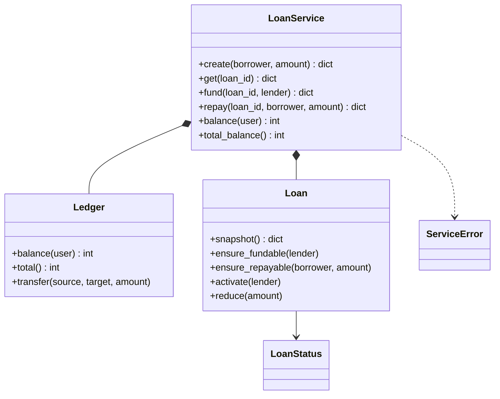
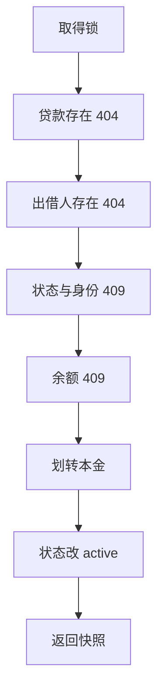

# 设计题解：贷款生命周期修复（Loan Lifecycle）

## 题目与澄清

LedgerBridge 是一个进程内的贷款服务：借款人申请一笔贷款，出借人把钱放给他，借款人再分次还回去。整个服务只有五个公开方法：
`create(borrower, amount)`、`get(loan_id)`、`fund(loan_id, lender)`、`repay(loan_id, borrower, amount)`、`balance(user)`，所有金额都是整数分。
现场的症状有四个：创建完的贷款再也查不到；放款后借款人和出借人的余额对不上；同一笔贷款可以被放款两次；还款莫名其妙失败。
你拿到的是一个能跑但有缺陷的 `LoanService`，任务是修好它，同时保持对外的类名、方法名、签名和错误形状不变。这类修复题评的不是你会不会写几行转账，
而是你会不会读合同、把规则排成顺序、找出缺陷互相遮盖的地方，并用测试证明每一条，最后能在不同的并发与存储方案之间讲清取舍。

公开的错误是 `ServiceError(status, code)`，`status` 是整数，`code` 是稳定的字符串。参考解另外多给了一个只读的 `total_balance()`，返回全部余额之和，守恒测试靠它断言。先把合同用自己的话写成十条，这是开工前的第一件事：

1. **金额**：必须恰好是 `int` 且大于 0。布尔、浮点（包括 `5.0`）、字符串、`None`、0、负数都是 `400 invalid_amount`。`bool` 是 `int` 的子类，`True` 看上去是 1，必须靠 `type(x) is int` 挡住。
2. **创建**：先验金额，再验借款人存在（`404 user_not_found`）；成功才消耗编号，编号从 1 起；创建不动任何人的钱。返回恰好六个键：`id`、`borrower`、`lender`（此时是 `None`）、`principal`、`outstanding`（等于本金）、`status`（`"pending"`）。
3. **查询**：`get` 返回已存的贷款；编号不存在是 `404 loan_not_found`。`balance` 对不存在的用户是 `404 user_not_found`。
4. **放款的检查顺序**：贷款存在 → 出借人存在 → 状态与身份 → 余额。只有 `pending` 的贷款能放款，出借人也不能是借款人，违反都是 `409 invalid_state`；出借人余额低于本金是 `409 insufficient_balance`，**恰好等于本金可以**。
5. **放款成功**：本金从出借人划给借款人，贷款记下出借人、变成 `active`，未还金额仍等于本金。
6. **还款的检查顺序**：金额 → 贷款存在 → 借款人对得上（`403 forbidden`）→ 贷款是 `active` 且金额不超过未还金额（`409 invalid_state`）→ 借款人余额够（`409 insufficient_balance`）。
7. **还款成功**：钱从借款人划给出借人，未还金额减少；减到 0 变 `repaid`，否则仍是 `active`。
8. **失败不留痕迹**：任何一次失败之后，所有贷款、所有余额、下一个编号都和调用前一模一样。
9. **并发**：同一个实例上的所有方法可以同时调用；同一笔贷款并发放款恰好一次成功，其余是 `invalid_state`；所有余额之和恒定，没有负数。
10. **隔离**：每个返回值都是独立的快照；构造时复制传入的余额；多个实例互不相干。

下面几个澄清问题，答案会直接改代码：

- **金额错和用户不存在同时发生，报哪个？** 合同给了顺序：创建先验金额，所以 `create("ghost", 0)` 是 `400 invalid_amount`，不是 404。还款同理，金额排在最前，连贷款存不存在都还没看。
- **别人给一笔 `pending` 的贷款还款，是 403 还是 409？** 归属先于状态，所以是 `403 forbidden`。一个不存在的用户去还，也是 403：服务只比较"你是不是这笔贷款的借款人"，不去查你存不存在。
- **超额还款和余额不足同时成立，报哪个？** 超额是状态问题，先于余额，所以报 `invalid_state`。例如借款人还欠 5、余额也只剩 5，这时请求还 6，得到的是 `invalid_state`。
- **编号不是整数怎么办？** 合同没写。参考解把任何不是 `int` 的编号（包括 `True`、字符串、列表）都当作不存在，返回 `404 loan_not_found`。原因是 `True == 1` 且哈希相同，直接拿去查字典会误中第一笔贷款；列表更会抛出 `TypeError`，变成 500。用户名同理。

**修复清单**：待修的 `starter.py` 里的 `LoanService` 有下面五处缺陷，每一条都对应上面的某条规则，症状都是运行得到的：

| 症状 | 缺陷 | 违反的规则 |
|---|---|---|
| 创建完查不到：`create("ann", 60)` 返回编号 1，`get(1)` 是 `404 loan_not_found`，`get(2)` 反而取到它 | 贷款存进了"编号加一"的位置 | 2、3 |
| 改返回值会改掉服务里的贷款：把 `get` 返回的 `status` 改成 `"x"`，服务里的贷款跟着变 | `get` 把内部字典本体交了出去 | 10 |
| 同一笔贷款能放款多次：已放款的贷款，第二个出借人再放款，借款人收到 120 | `fund` 没检查贷款是不是 `pending` | 4、9 |
| 余额够的出借人被拒，不够的反而放行：余额 100 放 60 的贷款得 `409 insufficient_balance`；余额 50 却成功，出借人余额变 −10 | 放款的余额比较方向写反了 | 4、9 |
| 余额够的借款人被拒，不够的反而放行：余额 60 还 20 得 `409 insufficient_balance`；余额 5 还 20 成功，借款人余额变 −15 | 还款的余额比较方向写反了 | 6、9 |

**起始代码已经做对的**：构造时复制了传入的余额；金额校验用 `type(amount) is int`，布尔、浮点、0、负数都是 `400 invalid_amount`；创建先验金额、再验借款人，失败不消耗编号；还款的检查顺序（金额、贷款、归属、状态与超额）和还清变 `repaid`、没还清仍是 `active`；放款对自己借给自己的拦截；`create`、`fund`、`repay` 的返回值是拷贝；所有方法都在锁里。修复要保住这些。

**范围之外**：利息、手续费、存款、删除、取消贷款、磁盘持久化和进程重启后的恢复。"持久化"在这里只是指同一个实例的多次调用之间状态保留。

## 需求与分级

**第 1 关（约 15 分钟，先看清缺陷）**：不改代码，把十条规则逐条对照现有服务，列出差异清单；然后跑一遍现有测试，看哪几个失败。
这一关的产出就是上面那张修复清单。例子：余额 `{"ann": 0, "bob": 100}`，`ann` 借 60、`bob` 放款、`ann` 还 20，应该得到未还 40，余额 `(40, 60)`；
现有服务连第一步 `get` 都过不了，因为贷款存错了位置。

**第 2 关（约 20 分钟，创建、查询、放款）**：让创建真正存下贷款并返回快照；编号只给成功的创建、构造时复制余额（这两点起始代码本来就对，留测试守住）；放款按"贷款 → 出借人 → 状态与身份 → 余额"的顺序检查，转账成功后才改状态。
这一关决定了"每个返回值是快照"和"先查后写"两个结构（决策四、决策二）。例子：`bob` 余额 79 给本金 80 的贷款放款，得到 `409 insufficient_balance`，
贷款仍是 `pending`，两人的余额都没动；换一个余额恰好 80 的出借人，立刻能放款成功。

**第 3 关（约 20 分钟，还款与失败不留痕）**：还款按"金额 → 贷款 → 归属 → 状态与超额 → 余额"的顺序检查；全部通过才划转并扣减；还清变 `repaid`。
这一关的难点是"失败不留痕迹"：余额不足时，出借人的余额一分也不能多。例子：借款人欠 60、余额只剩 5，还 6 得到 `409 insufficient_balance`，
出借人余额、借款人余额和未还金额三样都和调用前一样；再还 5，成功，欠款变 55。

**第 4 关（选做，约 15 分钟，并发与书面回答）**：用屏障让十六个线程同时给同一笔贷款放款，必须恰好一个成功、十五个 `invalid_state`；
再让一个余额 100 的出借人同时给十笔本金 30 的贷款放款，成功的恰好是三笔，余额剩 10；二十个线程各还 10，欠款 100 时恰好十个成功。
然后回答三个书面问题：只放款一次的不变量和测法；余额与贷款搬进共用数据库时锁换成什么；还款幂等与禁止超额有什么区别（见同名的三张卡）。

## 核心对象与职责

| 类 | 单一职责 | 它拥有的不变量 |
|---|---|---|
| `ServiceError` | 对外的错误：整数 `status` 加稳定的 `code` | 调用方只靠这两个字段分支，不看异常文本 |
| `LoanStatus` | 三个状态的枚举 | 只有 `pending`、`active`、`repaid` 三个值，没有"其他" |
| `Loan` | 一笔贷款的数据与状态转移的前提 | `0 <= outstanding <= principal`；`pending` 时没有出借人；`repaid` 当且仅当欠款为 0 |
| `Ledger` | 所有人的余额，唯一改余额的入口是 `transfer` | 余额总和不变，任何余额不为负；失败的转账什么都不改 |
| `LoanService` | 一把锁，加上"贷款与账本"的联动顺序 | 每个公开方法在持锁期间完成全部检查与修改；返回值一律是快照 |

`LoanService` 是协调者，不是转发者：它拥有的东西是**锁**和**检查的顺序**。贷款的状态转移前提在 `Loan` 里，余额的守恒在 `Ledger` 里，
但"先查贷款、再查出借人、再查状态、再划转、最后改状态"这条流水线只有服务知道，因为它跨了两个对象。
`Loan` 不持有账本的引用，`Ledger` 也不认识贷款，两个小对象各自可以单独测试，服务把它们串起来。



一次放款走的路径：每一步失败，就停在那一步之前，后面的写一个都没有发生。



## 关键设计决策

### 决策一：检查与修改放进同一次持锁，锁放在服务上

**问题**：放款是"先看贷款是不是 `pending`，再划转，再把状态改成 `active`"。如果两个线程同时执行，都看到 `pending`，就会放款两次，借款人拿到双倍的钱。
这就是复合操作（compound action）：每一步单独看都对，合起来不是原子的。

**选项一：每笔贷款一把锁。** 放款只碰这一笔贷款，看起来锁越细并发越高。代价：放款还要改出借人的余额，而出借人的余额被他名下所有贷款共享。
两个线程分别给两笔不同的贷款放款，用的是不同的锁，却同时读写同一个出借人的余额，余额 100 的人可能被放出 150。要补救就得再加账户锁，并规定加锁顺序，复杂度立刻上去。

**选项二：不加锁，靠 GIL。** CPython 里单条字典操作是原子的，但"读余额、比较、减、加、改状态"是很多条字节码，线程可以在任意两条之间被切走。
单线程测试永远过得去，出事故在线上。这是最危险的一种"看上去正确"。

**选项三：一把服务级的锁，罩住贷款表、账本和编号计数。** 代价是所有操作串行；好处是一次持锁里完成全部检查与写，不变量在持锁的任意时刻都成立。
内存里的操作每次只是几次字典读写，串行不是瓶颈。

**选择**：选项三。锁放在服务上而不是账本或贷款里，因为需要原子的是"贷款状态加账本"这一对的联动，哪一个单独的对象都罩不住它。
这不是任何设计模式，只是临界区（critical section）加上"锁住的范围要覆盖不变量涉及的全部数据"这条规则。

### 决策二：先查后改，而不是改了再回滚

**问题**：还款要"给出借人加钱、给借款人减钱、减少未还金额、可能改状态"，其中任何一步都可能因为余额不足而失败。失败之后，规则 8 要求一切如初。

**选项一：先改再检查，失败时回滚。** 例如先给出借人加钱，发现借款人付不起，再把加的钱减回去。代价：每一条失败路径都要写一份撤销代码，漏一条账就记歪；
异常恰好发生在撤销之前（比如线程被打断）时，中间状态被别的线程看到。典型的写法是加钱写在检查之前，而失败路径没有撤销，出借人白拿了钱。起始代码没有这个缺陷（它的检查先于任何写入，只是余额的比较方向写反了），但每多一条写入，这类缺陷就多一个藏身处。

**选项二：改之前拷贝一份状态，失败时整体换回。** 对贷款和余额各拷贝一份，出错就恢复。代价：每次操作的开销与账户数成正比；而且恢复要换掉被别人持有的引用。

**选项三：所有检查都通过之后才开始写，并保证写的序列中间没有会失败的步骤。** `Ledger.transfer` 先查余额，然后连续两次写；
两次写之间没有任何会抛错的调用，所以要么一次都没写，要么两次都写完。状态转移排在转账之后，同样前面没有失败点。

**选择**：选项三。检查是纯读，写是不会失败的赋值，失败路径天然什么都没改，不需要任何撤销代码。
这条原则也解释了为什么 `Loan.ensure_fundable` 与 `Loan.activate` 分成两个方法：前者只读可以失败，后者只写不能失败，调用方在二者之间夹一次转账。

### 决策三：状态转移的前提写在 `Loan` 里，不引入状态模式

**问题**：贷款有三个状态、两条转移：`pending → active`（放款）、`active → repaid`（还清），部分还款停留在 `active`。每次转移前要检查前提，而且前提不能被绕过。

**选项一：服务里一串 `if loan.status == ...`。** 最直接，但同样的前提会在 `fund`、`repay` 和以后新增的 `cancel` 里各写一遍，漏一处就是"重复放款"这样的缺陷。

**选项二：状态模式（State pattern）：每个状态一个类，`PendingState.fund`、`ActiveState.repay`……** 对三个状态、两条转移来说，这是为了模式而模式：
类的数量比规则还多，而且规则分散在三个类里，要看"放款需要什么"得翻三处。

**选项三：状态是个枚举，前提写成 `Loan` 的两个小方法。** `ensure_fundable` 一句话：不是 `pending` 或出借人就是借款人，则抛 `invalid_state`；
`ensure_repayable` 两句话：先查归属，再查状态与超额。转移本身是 `activate` 与 `reduce`，两个方法里只有赋值。

**选择**：选项三，并且**明确拒绝状态模式**。判断标准是：状态之间的行为差异是不是多到一个方法里放不下。这里每个状态下可用的操作加起来只有两个，写成数据和两个守卫就够；
要等到状态超过五六个、每个状态下的行为各不相同（取消、展期、逾期、坏账），才值得拆成转移表或状态类。

### 决策四：返回快照，用新建的浅字典，不用深拷贝也不返回对象

**问题**：`get` 若直接返回内部字典，调用方改一下 `loan["status"] = "repaid"`，服务里的贷款就跟着变了，绕过了所有检查。

**选项一：`copy.deepcopy`。** 安全，但对这里的数据是浪费：贷款的所有字段都是不可变的值（整数、字符串、`None`），递归拷贝没有意义，还要为每次调用付递归的开销。

**选项二：返回 `Loan` 对象本身（或冻结的数据类）。** 对象一旦交出去，调用方持有的是活引用，后续放款会改它，这是"返回的快照会自己变"的另一种缺陷。冻结数据类能防止调用方改，防不了服务自己改。

**选项三：`Loan.snapshot()` 每次现建一个新字典，值全是不可变的。** 调用方怎么改这个字典，碰到的都只是一个副本；服务自己之后的修改，也影响不了已经交出去的副本。

**选择**：选项三。顺带的规则是对称的：**进来的也要拷贝**。`Ledger.__init__` 里的 `dict(balances)` 是同一条原则的另一半，否则调用方在构造之后改自己的字典，服务的余额就悄悄变了。

### 决策五：普通 `Lock`，公开方法之间不互相调用

**问题**：原来的写法用可重入锁（`RLock`），公开方法之间互相调用，例如 `fund` 里调 `self.get(...)`，`create` 里调 `self.balance(...)`。可重入锁让这样的嵌套"不会死锁"，也就让人不再需要想清楚哪里持了锁。

**选项一：`RLock` 加公开方法互相调用。** 好处是写起来随意；代价是持锁范围变得隐含，以后有人在两次调用之间加了一个与锁无关的步骤，就留下了缝。

**选项二：普通 `Lock`，公开方法各自持锁一次，内部辅助函数（`_find`）约定"调用方已持锁"。** 如果有人写了嵌套调用，立刻死锁，问题当场暴露，而不是潜伏。

**选择**：选项二。公开方法的入口各持锁一次，内部只调用不持锁的小函数（`Ledger.balance`、`Loan.snapshot`、`_find`）。
死锁比悄悄的竞态好诊断：它是确定性的，测试一跑就挂。可重入锁只在确实需要递归进入同一个临界区时才用，这里不需要。

## 代码走读

下面是经过测试的完整参考解。

%% code:begin solution.py %%
```python
"""贷款服务（LedgerBridge）参考解：账本管余额，贷款管状态，服务用一把锁把两者的联动包成原子操作。

产品规则（编号即测试编号，金额一律是整数分，Python 的 int 没有上限）：

1. 金额：必须是恰好为 `int` 的正数；`bool`、浮点、字符串、`None`、0 和负数都是 400 invalid_amount。
2. 创建：先验金额，再验借款人存在（404 user_not_found）；成功才消耗编号，编号从 1 起；创建不动钱。
   返回 `{id, borrower, lender: None, principal, outstanding, status: "pending"}`。
3. 查询：`get` 返回已存的贷款；编号不存在 404 loan_not_found；`balance` 对不存在的用户 404 user_not_found。
4. 放款检查顺序：贷款存在 → 出借人存在 → 状态与身份（只有 pending 且出借人不是借款人，否则 409 invalid_state）
   → 余额（低于本金 409 insufficient_balance，恰好等于本金可以）。
5. 放款成功：本金从出借人划给借款人，贷款记下出借人、变为 active，未还金额等于本金。
6. 还款检查顺序：金额 → 贷款存在 → 借款人对得上（403 forbidden）→ 状态为 active 且不超额（409 invalid_state）
   → 借款人余额（409 insufficient_balance）。
7. 还款成功：钱从借款人划给出借人，未还金额减少；减到 0 变 repaid，否则仍是 active。
8. 任何一次失败都不留痕迹：贷款、余额、编号计数都和调用前一样。
9. 并发：同一实例上的所有方法互斥；同一笔贷款并发放款恰好一次成功；所有余额之和恒定且没有负数。
10. 隔离：返回值都是独立的快照，改它不影响服务；构造时复制传入的余额；多个实例互不相干。

放进真实工作区时，把下面的 `ServiceError` 换成 `from models import ServiceError`，其余原样使用。
"""

from __future__ import annotations

import threading
from dataclasses import dataclass
from enum import Enum


class ServiceError(Exception):
    """对外的服务错误：status 是 HTTP 状态码，code 是稳定的错误码字符串。"""

    def __init__(self, status: int, code: str) -> None:
        self.status, self.code = status, code
        super().__init__(code)


def require_amount(amount: object) -> int:
    """金额合格就原样返回。用 `type(...) is int` 而不是 isinstance：True 也是 int，必须挡在外面。"""
    if type(amount) is int and amount > 0:
        return amount
    raise ServiceError(400, "invalid_amount")


class LoanStatus(Enum):
    """贷款的三个状态；只允许 PENDING → ACTIVE → REPAID 单向前进。"""

    PENDING = "pending"
    ACTIVE = "active"
    REPAID = "repaid"


@dataclass
class Loan:
    """一笔贷款。状态转移的前提都写在这里，调用方不能绕过检查直接改字段。

    不变量：0 <= outstanding <= principal；status 为 PENDING 时 lender 是 None；
    status 为 REPAID 当且仅当 outstanding == 0。
    """

    id: int
    borrower: str
    principal: int
    outstanding: int
    lender: str | None = None
    status: LoanStatus = LoanStatus.PENDING

    def snapshot(self) -> dict:
        """对外的快照：每次现建一个新字典，全是不可变的值，调用方怎么改都碰不到贷款本身。"""
        return {
            "id": self.id,
            "borrower": self.borrower,
            "lender": self.lender,
            "principal": self.principal,
            "outstanding": self.outstanding,
            "status": self.status.value,
        }

    def ensure_fundable(self, lender: str) -> None:
        """放款的状态与身份检查；只读，不改任何字段。"""
        if self.status is not LoanStatus.PENDING or lender == self.borrower:
            raise ServiceError(409, "invalid_state")

    def ensure_repayable(self, borrower: str, amount: int) -> None:
        """还款的归属、状态与超额检查，顺序固定：先 403，再 409；只读。"""
        if borrower != self.borrower:
            raise ServiceError(403, "forbidden")
        if self.status is not LoanStatus.ACTIVE or amount > self.outstanding:
            raise ServiceError(409, "invalid_state")

    def activate(self, lender: str) -> None:
        """放款成功后的状态转移；调用前必须已通过 ensure_fundable。"""
        self.lender = lender
        self.status = LoanStatus.ACTIVE

    def reduce(self, amount: int) -> None:
        """还款成功后扣减未还金额；扣到 0 就结清。调用前必须已通过 ensure_repayable。"""
        self.outstanding -= amount
        if self.outstanding == 0:
            self.status = LoanStatus.REPAID


class Ledger:
    """账本：只管余额。唯一能改余额的入口是 `transfer`，它先查后改，所以余额守恒且不会出现负数。"""

    def __init__(self, balances: dict[str, int]) -> None:
        self._cents = dict(balances)  # 复制一份：之后调用方改它的字典，账本不受影响

    def balance(self, user: str) -> int:
        """用户必须存在；非字符串（含不可哈希的值）也按"不存在"处理，而不是抛 TypeError。"""
        if type(user) is str and user in self._cents:
            return self._cents[user]
        raise ServiceError(404, "user_not_found")

    def total(self) -> int:
        """所有人的余额之和：守恒的那个量，测试与对账都读它。"""
        return sum(self._cents.values())

    def transfer(self, source: str, target: str, amount: int) -> None:
        """从 source 划 amount 给 target。余额不够就抛错且什么都不改；两次写之间没有可能失败的步骤。"""
        if self.balance(source) < amount:
            raise ServiceError(409, "insufficient_balance")
        self.balance(target)
        self._cents[source] -= amount
        self._cents[target] += amount


class LoanService:
    """对外的服务。一把锁罩住"贷款状态 + 账本"这一对：它们之间的联动才是需要原子的东西。"""

    def __init__(self, balances: dict[str, int]) -> None:
        self._ledger = Ledger(balances)
        self._book: dict[int, Loan] = {}
        self._serial = 1
        self._mutex = threading.Lock()  # 公开方法之间不互相调用，用不着可重入锁

    def balance(self, user: str) -> int:
        with self._mutex:
            return self._ledger.balance(user)

    def total_balance(self) -> int:
        """全部余额之和；放款与还款只在人与人之间搬钱，所以它在任何时刻都等于构造时的总和。"""
        with self._mutex:
            return self._ledger.total()

    def create(self, borrower: str, amount: int) -> dict:
        with self._mutex:
            require_amount(amount)
            self._ledger.balance(borrower)  # 只为确认借款人存在
            loan = Loan(self._serial, borrower, amount, amount)
            self._book[loan.id] = loan
            self._serial += 1  # 全部检查通过、贷款已入表之后才消耗编号
            return loan.snapshot()

    def get(self, loan_id: int) -> dict:
        with self._mutex:
            return self._find(loan_id).snapshot()

    def fund(self, loan_id: int, lender: str) -> dict:
        with self._mutex:
            loan = self._find(loan_id)
            self._ledger.balance(lender)  # 出借人存在
            loan.ensure_fundable(lender)  # 状态与身份，先于余额
            self._ledger.transfer(lender, loan.borrower, loan.principal)  # 最后一道检查，也是第一个写
            loan.activate(lender)  # 转账成功后状态才变，之间没有失败点
            return loan.snapshot()

    def repay(self, loan_id: int, borrower: str, amount: int) -> dict:
        """还款：先过五道检查（金额、贷款、归属、状态与超额、余额），再划转并扣减。"""
        with self._mutex:
            require_amount(amount)
            loan = self._find(loan_id)
            loan.ensure_repayable(borrower, amount)
            assert loan.lender is not None  # 仅为类型检查：active 的贷款一定有出借人
            self._ledger.transfer(borrower, loan.lender, amount)
            loan.reduce(amount)
            return loan.snapshot()

    def _find(self, loan_id: int) -> Loan:
        """调用方已持锁。编号不是 int（含 True、字符串）都按"不存在"处理：True 与 1 哈希相同，会误中第一笔贷款。"""
        loan = self._book.get(loan_id) if type(loan_id) is int else None
        if loan is None:
            raise ServiceError(404, "loan_not_found")
        return loan


if __name__ == "__main__":
    service = LoanService({"mia": 5, "noah": 500})
    loan = service.create("mia", 120)
    print(service.fund(loan["id"], "noah"))
    print(service.repay(loan["id"], "mia", 50))
    print(service.repay(loan["id"], "mia", 70)["status"])  # 还清：repaid
    print({user: service.balance(user) for user in ("mia", "noah")}, service.total_balance())
    for attempt in (lambda: service.fund(loan["id"], "noah"), lambda: service.repay(loan["id"], "mia", 71)):
        try:
            attempt()
        except ServiceError as error:  # 失败的调用：状态码、错误码，余额一分没动
            print(error.status, error.code, service.total_balance())
```
%% code:end %%

**位置一：`Ledger.transfer`，守恒的唯一入口。** 先 `self.balance(source) < amount` 检查余额，再 `self.balance(target)` 确认收款人存在，之后才连续两次写。
比较用的是 `<`：余额恰好等于金额时不报错。两次写之间没有函数调用，所以不会有"扣了没加"的中间状态。所有改余额的路径只有这一个，守恒因此只需要在这一处证明。

**位置二：`LoanService.fund`，顺序就是合同。** 五行依次是：贷款存在（`_find`）、出借人存在（`self._ledger.balance(lender)`）、状态与身份（`ensure_fundable`）、余额与划转（`transfer`）、状态转移（`activate`）。
把第二行和第三行对调，已放款的贷款被一个不存在的出借人再次放款时，报的错就会从 `user_not_found` 变成 `invalid_state`，测试里专门有一条抓这个。

**位置三：`LoanService.repay` 里的那一句 `assert`。** `assert loan.lender is not None` 只是给类型检查器看的：通过 `ensure_repayable` 的贷款必然是 `active`，`active` 必然有出借人。
它不是安全边界：去掉它，程序的行为不变。真正保证"`active` 必有出借人"的是 `Loan.activate` 在同一处设置两个字段。

**位置四：`_find` 的类型判断。** `type(loan_id) is int` 的判断先于字典查找，因为 `True` 与 1 相等、哈希相同，`self._book[True]` 会取到第一笔贷款；
列表作键会直接抛 `TypeError`。两种情况都收敛成 `404 loan_not_found`，对调用方来说"不存在"只有一种长相。

## 测试与自检

测试文件按规则分组，每个缺陷至少被一条测试抓住：

- **合同的例子**：借 60、放款、还 20，欠款 40，余额 `(40, 60)`；创建返回的六个键和值。
- **校验与顺序**：金额的十一种坏值；创建里金额先于用户；放款里"贷款先于出借人、出借人先于状态、状态先于余额"；还款里"金额先于一切、归属先于状态、超额先于余额"。
  这些测试用的是"同时违反两条规则"的输入，例如已放款的贷款被余额不足的人再放款，必须是 `invalid_state`。
- **失败不留痕迹**：每个失败用例之后，重新读取所有贷款和余额，与调用前逐项相等；失败的创建不消耗编号。
- **边界**：余额恰好等于本金、少一分；欠款恰好等于余额；`10**30` 这样的大数不溢出。
- **隔离**：改创建、查询、放款、还款四种返回值，服务里的贷款不变；构造后改传入的字典，服务不变；两个实例互不相干。
- **并发**：十六个线程同时放款同一笔贷款；一个出借人同时放十笔贷款；二十个线程同时还款；三十二个线程同时创建，编号恰好是 1 到 32。每条都用屏障让线程同时出发，只断言不变量（成功的个数、`total_balance()` 不变），不断言谁赢。
- **随机序列**：固定种子的六百次随机操作，每一步之后断言 `total_balance()` 不变、没有负数，最后断言每笔贷款满足 `0 <= outstanding <= principal` 以及状态与出借人、欠款的对应关系。

缺陷与测试的对应关系可以当自检用：把 `transfer` 里的 `<` 改成 `<=`，"余额恰好够"那条挂；把 `ensure_fundable` 里的状态检查删掉，"放第二次"那条挂；
把贷款存到编号加一的位置，所有"创建后立即查询"的测试挂；让 `snapshot` 返回内部字典，隔离那组挂；把构造时的复制去掉，"构造后改字典"那条挂。
有一处例外要诚实地讲：把放款里的锁去掉，并发测试**不一定**会挂。CPython 的 GIL 让线程切换发生得不那么勤，临界区又很短，漏锁常常能侥幸通过。
这就是为什么"同一笔贷款放两次必须 409"的确定性测试不能省，也是为什么并发测试只是第二道防线。

**两分钟演示**：先说合同的两个顺序（放款四步、还款五步），再跑 `python solution.py`：借 120、放款、还 50 后欠 70、状态仍是 `active`，再还 70 变 `repaid`，余额回到 `{'mia': 5, 'noah': 500}`，总和一直是 505；演示里最后两次失败的调用都是 `409 invalid_state`，总和不变。然后现场把两个出借人同时放款的测试跑一遍，指给面试官看"恰好一个成功"。

## 扩展与追问

**新需求**

- **利息或手续费**：`Loan` 加一个计算应还总额的方法，`ensure_repayable` 的"超额"改成和应还总额比；`Ledger` 与 `LoanService` 的结构不变。费用要收到哪个账户，是新需求里最该先问清的一句。
- **取消 `pending` 的贷款**：`LoanStatus` 加 `CANCELLED`，`Loan` 加一个 `cancel` 守卫，只允许从 `pending` 进入；`fund` 与 `repay` 的守卫自动拒绝已取消的贷款，因为它们本来就只认 `pending` 与 `active`。这是决策三"前提写在 `Loan` 里"的回报。
- **分期还款计划**：在 `Loan` 上增加 `schedule`，`reduce` 时按期扣减；账本不变。

**并发与线程安全**

- **锁太粗了怎么办**：先量，再改。要拆就按账户拆锁，`transfer` 按用户名排序后依次加锁，两个互相借钱的线程才不会各拿一把等对方；贷款状态再按贷款拆一层。这时第一个并发测试（一个出借人同时放十笔）仍然是回归的底线。
- **为什么不用无锁方案**：Python 没有可用的原子比较并交换来同时改两个字典的值，硬做只会更复杂。

**持久化与规模**

- **搬进共用数据库**：锁换成事务加条件更新。放款是 `UPDATE loans SET status = 'active' … WHERE status = 'pending'`，看受影响的行数是不是 1；扣款是 `UPDATE accounts SET cents = cents - ? … WHERE cents >= ?`，同样看行数。参考写法在第三张卡里。`Ledger` 与 `Loan` 退化成数据行的读写，`LoanService` 的方法顺序几乎照搬。
- **还款幂等**：加请求号和唯一约束，同号同内容重放、同号不同内容冲突，登记与划转在同一个事务里。它和"禁止超额"是两层防护，见第四张卡。
- **账户分库之后**：单个事务罩不住两个库，改成"流水加对账"：先在各库各记一条带同一业务号的流水，再用定期对账发现并修复不一致。

## 常见错误

- **只改一处缺陷就收工。** 这类题里缺陷互相遮盖：先修了"贷款存错位置"，才会发现放款没有状态检查。每修一类缺陷就重跑全部测试，并为每个缺陷先写一个会失败的测试。
- **把比较方向当成"对了就行"。** 余额检查是 `balance < principal` 才拒绝；写成 `<=` 会拒绝"恰好够"的人，写成 `>` 会放行没钱的人。边界值要各测一次：差一分、恰好、多一分。
- **先给出借人加钱，再检查借款人。** 失败时钱已经多出来了。规则是：先全部检查，再连续写。
- **返回内部字典，或者把传入的字典直接留着。** 隔离是双向的：出去的要拷贝，进来的也要拷贝。
- **只用 `isinstance(x, int)` 检查金额。** `True` 通过了，借 `True` 分钱，借出 1 分。
- **状态检查与修改拆在两次持锁之间。** 例如 `fund` 先拿锁检查，释放，再拿锁修改。每个公开方法持锁一次，完成全部事情。
- **在测试里断言谁赢。** 并发测试断言的是"恰好一个成功、总和不变"，哪个线程赢是不确定的，断言它就是不稳定的测试。
- **Java 式的写法。** 给 `Ledger` 写 `getBalance` / `setBalance`，让别的类绕过 `transfer` 直接改余额；或者给只有一个实现的东西起一个 `ILoanService` 接口。这里用一个方法 `transfer` 把写入口收窄，就是封装。
- **把"持久化"做成写磁盘。** 合同里的持久化只是同一个实例的多次调用之间状态保留，进程重启不在范围内。

## 45 分钟怎么分配

- **0 到 8 分钟：读合同，列清单。** 把十条规则抄成自己的话，写出差异清单，让编程智能体只列差异、不改代码。你先说出声：放款四步、还款五步的顺序，和"失败不留痕迹"。
- **8 到 18 分钟：创建与查询。** 存位置、编号、快照、构造时复制。每类缺陷先让智能体写一个会失败的测试，你核对期望值，再让它改。
- **18 到 30 分钟：放款与还款。** 状态检查、比较方向、先查后写。这一段的设计由你自己定（检查顺序、锁罩住什么），不交给智能体。
- **30 到 38 分钟：并发测试。** 屏障、同一笔贷款并发放款、一个出借人并发放多笔、并发还款。
- **38 到 45 分钟：三个书面问题（各留一两分钟）**，跑全部测试，最后再看一遍"每个失败路径之后状态有没有变"。

说出声的话：先说顺序，再说"检查与修改在同一次持锁里"，最后说"换成数据库，锁换成事务加条件更新，幂等靠请求号"。
时间不够时，先砍随机序列测试和大数测试；**绝不能砍**的是：状态检查、比较方向、先查后写、快照、并发放款的屏障测试。

## 延伸阅读

- [[problems.marketplaces.digital-wallet|数字钱包（Digital Wallet）]]：同样的"转账两边一致、余额不能为负"，对照这里把"唯一改余额的入口"收进 `Ledger.transfer`。
- [[problems.marketplaces.bank-account|银行账户系统（Bank Account System）]]：同样的转账与余额，分关递进；对照这里"检查全部通过之后才写"的做法。
- [[solution-lcp-scheduled-banking|定时银行转账（Scheduled Banking）]]：另一个余额守恒的练习，侧重时间与定时执行。
- 状态机（State Machines）、非法转移与幂等（Illegal Transitions）、复合操作（Compound Actions）、防御性拷贝（Defensive Copying）：这个服务依赖的四个知识点，见知识树对应的叶子。
- [Python 文档：threading.Barrier](https://docs.python.org/3/library/threading.html#threading.Barrier)：让一组线程同时出发，并发测试的基本工具。
- [Python 文档：threading.Lock](https://docs.python.org/3/library/threading.html#lock-objects)：普通锁与可重入锁的区别。
- [SQLite 文档：事务](https://www.sqlite.org/lang_transaction.html)：参考写法里"抛错即整体回滚"所依据的语义。
- [SQLite 文档：UPDATE](https://www.sqlite.org/lang_update.html)：条件更新与受影响的行数。
