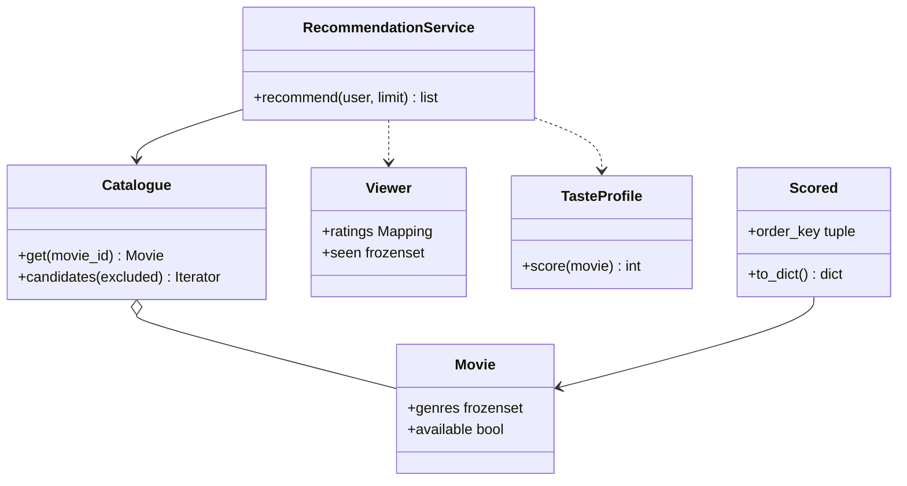
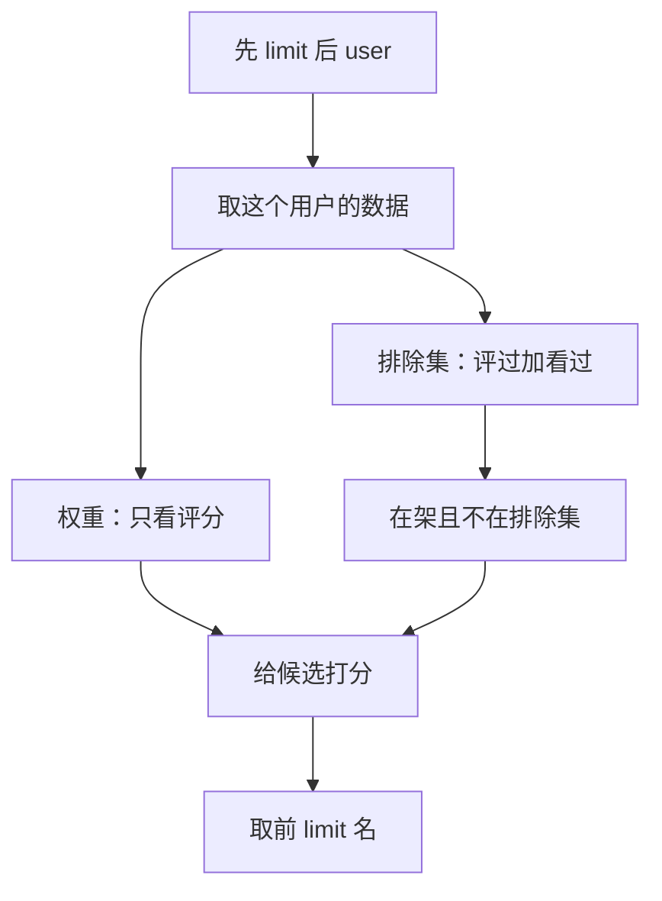

# 设计题解：电影推荐修复（Movie Recommendations）

## 题目与澄清

NextFrame 是一个电影推荐服务：给一个用户，从片库里挑出他还没接触过的电影，按"和他口味有多合"排好队，返回前几部。
线上的症状是：用户明明有评分和观看记录，拿到的却是空的、排错序的，甚至是他早就评过分的片子。
你拿到的是一个能跑但有缺陷的 `RecommendationService`，HTTP 适配器（读请求头、解析 `limit`、把错误写成状态码）已经写好、不能改。
任务是修好服务，保持对外的类名、方法签名和返回形状不变。这类题评的不是你会不会排序，而是你会不会把"谁有资格出现"和"出现的先后"拆成两件事，
把边界（50 含不含、评 3 分算什么、两条平局怎么分）逐条钉成测试。

公开接口只有一个类和一个方法：`RecommendationService(movies, ratings, history)` 与 `recommend(user, limit=10) -> list[dict]`。
`ServiceError` 带整数 `status` 和字符串 `code`。目录（movies）、评分（ratings）、观看记录（history）都是可信的输入，不用校验，只用复制。

先把合同用自己的话写成六条，这是开工前的第一件事：

1. **数据**：电影有唯一的正整数 `id`、标题、类型列表 `genres`（可重复）、非负整数 `popularity`、布尔 `available`；评分是 `{用户: {电影 id: 1 到 5}}`，
   观看记录是 `{用户: [电影 id]}`；两边的 id 都可能指向早已从目录删除的电影。构造时复制全部嵌套输入。
2. **校验**：`limit` 必须恰好是 `int`（布尔不算），范围 1 到 50，**含 50**，否则 `ServiceError(400, "invalid_limit")`；通过之后才看 `user`：必须是字符串且去掉空白后非空，
   否则 `(400, "invalid_user")`；两个都错时报 `invalid_limit`。没出现过的非空用户是合法的"冷启动"（cold start）用户。
3. **候选集**：在架（`available`）的电影，且 id 不在"这个用户评过分的 id 并上他看过的 id"里。评过就排除，不管几分、不管看没看过；只看这个用户自己的数据。
4. **偏好与分数**：用户的每条评分，只要这部电影还在目录里，就给它的每个**不同**类型加 `rating - 3`（3 分不加不减，1 分是 -2，5 分是 +2）；
   已下架但还在目录里的电影照样贡献；目录里已经没有的 id 忽略；观看记录本身不产生权重。候选的分数是它每个不同类型当前权重之和，可以是负数或零，**不能因此丢掉候选**。
5. **排序与结果**：分数降序，再热度降序，再 id 升序；最多返回 `limit` 条，不够就少返回；每条恰好是 `{id, title, score, popularity}`；目录为空或全部看过返回 `[]`；
   冷启动用户分数全是 0，所以只由热度和 id 决定。返回值是新对象：调用方改它，不影响服务；服务也不改传入的数据。
6. **HTTP**：`GET /recommendations?limit=10`，请求头 `X-User-ID`；成功 200 `{"recommendations": [...]}`；`limit` 缺省 10，解析不了是 400 `invalid_limit`；
   缺失或空白的用户是 401 `unauthorized`；`ServiceError` 变成 `{"error": 代码}`；其他路径 404 `not_found`，其他方法 405 `method_not_allowed`。

一个完整的例子，后面每一节都会回到它。目录有七部电影，用户 `mia`：

| id | 标题 | 类型 | 热度 | 在架 |
|---|---|---|---|---|
| 1 | Harbor Lights | drama、romance | 50 | 是 |
| 2 | Chrome Dawn | scifi、thriller | 80 | 是 |
| 3 | Paper Boats | drama | 30 | 是 |
| 4 | Last Signal | scifi | 60 | 是 |
| 5 | Laugh Track | comedy | 70 | 是 |
| 6 | Old Reel | drama、comedy | 90 | 否 |
| 7 | Night Shift | thriller、drama | 60 | 是 |

`mia` 的评分是 `{1: 5, 2: 1, 6: 4, 404: 5}`，观看记录是 `[5, 404, 77]`。

- **排除集**：评过分的 {1, 2, 6, 404} 并上看过的 {5, 404, 77}，得到 {1, 2, 5, 6, 77, 404}；再去掉已下架的 6。可推荐的只剩 3、4、7。
- **权重**：电影 1 打 5 分，drama 和 romance 各 +2；电影 2 打 1 分，scifi 和 thriller 各 -2；电影 6 已下架但打了 4 分，drama 和 comedy 各 +1；404 不在目录里，忽略。
  合计 drama 3、romance 2、comedy 1、scifi -2、thriller -2。
- **分数**：电影 3（drama）得 3；电影 7（thriller 加 drama）得 -2 加 3，等于 1；电影 4（scifi）得 -2。
- **结果**：`[(3, 分数 3), (7, 分数 1), (4, 分数 -2)]`；`limit=1` 时只有电影 3。

没有任何数据的用户 `zed`：所有分数是 0，按热度降序得 2（80）、5（70）、4 与 7（同为 60，id 小的先，所以 4 在 7 前）、1（50）、3（30）；电影 6 已下架，不出现。`limit=3` 得 `[2, 5, 4]`。

三个必须当场问清、答案会改代码的澄清问题：

- **评过分的电影，评分还算不算？** 要算。"排除"决定谁能出现，"偏好"决定谁排前面，两件事用同一份评分，但不能互相影响：
  把评过分的电影从候选里去掉，不等于把它的评分也扔掉；下架的电影同理，不能出现，但它的评分仍在塑造口味。上面 `mia` 的电影 6 就是这样。
- **3 分是什么意思？** 中性：既不喜欢也不讨厌，权重为 0。所以权重是 `rating - 3`，不是 `rating`。如果直接累加评分，打 1 分（明确不喜欢）的类型反而得到正权重，推荐就和口味反着来了。
- **分数是负数怎么办？** 留着。冷门又不对口味的电影排在最后，但仍然是合法候选；用户只要要求的 `limit` 够大，就应该看到它们。丢掉负分候选会让"全是不喜欢的类型"的用户拿到空列表。

**修复清单**：起始代码有五个缺陷，每一个都能用一个小例子复现（电影的类型、热度都在例子里写明）：

| 症状 | 缺陷 | 违反的规则 |
|---|---|---|
| `limit=50` 被拒绝，返回 400；49 可以 | 上界写成 `< 50`，应为 `<= 50` | 2 |
| 要 2 条，目录里有 4 个候选，返回 4 条 | 排完序直接返回整张表，没有按 `limit` 截断 | 5 |
| 用户评过分的电影 1 仍出现在结果里 | 排除集只含观看记录，没有并上评分 | 3 |
| 打 3 分的类型得 3 分，而不是 0；打 5 分得 5，而不是 2 | 权重累加的是 `rating`，应为 `rating - 3` | 4 |
| 三部同分同热度的电影（id 1、2、3）返回顺序 3、2、1 | 平局键里 id 取了负数，变成降序，应为升序 | 5 |

公开测试一共三个，起始代码只挂一个（评分之后的推荐）：评过分的电影还在、分数多出一截。其余两个（空目录、`limit=0`）本来就过，所以"公开测试全绿"不能说明修好了，五个缺陷里只有一个被公开测试抓到。

**起始代码已经做对的**：`limit` 的类型检查用 `type(limit) is int`，布尔被挡住；校验顺序是先 `limit`、后 `user`；构造时深拷贝了三份输入；类型用 `set` 去重，分数不会因为重复的类型而翻倍；
权重从完整目录读出，所以下架的电影照样贡献，目录里没有的评分 id 被忽略；返回的每一行都是新字典，改它不影响服务。隐藏测试仍然检查这些，修缺陷时不能把它们改坏。

**和真实工作区的差别**：这里没有数据库。HTTP 适配器 `dispatch` 在真实工作区里是固定文件，这里按它的行为重写了一份，才能把规则 6 变成测试；
`ServiceError` 在真实工作区由 `models.py` 提供，放进去时把本地定义换成 `from models import ServiceError`，其余原样使用。

范围之外：真正的推荐算法（协同过滤、嵌入向量、学习排序）、分页、鉴权令牌、目录与评分的在线更新（最后一部分在"扩展与追问"里回答）。

## 需求与分级

**第 1 关（约 15 分钟，先看清缺陷）**：不改代码，先把六条规则逐条对照现有服务，列出差异清单；再跑一遍公开测试，看哪几个失败。
这一关的产出是上面那张五行的修复清单，以及"已经做对的"一行。例子：用 `mia` 的数据在起始代码上跑，得到五条结果，电影 1 排第一、分数 14（drama 的权重被算成 9），这一行输出已经暴露了两个缺陷：
评过分的电影还在、权重没有减 3；再要 `limit=2` 却拿到五条，是第三个。

**第 2 关（约 20 分钟，校验与候选集）**：修 `limit` 的上界；排除集并上评分；评分与排除各走各的路径。这一关决定了"排除"和"打分"分成两个结构（决策一）。
例子：`mia` 评过分的电影 1，不论她打几分，都不出现；打 1 分和打 5 分的电影，在候选集里的待遇一样，在权重里的待遇相反。

**第 3 关（约 20 分钟，偏好与排序）**：权重改成 `rating - 3`；排序键改成 分数降序、热度降序、id 升序；按 `limit` 取前几名。
例子：三部同分同热度的电影，无论目录里的顺序怎么排，结果都是 id 1、2、3；同分时热度高的在前；冷启动用户只按热度和 id 排。

**第 4 关（选做，约 15 分钟，隔离、HTTP 与书面回答）**：验证输入输出的隔离（构造之后改传入的数据、改返回的数据，服务都不受影响）；检查适配器在五种 `limit` 文本下的反应；
然后回答三个书面问题：如何区分候选排除与评分；新策略中如何避免热度压倒个性化；请求期间目录和评分变化时用什么快照或版本。三问各有一张同主题的卡片。

## 核心对象与职责

| 类 | 单一职责 | 它拥有的不变量 |
|---|---|---|
| `ServiceError` | 带状态码与错误码的服务错误 | 对外只暴露整数 `status` 与字符串 `code` |
| `Movie` | 一部电影的冻结值 | 类型是 `frozenset`，重复的类型在进入服务时就消失了 |
| `Catalogue` | 持有全部电影（含下架），回答"谁有资格被推荐" | 排除只在这里发生：`candidates(excluded)` 只给出在架且不在排除集里的电影 |
| `Viewer` | 一个用户自己的评分与观看记录 | `seen` 是评过分的并上看过的；别的用户的数据拿不到 |
| `TasteProfile` | 由评分算出的类型权重，并给任意电影打分 | 只读评分；权重是 `rating - 3` 之和；不看 `available` |
| `Scored` | 一个打好分的候选 | 排序键 `(-分数, -热度, id)` 是全序；输出形状恰好四个字段 |
| `RecommendationService` | 校验请求，把上面几块串成流水线 | 构造之后不可变，没有任何会被请求改动的状态 |

`RecommendationService` 不保存任何随请求变化的东西：目录是冻结值的字典，评分与观看记录在构造时复制成不会被外部碰到的结构，所以并发调用不需要锁。
`Viewer` 和 `Scored` 都是"一个小值加一两个计算"，存在的唯一理由是各管一件事：前者把"这个用户的数据"圈在一起，后者把"排序键"与"输出形状"圈在一起。



一次 `recommend` 的路径：排除与打分在一个地方汇合，但各自读各自的东西。



## 关键设计决策

### 决策一：排除与打分，两个集合各读各的

**问题**：书面问题的第一问就是这个。推荐流水线里有两个容易混在一起的集合：不能出现的电影（评过的、看过的、下架的），和塑造口味的电影（评过分的）。
两个集合并不重合：评过分的电影既被排除、又贡献权重；下架的电影同样既被排除、又贡献权重；只看过、没评分的电影被排除，却不贡献；目录里已经没有的评分，既排除不了任何东西，也贡献不了任何东西。

**选项一**：一个循环，一次遍历目录：对每部电影，评过分的就"跳过"，没评过的就打分。写起来像一遍流水线，但"跳过"同时发生在两件事上：
权重要先于打分算完，而权重需要读到评过分的电影，所以评过分的电影不能在第一遍就被丢掉。把"评过分就 `continue`"写在算权重的循环里，下架的电影就悄悄不再贡献，用户的口味被截掉一块。

**选项二**：两条各自的路径：偏好只从评分走（`TasteProfile.build(catalogue, ratings)`，遍历评分、按 id 去整个目录里查，不看 `available`）；
候选只从目录走（`Catalogue.candidates(seen)`，遍历在架的电影，按排除集过滤）。两条路径只在最后汇合：`profile.score(movie)`。

```python
profile = TasteProfile.build(self._catalogue, viewer.ratings)   # 评分走偏好，下架的也算
eligible = self._catalogue.candidates(viewer.seen)               # 目录走候选，排除集在这里
scored = (Scored(movie, profile.score(movie)) for movie in eligible)
```

**选择**：选项二。哪个集合服务于哪件事一眼可见；改任何一件事（比如"看过的电影也算弱信号"）只动一条路径。
还有一个好处是可以分别测：`test_unavailable_rated_film_still_contributes_but_orphans_do_not` 一个用例同时钉住"下架的评分贡献"与"孤立评分被忽略"，`test_rated_films_are_excluded_whatever_the_rating_and_history` 钉住排除。
**模式**：这是"把筛选与评分分开"（filter, then score）的流水线，不需要任何模式的类层次。

### 决策二：一个全序键，加上取前几名

**问题**：三级排序（分数降序、热度降序、id 升序）有一个降序与升序混用的陷阱：`sort(reverse=True)` 会把三级一起反过来，id 也变成降序。起始代码就栽在这里：id 取了负数。

**选项一**：自己写比较函数（`functools.cmp_to_key`），每一级比一下，返回 -1、0、1。灵活，但写错一个符号很难一眼看出来，每次比较还要多一次函数调用。

**选项二**：多趟稳定排序：先按 id 升序，再按热度降序，最后按分数降序。Python 的排序是稳定的，所以结果正确；但它要三趟，而且三行顺序必须反着写（最次要的先排），读的人要在头脑里倒过来。

**选项三**：一个键函数返回元组 `(-分数, -热度, id)`，让升序排序一次完成。元组按字典序比较，降序的字段取负，升序的字段原样。因为 id 唯一，这个键是全序：任意两部电影都分得出先后，永远没有平局。

```python
@property
def order_key(self) -> tuple[int, int, int]:
    return (-self.score, -self.movie.popularity, self.movie.id)   # 降序取负，id 原样升序
```

**选择**：选项三，它是规则的一行翻译：三个字段、三种方向，和合同里的句子一一对应。
再往前一步：取前 `limit` 名不必先把全部候选排完序。`heapq.nsmallest(limit, scored, key=...)` 只维护大小为 `limit` 的堆，时间是 `O(N log limit)`，而 `limit` 最大是 50。
因为键是全序，`nsmallest` 与"完整排序再切片"的结果完全相同，`test_top_k_matches_a_full_sort_over_random_catalogues` 用四十个种子、三种 `limit` 逐一对比。
诚实的账：几千部电影的目录里，完整排序与堆的差别肉眼看不出；用堆，主要是让"最多 50 条"这件事在代价上也成立，而不只是在返回值上成立。
**模式**：不需要模式。键函数就是策略对象的最小形式：一个函数，没有状态。

### 决策三：权重以 3 为中心，整数，不求平均

**问题**：怎样把"用户给电影打了几分"变成"用户喜欢哪些类型"？

**选项一**：直接累加评分。打 5 分加 5、打 1 分加 1，所以喜欢与不喜欢都是正的，类型越常出现越"好"。口味被反着读：看了十部打 1 分的恐怖片，恐怖类型得 10 分，居然排在前面。
**选项二**：求每个类型的平均评分。平均能区分好坏，但丢掉了次数：看了一部打 5 分的和看了二十部都打 5 分的是同一个平均数，而且平均数是浮点，分数相等的判断会遇到舍入。
**选项三**：以 3 为中性点，累加 `rating - 3`：评 3 分贡献 0，评 4、5 分是正的，评 1、2 分是负的；次数自然累积；全是整数，相等就是相等。

**选择**：选项三，也是合同的规定。负权重不是 bug，是"不喜欢"的信号，所以候选分数可以为负；不丢弃负分候选（上面第三个澄清问题）。
如果哪天要加"评分越多越可信"之类，那是新策略，不是这个权重公式的修补。

### 决策四：在边界复制，在边界新建，里面用冻结值

**问题**：合同要求"复制传入的嵌套数据"和"返回分离的数据"：构造之后调用方改 `movies[0]["available"]`，服务不能变；调用方改返回的 `row["title"]`，服务也不能变。

**选项一**：构造时 `copy.deepcopy` 三份输入，原样存着；返回时 `copy.deepcopy` 结果。正确，但每次请求都深拷贝，而且内部仍然保存着可变的字典，每个方法都得记得别改它。
**选项二**：构造时一次性转成不可变的结构：电影变成冻结的 `Movie`（类型是 `frozenset`），评分只复制一层 `dict(given)`（键值都是不可变的整数），观看记录变成 `frozenset`。
返回时每条结果新建一个字典（`Scored.to_dict`），字段都是不可变的整数和字符串，所以不需要深拷贝。

**选择**：选项二。深拷贝解决的是"我不知道里面有什么"，而这里知道：电影字段是字符串、整数、字符串列表，评分是整数对整数。知道形状，就能转成不可变的值，
此后"不会被外面改"由结构保证，而不是靠每个方法记得不去改。两个注意：
`dict(given)` 只复制一层，因为里层是整数；如果评分的值是列表，这里就必须深一层。返回值里的 `title` 是字符串，不可变，所以也只需要新建外层字典。
**模式**：这是"防御性拷贝"（Defensive Copying）加"值对象"：一进一出各复制一次，中间不可变。线程安全是它的副产品：没有可变状态，就没有锁。

### 决策五：评分用一个函数，不用策略对象，也不缓存

**问题**：第二个书面问题暗示了"以后会有新的评分策略"。要不要现在就为它做抽象？

**选项一**：定义 `ScoringStrategy` 基类，当前的类型偏好写成 `GenreStrategy`，以后加 `PopularityBlendStrategy`。
**选项二**：现在只有一个策略，就把它写成一个函数（`TasteProfile.score`）；等第二个策略真的出现，再把它换成一个可传入的函数，调用方一行不改。

**选择**：选项二。只有一个实现的抽象基类是 Java 习惯；而且"以后的策略要什么输入"现在无从知道（只要评分？还要热度的分布？要不要时间？），今天写出的接口多半是错的。
Python 里函数就是对象，把评分变成可替换的东西，只需要把 `profile.score` 换成参数，不需要类层次（相关概念见 [[patterns.strategy|策略模式与可替换算法（Strategy）]]）。
同理不缓存每个用户的权重：缓存要处理"评分变了，缓存何时失效"，而这里每次请求只要 `O(评分数 + 候选数)`，没有什么值得省的；一个缓存换来的是一类新的不一致。

## 代码走读

下面是完整的参考解，之后挑四处看设计决策在代码里的位置。

%% code:begin solution.py %%
```python
"""NextFrame 电影推荐修复：参考解。放进真实工作区时，把下面的 `ServiceError` 换成 `from models import ServiceError`。

产品规则（编号即测试编号；全部来自合同，每一条都有测试）：

1. 目录与用户数据可信：电影有唯一正整数 id、字符串标题、字符串列表 genres（可重复）、非负整数 popularity、布尔 available；
   ratings 是 {用户: {电影 id: 1..5}}，history 是 {用户: [电影 id]}，里面的 id 可能指向已下架并从目录删除的电影。
   构造时把嵌套的输入全部复制一份；之后调用方怎么改自己的对象，都不影响服务。
2. 请求校验：limit 必须恰好是 `int`（bool 不算），范围 1..50（含 50），否则 `ServiceError(400, "invalid_limit")`；
   通过后再看 user：必须是 `str` 且 `strip()` 之后非空，否则 `ServiceError(400, "invalid_user")`。两项都错时报 limit。
   没出现过的非空用户是合法的冷启动用户；user 不做 strip 归一，`"bob "` 与 `"bob"` 是两个用户。
3. 候选集：目录里所有 `available` 为真、且 id 不在「该用户评过分的 id 并上看过的 id」里的电影。
   评过分就排除，与分数高低、是否在 history 里无关；只看这个用户自己的数据。
4. 偏好：该用户每条评分，若电影还在目录里，就给这部电影每个**不同**的类型加 `rating - 3`
   （3 分不加不减，1 分是 -2，5 分是 +2）；已下架但还在目录里的电影照样贡献；目录里已经没有的 id 直接忽略；
   history 不产生任何权重。候选的分数是它每个不同类型当前权重之和；分数可以是负数或零，不能因此丢掉候选。
5. 排序与结果：按 分数降序、popularity 降序、id 升序 排；最多返回 limit 条，不够就少返回；
   每条恰好是 {id, title, score, popularity}；目录为空或全部看过则返回 []；冷启动用户分数全是 0，
   所以只由 popularity 与 id 决定顺序。返回值是新对象：改它不影响服务，服务也不改传入的数据。
6. HTTP：`GET /recommendations?limit=10`，请求头 `X-User-ID`，成功 200 `{"recommendations": [...]}`；
   limit 缺省为 10，按整数解析，解析不了是 400 invalid_limit；缺失或空白的用户是 401 unauthorized；
   `ServiceError` 变成 `{"error": code}`；其他路径 404 not_found，其他方法 405 method_not_allowed（先看路径，再看方法，最后看用户）。
"""

from __future__ import annotations

import heapq
from collections.abc import Container, Iterator, Mapping
from dataclasses import dataclass
from operator import attrgetter
from typing import Any

MAX_LIMIT = 50
NEUTRAL_RATING = 3  # 打 3 分表示"无所谓"：权重是 rating 减去它
DEFAULT_LIMIT = "10"
ROUTE = "/recommendations"


class ServiceError(Exception):
    """对外的服务错误：status 是 HTTP 状态码，code 是稳定的错误码字符串。"""

    def __init__(self, status: int, code: str) -> None:
        self.status, self.code = status, code
        super().__init__(code)


@dataclass(frozen=True, slots=True)
class Movie:
    """目录里的一部电影。冻结，类型集合是 frozenset：类型只关心"有没有"，重复写几次都一样。"""

    id: int
    title: str
    genres: frozenset[str]
    popularity: int
    available: bool

    @classmethod
    def from_record(cls, record: Mapping[str, Any]) -> Movie:
        return cls(record["id"], record["title"], frozenset(record["genres"]), record["popularity"], record["available"])


class Catalogue:
    """目录：按 id 持有全部电影（含已下架的），并回答"谁有资格被推荐"。排除只在这里发生，打分与它无关。"""

    def __init__(self, records: list[dict]) -> None:
        self._by_id = {record["id"]: Movie.from_record(record) for record in records}

    def get(self, movie_id: int) -> Movie | None:
        return self._by_id.get(movie_id)

    def candidates(self, excluded: Container[int]) -> Iterator[Movie]:
        """在架、且不在排除集里的电影。"""
        return (movie for movie in self._by_id.values() if movie.available and movie.id not in excluded)


@dataclass(frozen=True)
class TasteProfile:
    """一个用户的类型权重。它只由评分算出，和"要不要排除"无关。"""

    weights: Mapping[str, int]

    @classmethod
    def build(cls, catalogue: Catalogue, ratings: Mapping[int, int]) -> TasteProfile:
        weights: dict[str, int] = {}
        for movie_id, rating in ratings.items():
            movie = catalogue.get(movie_id)
            if movie is None:  # 目录里已经没有的电影：评分无处可挂
                continue
            for genre in movie.genres:  # 下架的电影照样贡献，所以这里不看 available
                weights[genre] = weights.get(genre, 0) + rating - NEUTRAL_RATING
        return cls(weights)

    def score(self, movie: Movie) -> int:
        return sum(self.weights.get(genre, 0) for genre in movie.genres)


@dataclass(frozen=True, slots=True)
class Scored:
    """一个打好分的候选：排序键和输出形状都由它负责。"""

    movie: Movie
    score: int

    @property
    def order_key(self) -> tuple[int, int, int]:
        # 分数、热度取负数来表示降序；id 本身升序。id 唯一，所以这是全序，没有平局
        return (-self.score, -self.movie.popularity, self.movie.id)

    def to_dict(self) -> dict[str, Any]:
        return {
            "id": self.movie.id,
            "title": self.movie.title,
            "score": self.score,
            "popularity": self.movie.popularity,
        }


@dataclass(frozen=True, slots=True)
class Viewer:
    """一个用户自己的数据：评分与看过的片子。排除集和偏好都只从它取，别的用户的数据到不了这里。"""

    ratings: Mapping[int, int]
    watched: frozenset[int]

    @property
    def seen(self) -> frozenset[int]:
        """评过分的并上看过的：这些电影不再推荐。"""
        return frozenset(self.ratings) | self.watched


def valid_user(user: object) -> bool:
    return isinstance(user, str) and user.strip() != ""  # 只校验，不归一：查数据时仍用原样的字符串


def error_reply(status: int, code: str) -> tuple[int, dict]:
    return status, {"error": code}


def valid_limit(limit: object) -> bool:
    return type(limit) is int and 1 <= limit <= MAX_LIMIT  # type() 而不是 isinstance：True 是 int 的实例


class RecommendationService:
    """构造之后不可变，所以多个线程并发调用 `recommend` 不需要锁。"""

    def __init__(self, movies: list[dict], ratings: dict, history: dict) -> None:
        self._catalogue = Catalogue(movies)
        self._ratings = {user: dict(given) for user, given in ratings.items()}
        self._history = {user: frozenset(watched) for user, watched in history.items()}

    def _viewer(self, user: str) -> Viewer:
        return Viewer(self._ratings.get(user, {}), self._history.get(user, frozenset()))

    def recommend(self, user: str, limit: int = 10) -> list[dict]:
        if not valid_limit(limit):
            raise ServiceError(400, "invalid_limit")
        if not valid_user(user):
            raise ServiceError(400, "invalid_user")
        viewer = self._viewer(user)
        profile = TasteProfile.build(self._catalogue, viewer.ratings)  # 偏好：只看评分，下架的也算
        eligible = self._catalogue.candidates(viewer.seen)  # 排除：评过的、看过的、已下架的
        scored = (Scored(movie, profile.score(movie)) for movie in eligible)
        best = heapq.nsmallest(limit, scored, key=attrgetter("order_key"))  # 前 limit 名，不必排完全部
        return [item.to_dict() for item in best]


def parse_limit(query: Mapping[str, str] | None) -> int | None:
    """适配器的 limit 解析：缺省 10，用 `int()` 读文本；读不出来返回 None。"""
    try:
        return int((query or {}).get("limit", DEFAULT_LIMIT))
    except ValueError:
        return None


def dispatch(
    service: RecommendationService,
    method: str,
    path: str,
    user: str | None,
    body: object = None,
    query: Mapping[str, str] | None = None,
    key: str | None = None,
) -> tuple[int, dict]:
    """HTTP 适配器的行为：路径 → 方法 → 用户 → limit → 服务；服务的 ServiceError 变成错误体。"""
    if path != ROUTE:
        return error_reply(404, "not_found")
    if method != "GET":
        return error_reply(405, "method_not_allowed")
    if not valid_user(user):
        return error_reply(401, "unauthorized")
    limit = parse_limit(query)
    if limit is None:
        return error_reply(400, "invalid_limit")
    try:
        return 200, {"recommendations": service.recommend(user, limit)}
    except ServiceError as error:
        return error_reply(error.status, error.code)


if __name__ == "__main__":
    shows = [
        {"id": 1, "title": "Gold Rush", "genres": ["western", "comedy"], "popularity": 40, "available": True},
        {"id": 2, "title": "Dust Road", "genres": ["western"], "popularity": 25, "available": True},
        {"id": 3, "title": "Quiet Lab", "genres": ["scifi"], "popularity": 90, "available": True},
        {"id": 4, "title": "Slow Joke", "genres": ["comedy"], "popularity": 10, "available": True},
    ]
    demo = RecommendationService(shows, {"ana": {1: 5}}, {"ana": [2]})
    print(demo.recommend("ana"))  # Slow Joke 得 2 分排第一；Gold Rush 评过、Dust Road 看过，都不出现
    print(demo.recommend("newcomer", 2))  # 冷启动：按热度，Quiet Lab 与 Gold Rush
```
%% code:end %%

**第一处，`valid_limit` 与 `RecommendationService.recommend` 的开头**：`type(limit) is int` 而不是 `isinstance`，因为 `True` 是 `int` 的实例，`isinstance(True, int)` 为真，
布尔会混进来；上界写 `<= MAX_LIMIT`，常量放在模块顶部，不在函数里写字面量 50。两个校验各自 `raise`，顺序就是合同的顺序：先 `limit`、后 `user`。校验先于任何别的工作，所以失败的请求不碰数据。

**第二处，`Viewer.seen` 与 `Catalogue.candidates`**：`seen` 是 `frozenset(self.ratings) | self.watched`，评过分的并上看过的；起始代码这里只有 `self.watched`，缺陷三就是一个缺失的并集。
`candidates` 同时检查 `available` 与 `id not in excluded`，这是整个流水线里唯一做排除的地方（决策一）。

**第三处，`TasteProfile.build`**：遍历评分，`catalogue.get(movie_id)` 取不到就 `continue`（孤立评分被忽略）；取到了就对 `movie.genres` 这个 `frozenset` 里每个类型加 `rating - NEUTRAL_RATING`。
这里没有任何地方看 `available`，所以下架的电影照样贡献；`frozenset` 让同一个类型写了两遍的电影只计一次（构造时 `Movie.from_record` 里 `frozenset(record["genres"])` 完成了去重）。

**第四处，`Scored.order_key` 与 `heapq.nsmallest`**：键是 `(-分数, -热度, id)`；`nsmallest` 取出键最小的 `limit` 个，它们的顺序就是返回的顺序；
再用 `to_dict` 为每一条新建一个字典。这一段把规则五的所有句子一口气落地：排序、截断、形状、分离。

另外一处，`dispatch` 没有放进走读，却值得读：它把"解析 `limit`"和"调用服务"分成两个独立的 `try`。真实工作区的适配器把两者放在同一个 `try ... except ValueError` 里，
服务里要是什么地方抛出一个 `ValueError`，也会被说成 `invalid_limit`；参考解里的 `parse_limit` 只负责把文本变整数，所以这个混淆不会发生。

## 测试与自检

测试文件有 53 个用例（参数化展开后），分成七组：

- **合同的例子**：评分后的推荐、空目录、全部看过。
- **校验**：`limit` 的十种坏值（`0`、`-1`、`51`、`True`、`False`、`2.0`、`"5"`、`None`……）；`limit` 的边界（1 和 50 可以，默认 10）；`user` 的七种坏值；两个都错时报 `limit`；`"bob "` 与 `"bob"` 是两个用户。
- **候选集**：评过分的电影不论评分高低、是否看过都排除；看过的、下架的排除；别的用户的数据不影响自己。
- **权重与分数**：`rating - 3`（5 分得 2、3 分得 0、1 分得 -2）；类型重复只算一次；多部评分的权重相加；下架的评分仍贡献、孤立评分被忽略；负分候选保留；没有类型的电影分数为 0。
- **排序**：分数、热度、id 三级；冷启动只按热度和 id；`limit` 取排名前列、不够就少返回；四十个随机目录对照一个独立写的完整排序，三种 `limit`。
- **隔离**：每条结果恰好四个键；改返回值不影响后来的结果；构造之后改传入的数据不影响服务；调用不改传入的数据；八个线程在屏障处同时起跑、各调五十次，结果全部一致（服务没有可变状态，所以不需要锁，这条测试证明的正是这一点）。
- **HTTP**：成功与默认 `limit`；`abc`、空串、`2.5`、`1e1` 都是 400；`0`、`51`、`-3` 由服务报 400；`50` 通过；缺失或空白的用户 401；错路径 404；错方法 405。

测试用的是行为，不读任何私有属性。**对每个缺陷各做一次变异**：从起始代码出发，只修一个缺陷，其余四个保留，测试套件都至少有失败的用例：
只剩上界缺陷时失败 4 个、只剩不截断缺陷时失败 4 个、只剩排除集缺陷时失败 13 个、只剩权重缺陷时失败 7 个、只剩 id 方向缺陷时失败 3 个；五个缺陷都被测试单独抓住，不依赖哪两个凑在一起。

**两分钟演示**：打开 `mia` 的七部电影；先看 `recommend("mia")`，电影 3 分数 3、电影 7 分数 1、电影 4 分数 -2，电影 1、2、6 和看过的 5 一个都没有；
再 `recommend("mia", 1)`，只剩电影 3；`recommend("zed", 3)` 得 2、5、4，靠热度和 id 排；最后把返回值里的标题改掉，再调一次，标题没变。

## 扩展与追问

**新需求**

- **热度与个性化的混合**（第二个书面问题）：现在热度只在分数相同时当平局键，所以它不可能压过个性化：这本身就是一条保证。
  如果产品要把热度也算进分数，先要让两边在同一个尺度上：个性化分数的范围随用户评分数增长，热度可能是几百万的计数，直接相加热度必然淹没一切。
  做法：热度取对数或在目录内换成百分位（0 到 1），个性化分数除以它的最大绝对值（同样落在 -1 到 1），最后 `final = (1 - α) * 个性化 + α * 热度分位`，`α` 设上限（比如不超过 0.3）。
  再配一个监控：看"前 10 名里热度排名的中位数"，如果它随着 `α` 上调而陡增，说明热度开始压倒个性化。改动落在 `Scored.order_key` 与 `profile.score` 的调用处；`Catalogue`、`Viewer`、校验、HTTP 都不动。
- **冷启动的兜底**：现在冷启动用户靠热度和 id 排。想换成"按他注册时选的类型先给一点初始权重"，只是 `TasteProfile.build` 多读一个来源，`Catalogue` 与排序不动。
- **重看窗口**：允许"一年前看过的可以再推荐"：观看记录从 id 集合变成"id 加时间"，`Viewer.seen` 里按窗口过滤；排除的出口还是 `Catalogue.candidates`。
- **按类型限额**：前 10 名里同一个类型最多 3 部：在 `nsmallest` 之后多一步按序遍历、计数、跳过；排序键不动。

**并发与线程安全**

- 现在每个请求只读不写，所以不需要锁：目录是冻结值的字典，评分与观看记录构造后不被任何方法改动，`TasteProfile` 每次请求新建、用完就丢。
- **请求期间目录和评分会变**（第三个书面问题）：把"目录加所有评分"做成一个不可变的快照 `Snapshot(version, catalogue, ratings, history)`，服务只持有一个指向当前快照的引用。
  每个请求开头读一次这个引用（`snap = self._snapshot`），后面全部用 `snap`；写入方构造一个新快照，再一次赋值换掉引用。引用的赋值在 CPython 里是一步完成的，读者看到的要么是旧的、要么是新的，不会看到半新半旧。
  响应里可以带上 `snap.version`，便于排查"这批推荐是哪一版数据算出来的"。不要在一次请求里分别去读目录和评分：两次读之间数据可能已经换了，结果就是用新目录配旧评分，排除集和权重对不上。
- 如果底层是数据库：把整个请求放在一个读事务里（快照隔离级别，PostgreSQL 的 `REPEATABLE READ`，SQLite 的一次 `BEGIN` 读事务），原理相同：一个请求，一个一致的视图。

**持久化与规模**

- 数据放进数据库：`ratings(user, movie_id, rating)`、`history(user, movie_id)`、`movies(...)`。排除集是 `NOT EXISTS` 子查询，权重是评分表联接电影类型表 `GROUP BY genre`，
  候选的分数是一次联接和一次聚合；`ORDER BY score DESC, popularity DESC, id ASC LIMIT ?` 正是这里的排序键和截断。这时 `nsmallest` 换成数据库的 `ORDER BY ... LIMIT`，服务的流水线结构不变。
- 目录很大：每次请求对全部在架电影打分是 `O(N)`。可以按类型建倒排表：只给"和用户有权重的类型相交"的电影打分，再用"全局热度榜"补足不够 `limit` 的部分（冷启动用户走这条）。
- 用户很多：权重表按用户预算好、在评分写入时增量更新（评一部电影，只改这部电影的几个类型）。这时才需要缓存与失效，也是决策五里"值得做缓存"的那一天。

## 常见错误

- **上界写成 `< 50`**：合同写的是 1 到 50，含 50；这是起始代码的缺陷之一。边界的测试要两侧都写：50 通过、51 失败。
- **按 `limit` 忘了截断**：排完序直接返回，公开测试的例子只有一条结果，发现不了。用比 `limit` 多的候选写一条测试。
- **评过分的电影没被排除**：排除集只用了观看记录。评分排除和观看排除是两个来源，并集才是排除集。
- **权重直接累加评分**：评 1 分的类型得到正权重，口味被反着读；应该是 `rating - 3`，3 分是中性。
- **用 `sort(reverse=True)` 排三级键**：id 也变成降序。降序的字段取负，升序的字段原样，用升序排一次。
- **在算权重的循环里 `continue` 掉评过分或下架的电影**：权重就少了一块。偏好走评分、候选走目录，两条路径分开（决策一）。
- **用 `isinstance(limit, int)` 判断**：布尔通过了。用 `type(limit) is int`。
- **用 `str.strip()` 的结果当用户 id**：`" bob "` 的数据和 `"bob"` 的数据不是同一个人的；合同只要求"去掉空白后非空"，没有要求归一化。校验用 `strip()`，查数据用原样的字符串。
- **类型不去重**：一部电影的 `genres` 里写了两遍 `drama`，权重和分数就翻倍。进入服务时就转成 `frozenset`。
- **丢掉负分的候选**：这会让"全是不喜欢的类型"的用户拿到空列表；负分只影响排名，不影响资格。
- **返回内部字典，或只复制外层列表**：调用方改一行的标题，下一次调用就变了。每行都新建一个字典。
- **构造时只复制外层字典**：`ratings` 的内层字典被调用方改了，服务的偏好就变了。嵌套的结构每一层都要复制。
- **把适配器里的 `int()` 当成严格解析**：`int("1_0")` 是 10，`int(" 5 ")` 是 5，`int("+5")` 是 5，`int("５")`（全角数字）也是 5；这些都会被适配器当作合法的 `limit`。
  适配器是固定的，不要在服务里去补救；知道它的行为，才不会把"适配器放行了"当成"服务校验了"。
- **同一个 `try` 包住解析与服务调用**：服务里的 `ValueError` 会被错报成 `invalid_limit`。

## 45 分钟怎么分配

项目整体约 60 分钟，其中真正写代码的部分按 45 分钟安排：

- **0 到 8 分钟**：读合同，把六条规则抄成测试的名字。对着现有服务列缺陷清单（五处）；告诉智能体"先列差异，不要改代码"，你自己核对一遍。
- **8 到 16 分钟**：先让智能体给每个缺陷写一个会失败的测试（上界 50、截断、排除评过分的、权重减 3、id 升序）；期望值你自己用小例子手算，不照搬它的结果。
- **16 到 28 分钟**：逐个修；每修一个，跑全部测试，看只有对应的那一个变绿。排除集与偏好分成两条路径，这是设计决定，自己做。
- **28 到 36 分钟**：隔离与边界：构造之后改输入、改返回值、`limit` 为 50、冷启动、全部看过、负分候选；HTTP 的五种 `limit` 文本。
- **36 到 45 分钟**：回答三个书面问题（各留两三分钟），最后把适配器当黑盒跑一遍。

说出声的话：先说"排除和打分是两件事，评过分的电影既排除又贡献"；再说"排序键是 (-分数, -热度, id)，id 唯一所以是全序"；
最后说"输入输出在边界复制，里面全是不可变的值，所以不需要锁"。时间不够时先砍并发测试和第四关的演示，**绝不能砍**的是：`limit` 含 50、评过分排除、`rating - 3`、id 升序、按 `limit` 截断。

## 延伸阅读

- [[problems.social.music-streaming|音乐流媒体（Spotify）]]：同样是"由用户的历史生成候选"，对照这里的"排除加打分加取前几名"；那里把推荐留在了范围之外，这里把它做成了规则。
- [[solution-lcp-stockroom-inventory]]：同样是修复题：先列缺陷、再区分"已经做对的"，对照其中"先解析成合格的值再执行"的做法。
- 知识树上的叶子：防御性拷贝（Defensive Copying）、边界校验（Validate at the Boundary）、不变量与封装（Invariants），这个服务依赖的三个知识点。
- [[patterns.strategy|策略模式与可替换算法（Strategy）]]：什么时候一个评分函数应该升级成可替换的策略。
- [[python.dataclasses-enums|dataclass 与 Enum]]：冻结的值对象与 `slots` 的写法。
- [Python 文档：heapq.nsmallest](https://docs.python.org/3/library/heapq.html#heapq.nsmallest)：取前 k 名与完整排序的关系，以及键函数的用法。
- [Python 文档：排序指南](https://docs.python.org/3/howto/sorting.html)：稳定排序、键函数与元组键、多级排序的几种写法。
- [Python 文档：copy 模块](https://docs.python.org/3/library/copy.html)：浅拷贝与深拷贝的区别。
- [Python 文档：dataclasses](https://docs.python.org/3/library/dataclasses.html)：`frozen=True` 与 `slots=True`。
- [PostgreSQL 文档：事务隔离](https://www.postgresql.org/docs/current/transaction-iso.html)：一个请求读到一致的快照。
