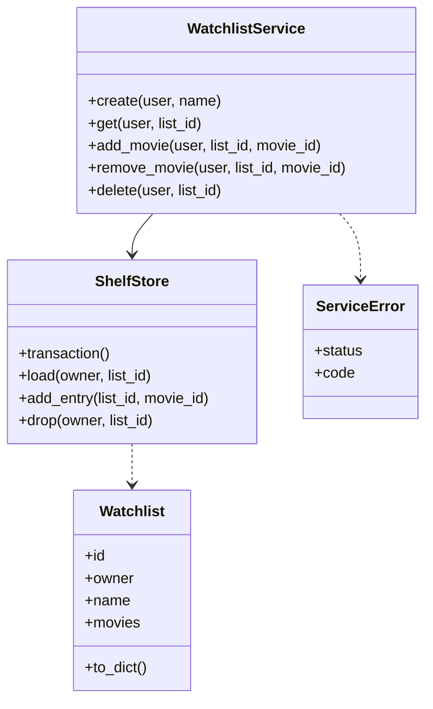
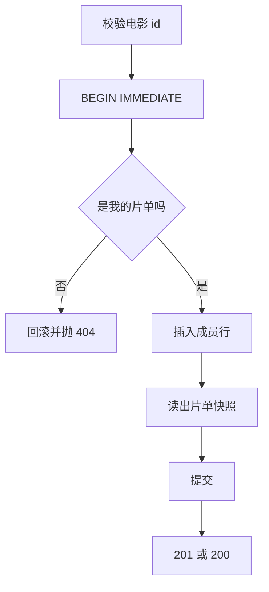

# 设计题解：私人片单修复（Persistent Private Watchlists）

## 题目与澄清

ScreenShelf 是一个私人片单服务：每个用户可以建任意多张命名的片单，每张片单是一组不重复的电影 id；数据存在 SQLite 文件里，所以同一个文件上再开一个服务实例，立刻看得到前一个实例提交过的内容。
线上的症状是：重复添加同一部电影也报"新建成功"，用户能读到甚至改到别人的片单，删除一张片单之后别的片单也不见了，从片单里移除一部电影会连带删掉同一张片单里的其他电影。
你拿到的是一个能跑但有缺陷的 `WatchlistService`，HTTP 适配器（读请求头、解析路径与 JSON、把 `ServiceError` 写成状态码）已经写好、不能改。
任务是修好服务，保持对外的类名、方法签名和返回形状不变。这类修复题评的不是你会不会写 CRUD，而是你能不能把合同里的每一句话落成一个具体的 SQL 条件或状态码，并且知道哪一条条件漏了会让哪个用户的数据消失。

公开接口是一个类、六个方法：`WatchlistService(database_path)`，`create(user, name)`，`get(user, list_id)`，`rename(user, list_id, name)`，`delete(user, list_id)`，`add_movie(user, list_id, movie_id)`，`remove_movie(user, list_id, movie_id)`，外加 `close()`。
`ServiceError` 带整数 `status` 和字符串 `code`。成功的写操作返回 `(状态码, 片单)` 或 `(204, None)`，失败抛 `ServiceError`。

先把合同用自己的话写成六条，这是开工前的第一件事：

1. **输入**：`user` 是适配器给的非空字符串，服务不再校验、不做 `strip`，大小写敏感。名字必须是 `str`，`strip()` 之后长度 1 到 80（按 Unicode 字符计），库里存的是 `strip` 之后的值，不合格是 `ServiceError(400, "invalid_name")`。
   电影 id 必须恰好是 `int`（布尔不算），范围 1 到 2147483647，否则 `(400, "invalid_movie")`；电影不需要存在于任何片库。片单 id 是 1 到 2⁶³-1 的整数，由适配器保证。
2. **创建、读取、改名**：`create` 返回 `(201, {id, owner, name, movies: []})`；id 由 SQLite 自增，新库从 1 起，删除之后也不复用；重名允许。`get` 返回同样的形状，`movies` 去重并升序；`rename` 返回 `(200, 更新后的片单)`；所有返回值都是新对象，改它不影响库里的数据。
3. **归属与顺序**：一张片单只属于一个用户。`get`、`rename`、`delete`、`add_movie`、`remove_movie` 对"不存在"和"别人的"一律 `(404, "list_not_found")`；新名字、电影 id 先于归属校验；被拒绝的操作什么都不改。
4. **成员与删除**：`add_movie` 第一次插入返回 `(201, 更新后的片单)`，已经存在返回 `(200, 原样的片单)`；成员关系只属于这一张片单。`remove_movie` 只删指定的那一部，返回 `(204, None)`，不在其中是 `(404, "movie_not_found")`，且先查片单、后查电影。`delete` 只删这一张片单和它的成员，返回 `(204, None)`，再删一次是 `list_not_found`。
5. **持久化与连接**：每个写操作返回之前提交；同一路径上的第二个实例立刻看得到；不同路径互不相干；`close` 释放连接；同一实例内的调用串行执行；不能用进程内存代替数据库。
6. **HTTP**：`POST /watchlists`、`GET|PATCH|DELETE /watchlists/{id}`、`POST /watchlists/{id}/movies`、`DELETE /watchlists/{id}/movies/{movie_id}`；请求头 `X-User-ID` 缺失或空白是 401；错误体是 `{"error": 代码}`；路径不合法或片单 id 超出 64 位是 404 `not_found`；路径合法但方法不对是 405；请求体多了或少了键是 400 `invalid_input`；204 没有响应体。

一个完整的例子，后面每一节都会回到它。两个用户 `ann` 和 `ben`，新库：

| 调用 | 结果 |
|---|---|
| `create("ann", "  Friday night  ")` | `(201, {id: 1, owner: "ann", name: "Friday night", movies: []})`，名字被 `strip` |
| `add_movie("ann", 1, 42)` | `(201, … movies: [42])` |
| `add_movie("ann", 1, 42)` | `(200, … movies: [42])`，已经在里面，原样返回 |
| `add_movie("ann", 1, 17)` | `(201, … movies: [17, 42])`，升序 |
| `get("ben", 1)`、`get("ann", 99)` | 都是 `404 list_not_found`，外人分不出"别人的"和"不存在" |
| `rename("ben", 1, "  ")` | `400 invalid_name`，校验先于归属 |
| `add_movie("ben", 1, 0)` | `400 invalid_movie` |
| `remove_movie("ann", 1, 5)` | `404 movie_not_found` |
| `remove_movie("ben", 1, 17)` | `404 list_not_found`，先查片单 |
| `remove_movie("ann", 1, 17)` | `(204, None)`，之后 `movies` 是 `[42]` |
| `delete("ann", 1)`，再 `delete("ann", 1)` | `(204, None)`，然后 `404 list_not_found` |
| `create("ann", "Next")` | `id` 是 2：刚删掉的 1 不会被复用 |

四个必须当场问清、答案会改代码的澄清问题：

- **别人的片单和不存在的片单，要不要分开报？** 不分开，都是 404 `list_not_found`。分开（别人的报 403）等于告诉外人"这个 id 有人在用"，用户可以靠枚举 id 探测别人的片单数量。
  代码上的后果是：归属判断写进 SQL 的 `WHERE`，一条语句同时回答"存在吗"和"是你的吗"，不会有"先查存在、再比较所有者"的两步。
- **添加已经存在的电影，是错误还是成功？** 是成功，状态码 200，表示"目标状态已经成立"，片单原样返回；201 只留给真的新增。这个区分只能来自数据库告诉你"这一行是不是新插入的"，不能靠先查再插。
- **校验和归属谁先？** 校验先。名字和电影 id 是请求自己的问题，与库里有什么无关；先校验，别人用坏参数去探测片单时也只会拿到 400，而不是 404 与 400 的差别（那个差别会泄露"这张单子是不是别人的"）。
- **被拒绝的操作能留下什么？** 什么都不留。一个写操作要么整体生效，要么整体不生效；这是事务的职责，不是每个方法手动撤销。

**范围之外**：片单分享给别人、每个用户的片单数量上限、电影目录（电影 id 不需要存在）、分页的实现（书面问题里回答）、多进程高并发下的 SQLite 调优（WAL、重试退避，只讨论）、鉴权令牌。

**修复清单**：起始代码有五个缺陷，每一个都能用一个小例子复现（名字和电影 id 是例子里的）：

| 症状 | 缺陷 | 违反的规则 |
|---|---|---|
| `create("ann", "  Friday night  ")` 之后读到的名字还带着两侧空格 | 校验算的是 `strip()` 之后的长度，返回和存储的却是原串 | 1 |
| `ben` 读、改名、往里加片，对的都是 `ann` 的片单：`get("ben", 1)` 返回 ann 的内容，`rename("ben", 1, "mine now")` 返回 200 | 读取片单的那条查询只按 id 找，没有带所有者；其余四个方法都用它做归属检查，所以一处漏洞开了五个方法 | 3 |
| 片单里已有 4，再 `add_movie` 一次 4 仍返回 201 | 用 `INSERT OR IGNORE` 避免了重复行，却没看这次是否真的插入，状态码写死了 201 | 4 |
| 片单是 `[4, 6, 8]`，`remove_movie(…, 6)` 之后剩下 `[6]`；再 `remove_movie(…, 99)`（根本不存在）返回 204，片单变成 `[]` | 删除条件写成"电影 id 不等于"，删的是其他所有电影；缺失的电影 99 反而"匹配"了一大堆，所以 `movie_not_found` 几乎出不来 | 4 |
| 删除 `ann` 的片单 1 之后，`ann` 的片单 2 和 `ben` 的片单都 404 | 删除条件写成"片单 id 不等于"，删的是除这张以外的所有片单（成员被外键级联一并带走） | 4 |

公开测试一共三个：建单加片、查不存在的片单、重复添加。起始代码只挂一个（重复添加返回 201），其余两个本来就过，所以"公开测试全绿"不能说明修好了：五个缺陷里公开测试只抓到一个，另外四个（名字、归属、删除、移除）要靠自己写的测试。

**起始代码已经做对的**（隐藏测试仍然检查它们，修缺陷时不能改坏）：每个写操作都包在 `with self._db` 里，成功提交、抛错回滚，所以第二个实例读得到已提交的内容；连接上开了外键，片单删除时成员被级联删除；
`AUTOINCREMENT` 保证删除后 id 不复用；名字和电影 id 先校验、后查片单；电影 id 用 `type(x) is int` 挡住布尔；读出来的片单是新字典和新列表；一把可重入锁让同一个实例内的调用串行。

**和真实工作区的差别**：真实工作区里 `ServiceError` 来自 `models.py`，把参考解另存为 `service.py` 时把本地的类换成 `from models import ServiceError`，其余不动；HTTP 适配器 `dispatch` 是固定文件，这里按它的行为重写了一份，才能把规则 6 变成测试；
`membership_count` 是参考解多出来的一个只读属性，只是测试的辅助、不在真实工作区的接口里；测试用它看出"删除片单后成员行是否真的被带走"（接口看不到孤儿行，因为 id 不复用）。表名和列名与起始代码相同（`watchlists`、`entries`）。

## 需求与分级

**第 1 关（约 15 分钟，先看清缺陷）**：不改代码，先把六条规则逐条对照现有服务，列出差异清单；再跑公开测试，看哪一个失败。这一关的产出是上面那张五行的修复清单，以及"已经做对的"一段。
例子：用 `ann` 与 `ben` 两个用户在起始代码上走一遍，`ben` 读 `ann` 的片单就成功，一行输出就暴露了归属缺陷；加两部电影再删一部，片单只剩被删的那部，暴露了移除缺陷。

**第 2 关（约 15 分钟，输入与归属）**：名字存 `strip` 之后的值；所有读、改、删、加、移的查询都带所有者。这一关决定了归属怎么表达（决策一）：写进 SQL，一处出口。
例子：`ben` 对 `ann` 的片单做五个操作，每一个都是 404，之后 `ann` 的片单每个字段都没变。

**第 3 关（约 20 分钟，成员与删除）**：添加返回 201 或 200，由数据库说了算（决策二）；移除只删指定的一部，缺失的电影 404；删除只删请求的那一张，成员级联（决策五）。
例子：同一部电影放进两张不同的片单，各自算新增；从一张里移除，另一张还在；删除一张片单，同一用户的另一张和别的用户的片单都完好。

**第 4 关（选做，约 15 分钟，持久化、并发与书面回答）**：事务边界与回滚（决策三）、一个连接加一把锁（决策四）；第二个实例读得到、关闭后重开还在；然后回答三个书面问题：失败的修改怎样保证已提交的数据不变；什么约束防止重复成员；大片单怎样分页又不松动归属。三问各有一张同主题的卡片。

## 核心对象与职责

| 类 | 单一职责 | 它拥有的不变量 |
|---|---|---|
| `ServiceError` | 带状态码与错误码的服务错误 | 对外只暴露整数 `status` 与字符串 `code` |
| `Watchlist` | 一张片单读出来的冻结快照 | 成员是升序、不重复的元组；它没有指向库的引用，所以调用方改不到库 |
| `ShelfStore` | 持有唯一的 SQLite 连接和锁；每条 SQL 都在这里；事务的开、提交、回滚也只在这里 | 带所有者条件的语句是读写片单的唯一入口；一个事务从 `BEGIN IMMEDIATE` 到提交或回滚，中间不被别的线程插入 |
| `WatchlistService` | 校验输入、把"这一行有没有被改到"翻译成状态码、决定一个操作的事务范围 | 校验在事务之外、先于任何库操作；写操作的返回值是事务内读出的快照 |

`ShelfStore` 和 `WatchlistService` 的分工是：前者只会说"这一行改到了没有"（布尔），不知道状态码；后者只会说"这个结果是 201 还是 200 还是 404"，不写 SQL。
这样改状态码的规则只动服务，改 SQL 或换库只动 `ShelfStore`。`Watchlist` 是返回值的形状，`to_dict` 每次新建字典和列表，调用方改返回值伤不到库，也伤不到别的调用方。
服务本身不保存任何随请求变化的状态，所以并发的安全完全由 `ShelfStore` 的锁和数据库的约束承担。



一次写操作（以 `add_movie` 为例）的路径：校验在最外面，其余全在一个事务里。



## 关键设计决策

### 决策一：所有者条件写进 SQL，"不存在"和"别人的"是同一个 404

**问题**：五个方法都要先确认"这张片单是调用者的"。起始代码把这件事收在一个共用的读取函数里，这个函数漏了所有者，五个方法同时越权。归属检查应该放在哪一层、怎么表达，才能让漏掉它变得不可能？

**选项一**：先按 id 读出整行，再在 Python 里比较 `row.owner == user`。能工作，但"读出来"和"比较"是两步，哪个方法忘了比较，就读得到别人的行；而且写操作（改名、删除）往往只想知道"改到了没有"，读出整行是多余的往返。
**选项二**：先查"这个 id 存在吗"，不存在报 404，存在但不是你的报 403。语义上最细，却等于给外人一个枚举 id 的探针；合同也明确规定两种情况一样。
**选项三**：把所有者写进每条语句的 `WHERE`：读是 `WHERE id = ? AND owner = ?`，改名与删除是 `UPDATE/DELETE … WHERE id = ? AND owner = ?`，再用 `rowcount` 判断有没有命中。"不存在"和"别人的"在 SQL 里本来就是同一件事：没有一行同时满足两个条件。

```python
cursor = conn.execute("DELETE FROM watchlists WHERE id = :shelf AND owner = :who", {"shelf": list_id, "who": owner})
if cursor.rowcount != 1:      # 没有一行同时满足：不存在，或不是你的
    raise ServiceError(404, "list_not_found")
```

**选择**：选项三。归属不再是"一段要记得写的代码"，而是每条语句签名的一部分：`ShelfStore` 里读写片单的方法都要求传 `owner`，不传就调不了。
对成员表的写入（`add_entry`、`remove_entry`）本身不带 `owner`（成员行没有这一列），所以它们永远排在 `owns(owner, list_id)` 之后，两步在同一个事务里，中间没有别人插进来。
**模式**：没有套用模式。这是"把权限条件放在数据的访问路径上"，而不是放在一个要靠记性调用的检查函数里。

### 决策二：重复由主键裁决，用 `rowcount` 区分 201 和 200

**问题**：添加电影要告诉调用方"这次是新增，还是早就在里面"。起始代码用 `INSERT OR IGNORE` 避免了重复行，却把状态码写死成 201。

**选项一**：先 `SELECT` 看在不在，不在才 `INSERT`。两步之间别的线程或别的进程可以插进同一行：两个请求都看到"不在"，都插，后到的撞上主键报 `IntegrityError`，或者两个都返回 201。要补就得再套一层锁，而锁只管同一个进程。
**选项二**：直接 `INSERT`，捕获 `IntegrityError`，把它翻译成 200。主键冲突确实是数据库在裁决，但异常是粗的：外键失败、非空失败也是 `IntegrityError`，只靠类型分不清；而且在事务里异常之后事务的状态要小心处理。
**选项三**：`INSERT … ON CONFLICT (list_id, movie_id) DO NOTHING`，然后看 `cursor.rowcount`：插进去是 1，因为主键冲突而什么都没做是 0。一条语句，数据库自己裁决，没有检查与插入之间的空隙。

```python
cursor = conn.execute(
    "INSERT INTO entries (list_id, movie_id) VALUES (:shelf, :movie) ON CONFLICT (list_id, movie_id) DO NOTHING",
    {"shelf": list_id, "movie": movie_id},
)
status = 201 if cursor.rowcount == 1 else 200
```

**选择**：选项三。`(list_id, movie_id)` 的联合主键是重复成员的唯一防线（书面问题的第二问），`rowcount` 是这条防线给出的回话。
`ON CONFLICT DO NOTHING` 比 `OR IGNORE` 窄：`OR IGNORE` 会把非空约束、检查约束失败的行也悄悄丢掉，而 `ON CONFLICT(…)` 只对指定的那个冲突什么都不做，其他约束照常报错。
**模式**：没有套用模式；这是"让约束做裁判，代码只读裁判的判决"。

### 决策三：一个写操作一个事务，校验放在事务之外

**问题**：合同要求"被拒绝的操作什么都不改"和"返回之前已经提交"。要在哪里开事务、哪里提交、哪里回滚，才能让每个方法都不用手写撤销？

**选项一**：每个方法自己 `commit()`，出错自己 `rollback()`。十个出口、十份撤销，漏一个就留下半截写入或没提交的写入。
**选项二**：用 `with conn:`（sqlite3 的连接上下文管理器）：块正常结束提交，抛异常回滚。简洁，但 Python 3.11 的默认事务模式是"遇到第一条 `INSERT/UPDATE/DELETE` 才隐式 `BEGIN`"，也就是延迟事务；先读后写的流程（先查归属、再插入）在读的时候并没有写锁。
**选项三**：`ShelfStore.transaction()` 一个上下文管理器：持锁、`BEGIN IMMEDIATE`、`yield`、成功提交、任何异常回滚并重新抛出。服务的每个写方法就是 `with self._store.transaction():` 加几行业务。

```python
@contextmanager
def transaction(self):
    with self._lock:
        self._conn.execute("BEGIN IMMEDIATE")
        try:
            yield
        except BaseException:
            self._conn.rollback()
            raise
        self._conn.commit()
```

**选择**：选项三，理由有两个。其一，"失败的修改不改已提交的数据"成了结构性的：业务代码里的 `raise ServiceError(404, …)` 穿过 `with` 就触发回滚，没有第二种退出方式。
其二，`BEGIN IMMEDIATE` 一开始就拿到写锁。用两个服务实例连同一个文件、八个线程抢同一部电影，把它换成默认的延迟 `BEGIN` 再跑：几个线程立刻得到 `OperationalError: database is locked`，因为"先读、后升级为写"遇到另一个连接的写事务，SQLite 不会等待而是直接报忙（等待会造成死锁）。
`BEGIN IMMEDIATE` 把"等"放在开头，由 `timeout`（默认 5 秒）负责，等到就继续。
校验（名字、电影 id）放在 `transaction()` 之外：它们不碰库，没必要占着写锁，也保证了"坏参数不会开事务"。
**模式**：这是"工作单元"（Unit of Work）最小的形式：一个上下文管理器，不需要类层次。

### 决策四：一个连接加一把锁，不用每次新连接

**问题**：合同说"同一个实例内的调用串行"，还要 `":memory:"` 也能用。连接该怎么持有？

**选项一**：每次调用新开一个连接（`sqlite3.connect(path)`），用完关闭。文件库能工作，每次还白付一次打开的成本；但 `":memory:"` 的每个连接是一个全新的空库，数据立刻消失，直接违反合同。
**选项二**：一个连接，`check_same_thread=False`，不加锁，指望 `sqlite3` 模块自己串行。模块确实不会让两个线程同时在一个连接上执行语句，但它保证不了一个事务的完整：线程 A 的 `BEGIN` 和线程 B 的语句共用一个连接，B 的语句会被算进 A 的事务里，A 回滚时把 B 的写入一起撤销。
**选项三**：一个连接加一把 `RLock`，读写都在锁里；写操作在 `transaction()` 里持锁到提交，事务不会被别的线程切开。

**选择**：选项三。锁保护的不是业务不变量（那是约束和语句的事），而是"一个连接上同一时刻只有一个事务"。
线程安全的诚实账：GIL 让单个字节码原子，却不让"先查归属再插入"成为一个整体；真正保证整体的是锁加事务，多进程时则是数据库的写锁。
用 `RLock` 而不是 `Lock`，是因为 `transaction()` 持锁时，里面调用的 `ShelfStore` 方法自己也会取锁（每个方法都自带锁，没有哪个入口能绕开它）。
**模式**：不需要连接池：一个服务实例一个连接，规模是一个文件、一个实例。

### 决策五：删除交给外键级联；id 交给 `AUTOINCREMENT`

**问题**：删除一张片单要同时去掉它的成员；已删除片单的 id 不能被新片单拿走（否则旧的链接会指向别人的新片单）。

**选项一**：手写两条语句：先 `DELETE FROM entries WHERE list_id = …`，再 `DELETE FROM watchlists …`。显式，但这是两步，第二步没命中（不是你的）时第一步不能留下；顺序写反了会撞外键。
**选项二**：`entries.list_id REFERENCES watchlists (id) ON DELETE CASCADE`，删片单就够了；代价是 SQLite 的外键默认关闭、按连接开启：每个新连接都要 `PRAGMA foreign_keys = ON`，忘了的话级联悄悄不生效，成员行变成孤儿。
对 id：`INTEGER PRIMARY KEY` 在删除了最大的那一行之后，会把同一个值再发给下一张新片单；`AUTOINCREMENT` 用单独的计数表保证单调。

**选择**：级联加 `AUTOINCREMENT`，并且用测试把两个"悄悄失效"的地方钉住：删除一张有两部电影的片单之后，`membership_count` 恰好减 2（把 `PRAGMA` 去掉，这个测试失败）；
删掉最后一张片单再新建，id 继续递增（把 `AUTOINCREMENT` 去掉，这个测试失败）。孤儿行通过接口看不到，因为 id 不复用，所以只能靠一个只读计数暴露它。
**模式**：没有套用模式；把不变量交给数据库声明，比在代码里手写更不容易漏。

### 决策六：简单的赢：不抽象仓储接口，不缓存，不用 ORM

**问题**：这是一个"持久化服务"，容易条件反射地加一层 `WatchlistRepository` 抽象基类（带 `SqliteWatchlistRepository` 实现）、一个对象关系映射、一层读缓存。要加吗？

**选项一**：抽象仓储接口加一个 SQLite 实现。只有一个实现的接口是 Java 习惯：今天写出的方法签名多半不是明天第二个实现要的；而且换库时真正要改的是 SQL 方言和事务语义，接口帮不上。
**选项二**：缓存"片单 id 到快照"。缓存要回答"谁在什么时候失效它"；这里每次读是一条主键查询，没有值得省的，缓存换来的是一类新的不一致（别的进程改了文件，本进程缓存还是旧的）。
**选项三**：两个类，一个具体的 `ShelfStore` 和一个具体的 `WatchlistService`；SQL 直接写，用 `sqlite3` 的参数绑定。

**选择**：选项三。`ShelfStore` 存在是因为它有自己的职责（连接、锁、事务、全部 SQL），不是因为"要有一层"；`WatchlistService` 不转发调用，它做校验和状态码。
如果有一天真的要换成 PostgreSQL，要改的恰好是 `ShelfStore` 一个类的内部，调用方一行不动；到那时才抽接口，签名由两个真实的实现一起决定。
这是"让数据库做数据库的事"：唯一性、级联、事务、原子性都在库里，没有一行代码在重复它们。

## 代码走读

下面是完整的参考解，之后挑四处看设计决策在代码里的位置。

%% code:begin solution.py %%
```python
"""ScreenShelf 私人片单修复：参考解。放进真实工作区时，另存为 `service.py`，并把本地的 `ServiceError` 换成
`from models import ServiceError`；`dispatch` 在真实工作区是固定文件，这里按它的行为重写了一份，好让第 6 条也能被测试。

产品规则（编号即测试编号，每一条都有测试）：

1. 输入：user 是适配器给的非空字符串，服务不再校验，也不做 strip，`"Ann"` 和 `"ann"` 是两个用户。
   name 必须是 `str`，`strip()` 之后长度 1..80（按 Unicode 字符计），存的是 strip 之后的值；不合格 `ServiceError(400, "invalid_name")`。
   movie_id 必须恰好是 `int`（bool 不算），范围 1..2147483647，否则 `(400, "invalid_movie")`；电影不需要出现在任何片库里。
   list_id 是 1..2**63-1 的整数，由适配器保证。
2. 创建、读取、改名：create 返回 `(201, {id, owner, name, movies: []})`；id 由 SQLite 自增，新库从 1 起，删除后也不复用；重名允许。
   get 返回同样的形状，movies 去重并升序；rename 返回 `(200, 更新后的片单)`；所有返回值都是新对象，改它不影响库里的数据。
3. 归属与校验顺序：一张片单只属于一个用户；get、rename、delete、add_movie、remove_movie 对「不存在」和「别人的」
   一律 `(404, "list_not_found")`，外人分不出这两种；新名字、电影 id 先于归属校验；被拒绝的操作什么都不改。
4. 成员与删除：add_movie 第一次插入返回 `(201, 更新后的片单)`，已经存在返回 `(200, 原样的片单)`；成员关系只属于这一张片单；
   remove_movie 只删指定的那一部，返回 `(204, None)`，不在其中是 `(404, "movie_not_found")`（先查片单、后查电影）；
   delete 只删这一张片单和它的成员，返回 `(204, None)`，再删一次是 `list_not_found`。
5. 持久化与连接：每个写操作返回之前提交；同一路径上的第二个服务实例立刻看得到；不同路径互不相干；
   close 释放连接且可重复调用；同一实例内的调用串行执行；不能用进程内存代替数据库。
6. HTTP：`POST /watchlists`、`GET|PATCH|DELETE /watchlists/{id}`、`POST /watchlists/{id}/movies`、`DELETE /watchlists/{id}/movies/{movie_id}`；
   请求头 `X-User-ID` 缺失或空白是 401 `unauthorized`；错误体是 `{"error": 代码}`；路径不合法或 list id 超出 64 位是 404 `not_found`；
   路径合法但方法不对是 405 `method_not_allowed`；请求体多了或少了键是 400 `invalid_input`；204 没有响应体。
"""

from __future__ import annotations

import re
import sqlite3
import threading
from collections.abc import Iterator, Mapping
from contextlib import contextmanager
from dataclasses import dataclass
from typing import Any

MAX_NAME = 80
MAX_MOVIE_ID = 2**31 - 1
MAX_LIST_ID = 2**63 - 1

SCHEMA = """
CREATE TABLE IF NOT EXISTS watchlists (
    id    INTEGER PRIMARY KEY AUTOINCREMENT,
    owner TEXT NOT NULL,
    name  TEXT NOT NULL
);
CREATE TABLE IF NOT EXISTS entries (
    list_id  INTEGER NOT NULL REFERENCES watchlists (id) ON DELETE CASCADE,
    movie_id INTEGER NOT NULL,
    PRIMARY KEY (list_id, movie_id)
);
"""


class ServiceError(Exception):
    """对外的服务错误：status 是 HTTP 状态码，code 是稳定的错误码字符串。"""

    def __init__(self, status: int, code: str) -> None:
        self.status, self.code = status, code
        super().__init__(code)


def clean_name(name: object) -> str:
    """名字合法才返回 strip 之后的值：存进库里的就是这个，不是调用方传来的原样。"""
    if not isinstance(name, str):
        raise ServiceError(400, "invalid_name")
    trimmed = name.strip()
    if not 1 <= len(trimmed) <= MAX_NAME:
        raise ServiceError(400, "invalid_name")
    return trimmed


def check_movie(movie_id: object) -> int:
    """用 `type(...) is int` 挡住 bool：`True` 是 int 的子类，会被 isinstance 放行。"""
    if type(movie_id) is not int or not 1 <= movie_id <= MAX_MOVIE_ID:
        raise ServiceError(400, "invalid_movie")
    return movie_id


def list_missing() -> ServiceError:
    """「不存在」和「别人的」是同一个错误：每次新建，不共享异常对象。"""
    return ServiceError(404, "list_not_found")


@dataclass(frozen=True, slots=True)
class Watchlist:
    """一张片单读出来的快照：冻结的值，成员是元组，调用方拿不到库里的任何东西。"""

    id: int
    owner: str
    name: str
    movies: tuple[int, ...]

    def to_dict(self) -> dict[str, Any]:
        return {"id": self.id, "owner": self.owner, "name": self.name, "movies": list(self.movies)}


class ShelfStore:
    """SQLite 这一层：持有唯一的连接和锁，每条 SQL 都带着所有者条件，事务只在这里开关。"""

    def __init__(self, database_path: str) -> None:
        self._conn = sqlite3.connect(database_path, check_same_thread=False)
        self._conn.execute("PRAGMA foreign_keys = ON")  # 每个连接都要开：不开，级联删除就静默失效
        self._conn.executescript(SCHEMA)
        self._lock = threading.RLock()

    def close(self) -> None:
        with self._lock:
            self._conn.close()  # 关一个已关闭的连接什么也不做，所以 close 可以重复调用

    @contextmanager
    def transaction(self) -> Iterator[None]:
        """持锁、立即取得写权限、成功就提交、任何异常都回滚。读后写的流程必须整个包在里面。"""
        with self._lock:
            self._conn.execute("BEGIN IMMEDIATE")
            try:
                yield
            except BaseException:
                self._conn.rollback()
                raise
            self._conn.commit()

    def load(self, owner: str, list_id: int) -> Watchlist | None:
        """一条语句读出片单和它的成员：所有者条件在 WHERE 里，别人的片单就是读不到。"""
        with self._lock:
            rows = self._conn.execute(
                "SELECT s.id, s.owner, s.name, m.movie_id FROM watchlists AS s "
                "LEFT JOIN entries AS m ON m.list_id = s.id "
                "WHERE s.id = :shelf AND s.owner = :who ORDER BY m.movie_id",
                {"shelf": list_id, "who": owner},
            ).fetchall()
        if not rows:
            return None
        head = rows[0]
        return Watchlist(head[0], head[1], head[2], tuple(row[3] for row in rows if row[3] is not None))

    def owns(self, owner: str, list_id: int) -> bool:
        with self._lock:
            row = self._conn.execute(
                "SELECT 1 FROM watchlists WHERE id = :shelf AND owner = :who", {"shelf": list_id, "who": owner}
            ).fetchone()
        return row is not None

    def insert_list(self, owner: str, name: str) -> int:
        with self._lock:
            cursor = self._conn.execute("INSERT INTO watchlists (owner, name) VALUES (:who, :title)", {"who": owner, "title": name})
        assert cursor.lastrowid is not None  # 只为类型检查收窄；删掉这行不改变程序的保证
        return cursor.lastrowid

    def rename(self, owner: str, list_id: int, name: str) -> bool:
        with self._lock:
            cursor = self._conn.execute(
                "UPDATE watchlists SET name = :title WHERE id = :shelf AND owner = :who",
                {"title": name, "shelf": list_id, "who": owner},
            )
        return cursor.rowcount == 1

    def drop(self, owner: str, list_id: int) -> bool:
        """只删这一行；成员由外键的 ON DELETE CASCADE 带走。"""
        with self._lock:
            cursor = self._conn.execute("DELETE FROM watchlists WHERE id = :shelf AND owner = :who", {"shelf": list_id, "who": owner})
        return cursor.rowcount == 1

    def add_entry(self, list_id: int, movie_id: int) -> bool:
        """主键冲突才什么都不做（比 OR IGNORE 窄）；真的插入了返回 True，已经存在返回 False。"""
        with self._lock:
            cursor = self._conn.execute(
                "INSERT INTO entries (list_id, movie_id) VALUES (:shelf, :movie) "
                "ON CONFLICT (list_id, movie_id) DO NOTHING",
                {"shelf": list_id, "movie": movie_id},
            )
        return cursor.rowcount == 1

    def remove_entry(self, list_id: int, movie_id: int) -> bool:
        with self._lock:
            cursor = self._conn.execute(
                "DELETE FROM entries WHERE list_id = :shelf AND movie_id = :movie",
                {"shelf": list_id, "movie": movie_id},
            )
        return cursor.rowcount == 1

    def entry_count(self) -> int:
        with self._lock:
            return self._conn.execute("SELECT COUNT(*) FROM entries").fetchone()[0]


class WatchlistService:
    """校验输入、决定状态码、把写操作包进事务；不拼 SQL，也不保存任何随请求变化的状态。"""

    def __init__(self, database_path: str) -> None:
        self._store = ShelfStore(database_path)

    def close(self) -> None:
        self._store.close()

    @property
    def membership_count(self) -> int:
        """全库的成员行数：测试用它看出删除片单后成员是否真的被带走（API 看不到孤儿行）。"""
        return self._store.entry_count()

    def _snapshot(self, user: str, list_id: int) -> Watchlist:
        found = self._store.load(user, list_id)
        if found is None:
            raise list_missing()
        return found

    def get(self, user: str, list_id: int) -> dict[str, Any]:
        return self._snapshot(user, list_id).to_dict()

    def create(self, user: str, name: str) -> tuple[int, dict[str, Any]]:
        trimmed = clean_name(name)
        with self._store.transaction():
            new_id = self._store.insert_list(user, trimmed)
            return 201, self._snapshot(user, new_id).to_dict()

    def rename(self, user: str, list_id: int, name: str) -> tuple[int, dict[str, Any]]:
        trimmed = clean_name(name)  # 先校验名字，再看归属
        with self._store.transaction():
            if not self._store.rename(user, list_id, trimmed):
                raise list_missing()
            return 200, self._snapshot(user, list_id).to_dict()

    def delete(self, user: str, list_id: int) -> tuple[int, None]:
        with self._store.transaction():
            if not self._store.drop(user, list_id):
                raise list_missing()
        return 204, None

    def add_movie(self, user: str, list_id: int, movie_id: int) -> tuple[int, dict[str, Any]]:
        movie = check_movie(movie_id)
        with self._store.transaction():
            if not self._store.owns(user, list_id):
                raise list_missing()
            inserted = self._store.add_entry(list_id, movie)
            return (201 if inserted else 200), self._snapshot(user, list_id).to_dict()

    def remove_movie(self, user: str, list_id: int, movie_id: int) -> tuple[int, None]:
        movie = check_movie(movie_id)
        with self._store.transaction():
            if not self._store.owns(user, list_id):
                raise list_missing()
            if not self._store.remove_entry(list_id, movie):
                raise ServiceError(404, "movie_not_found")
        return 204, None


ID_DIGITS = r"[1-9][0-9]*"  # 不允许前导零，也不允许 0
ROUTE = re.compile(rf"/watchlists(?:/({ID_DIGITS})(?:/(movies)(?:/({ID_DIGITS}))?)?)?")


def error_reply(status: int, code: str) -> tuple[int, dict[str, str]]:
    return status, {"error": code}


def has_only(body: object, key: str) -> bool:
    return isinstance(body, dict) and set(body) == {key}


def dispatch(
    service: WatchlistService,
    method: str,
    path: str,
    user: str | None,
    body: object = None,
    query: Mapping[str, str] | None = None,
    key: str | None = None,
) -> tuple[int, Any]:
    """HTTP 适配器：先看用户，再看路径，再看方法与请求体，最后才调服务。"""
    if not isinstance(user, str) or not user.strip():
        return error_reply(401, "unauthorized")
    found = ROUTE.fullmatch(path)
    if found is None:
        return error_reply(404, "not_found")
    raw_list, tail, raw_movie = found.groups()
    if raw_list is not None and (len(raw_list) > 19 or int(raw_list) > MAX_LIST_ID):
        return error_reply(404, "not_found")  # 先比长度再转换：避免把超长数字串变成整数
    list_id = int(raw_list) if raw_list is not None else 0
    shape = (method, raw_list is not None, tail is not None, raw_movie is not None)
    try:
        if shape == ("POST", False, False, False):
            return service.create(user, body["name"]) if has_only(body, "name") else error_reply(400, "invalid_input")
        if shape == ("GET", True, False, False):
            return 200, service.get(user, list_id)
        if shape == ("PATCH", True, False, False):
            return service.rename(user, list_id, body["name"]) if has_only(body, "name") else error_reply(400, "invalid_input")
        if shape == ("DELETE", True, False, False):
            return service.delete(user, list_id)
        if shape == ("POST", True, True, False):
            if not has_only(body, "movie_id"):
                return error_reply(400, "invalid_input")
            return service.add_movie(user, list_id, body["movie_id"])  # type: ignore[index]
        if shape == ("DELETE", True, True, True):
            if len(raw_movie) > 10 or int(raw_movie) > MAX_MOVIE_ID:
                return error_reply(400, "invalid_movie")
            return service.remove_movie(user, list_id, int(raw_movie))
        return error_reply(405, "method_not_allowed")
    except ServiceError as failure:
        return error_reply(failure.status, failure.code)


if __name__ == "__main__":
    shelf = WatchlistService(":memory:")
    try:
        _, made = shelf.create("ann", "  Friday night  ")
        print(shelf.add_movie("ann", made["id"], 42))  # (201, ...)
        print(shelf.add_movie("ann", made["id"], 42))  # (200, ...)：同一部不会插第二次
        print(dispatch(shelf, "GET", f"/watchlists/{made['id']}", "ben"))  # (404, {'error': 'list_not_found'})
    finally:
        shelf.close()
```
%% code:end %%

**第一处，`ShelfStore.load` 与 `drop`**：读用一条 `LEFT JOIN` 把片单和成员一次取回，`WHERE w.id = ? AND w.owner = ?` 里有所有者；没有行就是 `None`，没有成员时 `LEFT JOIN` 给出一行 `movie_id` 为 `NULL`，所以空片单仍然读得到。
`drop` 和 `rename` 用 `rowcount == 1` 回答"改到了没有"。起始代码里漏所有者的那条读取，在这里是不可能写出来的形状：每个方法的参数表里都有 `owner`。

**第二处，`ShelfStore.add_entry` 与 `WatchlistService.add_movie`**：`ON CONFLICT … DO NOTHING` 加 `rowcount`，服务里 `201 if inserted else 200` 一行。返回的片单是在同一个事务里读出来的，所以"我加进去的"和"我读到的"是同一个时刻的库。
`add_movie` 先 `check_movie`（事务之外），再进事务、先 `owns`、才写成员；顺序就是合同的顺序：校验、归属、写入。

**第三处，`ShelfStore.transaction`**：持锁、`BEGIN IMMEDIATE`、提交或回滚，一共十行。`except BaseException` 而不是 `except Exception`：连 `KeyboardInterrupt`、`SystemExit` 穿过 `with` 时，也不留下半截事务。
服务里没有任何一个 `commit()` 或 `rollback()`，只有 `with`。

**第四处，`ShelfStore.__init__` 的两行**：`PRAGMA foreign_keys = ON` 让级联删除生效（它按连接生效，必须在这里设），`executescript(SCHEMA)` 用 `IF NOT EXISTS`，所以对已有的数据库文件无害；表名与列名（`watchlists`、`entries`）沿用起始代码的，已有的数据库文件和直接打开数据库文件的测试都照常工作。

另外一处，`dispatch` 没有放进走读，却值得读：它把"路由与方法的组合"变成一个四元组 `(方法, 有无片单 id, 有无 /movies, 有无电影 id)`，六种合法组合各占一行，其余一律 405；
片单 id 的上界先比字符串长度、再转整数，所以一个五千位的数字路径只会得到 404，不会让 `int()` 去转换它。参考解的 `dispatch` 与固定的适配器在 7560 种方法、路径、请求体、用户的组合上给出完全相同的结果。

## 测试与自检

测试文件里有 32 个测试函数（参数化展开后 53 个用例），分成七组：

- **输入边界**：名字的 9 种坏值（空串、纯空白、81 个字符、`None`、整数、列表、字节串）、`strip` 之后恰好 80 个字符（含两侧空格）可以、80 个汉字可以而 81 个不行；电影 id 的 9 种坏值（`0`、负数、`2**31`、`True`、`3.0`、字符串、`None`、列表）以及两个含端点的合法值 1 与 2147483647。
- **归属**：五个方法分别对"别人的"和"不存在"都是 `list_not_found`，并且之后 `ann` 的片单每个字段都没变；用户 id 不做大小写或空白归一；校验先于归属；先查片单、后查电影。
- **成员与删除**：201 与 200；同一部电影放进两张片单各算新增；移除只删指定的一部；删除只删请求的那一张，同一用户的另一张和别的用户的片单完好，`membership_count` 恰好减去被删片单的成员数；`id` 删除后不复用。
- **持久化**：第二个实例读到创建、添加、移除、改名、删除的每一步；关闭再重开后数据还在，id 继续递增；不同文件互相隔离，两个 `":memory:"` 也互相隔离；`close` 可以调两次。
- **并发**：八个线程在屏障处同时起跑，往同一张片单里加同一部电影，恰好一个 201、七个 200；十个线程各加不同的电影，全部落库；十个线程同时创建，id 互不相同；两个服务实例连同一个文件、八个线程抢同一部电影，仍然恰好一个 201。
- **对拍**：六个随机种子、每个 300 步，在三个用户之间随机创建、读取、添加、移除、删除，参考解的每一步结果与一个纯字典模型逐步一致，最后全库成员行数等于模型里的总数。
- **HTTP**：401 先于 404；完整流程；别人的片单与服务错误变成 `{"error": 代码}`；非法路径、片单 id 的上界与五千位数字路径、405 的各种组合、请求体缺键多键。

测试断言的是行为，不读任何私有属性；唯一的"探针"是公开的只读属性 `membership_count`。
把起始代码交给同一套测试，23 个用例失败、30 个通过；把参考解里的缺陷一个个重新放回去（所有者条件、删除条件、状态码、移除条件、外键开关、`AUTOINCREMENT`、`BEGIN IMMEDIATE`），每一个都至少让一个测试失败。

**两分钟演示**：建一张片单，名字前后加空格，看到存的是 `strip` 之后的；加同一部电影两次，看到 201 与 200；换一个用户读它，得到 404，再对一个不存在的 id 读，同样是 404；
移除片单里没有的电影，得到 `movie_not_found`；删除片单后，成员行数减少；最后启动八个线程抢同一部电影，数一数 201 的个数。

## 扩展与追问

**新需求**

- **分页**（书面问题之一）：新增 `list_movies(user, list_id, after=None, limit=50)`。用键集分页：`WHERE list_id = ? AND movie_id > ? ORDER BY movie_id LIMIT ?+1`，多取一条判断有没有下一页；游标就是上一页最后一个电影 id。
  所有者不进游标：每一页都重新做归属检查（`owns` 与取页在同一个事务里），所以伪造游标最多得到自己片单里的另一段。改动只落在 `ShelfStore`（新增一个读方法）和 `WatchlistService`（新增一个方法与路由）；其余不动。
  不用 `OFFSET`：它每翻一页都要从头数起，并且翻页期间有人加减电影时会漏项或重复；键集分页走 `(list_id, movie_id)` 的主键索引，一次查找加顺序读。
- **每个用户的片单数量上限**：`create` 在同一个事务里先 `SELECT COUNT(*) … WHERE owner = ?` 再插入，超限抛一个新的错误码。因为 `BEGIN IMMEDIATE` 已经拿到写锁，"数完再插"之间不会有别的写入，不需要额外的锁。
- **分享给别人只读**：加一张 `grants(list_id, grantee)` 表；`load` 的 `WHERE` 里的 `owner = ?` 变成"所有者，或者在授权表里"，写操作仍然只认所有者。外人读不到的仍然是 404，不泄露存在。
- **软删除**：`watchlists` 加 `deleted_at`，所有查询加 `deleted_at IS NULL`，`delete` 变成 `UPDATE`；"删除后 id 不复用"天然成立，但成员的级联要手动做。

**并发与线程安全**

- 为什么进程内的锁不够？锁只在一个进程里有效。两个服务进程各持一把锁，照样同时进入"先查再插"。裁决要放在数据库里：联合主键防重复、`BEGIN IMMEDIATE` 防写写交叉，都是文件级的，跨进程有效。
- 为什么不把 `isolation_level` 设成 `None` 全部手动？可以，那样语句边界更清楚；这里只在 `transaction()` 里手动 `BEGIN IMMEDIATE`，读语句留在自动提交模式，一条 `SELECT` 本身就是一致的快照，不需要事务。
- 多进程高并发：打开 WAL 模式（读不阻塞写、写不阻塞读），设置 `busy_timeout`，在应用层对"忙"做带抖动的重试；写仍然是单写者，写入量继续涨就该换成客户端服务器型数据库。这部分只是讨论，不属于合同。

**持久化与规模**

- 换成 PostgreSQL：`ShelfStore` 换成同样接口的另一个类；`INSERT … ON CONFLICT DO NOTHING` 语法相同，`rowcount` 语义相同；`AUTOINCREMENT` 换成 `GENERATED … AS IDENTITY`（序列同样不回收）；
  `BEGIN IMMEDIATE` 没有对应物：要么用 `SELECT … FOR UPDATE` 锁住片单那一行，要么让条件写入本身原子。服务层一行不改。
- 片单与成员很多：`watchlists(owner)` 加索引，列出某个用户的所有片单就走索引；成员表主键对应的自动索引已经覆盖 `(list_id, movie_id)`，片单内的升序读取直接按索引顺序走，不需要排序。

## 常见错误

- **归属检查放在一个要记得调用的函数里**：起始代码的做法，只要这个函数漏了所有者，所有调用它的方法一起越权。把所有者放进每条语句的 `WHERE`。
- **`INSERT OR IGNORE` 之后写死 201**：避免了重复行，却丢了"这次到底有没有插入"的信息。读 `rowcount`。
- **`movie_id != ?`**：写成"不等于"删的是其余所有；而且缺失的电影会"匹配"所有行，`movie_not_found` 几乎出不来。删除的条件永远写成等于，再用 `rowcount` 判断。
- **删除条件漏了或写反**：`DELETE FROM watchlists WHERE id != ?` 的效果是清空别人的数据；上线前至少用"两个用户、各两张片单"的数据跑一遍删除。
- **只校验长度、返回原串**：`len(name.strip())` 合格，存的却是 `name`。校验和归一在同一个函数里完成，返回归一之后的值。
- **用 `isinstance(x, int)` 判断电影 id**：布尔通过了，`True` 被存成 1。用 `type(x) is int`。
- **忘了 `PRAGMA foreign_keys = ON`**：每个新连接都要开。不开，级联删除不生效，成员行变成孤儿，而接口里什么也看不出来。
- **先查再插代替约束**：`SELECT` 后 `INSERT` 中间有空隙；约束是唯一不会被绕过去的防线。
- **自己写 `commit()`/`rollback()` 十几处**：用一个上下文管理器。
- **在 `":memory:"` 上每次新建连接**：每个连接一个空库，数据一创建就没有了。
- **把"重连后丢数据"当成一个缺陷去修**：写操作本来就在 `with self._db` 里提交；修缺陷时把这一层改掉，才会真的丢数据。先用两个实例对同一个文件写一个测试，确认它是不是缺陷，再动手。

## 45 分钟怎么分配

项目整体约 60 分钟，其中真正写代码的部分按 45 分钟安排：

- **0 到 8 分钟**：读合同，把六条规则抄成测试的名字；对着现有服务逐条找差异，列修复清单；对智能体说清"先列差异，不要改代码"。
- **8 到 18 分钟**：名字归一、所有者条件。每一类缺陷先让智能体写一个会失败的测试（两个用户、一张片单），你核对期望值，再让它改；注意五个方法同源，只改一处。
- **18 到 30 分钟**：201 与 200、精确删除、级联。这一段的设计（`rowcount`、`ON CONFLICT`、外键）由你自己定，不交给智能体；每改一处立刻跑测试。
- **30 到 38 分钟**：事务边界、一个连接一把锁；第二个实例的测试；八个线程抢同一部电影的测试。
- **38 到 45 分钟**：回答三个书面问题（各留一两分钟），跑全部测试，再看一遍每条 SQL 有没有带所有者。

说出声的话：先说顺序（校验、归属、写入），再说"归属在 `WHERE` 里，重复由主键裁决，回滚由上下文管理器统一做"，最后说"进程内的锁帮不了多进程，裁决放在数据库里"。
时间不够时，先砍 HTTP 的组合测试、再砍对拍测试，**绝不能砍**的是：所有者条件、删除与移除的条件、`rowcount` 判断 201/200、事务的回滚。

## 延伸阅读

- [[solution-lcp-stockroom-inventory|库存 API 修复（Inventory API）]]：同样的"每条语句都带所有者"，换成 MongoDB 的版本号条件更新。
- [[problems.components.kv-store|内存键值存储（In-Memory Key-Value Store）]]：同样的"检查与修改要在一步里完成"，对照一把锁与一条条件语句的分工。
- [[problems.social.music-streaming|音乐流媒体（Spotify）]]：播放列表引用曲目 id 而不复制，对照这里片单只存电影 id。
- 内存持久化（In-Memory Persistence）、接口的错误契约（Error Contract）、复合操作（Compound Actions）、边界校验（Validate at the Boundary）：这个服务依赖的四个知识点，见知识树对应的叶子。
- [SQLite 文档：外键](https://www.sqlite.org/foreignkeys.html)：外键默认关闭、按连接开启，以及 `ON DELETE CASCADE`。
- [SQLite 文档：AUTOINCREMENT](https://www.sqlite.org/autoinc.html)：为什么不加它的 `INTEGER PRIMARY KEY` 可能复用已删除的 id。
- [SQLite 文档：UPSERT](https://www.sqlite.org/lang_upsert.html)：`ON CONFLICT DO NOTHING` 的语法与适用的冲突。
- [SQLite 文档：事务](https://www.sqlite.org/lang_transaction.html)：`DEFERRED`、`IMMEDIATE`、`EXCLUSIVE` 三种 `BEGIN` 的区别。
- [Python 文档：sqlite3 的事务控制](https://docs.python.org/3.11/library/sqlite3.html#transaction-control)：隐式 `BEGIN` 的时机，连接作为上下文管理器时做什么。
