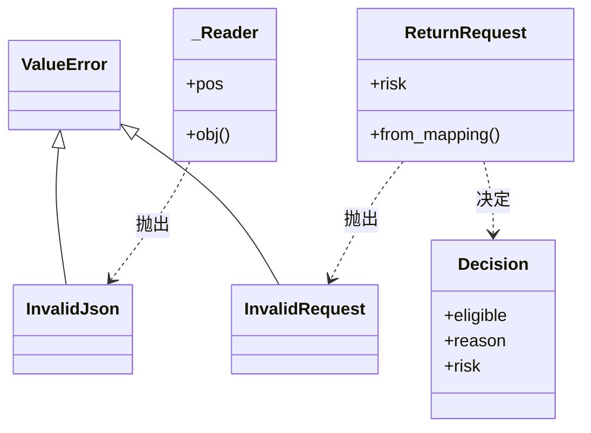

# 设计题解：退货策略引擎与严格 JSON 解析修复（Return Approval Engine）

## 题目与澄清

一个退货服务每行读一个 JSON 请求，解析成字典，按风险与规则判断这笔退货能不能批，再输出一行 JSON 结果。现有代码由两个小模块加一个驱动组成：解析器 `parse` 把文本变成字典，评估器 `evaluate` 把字典变成决定 `Decision(eligible, reason, risk)`，驱动按物理行把它们串起来。代码能跑，也过得了最简单的例子，但解析器把不该接受的输入接受了，评估器的几个边界差了一格，同样的请求得到前后不一致的结果。这是一个修复型项目：没有新功能，难点在于缺陷分在两层，而且一处缺陷会遮住另一处。

先把合同写成十三条，按"一个粗心的读者最容易漏掉"的顺序：

1. **子集语法**：输入是一个扁平对象，键是 ASCII 字符串，值是有符号 64 位整数、布尔或 ASCII 字符串。数组、嵌套对象、`null`、小数、指数一律拒绝；这是刻意的子集，不是通用 JSON。
2. **空白**：只有空格、制表、回车、换行四种，且只在字符串之外；字符串里的空格是内容。
3. **字符串内容**：只收可打印 ASCII（32 到 126），双引号和反斜杠除外；转义只有 `\"` `\\` `\/` `\b` `\f` `\n` `\r` `\t` 八种。`\u`、别的转义、原始控制字符、非 ASCII 全拒。转义出来的控制字符在解码结果里可以出现。
4. **结构**：对象可以为空；键必须带引号，冒号分隔，逗号分隔条目，没有尾逗号；截断的输入和对象之后的任何非空白内容都拒绝。
5. **重复键**：按解码之后的键判断，`"a/b"` 与 `"a\/b"` 是同一个键，出现两次就拒绝。
6. **整数**：形如 `-?(0|[1-9][0-9]*)`；`-0` 接受；前导加号、前导零、溢出拒绝；两个 64 位极值都接受；布尔不是整数。
7. **语法错误**：全部是 `ValueError("invalid_json")`。
8. **请求校验**：恰好六个字段：`rating`（整数 1 到 5）、`value_cents`、`account_age_days`、`days_since_purchase`（非负的 64 位整数）、`opened`、`final_sale`（布尔）。缺字段、多字段、类型不对、范围不对，都是 `ValueError("invalid_request")`；六个字段全部验完才做决定；直接调用 `evaluate` 也要校验。
9. **风险分**：`(5 - rating) * 10`，加金额分（低于 10000 分得 0；10000 到 49999 得 15；50000 及以上得 30），再加账龄分（低于 30 天得 25；30 到 179 得 10；180 及以上得 0）。被拒绝的请求也返回算出的风险分。
10. **拒绝规则按序**：`final_sale` 得 `"final_sale"`；`days_since_purchase > 30` 得 `"window_expired"`；已打开且金额不小于 10000 得 `"opened_high_value"`；风险分不小于 60 得 `"high_risk"`；都不是则 `eligible=True`、`reason="eligible"`。拒绝的 `eligible` 一律是 `False`。第 30 天仍在窗口内。
11. **驱动**：每个物理行一个请求，输出一行紧凑 JSON，`{eligible, reason, risk}` 或 `{error: ...}`；空行是 `invalid_json`；空输入没有输出；坏行不影响后面的行；标准输出不写别的。
12. **`parse` 本身接受字符串里的回车与换行**，驱动不把相邻的物理行拼起来。
13. **Python 3.11，只用标准库。**

合同里的例子是第一个测试：`{"rating":5,"value_cents":0,"account_age_days":180,"days_since_purchase":30,"opened":false,"final_sale":false}` 得到 `{"eligible":true,"reason":"eligible","risk":0}`。它同时压着第 30 天的边界，所以现有代码连这个例子都过不了。

开口前值得问的澄清问题，每个答案都会改变代码：

- **重复键比较的是原始文本还是解码后的文本？** 解码后。所以键的比较要放在字符串解码之后，不能在词法阶段做。
- **超出 64 位的整数是语法错还是请求错？** 语法错：`invalid_json`。整数的语法规则里已经写了"落在 64 位范围内"，所以它在解析器里就被拒绝，评估器永远看不到。评估器里的 64 位上界只在被直接调用时才起作用。
- **`3.0` 是不是整数？** 不是。小数在解析阶段就拒绝；直接调用 `evaluate` 传入浮点数，是 `invalid_request`。
- **`True` 是不是合法的评分？** 不是。`bool` 是 `int` 的子类，`True == 1` 成立，但合同写明布尔不是整数。
- **一行里语法和字段都不对，报哪个？** 语法。解析在前，评估在后，评估根本没有机会运行。
- **输出里键的顺序呢？** `eligible`、`reason`、`risk`，与 `Decision` 的字段顺序一致；错误行只有一个键 `error`。
- **什么不做：** 不做通用 JSON；不做并发；不做限流；不碰文件系统。

下面是修复前的症状。这份修复起点故意把几类缺陷叠在一起（代码在 `starter.py`），输出是实际运行的结果：

| 位置 | 输入 | 修复前 | 应该 |
|---|---|---|---|
| 重复键 | `{"a":1,"a":2}` | `{'a': 2}`，后一个悄悄覆盖前一个 | `invalid_json` |
| 溢出 | `{"n":9223372036854775808}` | 得到一个超过 64 位的整数（另一种常见写法是悄悄变成 0） | `invalid_json` |
| 前导零 | `{"n":01}` | `{'n': 1}` | `invalid_json` |
| 尾逗号 | `{"a":1,}` | `{'a': 1}` | `invalid_json` |
| 转义 | `{"a":"A"}` | `{'a': 'u0041'}`，反斜杠被吃掉 | `invalid_json` |
| 额外字段 | 六个字段加 `extra` | 照常评估 | `invalid_request` |
| 布尔当整数 | `rating: true` | 当作评分 1，风险 40 | `invalid_request` |
| 窗口 | 第 30 天 | `window_expired` | `eligible` |
| 阈值 | 金额 10000 | 金额分 0 | 金额分 15 |
| 驱动 | 字节 `\xff` | 输出里是 `'ascii' codec can't decode byte 0xff …` | `{"error":"invalid_json"}` |
| 驱动 | 空行 | 没有输出，悄悄跳过 | `{"error":"invalid_json"}` |

注意窗口那一行：第 30 天被误判为过期，之后的所有边界都被它遮住。表里金额 10000、金额 50000 的请求都带着 `days_since_purchase=30`，得到的全是 `window_expired`，看不到金额阈值的错。所以修复要一次一处，先修会遮住别人的那一处，每处先写一个会失败的测试。

## 需求与分级

修复型项目没有新功能，分关就是修复的顺序：先让解析器可信，再让评估器可信，最后核对驱动与书面回答。每一关都能单独运行测试。

**第 1 关（约 15 分钟，整数与溢出）**：先不改代码，把规则逐条对照现有代码，写出差异清单。然后修整数：正则匹配出合法的形状，位数超过十九位的一定溢出，其余再比较范围。陷阱有两个：溢出必须拒绝而不是变成 0；超长数字不能交给 `int()` 去碰，否则 Python 会抛出另一种 `ValueError`（见决策二）。

**第 2 关（约 15 分钟，语法的其余部分）**：重复键按解码后的键判断；转义只收八种；对象之后只能是空白；尾逗号、缺值、`null`、数组、小数、指数拒绝。这一关的陷阱是"接受得太宽"：现有写法对尾逗号和前导零都网开一面。

**第 3 关（约 15 分钟，评估器）**：恰好六个字段，类型检查用 `type(x) is int`，六个全验完才判；金额与账龄的下界含；窗口是 `> 30`；拒绝顺序固定；被拒绝的请求也带风险分。示例：`rating=3, value_cents=10000, account_age_days=0` 的风险分是 20 + 15 + 25 = 60，必须是 `high_risk`。

**第 4 关（选做，约 15 分钟，驱动与书面回答）**：核对驱动：一行一结果、空行是 `invalid_json`、非 ASCII 字节是 `invalid_json` 且不泄漏解码提示。最后回答三个问题：语法错与策略错怎么区分、哪些测试证明溢出与完整消费、换成 JSON 库怎么保持行为。每个约一百字，不要留到最后一分钟。

## 核心对象与职责

| 名字 | 单一职责 | 它拥有的不变量 |
|---|---|---|
| `InvalidJson` | 语法层的错误，消息固定为 `invalid_json` | 是 `ValueError`，`str(error)` 就是错误码 |
| `InvalidRequest` | 策略层的错误，消息固定为 `invalid_request` | 同上；与 `InvalidJson` 没有继承关系，两层不会混 |
| `_Reader` | 只前进的读取器：位置指针加 `expect`/`accept`，读一个语法单元 | `pos` 只增不减；读不下去就抛 `InvalidJson`，不返回半个结果 |
| `ReturnRequest` | 校验之后的请求，冻结的值 | 能构造出来，就说明六个字段齐全、类型与范围都对 |
| `Decision` | 一次决定：`eligible`、`reason`、`risk` | 冻结；`eligible` 为真当且仅当 `reason == "eligible"` |
| `parse` / `evaluate` | 两个公开函数，把文本变成字典、把字典变成决定 | 无状态，调用之间互不影响 |
| `process_line` / `run` | 驱动的核心：一行字节变成一行输出 | 只捕获两种命名错误；一行失败不碰别的行 |

`_Reader` 只活在一次 `parse` 调用里，用完即弃；`ReturnRequest` 只活在一次 `evaluate` 里；整个模块没有任何跨调用的状态，所以坏行无处污染后面的行。两种错误类之间没有继承关系，也不继承彼此的行为，只共享 `ValueError` 这一个祖先，因为合同要的就是 `ValueError`。



规则表 `_REJECTIONS` 与几个函数没有画进图里，它们是数据和函数，不是对象。为什么没有 `Parser` 类、`Policy` 类、`Driver` 类：因为它们没有状态要保护，也没有第二种实现要替换，造出来只会是只转发一次调用的壳（Java 习惯）。`parse` 之所以背后有一个 `_Reader` 类，是因为位置指针确实是一份要在许多小方法之间共享的状态。

## 关键设计决策

### 决策一：解析器怎么写——一把正则、手写读取器，还是直接用 `json.loads`

**问题**：合同的语法是通用 JSON 的一个子集，既比标准窄（没有数组、小数、`\u`、非 ASCII），又有标准没有的限制（重复键、64 位范围）。

**选项 A：一把正则把输入切成记号，再按固定长度拼键值对。** 修复起点就是这样写的：

```python
for i in range(0, len(body), 4):
    chunk = body[i : i + 4]   # 键、冒号、值、逗号
```

它按"每四个记号一组"（键、冒号、值、逗号）拼对，`{"a":1,}` 里的 `"a" : 1 ,` 正好凑满一组，末尾多出的逗号被当成正常分隔，整行被当成合法。结构靠位置猜，不靠语法，每一类畸形输入都要再补一条判断。

**选项 B：`json.loads` 加钩子加后检查。** `parse_float` 与 `parse_constant` 抛错，拒绝小数与 NaN；`object_pairs_hook` 拒绝重复键；解析之后再检查顶层是对象、值只有三种、整数在范围内；解析之前再用一个正则挡住 `\u`、非 ASCII 和 DEL。它短，也经过了大量使用的检验；代价是规则分散在三处（钩子、正则、后检查），而且每一条都是"库接受了，我再减回去"，库升级改了一个边界，你的子集就悄悄变了。还有一个坑：深层嵌套的输入会让标准库抛 `RecursionError`，不是 `ValueError`，要另外接住。

**选项 C：手写的读取器。** 语法规则一条对一个方法：`string`、`integer`、`value`、`obj`。读不下去就抛 `InvalidJson`，没有"接受再减回去"。代价是代码多（读取器本身约八十行），要自己保证没有漏掉的畸形输入。

**选择**：参考解用 C，并把 B 留在测试里当对拍的参照。依据：合同的子集是自己定义的，手写读取器的每个方法与规则一一对应，读代码就是读合同；而 B 当参照有一个重要性质：它与 C 是两种互不相干的写法，两者在几千个变异输入上结论一致，比任何一份手写的期望表都更有说服力。换成 B 作为产品代码，是书面问题三的内容，见 CSV 与 JSON 的稳健读写（CSV & JSON）。

**模式**：递归下降（Recursive Descent）的最小形态，见 递归下降解析（Recursive Descent）。被拒绝的是整套的词法记号类、语法树和解析器组合子：输入是一层扁平对象，没有嵌套，没有递归，要的只是一个能读一个单元、读不下去就报错的指针。

### 决策二：整数的溢出怎么拒绝

**问题**：整数要拒绝加号、前导零、小数、指数，要接受 `-0`，要在 64 位范围内。写法错一处，就多接受或少接受一类输入。

**选项 A：先 `int(...)` 再比范围。** 最直白，也是最容易出事的：

```python
number = int(text[start:position])
if not -(2**63) <= number <= 2**63 - 1: ...
```

Python 3.11 里，`int()` 对超过 4300 位的十进制字符串直接抛 `ValueError`，消息是 `Exceeds the limit (4300 digits) for integer string conversion: value has 5000 digits; ...`。这是一个 `ValueError`，驱动按"`except ValueError` 输出 `str(error)`"的写法，就会把这句话当成错误输出，合同里的错误只有两种。五千位的数字让一个小服务输出了一句不属于合同的话。

**选项 B：先用正则匹配出合法的形状，再按位数拒绝，最后才转换。**

```python
_INTEGER = re.compile(r"-?(?:0|[1-9][0-9]*)")
...
if len(digits.lstrip("-")) > 19 or not INT64_MIN <= int(digits) <= INT64_MAX:
    raise InvalidJson
```

形状正则不允许前导零，所以任何超过十九位的数字一定大于 `2**63 - 1`，可以不碰 `int()` 就拒绝；十九位以内的才转换并比较范围。`-0` 的形状合法，值是 0。

**选择**：B。两个细节值得记：一是 `[0-9]` 而不是 `\d`，`\d` 会匹配别的文字系统里的数字（`int("1٢٣")` 是 123），语法就被悄悄放宽了；二是正则从当前位置开始匹配（`match(text, pos)`），不用 `^`、`$` 去锚整个字符串，因为 `$` 会在末尾换行之前匹配。字符串匹配从 `pos` 开始，之后的内容由语法本身决定：`01` 匹配出 `0`，下一个字符是 `1`，既不是逗号也不是右括号，所以后面仍然报错。

**被拒绝的方案**：捕获 `ValueError` 再改写成 `invalid_json`。看起来省事，却把"我知道这里会抛什么"变成"凡是抛了就当语法错"，会掩盖别处真正的缺陷（见决策三）。

### 决策三：两层错误——一个异常类、两个异常类，还是返回错误值

**问题**：合同要的是 `ValueError("invalid_json")` 与 `ValueError("invalid_request")`，驱动要把两者输出成 `{"error": ...}`，并且要区分语法错与策略错（书面问题一）。

**选项 A：直接 `raise ValueError("invalid_json")`。** 最贴近合同，只要三个字。代价：两层错误只靠字符串区分；驱动的 `except ValueError` 会接住一切 `ValueError`，包括真正的缺陷（比如 `int()` 的位数限制、`UnicodeDecodeError`），并且把它们的消息原样输出。

**选项 B：两个 `ValueError` 的子类，消息固定。**

```python
class InvalidJson(ValueError):
    def __init__(self) -> None:
        super().__init__("invalid_json")
```

合同要求的 `except ValueError` 与 `str(error)` 照样成立，所以公开测试和任何按合同写的调用方都不受影响；同时驱动可以只接这两种具名的错，其余的 `ValueError` 是缺陷，冒出去，在日志里被看见。

**选项 C：返回错误值（`Result` 或 `(ok, error)` 元组）。** 解析函数返回 `Ok(dict) | Err(code)`。合同给定的签名是 `parse(text) -> dict`，抛异常是接口，不能改；而且在递归读取的深处，每一层都要检查返回值，比抛异常笨重。

**选择**：B。驱动里有一个细节必须单独处理：`UnicodeDecodeError` 也是 `ValueError` 的子类，它的消息是 `'ascii' codec can't decode byte ...`。所以 `process_line` 先接它，再接两种具名错误：

```python
except UnicodeDecodeError:
    result = {"error": "invalid_json"}
except (InvalidJson, InvalidRequest) as error:
    result = {"error": str(error)}
```

顺序是行为的一部分：先接窄的，再接宽的。完整的讨论见 捕获的范围（Narrow Catch） 与 错误类型体系（Error Taxonomy）。

### 决策四：拒绝规则的顺序写成什么

**问题**：四条拒绝规则有固定的优先级：`final_sale`、窗口、`opened_high_value`、`high_risk`；第一条命中的赢；同一个请求可能同时满足好几条，所以顺序就是行为。

**选项 A：`if / elif` 链。** 四个分支，读起来一目了然，是最朴素的写法。代价：顺序藏在代码的位置里，想断言"顺序是这样"只能构造输入去碰；每一条规则的"原因名"和"条件"分在两行。

**选项 B：有序的表，元素是（原因, 条件）。**

```python
_REJECTIONS = (
    ("final_sale", lambda r, risk: r.final_sale),
    ("window_expired", lambda r, risk: r.days_since_purchase > 30),
    ("opened_high_value", lambda r, risk: r.opened and r.value_cents >= 10_000),
    ("high_risk", lambda r, risk: risk >= 60),
)
reason = next((name for name, hit in _REJECTIONS if hit(parsed, risk)), "eligible")
```

原因名与条件放在一起，顺序是元组的顺序，一眼可见，也可以被测试和别的代码读到。

**选项 C：责任链类（Chain of Responsibility）。** 每条规则一个类，各持有下一个处理者。四条规则、没有一条要自己的状态，这等于把一张表改写成四个类加一条链：多出的代码多于规则本身。

**选择**：B；A 也可以接受，四条规则时两者差别很小，选 B 是因为原因名与条件靠在一起，加第五条规则就是加一行。**被拒绝的模式**是 C。只有当每条规则要有自己的状态（例如计数、缓存），或要在运行时重新组装顺序，链才值得；那时再重构也不晚，见 [[patterns.strategy|策略模式与可替换算法（Strategy）]]。表里四个函数都是纯函数，行为一样、只有数据不同，用数据表达。

### 决策五：校验放在哪里，校验之后留下什么

**问题**：合同要求"六个字段全部验完才做决定"，并且直接调用 `evaluate` 也要校验。

**选项 A：在 `evaluate` 里边验边算。** 取出 `rating` 就验，算完风险再取下一个字段。这样"final_sale 为真时别的字段坏了"的请求，会在读到 `final_sale` 之后提前返回，坏字段没人发现。

**选项 B：先构造一个冻结的 `ReturnRequest`，构造成功才往下走。** `from_mapping` 先验键集合恰好是六个，再验每个字段的类型与范围，最后才构造；风险分与规则只读这个值，不再碰字典。这是"解析而不是校验"（parse, don't validate）的写法：验证的结果留在类型里，后面的代码不用再担心字段在不在、是不是 `bool`。

**选择**：B。类型检查用 `type(x) is int`，不用 `isinstance(x, int)`，因为 `bool` 是 `int` 的子类，`isinstance(True, int)` 为真；比较（`1 <= rating <= 5`）写在类型检查之后，`and` 短路，所以字符串不会走到 `"3" >= 1` 去抛 `TypeError`。键集合用 `request.keys() != FIELDS`，缺的和多的都在这一个比较里发现。相关原理见 边界校验（Validate at the Boundary）。

## 代码走读

下面是完整的参考解，一百五十四行代码，其余是中文说明。

%% code:begin solution.py %%
```python
"""退货策略引擎与严格 JSON 解析（ParcelPolicy）参考解：一行一个请求，坏行只影响它自己。

设计五句话：
1. 解析和策略是两层，各有各的错误：语法层只抛 `InvalidJson`，策略层只抛 `InvalidRequest`；两者都是 `ValueError`，
   `str(error)` 恰好是合同里的错误码，所以按合同的写法 `except ValueError as e: str(e)` 也成立。
2. 解析器是一个只前进的读取器（`_Reader`）：一个位置指针、`expect`/`peek`，按"对象 → 键值对 → 值"递归下降；
   整数先用正则匹配出合法形状，再按位数和范围拒绝，绝不静默改成别的值。
3. 请求先被校验成一个冻结的 `ReturnRequest`（六个字段恰好齐全、类型恰好是 `int`/`bool`、范围对），
   之后的风险与拒绝规则只看这个值，不再碰字典，所以"先全部校验再做决定"由类型保证。
4. 拒绝规则是一张有序的表（原因, 条件）；表的顺序就是合同的优先级，第一条命中的赢。
5. `process_line` 是行驱动的核心：解码、解析、评估、序列化，只捕获两种命名错误；一行失败不碰别的行，无状态。
"""

from __future__ import annotations

import json
import re
from collections.abc import Callable, Iterable, Iterator
from dataclasses import asdict, dataclass

INT64_MIN, INT64_MAX = -(2**63), 2**63 - 1
# 只认 ASCII 数字：不用 \d（它会匹配别的文字系统里的数字），也不用 $（它会在末尾换行前匹配）
_INTEGER = re.compile(r"-?(?:0|[1-9][0-9]*)")
_ESCAPES = {'"': '"', "\\": "\\", "/": "/", "b": "\b", "f": "\f", "n": "\n", "r": "\r", "t": "\t"}
_WHITESPACE = " \t\r\n"
_LITERALS = (("true", True), ("false", False))


class InvalidJson(ValueError):
    """语法层的错误：输入不是受支持的 JSON 子集。消息固定为 `invalid_json`。"""

    def __init__(self) -> None:
        super().__init__("invalid_json")


class InvalidRequest(ValueError):
    """策略层的错误：语法对，但字段不齐、类型不对或范围不对。消息固定为 `invalid_request`。"""

    def __init__(self) -> None:
        super().__init__("invalid_request")


class _Reader:
    """只前进的读取器：`pos` 是下一个要读的字符；每个方法读完一个语法单元，读不下去就抛 `InvalidJson`。"""

    def __init__(self, text: str) -> None:
        self.text, self.pos = text, 0

    def skip_whitespace(self) -> None:
        while self.pos < len(self.text) and self.text[self.pos] in _WHITESPACE:
            self.pos += 1

    def peek(self) -> str:
        """下一个字符（先跳过空白）；输入读完了就是空串，空串不等于任何记号。"""
        self.skip_whitespace()
        return self.text[self.pos] if self.pos < len(self.text) else ""

    def accept(self, token: str) -> bool:
        if self.peek() == token:
            self.pos += 1
            return True
        return False

    def expect(self, token: str) -> None:
        if not self.accept(token):
            raise InvalidJson

    def string(self) -> str:
        self.expect('"')
        out: list[str] = []
        while self.pos < len(self.text):  # 字符串里不跳空白：空格是内容
            ch = self.text[self.pos]
            self.pos += 1
            if ch == '"':
                return "".join(out)
            if ch == "\\":
                escape = self.text[self.pos : self.pos + 1]
                if escape not in _ESCAPES:  # 包括 \u 和输入在反斜杠处结束
                    raise InvalidJson
                out.append(_ESCAPES[escape])
                self.pos += 1
            elif 32 <= ord(ch) <= 126:
                out.append(ch)
            else:  # 原始控制字符、DEL、非 ASCII
                raise InvalidJson
        raise InvalidJson  # 没有收尾的引号

    def integer(self) -> int:
        self.skip_whitespace()
        match = _INTEGER.match(self.text, self.pos)
        if match is None:
            raise InvalidJson
        digits = match.group()
        # 合法形状没有前导零，所以超过 19 位的一定溢出；先拒绝，免得 int() 为超长数字抛出别的 ValueError
        if len(digits.lstrip("-")) > 19 or not INT64_MIN <= int(digits) <= INT64_MAX:
            raise InvalidJson
        self.pos = match.end()
        return int(digits)

    def value(self) -> int | bool | str:
        ch = self.peek()
        if ch == '"':
            return self.string()
        for word, decoded in _LITERALS:
            if self.text.startswith(word, self.pos):
                self.pos += len(word)
                return decoded
        return self.integer()  # 数组、对象、null、小数点、指数都会在这里或之后失败

    def obj(self) -> dict[str, int | bool | str]:
        result: dict[str, int | bool | str] = {}
        self.expect("{")
        if not self.accept("}"):
            while True:
                key = self.string()
                if key in result:  # 按解码后的键判重："a/b" 与 "a\/b" 是同一个键
                    raise InvalidJson
                self.expect(":")
                result[key] = self.value()
                if not self.accept(","):
                    break
            self.expect("}")
        return result


def parse(text: str) -> dict[str, int | bool | str]:
    """把一个扁平 JSON 对象解析成字典；任何不符合子集的输入都抛 `InvalidJson`。"""
    if type(text) is not str:
        raise InvalidJson
    reader = _Reader(text)
    result = reader.obj()
    if reader.peek() != "":  # 对象之后只能是空白
        raise InvalidJson
    return result


@dataclass(frozen=True)
class Decision:
    eligible: bool
    reason: str
    risk: int


FIELDS = frozenset({"rating", "value_cents", "account_age_days", "days_since_purchase", "opened", "final_sale"})


def _is_count(x: object) -> bool:
    """非负的 64 位整数。`bool` 是 `int` 的子类，所以比较类型本身而不是 isinstance。"""
    return type(x) is int and 0 <= x <= INT64_MAX


@dataclass(frozen=True)
class ReturnRequest:
    """校验之后的请求：能构造出来，就说明六个字段齐全、类型与范围都对。"""

    rating: int
    value_cents: int
    account_age_days: int
    days_since_purchase: int
    opened: bool
    final_sale: bool

    @classmethod
    def from_mapping(cls, request: object) -> ReturnRequest:
        """六个字段先全部验完，再构造；任何一处不对都是同一个 `InvalidRequest`。"""
        if not isinstance(request, dict) or request.keys() != FIELDS:
            raise InvalidRequest
        rating = request["rating"]
        if not (
            type(rating) is int
            and 1 <= rating <= 5
            and all(_is_count(request[k]) for k in ("value_cents", "account_age_days", "days_since_purchase"))
            and type(request["opened"]) is bool
            and type(request["final_sale"]) is bool
        ):
            raise InvalidRequest
        return cls(**request)

    @property
    def risk(self) -> int:
        """风险分：星级、金额、账龄三项之和；每个下界都含在本段内。"""
        value = 30 if self.value_cents >= 50_000 else 15 if self.value_cents >= 10_000 else 0
        age = 25 if self.account_age_days < 30 else 10 if self.account_age_days < 180 else 0
        return (5 - self.rating) * 10 + value + age


# 拒绝规则：顺序就是优先级，第一条命中的赢；第二项收的是请求和已算好的风险分
_REJECTIONS: tuple[tuple[str, Callable[[ReturnRequest, int], bool]], ...] = (
    ("final_sale", lambda r, risk: r.final_sale),
    ("window_expired", lambda r, risk: r.days_since_purchase > 30),  # 第 30 天仍在窗口内
    ("opened_high_value", lambda r, risk: r.opened and r.value_cents >= 10_000),
    ("high_risk", lambda r, risk: risk >= 60),
)


def evaluate(request: dict[str, int | bool | str]) -> Decision:
    """校验、算风险、按序检查拒绝规则。风险分对被拒绝的请求同样返回。"""
    parsed = ReturnRequest.from_mapping(request)
    risk = parsed.risk
    reason = next((name for name, hit in _REJECTIONS if hit(parsed, risk)), "eligible")
    return Decision(reason == "eligible", reason, risk)


def process_line(raw: bytes) -> str:
    """一个物理行 → 一行输出（不含换行）。只捕获两种命名错误，别的异常是缺陷，要冒出去。"""
    try:
        result: dict[str, object] = asdict(evaluate(parse(raw.decode("ascii"))))
    except UnicodeDecodeError:  # 非 ASCII 字节；它也是 ValueError，必须在别的处理之前认出来
        result = {"error": "invalid_json"}
    except (InvalidJson, InvalidRequest) as error:
        result = {"error": str(error)}
    return json.dumps(result, separators=(",", ":"))


def run(lines: Iterable[bytes]) -> Iterator[str]:
    """一行一结果，空输入没有结果；行与行之间没有任何共享状态。"""
    for raw in lines:
        yield process_line(raw)


if __name__ == "__main__":
    sample = b'{"rating":5,"value_cents":0,"account_age_days":180,"days_since_purchase":30,"opened":false,"final_sale":false}\n'
    for out in run([sample, b"\n", b'{"rating":true}\n']):
        print(out)
```
%% code:end %%

设计决策在代码里出现的四个地方：

1. **`_Reader.integer`**：形状正则、位数检查、范围检查是三道门，顺序不能换。位数检查在前，是为了不让 `int()` 碰超长数字（决策二）；`self.pos = match.end()` 只在三道门都过了之后才推进，所以失败的读取不留痕迹。
2. **`_Reader.obj`**：重复键的检查在字符串解码之后（`key in result`），所以 `"a/b"` 与 `"a\/b"` 是同一个键（决策一）。`while True` 的出口只有一个：读完一个条目后看不到逗号。尾逗号之所以被拒绝，是因为逗号之后一定要读一个键，而 `string()` 的第一步 `expect('"')` 在遇到 `}` 时抛错。
3. **`parse` 的结尾**：`reader.peek() != ""` 就是"完整消费"。`peek` 先跳空白，再看有没有字符；对象之后只允许空白，其余一概拒绝。`type(text) is not str` 的检查放在最前面，让非字符串的参数也得到 `invalid_json`。
4. **`process_line`**：`UnicodeDecodeError` 在前，具名的两种错在后，别的异常不接。意外的 `ValueError` 在这里冒出去，在测试里是红的，在线上是日志里的一条栈。`run` 是一个生成器：一行进，一行出，行与行之间没有任何共享状态。

模块底部的 `__main__` 演示：合同例子输出 `{"eligible":true,"reason":"eligible","risk":0}`；空行输出 `{"error":"invalid_json"}`；`{"rating":true}` 语法对但字段不全，输出 `{"error":"invalid_request"}`。

## 测试与自检

测试文件有四十六个测试函数，参数化展开后共二百三十二个用例，没有一个依赖时钟、线程或网络；随机的那一个用固定的种子。按合同条目分组：

- **合同例子**：例子逐字断言；第 30 天可以、第 31 天不行。
- **语法接受**：空对象与四种空白的组合；三种值类型，布尔仍是布尔；两个 64 位极值、`-0`；八种转义的解码；字符串内的空格与全部可打印字符。
- **语法拒绝**：七十七个畸形输入的参数化，覆盖：空输入、数组、`null`、`NaN`、小数、指数、加号、前导零、`\u`、别的转义、原始控制字符、非 ASCII、尾逗号、缺值、缺冒号、截断，以及对象之后的各种尾部内容；全角数字与阿拉伯-印度数字；二十万层深的嵌套不崩溃，只得到 `invalid_json`。
- **重复键**：七种，包括解码后相同、原文不同的两个键，以及只有大小写不同的两个键（是不同的键）。
- **溢出与完整消费**：两个极值的两侧；二十位、五千位的数字；零开头的长串；十一种尾部内容，各自带空白与不带空白两种；每次都断言消息恰好是 `invalid_json`（`match="^invalid_json$"`）。
- **请求校验**：缺哪个字段、多哪个字段；非字典的八种输入；四个整数字段各八种错误类型，其中包括 `True` 与 `False`；两个布尔字段各八种错误类型；评分范围；三个计数字段的 0、上限、下限之外；`final_sale` 为真时别处的坏字段仍然被发现；`evaluate` 不修改传入的字典。
- **风险与规则**：金额、账龄、评分各个边界的两侧；规则同时命中时的顺序（逐个去掉前一条）；高风险边界用不压别的边界的输入；被拒绝的请求也有风险分；还有一个把评分四档、金额五个点、账龄五个点、三种天数、两个布尔共一千二百个组合，与测试里独立写出的期望表逐个比对的用例。
- **驱动**：一行一结果且保序；空行与纯空白行；空输入；非 ASCII 字节；最后一行没有换行与回车换行；二进制流逐行读；一个对象拆成两行时两行都是坏行；输出是紧凑 JSON 且键序固定；语法错先于策略错；每一行输出都是合法 JSON 且只含已知的键。
- **对拍**：七个种子输入，每个随机变异六百次（固定种子），共四千二百个输入，解析器与"标准库 `json.loads` 加子集限制"的接受与拒绝必须一致；其中有六百三十八个被接受，所以不是一边倒地全拒绝。

选点的两条原则。第一，期望值来自测试里独立写出的表和另一种写法（标准库加钩子），不是从被测代码里抄来的；这样两者错成同一个样子的概率才低。第二，决定边界要用不压别的边界的输入：窗口的测试把金额压在 10000 以下，高风险的测试不打开包裹，失败时只可能是那一处缺陷。

怎么知道这些测试够用？把参考解改坏几处再运行，看红的数量：

| 改动 | 失败用例数 |
|---|---|
| 溢出时返回 0 而不是拒绝 | 12 |
| 对象之后的内容不检查 | 20 |
| 窗口改成 `>= 30` | 10 |
| 重复键后一个覆盖前一个 | 7 |
| 去掉位数检查，直接 `int()` | 4 |
| 金额阈值改成 `>` | 4 |
| `final_sale` 为真时跳过校验 | 4 |
| 风险分对被拒绝的请求报 0 | 5 |
| 两条规则的顺序互换 | 2 |
| 允许额外字段 | 2 |
| 评分允许 0 | 2 |
| 去掉 `UnicodeDecodeError` 的单独处理 | 2 |
| 允许 `\u` 转义 | 2 |
| `isinstance` 代替 `type(x) is int` | 1 |
| 正则里 `[0-9]` 改成 `\d` | 1 |
| 驱动跳过空行 | 1 |

最后几行只有一个用例捕获，说明它们钉住的是特定的一条规则；每条规则都要有它自己的测试，不能指望别的用例顺便覆盖。

两分钟演示：先运行合同例子，说出"第 30 天仍在窗口内"；再运行 `{"a":1,"a":2}` 说明重复键；然后输入一个五千位的数字，指给面试官看输出仍然是 `invalid_json`；最后传入一个坏字节，展示后面的行照常输出。

放进真实工作区：把整个文件放进 `policy.py`，`Decision` 的定义换成 `from models import Decision`，`json_parser.py` 只写一行 `from policy import parse`。公开的两个用例（第 30 天与畸形对象）通过，驱动 `cli.py` 不用改，`parse` 与 `evaluate` 的名字和签名都不变；公开测试只覆盖了合同的一小部分，其余要靠自己的测试补齐。

## 扩展与追问

**新需求**

- *新增一个字段（例如 `country`，字符串，只允许两个字母）*：`FIELDS` 多一个名字，`from_mapping` 多一个校验，`ReturnRequest` 多一个属性；`_Reader`、驱动、其余规则不动。要同步约定的是合同：多字段本来是错误，老调用方不传这个字段就变成缺字段，要不要给默认值是产品决定，写进合同。
- *新增第五条拒绝规则*：`_REJECTIONS` 多一行，并决定它的位置；它的位置就是它的优先级。其余的行都不动。
- *风险分的阈值改成可配置*：把金额与账龄的三段表搬进一个冻结的 `Policy`，`ReturnRequest.risk` 读它；这一步在 `lcp-return-fraud-risk` 的题解里展开过，见 [[solution-lcp-return-fraud-risk]]。
- *错误要带位置（第几列）*：`InvalidJson` 多收一个 `column` 参数，`_Reader` 在抛出时带上 `pos`；合同里的消息不变，驱动里的输出也不变，附加信息只写进日志。
- *接受小数的金额*：这是语法的变化，不是策略的变化：`integer` 旁多一个 `decimal`，评估器的类型检查也要改成金额类型；要先问清是小数还是以分为单位的整数，后者就是现在的写法。

**并发与线程安全**

模块没有可变的共享状态：`_Reader` 只活在一次调用里，`FIELDS` 是冻结集合，`_REJECTIONS` 是元组，`Decision` 与 `ReturnRequest` 是冻结的数据类。所以多个线程同时调用 `parse`、`evaluate`、`process_line` 不需要锁；这不是靠全局解释器锁（GIL）碰巧安全，而是没有共享的可变数据。要并行处理大文件，按行分块给多个进程，各自 `run`，再按行号合并输出。

**持久化与规模**

- *输入很大（几十 GB 的行文件）*：`run` 是生成器，一行进一行出，内存只与最长的一行有关；读文件时用二进制模式逐行，和驱动一样。
- *行很长*：一行里的恶意输入可以是几百兆的数字。位数检查之前，正则 `-?(?:0|[1-9][0-9]*)` 要先扫完所有数字，所以在入口加一个行长度上限，超过就直接 `invalid_json`；这是对合同的补充，要写进合同。
- *监控*：`invalid_json` 与 `invalid_request` 分开计数：前者多半指向上游的编码、截断或拼接错误，后者多半指向调用方的契约变化。标签只用这两个错误码，不放原始输入。
- *换成成熟的 JSON 库*：见书面问题三。核心做法是库管词法与基础语法，子集规则放在库外的一层，换之前冻结行为，换之后与旧实现并跑对拍。

## 常见错误

- **溢出时返回 0**：一个"安全的默认值"把错误变成了正确的输入，下游得到一个从未出现过的数字。
- **先 `int()` 再检查范围**：超长数字让 `int()` 抛出一句不属于合同的 `ValueError`，驱动把它当成错误输出。
- **用 `\d` 匹配数字**：`\d` 认得别的文字系统里的数字，`int()` 也认，语法被悄悄放宽。
- **按固定个数的记号拼键值对**：`{"a":1,}` 的尾逗号被当成合法；结构要由语法决定，不由位置猜。
- **用字典赋值收集键值对**：后一个悄悄覆盖前一个，重复键没有任何报错。
- **转义用"其余原样保留"处理**：`A` 变成 `u0041`，`\q` 变成 `q`；合同只收八种转义。
- **`isinstance(x, int)` 不排除 `bool`**：`True` 被当成评分 1。
- **先比较范围再检查类型**：字符串在 `"3" >= 1` 处抛 `TypeError`，调用方看到的是崩溃，不是 `invalid_request`。
- **一边验字段一边做决定**：`final_sale` 为真时提前返回，别处的坏字段没人发现。
- **用 `>` 代替 `>=`（或相反）**：金额 10000 得 0 分；第 30 天被判过期。
- **窗口的缺陷遮住后面的**：修复要一次一处，先修会遮住别人的那一处。
- **`except ValueError` 后输出 `str(error)`**：`UnicodeDecodeError`、`int()` 的位数限制都是 `ValueError`，它们的消息会漏进输出。
- **驱动跳过空行**：合同写明空行是 `invalid_json`，调用方靠输出行数与输入行数对得上来对账。
- **把相邻的物理行拼成一个对象**：合同规定一行一个请求，拆开的对象两行都是坏行。
- **一次让智能体修所有缺陷**：缺陷互相遮挡，改好一处，结果仍然不对，分不清哪处是哪处；一次一类缺陷、每次一个失败测试。
- **让智能体"把测试改成通过"**：先判断是代码错还是测试错，合同例子是不能改的。
- **用被测代码生成期望值**：解析器与期望表错成同一个样子，测试永远是绿的。

## 45 分钟怎么分配

- **0 到 5 分钟｜读规则、列差异**：不要先改代码。把合同十三条用自己的话写成注释，对每条规则用现有代码跑一个反例。给智能体的第一句话也是这份清单，加合同例子，要求它先列出差异、不改代码；你核对清单有没有漏掉驱动。
- **5 到 15 分钟｜整数与溢出**：先写失败的测试（二十位数字、五千位数字、前导零、`-0`），再让智能体修；溢出算语法错、位数检查放在 `int()` 之前，这两个决定自己做。
- **15 到 25 分钟｜语法的其余部分**：重复键、转义、尾逗号、对象之后的内容；每处先写一个失败的测试。
- **25 到 35 分钟｜评估器**：恰好六个字段、`type(x) is int`、下界含、窗口 `> 30`、规则顺序；测边界时用不压别的边界的输入。
- **35 到 40 分钟｜驱动**：空行、坏字节、坏行之后的好行；跑公开测试与自己的全部测试。
- **40 到 45 分钟｜书面回答**：三个问题各约一百字：两层错误加语法先于策略；两端极值两侧、超长数字、尾部内容、对拍；库管语法、子集规则留在库外、先冻结再并跑。不要留到最后一分钟。

时间不够时的取舍：先砍对拍与深层嵌套的测试（口述），再砍并发的讨论；绝不能砍的是合同例子、整数的两端与溢出、重复键、`bool` 的校验、窗口的 `> 30`、驱动的空行与坏字节。

## 延伸阅读

- [[solution-lcp-return-fraud-risk]]：同样是"阈值边界加类型校验"的修复项目，评分表做成了可版本化的策略，可对照这里的有序规则表。
- [[solution-amz-discount-engine]]：一组规则的叠加与优先级，另一种写法。
- 解析错误（Parse Errors）、递归下降解析（Recursive Descent）、词法分析（Tokenizer）：读取器的原理，见知识树的解析与输入输出部分。
- 边界校验（Validate at the Boundary）、捕获的范围（Narrow Catch）、错误类型体系（Error Taxonomy）：校验、捕获顺序与两层错误的原理。
- [Python 文档：json 模块](https://docs.python.org/3/library/json.html)：`parse_float`、`parse_constant`、`object_pairs_hook` 的定义，以及标准库接受而本子集拒绝的部分。
- [Python 文档：整数字符串转换的长度限制](https://docs.python.org/3/library/stdtypes.html#int-max-str-digits)：超长数字抛出 `ValueError` 的来由与 `sys.set_int_max_str_digits`。
- [Python 文档：re 模块中的 `\d`](https://docs.python.org/3/library/re.html#regular-expression-syntax)：`\d` 对 Unicode 字符串匹配所有十进制数字，而不只是 `[0-9]`。
- [RFC 8259：JSON 数据交换格式](https://www.rfc-editor.org/rfc/rfc8259)：通用 JSON 的语法，对照本子集少了什么。
