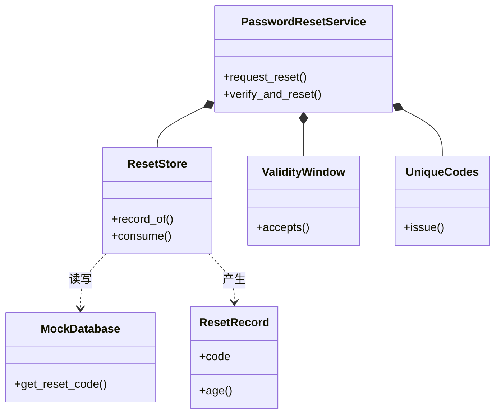
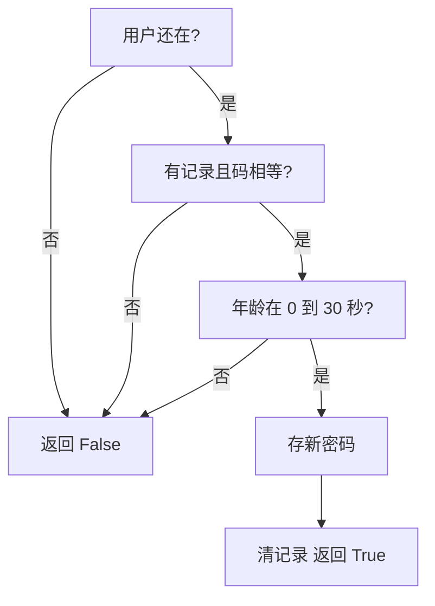

# 设计题解：密码重置修复（Password Reset）

## 题目与澄清

一个账号系统的密码重置服务 `PasswordResetService` 出了四类用户投诉：重置码过期时间不对（有的刚发就失效，有的过了很久还能用）；接口返回成功，密码却没变；同一个重置码可以用两次；服务读到的认证服务地址被悄悄改写了。服务有三个方法：`generate_code()` 生成一个码，`request_reset(user_id)` 给用户签发一个码并记下时间，`verify_and_reset(user_id, code, new_password)` 在码正确且未过期时改密码。数据都放在一个共享的存储对象 `db` 里，它只有五个方法：`get_user`、`update_password`、`save_reset_code`、`get_reset_code`、`clear_reset_code`。这是一个修复型项目：没有新功能，难点是每一条规则都有一个让粗心的人踩进去的边界，而且几处缺陷互相遮挡。

先把合同写成十五条，按"一个粗心的读者最容易漏掉"的顺序：

1. **配置只读一次**：构造实例时读环境变量 `INTERNAL_AUTH_URL`，存进 `auth_service_url`。没设置就是 `http://internal.auth.local`；设了就原样保留，空字符串、首尾空白都不动，不改写、不校验、不访问。之后环境变了，只影响新实例。
2. **`environment` 参数**：给了映射就读映射，没给才读 `os.environ`；空映射也算"给了"。
3. **构造不读时钟、不碰存储。**
4. **请求重置先查用户**：用户不存在抛 `ValueError("User not found")`，此时不读时钟，不写任何东西。
5. **码是非空字符串**，长度与字母表不限。
6. **码不重复**：同一个实例生成的值不重复，成功用过之后也不重复；也不能等于该用户当前存着的码，哪怕那个码是另一个实例签发的。`generate_code()` 是可以被覆盖的钩子，每次尝试调用一次，撞上就重试。
7. **保存的时间**是带时区的 UTC 时刻，与时钟读到的是同一瞬间。
8. **再次请求**替换该用户的码与时间，重新开始 30 秒；请求不改任何密码，也不动别人的记录。
9. **校验返回布尔值**：用户不存在、没有记录、码不精确相等（不去空白、不改大小写）都是 `False`。
10. **有效期是半开区间**：年龄 = 当前时钟 − 创建时间，按时刻比较，不比钟面字段；`0 <= 年龄 < 30` 秒才有效。0 秒与 29.9 秒有效，30 秒过期，负年龄（记录在"未来"，时钟倒退）无效。
11. **旧记录里没有时区的时间戳按 UTC 解释**；有时区的可以是任意偏移。
12. **任何 `False` 都不改任何东西**：错码不消耗有效的码；过期的记录可以留在库里，直到被新请求替换。
13. **成功**：一次 `update_password` 存下 `"hashed_" + 新密码`，原样保留空串、空白、Unicode；`get_user` 返回的是副本，改副本不保存。
14. **成功之后清记录再返回 `True`**：同一个码再提交（哪怕换一个实例）得 `False`；之后再请求得到新码，可以再改一次。
15. **用户隔离**：码属于存着它的用户；用户存在与否要在校验时才查，被删用户的残留记录返回 `False` 且不动状态。

两个数字例子是你的第一批测试：请求重置得到码 `c`，时钟推进 31 秒后用 `c` 校验得到 `False`，密码不变；推进 29.9 秒则得到 `True`，密码变成 `hashed_` 加新密码。

开口前值得问的澄清问题，每个答案都会改变代码：

- **年龄恰好 30 秒呢？** 半开区间，30 秒过期。所有比较写成 `0 <= 年龄 < 30`，没有一处是"小于等于 30"。
- **时钟倒退、记录在未来呢？** 无效，但不消耗记录：时钟回到正常后，这个码仍然有效。
- **旧记录没有时区信息怎么办？** 当 UTC。关键是怎么"当"：用 `replace(tzinfo=UTC)` 补上，而不是 `astimezone`，后者会把没有时区的时间当成这台机器的本地时间去换算。
- **请求时发现用户不存在，要不要读时钟？** 不要。读时钟是一个可观察的副作用：测试用的时钟会计数。
- **错码要不要计次、要不要锁账号？** 不要，次数限制是书面问题。但要在回答里说清楚为什么：6 位数字只有一百万种。
- **同一个码给两个用户各存一份算冲突吗？** 不算：唯一性只要求不等于"该用户当前存着的码"与"本实例生成过的码"。

没有这几个答案，就会写出"看起来对"的代码：能跑，常见路径也对，但在上面这些边界上逐个出错。下面这张表是现有代码的症状与对应的规则，每个症状都能用一个失败的测试复现：

| 位置 | 症状 | 对应条目 |
|---|---|---|
| 配置 | 值被 `strip`、去掉结尾斜杠；空串变成默认地址；环境变了，已有实例的地址跟着变 | 1、2 |
| 构造 | 构造时读了一次时钟 | 3 |
| 生成 | 码是四位随机数（九千种），没有去重；签发一百个码，其中出现相同码的概率约 42% | 6 |
| 请求 | 未知用户先读了时钟；存的时间保持时钟自带的偏移 | 4、7 |
| 校验 | 码去空白后再比较；不检查用户是否还在 | 9、15 |
| 有效期 | 比较钟面字段；没有下界；旧时间戳按本地时区猜 | 10、11 |
| 保存 | 改的是 `get_user` 返回的副本，密码没有保存 | 13 |
| 消耗 | 成功后不清记录，同一个码可以重放 | 14 |

这些缺陷会互相叠加：一个"成功"的返回值，可能同时是时间算错、密码没存、记录没清三处错误的结果。只看最后的返回值分不清是哪处，所以修复要一次一处，每处先写一个失败的测试。

## 需求与分级

修复型项目没有新功能，分关就是修复的顺序：先让输入和配置可信，再让时间可信，最后让状态变更可信。每一关都能单独运行测试。

**第 1 关（约 10 分钟，配置与请求）**：先修 `auth_service_url` 的读取与快照，再修请求：未知用户先查、不读时钟；码非空；码不重复；存下 UTC 时刻。这一关的陷阱有两个：`environment or os.environ` 会把空映射当成"没给"；用 `get(KEY) or 默认值` 会把"设成空串"改成默认地址。示例：`environment={"INTERNAL_AUTH_URL": ""}` 的实例，地址就是空串。

**第 2 关（约 10 分钟，校验与有效期）**：错码、无记录、未知用户返回 `False` 且不留痕；有效期是 `[0, 30)` 秒。数字例子：创建时间 12:00:00，12:00:29.9 校验有效，12:00:30 过期，11:59:59 校验无效（负年龄）。同一瞬间要换各种偏移（UTC−8、UTC+5:30、UTC+14）各测一遍；旧记录的无时区时间要在"非 UTC 的本地时区"下再测一遍，否则在 UTC 机器上永远发现不了错误。

**第 3 关（约 10 分钟，保存密码与一次性）**：成功时一次 `update_password`、再一次 `clear_reset_code`；重放得 `False`；换实例也得 `False`；再请求得到新码并可再改。这一关最容易被前两关遮住：如果有效期还是错的，"成功"的路径根本走不到，一次性消耗的缺陷就看不见。所以前两关修完再来。

**第 4 关（约 15 分钟，书面回答）**：三个问题，各约一百字：并发下怎样让改密码与消耗原子；上线前改生成、存储与哈希的哪几处；多实例共享数据库时怎样限制尝试次数并让过期可靠。不要实现，只需要说清楚思路。

## 核心对象与职责

| 类 | 单一职责 | 它拥有的不变量 |
|---|---|---|
| `MockDatabase` | 内存里的存储边界（真实工作区由 `database.py` 提供，接口相同） | `get_user` 返回副本；每个用户至多一条重置记录 |
| `ResetStore` | 服务碰存储的唯一入口：把原始字典变成 `ResetRecord`，并固定"先存密码、后清记录" | 写入前时间已是 UTC；消耗的顺序只在一处 |
| `ResetRecord` | 一条重置记录的类型化只读视图，会算年龄 | 创建时间在读入时已统一成 UTC |
| `ValidityWindow` | 有效期规则本身：半开区间 `[0, length)` | 边界规则全程序只此一处 |
| `UniqueCodes` | 一个实例签发的码不重复，且不等于该用户当前存着的码 | 生成过的码只增不减；重试有上限 |
| `PasswordResetService` | 编排：快照配置、读时钟、依次调用上面几个 | 失败的校验不写；一个码最多成功一次 |

`PasswordResetService` 组合一个 `ResetStore`、一个 `UniqueCodes` 和一个 `ValidityWindow`，三者与它同生共死。`ResetStore` 不持有 `db`：它每次调用时才去取模块里的 `db`，所以测试可以把整个存储换掉，真实工作区也只需要删掉 `MockDatabase` 那一段、改成从 `database.py` 导入同名的 `db`。`ResetRecord` 是 `ResetStore` 每次读取产生的值，不被保存。



一次校验的流程是一串短路的检查，每一步失败都立刻返回 `False`，只有走到最后才写：



`ValidityWindow` 只有一个字段和一个方法，值得留着：把"30 秒"和"半开"写成一个有名字的值，规则只出现一次；以后要改成 60 秒，或者按用户类型用不同的窗口，只是构造时传不同的参数。它不是为了"多态"而存在，所以没有基类。

## 关键设计决策

### 决策一：有效期怎么算，才不被时区和夏令时骗到

**问题**：创建时间可能带任意偏移，也可能没有时区信息；时钟可能带另一个偏移。"过了 30 秒"在这三种输入下都要给出同一个答案，而且要对一个很不起眼的 Python 行为免疫。

**选项 A：直接相减再比较**：

```python
age = (now - created_at).total_seconds()
valid = 0 <= age < 30
```

两个有时区的时间相减，Python 会按各自的偏移换算成时刻，看起来没有问题。但有一个例外：两个时间戳的 `tzinfo` 是**同一个对象**时，Python 直接减钟面字段，忽略偏移。如果这个时区在两个时刻之间发生了偏移变化（夏令时开始或结束），结果就是错的：例子里 01:59:50 与 03:00:10 之间真实只过了 20 秒，钟面差是 3620 秒，于是一个 20 秒前签发的码被判成过期。没有时区的时间与有时区的时间相减，则直接抛 `TypeError`。浮点秒比较还会在 `29.999999` 附近引入舍入。

**选项 B：两端先换成 UTC，再用 `timedelta` 比较**：

```python
def to_utc(moment):
    if moment.utcoffset() is None:
        return moment.replace(tzinfo=timezone.utc)
    return moment.astimezone(timezone.utc)

age = to_utc(now) - to_utc(created_at)
valid = timedelta(0) <= age < timedelta(seconds=30)
```

换成 UTC 之后，两个时间戳的 `tzinfo` 都是同一个固定偏移的 UTC，相减就是真实的时刻差；没有时区的旧时间戳在这里补成 UTC；`timedelta` 的比较是精确的微秒整数，没有舍入。

**选择**：B。依据是三类输入走同一条路径：读入时 `ResetRecord.from_row` 一次换好，算年龄时对时钟再换一次，规则本身（半开区间）在 `ValidityWindow.accepts` 里只写一次。判断"有没有时区"用 `utcoffset() is None`，而不是 `tzinfo is None`：Python 的定义是 `tzinfo` 存在、并且 `utcoffset()` 返回的不是 `None`，才算有时区。

补一条容易写错的细节：没有时区的旧时间戳必须用 `replace` 补，不能用 `astimezone`。在一台时区是 UTC+9 的机器上，`datetime(2026,1,1,12).astimezone(timezone.utc)` 得到 03:00，早了 9 小时，一个刚刚签发的旧记录会被判成过期 9 小时；`replace` 得到的是 12:00。在 UTC 的开发机上两者结果相同，所以这个缺陷在本地永远复现不出来。测试里把进程时区改成 `JST-9` 再跑，才能把它变成失败。

**被拒绝的模式**：不需要任何模式。"时间窗口"没有多种实现，只有一个参数，做成策略类层级就是把参数伪装成多态。

### 决策二：码怎么保证不重复

**问题**：规则要求同一个实例生成的值永不重复（成功用过也不行），还不能等于该用户当前存着的码；而且生成器是可以被覆盖的钩子，也就是说测试会把它换成"总是返回同一个值"或"按给定顺序返回"的函数。

**选项 A：靠随机数足够大，不去重**：用 `secrets.token_urlsafe(6)` 得到 8 个字符，空间是 64 的 8 次方，约 2.8 乘 10 的 14 次方，碰撞概率可以忽略。代价：规则里的"重试"一旦被测试用钩子触发（钩子返回一个已经用过的值），代码根本没有重试的逻辑，直接返回了重复值。

**选项 B：给每个码拼一个单调计数器**：把实例里递增的整数拼进码里，天然不重复，不用记账。代价：钩子被覆盖后，计数器就不再参与码的内容，保证也随之失效；而且码里带了可以被猜到的序号，对攻击者是信息。

**选项 C：实例里记一个已生成码的集合 `_seen`，再加该用户当前存着的码**，撞上就换一个：

```python
for _ in range(MAX_ATTEMPTS):
    code = generate()
    taken = code in self._seen or code == stored
    self._seen.add(code)
    if not taken:
        return code
raise RuntimeError("code generator keeps returning codes that are already taken")
```

**选择**：C，并且保留 A 的大空间作为默认生成器。C 满足规则里的两条语言，也对任何覆盖的钩子都成立。被拒绝的候选也记进集合：从此这个实例不会再产生它，这是"生成过的值不重复"最直接的读法。

两点代价要说清楚。第一，集合只增不减：规则要求"成功用过之后也不重复"，所以没有任何时机可以安全地删掉一个条目。这在规则范围内是对的，但在真实系统里不是：真实系统靠足够长的随机码，再在存储里给"当前有效的码"加唯一约束，就不需要这个账本。第二，钩子一直返回同一个值时，无限重试会让进程卡死，所以设了 1000 次上限，超过就抛 `RuntimeError`，并且不写任何状态。这是一个本方案自己的决定，规则没有要求，隐藏的测试如果用"先重复几次再给新值"的钩子，只要重复次数不超过上限就不受影响。

默认生成器用 `secrets`，不用 `random`：`random` 的输出是可预测的（见书面问题二）。码的长度不是规则，但越短越要限次。

**被拒绝的模式**：把"生成"做成可注入的策略对象。已经有一个可覆盖的钩子 `generate_code`，再包一层策略是多余的。

### 决策三：成功路径里，先存密码还是先清记录

**问题**：成功需要两次写入：存新密码（`update_password`），清掉重置记录（`clear_reset_code`）。存储接口没有事务，两次写入之间可以失败。顺序决定了"失败"留下什么。

**选项 A：先清记录，再存密码**：

```python
db.clear_reset_code(user_id)
db.update_password(user_id, hashed)
```

如果存密码抛了异常，记录已经没了：用户拿着一个没有生效的密码，也没有可用的码，必须重新请求。更糟的是调用方看到异常会重试，重试时记录已经不在了，返回 `False`，看起来像"码错了"。

**选项 B：先存密码，再清记录**：

```python
db.update_password(user_id, hashed)
db.clear_reset_code(user_id)
```

如果存密码抛异常，记录还在，码仍然有效，调用方可以直接重试。如果清记录抛异常，密码已经改了，记录还留着：同一个码可以再用一次，这个窗口就是清记录失败的那一瞬间，最多持续到 30 秒过期。

**选择**：B。依据是失败的代价不对称：A 的失败使用户和调用方都困惑，B 的失败只留下一个有时限的重放窗口。这个窗口只有靠事务才能关上，所以放进书面问题一：把两次写入放进一个数据库事务，或者让清记录成为"带条件的删除"，影响一行才算成功。顺序只在 `ResetStore.consume` 一个方法里出现，所以服务代码不会写错。

**被拒绝的模式**：命令模式（Command）加回滚。可以把"存密码"和"清记录"各写成一个带 `undo` 的命令，失败时反向执行。拒绝它的理由：存储接口本身没有"恢复旧密码"的操作，回滚要先读出旧值再写回，自己又会失败；两步写入本来就该交给存储的事务，不是在服务里模拟。

### 决策四：服务和存储之间要不要一层 `ResetStore`

**问题**：服务要读用户、读记录、写记录、写密码、清记录，一共五个存储调用。直接在服务方法里写 `db.get_reset_code(...)` 最短；多一层 `ResetStore` 就多一个类。

**选项 A：服务直接调 `db`**：最短。代价：原始字典 `{"code": ..., "created_at": ...}` 在服务里到处传，每处读 `created_at` 的代码都得记得先换 UTC；"先存密码、后清记录"的顺序写在 `verify_and_reset` 里，下一个人改这个方法时可能不小心换了顺序。

**选项 B：`ResetStore` 作为唯一入口**：它把原始字典变成类型化的 `ResetRecord`（读入时就换好 UTC），把"保存时间先换 UTC"和"先存后清"各固定在一个方法里。服务方法读起来就是规则本身。

**选择**：B，因为这一层有两个实在的职责：转换与固定顺序。它不是"只转发一个调用"的 Java 习惯：`record_of` 和 `consume` 做了转发之外的事。它没有自己的状态，也没有基类，因为存储只有一个实现；真实工作区的 `db` 与 `MockDatabase` 接口相同，不需要再抽象一层。

有一个细节必须注意：`ResetStore` 每次调用时才去取模块里的 `db`，不在 `__init__` 里保存引用。测试通过替换模块里的 `db` 隔离状态，真实的测试支撑也是改同一个 `db` 对象的内部字典；一个在构造时就捕获了旧对象的服务，换了存储之后仍然会读旧的。另外，`get_reset_code` 返回的是存储里那条记录**本体**，不是副本，`get_user` 才是副本。服务只读不改：给它加上一行 `row["code"] = ...` 就绕过了存储边界，并且没有任何错误会提示。

### 决策五：记录的生命周期要不要做成状态机（取舍：简单优先）

**问题**：一条重置记录有三种情形：不存在、有效、过期，转移看起来像一个状态机：请求使"无记录"和"过期"变成"有效"；时间使"有效"变成"过期"；校验成功使"有效"变成"无记录"。

**选项 A：状态模式（State）**：给每个状态一个类，记录对象带着当前状态，用定时器把"有效"推进成"过期"。

**选项 B：不存状态，只存两个事实**：码与创建时间；"有效还是过期"是现算的：年龄落在不在 `[0, 30)`。

**选择**：B。理由是一个状态要有来源。"过期"的来源是时钟，不是任何一次写入；如果存它，就要有人在 30 秒后去写，也就要有一个会漏掉、会和读取竞争的定时器；更糟的是时钟会倒退，一个已经标成"过期"的记录可能在回拨之后重新有效。现算的值没有这些问题。同样地，第二条状态转移（"校验成功"）只是删记录，用 `clear_reset_code` 就够了。这里应当拒绝这个模式：只有一个"有没有"和一个"多久"，没有需要用类区分的行为。

## 代码走读

下面是完整的参考解，它通过了自己的全部测试，也通过了工作区的公开测试。

%% code:begin solution.py %%
```python
"""密码重置服务（PasswordResetService）参考解：配置快照、有时限且一次性的重置码、经存储边界保存状态。

设计五句话：
1. 构造时一次性读取 `INTERNAL_AUTH_URL` 并原样保存，之后环境变量再变不影响这个实例；构造不读时钟、不碰存储。
2. 重置码"不重复"由 `UniqueCodes` 负责：它记住本实例生成过的每个码，并把该用户当前存着的码也算作已占用，撞上就重试。
3. 有效期由 `ValidityWindow` 判断，年龄由 `ResetRecord.age` 算：两端先换成 UTC 时刻再相减，没有时区的旧时间当作 UTC，只有 0 <= 年龄 < 30 秒有效。
4. 校验失败一律先返回 `False` 且不写任何东西；成功时先 `update_password` 再 `clear_reset_code`，密码没写成功就不消耗重置码。
5. 所有读写都经过共享的 `db`：`ResetStore` 是服务碰存储的唯一入口，把原始字典变成 `ResetRecord`，并把"先存密码后清记录"固定在一处；每次调用时才取模块里的 `db`。
"""

from __future__ import annotations

import copy
import os
import secrets
from collections.abc import Callable, Mapping
from dataclasses import dataclass
from datetime import datetime, timedelta, timezone
from typing import Any

URL_VARIABLE = "INTERNAL_AUTH_URL"
DEFAULT_AUTH_URL = "http://internal.auth.local"
PASSWORD_PREFIX = "hashed_"  # 题目里的"哈希"只是加前缀的占位，不是真正的密码哈希
MAX_ATTEMPTS = 1000  # 生成器一直撞车时的上限，防止死循环


# ---- 存储边界开始：真实工作区由 database.py 提供同样接口的 `db`；放进去时删掉这一段，改成 `from database import db` ----
class MockDatabase:
    """内存里的存储：用户（含密码哈希）和每个用户至多一条重置记录。"""

    def __init__(self, users: dict[str, dict[str, Any]] | None = None) -> None:
        default = {"user_123": {"password_hash": "old_hash_abc", "email": "user@example.com"}}
        self._users: dict[str, dict[str, Any]] = copy.deepcopy(default if users is None else users)
        self._reset_codes: dict[str, dict[str, Any]] = {}

    def get_user(self, user_id: str) -> dict[str, Any] | None:
        """返回副本：改它不会改存储，要改密码必须走 `update_password`。"""
        user = self._users.get(user_id)
        return dict(user) if user else None

    def update_password(self, user_id: str, new_password_hash: str) -> None:
        if user_id in self._users:
            self._users[user_id]["password_hash"] = new_password_hash

    def save_reset_code(self, user_id: str, code: str, timestamp: datetime) -> None:
        self._reset_codes[user_id] = {"code": code, "created_at": timestamp}

    def get_reset_code(self, user_id: str) -> dict[str, Any] | None:
        """返回存储里的那条记录本身（不是副本），所以服务只能读，不能改它。"""
        return self._reset_codes.get(user_id)

    def clear_reset_code(self, user_id: str) -> None:
        self._reset_codes.pop(user_id, None)

    def snapshot(self) -> tuple[dict[str, Any], dict[str, Any]]:
        """（仅本仓库的测试用）深拷贝出全部状态，用来断言"失败不留痕"。"""
        return copy.deepcopy((self._users, self._reset_codes))


db = MockDatabase()
# ---- 存储边界结束 ----


def to_utc(moment: datetime) -> datetime:
    """换成 UTC 的有时区时间；没有时区信息的（旧记录）当作本来就是 UTC。"""
    if moment.utcoffset() is None:
        return moment.replace(tzinfo=timezone.utc)
    return moment.astimezone(timezone.utc)


def utc_now() -> datetime:
    return datetime.now(timezone.utc)


@dataclass(frozen=True)
class ResetRecord:
    """存储里一条重置记录的类型化视图：时间在读入这一刻就统一成 UTC，后面不用再想时区。"""

    code: str
    created_at: datetime

    @classmethod
    def from_row(cls, row: Mapping[str, Any]) -> ResetRecord:
        return cls(row["code"], to_utc(row["created_at"]))

    def age(self, now: datetime) -> timedelta:
        """从创建到 now 过了多久。两端都先换成 UTC 再相减：同一个 tzinfo 对象的两个时间直接相减会忽略偏移变化。"""
        return to_utc(now) - self.created_at


@dataclass(frozen=True)
class ValidityWindow:
    """有效期规则本身：半开区间 [0, length)，下界含、上界不含，全程用 timedelta 精确比较。"""

    length: timedelta = timedelta(seconds=30)

    def accepts(self, age: timedelta) -> bool:
        return timedelta(0) <= age < self.length


class ResetStore:
    """服务与存储之间唯一的接口层：读出来的是类型化的 `ResetRecord`，写入前时间已是 UTC。

    它没有自己的状态，每次调用时才取模块里的 `db`（测试和真实工作区都靠这一点替换存储）。
    """

    def user_exists(self, user_id: str) -> bool:
        return db.get_user(user_id) is not None

    def record_of(self, user_id: str) -> ResetRecord | None:
        row = db.get_reset_code(user_id)
        return None if row is None else ResetRecord.from_row(row)

    def save(self, user_id: str, code: str, now: datetime) -> None:
        db.save_reset_code(user_id, code, to_utc(now))  # 覆盖旧记录，开始新的有效期

    def consume(self, user_id: str, new_password: str) -> None:
        """先存密码、再清记录：存密码抛异常时记录还在，调用方可以重试。"""
        db.update_password(user_id, PASSWORD_PREFIX + new_password)
        db.clear_reset_code(user_id)


class UniqueCodes:
    """一个实例签发的码不重复：已生成过的、该用户当前存着的，都要换一个。"""

    def __init__(self) -> None:
        self._seen: set[str] = set()

    def issue(self, generate: Callable[[], str], stored: str | None) -> str:
        for _ in range(MAX_ATTEMPTS):
            code = generate()
            taken = code in self._seen or code == stored
            self._seen.add(code)  # 被拒绝的值也记下：同一个实例从此不再产生它
            if not taken:
                return code
        raise RuntimeError("code generator keeps returning codes that are already taken")


class PasswordResetService:
    """请求重置码、凭码改密码。本身只持有配置快照、时钟、码的账本和有效期规则，用户数据全在 `db`。"""

    def __init__(
        self,
        *,
        clock: Callable[[], datetime] | None = None,
        environment: Mapping[str, str] | None = None,
    ) -> None:
        env = os.environ if environment is None else environment  # `or` 会把空映射误当成"没给"
        self.auth_service_url: str = env.get(URL_VARIABLE, DEFAULT_AUTH_URL)  # 存在就原样保留，包括空串与空白
        self._clock = clock if clock is not None else utc_now
        self._codes = UniqueCodes()
        self._store = ResetStore()
        self._window = ValidityWindow()

    def generate_code(self) -> str:
        """可覆盖的生成器钩子：每次尝试调用一次。默认用密码学安全的随机数。"""
        return secrets.token_urlsafe(6)

    def request_reset(self, user_id: str) -> str:
        if not self._store.user_exists(user_id):
            raise ValueError("User not found")  # 在读时钟、写存储之前
        current = self._store.record_of(user_id)
        code = self._codes.issue(self.generate_code, current.code if current else None)
        self._store.save(user_id, code, self._clock())
        return code

    def verify_and_reset(self, user_id: str, code: str, new_password: str) -> bool:
        if not self._store.user_exists(user_id):  # 用户被删后残留的记录也不能用
            return False
        record = self._store.record_of(user_id)
        if record is None or record.code != code:  # 精确比较，不去空白、不改大小写
            return False
        if not self._window.accepts(record.age(self._clock())):
            return False
        self._store.consume(user_id, new_password)
        return True


if __name__ == "__main__":
    # 两分钟演示：用手动推进的时钟看窗口边界、重放和旧的无时区记录
    now = [datetime(2026, 1, 1, 12, tzinfo=timezone.utc)]
    service = PasswordResetService(clock=lambda: now[0], environment={})
    print("url        :", service.auth_service_url)
    issued = service.request_reset("user_123")
    print("wrong code :", service.verify_and_reset("user_123", issued + "x", "pw"))
    now[0] += timedelta(seconds=29.9)
    print("at 29.9 s  :", service.verify_and_reset("user_123", issued, "pw"))
    print("replay     :", service.verify_and_reset("user_123", issued, "pw2"))
    print("password   :", (db.get_user("user_123") or {})["password_hash"])
    db.save_reset_code("user_123", "legacy", datetime(2026, 1, 1, 12, 0, 0))  # 旧记录：没有时区信息，按 UTC
    now[0] += timedelta(seconds=0.1)  # 现在正好是 12:00:30.0，旧记录年龄 30 秒
    print("legacy 30 s:", service.verify_and_reset("user_123", "legacy", "pw3"))
    print("password   :", (db.get_user("user_123") or {})["password_hash"])
```
%% code:end %%

读代码时看四个地方：

1. **构造函数**：`env = os.environ if environment is None else environment` 用 `is None` 判断而不是 `or`；`env.get(URL_VARIABLE, DEFAULT_AUTH_URL)` 把"没设置"和"设成空串"分开。地址在这一行存成普通字符串，之后环境变量怎么变都与这个实例无关。构造函数里没有一行读时钟或碰 `db`。
2. **`ResetRecord.age` 与 `ValidityWindow.accepts`**：前者负责"两端同一时区"，后者负责"半开区间"；两行合起来就是规则 10 和 11。`to_utc` 里用 `utcoffset() is None` 判断有没有时区。
3. **`UniqueCodes.issue`**：`self._seen.add(code)` 在判断之后、返回之前，无论候选是否被拒绝都记下；循环有上限，抛异常发生在任何写入之前。
4. **`verify_and_reset` 是一串提前返回**：每条规则一个 `if`，成功路径只有最后两行。读时钟只发生在码比对成功之后，所以错码、未知用户和无记录的校验都不读时钟。

模块底部的 `__main__` 演示：用一个手动推进的时钟，先错码得 `False`，推进 29.9 秒后用对的码得 `True`，重放得 `False`，密码是 `hashed_pw`；再放一条没有时区的旧记录，把时钟推到刚好 30 秒，得 `False`，密码不变。

要放进真实工作区：删掉 `# ---- 存储边界开始` 到 `# ---- 存储边界结束 ----` 之间的一段，换成 `from database import db`，文件另存为 `auth_service.py`，不需要改别的。

## 测试与自检

测试文件有四十一个测试函数，参数化展开后共六十七个用例，不依赖真实时间或随机数：时钟是手动推进的，生成器钩子是按顺序给值的函数，存储每个用例新建一个。按合同条目分组：

- **配置**：缺省地址；六种值原样保留（空串、纯空白、前后空白、结尾斜杠、带用户名密码与查询串的地址、大写协议）；快照（先改映射再建第二个实例，两个实例各看各的）；没给映射时用 `os.environ`，给了空映射时不用；构造不读时钟、不写存储。
- **请求**：未知用户抛 `ValueError`、零次读时钟、零次写入；存下的时间等于时钟值且偏移为零；时钟带 UTC+5:30 时也存成 UTC；一次请求读一次时钟；不改密码、不动别的用户；第二次请求替换并重开窗口（第一个码已 40 秒，第二个才 20 秒）。
- **唯一**：三百次请求三百个不同的码；钩子返回已发出的码时重试；钩子每次尝试恰好调用一次；成功用过的码不再出现；另一个实例存着的码被避开；卡死的钩子抛 `RuntimeError` 且不留痕。
- **失败不留痕**：六种错误输入（未知用户、别的用户、错码、空码、前面多一个空格、大小写不同）各自断言整个存储没变、零次写入；错码不消耗有效码。
- **有效期**：八个年龄用例，包括 0、29.9、29.999999、30、30.000001、两小时、负一微秒、负五秒；时钟倒退不消耗记录，回到正常后仍有效；四种偏移（UTC−8、0、+5:30、+14）下 29.9 秒有效、30 秒过期；时钟在东京偏移；同一个 `tzinfo` 对象跨偏移变化；机器时区是 UTC+9 时旧的无时区时间戳仍按 UTC。
- **保存与消耗**：七种密码原样加前缀；成功只调用一次 `update_password` 再一次 `clear_reset_code`，邮箱保留；改 `get_user` 的副本不保存；过期的码零次写入；存密码失败时记录仍在，修好之后重试成功；重放在同一个与另一个实例都得 `False`；再请求可再改；两个实例共享存储；A 的码不能重置 B；两个用户存着同一个码字符串时只清其中一个；被删用户的残留记录。

选点的两条原则。第一，"失败不留痕"用整个存储的快照比较，加上记录写入调用的次数，不是只看返回值：返回 `False` 但悄悄清了记录，是同样严重的缺陷。第二，边界值不靠睡眠，靠推进时钟，而且用 `timedelta` 精确构造 29.999999 与 30.000001，不用浮点数相加。

怎么知道这些测试够用？把解答改坏几处再运行，看红的数量：

| 改动 | 失败用例数 |
|---|---|
| 有效期上界改成 `<=` | 8 |
| 去掉有效期下界（接受负年龄） | 4 |
| 成功后不清记录 | 4 |
| 构造函数里读一次时钟 | 4 |
| 默认生成器返回固定值 | 4 |
| 失败的校验也清记录 | 3 |
| 先清记录再存密码 | 2 |
| 码账本不记已生成的码 | 2 |
| 未知用户先读时钟 | 2 |
| 两端都不换 UTC（同一 `tzinfo` 直接相减） | 2 |
| 旧时间戳按本地时区换算 | 1 |
| 码去空白再比较 | 1 |
| 不避开该用户当前存着的码 | 1 |
| 校验时不查用户是否还在 | 1 |
| 存时间不转 UTC | 1 |
| `environment or os.environ` | 1 |
| 地址用 `get(...) or 默认值` | 1 |
| 错码也读一次时钟 | 1 |

只有一个用例捕获的行，说明它们钉住的是一条特定的规则，每条规则都要有它自己的测试，不能指望别的用例顺便覆盖。"两端都不换 UTC"只在 `tzinfo` 是同一个对象且偏移发生变化时才出错，所以专门造了一个偏移在 02:00 跳变一小时的时区；"旧时间戳按本地时区换算"只在机器时区不是 UTC 时才出错，所以测试把进程时区改成 `JST-9`。

公开测试要跑：把存储那一段换成 `from database import db`，另存为工作区的 `auth_service.py`，运行 `python3 -m pytest` 或 `python3 -m unittest`，四个公开用例全过。公开测试只覆盖默认地址、成功保存、过期与替换四件事，其余规则靠自己的测试补全。

两分钟演示：先运行 `__main__`，对着输出说"错码不消耗，29.9 秒有效，重放是 `False`"；再把时钟推到恰好 30 秒，说"半开区间，所以过期"；最后放一条没有时区的旧记录，说"当 UTC，不是当本地时间"。

## 扩展与追问

**新需求**

- *尝试次数限制（连错五次作废）*：记录里多一个 `attempts` 字段，`ResetStore` 多一个 `record_failure`，`verify_and_reset` 在码不相等的分支里调用它；这与规则 12（任何 `False` 都不改记录）冲突，要先问清楚：次数超限之后才作废，还是每次失败都写。`ValidityWindow`、`UniqueCodes` 不动。
- *码的有效期随场景变化（登录重置 30 秒，邮件重置 15 分钟）*：构造时传不同的 `ValidityWindow`，或者请求时记下窗口长度；`accepts` 的规则不动。
- *发送邮件*：`request_reset` 返回码之后由调用方发送，服务不依赖邮件；认证服务地址是配置，不在服务里发请求。
- *同一用户短时间内不能重复请求*：`ResetStore` 加一个"最近一次请求时间"的读取，`request_reset` 里多一个前置检查；注意不要在检查失败时读生成器。

**并发与线程安全**

当前实现面向串行调用，这是规则明确写的范围。想要线程安全，真正需要保护的是"读记录、判断、存密码、清记录"这四步合成的整体：只给 `UniqueCodes._seen` 加锁，两个线程仍然可以同时通过校验，各存一次密码，两个都得到 `True`。用一把 `threading.Lock` 罩住整个 `verify_and_reset` 能解决单进程的问题；多进程时锁没有用，要让存储自己做原子的"带条件删除"（见卡片里的并发那张）。

**持久化与规模**

- *把存储换成真正的数据库*：`ResetStore` 的五个方法对应五条 SQL，服务不动；`ResetRecord` 的时间改成 `timestamptz`，读出来就是有时区的值，旧的无时区值只会在迁移前的数据里出现。
- *码存摘要*：库里存码的 HMAC，比较前对提交的码算同样的摘要；`ResetStore.record_of` 与 `save` 是唯一需要改的地方。
- *码账本会无限增长*：真实系统靠"够长的随机码 + 当前有效码的唯一约束"，删掉 `UniqueCodes` 的账本，只保留"不等于当前存着的"那一条。
- *统一时间来源*：多台机器的时钟有偏差，所以记录里存创建时刻，过期用数据库的 `now()` 判断，而不是各实例的时钟。

## 常见错误

- **用 `or` 给默认值**：`get(KEY) or 默认` 把"设成空串"改成默认；`environment or os.environ` 把空映射当成"没给"。
- **构造时读环境之外的东西**：在 `__init__` 里读时钟、写存储，或者把地址做成每次访问才读环境的属性，后者让已有实例的地址随环境变化。
- **改写地址**：去空白、去结尾斜杠、补协议；规则是"原样保留，不校验"。
- **未知用户先读时钟**：计数时钟会发现。
- **用 `random` 生成码**：可预测；四位数字的空间只有九千种，签发一百个码，出现相同码的概率约 42%。
- **只在构造时去重**：账本只管本实例，另一个实例签发的码还要靠"不等于该用户当前存着的码"。
- **按钟面字段比较**：UTC+8 的 12:00 和 UTC 的 12:00 差八小时，字段却一样。
- **没有下界**：`age < 30` 不够，时钟倒退时负年龄也会被接受。
- **旧时间戳用 `astimezone`**：在非 UTC 机器上才出错，开发机上看不出来。
- **用浮点秒比较**：`29.999999` 附近的舍入。
- **改 `get_user` 返回的字典**：副本，密码没存下，而函数照样返回 `True`。
- **改 `get_reset_code` 返回的记录**：那是存储里的本体，改了就绕过了边界。
- **成功后忘了清记录，或清在存密码之前**：前者重放成功，后者在存密码失败时丢了码。
- **失败时顺手清记录**：错码就把有效码删了，攻击者可以靠一次错误提交让用户的码失效。
- **去空白再比较码**：规则是精确相等，` abc` 不等于 `abc`。
- **用 `assert` 保证不变量**：`python -O` 会删掉它；这里的"重试有上限"用的是异常。
- **一次让智能体修所有缺陷**：几处缺陷互相叠加，改好一处，结果仍然不对，分不清哪处是哪处。
- **让智能体"把测试改成通过"**：先判断是代码错还是测试错。
- **期望值从被测代码里抄**：服务和期望错成同一个样子，测试永远是绿的；边界的期望值自己独立写出来。

## 45 分钟怎么分配

- **0 到 5 分钟｜读规则、列差异**：不要先改代码。把十五条规则用自己的话写成注释，运行现有代码，对每条规则找一个反例。给智能体的第一句话也是这份清单，加上 29.9 秒与 30 秒两个数字例子，要求它先列出现有代码与规则的差异、不改代码；你核对这份清单有没有漏掉旧时间戳、时区和一次性消耗。
- **5 到 12 分钟｜配置与请求**：先写失败的测试（空串、空白、空映射、构造读时钟、未知用户读时钟），再让智能体改；码不重复的实现由你自己决定。
- **12 到 25 分钟｜有效期**：先写 `0`、`29.9`、`30`、负年龄四个测试，再写四种偏移、一个旧无时区记录、一个同一个 `tzinfo` 跨偏移的测试。写测试时把进程时区改成非 UTC，否则 `astimezone` 的缺陷看不见。
- **25 到 35 分钟｜保存与消耗**：成功路径的两次写入，用一个记录写入顺序的存储替身断言；重放、再请求、用户隔离、被删用户各一个测试。
- **35 到 40 分钟｜回归**：跑公开测试与自己的全部测试；对着规则表逐条打勾。
- **40 到 45 分钟｜书面回答**：三个问题各约一百字：原子消耗（带条件的删除加事务）；码的生成、存储与密码哈希（`secrets`、HMAC 摘要、加盐慢哈希）；多实例的次数与过期（库里原子自增、库的时间）。不要留到最后一分钟。

时间不够时的取舍：先砍书面回答的展开（口述要点）、再砍并发与持久化的讨论；绝不能砍的是 `[0, 30)` 的两侧测试、旧时间戳在非 UTC 机器上的测试、"失败不留痕"的整体快照比较、先存密码后清记录、重放得 `False`。

## 延伸阅读

- [[solution-ttl-cache]]：同样是"记录加创建时间，按时间判断有没有过期"的结构；这里的有效期是半开区间，而且过期的记录要留着等新请求替换，不是惰性删除。
- [[solution-rate-limiter]]：尝试次数限制的做法，可以接到书面问题三。
- [[solution-lcp-issue-creation-api]]：同样"失败不留痕、先检查后写"的项目，那里的重试靠幂等键，这里的重试靠"先存密码后清记录"。
- 时间与数字（Time & Numbers）、非法转移与幂等（Illegal Transitions）：时间边界与一次性消耗的原理。
- 复合操作（Compound Actions）、防御性拷贝（Defensive Copying）、不变量与封装（Invariants）：原子消耗、副本与本体、记录的不变量。
- 测试替身（Test Doubles）：注入时钟与记录写入顺序的存储替身。
- [Python 文档：datetime 的 aware 与 naive](https://docs.python.org/3/library/datetime.html#aware-and-naive-objects)：什么时候一个时间算有时区，以及时间相减的规则。
- [Python 文档：secrets](https://docs.python.org/3/library/secrets.html)：用于码与令牌的安全随机数。
- [Python 文档：hmac](https://docs.python.org/3/library/hmac.html)：`compare_digest` 与带密钥的摘要。
- [Python 文档：hashlib](https://docs.python.org/3/library/hashlib.html)：`scrypt` 等慢速密码哈希。
- [OWASP：Forgot Password Cheat Sheet](https://cheatsheetseries.owasp.org/cheatsheets/Forgot_Password_Cheat_Sheet.html)：重置流程的安全要点。
- [OWASP：Password Storage Cheat Sheet](https://cheatsheetseries.owasp.org/cheatsheets/Password_Storage_Cheat_Sheet.html)：密码怎么存。
