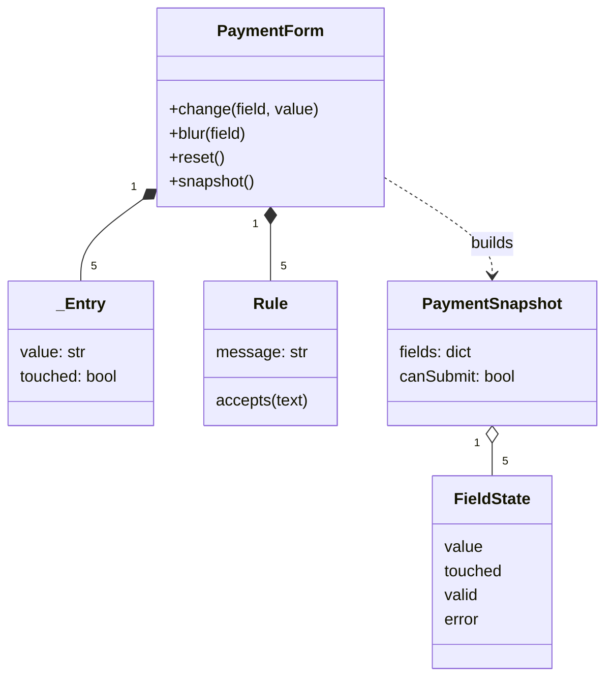
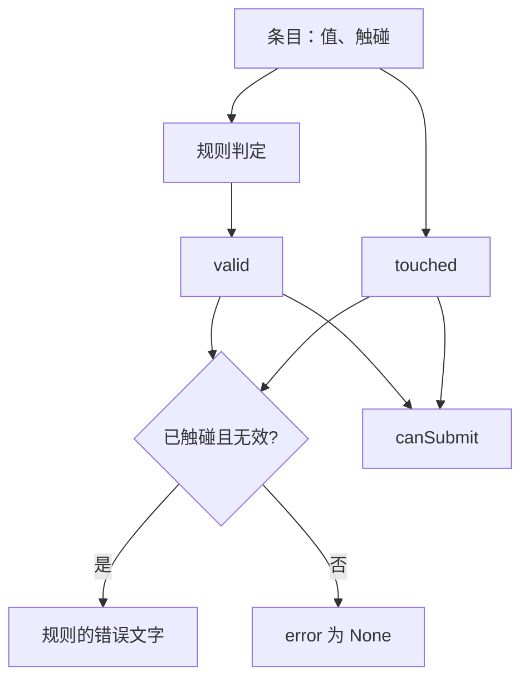

# 设计题解：支付表单校验（Payment Form Validation）

## 题目与澄清

一个支付页面有五个输入框：卡号、持卡人姓名、到期月份、到期年份、安全码（CVV）。页面和 HTTP 传输已经写好，你要写的是它背后的原生校验组件 `PaymentForm`。
它只回答"这一刻每个框里有什么、有没有被碰过、对不对、该不该给用户看红字、能不能点提交"。不付款，不存盘，不做 Luhn 校验，不同步多个客户端。
类的接口只有五个：`PaymentForm(currentYear)`、`change(field, value)`、`blur(field)`、`reset()`、`snapshot()`。
`currentYear` 由外面注入，范围 2000 到 2096；字段名永远是 `number`、`name`、`month`、`year`、`cvv` 之一，值永远是字符串；调用都是顺序的，没有并发。

这类题看着像"写五个正则"，实际上考三件事：**严格的格式判断**（边界一个字符都不能松）、**把"有效、已触碰、可见错误"三件事分开**、**快照互不牵连**。
开工前先把合同写成十二条自己的话，再动手：

1. 五个字段初始为空串、未触碰、无效、没有错误；`canSubmit` 为假。
2. `change` 把字符串原样存下：不裁剪、不改大小写、不补零；每次改值都重新判断有效性；**不碰触碰标记**。
3. `blur` 把这个字段标为已触碰，之后怎么改值都保持已触碰；重复失焦没有副作用。
4. `reset` 清空所有值和触碰标记，保留注入的年份。
5. 卡号：恰好 16 个 ASCII 数字。姓名：一个或多个 ASCII 字母，没有空格。月份：两位 ASCII 数字，01 到 12。年份：四位 ASCII 数字，`currentYear` 到 `currentYear+3`（含两端）。安全码：恰好 3 个 ASCII 数字。
6. 空白、换行、正负号、全角数字、阿拉伯数字、带重音的字母，一律无效；前导零保留；月份和年份互相独立，没有"不能早于本月"的规则。
7. 错误文字固定，五个字段各一句：`Invalid Card Number`、`Invalid Card Name`、`Invalid Month`、`Invalid Year`、`Invalid CVV`。
8. `error` 只在"已触碰且无效"时是文字；未触碰的无效字段是 `None`；触碰过的有效字段也是 `None`。
9. `canSubmit` 仅当五个字段**全部有效且全部已触碰**。
10. 快照是独立的：旧快照不受之后任何操作影响；改动返回的快照不影响表单；两个表单之间不共享可变对象。
11. 快照的形状：`fields` 是字段名到 `{value, touched, valid, error}` 的映射，外加 `canSubmit`。
12. 失败的调用不留痕：这里的失败只有"字段名不认识"和"值不是字符串"，它们抛异常、不改状态（合同没有规定，是本解的选择，见下）。

用参考解跑一个完整流程：年份 2031，依次填入并失焦五个字段，安全码只填了 `42`：

```text
number  '4000000000000002'   error=None                     canSubmit=False
name    'Ada'                error=None                     canSubmit=False
month   '11'                 error=None                     canSubmit=False
year    '2033'               error=None                     canSubmit=False
cvv     '42'                 error='Invalid CVV'            canSubmit=False
fixed cvv  -> True
after touch_all: ['Invalid Card Number', 'Invalid Card Name', 'Invalid Month', 'Invalid Year', 'Invalid CVV']
```

开口前值得问的澄清问题，每一个都会改变代码：

- **"有效"和"出错"是同一件事吗？** 不是。合同把它们拆开：有效性是对值的判断，出错是"有效性加触碰"才给用户看的东西。这一点决定状态里存什么，见决策一。
- **改值会不会标记触碰？** 不会。用户还在打字时不该看到红字；只有离开输入框（blur）才算"碰过"。合同明确写了。
- **前后空白要不要裁掉再判断？** 不要。值原样存、原样判：`" 12"` 的月份是无效的，存下来的也是 `" 12"`。裁剪会让页面显示的和判断的不是同一个字符串。
- **"数字"是什么？** 只有 `0` 到 `9`。全角的 `１２３`、阿拉伯-印度数字 `٣٣٣`、上标 `²` 在 Python 里 `isdigit()` 都为真，必须挡掉。
- **"字母"是什么？** 只有 `A–Z` 和 `a–z`。`Zoë` 和中文名都无效，这是合同的简化规则，不是缺陷。
- **月份要不要考虑"今年的哪个月已经过了"？** 不要。月份和年份互相独立；`currentYear` 年的 01 月也有效。
- **`currentYear` 要不要校验？** 合同说它是 2000 到 2096 的整数，这个范围恰好保证 `currentYear+3` 仍是四位数。本解在构造时检查它，越界抛 `ValueError`。
- **未知字段名怎么办？** 合同保证不会出现。参考解抛 `ValueError`，让调用方的拼写错误立刻暴露；换成静默忽略会把错误埋进"用户明明填了却提交不了"里。

## 需求与分级

机器编码轮会分关给出要求。这个项目大致是四关；每一关说明设计里哪一部分为它而存在。

**第 1 关（约 15 分钟，五条格式规则）**：`change` 存值，`snapshot` 对每个字段给出 `valid`。为这一关存在的是 `Rule`（错误文字加判定函数）和 `build_rules` 返回的规则表。
五条规则里最容易写错的是"ASCII 数字"和年份窗口；这一关的测试就是边界表：十五位、十七位、`0000000000000000`、`13`、`00`、`2043` 与 `2044`。

**第 2 关（约 15 分钟，触碰与可见错误）**：`blur`、`error` 的显示条件、`canSubmit`。为这一关存在的是内部的 `_Entry`（值加触碰标记）和 `snapshot` 里那一行"已触碰且无效才给文字"。
这一关把"有效、已触碰、可见错误"三个概念分开：前两个一个由值算出、一个由事件改变，第三个是两者的组合。

**第 3 关（约 10 分钟，重置与快照隔离）**：`reset` 保留年份；快照是新对象。为这一关存在的是"快照每次现建"的写法，以及 `reset` 重建 `_Entry` 字典而不是原地清空。
公开测试会改动返回的快照，再检查表单和旧快照有没有被牵连；还会同时创建第二个表单去做一堆操作，再检查第一个表单没变。

**第 4 关（选做，约 15 分钟，页面的边界）**：页面通过 HTTP 发 JSON 动作。`apply_action` 把 JSON 体的形状校验和三个方法调用连起来，形状不对在碰表单之前就拒绝。
同一关里放得下的小扩展：`touch_all`（点提交时让所有错误同时显示）和 `first_invalid`（提交失败时把光标送到第一个坏字段）。这三样都不改前三关写好的任何一行。

最后留十分钟写两篇短文：一篇说清"有效性、触碰状态、可见错误"各自存在哪里；一篇说怎样在不依赖默认年份的情况下检查重置和快照隔离。

## 核心对象与职责

| 对象 | 单一职责 | 它守住的不变量 |
| --- | --- | --- |
| `PaymentForm` | 持有五个 `_Entry` 和一张规则表，对外四个操作加快照 | 状态里只有"值"和"触碰"；有效性与错误永远现算 |
| `_Entry` | 一个字段的可变状态：原始字符串、是否触碰 | 值是调用方给的原样字符串 |
| `Rule` | 一个字段的错误文字和判定函数 | 不可变；判定函数只看字符串，不看表单状态 |
| `FieldState`、`PaymentSnapshot` | 快照里的数据（与工作区提供的模型同名同字段） | 每次调用现建，不与表单或其他快照共享可变对象 |
| `ActionError`、`apply_action` | HTTP 边界：形状校验加分派 | 校验通过之前不碰表单 |

关系是组合：表单拥有五个 `_Entry` 和五条 `Rule`，生命周期与表单相同；`Rule` 与 `_Entry` 之间没有引用，是 `snapshot` 在用规则去判断条目的值，所以规则可以脱离表单单独测试。
`Rule` 的年份窗口在构造时由 `currentYear` 算好，所以 `reset` 不用管它：重置的是条目，不是规则。



`snapshot` 的数据流是一条没有分支的流水线，每个字段独立走一遍，最后汇总：



## 关键设计决策

### 决策一：状态里只存"值"和"触碰"，有效性与错误现算

**问题**：合同要求"每次改值都重新判断有效性"，快照里有 `valid` 和 `error` 两个派生字段。它们存在哪里？

**选项 A，存下来**：`change` 里算出 `valid` 写进条目；`blur` 里把 `error` 写进条目。
读快照很快，但每个能改值或改触碰的方法都要记得同步更新另外两个字段；将来加一个新入口（比如 `touch_all`、从草稿恢复），漏掉同步就会出现"值是对的、`valid` 还是旧的"。
更糟的是失效的时机：`reset` 要重置三份东西，`blur` 要重算 `error`，每多一个字段就多一份遗忘的机会。

**选项 B，只存原始输入，快照里现算**：条目只有 `value` 和 `touched`；`valid = rule.accepts(value)`；`error = rule.message if touched and not valid else None`。
代价是每次快照要把五个字符串各判断一次——五个常数时间的判断，比一次 JSON 序列化便宜得多。
收益是不变量由结构保证：没有第二份状态，就不可能和第一份不一致。`touch_all`、`first_invalid` 这些新入口也不需要知道"该顺手更新什么"。

**选择 B。** 这是"派生数据不单独存"的老原则：能从两个事实算出来的东西，不要成为第三个事实。
它不是一个需要名字的设计模式；把一个字段设计成"带缓存的属性"在这里是过度设计。
什么时候选 A？校验贵（远程查重、复杂规则）、字段多、且读远多于写的时候，才值得缓存，并且要把缓存的失效集中在一个出口。

### 决策二：规则是一张"字段名 → `Rule`"的表，不是五个类

**问题**：五个字段五条规则，怎么组织？

**选项 A，每个字段一个校验类**，共同基类 `FieldValidator`，子类 `CardNumberValidator`、`MonthValidator`……这是教科书里的策略模式（Strategy）。
五个子类里四个只有一行判断，类的数量比逻辑还多；每个子类还要决定"错误文字放在哪、年份怎么传进来"。

**选项 B，一张表**：`Rule` 是一个冻结的小数据类，只有 `message` 和 `accepts` 两个成员；`build_rules(current_year)` 返回字典。
策略退化成"一个可调用对象"，没有继承，没有注册。年份窗口的依赖只在 `build_rules` 一处出现，其余规则不知道年份的存在。
新增第六个字段（比如邮编）就是表里加一行和 `FIELD_NAMES` 里加一个名字。

**选择 B。** 这里刻意拒绝了策略模式的类形式：策略只有"判定一个字符串"这一个方法，且没有自己的状态，一个函数足够。
如果某个规则需要状态（例如调用远程服务校验卡号并带缓存），再把那一条升级成带状态的对象，其他规则不用动。

### 决策三：格式判断用字符串方法加枚举集合，不用 `int()`，不用 `\d`

**问题**：怎么写"恰好两位数字且在 01 到 12 之间"才不会漏掉任何一个无效字符串？

**选项 A，`int()` 转换再比大小**：`len(v) == 2 and 1 <= int(v) <= 12`。运行一下这个写法，下面是它在不同输入下的结果：

```text
'04'  True      '+5'  True      ' 5'  True      '5 '  True
'٠٥'  True      '0٥'  True      '13'  False     '00'  False
'1_'  crash     'a1'  crash
```

正负号、空白、阿拉伯-印度数字都被接受，因为 `int()` 本来就接受它们；`'1_'`、`'a1'` 则直接抛 `ValueError`，一个格式判断函数崩溃了，而不是返回"无效"。年份用 `int()` 写同样会把 `'２０２８'`（全角）判为有效。

**选项 B，正则 `\d{3}`**：Python 的 `\d` 默认匹配所有 Unicode 十进制数字，`re.fullmatch(r'\d{3}', '٣٣٣')` 为真；用 `re.match(r'^\d{3}$', '123\n')` 也为真，因为 `$` 匹配在末尾换行之前。
改成 `[0-9]` 加 `fullmatch` 才正确：`re.fullmatch(r'[0-9]{3}', '123\n')` 为假。可行，但"哪个锚点、哪个字符类"是一个每次都要重新想起的陷阱。

**选项 C，字符串方法加集合**：数字用 `len(text) == n and text.isascii() and text.isdigit()`（先 `isascii`，再 `isdigit`；`isdigit` 单独用会接受 `²` 和 `٣`）；字母用 `text.isascii() and text.isalpha()`；
月份和年份直接写成合法字符串的集合：`01` 到 `12` 这十二个字符串，和 `currentYear` 起连续四年的四个字符串，判断就是 `in`。

**选择 C。** 集合的好处是"合法值有哪些"一眼可见，不存在任何解析；年份窗口是"四个字符串"，不是一个区间加一个格式。
`int()` 路线需要给每个陷阱写一个特判，集合路线没有特判。代价是月份和年份的规则不能推广到"任意范围"：窗口变成几百年时要换成"先查格式、再转整数"，那时必须加 `isascii`。

### 决策四：快照每次现建，里外都不共享可变对象

**问题**：怎么保证"旧快照不变、改返回值不影响表单、两个表单互不影响"？

**选项 A，缓存快照**：算一次，返回同一个对象，下次变更时再算。省了对象，但调用方拿到的是内部对象；调用方改一下 `fields["name"].value`，表单下次返回的就是被改过的值。
要靠"约定调用方不改"来保证，这是一个需要信任的接口。

**选项 B，深拷贝**：内部也存一份 `PaymentSnapshot`，返回时 `copy.deepcopy`。可行，但内部那份又是第二份状态，同决策一。

**选项 C，现算现建**：`snapshot` 本来就在遍历五个条目，每次新建字典和 `FieldState`。字符串不可变，可以直接放进新对象；布尔值和 `None` 同理。
没有任何内部可变对象从方法里出去，也就没有需要防御的东西。

**选择 C。** 它同时解决了"表单之间互不影响"：`_Entry` 字典是每个实例自己在 `__init__` 里新建的，不是类属性；`reset` 重新建字典而不是原地清空，所以已经取走的任何东西都不会被牵连。
这是防御性拷贝（Defensive Copying）里最便宜的一种：不拷贝，因为从一开始就没有共享。

### 决策五：不规范输入的处理——先拒绝，不改状态，不静默容忍

**问题**：合同保证字段名合法、值是字符串，但代码里仍要决定"万一不是"。

**选项 A，什么也不检查**：未知字段名的 `change` 会抛 `KeyError`，或者（如果用 `setdefault`）悄悄多出第六个字段；值是 `None` 时 `len(None)` 在判定函数里才崩。
**选项 B，在入口检查**：`_entry` 先查字段名，不认识就抛 `ValueError`；`change` 再检查 `isinstance(value, str)`，不是就抛 `TypeError`。两个检查都发生在改任何东西之前，所以失败的调用不留痕。
**选择 B。** 这是边界校验：错误在入口处用清楚的消息暴露，而不是传到深处变成一个看不懂的异常。HTTP 边界 `apply_action` 的做法一致，只是把"类型和键集合"的检查放在那里，失败抛 `ActionError`，在碰表单之前就拒绝。
构造函数同样拒绝 `currentYear` 越界：它是唯一一个"配置"输入，配置错了越早失败越好。

## 代码走读

下面是完整的参考解。

%% code:begin solution.py %%
```python
"""支付表单校验（PaymentForm）参考解。

设计五行：
1. 每个字段只存两样东西：用户敲进去的原始字符串、是否失焦过（`_Entry`）；有效性和错误文字都不存。
2. 有效性由 `Rule` 表按字段名查出来：一条规则 = 错误文字 + 一个只看字符串的判定函数；年份窗口由注入的当前年份在构造时算好。
3. `snapshot()` 每次从头算：valid = 规则通过；error = 已触碰且无效时才是规则文字；canSubmit = 五个字段都 valid 且 touched。
4. 返回给调用方的永远是新对象（新字典、新 `FieldState`），内部状态不外泄；字符串本身不可变，可以放心共享。
5. `apply_action` 是 HTTP 边界：只认三种动作的精确键集合与字符串类型，形状不对就抛 `ActionError`，表单状态一点不动。
"""
from __future__ import annotations

import dataclasses
from collections.abc import Callable
from dataclasses import dataclass

FIELD_NAMES: tuple[str, ...] = ("number", "name", "month", "year", "cvv")
YEAR_WINDOW = 4  # 当前年份起算共四年：currentYear … currentYear+3


@dataclass
class FieldState:
    """一个字段在某一刻的样子。"""

    value: str
    touched: bool
    valid: bool
    error: str | None


@dataclass
class PaymentSnapshot:
    """整张表单在某一刻的样子；`fields` 按 FIELD_NAMES 的顺序。"""

    fields: dict[str, FieldState]
    canSubmit: bool


class ActionError(ValueError):
    """HTTP 动作体形状不对（对应 400）。"""


@dataclass(frozen=True, slots=True)
class Rule:
    """一个字段的规则：判定函数只看字符串，错误文字固定。"""

    message: str
    accepts: Callable[[str], bool]


@dataclass(slots=True)
class _Entry:
    """内部可变状态：原始输入和是否失焦过。"""

    value: str = ""
    touched: bool = False


def _ascii_digits(length: int) -> Callable[[str], bool]:
    """恰好 `length` 个 ASCII 数字。先查 isascii：isdigit 单独用会放过全角数字、阿拉伯数字和上标。"""

    def accepts(text: str) -> bool:
        return len(text) == length and text.isascii() and text.isdigit()

    return accepts


def _ascii_letters(text: str) -> bool:
    """至少一个字符，全是 ASCII 字母；空格、重音字母、数字都不行。"""
    return text.isascii() and text.isalpha()


def build_rules(current_year: int) -> dict[str, Rule]:
    """五条规则。月份和年份直接写成合法字符串的集合：不调用 int()，也就没有正负号、空白、下划线的歧义。"""
    months = frozenset(f"{m:02d}" for m in range(1, 13))
    years = frozenset(str(y) for y in range(current_year, current_year + YEAR_WINDOW))
    return {
        "number": Rule("Invalid Card Number", _ascii_digits(16)),
        "name": Rule("Invalid Card Name", _ascii_letters),
        "month": Rule("Invalid Month", months.__contains__),
        "year": Rule("Invalid Year", years.__contains__),
        "cvv": Rule("Invalid CVV", _ascii_digits(3)),
    }


class PaymentForm:
    """五个字段的输入状态机：change 改值，blur 标触碰，reset 清空，snapshot 拍照。"""

    def __init__(self, currentYear: int) -> None:
        if type(currentYear) is not int or not 2000 <= currentYear <= 2096:
            raise ValueError("currentYear must be an int in 2000..2096")
        self._year = currentYear
        self._rules = build_rules(currentYear)
        self._entries = {name: _Entry() for name in FIELD_NAMES}

    def _entry(self, field: str) -> _Entry:
        try:
            return self._entries[field]
        except (KeyError, TypeError):
            raise ValueError(f"unknown field: {field!r}") from None

    def change(self, field: str, value: str) -> None:
        """原样保存字符串（不裁剪、不规范化）；不碰触碰标记。"""
        entry = self._entry(field)
        if not isinstance(value, str):
            raise TypeError("value must be a str")
        entry.value = value

    def blur(self, field: str) -> None:
        """标记触碰；重复失焦无副作用。"""
        self._entry(field).touched = True

    def touch_all(self) -> None:
        """点“提交”时的做法：把五个字段都标为已触碰，让每个无效字段同时亮出错误。"""
        for entry in self._entries.values():
            entry.touched = True

    def first_invalid(self) -> str | None:
        """第一个无效字段的名字（按页面顺序），用来在提交失败时把光标送过去；全有效时为 None。"""
        for name in FIELD_NAMES:
            if not self._rules[name].accepts(self._entries[name].value):
                return name
        return None

    def reset(self) -> None:
        """清空所有值和触碰标记，保留年份与规则。"""
        self._entries = {name: _Entry() for name in FIELD_NAMES}

    def snapshot(self) -> PaymentSnapshot:
        """每次现算、现建：返回值与表单、与上一次的快照都不共享可变对象。"""
        fields: dict[str, FieldState] = {}
        for name in FIELD_NAMES:
            entry, rule = self._entries[name], self._rules[name]
            valid = rule.accepts(entry.value)
            shown = entry.touched and not valid
            fields[name] = FieldState(
                value=entry.value,
                touched=entry.touched,
                valid=valid,
                error=rule.message if shown else None,
            )
        ready = all(state.valid and state.touched for state in fields.values())
        return PaymentSnapshot(fields=fields, canSubmit=ready)


# 每种动作需要的键（除 action 之外）；多一个或少一个都算畸形
_ACTION_KEYS: dict[str, tuple[str, ...]] = {
    "reset": (),
    "blur": ("field",),
    "change": ("field", "value"),
}


def apply_action(form: PaymentForm, body: object) -> dict[str, object]:
    """HTTP 边界：校验 JSON 体的形状，执行动作，返回快照的纯字典。校验全部通过之前不碰表单。"""
    if not isinstance(body, dict):
        raise ActionError("body must be an object")
    action = body.get("action")
    if type(action) is not str or action not in _ACTION_KEYS:
        raise ActionError("unknown action")
    wanted = {"action", *_ACTION_KEYS[action]}
    if set(body) != wanted:
        raise ActionError("unexpected or missing keys")
    if any(type(body[key]) is not str for key in wanted):
        raise ActionError("every value must be a string")
    if "field" in wanted and body["field"] not in FIELD_NAMES:
        raise ActionError("unknown field")
    if action == "reset":
        form.reset()
    elif action == "blur":
        form.blur(body["field"])
    else:
        form.change(body["field"], body["value"])
    return dataclasses.asdict(form.snapshot())


if __name__ == "__main__":
    form = PaymentForm(2031)
    steps = [("number", "4000000000000002"), ("name", "Ada"), ("month", "11"), ("year", "2033"), ("cvv", "42")]
    for name, text in steps:
        form.change(name, text)
        form.blur(name)
        snap = form.snapshot()
        print(f"{name:7} {text!r:20} error={snap.fields[name].error!r:24} canSubmit={snap.canSubmit}")
    form.change("cvv", "420")
    print("fixed cvv  ->", form.snapshot().canSubmit)
    form.reset()
    form.touch_all()
    print("after touch_all:", [s.error for s in form.snapshot().fields.values()])
```
%% code:end %%

**走读一：规则表（`build_rules`）。** 看 `months` 和 `years` 两个集合：它们是"所有合法答案"，不是"检查规则"。`"month": Rule("Invalid Month", months.__contains__)` 里的判定函数就是集合的 `in`。
卡号和安全码共用 `_ascii_digits(n)`，它是一个返回判定函数的函数，只有长度不同。读到这里应该能回答：为什么年份窗口不用在 `reset` 里重新算？因为规则在构造时已经带着年份，`reset` 没有碰它。

**走读二：`snapshot`。** 循环体里三行是整个"有效、已触碰、可见错误"的定义：`valid = rule.accepts(entry.value)`；`shown = entry.touched and not valid`；`error = rule.message if shown else None`。
条目里没有 `valid` 和 `error`，所以不会不同步。循环后一行 `ready = all(state.valid and state.touched ...)` 就是 `canSubmit`，它读的是刚建好的 `FieldState`，不是另一份缓存。

**走读三：`change`、`blur`、`reset`。** `change` 里先 `_entry(field)`（可能抛 `ValueError`），再检查类型（可能抛 `TypeError`），最后才赋值，三步的顺序保证失败的调用不改状态。
`change` 里没有任何一行碰 `touched`；`blur` 里也没有任何一行碰 `value`。`reset` 用新字典换掉旧字典，条目对象整个丢弃。

**走读四：`apply_action`。** `_ACTION_KEYS` 是一张"动作名 → 需要的键"的表。校验顺序是：是字典、动作名认识、键集合恰好等于 `{action} + 需要的键`、每个值都是 `str`（用 `type(x) is str` 精确判断，数字、布尔、列表、`None` 都挡在外面）、字段名认识。
全部通过之后才调用表单的方法，所以畸形请求不会半途改掉状态。最后用 `dataclasses.asdict` 把快照转成纯字典，页面拿到的是 JSON 能表示的东西，改它也碰不到表单。

## 测试与自检

测试文件对每条合同规则各有一个断言，以下是值得单独说的几类：

- **边界表**：每个字段一组有效、一组无效，无效里放真正会漏的：前后空白、末尾换行、正负号、全角与阿拉伯数字、带重音的字母、长度差一。
- **年份窗口**：用 2000、2040、2096 三个注入年份，检查 `year-1`、`year`、`year+3`、`year+4`；这就是"不依赖默认年份"的做法：窗口的两端都是相对注入值算出来的，换一个年份，测试仍然成立。
- **可见错误的四个格**：无效未触碰（无错误）、无效已触碰（有错误）、改对之后（立刻消失）、已触碰后再改错（立刻出现）。
- **`canSubmit` 的两个独立条件**：五个字段各让一次"唯一未失焦"，各让一次"唯一无效"，用参数化覆盖。
- **重置**：`reset` 之后 `year` 的窗口末端仍然按旧年份算，是在重置后再填一个 `currentYear+3` 来证明的；把年份悄悄改成默认值会让它失败。
- **快照隔离**：持有旧快照，做 `change`、`reset`，再比较旧快照与当时的深拷贝；再对返回值做破坏性修改（赋值、清空字典、新增键），比较表单；再建第二个表单，做一串操作，比较第一个。
- **随机对拍**：四千个随机字符串（含空白、符号、全角与阿拉伯数字、带重音字母），用一份独立的 `re.fullmatch(r'[0-9]{16}', ...)` 式的参照实现比较，种子固定，期望值由参照实现算出，不是手填的。
- **失败不留痕**：未知字段、非字符串值抛异常，前后快照相同。
- **HTTP 边界**：十五种畸形的 JSON 体都抛 `ActionError`，表单没有任何变化。

自检方式是**换一份有缺陷的实现看测试能不能抓住**。在参考解上各做一处改动：去掉 `isascii`、`change` 里 `strip()`、`change` 里顺手标触碰、错误不看触碰、年份窗口少一年、`canSubmit` 只看有效、`reset` 重置了年份、快照复用同一个字典，每一处都会让至少一个测试失败。
五分钟内向面试官演示：构造年份 2031，填满五个字段并失焦，`canSubmit` 为真；把安全码改成 `42`，`canSubmit` 立刻为假，`error` 是 `Invalid CVV`；`reset` 后一切回到初始。

关于页面：工作区带有一个静态页面和一个很薄的 HTTP 服务，页面里的脚本把每次输入、失焦、重置排成一个队列依次提交，并丢弃过期的响应。
这对组件有两个直接的要求：**重复的 `blur` 必须无副作用**（页面在值没变时会跳过重复失焦，但服务端不该依赖这一点），以及**所有响应都是完整快照**（页面用最新快照整体重画，不做增量合并）。本解满足这两条；`apply_action` 的校验行为与那个服务对一批畸形请求的返回一致（正常请求返回 200 和同样的 JSON，畸形请求返回 400 且不改状态）。
页面脚本本身的行为（输入队列、过期响应的丢弃、提交按钮的启用）只在这里作为约束被阅读，没有在浏览器里运行；这个项目的评分调用的是原生方法，不经过页面。

## 扩展与追问

**新需求**
- **点提交时一次性显示所有错误**：`touch_all()`，把五个条目都标为已触碰，一个循环、三行。没有第二份状态，所以不需要同步任何东西。已经加在参考解里。
- **提交失败时把光标送到第一个坏字段**：`first_invalid()`，按页面顺序找第一个 `accepts` 为假的字段，与触碰无关。已经加在参考解里。
- **新增一个邮编字段**：`FIELD_NAMES` 加一个名字，`build_rules` 加一行，`_Entry` 字典自动多一项；其余类不改。
- **月份不能早于本月**：规则不再只看一个字符串。给月份规则一个带 `current_month` 的构造参数，或把 `Rule.accepts` 的签名放宽到"看整张表单的值"；`snapshot` 的循环不变。要先问清楚：是"月份年份组合不早于今天"，而不是各自独立判断。
- **卡号 Luhn 校验**：新的判定函数 `_luhn(text)`，在 `_ascii_digits(16)` 之后串联；错误文字不变或新增一句，决定于产品。

**并发与线程安全**
- 合同说调用是顺序的。如果页面服务是多线程的（`ThreadingHTTPServer`），`change` 加 `snapshot` 就是读—改—写，需要一把锁罩住 `PaymentForm` 的每个公开方法；不要把锁放进 `_Entry`，因为 `snapshot` 要看到五个条目的一致视图。
- 全局解释器锁（GIL）保证的是单个字节码的原子性，不保证"先判断再赋值"的复合操作；这里的 `snapshot` 要一次读五个条目，不加锁时可能读到"刚改了一半"的组合。
- 改动落在：`PaymentForm` 里多一个 `threading.Lock`，公开方法体放进 `with`。`Rule`、`_Entry`、`apply_action` 不动。

**持久化与规模**
- **刷新页面不丢草稿**：把 `_Entry` 序列化成字典存到 `sessionStorage` 或服务端，构造时恢复。因为状态只有"值与触碰"，存下来的就是这两样；有效性与错误自然重新算出，不会出现旧缓存。
- **多个表单实例的服务**：按会话 ID 保存一个 `PaymentForm`，淘汰策略决定内存；组件本身不变。
- **五十个字段的大表单**：快照每次重算五十个判定仍然很便宜；如果有昂贵的校验（远程查重），只对那一个字段做缓存，键是 `(字段, 值)`，其余保持现算。

## 常见错误

- **把 `valid` 存进条目**：一个入口忘了同步，值和有效性就对不上。改成现算，这类错误从结构上消失。
- **`change` 里顺手标触碰**：用户一输入第一个字符就看到红字。合同写了"改值不碰触碰"，这是最常被隐藏测试针对的一条。
- **`isdigit()` 单独用**：接受 `٣٣٣`、`２０２８`、`²`。要先 `isascii()`。
- **月份或年份用 `int()`**：接受 `+5`、` 5`、`٠٥`；传入 `a1` 时直接抛 `ValueError`。用合法值的集合。
- **正则写 `\d` 或 `^…$`**：`\d` 匹配所有 Unicode 数字；`$` 匹配末尾换行之前，`"123\n"` 被当成三位数字。用 `[0-9]` 加 `fullmatch`，或者干脆不用正则。
- **姓名用 `isalpha()` 单独判断**：接受 `Zoë`。同样要 `isascii()`。空字符串的 `isalpha()` 是假，所以"一个或多个"自动成立。
- **裁剪输入**：`value.strip()` 之后再存，页面显示的和判断的不是同一个字符串，而且 `" 12"` 本来就应该无效。
- **`error` 看 `valid` 不看 `touched`**：未触碰的字段一加载就满屏红字。
- **`canSubmit` 只看有效**：表单被预先填好、没有任何字段失焦过时，也应该不能提交。
- **快照里放内部字典**：`self._entries` 或缓存的 `PaymentSnapshot` 直接返回，调用方一改就串。
- **`reset` 里把年份也清了**：之后年份窗口变成默认年份的窗口，只有在注入非默认年份的测试里才暴露。
- **类属性当实例状态**：`_entries = {}` 写在类体里，两个表单共享一份。这是 Python 特有的共享状态陷阱。
- **写 `get_error(field)`、`set_value(field, v)` 这样的访问器**：属性与方法已经够用，`snapshot` 是唯一的读口。
- **让智能体一次性写完**：智能体常把 `valid` 缓存起来、顺手 `strip()`、用 `\d` 正则；一次给它一个失败用例，读 diff 时专门查这四个地方。

## 45 分钟怎么分配

- **0–5 分钟｜读合同**：把十二条写成注释，标出最可能被隐藏测试针对的：改值不碰触碰、未触碰无错误、年份窗口两端、非 ASCII 数字、重置保留年份、快照独立。先对自己说清"有效、已触碰、可见错误"各存在哪里，再开口跟智能体说话。
- **5–10 分钟｜定骨架**：口头说结构——条目只有值与触碰，一张规则表，快照现算。让智能体写 `_ascii_digits` 和规则表（输入输出清楚，易验证）；状态里存什么这个决定自己定。
- **10–22 分钟｜第 1 关和第 2 关**：先写格式规则，用边界表测；再写 `blur` 和 `error`。每写完一块跑公开测试，再把合同里的例子写成自己的断言。
- **22–30 分钟｜第 3 关**：写快照隔离测试：持有旧快照、改返回值、建第二个表单。写不依赖默认年份的重置测试（换两个不同的注入年份）。
- **30–38 分钟｜审智能体的 diff**：找缓存的 `valid`、`strip()`、`int()`、`\d`、`change` 里碰触碰的那一行。
- **38–45 分钟｜两篇短文**：各约一百五十字。第一篇：有效性是由值算出的，触碰是事件改变的，可见错误是两者的组合，所以条目里只存前两个里的"值"和"触碰"。第二篇：用两个不同的注入年份、持有旧快照后再操作、破坏返回值再检查表单。

时间不够时的取舍顺序：先砍 `apply_action`（页面边界，评分不调用），再砍 `touch_all` 与 `first_invalid`，再砍随机对拍；**绝不能砍的是**：改值不碰触碰、错误取决于触碰与有效、年份窗口两端、`isascii`、快照现建、两篇短文。

## 延伸阅读

- [[fsm.guards-actions|守卫、动作和进出钩子（Guards, Actions, Hooks）]]：`canSubmit` 是一个由两个事实组成的守卫，不是一个状态。
- [[errors.boundary-validation|边界校验（Validate at the Boundary）]]：格式判断与 `apply_action` 的做法。
- [[data.defensive-copy|防御性拷贝（Defensive Copying）]]：快照现建与"从一开始就不共享"。
- [[fluency.strings-bytes|字符串与字节（Strings & Bytes）]]：`isdigit`、`isascii`、`isalpha` 各自接受什么。
- [[solution-lcp-feature-flag]]：同样用"名字到函数的表"代替一族类，并且有"缺失或类型不符只算不命中"的严格输入约定。
- [Python 文档：str.isdigit 与 str.isascii](https://docs.python.org/3/library/stdtypes.html#str.isdigit)：`isdigit` 接受上标和其他文字的数字。
- [Python 文档：re.fullmatch](https://docs.python.org/3/library/re.html#re.fullmatch)：与 `match` 加 `$` 的区别，`\d` 的 Unicode 范围。
- [Python 文档：Unicode HOWTO](https://docs.python.org/3/howto/unicode.html)：码点、字符属性和字符串比较。
- [MDN：blur 事件](https://developer.mozilla.org/en-US/docs/Web/API/Element/blur_event)：失焦事件何时触发，"已触碰"这个概念在浏览器里的来源。
- [Luhn 算法（维基百科）](https://en.wikipedia.org/wiki/Luhn_algorithm)：真实卡号校验在格式之外还要做的一步。
