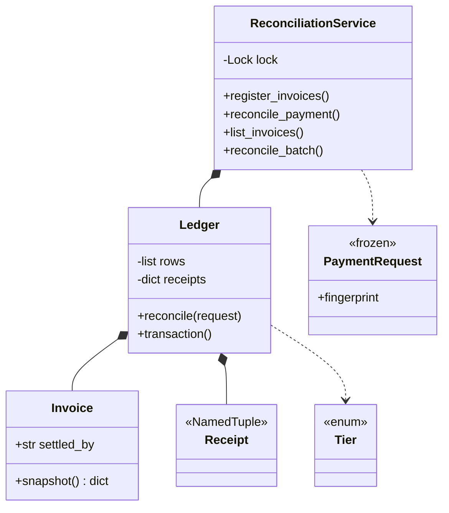
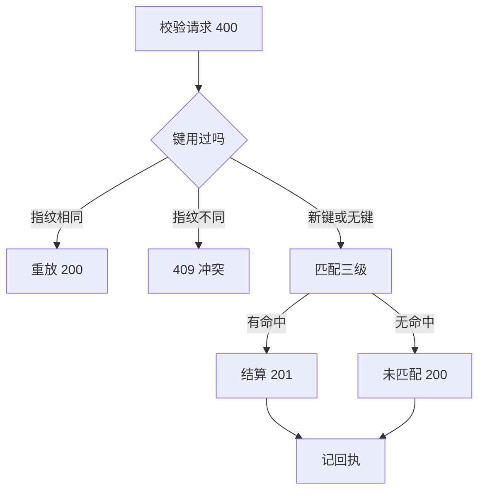

# 设计题解：付款对账服务（Payment Reconciliation）

## 题目与澄清

一个对账平台每天收到银行的付款，要把每笔付款匹配到某张未付发票并结算。客户会重发同一笔付款，几笔付款会同时抢同一张发票，运营还会一次提交一整批付款，要求要么全部入账、要么一笔都不动。
你要写的是进程内的 `ReconciliationService`，背后的 HTTP 适配器（路由、`Idempotency-Key` 请求头、JSON 解析、错误翻译）已经写好，只负责把四个方法接到四条路由上。账本只在一个实例的内存里，不要求落盘。

四个方法与返回形状，**形状本身就是合同的一部分**：

| 方法 | 成功返回 | HTTP |
|---|---|---|
| `register_invoices(invoices)` | `(201, {"registered_count": n})` | 201 |
| `reconcile_payment(payment, forgiveness=0, key=None)` | 命中 `(201, 响应体)`；未命中、或同键重放 `(200, 响应体)` | 201 或 200 |
| `list_invoices()` | `(200, 发票字典的列表)` | 200 |
| `reconcile_batch(payments)` | `(200, {"results": [{"status", "body"}, ...]})` | 200 |

失败一律抛 `ServiceError(status, code)`，`status` 是整数，`code` 是稳定的字符串，适配器把它翻成 `{"error": code}`。
**未匹配不是失败**：账单里没有这笔钱对应的发票是常事，返回 200 加 `UNMATCHED`，让调用方留着这笔钱慢慢查。

先把合同用自己的话写下来，这是开工前的第一件事。按"一个粗心读者最容易漏掉"的顺序：

1. **发票一行**是 `"发票号, 到期日, 金额"`：按 `", "`（逗号加一个空格）切成恰好三段，每段去首尾空白再校验。发票号去空白后长度 1 到 64；
   到期日必须是严格的 `YYYY-MM-DD`、ASCII 数字、真实存在的日历日；金额是只含 `0`–`9` 的正整数分，前导零可以，零、正负号、下划线、全角数字都不行。
2. **登记的错误顺序**：按输入顺序逐行校验，格式错得 `400 invalid_input`，批内重复得 `409 duplicate_invoice`，先遇到的赢；整批都通过之后才去查账本里已有的号。批次原子：任何一项出错，一张都不存。
3. **付款一笔**是 `"付款号, 金额, 备注"`：同样按 `", "` 切，但备注是第三段起**原样**接回去的文字，里面的逗号保留；缺备注就是空串。
   `forgiveness`（容差）是非负整数，`True` 不算整数；`key` 是 `None` 或长度 1 到 64 的字符串，空白算内容。
4. **三级匹配，只看未付发票，严格按优先级**：第一级 `id`，备注里有 `paying for:` 或 `paying off:`，后面跟着一个未付发票的号，就直接命中，**金额不同也算**；第二级 `exact`，金额恰好相等；
   第三级 `fuzzy`，只在 `forgiveness > 0` 时启用，金额落在 `[付款额 − 容差, 付款额 + 容差]` 闭区间里。
5. **同一级里的平局**依次比：到期日更早，金额差的绝对值更小，发票号字典序更小。
6. **幂等**：范围是实例里的 `key`。先校验请求，再查键。同键、同指纹（付款串去首尾空白加 `forgiveness`）得到 `(200, 当初那份响应)`，不重新匹配；同键不同指纹得到 `409 idempotency_conflict`。没有键的请求永远按当前账本匹配。
7. **批次**：逐行处理，每行看得见前面行的结算和回执；第一个错误按行序胜出，并撤销这一批做过的一切；没匹配的行是成功的行。
8. **隔离与并发**：返回值都是和内部脱钩的快照；所有方法线程安全；批次对其他所有方法是原子的。

四个必须当场问清、答案会改代码的澄清问题：

- **批次里第一行是幂等冲突、第二行是格式错，抛哪个？** 合同写的是"按行序，第一个错误胜出"，所以抛 409，不是 400。如果先把所有行的格式都检查一遍再执行，就会抛 400，和合同不同。
  这决定了"检查这一行"和"处理这一行"要交错进行，而不是分成两遍。
- **登记时批内重复和账本已有，谁先？** 批内重复在逐行校验时发现，账本已有要等整批通过之后。所以 `["已有的号", "格式错"]` 得 400，`["已有的号", "新号"]` 才得 409。
- **备注里的标记怎么"不分大小写"？** `PAYİNG FOR:`（带点的大写 İ）和 `payıng off:`（不带点的小写 ı）也要认。合同明说 `i`、`I`、`İ`、`ı` 等价，所以不能先把整串备注 `lower()`：
  `'İ'.lower()` 是两个字符，之后拿它算出的位置去切原串会错位。要用正则的 `re.IGNORECASE`，位置取自原串。
- **同一个付款号能再用吗？** 能。付款号只是标签，不是隐式的幂等键；要靠键才有重放。

范围之外：磁盘持久化、发票作废或部分付款、一笔付款拆分结算多张发票、跨进程的幂等。

## 需求与分级

**第 1 关（约 15 分钟，登记与列表）**：解析发票行、逐行校验、原子登记、按（到期日，发票号）排序的列表。
这一关最重要的是把"一行怎么变成合法发票"写成**一个**函数（`Invoice.parse`），金额、日期、发票号三个小解析各一个函数，被付款那边复用。
示例：`register_invoices(["ORD A, 2026-08-04, 100", "ORD B, 2026-08-05, 100"])` 得到 `(201, {"registered_count": 2})`；再登记 `["ORD A, 2026-08-04, 100"]` 得到 `409 duplicate_invoice`，账本里仍是两张。

**第 2 关（约 20 分钟，三级匹配）**：备注标记、exact、fuzzy、平局顺序、结算与返回体。
示例：发票 `LN-1` 到期 2026-11-01 金额 150，`LN-2` 到期 2026-12-01 金额 180，付款 `"rcpt_3, 147, wire transfer"`：

| forgiveness | 结果 |
|---|---|
| 0 | `UNMATCHED` |
| 2 | `UNMATCHED`（147 + 2 = 149，够不到 150） |
| 3 | `MATCHED LN-1`，`tier_used` 是 `fuzzy`（闭区间的上界 150 正好含在内） |
| 4 | `MATCHED LN-1`，`fuzzy` |

平局例子：发票 `A` 03-02 金额 101、`B` 03-01 金额 96、`D` 03-01 金额 102、`C` 03-01 金额 98，付款 100 容差 5，连续付五笔，命中顺序是 `C D B A` 然后未匹配。
`C` 与 `D` 的金额差都是 2，到期日相同，发票号小的 `C` 先；之后 `D`（差 2）先于 `B`（差 4）；最后才是晚一天到期的 `A`，哪怕它的差只有 1。

**第 3 关（约 15 分钟，幂等）**：键的范围、指纹比较、重放、"先校验再查键"。
示例：发票 A、B 金额都是 100，付款 `"p1, 100"` 带键 `k` 命中 A，状态 201；然后登记第三张发票 C（金额也是 100），同样的请求再发一次，得到 `(200, 同一份命中 A 的响应)`，C 仍是未付；
把金额改成 101 再用键 `k` 得到 `409 idempotency_conflict`；格式错的 `"bad"` 带键 `k` 得到 `400`（先校验）；不带键的 `"p1, 100"` 连发三次，依次命中 B、C，然后 `UNMATCHED`。

**第 4 关（约 10 分钟，批次与并发）**：逐行暂存、回滚、整批原子、并发。
示例：README 的批次例子里三行的状态是 `[201, 200, 201]`，命中的发票是 `ORD A`、`ORD A`、`ORD B`；第一行靠 id 命中，尽管金额只有 1，第二行同键同请求重放，第三行 exact 命中 `ORD B`。
`[p3 带键 new-key, "invalid"]` 得到 `400 invalid_input`，之后 `new-key` 是全新的键，p3 的结算也不见了。

HTTP 合同（适配器已写好，要知道它做什么，才知道你的方法会收到什么）：

| 路由 | 调用 | 说明 |
|---|---|---|
| `POST /invoices` | `register_invoices` | 请求体 `{"invoices": [...]}`，成功 201 |
| `POST /payments` | `reconcile_payment` | 请求体 `{"payment": "...", "forgiveness": 0}`，键来自 `Idempotency-Key` 请求头；`forgiveness` 是 bool 或非整数时适配器直接回 400 |
| `POST /payment-batches` | `reconcile_batch` | 请求体恰好是 `{"payments": [...]}`；每行的键写在行里，请求头不起作用 |
| `GET /invoices` | `list_invoices` | 200 加数组 |

适配器还有固定行为：JSON 解析失败回 `400 invalid_json`，路由不存在回 `404 not_found`，方法不支持回 `405 method_not_allowed`，并且会把漏出来的 `ValueError` 和 `TypeError` 翻成 400。
所以你的方法收到的 `payment` 在直连调用时可能是任意类型，校验不能只检查取值，必须先检查类型。

## 核心对象与职责

| 类 | 单一职责 | 它拥有的不变量 |
|---|---|---|
| `ServiceError` | 带状态码和稳定字符串的失败 | `status` 是整数，`code` 是字符串，适配器只靠这两个字段翻译 |
| `Tier` | 三级匹配的名字 | 值就是返回体里的 `tier_used`，只有 `id`、`exact`、`fuzzy` 三个 |
| `Invoice` | 一张发票和它的快照 | 状态由 `settled_by` 推出来：已付当且仅当有结算它的付款号 |
| `PaymentRequest` | 把一次付款请求解析成一个只读的值 | 字段都已校验；`fingerprint` 相等就是"同一个请求" |
| `Receipt` | 一次已完成请求的回执 | 指纹、状态码、响应体的私有副本；创建后不改 |
| `Ledger` | 全部可变状态：有序发票、发票号索引、回执表、撤销日志 | 发票号唯一；一张发票至多结算一次；一个键至多一份回执；自己不加锁 |
| `ReconciliationService` | 锁外校验、锁内执行，把四个方法接到 `Ledger` 上 | 一把锁保护全部可变状态；批次整段持锁 |

`ReconciliationService` 拥有 `Ledger`，`Ledger` 拥有它的发票和回执，生命周期一致，都是组合（composition）。外部拿不到任何 `Invoice`，只拿得到字典快照。
`Ledger` 不加锁是有意的：锁的范围由服务一个类决定，不是每个对象各管各的，原因在决策一。



一次 `reconcile` 的路径（会抛错的步骤都在第一次写之前）：



## 关键设计决策

### 决策一：一把锁罩住全部状态，批次整段持锁

**问题。** 四个方法在多个线程里同时被调用。付款是"读键、匹配、改发票、记回执"的复合操作；批次更是几笔付款连在一起，还要在失败时撤销。线程可以在任意两步之间被切走。

**选项 A：不加锁，指望 GIL。** 全局解释器锁（GIL）只保证单个字节码是原子的，不保证一串字节码是原子的。
两个线程同时发同一个键：都执行了"键不在回执表里"，都匹配到同一张发票，都写上"已付"，发票被结算了两次，回执只记住后一个。重试保护恰恰在重试风暴里失效。

**选项 B：每张发票一把锁，或者按金额分片的锁。** 不相干的付款可以并行。代价是匹配要看全部未付发票（要看多张发票才知道谁是最早到期的），就得同时拿到很多把锁，拿的顺序不统一就会死锁；
批次更糟，几笔付款的发票集合事先不知道，只能先锁整本账。这套复杂度在这个规模上买不到任何东西。

**选项 C：一把 `threading.Lock`，校验之后的全部状态访问都在里面。** 解析与校验是纯函数，放在锁外，让 400 的请求不排队；锁里只有内存操作，没有 I/O，持有时间是微秒级。

**选择 C。** 一把锁容易证明：任何两个方法的状态访问都不会交错。**读也要在锁里**：`list_invoices` 如果不加锁，批次进行到一半时它可能看到"第一张已付、第二张未付"，而合同要求批次对所有方法都是原子的。
测试 `test_readers_never_see_half_a_batch` 把切换间隔调到一微秒，断言读到的只会是全未付或全已付；去掉 `list_invoices` 里的锁，这个测试就会失败。

**扩展方向。** 要让互不相干的账户并行，按账户拆成多个 `Ledger`，每个一把锁；同一个键只属于一个账户，所以拆分后幂等仍然正确。这个改动只涉及 `ReconciliationService`。
**是什么模式。** 一个监视器保护整个聚合（Monitor / Coarse-Grained Lock），不需要额外的模式类。

### 决策二：批次回滚，用撤销日志，不拷贝整本账

**问题。** 批次要"全有或全无"：第 3 行出错，前两行已经做过的结算和已经写下的键都要消失，批前已有的状态保持原样。
关键点是**没法在执行前预先检查完**：第 2 行是否冲突，取决于第 1 行有没有写下同一个键；第 3 行能不能匹配，取决于前两行占用了哪些发票。所以必须"边做边看"，并且能撤回。

**选项 A：先拷贝整本账，在拷贝上执行，成功再换回去。** 概念最简单，也最不容易写错：失败就是丢掉拷贝。
代价是每个批次都付出与账本大小成正比的拷贝费用，账本里有一百万张发票时，一个两行的批次也要拷一百万张；而且持锁的时间被拉长。

**选项 B：执行时记一本撤销日志，失败时按相反顺序撤销。** 每次结算和每次写回执都记一条"怎么撤销"的小函数，出错时倒着执行。代价与这一批实际改动的条数成正比。
要写对的地方有两个：一是撤销必须发生在放锁之前，否则别人会看到中间状态；二是日志只在批次里开着，单笔付款不记，因为单笔失败发生在第一次写之前。

**选项 C：暂存层（overlay）。** 批次在一个覆盖层里读写，成功时合并。读要先查覆盖层再查账本，匹配要把两层合起来看，代码最多，最容易漏一条读路径。

**选择 B。** `Ledger.transaction()` 是一个上下文管理器：进入时开日志，块里抛出任何异常（`BaseException`，所以 `KeyboardInterrupt` 也算）就倒着撤销，然后把异常原样抛出；`finally` 里关掉日志。
`reconcile_batch` 写成 `with self._lock, self._ledger.transaction():`，退出时先回滚、再放锁。
**是什么模式。** 这是命令模式（Command）里"撤销"那一半的最小形式：每条日志就是一个可撤销的动作，但这里不需要命令类，闭包就够了，因为没有序列化、没有重做。

### 决策三：幂等指纹是一个值，回执存首次响应的私有副本

**问题。** 幂等要回答"这次请求和当初那次是同一个吗"，以及"同一个的话，返回什么"。

**选项 A：存原始的请求字典，比较时临时规范化。** 规范化规则（去首尾空白、`forgiveness` 默认值）要写在两处，迟早改了一处忘了另一处。

**选项 B：存请求的哈希。** 真实的支付接口常见，适合请求体很大、不愿保存的场景；这里数据就在内存里，直接比较值既简单又没有碰撞。

**选项 C：解析成冻结的 `PaymentRequest`，`fingerprint` 是 `(付款串去首尾空白, forgiveness)` 这个元组。** 规则只写一处，比较就是 `!=`。
注意指纹用的是**整串**去首尾空白，而不是解析后的字段：`"p1, 100, rent"` 与 `"p1,  100, rent"`（逗号后多一个空格）是两个不同的请求，因为内部的空白算内容。

**回执里放什么。** 另一个决定是回执存**响应体的拷贝**，而不是发票的引用。合同要的是"重放得到当初那份响应"，哪怕发票之后已经变了；存引用会让响应跟着发票变。
和 [[solution-lcp-issue-creation-api]] 对照：那里合同是"返回工单的**当前**状态"，所以回执存引用才对。同样叫幂等，两份合同的重放语义相反，要先读合同再决定存什么。
重放时返回 `dict(receipt.body)`，是一份新字典：调用方改它不会污染缓存；批次里同键的两行也不会拿到同一个字典。

**选择 C，加私有副本。** **是什么模式。** 值对象（Value Object）；不需要策略或工厂。

### 决策四：线性扫描加 `min(key=...)`，先不建索引

**问题。** 每笔付款要在未付发票里找"到期日最早、金额差最小、号最小"的一张。

**选项 A：每次线性扫描所有未付发票。** 每笔付款 O(n)，代码是一行 `min(候选, key=(到期日, 差, 号))`，没有任何要维护的结构，也就没有"结算后忘了更新索引"的错误。

**选项 B：建索引。** 发票号字典（已经有）管第一级；`金额 → 按（到期日，号）排序的堆` 管第二级，结算时惰性删除；第三级要在 `[p−f, p+f]` 里找最早到期的，用按金额排序的数组加区间最小值（线段树，值是 `(到期日, 号)`），
找到最早到期日之后，再在这一天的候选里比金额差与号。索引全都要在结算和回滚时同步更新，回滚尤其容易漏。

**选择 A。** 在读者要写的规模上，线性扫描不是瓶颈，而每多一个索引就多一个必须和撤销日志一起维护的结构。**先写对、再量、再优化**（YAGNI）。索引的做法写在扩展里，面试官追问时要说得出，但不必先写。
发票列表用 `insort` 保持有序，是因为列表的顺序是合同的一部分，且插入的代价只在登记时付一次。

### 决策五：备注标记用正则的 `IGNORECASE`，位置取自原串

**问题。** 要从备注里找 `paying for:` 或 `paying off:`，不分大小写，并且 `İ`、`ı` 当作 `i`。

**选项 A：`memo.lower()` 再 `find`。** 看上去最直接。但 `'PAYİNG FOR: X'.lower()` 是 `'payi̇ng for: x'`，`İ` 变成了 `i` 加一个组合附点，**根本找不到** `paying`；就算找到了，位置也是新串里的，拿它去切原串会错位。

**选项 B：`casefold()`。** 同样会改变长度，位置问题依旧。

**选项 C：`re.compile(r"paying (?:for|off):", re.IGNORECASE)`，用 `finditer` 在原串上找，位置取 `match.end()`。** 正则的大小写规则正是合同说的那一套：`i` 与 `İ`、`ı` 等价。

**选择 C。** 发票号则**保留原样、区分大小写**：`paying for: inv-1` 不会命中 `INV-1`，而是掉到下一级。
发票号从标记之后取到下一个逗号（只是逗号，不是逗号加空格）或串尾，去首尾空白；号里可以有空格，所以 `paying for: INV A, thanks` 取到的是 `INV A`，而 `paying for: INV-1 thanks` 取到的是 `INV-1 thanks`，不是任何发票。
**是什么模式。** 不是模式，是选对工具：用库里已经做对的东西，而不是自己重写大小写规则。

### 决策六：三级匹配不用策略模式，三个函数调用按固定顺序

**问题。** 教科书看到"几种匹配方式、按优先级尝试"，会想到策略模式（Strategy）加责任链（Chain of Responsibility）：一个 `Matcher` 接口，三个实现，一个链把它们串起来。

**为什么不用。** 三级的顺序是合同写死的，不会在运行时换；每一级的"输入"也不一样（第一级要备注，第二、三级要金额和容差）；没有第四种匹配方式的计划。
这时接口加三个类加链的装配，比规则本身还长，换来的只是 `if hit is not None: return` 重复三遍。`Ledger.match` 是十行直线代码，读起来就是合同。

**什么时候该用。** 匹配方式要按客户配置、要在运行时增减、或者有几十种时，才值得抽成策略表（`dict[name, Callable]`）；仍然不需要类，除非每种方式带自己的状态。规则变复杂了再加结构，而不是预先加。

### 决策七：发票状态由 `settled_by` 推出来，不另存一份

**问题。** 发票有"未付/已付"状态，也有"结算它的付款号"，两个字段。

**选项 A：两个字段各存一份。** 结算时要同时改两处，撤销时也要同时撤两处；漏了一处，就出现"状态是已付、付款号是 None"这种不可能的状态，而且是静默的。

**选项 B：只存 `settled_by`，状态是一个只读属性。** 撤销只有一个动作（把 `settled_by` 设回 `None`）；不一致的状态**写不出来**。

**选择 B。** 这是"让非法状态不可表示"的最小例子，也是安全不变量用结构保证、而不是靠 `assert` 的例子：`python -O` 会去掉 `assert`，但去不掉一个属性的定义。

## 代码走读

下面是完整的、被测试的实现。

%% code:begin solution.py %%
```python
"""付款对账服务（Payment Reconciliation）：发票批量原子登记、三级匹配、幂等重放、全有或全无的付款批次。

设计（五行）：
1. 金额全程是整数分（cent）；`parse_cents` 只收 ASCII 数字，从不经过浮点数。
2. 匹配分三级：备注里的发票号（id）→ 金额完全相等（exact）→ 容差范围内（fuzzy）；
   同一级里按 (到期日, 金额差, 发票号) 取最小，所以结果是确定的。
3. `Ledger` 拥有全部可变状态（发票和幂等回执），并带一本撤销日志：`transaction()` 里出了错，
   就把这一批做过的结算和回执按相反顺序撤销；批次因此全有或全无。
4. `ReconciliationService` 只做两件事：先在锁外校验输入，再在同一把锁里执行；读、写、批次都走这把锁。
5. 所有会抛错的检查都排在该行第一次写之前，所以单行失败不留痕；返回值一律是新字典，和缓存互不相连。
"""

from __future__ import annotations

import re
import threading
from bisect import insort
from collections.abc import Callable, Iterator
from contextlib import contextmanager
from dataclasses import dataclass
from datetime import date
from enum import Enum
from typing import Any, NamedTuple

ID_MAX, KEY_MAX = 64, 64
MAX_DIGITS = 4300  # CPython 3.11 的 int() 对超过 4300 位的字符串会抛 ValueError；超过的一律当非法输入
MARKER = re.compile(r"paying (?:for|off):", re.IGNORECASE)  # 大小写按 re 的规则：i、I、İ、ı 等价
ISO_DATE = re.compile(r"[0-9]{4}-[0-9]{2}-[0-9]{2}")


# --- errors:begin（真实工作区里 ServiceError 在 models.py，测试比较的是那个类）
class ServiceError(Exception):
    """对外的错误：status 是 HTTP 状态码，code 是稳定的字符串。"""

    def __init__(self, status: int, code: str) -> None:
        self.status, self.code = status, code
        super().__init__(code)


# --- errors:end


def _invalid() -> ServiceError:
    return ServiceError(400, "invalid_input")


def _is_int(value: object) -> bool:
    """`True` 是 int 的子类，但不是合法的宽限额。"""
    return isinstance(value, int) and not isinstance(value, bool)


def parse_cents(text: str) -> int:
    """正整数分：去首尾空白后只允许 ASCII 数字 0-9（前导零可以），零、符号、下划线、别种文字的数字都不行。"""
    text = text.strip()
    digits = text.lstrip("0")
    if not (text.isascii() and text.isdigit()) or not digits or len(digits) > MAX_DIGITS:
        raise _invalid()
    return int(digits)


def parse_label(text: str) -> str:
    """发票号与付款号：去首尾空白后长度 1..64。"""
    text = text.strip()
    if not 1 <= len(text) <= ID_MAX:
        raise _invalid()
    return text


def parse_due_date(text: str) -> str:
    """严格的 YYYY-MM-DD 且是真实存在的日历日；返回原字符串，因为同宽的 ISO 日期按字典序就是时间序。"""
    text = text.strip()
    try:
        if not ISO_DATE.fullmatch(text):
            raise ValueError(text)
        date.fromisoformat(text)
    except ValueError:
        raise _invalid() from None
    return text


class Tier(str, Enum):
    """三级匹配的名字，值就是返回体里的 `tier_used`。"""

    ID = "id"
    EXACT = "exact"
    FUZZY = "fuzzy"


class Invoice:
    """一张发票。状态由 `settled_by` 推出来，所以"已付款当且仅当有结算它的付款号"不可能被写坏。"""

    __slots__ = ("invoice_id", "due_date", "amount", "settled_by")

    def __init__(self, invoice_id: str, due_date: str, amount: int) -> None:
        self.invoice_id, self.due_date, self.amount = invoice_id, due_date, amount
        self.settled_by: str | None = None

    @property
    def unpaid(self) -> bool:
        return self.settled_by is None

    @property
    def order(self) -> tuple[str, str]:
        """列表顺序：到期日升序，再按发票号升序。"""
        return self.due_date, self.invoice_id

    @classmethod
    def parse(cls, entry: object) -> Invoice:
        """"发票号, 到期日, 金额"：按 ", " 切成恰好三段，每段去空白后各自校验。"""
        if not isinstance(entry, str):
            raise _invalid()
        parts = entry.split(", ")
        if len(parts) != 3:
            raise _invalid()
        invoice_id, due_date, amount = parts
        return cls(parse_label(invoice_id), parse_due_date(due_date), parse_cents(amount))

    def snapshot(self) -> dict[str, Any]:
        return {"invoice_id": self.invoice_id, "due_date": self.due_date, "amount_cents": self.amount,
                "status": "UNPAID" if self.unpaid else "PAID", "settled_by_payment_id": self.settled_by}


@dataclass(frozen=True, slots=True)
class PaymentRequest:
    """校验并解析后的一次付款请求。`fingerprint` 就是幂等比较的"同一个请求"。"""

    payment_id: str
    amount: int
    memo: str
    forgiveness: int
    key: str | None
    text: str  # 去首尾空白的整串付款文本

    @property
    def fingerprint(self) -> tuple[str, int]:
        return self.text, self.forgiveness

    @classmethod
    def parse(cls, payment: object, forgiveness: object = 0, key: object = None) -> PaymentRequest:
        if not isinstance(payment, str) or not _is_int(forgiveness) or forgiveness < 0:
            raise _invalid()
        if key is not None and not (isinstance(key, str) and 1 <= len(key) <= KEY_MAX):
            raise _invalid()
        parts = payment.split(", ", 2)  # 第三段是原样的备注：备注里的 ", " 保留
        if len(parts) < 2:
            raise _invalid()
        memo = parts[2] if len(parts) == 3 else ""
        return cls(parse_label(parts[0]), parse_cents(parts[1]), memo, forgiveness, key, payment.strip())

    @classmethod
    def from_row(cls, row: object) -> PaymentRequest:
        """批次里的一行：必须是字典，必须有 payment，只允许 payment、forgiveness、key 三个键。"""
        if not isinstance(row, dict) or "payment" not in row or not row.keys() <= {"payment", "forgiveness", "key"}:
            raise _invalid()
        return cls.parse(row["payment"], row.get("forgiveness", 0), row.get("key"))


class Receipt(NamedTuple):
    """一次已完成请求的回执：当初的指纹，以及当初的状态码和响应体（私有副本）。"""

    fingerprint: tuple[str, int]
    status: int
    body: dict[str, Any]


class Ledger:
    """全部可变状态：按 (到期日, 发票号) 排好序的发票、发票号索引、幂等回执，加一本撤销日志。

    不变量：发票号唯一；一张发票至多被结算一次；一个键至多一份回执。自己不加锁，锁归服务。
    """

    def __init__(self) -> None:
        self._rows: list[Invoice] = []
        self._by_id: dict[str, Invoice] = {}
        self._receipts: dict[str, Receipt] = {}
        self._undo: list[Callable[[], None]] | None = None

    # ---- 发票 ----
    def check_new(self, invoices: list[Invoice]) -> None:
        for invoice in invoices:
            if invoice.invoice_id in self._by_id:
                raise ServiceError(409, "duplicate_invoice")

    def add_all(self, invoices: list[Invoice]) -> None:
        """先检查全部、再写入全部：中途不会抛错，所以批次原子。"""
        self.check_new(invoices)
        for invoice in invoices:
            insort(self._rows, invoice, key=lambda row: row.order)
            self._by_id[invoice.invoice_id] = invoice

    def snapshot(self) -> list[dict[str, Any]]:
        return [invoice.snapshot() for invoice in self._rows]

    # ---- 事务 ----
    @contextmanager
    def transaction(self) -> Iterator[None]:
        """块里抛出任何异常，就把块里做过的结算和回执按相反顺序撤销，然后原样抛出。"""
        self._undo = []
        try:
            yield
        except BaseException:
            for undo in reversed(self._undo):
                undo()
            raise
        finally:
            self._undo = None

    def _journal(self, undo: Callable[[], None]) -> None:
        if self._undo is not None:
            self._undo.append(undo)

    # ---- 匹配 ----
    def _unpaid(self) -> Iterator[Invoice]:
        return (invoice for invoice in self._rows if invoice.unpaid)

    def _explicit(self, memo: str) -> Invoice | None:
        """第一级：从左到右扫每个标记，取标记后到下一个逗号的文字（去空白、保留大小写），第一个指向未付发票的号胜出。"""
        for marker in MARKER.finditer(memo):  # 位置取自原串，不能先 lower()：İ 小写后长度会变
            invoice = self._by_id.get(memo[marker.end():].split(",", 1)[0].strip())
            if invoice is not None and invoice.unpaid:
                return invoice
        return None

    def _closest(self, amount: int, spread: int) -> Invoice | None:
        """金额落在 [amount - spread, amount + spread] 里的未付发票中，按 (到期日, 金额差, 发票号) 取最小。"""
        found = [i for i in self._unpaid() if abs(i.amount - amount) <= spread]
        return min(found, key=lambda i: (i.due_date, abs(i.amount - amount), i.invoice_id), default=None)

    def match(self, request: PaymentRequest) -> tuple[Invoice, Tier] | None:
        explicit = self._explicit(request.memo)
        if explicit is not None:
            return explicit, Tier.ID
        exact = self._closest(request.amount, 0)
        if exact is not None:
            return exact, Tier.EXACT
        if request.forgiveness > 0:
            fuzzy = self._closest(request.amount, request.forgiveness)
            if fuzzy is not None:
                return fuzzy, Tier.FUZZY
        return None

    # ---- 一次付款 ----
    def reconcile(self, request: PaymentRequest) -> tuple[int, dict[str, Any]]:
        """幂等检查 → 匹配 → 结算 → 记回执；会抛错的只有第一步，且在任何写之前。"""
        if request.key is not None and request.key in self._receipts:
            receipt = self._receipts[request.key]
            if receipt.fingerprint != request.fingerprint:
                raise ServiceError(409, "idempotency_conflict")
            return 200, dict(receipt.body)  # 重放：不匹配、不改状态，给一份新拷贝

        hit = self.match(request)
        if hit is None:
            status = 200
            body: dict[str, Any] = {
                "status": "UNMATCHED", "payment_id": request.payment_id, "settled_invoice_id": None,
                "tier_used": None, "message": f"Payment {request.payment_id} could not be matched to any invoice"}
        else:
            invoice, tier = hit
            self._settle(invoice, request.payment_id)
            status = 201
            body = {
                "status": "MATCHED", "payment_id": request.payment_id, "settled_invoice_id": invoice.invoice_id,
                "tier_used": tier.value,
                "message": f"Payment {request.payment_id} paid {request.amount} for invoice "
                           f"{invoice.invoice_id} due on {invoice.due_date}"}
        if request.key is not None:
            self._remember(request.key, Receipt(request.fingerprint, status, dict(body)))
        return status, body

    def _settle(self, invoice: Invoice, payment_id: str) -> None:
        invoice.settled_by = payment_id
        self._journal(lambda: setattr(invoice, "settled_by", None))

    def _remember(self, key: str, receipt: Receipt) -> None:
        self._receipts[key] = receipt
        self._journal(lambda: self._receipts.pop(key, None))


class ReconciliationService:
    """公开接口。输入校验在锁外（纯函数），状态访问在同一把锁里；返回值都是新对象。"""

    def __init__(self) -> None:
        self._lock = threading.Lock()
        self._ledger = Ledger()

    def register_invoices(self, invoices: list[str]) -> tuple[int, dict[str, Any]]:
        if not isinstance(invoices, list) or not invoices:
            raise _invalid()
        parsed: list[Invoice] = []
        seen: set[str] = set()
        for entry in invoices:  # 按输入顺序：格式错 400，批内重复 409，先遇到的赢
            invoice = Invoice.parse(entry)
            if invoice.invoice_id in seen:
                raise ServiceError(409, "duplicate_invoice")
            seen.add(invoice.invoice_id)
            parsed.append(invoice)
        with self._lock:
            self._ledger.add_all(parsed)  # 全部通过后才查账本里已有的号
        return 201, {"registered_count": len(parsed)}

    def reconcile_payment(self, payment: str, forgiveness: int = 0,
                          key: str | None = None) -> tuple[int, dict[str, Any]]:
        request = PaymentRequest.parse(payment, forgiveness, key)
        with self._lock:
            return self._ledger.reconcile(request)

    def list_invoices(self) -> tuple[int, list[dict[str, Any]]]:
        with self._lock:
            return 200, self._ledger.snapshot()

    def reconcile_batch(self, payments: list[dict[str, Any]]) -> tuple[int, dict[str, Any]]:
        if not isinstance(payments, list) or not payments:
            raise _invalid()
        rows = tuple(payments)  # 快照：调用方之后再改列表，不影响这一批
        with self._lock, self._ledger.transaction():  # 退出时先回滚、再放锁：别人看不到中间状态
            results = []
            for row in rows:  # 逐行：先校验这一行、再处理；第一个错误按行序胜出
                status, body = self._ledger.reconcile(PaymentRequest.from_row(row))
                results.append({"status": status, "body": body})
        return 200, {"results": results}


if __name__ == "__main__":
    service = ReconciliationService()
    print(service.register_invoices(["ORD A, 2026-08-04, 100", "ORD B, 2026-08-05, 100"]))
    print(service.reconcile_batch([
        {"payment": "r1, 1, paying for:ORD A", "key": "again-1"},
        {"payment": "r1, 1, paying for:ORD A", "key": "again-1"},
        {"payment": "r2, 100"},
    ]))
    print(service.list_invoices())
```
%% code:end %%

设计决定在代码里出现的四个地方：

**三个小解析函数。** `parse_cents`、`parse_label`、`parse_due_date` 各做一件事，发票和付款共用。`parse_cents` 里 `text.isascii() and text.isdigit()` 缺一不可：
`"１２".isdigit()` 为真（全角数字），只有再加 `isascii()` 才排除它。`lstrip("0")` 之后再看长度，是因为 CPython 的 `int()` 对超过 4300 位的字符串会抛 `ValueError`，直连调用时它会冒泡成 500，所以超过的一律当非法输入。
金额从头到尾是 `int`，没有一次浮点运算。

**`PaymentRequest.parse` 的 `split(", ", 2)`。** 最多切三段，第三段就是原样的备注，备注里的 `", "` 自然保留，不需要"切开再接回去"。缺备注时只有两段，备注是空串；`"p1, 100,"` 的金额段是 `"100,"`，不是数字，得 400。
解析的是原始串，指纹用的才是去首尾空白的串；两者不能混。

**`Ledger.reconcile` 的顺序。** 第一步（查键、比指纹）是唯一可能抛错的，它在任何写之前。之后是匹配、结算、记回执：`_settle` 和 `_remember` 各自把撤销动作交给日志，再做修改。
响应体 `body` 被拷贝一份放进回执，返回给调用方的是原来那份，两边互不相连。

**`reconcile_batch` 的两层 `with`。** `with self._lock, self._ledger.transaction():`：先拿锁，再开日志；退出时先关日志（出错就回滚），再放锁。循环里每一行先 `PaymentRequest.from_row(row)`（校验这一行），再 `reconcile`（处理这一行），
所以错误按行序胜出。`rows = tuple(payments)` 是给这一批拍的快照，调用方之后再改列表，不影响正在跑的批次。

## 测试与自检

测试文件里有五十三个测试函数，参数化展开后是一百三十七个用例，没有一个 `sleep`、没有读任何私有属性。按合同条目分组：

- **公开用例与合同例子**：批次例子的行状态与命中发票、回滚例子（包括 `new-key` 也没留下）、六个公开用例逐条重写、返回体与 `message` 的逐字段断言（金额 `0100` 在 `message` 里写成 100）。
- **登记**：三十二种坏批次（空列表、非列表、非字符串、两段与四段、全角数字、闰年外的 2 月 29、零金额、符号、下划线、`1 0`……）都是 400 且账本不变；去空白与边界（64 位的号、闰日 2024-02-29、前导零）；批内重复和已有重复都是 409 且一张不存；错误顺序的四个组合；大小写不同的号是两张发票。
- **付款输入**：二十种坏付款串、七种坏 `forgiveness`（含 `True`）、六种坏键（含 64 与 65 个字符的边界）；备注保留逗号、备注可缺省、付款号去空白。
- **三级匹配**：id 先于 exact、不看金额；八种标记写法（含 `İ`、`ı`、冒号后不留空格）；`İİİİ` 开头的备注里位置仍然正确；发票号区分大小写且可含空格；标记取到下一个逗号；多个标记从左到右并跳过已付的；
  exact 平局按日期再按号；fuzzy 的开关与闭区间两端；fuzzy 平局的三层顺序（日期先于金额差、金额差先于号）；exact 先于更早到期的 fuzzy；已结算的发票不再参与；三十一位的金额仍是精确整数；五千位的金额是 400。
- **幂等**：重放在登记新发票之后仍是原响应；未匹配也缓存；四种冲突（付款号、金额、备注、容差不同）不改任何状态；整串去空白才算同一个请求；先校验再查键；键是全局的、空白算内容；无键请求每次重新匹配；改返回值不污染缓存。
- **批次**：每行看得见前面行；回滚撤销结算与回执，批前的键保留；批内同键不同指纹是 409；错误按行序胜出；十七种坏批次形状；不修改传入的字典；结果互相脱钩。
- **并发**：全部用 `threading.Barrier` 让线程同时起跑。六十四个线程用同一个键：恰好一个 201、六十三个 200、响应体全部相同、只有一张发票被付；四十八个线程抢一张发票：恰好一个命中；三十个线程各付一笔，三十张发票各被结算一次；
  八个批次各两行抢十六张发票，每批占用相邻的两张且先 a 后 b，即批次之间没有交错；一个读线程两百轮读取，批次不断失败回滚，读到的只会是"全未付"或"全已付"。

两分钟演示给面试官：模块底部的 `__main__` 依次执行合同例子，输出三行（第二行是批次结果）：

```text
(201, {'registered_count': 2})
(200, {'results': [{'status': 201, 'body': {'status': 'MATCHED', 'payment_id': 'r1', 'settled_invoice_id': 'ORD A', 'tier_used': 'id', 'message': 'Payment r1 paid 1 for invoice ORD A due on 2026-08-04'}}, {'status': 200, 'body': {'status': 'MATCHED', 'payment_id': 'r1', 'settled_invoice_id': 'ORD A', 'tier_used': 'id', 'message': 'Payment r1 paid 1 for invoice ORD A due on 2026-08-04'}}, {'status': 201, 'body': {'status': 'MATCHED', 'payment_id': 'r2', 'settled_invoice_id': 'ORD B', 'tier_used': 'exact', 'message': 'Payment r2 paid 100 for invoice ORD B due on 2026-08-05'}}]})
(200, [{'invoice_id': 'ORD A', 'due_date': '2026-08-04', 'amount_cents': 100, 'status': 'PAID', 'settled_by_payment_id': 'r1'}, {'invoice_id': 'ORD B', 'due_date': '2026-08-05', 'amount_cents': 100, 'status': 'PAID', 'settled_by_payment_id': 'r2'}])
```

然后说出：为什么先校验再查键、为什么回执存响应的副本、为什么批次要撤销日志而且回滚在放锁之前。

另外，把 `solution.py` 复制成真实工作区里的 `service.py`（把里面的 `ServiceError` 换成工作区 `models` 模块里那个，测试比较的是那个类），点 Run，六个公开用例应当全过；
再自己写三个测试：同键重放不再结算、批次失败后键也没留下、屏障并发同键只结算一次。公开用例只覆盖了合同的一小部分。

## 扩展与追问

**新需求**

- *部分付款或超额付款*：`Invoice` 加 `paid_cents`，状态变成三态（未付、部分付、已付）；`Ledger.match` 不变，`_settle` 里累加；"至多结算一次"的不变量要改写成"累计不超过金额"。
- *退款与作废*：在 `Ledger` 里加 `void(invoice_id)`，同样把撤销动作交给日志；回执里的重放响应保持原样，所以重放不受影响。
- *匹配规则可配置*：当规则要按客户配置时，才把三级抽成 `list[Callable]`，`match` 变成"依次试，第一个非空的赢"；`Ledger` 的其余部分不动。
- *按付款号查询结算结果*：给 `Ledger` 加一个 `付款号 → 发票号` 字典，结算与撤销时同步；列表与匹配不动。

**并发与线程安全**

- *同键并发*：查键、匹配、结算、记回执在同一个临界区里，所以同一个键的两个并发请求被串行化，先进的结算，后进的查到回执返回 200。回执的写入和结算必须不可分，否则第二个线程可能看到发票已付、回执还没有，再匹配一次。
- *批次与别的调用*：整批持锁，回滚在放锁之前，别人要么看到批前、要么看到批后。多个批次并发等价于某个串行顺序，测试里用"每批占相邻两张发票"来断言。
- *一把锁的代价与拆分*：所有请求串行，在这个规模上没问题；要让互不相干的账户并行，按账户拆 `Ledger`，每个一把锁，批次若跨账户就要按固定顺序拿锁，防止死锁。
- *多个进程*：每个进程有自己的字典与锁，`threading.Lock` 管不到别的进程。见下一节第一问。

**持久化与规模**（对应 REFLECTION 的三个问题）

- *多实例部署时，怎样保持批次与幂等记录的原子性*：把原子性下沉到共享数据库。整批在一个事务里（`BEGIN IMMEDIATE` 或 `SERIALIZABLE`），出错整体回滚，结算和回执一起撤销；
  结算写成条件更新：`UPDATE invoices SET settled_by=? WHERE invoice_id=? AND settled_by IS NULL`，影响 0 行就是被别的实例抢先了，重新匹配下一张；
  回执表的 `key` 是主键，两个实例同时插入，必有一个失败，失败者读出旧回执，指纹相同就重放，不同就 409。匹配和结算要在同一个事务里，否则两个实例会各选同一张发票。事务里不调外部服务，冲突重试设上限。
  要分片时，把同一个账户的发票和它的键放在同一个分片里，跨分片批次才需要两阶段提交，能不做就不做。
- *幂等记录过期，又不让迟到的重试再结算*：回执一直存会撑爆内存，但简单地删掉旧回执，等于让迟到的同键请求被当成新请求，再结算一张发票。
  办法是让过期的键被拒绝，而不是被当成新键：保留期写进接口文档，必须大于客户端重试的总时长（比如 24 小时）；键里带时间戳，形如 `<秒>-<随机串>`，服务端看到比保留期更老的键直接回 410，什么都不用存；
  清理按创建时间分批删，处理中的请求不删，别在持锁时一次删光。付款号不能兜底，因为同一个付款号可以合法地再次使用。
- *给发票匹配建索引，又保证并发下选择确定*：第一级用发票号字典；第二级用 `金额 → 按（到期日，发票号）排序的堆`，结算时惰性删除；
  第三级把未付发票按金额排序，用线段树在 `[p−f, p+f]` 里取最早到期日，再在那一天的几张里比金额差和号。
  所有索引的更新（结算、回滚）都和结算在同一个临界区里，所以并发下看到的永远是一致的未付集合，选择是确定的；拆锁的时候，同一批要碰的发票必须在同一把锁之下。
  这里不先建索引的理由见决策四。

## 常见错误

- **先查键、后校验**：一个格式错误的请求带着用过的键，得到 200 或 409，而合同要的是 400。
- **整串 `lower()` 备注**：`PAYİNG FOR:` 找不到；找到了也因为长度变化切错位置。
- **幂等只比付款号**：同键同付款号、不同金额被当成重放，第二次的金额被静默丢弃；合同要 409。
- **指纹用解析后的字段**：`"p1, 100, rent"` 与 `"p1,  100, rent"` 被当成同一个请求，而合同按去首尾空白的整串比较。
- **重放时重新匹配**：新登记了更合适的发票，重放却结算了别的发票；合同要原样返回当初的响应。
- **未匹配的结果不缓存**：重试时发票已经登记，第二次变成了命中，两次响应不一致。
- **用 `isdigit()` 检查金额**：全角数字、上标数字通过检查，`int()` 却把全角数字当成合法的数；要再加 `isascii()`。
- **用浮点数算金额或容差**：大金额下相等判断出错；整数分一路用 `int`。
- **容差区间写成开区间**：98 付 100 容差 2 本应命中，却差一分没命中。
- **平局顺序写成先比金额差**：早到期但差 4 的发票输给晚到期但差 1 的。
- **fuzzy 先于 exact，或 `forgiveness=0` 时仍走 fuzzy**：更早到期但金额不等的发票抢走了本该精确匹配的付款。
- **发票号取到标记后的全部文字**：`paying for: INV-1, thanks` 取成了 `INV-1, thanks`；要取到下一个逗号。
- **回滚只撤结算、不撤回执**：批次失败后键已被记住，第二次用这个键得到的是一个从没发生过的结果。
- **批次先把所有行校验一遍再执行**：第一行的幂等冲突本该先报，却被后面某行的格式错抢先报成 400。
- **批次回滚在放锁之后**：读线程在两者之间看到半个批次。
- **列表不加锁**：批次进行到一半时读到"第一张已付、第二张未付"。
- **返回内部对象**：回执里的响应体直接返回，调用方改动返回值，缓存跟着变；批次里同键的两行共享同一个字典。
- **用 AI 生成时只给一句"实现一个对账服务"**：没有合同里的八条规则和错误顺序，生成的代码会在其中几条上违反；把数字例子逐条交给它，再用你自己写的测试验收。
- **让智能体"把测试改成通过"**：测试失败时先判断是代码错还是测试错，合同例子是不能改的。

## 45 分钟怎么分配

- **0–5 分钟｜读合同**：不要先写代码。把上面八条用自己的话写成注释，逐条标出"哪一条会被隐藏测试针对"；特别标出错误顺序（先校验再查键、登记按行序、批次按行序）和备注标记的大小写规则。对智能体说的第一句话也是这份清单，而不是"写个对账服务"。
- **5–10 分钟｜定骨架并分工**：口头说出结构：`Invoice`、冻结的 `PaymentRequest`、`Receipt`、拥有全部状态的 `Ledger`、一把锁的 `ReconciliationService`。让智能体起草三个小解析函数和 `Invoice.parse`（输入输出清楚，易验证）；
  校验顺序、锁的范围、批次怎么回滚这三个决定自己定。
- **10–20 分钟｜登记与三级匹配**：每写完一个方法就跑公开测试，再把合同里的例子写成自己的断言。每次只给智能体一个失败的用例。标记匹配和平局顺序是它最容易写错的两处。
- **20–30 分钟｜幂等与批次**：自己写"同键重放不再结算""批次失败后键也没留下"两个测试，再让智能体实现；它最容易漏的是"重放不重新匹配"和"回滚也撤回执"。
- **30–38 分钟｜并发**：自己写屏障测试，六十四个线程同一个键；再写一个读线程，断言读不到半个批次。
- **38–45 分钟｜短文与 HTTP 冒烟**：留最后八到十分钟写 REFLECTION 的三个问题，各约一百五十字：多实例怎样原子、键怎样过期、匹配怎样建索引。最后用适配器手发一个带 `Idempotency-Key` 的 `POST /payments`，看 201 与 200。

时间不够时的取舍顺序：先砍索引与分片的口述，再砍读线程的并发测试，再砍标记写法的变体。
**绝不能砍的是**：先校验再查键、三级优先级与平局顺序、指纹比较的重放与 409、批次回滚连键一起撤、整批持锁、三篇短文。

## 延伸阅读

- [[solution-lcp-issue-creation-api]]：同样是"重试加幂等键"的服务，但那里重放返回工单的当前状态；这里重放返回首次响应，对照回执里存什么。
- [[solution-lcp-scheduled-banking]]：另一个"批次全有或全无"的账本，对照怎样用暂存而不是撤销日志做回滚。
- [[problems.marketplaces.digital-wallet|数字钱包（Digital Wallet）]]：整数分与账户转账的经典题，对照余额不变量。
- [[problems.marketplaces.bank-account|银行账户系统（Bank Account System）]]：事件日志加归约的账本，对照这里"原地改状态加撤销日志"。
- 复合操作（Compound Actions）、重试与退避（Retry & Backoff）、接口的错误契约（Error Contract）：这个服务依赖的三个知识点，见知识树对应的叶子，讲"查键、匹配、结算、记回执"为什么必须在同一个临界区里，以及重试窗口与键保留期的关系。
- [RFC 9110 第 9.2.2 节：幂等方法](https://www.rfc-editor.org/rfc/rfc9110#name-idempotent-methods)：哪些 HTTP 方法天然幂等；`POST` 不在其中，所以才需要幂等键。
- [Stripe 文档：幂等请求](https://docs.stripe.com/api/idempotent_requests)：键的范围、相同请求与不同请求的处理、保留期，对照这里的 409 与过期讨论。
- [Python 文档：re 的 IGNORECASE](https://docs.python.org/3/library/re.html#re.IGNORECASE)：Unicode 下大小写不敏感匹配的规则，包括 `İ` 与 `ı`。
- [Python 文档：bisect](https://docs.python.org/3/library/bisect.html)：`insort` 的 `key` 参数（3.10 起）。
- [Python 文档：contextlib.contextmanager](https://docs.python.org/3/library/contextlib.html#contextlib.contextmanager)：用生成器写事务上下文，以及异常怎样在 `yield` 处抛进来。
