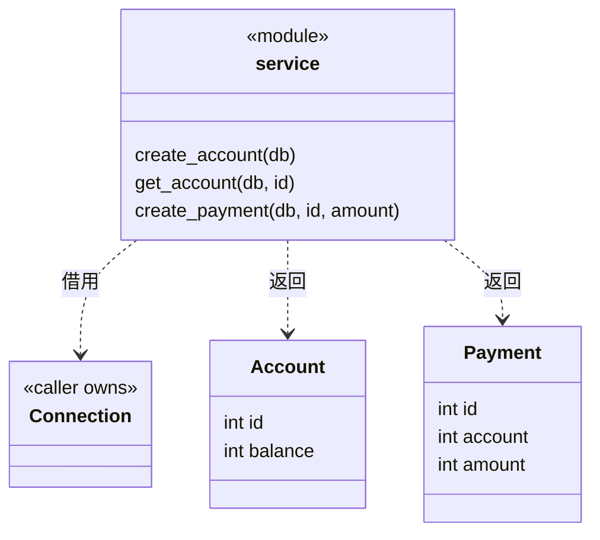
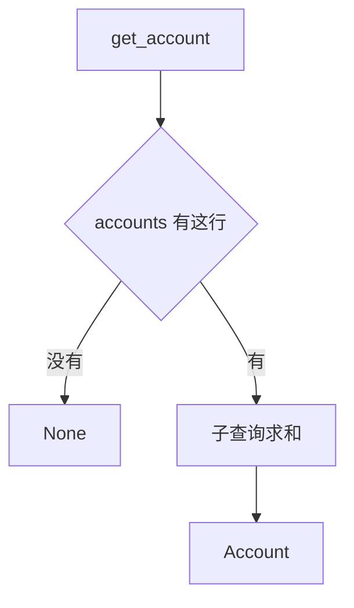
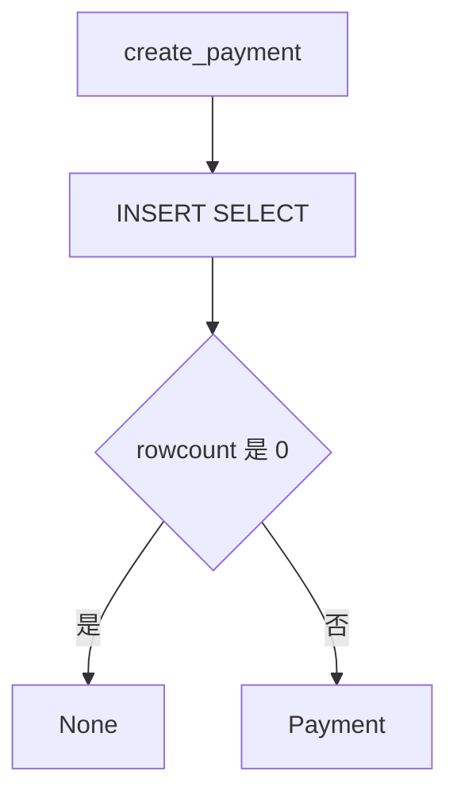

# 设计题解：付款记录接口（Payments API）

## 题目与澄清

一个小型账户服务要记录付款，并告诉你每个账户现在有多少钱。数据放在一个 SQLite 文件里，服务重启后账户、付款和编号都不能丢；两个不同的数据库文件之间不能有任何共享的状态。
HTTP 服务器、请求解析、建表语句都已经写好，你要补的是三个函数：建账户、查账户（带余额）、给账户记一笔付款。余额不是存下来的数字，而是这个账户全部付款金额之和，付款可以是正数、负数，也可以是零。

三个函数与返回形状，**形状本身就是合同的一部分**：

| 函数 | 成功返回 | 账户不存在 |
|---|---|---|
| `create_account(database)` | `Account(id, 0)` | 不适用 |
| `get_account(database, account_id)` | `Account(id, 余额)` | `None` |
| `create_payment(database, account_id, amount)` | `Payment(id, account, amount)` | `None` |

`Account` 与 `Payment` 是冻结的数据类（frozen dataclass），由现成的模块提供，你只用不改。`None` 在这里是**正常结果**，不是错误；数据库自己抛出的异常（磁盘满、库被锁）可以原样向上传。

开工前先把合同写成十一条断言，每一条都对应一个隐藏测试可能卡的边界：

1. **新库里账户 id 从 1 开始**，每成功建一个加 1；新账户余额是 0。
2. **余额是该账户全部付款金额之和**，正负都算；没有付款的账户余额是 0。
3. **查不存在的账户返回 `None`**，不抛异常；`0`、负数、没建过的大数都一样。
4. **给存在的账户记付款**，返回 `Payment(id, 账户 id, 金额)`；付款 id 在新库里从 1 开始。
5. **给不存在的账户记付款返回 `None`**，不写任何数据，**也不消耗付款 id**：失败之后的第一笔成功付款，id 仍然是紧接着上一笔成功付款的那个数。
6. **账户 id 与付款 id 是两条独立的序列**：记付款不影响下一个账户的编号，建账户也不影响下一笔付款的编号。
7. **金额可正可负可为零**，没有透支检查；金额为零的付款照样是一条记录，照样推进付款 id。
8. **两次内容相同的提交是两条不同的记录**，没有去重、没有幂等键。
9. **关闭再打开数据库，账户、付款、余额、两条序列都原样还在**；两个不同的库文件互不影响。
10. **不要关调用方传进来的连接**：连接的生命周期属于打开它的人。
11. **数值范围**：金额是整数分，取值 −10 亿到 10 亿；编号和累计余额都落在 ±(2^53−1) 以内，返回值必须是精确的 `int`。

这十一条里最容易漏的是第 5 条的后半句（不消耗 id）和第 2 条的后半句（空账户余额是 0 而不是 `None`），它们恰好是 REFLECTION 里两个问题背后的东西。

必须当场问清、答案会改代码的澄清问题：

- **"账户不存在"是返回值还是异常？** 合同说是返回值。这决定了函数的出口形状是 `Account | None`，调用方用 `if account is None` 处理；如果换成异常，HTTP 层就要多一层 `try/except` 把异常翻译成 404。
- **余额要不要存在账户表里？** 表结构已经给定，账户表只有一个 `id` 列，所以余额只能现算。即使可以改表，存余额也是一个要认真论证的决定（见决策一）。
- **失败要不要"不消耗 id"？** 要。合同明确说缺失账户的付款不改任何数据。这直接排除了"先插入、失败了再回滚"的某些写法在别的数据库里的表现（见决策三）。
- **并发呢？** 合同说调用都是顺序的，并发不在范围内。所以这里不需要锁，但单条语句的原子性是免费的好处，值得用上。
- **要不要校验输入？** 原生函数的入参类型已经保证合法；字段数量、布尔值、数字字符串、数值范围由已经写好的 HTTP 适配器在门口挡掉。这里不重复校验，只在第 4 关谈它。

范围之外：并发写、币种与小数、转账与退款、幂等键、认证、分页列出付款、删除账户。

## 需求与分级

机考通常把一道题拆成几关，一关一关地加要求。这个题的四关如下，每一关说清设计里哪一部分为它而存在。

**第 1 关（约 15 分钟，核心流程）**：建账户、记付款、查余额。示例：`create_account` 得 `Account(1, 0)`；`create_payment(db, 1, 700)` 得 `Payment(1, 1, 700)`；`create_payment(db, 1, 1300)` 得 `Payment(2, 1, 1300)`；`get_account(db, 1)` 得 `Account(1, 2000)`。
这一关出现的设计部分：两张表的读写、`INSERT … DEFAULT VALUES`、子查询求和。

**第 2 关（约 10 分钟，缺失与零的区别）**：不存在的账户返回 `None`；没有付款的账户余额是 0；缺失账户的付款不写行。示例：`get_account(db, 77)` 得 `None`，`create_payment(db, 77, 5)` 得 `None`，随后对真账户记一笔付款，id 仍是 1。
这一关出现的设计部分：存在性由账户表回答、`COALESCE`、`INSERT … SELECT … WHERE EXISTS` 与 `rowcount` 判断。这是整道题的核心，也是 REFLECTION 第一个问题。

**第 3 关（约 10 分钟，持久化与序列）**：关库重开后数据与两条序列都在；不同文件互不共享。示例：记两笔付款后关库重开，下一笔付款 id 是 3；另一个库文件里的第一个账户仍然是 1。
这一关出现的设计部分：`AUTOINCREMENT`、不用模块级变量存任何数据、连接归调用方。

**第 4 关（约 10 分钟，数值与 HTTP）**：金额边界、累计余额超过 32 位、2^53−1 的 id；以及把函数接到已经写好的 HTTP 适配器上，用 `curl` 走一遍：建账户 201、记付款 201、查余额 200、不存在的账户 404。
这一关出现的设计部分：`SUM` 而不是 `TOTAL`、返回类型是 `int`、`None` 在适配器里变成 404。

## 核心对象与职责

这个题的"对象"很少，这是它的特点：状态全在数据库里，函数没有自己的状态。

| 部分 | 职责 | 拥有的不变量 |
|---|---|---|
| `Account`（冻结数据类） | 一个账户在某个时刻的样子：id 与余额 | 余额是查询那一刻的付款总和，之后不再变（快照） |
| `Payment`（冻结数据类） | 一笔已记录的付款：id、账户 id、金额 | 记录一旦写入不可改，所以数据类也冻结 |
| `accounts` 表 | 回答"这个账户存在吗"，并分配账户 id | id 唯一、只增不复用 |
| `payments` 表 | 保存每一笔付款 | 每行的账户 id 指向存在的账户；金额不为空 |
| 三个函数 | 把上面两张表的读写包装成合同规定的形状 | 失败（缺失账户）不留痕 |

关系：函数**借用**调用方传进来的连接，不拥有它；`Account` 和 `Payment` 是函数返回的值，调用方想留多久留多久，不会和数据库同步变化。没有"服务对象"，没有仓储类，没有单例：理由在决策六。



读路径和写路径各一条，分开画：





## 关键设计决策

### 决策一：余额存还是算

**问题**：`get_account` 要返回余额。余额每次记付款都变，读的频率也许比写高。

**选项 A，在账户表加一列 `balance`，每次记付款顺手加上去**：

```python
db.execute("UPDATE accounts SET balance = balance + ? WHERE id = ?", (amount, account_id))
db.execute("INSERT INTO payments (account_id, amount) VALUES (?, ?)", (account_id, amount))
```

读是 O(1)，但现在有两份真相：付款流水和余额列。两条语句必须在同一个事务里，漏掉任何一条、顺序写反、中途崩溃都会让两者永久不一致；而且余额列的初值、修正付款（以后的退款）、对账都要多写代码。

**选项 B，把某账户的付款全读进 Python 再 `sum`**：

```python
rows = db.execute("SELECT amount FROM payments WHERE account_id = ?", (account_id,)).fetchall()
balance = sum(row[0] for row in rows)
```

结果对，但把整个流水搬过连接，账户有一百万笔付款时一次查余额就搬一百万行。

**选项 C，让数据库求和**：`SELECT SUM(amount) …`，只传回一个数。

**选择**：C，并且表结构本来就只有一个 `id` 列，没给 A 留位置。余额是**派生量**（derived value）：能从别的数据推出来的东西，最好不另存一份，否则就要自己守住"两份相等"这条额外的不变量。真正的性能问题出现时，正确的做法是先给 `payments(account_id)` 建索引，再考虑汇总表，而不是一开始就存。
**模式**：不需要。这是"规范化存储 + 查询时聚合"，是一条数据库设计的常识，不是一个设计模式。

### 决策二：谁来回答"账户存在吗"

**问题**：`get_account` 要同时区分"存在但没付款（余额 0）"和"不存在（None）"。

**选项 A，只对付款表求和，结果为空就当 0**：

```python
total = db.execute("SELECT SUM(amount) FROM payments WHERE account_id = ?", (account_id,)).fetchone()[0]
return Account(account_id, total or 0)
```

账户 2 存在但没有付款，账户 77 根本不存在，两条语句的结果都是 `(None,)`（见"测试与自检"里的运行输出）。这个写法永远不会返回 `None`，查缺失账户得到的是一个余额为 0 的幽灵账户，合同第 3 条直接违反。

**选项 B，先 `SELECT id FROM accounts WHERE id = ?`，再对付款求和**：两条语句，能对。代价是两次往返，以及两条语句之间别的写入可能插进来；当前合同是顺序调用，这不是缺陷，但没有必要引入。

**选项 C，账户表左连接付款表再 `GROUP BY`**：

```sql
SELECT a.id, COALESCE(SUM(p.amount), 0) FROM accounts a
LEFT JOIN payments p ON p.account_id = a.id WHERE a.id = ? GROUP BY a.id
```

对，一条语句。注意**必须是左连接**：内连接会把没有付款的账户整个丢掉，于是空账户被当成不存在。

**选项 D，从账户表出发，用标量子查询求和**（最终写法）：

```sql
SELECT a.id, (SELECT COALESCE(SUM(p.amount), 0) FROM payments p WHERE p.account_id = a.id)
FROM accounts a WHERE a.id = ?
```

同样一条语句，没有 `GROUP BY`，意图直接读出来：先看账户在不在，再问它的余额。

**选择**：D（C 同样正确，口味之别）。核心原则是：**存在性属于拥有这个实体的那张表**，聚合属于明细表；两者放进同一条语句，读到的是同一个快照。
**模式**：无。

### 决策三：缺失账户的付款怎么"什么都不写"

**问题**：合同要求账户不存在时返回 `None`，不改数据，不消耗付款 id。三种写法各有各的陷阱。

**选项 A，先查后写**：

```python
if db.execute("SELECT 1 FROM accounts WHERE id = ?", (account_id,)).fetchone() is None:
    return None
cursor = db.execute("INSERT INTO payments (account_id, amount) VALUES (?, ?)", (account_id, amount))
```

在顺序调用下正确。它是经典的"先检查后动作"（check-then-act）：两条语句之间有一个缝隙，别的连接在缝隙里改了数据，检查就过期了。此处合同没有删除账户，缝隙无害；但这种写法在换到有删除、有并发的需求时就必须重写。

**选项 B，直接插入，靠外键约束报错，再捕获**：

```python
try:
    cursor = db.execute("INSERT INTO payments (account_id, amount) VALUES (?, ?)", (account_id, amount))
except sqlite3.IntegrityError:
    return None
```

在 SQLite 里能对：失败的语句回滚，序列不动（见运行输出里 `sqlite_sequence` 前后相同）。但它有两个隐患。其一，`IntegrityError` 是一大类：金额为空（`NOT NULL`）同样抛它，会被当成"账户不存在"悄悄吞掉，把一个调用方的 bug 变成一个看起来正常的 `None`。其二，它依赖外键开关：忘了 `PRAGMA foreign_keys=ON`，孤儿付款会被默默接受（见运行输出）。在 PostgreSQL 这类数据库里，序列取值不随事务回滚，一次失败的插入就烧掉一个 id，合同第 5 条在那里直接做不到。

**选项 C，一条 `INSERT … SELECT … WHERE EXISTS`**（最终写法）：

```sql
INSERT INTO payments (account_id, amount) SELECT a.id, ? FROM accounts a WHERE a.id = ?
```

账户存在时 `SELECT` 产出一行，被插入；不存在时 `SELECT` 产出零行，**根本没有"待插入的行"**，序列也就不会被取值，也没有异常。判断成败看 `cursor.rowcount`：1 是成功，0 是账户缺失。检查与写入是同一条语句的两个部分，没有缝隙；金额为空这类真正的错误照样抛 `IntegrityError`，不会被误吞。

**一个必须记住的陷阱**：`rowcount` 为 0 时，`cursor.lastrowid` **不是 0，也不是 `None`，而是这个连接上一次成功插入的 id**（运行输出里写着 `5 missing 0 2`）。如果忘了先看 `rowcount`，缺失账户的付款会返回一个编号是"上一笔付款"的 `Payment`，而且谁也不会报错。所以代码里 `rowcount` 的判断必须在读 `lastrowid` 之前。
**模式**：无；这是"让写入语句自带前置条件"的写法，在数据库里叫条件插入（conditional insert）。

### 决策四：编号怎么分配

**问题**：账户 id 和付款 id 都要"从 1 开始、成功一次加 1、重启后接着走"。

**选项 A，Python 里存计数器**：模块变量或对象字段。重启就丢；两个库文件会共享同一个计数器，违反合同第 9 条的"不共享状态"。直接排除。

**选项 B，`SELECT MAX(id) + 1` 自己算再插入**：重启后能接着，但是又一个检查后动作；而且如果最后一行被删掉，最大值回退，旧编号会被再次发给新记录。

**选项 C，建表时的 `INTEGER PRIMARY KEY AUTOINCREMENT`**（已经给定）：数据库把"见过的最大 id"记在内部表 `sqlite_sequence` 里，只增不减，关库重开后接着用。没有 `AUTOINCREMENT` 的 `INTEGER PRIMARY KEY` 在删掉最大一行后会重新发同一个 id（运行输出里 `6 reuse` 得 3、`6 autoinc` 得 4）。这个题没有删除操作，但"编号永不复用"本身是付款系统的要求：外部系统可能还拿着旧编号。

**选择**：C，代码里完全不碰编号，只读 `lastrowid`。
**模式**：无；让存储引擎做它擅长的事。

### 决策五：事务与连接谁管（刻意选简单）

**问题**：要不要在函数里 `BEGIN … COMMIT`？要不要 `with database:`？要不要关连接？

**选项 A，每个函数自己开事务**：对"两条语句要一起成功"的操作是必要的。但这里每个函数只发**一条**会改数据的语句，一条语句本身就是原子的；自己开事务只会让函数在调用方已经开了事务时出问题（SQLite 不支持嵌套的 `BEGIN`）。

**选项 B，函数结束时关连接**：合同禁止，而且那样同一个连接就用不了第二次。

**选择**：什么都不管。`open_database` 用 `isolation_level=None` 打开（自动提交模式），每条语句各自是一个事务；三个函数只用调用方给的连接，不 `commit`、不 `close`。如果调用方换成了默认的隔离模式，语句会留在调用方的事务里，由调用方 `commit`——这也是合理的分工。
**模式**：**拒绝**工作单元（Unit of Work）、仓储（Repository）和事务装饰器。这里只有"单条语句是原子的"一件事要守，数据库已经替你守了，再套这些结构是花了钱却什么也没买到。

### 决策六：为什么是三个函数，而不是一个服务类

**问题**：Java 风格的答案会写 `PaymentService`、`AccountRepository`、`PaymentRepository`、`LedgerMapper`。

**选项 A，类层次**：每个类只转发一条 SQL。代码行数翻几倍，信息量没增加，测试多了一层要替换的对象；连接要通过构造器传进去，在这里和"每个函数的第一个参数就是连接"没有区别。
**选项 B，模块里三个函数**：与合同的签名一致，HTTP 适配器直接 `service.create_account(database)` 调用；没有状态，也就没有需要保护的状态。

**选择**：B。判断一个类值不值得存在的标准：它有没有**状态**要保护，或者有没有**多个实现**要替换。这里两个都没有。数据类 `Account` 与 `Payment` 有，因为它们是值。以后需求变多（决策见"扩展与追问"）再引入对象，现有函数不用改。

## 代码走读

整份解答放在这里，下面逐段讲设计落在哪里。

%% code:begin solution.py %%
```python
"""付款记录接口（Payments API）：SQLite 里的两张表，三个函数。
设计：账户只有 id，余额不存，每次从付款流水现算（余额 = 该账户全部付款金额之和，正负都算）；
存在性由 `accounts` 表回答，不由付款表回答，所以"没有付款的账户"（余额 0）和"不存在的账户"（None）分得开；
记付款是单条 `INSERT … SELECT … WHERE EXISTS`，账户不在时一行都不写，也就不会消耗付款 id；
两个 id 序列都靠 AUTOINCREMENT 落在 `sqlite_sequence` 表里，关库重开后接着走。
三个函数都不关调用方的连接，也不自己管事务：每个函数只发一条会改数据的语句，语句本身是原子的。
"""

from __future__ import annotations

import sqlite3
from dataclasses import dataclass

# ---- 值类型与建库（真实工作区里由 models.py 提供，函数部分单独放进 service.py）----


@dataclass(frozen=True)
class Account:
    id: int
    balance: int


@dataclass(frozen=True)
class Payment:
    id: int
    account: int
    amount: int


SCHEMA = """
CREATE TABLE IF NOT EXISTS accounts (id INTEGER PRIMARY KEY AUTOINCREMENT);
CREATE TABLE IF NOT EXISTS payments (
    id         INTEGER PRIMARY KEY AUTOINCREMENT,
    account_id INTEGER NOT NULL REFERENCES accounts(id),
    amount     INTEGER NOT NULL
);
"""


def open_database(path: str) -> sqlite3.Connection:
    """打开（或新建）一个数据库文件。自动提交模式：每条语句各自成为一个事务；外键约束打开。"""
    connection = sqlite3.connect(path, isolation_level=None)
    connection.executescript("PRAGMA foreign_keys = ON;" + SCHEMA)  # 外键是连接级开关，每次打开都要设
    return connection


# ---- 三个操作 ----

BALANCE_OF = """
SELECT a.id,
       (SELECT COALESCE(SUM(p.amount), 0) FROM payments AS p WHERE p.account_id = a.id)
FROM accounts AS a
WHERE a.id = ?
"""

# 账户在才会产生一行可插入的数据：存在性检查与写入是同一条语句里的两个部分，中间没有缝隙
PAY_IF_ACCOUNT_EXISTS = """
INSERT INTO payments (account_id, amount)
SELECT a.id, ? FROM accounts AS a WHERE a.id = ?
"""


def create_account(database: sqlite3.Connection) -> Account:
    """新账户：id 由 AUTOINCREMENT 分配，余额必然是 0（还没有任何付款）。"""
    cursor = database.execute("INSERT INTO accounts DEFAULT VALUES")
    return Account(cursor.lastrowid, 0)


def get_account(database: sqlite3.Connection, account_id: int) -> Account | None:
    """账户不存在返回 None；存在但没有付款，余额是 0（COALESCE 把空集的 NULL 换成 0）。"""
    row = database.execute(BALANCE_OF, (account_id,)).fetchone()
    return None if row is None else Account(row[0], row[1])


def create_payment(database: sqlite3.Connection, account_id: int, amount: int) -> Payment | None:
    """给已有账户记一笔付款；账户不存在返回 None，什么都不写（rowcount 为 0），付款 id 原地不动。
    金额可正可负可为零，不检查透支；两笔相同的付款就是两条记录。"""
    cursor = database.execute(PAY_IF_ACCOUNT_EXISTS, (amount, account_id))
    if cursor.rowcount == 0:
        return None
    return Payment(cursor.lastrowid, account_id, amount)


if __name__ == "__main__":
    db = open_database(":memory:")
    first = create_account(db)
    print(first, create_payment(db, first.id, 700), create_payment(db, first.id, -250))
    print(get_account(db, first.id), get_account(db, 99), create_payment(db, 99, 5))
```
%% code:end %%

**第一处：`BALANCE_OF`**。账户表出发，子查询只在账户存在时才执行；`COALESCE` 把空集的 `NULL` 换成整数 0。用 `SUM` 而不是 `TOTAL`：`TOTAL` 永远返回浮点数，`0.0 == 0` 虽然为真，但 `type(...) is int` 为假，HTTP 层序列化出来是 `0.0`。
**第二处：`PAY_IF_ACCOUNT_EXISTS`**。`SELECT a.id, ?` 里的 `a.id` 来自账户表而不是参数：账户在才有行；金额那个 `?` 只是一个值。检查与写入共用同一条语句。
**第三处：`create_payment` 的 `rowcount` 判断**。先判断是否写入，再读 `lastrowid`。
**第四处：`open_database`**。自动提交模式、外键开关、`IF NOT EXISTS` 建表（重开时不会重复建、也不会清空）。
**第五处：模块里没有任何可变的全局变量**，所以两个库文件之间不会共享状态；换掉连接就换掉了整个世界。

## 测试与自检

测试文件有 23 个测试函数（对拍那个带三个种子，共 25 次运行），按关卡分组：

| 组 | 钉住的行为 |
|---|---|
| 缺失与零 | 不存在的 id（`0`、负数、`2^53−1`）查询是 `None`；空账户是 `Account(1, 0)` 且 `balance` 的类型是 `int`；缺失账户的付款是 `None`，之后真付款的 id 不跳号 |
| 余额 | 正负混合求和；负余额；零金额推进序列；相同提交两条记录；两个账户互不影响；两条序列独立 |
| 持久化 | 关库重开后余额、账户 id、付款 id 都接着走；失败的付款不推进序列（跨重开）；两个文件互不影响；第二个连接能读到已提交的数据；函数不关连接 |
| 数值 | 五笔 +10 亿再两笔 −10 亿，余额 30 亿，仍是 `int`；余额取到 `2^53−1` 精确；id 取到 `2^53−1` |
| 对拍 | 三个种子、每个 250 步的随机操作，对着一个纯 Python 字典模型逐步比较，并夹着随机的关库重开 |

关键的不变量断言：**失败的付款之后下一笔付款 id 不跳号**（`test_missing_account_payment_consumes_no_id_and_changes_nothing`）；**空账户与缺失账户是两种结果**；**重开之后序列接着走**。
测试只通过三个公开函数、`open_database` 和重开连接来观察，不看 SQL 文本、不看语句条数、不读 `sqlite_sequence`。只有两个测试用原始 SQL 往表里塞一行（造出需要 900 万笔付款才能累计出的 `2^53−1` 余额），表结构是合同的一部分，所以这样做不依赖实现。

两分钟演示，对面试官说一句"先看数字例子"，然后运行：

```
Account(id=1, balance=0) Payment(id=1, account=1, amount=700) Payment(id=2, account=1, amount=-250)
Account(id=1, balance=450) None None
```

第一行：建账户、记 700、记 −250；第二行：余额 450；账户 99 查不到是 `None`，给 99 记付款也是 `None`。

用一个小脚本把几条"错误写法"的行为打印出来，下面是它的输出（`#` 后面是说明），每一行对应前文的一个论断：

```
1 sum empty      (None,)            # 空账户：SUM 是 NULL
1 sum missing    (None,)            # 缺失账户：同样是 NULL，分不开
2 inner join     []                 # 内连接丢掉空账户
2 left join      [(2, 0)]           # 左连接保留，COALESCE 成 0
3 fk error       IntegrityError FOREIGN KEY constraint failed
3 null error     IntegrityError NOT NULL constraint failed: payments.amount
3 sequences      [('accounts', 2), ('payments', 2)]   # 两次失败前后相同
4 total          (750.0,) (0.0,)    # TOTAL 是浮点数
4 sum            (750,)
5 missing        0 2                # rowcount 是 0，lastrowid 却是旧的 2
5 existing       1 3
6 reuse          (3,)               # 没有 AUTOINCREMENT：删掉 3 号再插入，又发 3
6 autoinc        (4,)               # 有 AUTOINCREMENT：发 4
7 fk off         (1,)               # 外键没打开：孤儿付款被接受
```

接到真实 HTTP 适配器上冒烟：`POST /accounts/` 得 `{"id": 1, "balance": 0}`，记 600 与 −250 的付款各得 201，`GET /accounts/1/` 得 `{"id": 1, "balance": 350}`，给不存在的账户 5 记付款得 404。公开测试 2 个全部通过。

## 扩展与追问

**新需求**

- **转账**：两笔付款（一笔 −x，一笔 +x）必须同时成功或同时失败，现在每个函数只有一条写语句，转账就是第一个需要显式事务的操作。新增函数 `transfer(database, source, target, amount)`，里面 `BEGIN IMMEDIATE` … `COMMIT`，三个现有函数不动。
- **退款**：就是一笔负付款；若要"退款必须引用原付款"，在 `payments` 加 `refund_of` 列，`create_payment` 不动。
- **幂等键**：重试的客户端不应重复记账。加一张 `idempotency(key, payment_id)` 表，函数先查键、命中就返回原付款；这时"检查与写入之间的缝隙"开始要紧，要把查键、插入付款、记键放进一个事务。
- **币种**：金额从 `int` 分变成"金额 + 币种"，余额要按币种分别求和；`Account.balance` 变成按币种的映射，这是对外形状的变化，要和调用方商量。
- **分页的付款流水**：`list_payments(database, account_id, after_id, limit)`，用 `id > ? ORDER BY id LIMIT ?` 的游标分页；不动现有函数。

**并发与线程安全**

- 合同里调用都是顺序的。若有多个线程共享一个连接，Python 的 `sqlite3` 默认禁止跨线程使用连接；每个线程开自己的连接即可。
- 多个连接同时写同一个文件时，SQLite 在一个时刻只允许一个写者，其他的会得到"数据库被锁"；用 `timeout` 参数让它等一会儿。
- 单语句的 `INSERT … SELECT … WHERE EXISTS` 在这里的好处会显现：账户存在性与写入在同一条语句里，不会被别的连接插在中间。
- 如果以后有"删除账户"，选项 A（先查后写）在并发下就会插入孤儿付款，而外键会拒绝它——外键是最后一道保险，不是第一道。

**持久化与规模**

- **索引**：每次查余额都要找某账户的全部付款。付款多起来之后加 `CREATE INDEX payments_by_account ON payments(account_id)`，查询从扫全表变成按索引范围读。合同要求"保持表结构原样"，所以这一步只能在口述里提。
- **汇总表**：热点账户有百万笔付款时，为每个账户存一行汇总（余额、最后付款 id），记付款与更新汇总在同一个事务里。代价是多了一条要守住的不变量，每次改动流水的代码都要同时改汇总。
- **换成 PostgreSQL**：`AUTOINCREMENT` 换成 `GENERATED … AS IDENTITY`；序列取值不随事务回滚，所以"不消耗 id"必须靠"没有待插入的行"来保证，决策三的选项 C 在那里依然成立，选项 B 则不成立。`SUM` 对 `bigint` 返回 `numeric`，要转成整数再返回。
- **余额溢出**：SQLite 的整数是 64 位，`SUM` 越界会抛"integer overflow"；合同的范围是 ±(2^53−1)，离 2^63 很远，所以不处理，作为数据库异常原样传出。

## 常见错误

- **只对付款表求和**：空账户和缺失账户都是 `NULL`，查缺失账户得到一个余额为 0 的幽灵账户。
- **内连接付款表**：没有付款的新账户查不到，调用方以为开户失败。
- **忘了先看 `rowcount` 再读 `lastrowid`**：缺失账户的付款会返回一个"编号是上一笔付款"的假 `Payment`，没有任何报错。
- **用 `TOTAL()`**：余额变成浮点数，HTTP 里是 `2500.0`；超过 2^53 时还会丢精度。
- **捕获整个 `IntegrityError`**：把"金额为空"这类真 bug 当成"账户不存在"吞掉。
- **余额存一列**：两份真相，漏一次更新就永久不一致；而且题目给的表里根本没有这列。
- **在函数里关连接或 `commit`**：关了调用方的连接，后续调用全部报"在已关闭的数据库上操作"。
- **用模块级字典或列表当"缓存"**：重启就丢，两个库文件互相串数据，直接违反持久化与隔离两条合同。
- **拼接 SQL 字符串**（f-string 把金额放进语句）：金额类型一变就出问题，也养成坏习惯；永远用 `?` 占位。
- **`max(id) + 1` 自己分配编号**：又一个检查后动作，删行之后还会复用旧编号。
- **测试断言 SQL 文本或 `sqlite_sequence`**：换一种写法就全红，测的是实现而不是合同。
- **用智能体生成时只说"实现三个函数"**：常见的产出是先查后写、存余额列、引入 ORM 或仓储类；它还会为了让测试变绿而改测试。把十一条合同和数字例子交给它，一次只给一个失败的测试，自己写第 5 条（失败不耗 id）和第 2 条（空账户是 0）的测试，再让它实现。
- **Java 味**：`AccountService`、`PaymentRepository`、`getBalance()`/`setBalance()`、给只有一个实现的类建接口。

## 45 分钟怎么分配

- **0–5 分钟｜读合同**：不要先写代码。把十一条用自己的话写成注释，逐条标出"哪一条会被隐藏测试针对"；特别标出第 5 条和第 2 条。对智能体的第一句话是这份清单，不是"写个付款服务"。
- **5–10 分钟｜定写法**：口头说出三个决定——余额现算、存在性问账户表、缺失账户的付款用条件插入。让智能体起草 `get_account`（输入输出清楚、易验证）；"条件插入加 `rowcount`"这个决定自己定。
- **10–20 分钟｜第 1、2 关**：每写完一个函数就跑公开测试，再把示例写成自己的断言；每次只给智能体一个失败的用例。
- **20–28 分钟｜持久化**：写"关库重开、序列接着走"的测试，检查失败的付款之后 id 不跳号；检查函数没有关连接。
- **28–35 分钟｜数值与 HTTP 冒烟**：金额 ±10 亿、余额超过 32 位；起适配器，用 `curl` 走一遍 201、200、404。
- **35–45 分钟｜REFLECTION**：两个问题各写约一百五十字：怎样区分空账户与缺失账户（决策二）、怎样在不依赖某种查询写法的情况下验证余额与持久化（对拍加重开）。

时间不够时的取舍：先砍随机对拍，再砍边界数值，再砍 HTTP 冒烟。**绝不能砍的是**：存在性由账户表回答、缺失账户的付款不耗 id、重开后序列接着走、两篇短文。

## 延伸阅读

- [[problems.marketplaces.bank-account|银行账户系统（Bank Account System）]]：同样是"余额由流水推出"，但在内存里做并带转账与排名，可以对照这里把真相放在数据库里的写法。
- [[problems.marketplaces.digital-wallet|数字钱包（Digital Wallet）]]：余额不能为负、转账两边一致，是"没有透支检查"之后的自然追问。
- [[amazon.amz-in-memory-db|内存数据库（In-Memory Database）]]：从零写一个小库，看建表、查询、事务是怎么搭起来的，对照这里直接用现成的 SQLite。
- [[lcproject.lcp-movie-watchlists|私人片单修复（Persistent Private Watchlists）]]：同样是 SQLite 加连接管理加状态码，侧重修复与归属校验。
- [SQLite 文档：AUTOINCREMENT](https://www.sqlite.org/autoinc.html)：为什么 `AUTOINCREMENT` 不复用编号，以及 `sqlite_sequence` 表。
- [SQLite 文档：聚合函数 sum 与 total](https://www.sqlite.org/lang_aggfunc.html)：空集合的结果、整数溢出与浮点结果的区别。
- [SQLite 文档：外键支持](https://www.sqlite.org/foreignkeys.html)：外键默认关闭，必须在每个连接上打开。
- [Python 文档：sqlite3 的事务控制](https://docs.python.org/3.11/library/sqlite3.html#transaction-control)：`isolation_level=None` 的自动提交模式，以及 `rowcount` 和 `lastrowid` 的含义。
