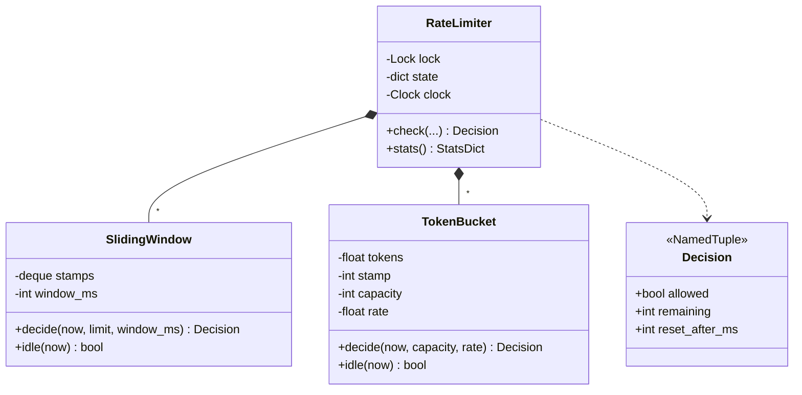

# 设计题解：LLM 网关限流器（Rate Limiter）

## 题目与澄清

一个 LLM API 网关同时服务很多客户端，每个客户端会打好几个接口（`/v1/chat`、`/v1/complete`）。网关在接收每个请求之前调用一次限流器：
放行就继续处理，拒绝就回 HTTP 429，并把"还剩多少额度""多久之后有额度恢复"两个数放进响应头，让客户端知道什么时候再来。
限流器是进程内的一个类，不是分布式限流服务；它被多个线程同时调用；它支持两种策略，运行时由配置选一种：
策略 A 是滑动窗口（Sliding Window），策略 B 是令牌桶（Token Bucket）。你要写的是 `RateLimiter.check(...)` 和 `stats()`，其余（HTTP 服务）已经写好。
用 `[[problems.components.rate-limiter|限流器（Rate Limiter）]]` 的经典题解打底是对的，但这个项目的合同比经典题更细，下面每一条都有测试在等着。

先把合同用你自己的话写下来，这是开工前的第一件事。按"一个粗心读者最容易漏掉"的顺序：

1. **返回三元组** `(allowed, remaining, reset_after_ms)`，第三项必须是 `int`，不是 `float`，也不是 `True`/`False` 这类 `int` 的子类。
2. **时间由限流器自己读**：`check` 没有时间参数，请求的时刻就是 `check` 被调用的那一刻。
   所以测试里不能传时间；要测边界，只能注入时钟（见决策二）。
3. **`remaining` 在本次判定之后算**：放行时是"此刻还能立刻放行几次"，被拒时恒为 0。
   令牌桶里"以后会补回来的"不算，只数此刻已经有的整令牌。
4. **被拒绝的请求不留痕**：不扣额度，不进入"已放行请求"的历史，也不改任何状态。
5. **按 `(client_id, endpoint)` 隔离**：同一个客户端换个接口，是一份全新的额度；同一个接口换个客户端，也是。
6. **策略 A**：最近 `window_ms` 毫秒内最多放行 `limit` 次，只数"被放行的"请求；先清掉过期的、再判定；
   `reset_after_ms` 是窗口里最老的一条退出窗口的时间——放行的请求也可能有一个大于 0 的 `reset_after_ms`。
7. **策略 B**：新桶是满的；每次放行花 1 个令牌；按 `refill_rate`（个／秒）连续补充，不超过 `capacity`；
   令牌数可以是小数，判定前不取整；放行时 `reset_after_ms` 是 0；被拒且速率大于 0 时是"凑够 1 个整令牌"的时间。
8. **毫秒数向 0 截断**，不四舍五入；所有计时值是非负整数。
9. **`stats()`** 返回含四个键的字典：`strategy`、`total_allowed`、`total_rejected`、`active_keys`；
   计数从 0 起，`active_keys` 是被跟踪的 key 数。
10. **线程安全**：`check` 与 `stats` 可能并发，同一个 key 上许多线程抢有限额度，放行数必须恰好等于额度。
11. **当前策略用不到的参数可以是任意值**：策略 A 下 `capacity` 和 `refill_rate` 随便传，反之亦然。

开口前值得问的澄清问题，每一个都会改变代码：

- **同一个限流器会不会在运行中换策略？** 答案是不会：策略在构造时定死，所以状态字典里只会有一种状态对象，
  不需要在每个 key 上记"我是哪种策略"。
- **同一个 key 的参数会不会逐次变化？** 服务端传的是常量，但接口签名允许变。因此判定必须用"这一次传进来的参数"，
  而不是把参数存在状态里当真理；令牌桶在容量变小时要把令牌数夹到新容量以内。
- **`refill_rate == 0` 被拒时返回什么？** 合同说任意非负整数。因为额度永远不会恢复，没有"正确"的等待时间；
  选 0 是最不会让客户端的整数解析出错的值，选一个很大的哨兵值则会把荒唐的数字写进响应头。
- **违反前置条件（`limit < 1` 之类）怎么办？** 合同保证不会发生，但一个静默通过的 `limit=0` 会让所有请求被拒而没有任何报错，
  所以对"当前策略要用的参数"抛 `ValueError`，且发生在动任何状态之前。
- **要不要回收不再使用的 key？** 合同没有要求，但内存无界增长是限流器自己的事故。回收的判据只能是"删掉与保留完全等价"，见决策五。
- **要不要跨进程？** 不要。同一台机器上多个进程各有各的内存，这是 REFLECTION 里的追问，答案在 `## 扩展与追问`。

范围之外：限额的配置下发、按用户等级给不同额度、把限流信息写进 HTTP 响应头的代码（服务端已经写好）、分布式一致性。

## 需求与分级

**第 1 关（约 15 分钟，策略 A）**：滑动窗口。每个 key 一个升序的时间戳队列；每次判定先从队首清掉"已满一个窗口"的条目，
再比较长度与 `limit`。边界要当场算清楚：时间戳恰好满一个窗口时已经不再计数（窗口是左闭右开）。
示例：`limit=2`、`window_ms=10000`，在 0、3000、3500 毫秒各来一次，应得 `(True,1,10000)`、`(True,0,7000)`、`(False,0,6500)`。
这一关同时决定了"放行才写、拒绝不写"的结构，后面两关都建立在它上面。

**第 2 关（约 15 分钟，策略 B）**：令牌桶。状态是 `(令牌数, 上次更新时间)`，用到时才按流逝时间补充，不起后台线程，
令牌数是小数。示例：`capacity=3`、`refill_rate=0.5`，前三次放行，第四次被拒、`reset_after_ms≈2000`；
桶空了之后过 1200 ms，令牌数是 0.6，被拒，还差 0.4 个，需要 800 ms。这一关考的是"不要提前取整"。

**第 3 关（约 10 分钟，隔离、统计、参数校验）**：`(client_id, endpoint)` 为键的字典，`stats()` 四个字段，
两个计数器和判定一起更新。参数校验放在动状态之前。

**第 4 关（约 10 分钟，并发与回收）**：整个"读时钟 → 判定 → 记账 → 更新统计"放进同一把锁里；
用屏障让两百个线程同时抢五十个额度；让闲置 key 的状态可回收。这一关还要写出 REFLECTION 里的两篇短文：
锁怎么保证原子、代价和降低代价的办法、多进程会怎样；单机内存状态怎么演进到 Redis 之类的共享存储。

## 核心对象与职责

| 类 | 单一职责 | 它拥有的不变量 |
|---|---|---|
| `Decision` | 一次判定的结果，三元组的具名版本 | 是 `tuple` 的子类，解包、比较都和普通三元组一样；第三项是 `int` |
| `SlidingWindow` | 策略 A 里一个 key 的放行时间戳 | 升序；长度只在放行时增加；窗口外的条目在下一次判定前被清掉 |
| `TokenBucket` | 策略 B 里一个 key 的令牌数与更新时间 | 令牌数在 `[0, capacity]` 内；只在放行时被写入 |
| `RateLimiter` | 按 key 找状态；在一把锁里完成判定与计数；回收闲置 key | 决策与计数同时可见；`active_keys` 不随"见过多少个 key"线性增长 |
| `StatsDict` | `stats()` 返回的字典形状 | 每次返回新字典，改它不影响限流器 |

`RateLimiter` 拥有它的状态对象，生命周期一致，是组合（composition）；外部拿不到 `SlidingWindow` 或 `TokenBucket`，
`stats()` 只交出计数的快照。两个状态类互相之间没有继承，原因在决策四。



## 关键设计决策

### 决策一：一把锁罩住"读时钟、判定、记账、更新统计"

**问题**：多个线程同时调用 `check`，同时有线程在调用 `stats`。哪些步骤必须不可分割？

先看没有锁会怎样。策略 A 的判定是"先数、再决定、再追加"：`len(stamps) < limit` 为真之后、`stamps.append` 之前，
另一个线程也可能通过同一个判断，两个线程各追加一个，窗口里就比 `limit` 多一个。Python 的 GIL 保证单条字节码不被撕开，
却不保证"检查 → 追加"这一对操作不被切线程；这是典型的先检查后动作（check-then-act）。
计数器也一样：`self._total_allowed += 1` 是读、加、写三步，两个线程同时执行会丢一次更新。

可选的做法有三个：

- **每个原子操作各自加锁**：判定一把锁、计数器一把锁。每一步单独看都是对的，但"决策出来了、计数还没加"的那个瞬间，
  `stats()` 能看到 `total_allowed` 比实际放行的少一个。统计与决策不一致，正是 REFLECTION 第一问要你说清的东西。
- **一把总锁**：`check` 的整个方法体和 `stats` 的整个方法体都在同一把 `threading.Lock` 下。这样一次决策和它的计数更新要么都看得到、要么都看不到。
- **分片锁或每个 key 一把锁**：竞争更低，但统计要跨分片取快照，才能保证"放行数加拒绝数等于已处理的请求数"，复杂度高很多（见 `## 扩展与追问`）。

选一把总锁。限流器的临界区只有"一次字典查找加几次整数运算"，微秒级；这个规模下总锁的代价低于任何更精细方案的复杂度。

锁里还要放一件容易漏的事：**读时钟**。如果线程先读了时钟再拿锁，线程 A 读到 t=1、线程 B 读到 t=2，B 先拿到锁并追加 2，A 随后追加 1，
队列就不再升序了；而清理过期条目的循环只看队首，乱序的队列会让"已经过期的条目"挡在后面不被清除。
把 `self._clock()` 放进锁里，时间戳的顺序就等于判定的顺序。

这里不需要任何设计模式。一个类、一把锁、一个字典；引入"限流策略接口加锁装饰器"一类的分层，只会让锁的范围更难一眼看清。

### 决策二：时间用整数纳秒，不用浮点秒

**问题**：合同要求毫秒数向 0 截断，并给出了 `6500`、`7000` 这样的精确值。用什么表示时间？

选项一：`time.monotonic()` 返回的浮点秒。浮点加减会留下尾巴。第一次请求在 0.7 s，第三次在 0.7 + 3.5 s，
窗口 10 s，`reset_after_ms` 应当是 6500：

```python
t0 = 0.7
reset = (t0 + 10.0) - (t0 + 3.5)
print(reset * 1000)        # 6499.999999999999
print(int(reset * 1000))   # 6499，向 0 截断后少了 1 ms
```

截断把一个 `1e-12` 的误差放大成整整 1 毫秒的错误，"精确值"测试会随机失败，且和时钟的取值有关，难以复现。

选项二：整数毫秒。精确，但一个请求到来时，把纳秒级的 `monotonic_ns` 先截成毫秒再相减，会让相差 0.9 ms 的两次请求被算成相差 0 或 1 ms，截断的方向取决于它们落在毫秒的哪个位置。

选项三（选用）：**内部全程整数纳秒**，只在最后一步做一次整数除法 `// 1_000_000`。
`NS_PER_MS` 乘窗口得到纳秒窗口，`stamps[0] + window - now` 是精确的整数，截断就是整数除法，结果恒为非负整数。
令牌桶不得不用浮点（令牌数是小数），所以它只在"令牌数"这一处用浮点，时间差仍是整数纳秒，再除以 `1e9` 化成秒。

时钟作为构造函数的可选参数注入：`RateLimiter(strategy, clock=time.monotonic_ns)`。
服务端调用 `RateLimiter(strategy=STRATEGY)` 不受影响；测试传一个 `FakeClock`，时间由测试推进，整套测试没有一个 `sleep`。
代价是 `clock` 要求返回整数纳秒——这是一个和 `time.monotonic_ns` 对齐的约定，写在 `Clock` 的文档里。

### 决策三：只在放行时写状态，拒绝什么都不留

**问题**：请求被拒时，要不要更新状态？

一个常见的写法是"每次请求都先追加进日志，再判断是否超限"。这样被拒的请求也留在窗口里，后果是：
一个客户端被限流之后不停重试，它的每一次重试都把窗口往后推，**重试得越勤，被锁定得越久**。
合同第 4 条禁止这一点，也是限流器对"重试风暴"最基本的礼貌。

所以 `SlidingWindow.decide` 的结构是先清理过期、再比较、只有放行才 `append`。
`TokenBucket.decide` 同理：先算出补充后的令牌数（一个局部变量），够 1 个才写回 `self._tokens` 与 `self._stamp`；
被拒时两个字段原样不动。因为补充是惰性的，下一次再算时，从旧的时间戳起补，得到的令牌数与"每次拒绝时都落盘"完全相同，
但被拒的路径没有任何写操作，既省事也不会引入浮点误差的逐次累积。

同一原则还延伸到两处：参数校验在锁之前、在动任何状态之前；非法参数抛 `ValueError`，不会新建 key，也不计入 `total_rejected`。
统计里的"拒绝"指"被限流"，不包括"调用方传错了参数"。

### 决策四：两个状态类，不要共同基类，也不要策略接口

**问题**：两种策略放在一起，教科书的反应是策略模式（Strategy）：一个抽象基类 `Policy`，两个子类，`RateLimiter` 持有一个。要不要？

先看两种策略的判定签名：策略 A 要 `(now, limit, window_ms)`，策略 B 要 `(now, capacity, refill_rate)`。参数集合不相交，
抽象基类里的 `decide(now, **params)` 要么用 `**kwargs` 抹掉类型，要么给出一个"全部参数的并集"的签名，调用方传一堆不用的值。
而且策略在构造时就定死，运行中不换，所以"在运行时替换算法"这一策略模式的价值根本用不上。
另一边，经典题解里的四种算法共用一个 `_used(now)` 接缝，因为四个算法的参数相同、只差"怎么数"；这里参数不同，接缝的位置就不同。

所以这里**拒绝策略接口**：两个小类各管各的状态，`RateLimiter.check` 里用一个 `if self.strategy == "policy_a"` 分派。
这是两个分支，不是一条 if 链；第三种策略出现时，才值得把分派换成字典或接口。
`strategy` 保持字符串，因为服务端的 `STRATEGY` 环境变量本来就是字符串，`stats()` 也要原样回显。

两个状态类也不是 Java 习惯里"只转发一次调用"的空壳：`SlidingWindow` 拥有"升序、只在放行时增长"这条不变量，
`TokenBucket` 拥有"令牌数在 0 到容量之间、只在放行时写"这一条；`RateLimiter` 只拥有字典、锁和计数。

### 决策五：令牌桶的小数、截断与"等了还不够"

**问题**：令牌桶被拒时 `reset_after_ms` 怎么算？

`(1 - tokens) / rate` 秒，乘 1000，向 0 截断。例：`rate=0.5`、令牌数 0.6，`(1 - 0.6) / 0.5 * 1000 = 800.0`，`int` 得 800，和合同里的示例一致。
再例：`rate=3`，桶空，`(1 - 0) / 3 * 1000 = 333.33…`，截断为 333。

截断带来一个诚实的副作用：客户端恰好等 333 ms 再来，令牌数是 0.999，仍然不够 1，会再被拒一次，
这次的 `reset_after_ms` 是 `(1 - 0.999) / 3 * 1000 = 0.33…`，截断为 0。
所以对被拒的客户端，响应头里的数字是"至少还要等这么久"，不是"到点必过"；这是合同选定的口径。
合同写明向 0 截断，不要自作主张改成向上取整：333.33 会变成 334，与"向 0 截断"的断言冲突。

不要在判定前 `round` 令牌数。令牌数 0.6 经过 800 ms 补到 1.0，这一次必须放行；如果每次被拒时把 0.6 取整成 0 写回去，
这位客户端永远攒不够。

### 决策六：回收闲置 key，只删"与新建等价"的，门槛按整理后的规模翻倍

**问题**：一百万个客户端各来过一次，字典里就有一百万个 key。什么时候可以删？

删早了等于给客户端免费解封：窗口里还有放行记录的 key 被删，下一次请求从零开始，额度被重置。
所以判据是"删掉它和留着它对后续任何判定完全没有区别"：
策略 A 的 key 当最新一条时间戳已经满一个窗口，窗口里的全部条目都会被下一次判定清掉，等价于一份新状态；
策略 B 的 key 当补充之后的令牌数已经达到 `capacity`，等价于一个新桶（新桶本来就是满的）。
这两个判据分别写成 `SlidingWindow.idle` 和 `TokenBucket.idle`。

**判据只能用这个 key 自己的参数。** `check` 每次都带着自己的 `limit`、`window_ms`、`capacity`、`refill_rate`，
不同接口完全可以配不同的限额。如果整理时拿"触发这次整理的那个请求"的参数去判断所有 key，
一个 `window_ms = 60000`、刚放行过一次的 key，会在别人用 `window_ms = 1` 触发整理时被当成闲置删掉，
它下一次请求就从零开始，在 60 秒里被放行了两次。所以每份状态在 `decide` 里记下自己最近一次用的参数，
`idle(now)` 只看自己。测试 `test_reclaiming_judges_each_key_by_its_own_parameters` 就是这个场景：
先给 `long` 放行一次，再用五千个一次性短窗口 key 把字典撑到整理门槛，`long` 的第二次请求必须仍被拒绝。

什么时候扫？每次 `check` 之后，如果字典长度达到 `_sweep_at` 就扫一遍；扫完把门槛设成 `max(SWEEP_FLOOR, 2 * 整理后的规模)`。
门槛盯着"整理后的规模"翻倍，而不是盯着"当前规模"：后者在"每次请求都带来新 key"的流量下永远追不上，
扫描再也不会触发；翻倍让两次扫描之间至少新增了与上次整理后一样多的 key，一次 `O(n)` 的扫描摊到这些请求上是 `O(1)`。

`SWEEP_FLOOR = 4096` 是刻意的：合同里的 `active_keys` 数的是"被跟踪的"key，而不是"仍然有效的"key；
服务端的冒烟测试会在窗口过期之后断言 `active_keys == 3`，所以小流量下过期的 key 要留着，回收只在字典真的长大时才发生。

## 代码走读

先看 `check` 的骨架：先校验当前策略要用的参数（不合法就在拿锁之前抛 `ValueError`），然后进入 `with self._lock`，
在锁里依次是读时钟、分派给策略、更新计数、必要时回收，最后返回。`stats` 也在同一把锁下，一次读齐四个字段。
这一个 `with` 块就是决策一的全部落点：任何线程看到的要么是"这次请求已经被判定并记账"，要么是"这次请求还没发生"。

然后看 `SlidingWindow.decide`：清理循环、`allowed = len(stamps) < limit`、只在放行时 `append`、
`remaining = limit - len(stamps) if allowed else 0`、最后用整数纳秒算 `reset`。放行的请求在追加之后，`stamps[0]` 可能就是它自己
（窗口原本是空的），所以放行请求的 `reset_after_ms` 正好等于 `window_ms`；被拒的请求，队列一定非空，因为 `limit >= 1`。

最后看 `TokenBucket.decide` 与 `_refilled`：`max(0, now - self._stamp)` 把倒退的时钟当作没有流逝，所以时钟回拨不会凭空铸造令牌；
`min(float(capacity), ...)` 保证不超过容量，也让"容量调小"这件事自动收敛；放行时才写回两个字段。

%% code:begin solution.py %%
```python
"""LLM 网关限流器（Rate Limiter）：进程内、按 (client_id, endpoint) 隔离、两种策略二选一。
设计：策略 A（滑动窗口）和策略 B（令牌桶）各是一个只管"一个 key 的状态"的小类，
`RateLimiter` 负责按 key 找状态、在同一把锁里完成"读时钟 → 判定 → 记账 → 更新统计"；
时间一律用整数纳秒，毫秒数由整数除法截断得到，避免浮点把 6500 算成 6499；
被拒绝的请求不写任何状态，也不新建 key；长时间不用的 key 在字典翻倍时被批量清理。
"""

from __future__ import annotations

import threading
import time
from collections import deque
from collections.abc import Callable
from typing import NamedTuple, TypedDict

Key = tuple[str, str]
Clock = Callable[[], int]
"""时钟：返回单调递增的整数纳秒；生产用 `time.monotonic_ns`，测试注入假时钟。"""

NS_PER_MS = 1_000_000
STRATEGIES = ("policy_a", "policy_b")
SWEEP_FLOOR = 4096
"""字典至少长到这个规模才会触发一次整理，小流量下永远不扫。"""


def _require_window(limit: int, window_ms: int) -> None:
    """策略 A 的前置条件；不合法就在碰任何状态之前抛出。"""
    if limit < 1:
        raise ValueError(f"policy_a needs limit >= 1, got {limit!r}")
    if window_ms < 1:
        raise ValueError(f"policy_a needs window_ms >= 1, got {window_ms!r}")


def _require_bucket(capacity: int, refill_rate: float) -> None:
    """策略 B 的前置条件；写成 `not >= 0`，让 NaN 也被拒。"""
    if capacity < 1:
        raise ValueError(f"policy_b needs capacity >= 1, got {capacity!r}")
    if not refill_rate >= 0:
        raise ValueError(f"policy_b needs refill_rate >= 0, got {refill_rate!r}")


class Decision(NamedTuple):
    """一次判定：(是否放行, 判定之后还能立刻放行几次, 多少毫秒后有额度恢复)。是普通元组的子类。"""

    allowed: bool
    remaining: int
    reset_after_ms: int


class StatsDict(TypedDict):
    strategy: str
    total_allowed: int
    total_rejected: int
    active_keys: int


class SlidingWindow:
    """策略 A 的单个 key：窗口内被放行请求的时间戳（升序）。不变量：长度只在放行时增加。
    还记着这个 key 最近一次用的窗口长度：判断它是否闲置只能用它自己的参数。"""

    def __init__(self) -> None:
        self._stamps: deque[int] = deque()
        self._window_ms = 0

    def decide(self, now: int, limit: int, window_ms: int) -> Decision:
        self._window_ms = window_ms
        window = window_ms * NS_PER_MS
        stamps = self._stamps
        while stamps and now - stamps[0] >= window:  # 恰好满一个窗口的请求已不再计数
            stamps.popleft()
        allowed = len(stamps) < limit
        if allowed:
            stamps.append(now)  # 只有放行才留下痕迹
        remaining = limit - len(stamps) if allowed else 0
        reset_ns = stamps[0] + window - now
        return Decision(allowed, remaining, max(0, reset_ns) // NS_PER_MS)

    def idle(self, now: int) -> bool:
        return not self._stamps or now - self._stamps[-1] >= self._window_ms * NS_PER_MS


class TokenBucket:
    """策略 B 的单个 key：可以是小数的令牌数，新建时是满的，用到时才按流逝时间补。
    还记着这个 key 最近一次用的容量和补充速率：判断它是否闲置只能用它自己的参数。"""

    def __init__(self, capacity: int, now: int) -> None:
        self._tokens = float(capacity)
        self._stamp = now
        self._capacity, self._rate = capacity, 0.0

    def _refilled(self, now: int, capacity: int, rate: float) -> float:
        elapsed_s = max(0, now - self._stamp) / 1e9  # 时钟倒退按没有流逝处理
        return min(float(capacity), self._tokens + elapsed_s * rate)

    def decide(self, now: int, capacity: int, rate: float) -> Decision:
        self._capacity, self._rate = capacity, rate
        tokens = self._refilled(now, capacity, rate)
        if tokens >= 1.0:
            self._tokens, self._stamp = tokens - 1.0, now
            return Decision(True, int(self._tokens), 0)
        if rate <= 0:  # 永不恢复：README 允许任意非负整数
            return Decision(False, 0, 0)
        return Decision(False, 0, int((1.0 - tokens) / rate * 1000))

    def idle(self, now: int) -> bool:
        return self._refilled(now, self._capacity, self._rate) >= self._capacity


class RateLimiter:
    """按 (client_id, endpoint) 隔离的限流器。一把锁罩住整个判定与计数，所以决策和统计互相一致。"""

    def __init__(self, strategy: str = "policy_a", clock: Clock = time.monotonic_ns) -> None:
        if strategy not in STRATEGIES:
            raise ValueError(f"Unknown strategy: {strategy}")
        self.strategy = strategy
        self._clock = clock
        self._lock = threading.Lock()
        self._state: dict[Key, SlidingWindow | TokenBucket] = {}
        self._total_allowed = 0
        self._total_rejected = 0
        self._sweep_at = SWEEP_FLOOR

    def check(self, client_id: str, endpoint: str, limit: int, window_ms: int,
              capacity: int, refill_rate: float) -> Decision:
        """按当前策略判定一次请求。时间取自锁内读到的时钟，不由调用方传入。"""
        if self.strategy == "policy_a":
            _require_window(limit, window_ms)
        else:
            _require_bucket(capacity, refill_rate)
        with self._lock:
            now = self._clock()  # 必须在锁内读：先读后拿锁会让时间戳乱序
            if self.strategy == "policy_a":
                result = self._policy_a(now, client_id, endpoint, limit, window_ms)
            else:
                result = self._policy_b(now, client_id, endpoint, capacity, refill_rate)
            if result.allowed:
                self._total_allowed += 1
            else:
                self._total_rejected += 1
            if len(self._state) >= self._sweep_at:
                self._sweep(now)
            return result

    def policy_a_limit(self, client_id: str, endpoint: str, limit: int, window_ms: int) -> Decision:
        """直接跑策略 A（持锁、读时钟，但不计入统计）。"""
        with self._lock:
            return self._policy_a(self._clock(), client_id, endpoint, limit, window_ms)

    def policy_b_limit(self, client_id: str, endpoint: str, capacity: int, refill_rate: float) -> Decision:
        """直接跑策略 B（持锁、读时钟，但不计入统计）。"""
        with self._lock:
            return self._policy_b(self._clock(), client_id, endpoint, capacity, refill_rate)

    def _policy_a(self, now: int, client_id: str, endpoint: str, limit: int, window_ms: int) -> Decision:
        state = self._state.setdefault((client_id, endpoint), SlidingWindow())
        assert isinstance(state, SlidingWindow)
        return state.decide(now, limit, window_ms)

    def _policy_b(self, now: int, client_id: str, endpoint: str, capacity: int, rate: float) -> Decision:
        state = self._state.setdefault((client_id, endpoint), TokenBucket(capacity, now))
        assert isinstance(state, TokenBucket)
        return state.decide(now, capacity, rate)

    def _sweep(self, now: int) -> None:
        """删掉"和新建状态等价"的 key：按它自己的参数，窗口全过期，或令牌桶已满。门槛按整理后的规模翻倍。"""
        for key in [k for k, s in self._state.items() if s.idle(now)]:
            del self._state[key]
        self._sweep_at = max(SWEEP_FLOOR, 2 * len(self._state))

    def stats(self) -> StatsDict:
        """在同一把锁里一次读齐，返回的是新字典，调用方改它不影响限流器。"""
        with self._lock:
            return {"strategy": self.strategy, "total_allowed": self._total_allowed,
                    "total_rejected": self._total_rejected, "active_keys": len(self._state)}


if __name__ == "__main__":
    ms = 0
    limiter = RateLimiter("policy_a", clock=lambda: ms * NS_PER_MS)
    for ms in (0, 3000, 3500):
        print(ms, limiter.check("alice", "/v1/chat", 2, 10000, 0, 0.0))
```
%% code:end %%

## 测试与自检

测试文件里有二十四个用例，没有一个 `sleep`：时间由 `FakeClock` 推进。按合同条目分组：

- **策略 A 的精确值**：合同里的 `10000 / 3000 / 3500` 示例逐项断言、窗口恢复示例、"恰好满一个窗口就不再计数"的边界、
  "被拒的请求不留痕"（拒绝五次之后，窗口仍然在第一次放行的时刻到期）、"毫秒数向 0 截断"（2.5 ms 之后还差 7.5 ms，记 7）。
- **策略 B 的精确值**：初始突发、部分补充（`rate=0.25` 过 2 秒得到 0.5 个令牌，还需要 2000 ms）、
  被拒的请求不清零小数（再过 2 秒恰好补到 1.0 并放行）、不超过容量、`remaining` 取整数部分、
  向 0 截断（`rate=3` 得 333）、`refill_rate=0`、时钟倒退不铸造令牌。
  这些速率取 0.25、0.5、3.0 这样的数，是因为它们在二进制浮点里能精确表示，测试的期望值不会被舍入误差弄脏。
- **共有规则**：按客户端与接口隔离、`stats` 的形状与计数、`stats` 返回新字典、非法策略与非法参数不留痕、
  不用的参数可以是任意值（包括 `NaN`）、默认时钟下返回普通 `int`。
- **回收**：十万个一次性 key，每毫秒一个、窗口 10 ms，任一时刻最多十个仍然有效，所以整理一旦触发，常驻 key 就远小于十万；
  上界取一万是推出来的（只要整理的下限不超过它），不是跑出来再抄回来的。
  另一个测试断言"回收不改变任何判定"：被回收的桶和一个全新的 key 给出相同的结果。
- **并发**：两百个线程用 `threading.Barrier` 同时起跑，抢五十个额度，断言放行数恰好五十、`total_allowed + total_rejected` 恰好两百；
  令牌桶版额外断言剩余额度 49 到 0 各出现一次，也就是没有两个线程拿到同一个令牌；
  一个读者线程在写入期间反复调用 `stats()`，断言每个快照里 `total_allowed` 不超过 50 且两项之和不超过 200。

两分钟演示给面试官：模块底部的 `__main__` 用一个假时钟跑合同示例，输出
`0 Decision(allowed=True, remaining=1, reset_after_ms=10000)`、`3000 Decision(allowed=True, remaining=0, reset_after_ms=7000)`、
`3500 Decision(allowed=False, remaining=0, reset_after_ms=6500)`；然后说出：锁罩住了什么、时间为什么是整数、拒绝为什么不写状态。

公开测试也要跑：把 `solution.py` 复制成工作区里的 `rate_limiter.py`，点 Run 或执行 `python3 -m pytest`，六个公开用例应当全过；
再自己写一个并发测试和一个"按合同数字逐项断言"的测试，不要只依赖公开用例。

## 扩展与追问

**新需求**

- *每个接口不同的限额*：把 `check` 里的四个参数换成一个 `Rule` 值对象，由调用方或配置按接口取出；`SlidingWindow` 与 `TokenBucket` 的 `decide` 已经只接收参数，不需要改。
- *一次请求消耗多个令牌（`cost`）*：`TokenBucket.decide` 的 `tokens >= 1.0` 改成 `tokens >= cost`，`SlidingWindow` 追加 `cost` 个时间戳或改存 `(时间, 数量)`；`RateLimiter` 的锁与统计不动。
- *`Retry-After` 响应头*：已有 `reset_after_ms`；注意它是"至少"的，不是"到点必过"，客户端要加抖动。
- *动态调整限额*：已经支持，因为参数每次传入；令牌桶会把令牌数夹到新容量，窗口则按新窗口重算。

**并发与线程安全**（对应 REFLECTION 第一问）

- *一把锁的代价*：吞吐上限等于单个线程做完一次判定的速度，所有 key 互相排队。流量增长后锁竞争先于计算成为瓶颈。
- *降低代价*：按 `hash(key) % N` 分成 N 片，每片一把锁、一个字典、一组计数；同一个 key 总落在同一片，判定仍然是原子的。
  代价转移到 `stats()`：要得到一致快照，必须按固定顺序拿全部分片锁（固定顺序避免死锁），或者接受"各片读数略有先后"的近似。
  再往下是把临界区里的工作缩到最小——时间换算和参数校验放在锁外，锁里只留字典查找、比较和写入。
- *同一台机器上的多个进程*：每个进程有自己的字典和自己的锁，`threading.Lock` 管不到别的进程。
  限额从"每个客户端 N 次"变成"每个客户端 N 乘进程数次"。要么让一个进程独占限流（边车进程、内核里的共享内存加跨进程锁），要么把状态放到所有进程共享的存储里。
  不管选哪个，原来锁里的"读—判—写"仍然必须原子。

**持久化与规模**（对应 REFLECTION 第二问）

- *迁到 Redis 或 Memcached*：内存字典换成共享存储，但"读—判—写"必须仍然是一个原子步骤，否则两个实例同时读到同一个旧值、各自放行。
  Redis 里用 Lua 脚本（或 `MULTI/EXEC`、`WATCH`）把整套判定放在服务端执行；Memcached 没有脚本，只能靠 `cas`（带版本号的写）重试，竞争高时重试会很多。
- *时钟从哪来*：多实例各用自己的时钟，漂移会让窗口错位。把时钟读在 Redis 服务端（`TIME` 命令）或用单调的序列号，才可信。
- *key 的过期*：令牌桶的 key 设一个等于"补满所需时间"的 `TTL`，滑动窗口的 key 设成窗口长度；过期等价于本地的回收。
- *延迟与可用性*：每个请求多一次网络往返；共享存储不可用时要决定放行还是拒绝（fail open 还是 fail closed）。常见折中是本地先放一部分额度、定期与中心对账。
- *统计*：单机内存里的 `stats()` 在多实例下各说各话；要聚合就写到共享计数器，或定期上报到监控。

## 常见错误

- **拒绝时也写状态**：策略 A 把被拒的时间戳追加进队列，重试越勤锁得越久；策略 B 把"补充后的令牌数"写回，累积浮点误差。
- **浮点时间**：`(t0 + 10.0) - (t0 + 3.5)` 乘 1000 截断得到 6499，而不是 6500。
- **提前取整令牌数**：把 0.6 取整成 0 再比较，永远攒不到 1。
- **`remaining` 口径错**：放行时返回判定之前的数；令牌桶把"以后补回来的"也算进去；被拒时没有归零。
- **先读时钟再拿锁**：时间戳乱序，过期清理循环被队首的"未过期"条目挡住。
- **只给 `check` 加锁，不给 `stats` 加锁**：统计读到半个更新，`total_allowed + total_rejected` 与实际处理数对不上。
- **在锁外分两步创建 key**：`if key not in state: state[key] = Window()` 在两步之间可以切线程，两个线程各创建一份状态，其中一份连同它的放行记录被丢掉。
- **把 `remaining` 做成 `limit - len(队列)`，却在放行之前计算**：放行后的 `remaining` 比实际多 1。
- **在 `__init__` 里把参数存下来、判定时用存下来的值**：接口每次传参，存下来的值会让第二次调用悄悄用旧参数。
- **回收用"多久没访问"做判据**：窗口很长的 key 被提前删，额度被重置；判据必须是"与新建等价"。
- **用 AI 生成时只给一句"实现一个限流器"**：没有合同里的十一条，生成的代码会在上面几条里挑几条违反；把合同的数字例子逐条交给它，再用你自己的测试验收。
- **改测试迁就代码**：测试失败时让智能体"把测试改成通过"，要先看是代码错还是测试错，合同例子是不能改的。

## 45 分钟怎么分配

- **0–5 分钟｜读合同**：不要先写代码。把上面十一条用自己的话写成注释，逐条标出"哪一条会被隐藏测试针对"。
  对智能体说出来的第一句话也是这份清单，而不是"写个限流器"。
- **5–10 分钟｜定骨架并分工**：口头说出结构——两个状态类、一个带锁的 `RateLimiter`、注入的整数纳秒时钟。
  让智能体起草两个状态类的 `decide`（输入输出都很清楚，易验证）；锁的范围、`remaining` 口径、截断规则、拒绝不留痕这四个决定，由你自己定。
- **10–22 分钟｜策略 A 与 B**：每写完一个策略就跑公开测试，再把合同里的数字例子写成你自己的断言。每次只让智能体改一件事、只给一个失败用例。
- **22–30 分钟｜`stats`、隔离、校验**：统计与判定放同一把锁；参数校验放在动状态之前。
- **30–38 分钟｜并发与回收**：自己写屏障测试，两百线程抢五十个额度；让智能体帮忙想边界，但锁的范围你自己核对。
- **38–45 分钟｜短文**：留出最后八到十分钟写 REFLECTION 的两个问题，各约一百五十字：锁管什么、代价、怎么降、多进程怎么办、Redis 里原子性怎么保住。
  不要把短文留到最后一分钟，也不要写成在复述代码。

时间不够时的取舍顺序：先砍回收，其次砍分片的讨论（口述），再砍并发测试的"读者线程"；
**绝不能砍的是**：合同里的数字例子逐条断言、拒绝不留痕、锁罩住整个判定与计数、两篇短文。

## 延伸阅读

- [[solution-rate-limiter]]：经典限流器题解，四种算法、分片锁、回收、组合规则的完整讨论；这里的合同更细（截断、`remaining` 口径、`stats()` 形状），以这里为准。
- [[problems.components.rate-limiter|限流器（Rate Limiter）]]：同一问题的知识树入口。
- 复合操作（Compound Actions）与测试并发代码（Testing Concurrency）：检查再动作与屏障测试的原理，见知识树的并发进阶部分。
- [Python 文档：threading.Barrier](https://docs.python.org/3/library/threading.html#threading.Barrier)：让线程同时起跑的标准工具。
- [RFC 6585 第 4 节：429 Too Many Requests](https://www.rfc-editor.org/rfc/rfc6585#section-4)：被限流时的状态码，以及 `Retry-After` 的用法。
- [Redis：脚本（EVAL）简介](https://redis.io/docs/latest/develop/interact/programmability/eval-intro/)：多实例下把"读—判—写"放进服务端原子执行。
