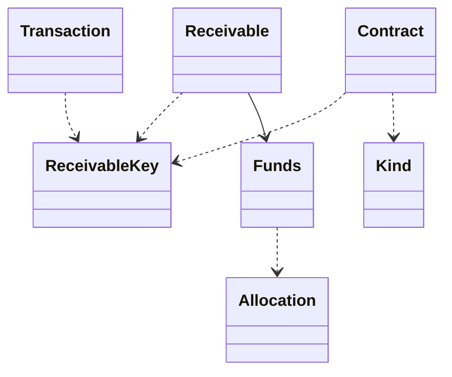
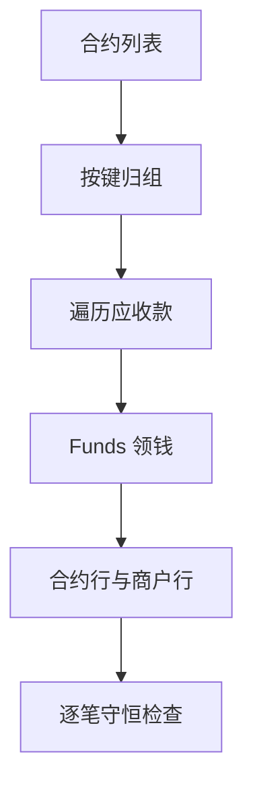

# 设计题解：交易汇总与应收分账（Aggregate Transactions）

## 题目与澄清

支付公司每天给商户打款（payout）。一笔打款可以合并好几位顾客的刷卡交易；商户又可以把其中一部分打款预先让给合约方，比如分期服务商或保理公司。于是结算系统要做两件事：第一，把一天里的交易按"哪个商户、哪种卡、哪天打款"汇总成应收款（receivable）；第二，对每一笔应收款，按合约约定把钱切成几份，一份给每个合约，剩下的归商户。你要实现两个函数：`register_receivables(transactions)` 返回汇总后的应收款列表，`allocate_receivables(receivables, contracts)` 返回分账行列表。数据类型和 CSV 读写由工作区提供，你只写这两个函数。

难点不在算法，而在合同的细节：一个粗心的读者会在"百分比算在哪个金额上"、"零要不要输出"、"取整往哪边"三处丢分。先把合同写成十二条，它们就是你的第一批测试：

1. **分组键是三元组**：(商户编号, 卡类型, 付款日) 精确匹配，区分大小写，不去空白、不规范化；日期当成不透明的字符串，不做日期运算。
2. **客户编号不参与分组**；同一个键下的交易金额相加；完全相同的两行是两笔交易，各算一次。
3. **空输入产生空输出**；`register_receivables([])` 是 `[]`。
4. **分账按键独立**：一个键的钱不会流到另一个键；合约按输入顺序处理。
5. **固定额合约**（`fixed`）请求 `value` 分。
6. **百分比合约**（`percentage`）请求 `原始金额 * value // 10000` 分，`value` 的单位是基点（basis point，万分之一），2500 就是 25%，向下取整。
7. **百分比永远基于该键的原始金额**，不基于已经扣掉前面合约之后的剩余金额。
8. **每份合约实际拿到 `min(请求额, 剩余)`**；键不在任何应收款里的合约被忽略。
9. **合约行只在拿到的金额为正时输出**：行的 `id` 是 `contract_id`，卡类型和付款日沿用应收款。
10. **每笔输入的应收款输出一行商户余额**，哪怕余额是零：`id` 是 `merchant_id`。不同合约不合并成一行。
11. **返回顺序不限；不修改输入；结果与输入互不相连；重复调用互相独立**；合约为空时只返回商户行。
12. **金额全程是整数分**：没有退款、币种、手续费和利息；金额和汇总值最多 10 亿分，百分比的乘积最多 10^13，必须保持精确。

三个数字例子是最先写的测试。例一：交易 `(P1, Bakery, 2026-12-01, Visa, 175)` 和 `(P2, Bakery, 2026-12-01, Visa, 225)` 汇总成 `(Bakery, Visa, 2026-12-01, 400)`；另一个商户或另一种卡的交易属于另一组。例二：Grocer 的应收款是 1203 分，合约依次是固定 350、百分比 1500。固定合约拿 350；百分比合约请求 `1203 * 1500 // 10000 = 180`（精确值 180.45，向下取整），拿到 180；商户余额是 `1203 - 350 - 180 = 673`。例三：在例二后面再加一份固定 900，它只拿到剩下的 673，商户行变成 0 但仍然输出。

面试官或隐藏测试会追问的澄清问题，以及每个答案怎样改变设计：

| 要问的问题 | 答案 | 它决定设计里的什么 |
|---|---|---|
| 百分比算在原始金额还是剩余金额上？ | 原始金额 | `Funds` 要同时保存 `original` 和 `remaining`；只存一个剩余数字就做不对 |
| 取整往哪边？ | 向下 | 用整数除法 `//`；`round()` 和浮点的 `int()` 都是陷阱 |
| 钱不够时谁先拿？ | 输入顺序先到先得 | 不能先全部算出请求额再按比例缩小，要边扣边算 |
| 零要不要输出？ | 合约行不要，商户行要 | 两种行的出行条件不同，写在两个地方 |
| 重复的应收款键会出现吗？ | 不会，输入保证唯一 | 可以放心按键归组；但仍应拒绝重复键，因为重复会让同一份合约被分两遍 |
| 要不要线程安全？ | 合同没有要求 | 函数无状态，输入只读，天然可以并发调用；不需要锁 |

不在范围内的事：CSV 的解析与渲染（工作区已提供）、币种与汇率、退款与负金额、日期的校验和换算、百分比之和不能超过 100% 之类的输入校验（合同保证输入有效，且允许超过 100%，后到的合约只拿剩下的）。

## 需求与分级

这个项目的机器编码轮没有隐藏的阶段，分关是实现的顺序：先把汇总做对，再把一份合约做对，再把多份合约和取整做对，最后把"不改输入、规模、守恒"钉牢。每一关都能单独运行测试。

**第 1 关（约 10 分钟，汇总）**：实现 `register_receivables`。一个字典、一个键、一个累加循环，没有别的。陷阱有两处：键要用名字取字段而不是按位置取，因为交易（顾客、商户、日期、卡、金额）和应收款（商户、卡、日期、金额）的字段顺序不同；输出顺序要确定，所以用字典的插入顺序，不要用集合。示例：`(P1, Bakery, 2026-12-01, Visa, 175)`、`(P2, Bakery, 2026-12-01, Visa, 225)`、`(P3, Florist, 2026-12-02, MasterCard, 90)` 汇总成两行，400 和 90。

**第 2 关（约 15 分钟，固定额与商户余额）**：实现 `allocate_receivables` 的主干：每笔应收款一份"还剩多少钱"，合约依次来领，领完输出商户行。示例：Kiosk 的 800 分、固定 250，输出合约行 250 和商户行 550。这一关要把"商户行一定输出、合约行拿到正数才输出"写对。

**第 3 关（约 15 分钟，百分比与取整）**：加上百分比合约。这一关的缺陷全部来自数字：基数用了剩余金额、用浮点数、用 `round()`、先把基点除成小数再乘。示例：50 分的 58% 精确是 29，`int(50 * (5800 / 10000))` 得到 28，因为 `5800 / 10000` 是 `0.58`，`50 * 0.58` 是 `28.999999999999996`。另一个：90 分的 70%，精确是 63，同样写法得到 62。

**第 4 关（约 10 分钟，守恒、规模与只读）**：让一万笔应收款乘一万份合约不变慢（合约先按键归组），让各行金额之和等于应收款总额，让输入列表原样不动。示例：一万 × 一万时，对每笔应收款扫描全部合约约 2.6 秒，按键归组约 0.01 秒（Python 3.11，同一台机器上量得）。

## 核心对象与职责

| 类型 | 单一职责 | 它拥有的不变量 |
|---|---|---|
| `Transaction`、`Receivable`、`Contract`、`Allocation` | 工作区提供的四个冻结记录 | 构造之后不再改变；金额是整数分 |
| `ReceivableKey` | 分组键：(商户, 卡类型, 付款日) 的具名元组 | 字段顺序固定；相等即同一组 |
| `Kind` | 合约种类的枚举：`fixed`、`percentage` | 只有两个值，未知字符串在转换时抛 `ValueError` |
| `Funds` | 一笔应收款里还没分出去的钱 | `0 ≤ remaining ≤ original`，`remaining` 只减不增 |
| `ConservationError` | 钱被造出或丢掉时抛出的具名异常 | 每笔应收款的各行之和等于它的金额 |

两个公开函数和三个小函数（`key_of`、`requested_amount`、`allocate_one`）是模块级函数，不是类：它们没有状态，也不会有第二种实现。`Funds` 是唯一带可变状态的类，它的生命周期只在一次 `allocate_one` 调用里，不会在调用之间共享，所以重复调用互不影响。



一次分账的流程：先把合约按键归组，再对每笔应收款走一遍，最后检查守恒：



`Funds` 同时保存 `original` 和 `remaining` 是整个设计里最小也最关键的一步。只存一个"剩余"数字的实现，要么让百分比读到剩余金额（错），要么得另开一个变量记原始金额，那个变量会被粗心地传错。把两个数放进一个小对象，"百分比读 `original`，扣款改 `remaining`"就成了对象的形状，而不是靠记忆。

## 关键设计决策

### 决策一：百分比怎么算才精确

**问题**：百分比请求额是 `原始金额 * 基点 / 10000` 向下取整。金额最多 10 亿分、基点最多 10000，乘积最多 10^13。怎样写出一个对所有输入都精确的版本？

**选项 A：先把基点除成小数，再乘金额。**

```python
want = int(original * (contract.value / 10_000))
```

读起来最像"金额乘百分比"。代价是 `5800 / 10000` 不能精确表示成二进制小数：50 分的 58% 精确是 29，这个写法得到 28（`50 * 0.58 = 28.999999999999996`）；90 分的 70% 精确是 63，得到 62。在 20 万个随机的 (金额, 基点) 组合里，它错了 9 个，例如金额 128515600、基点 5125，正确是 65864245，这个写法是 65864244。错得稀少，所以它最容易混过公开示例。

**选项 B：用 `round()` 或 `Decimal` 的默认取整。** 合同要的是向下取整，不是四舍五入。`round(1 * 9999 / 10000)` 得到 1，正确是 0；`round(6 * 2500 / 10000)`（1.5）得到 2，正确是 1。同样的 20 万个随机组合里，`round()` 错了约一半。`Decimal(a) * v / 10000` 再 `quantize` 默认也是四舍五入（实际是"银行家舍入"，向最近的偶数），在 20 万个组合里错的比例相当。`Decimal` 用 `ROUND_FLOOR` 当然可以做对，但为这一个除法引入一个模块、一个上下文和一次对象创建，不值得。

**选项 C：先乘后整除，纯整数。**

```python
want = original * contract.value // BASIS_POINTS   # 向下取整，整数
```

整数乘法精确，`//` 对非负数就是向下取整。10^9 乘 9999 再整除 10000 得 999900000，没有任何中间误差。

**选择：选项 C。** 有一个细节值得知道：`int(original * value / 10000)`（先乘、再用 `/` 除）在合同的界限内碰巧也是对的，因为乘积不超过 10^13，小于 2^53（9007199254740992），浮点数能精确表示这个整数，而一次正确舍入的除法在这个数量级上分得清"差万分之一"。但这是靠界限侥幸成立：界限一放宽就悄悄出错，而 `//` 在任何大小都对。再加一个现实原因：测试要求返回值是 `int`，`/` 的结果是 `float`，再包一层 `int()` 才补回来。

**模式**：这里不需要任何模式。有人会想到"货币值对象"（`Money` 类，带 `percent_of` 方法），这在金额有币种、有舍入模式、要在很多地方复用时才值得；这里只有一种单位、一个公式，一个模块级函数 `requested_amount` 就够了。

### 决策二：钱不够时怎么分，先算完再缩小还是边扣边算

**问题**：一笔 1000 分的应收款，两份合约各请求 700 分。谁拿多少？

**选项 A：先算出所有合约的请求额，如果总和超过原始金额，就按比例缩小。** 听起来公平：两份各拿 500。但合同写的是"每份拿 `min(请求, 剩余)`，按输入顺序处理"，结果应该是第一份 700、第二份 300。按比例缩小还要面对取整：1000 乘以三分之一得不到整数，零头往哪放没有规则。

**选项 B：边扣边算，一个"剩余"变量。** 每份合约来了，拿 `min(请求, 剩余)`，剩余减掉它。第一份 700，剩 300；第二份请求 700，拿 300，剩 0。调换两份合约的顺序，结果也调换（先到先得），这正是合同要的。

**选项 C：把"剩余"做成 `Funds` 对象。** 和 B 是同一种算法，但"剩余"不再是一个裸 `int` 变量，而是一个有名字、有不变量的小对象：`original` 不变、`remaining` 只减不增、`take(n)` 返回实际拿到的金额。

```python
@dataclass(slots=True)
class Funds:
    original: int
    remaining: int

    def take(self, requested: int) -> int:
        if requested < 0:
            raise ValueError(f"negative request: {requested}")
        granted = min(requested, self.remaining)
        self.remaining -= granted
        return granted
```

**选择：选项 C。** B 能通过所有测试，C 多出的价值是两点：一是 `original` 和 `remaining` 并排放在一起，"百分比读哪一个"变成可读的 `funds.original`；二是负请求会让钱凭空增加（`min(-5, 100)` 是 -5，`remaining` 反而变成 105），而 `take` 是唯一改动 `remaining` 的地方，所以只需要在一处挡住它。成本是一个十几行的类。**百分比之和超过 100% 的例子**：1000 分、两份 6000 基点，第一份拿 600，第二份请求 600 只拿到 400，商户行 0。

**零头归谁**：取整丢掉的零头留在 `remaining` 里，最后归商户。100 分、三份各 3333 基点，每份 `100 * 3333 // 10000 = 33`，共 99，商户拿 1。这和 [[solution-splitwise]] 里"最大余数法"的零头分配不一样：那里的零头要在参与者之间公平地补回去，这里合同规定了零头只有一个去处，不需要任何分配算法。

**模式**：不是策略模式。`fixed` 和 `percentage` 只差一行请求额的算法，有人想建一个 `Rule` 接口、两个实现类和一张注册表；这是用三个类换一个 `if`。选择是一个 `Enum` 加一个 `if`，等到第三种、第四种规则出现并且带自己的参数时，再改成按种类分派的表。

### 决策三：合约怎样找到自己的应收款

**问题**：应收款和合约各最多一万条。每份合约属于一个键，每笔应收款要拿到属于自己键的那些合约，并保持它们的输入顺序。

**选项 A：对每笔应收款，扫描全部合约，筛出键相同的。**

```python
mine = [c for c in contracts if key_of(c) == key_of(receivable)]
```

最直接，也最容易写对。一万 × 一万是一亿次键比较，在 Python 3.11 上约 2.6 秒；工作区的依赖里带着超时插件，慢的写法有被超时判红的风险。

**选项 B：把合约排序后分段。** 先按键排序，再用 `itertools.groupby`。要排序，而且 `sorted` 对键相同的合约必须是稳定的（`sorted` 本身稳定，但只要写成按 `(键, 合约编号)` 排序，输入顺序就丢了）；多一次 O(m log m)，还要管理"分段"的游标。

**选项 C：一次遍历，按键归成字典。**

```python
by_key: dict[ReceivableKey, list[Contract]] = {}
for contract in contracts:
    by_key.setdefault(key_of(contract), []).append(contract)
```

追加到列表尾部，所以每一组内部自然保持输入顺序。之后每笔应收款一次字典查找就拿到自己的合约列表（没有合约的键拿到空列表）。一万 × 一万的总耗时约 0.01 秒，比 A 快两个数量级。

**选择：选项 C。** 总成本 O(交易数 + 合约数)。一个小细节：用 `by_key.get(key, [])` 而不是 `defaultdict` 的 `by_key[key]`，后者在查询时会向字典里插入空列表，把"读"变成了"写"。注意这里的"索引"只活在一次调用里，调用结束就丢掉，所以没有缓存失效问题，也不会让两次调用互相影响。**这里不引入任何模式**：一个局部字典就是全部，不需要"索引类"或"仓库类"。

### 决策四：安全不变量用异常守，输入问题用什么挡

**问题**：合同说所有输入都有效。那还要不要检查什么？

**选项 A：什么都不检查，信任输入。** 最短。但三件事会让钱出错：键重复的应收款会让同一份合约被分两遍；负的请求额会让剩余增加；未知的合约种类会被静默当作某一种。

**选项 B：用 `assert` 守护。** `assert total_out == total_in`。`python -O` 会把它整行去掉，守恒这条"钱不会被造出来"的核心保证就消失了。

**选项 C：用具名异常守护。** 重复的应收款键抛 `ValueError`；`Kind(contract.kind)` 对未知字符串抛 `ValueError`；`Funds.take` 对负请求抛 `ValueError`；每笔应收款算完之后检查它的各行之和等于它的金额，不等就抛 `ConservationError`。

**选择：选项 C。** 判断标准是"去掉这一行，程序的保证会变吗"：守恒检查去掉之后，一个实现错误会让钱默默多出几分，没人知道，所以它必须是异常。注意它们守的是不同的东西：前三条拒绝不合法的输入，是边界校验；`ConservationError` 守的是实现自己，是"不可能发生"的断言，一旦发生就应该让调用方大声失败，而不是返回一个看起来正常的错误结果。逐笔检查比只在最后查全局总和更强：全局总和查不出「这个键多了、那个键少了」的错误，而钱在两个键之间流动恰好是按键归组写错时会出的错。检查是每笔 O(合约数) 的一次求和，相比分账本身可以忽略。

**这个决策里被拒绝的东西**：不为"百分比之和超过 100%"加校验，因为合同明确允许，后到的合约只拿剩下的；也不为空字符串、日期格式加校验，因为合同保证输入有效、日期是不透明的键。多做校验不是更安全，而是把合同没有规定的拒绝行为写进了系统，隐藏测试一旦覆盖到就会红。

### 决策五：怎样让结果与输入互不相连

**问题**：合同要求不修改输入，结果与可变输入互不相连，重复调用独立。

**选项 A：到处 `copy.deepcopy`。** 输入深拷贝一份再处理，结果深拷贝一份再返回。安全，但一万条记录被拷贝两次，没有必要，因为记录本身是冻结的。

**选项 B：记录冻结，输出新建。** 四个记录类型都是 `frozen=True` 的 dataclass，字段全是字符串和整数，不可变。输入的记录可以被安全地读，不可能被改；输出是新建的 `Allocation` 对象放进新建的列表，改动返回的列表不会碰到输入列表，输入列表里的记录也根本没有可改的地方。需要小心的只剩列表本身：不对参数列表调用 `sort`、`append`、`pop`。

**选择：选项 B。** 不可变性让"防御性拷贝"变成不需要的动作。唯一容易踩的坑是为了"让输出有序"而对 `contracts` 原地排序：测试会在调用前后比较输入列表，原地排序当场红。需要排序时写 `sorted(contracts, ...)`。**模式**：这是值对象（Value Object）本身，不需要额外的模式。

## 代码走读

下面是完整的、经过测试的解答。它在工作区里放进 `service.py`，唯一的改动是把中间"records"那一段换成 `from models import Allocation, Contract, Receivable, Transaction`，让测试比较的是工作区自己的类。

%% code:begin solution.py %%
```python
"""应收款汇总与分账：先按 (商户, 卡类型, 付款日) 汇总交易，再在合约与商户之间切分每一笔应收款。

设计（五行）：
1. 全程整数分（cent）：百分比用 `原始金额 * 基点 // 10000`，先乘后整除，不经过浮点数。
2. 分组键是 `ReceivableKey` 三元组，字典保持首次出现的顺序，所以输出是确定的。
3. 合约先按键归到各自的列表（保持输入顺序），每笔应收款只看自己那一组，总成本是 O(交易数 + 合约数)。
4. `Funds` 拥有一笔应收款的钱：百分比永远按 `original` 算，每份只能拿 `min(请求, remaining)`，剩下的归商户。
5. 函数不保存任何状态，也不修改参数；结果是新对象，记录是冻结的，所以重复调用互不影响。
   每笔应收款的各行之和必须等于它的金额（逐笔守恒）。
"""

from __future__ import annotations

from dataclasses import dataclass
from enum import Enum
from typing import NamedTuple

BASIS_POINTS = 10_000  # 1 个基点 = 0.01%，10000 = 100%


# --- records:begin（工作区的 models.py 提供这四个冻结记录，字段顺序以它为准）
@dataclass(frozen=True, slots=True)
class Transaction:
    customer_id: str
    merchant_id: str
    payout_date: str
    card_type: str
    amount: int


@dataclass(frozen=True, slots=True)
class Receivable:
    merchant_id: str
    card_type: str
    payout_date: str
    amount: int


@dataclass(frozen=True, slots=True)
class Contract:
    contract_id: str
    merchant_id: str
    payout_date: str
    card_type: str
    kind: str
    value: int


@dataclass(frozen=True, slots=True)
class Allocation:
    id: str
    card_type: str
    payout_date: str
    amount: int


# --- records:end


class ConservationError(RuntimeError):
    """钱被凭空造出或丢掉：这是实现错误，不是输入错误，所以不用 assert（python -O 会把它去掉）。"""


class Kind(str, Enum):
    FIXED = "fixed"
    PERCENTAGE = "percentage"


class ReceivableKey(NamedTuple):
    """分组键。区分大小写、不做任何规范化；顺序固定为 商户、卡类型、付款日。"""

    merchant_id: str
    card_type: str
    payout_date: str


def key_of(row: Transaction | Receivable | Contract) -> ReceivableKey:
    """三种记录的字段顺序并不相同，所以一律按名字取，不按位置取。"""
    return ReceivableKey(row.merchant_id, row.card_type, row.payout_date)


@dataclass(slots=True)
class Funds:
    """一笔应收款里还没分出去的钱。

    不变量：0 <= remaining <= original；remaining 只减不增。
    """

    original: int
    remaining: int

    def __post_init__(self) -> None:
        if not 0 <= self.remaining <= self.original:
            raise ValueError(f"need 0 <= remaining <= original, got {self.remaining}/{self.original}")

    @classmethod
    def of(cls, amount: int) -> Funds:
        return cls(original=amount, remaining=amount)

    def take(self, requested: int) -> int:
        """给一份合约划钱：拿走 min(请求, 剩余)，返回实际拿到的金额。"""
        if requested < 0:
            raise ValueError(f"negative request: {requested}")
        granted = min(requested, self.remaining)
        self.remaining -= granted
        return granted


def requested_amount(contract: Contract, original: int) -> int:
    """合约想要多少分。百分比向下取整，并且永远基于原始金额，不基于剩余金额。"""
    kind = Kind(contract.kind)  # 未知种类直接 ValueError，不静默当成固定额
    if kind is Kind.FIXED:
        return contract.value
    return original * contract.value // BASIS_POINTS


def register_receivables(transactions: list[Transaction]) -> list[Receivable]:
    """按 (商户, 卡类型, 付款日) 汇总交易金额；客户编号不参与分组，重复行各算一次。"""
    totals: dict[ReceivableKey, int] = {}
    for transaction in transactions:
        key = key_of(transaction)
        totals[key] = totals.get(key, 0) + transaction.amount
    return [
        Receivable(merchant_id=key.merchant_id, card_type=key.card_type,
                   payout_date=key.payout_date, amount=amount)
        for key, amount in totals.items()
    ]


def allocate_one(receivable: Receivable, contracts: list[Contract]) -> list[Allocation]:
    """一笔应收款：合约按输入顺序各拿一份，正数才出行；最后一行是商户余额，零也要出。"""
    funds = Funds.of(receivable.amount)
    rows: list[Allocation] = []
    for contract in contracts:
        granted = funds.take(requested_amount(contract, funds.original))
        if granted > 0:
            rows.append(Allocation(contract.contract_id, receivable.card_type,
                                   receivable.payout_date, granted))
    rows.append(Allocation(receivable.merchant_id, receivable.card_type,
                           receivable.payout_date, funds.remaining))
    if sum(row.amount for row in rows) != receivable.amount:  # 逐笔守恒：钱不能在键与键之间流动
        raise ConservationError(f"rows of {key_of(receivable)} do not add up to {receivable.amount}")
    return rows


def allocate_receivables(receivables: list[Receivable], contracts: list[Contract]) -> list[Allocation]:
    """逐键独立分账。键不在应收款里的合约被忽略；每笔应收款恰好一行商户余额。"""
    by_key: dict[ReceivableKey, list[Contract]] = {}
    for contract in contracts:  # 一次遍历：按键归组，组内保持输入顺序
        by_key.setdefault(key_of(contract), []).append(contract)

    seen: set[ReceivableKey] = set()
    rows: list[Allocation] = []
    for receivable in receivables:
        key = key_of(receivable)
        if key in seen:  # 同一个键出现两次，合约会被分两遍：钱会被造出来
            raise ValueError(f"duplicate receivable key: {key}")
        seen.add(key)
        rows.extend(allocate_one(receivable, by_key.get(key, [])))
    return rows


def payout_totals(rows: list[Allocation]) -> dict[str, int]:
    """每一方（合约或商户）跨所有键一共分到多少：对账用，返回新字典。"""
    totals: dict[str, int] = {}
    for row in rows:
        totals[row.id] = totals.get(row.id, 0) + row.amount
    return totals


# --- CSV 两端：工作区自带同样的适配器；这里写一份，让单个文件就能从文本跑到文本
def parse_transactions(text: str) -> list[Transaction]:
    """第一行是表头；值里没有逗号、引号和空白，所以直接按逗号切。"""
    records = (line.split(",") for line in text.splitlines()[1:])
    return [Transaction(c, m, d, k, int(a)) for c, m, d, k, a in records]


def parse_contracts(text: str) -> list[Contract]:
    records = (line.split(",") for line in text.splitlines()[1:])
    return [Contract(i, m, d, k, kind, int(v)) for i, m, d, k, kind, v in records]


def render_allocations(rows: list[Allocation]) -> str:
    lines = ["id,card_type,payout_date,amount"]
    lines += [f"{r.id},{r.card_type},{r.payout_date},{r.amount}" for r in rows]
    return "\n".join(lines) + "\n"


def settle_csv(transactions_csv: str, contracts_csv: str) -> str:
    """文本进、文本出：汇总，再分账，再渲染。"""
    receivables = register_receivables(parse_transactions(transactions_csv))
    return render_allocations(allocate_receivables(receivables, parse_contracts(contracts_csv)))


if __name__ == "__main__":
    demo = allocate_receivables(
        [Receivable("Grocer", "Visa", "2026-12-05", 1203)],
        [Contract("Split2", "Grocer", "2026-12-05", "Visa", "fixed", 350),
         Contract("Split3", "Grocer", "2026-12-05", "Visa", "percentage", 1500)],
    )
    for row in demo:
        print(row)
    print(settle_csv("c,m,d,k,a\nP1,Bakery,2026-12-01,Visa,175\nP2,Bakery,2026-12-01,Visa,225\n",
                     "i,m,d,k,kind,v\nSplit1,Bakery,2026-12-01,Visa,percentage,1000\n"), end="")
```
%% code:end %%

**第一处：`key_of` 和 `ReceivableKey`。** 交易的字段顺序是顾客、商户、日期、卡、金额，应收款是商户、卡、日期、金额，合约是编号、商户、日期、卡、种类、值。如果用位置取字段，`astuple(transaction)[1:4]` 是 (商户, 日期, 卡)，而 `astuple(receivable)[0:3]` 是 (商户, 卡, 日期)：同样三个字段，顺序不同，两边的键永远对不上，结果是所有合约都被"键不在应收款里"悄悄忽略，没有任何报错。`key_of` 用名字取字段，并且返回一个字段顺序固定的具名元组，这类错误就无从发生。

**第二处：`requested_amount`。** 这是整个解答里唯一算钱的地方：固定额直接返回 `value`，百分比是 `original * contract.value // BASIS_POINTS`。第一行 `Kind(contract.kind)` 把字符串变成枚举，未知种类立即 `ValueError`。参数里传的是 `original`，不是 `remaining`：函数签名本身就把"百分比基于原始金额"写成了类型。

**第三处：`allocate_one` 与 `Funds`。** 循环体三行：算请求额、`funds.take` 领钱、`granted > 0` 才出行。循环结束之后无条件追加商户行，最后做逐笔守恒检查。两种行的出行条件在两个地方，各一行代码，对应合同的两条不同规则，不会互相影响。`Funds` 的 `__post_init__` 在构造时就拒绝 `remaining` 大于 `original` 或为负，这样一个坏状态根本造不出来。

**第四处：`allocate_receivables`，以及文件尾部的 CSV 两端。** 先一次遍历合约建 `by_key`，再对每笔应收款调用 `allocate_one`。`seen` 集合拒绝重复键。这个函数不保存任何东西：`by_key`、`seen`、`rows` 都是局部变量，函数返回之后就只有 `rows` 活着，而且属于调用方。文件尾部的 `parse_transactions`、`parse_contracts`、`render_allocations` 和 `settle_csv` 是文本到文本的外壳：值里没有逗号、引号和空白，所以直接按逗号切；`payout_totals` 把各行按 `id` 跨键相加，对账时问「某个合约一共分到多少」用它。外壳不含任何分账规则，规则只在上面的函数里。

## 测试与自检

测试文件有 31 个测试函数，其中一个对随机种子参数化成 40 个，共 70 个用例，分六块。

- **合同里的数字例子**：汇总、不同卡类型分开、固定额留商户余额、固定 350 加百分比 1500 得 350、180、673、再加固定 900 得 673 和零余额。这五个先写，红了立刻知道哪条合同没做。
- **汇总的边界**：键区分大小写（卡 `Visa`/`visa`、商户 `Bakery`/`bakery`、日期不同各算一组）、重复行各算一次且顾客不参与、空输入、一万笔每笔十万分汇总到恰好 10 亿、首次出现的顺序。
- **分账的规则**：百分比读原始金额而不是剩余、浮点陷阱（50 分的 58% 必须是 29）、零值合约不出行、整额分走后商户行为 0、零金额应收款仍有商户行、合约顺序决定谁拿稀缺的钱、钱分完后后面的合约没有行、键不匹配的合约被忽略、各键独立、同商户的合约不合并、空合约只返回商户行、10 亿分的极端值精确。
- **输入只读与调用独立**：调用前后比较输入副本，调用两次结果相等且不是同一个列表，清空第一次结果不影响第二次；用一个计数的列表子类确认合约列表只被遍历常数次（逐笔扫描会遍历五十次）。
- **解答自带的安全设计与文本两端**：`Funds` 的构造拒绝 `remaining` 大于 `original` 或为负、`take` 拒绝负请求、重复的应收款键和未知的合约种类抛 `ValueError`；CSV 进、CSV 出的例子；按各方汇总的 `payout_totals` 跨键相加。这几项只在解答里有，starter 没有这些名字时这些测试跳过，学习者可以自己设计。
- **独立实现对拍**：用 `Fraction` 写一个步骤完全不同的模拟，在 40 个随机种子上逐行比较，并断言各行之和等于应收款总额、没有重复行、每笔应收款都有商户行；再对一万 × 一万的规模做一次精确比较。

**写错一处就会红的写法**，每一种都在代码里改过一次，确认至少有一个测试失败：

| 改动 | 失败的原因 |
|---|---|
| 百分比乘 `remaining` 而不是 `original` | 固定 350 加 15% 得到 127 而不是 180 |
| `int(original * (value / 10000))` | 50 分的 58% 得到 28 |
| `round(original * value / 10000)` | 1 分的 9999 基点得到 1 而不是 0 |
| 去掉 `granted > 0` 的判断 | 出现金额为 0 的合约行 |
| 商户余额为 0 时不输出 | 缺少零余额的商户行 |
| 去掉 `min(请求, 剩余)` 的上限 | 后到的合约拿到超过剩余的钱 |
| 先对 `contracts` 原地排序 | 输入列表被改动 |
| 每笔应收款扫描全部合约 | 遍历次数检查失败 |
| 把每组合约反过来排 | 谁拿稀缺的钱的顺序错了 |
| 建键时把卡类型转成小写 | `Visa` 和 `visa` 被合并 |

**两分钟演示**：运行文件末尾的 `__main__`，它跑的是合同里的 Grocer 例子，打印三行：`Split2 350`、`Split3 180`、`Grocer 673`。然后说两句话：百分比读 `original`，所以 180 而不是 127；零头和没分完的钱留在 `remaining`，最后归商户。

## 扩展与追问

**新需求**

- *百分比之和不得超过 100%，超过就整批拒绝*：改 `allocate_receivables` 在归组之后加一个按键求和的检查；`Funds`、`requested_amount`、`key_of` 都不动。
- *新增一种合约，例如"封顶的百分比"（取 25% 与 300 分中较小的）*：给 `Kind` 加一个值，`requested_amount` 里加一个分支；`allocate_one` 不动。如果规则开始带自己的参数并增加到四五种，再把 `if` 改成按种类分派的表。
- *零头归最后一份合约而不是商户*：改 `allocate_one` 的最后一步，其余不动；这时才需要回头问"零头是指什么"，因为合同现在规定了零头归商户。
- *多币种*：键里加币种，金额加币种；`Funds` 不变，百分比的算法不变。汇率换算是另一个项目的问题，见 [[solution-lcp-currency-conversion]]。

**并发与线程安全**

函数无状态、记录不可变，同时在多个线程里调用不需要锁，也不会互相影响：每次调用的 `by_key`、`seen`、`rows`、每笔应收款的 `Funds` 都是局部的。要加锁的是调用方，如果它在多个线程里往同一个列表追加交易，再把这个列表传进来：那是调用方列表的问题，不是这两个函数的问题。想用多核加速时，按键切片即可：键与键之间互不依赖，同一个键内部必须按合约顺序串行。Python 的全局解释器锁（GIL）让纯计算的线程并行没有收益，要并行就用进程。

**持久化与规模**

- *交易放在数据库里，汇总写成 `GROUP BY merchant_id, card_type, payout_date` 加 `SUM(amount)`*：汇总函数变成一条 SQL，键和合同一致；`allocate_receivables` 不动。
- *一个键下有很多合约，要在数据库里做先到先得*：每个键内要按合约顺序累计：第 i 份实际拿到 `MIN(请求额_i, MAX(0, 原始金额 - 前面各份请求额之和))`，前面各份请求额之和用窗口函数 `SUM(...) OVER (PARTITION BY 键 ORDER BY 合约顺序)` 求；不能写成一条没有顺序的批量更新。
- *每天重跑要幂等*：输出行按 (批次编号, 行 id, 卡类型, 付款日) 做主键写入，同一批重跑只生效一次；`Funds` 和守恒检查原样保留，它们守的是一次计算内部。
- *金额超出 10 亿分、乘积超出 10^13*：Python 的整数没有上限，代码不变；换成别的语言才要换成 128 位整数或大数库。

## 常见错误

- **百分比读了剩余金额。** 最常见的错，也是 REFLECTION 要你解释的那一个：固定 350 之后的 15%，写成 127 而不是 180。
- **用浮点数算百分比。** `int(50 * (5800 / 10000))` 得到 28。公开示例里的数都碰巧能对，隐藏测试会取到不能对的数。
- **用 `round()`。** 合同要向下取整；`round()` 对 1 分的 9999 基点得到 1。
- **漏掉零余额的商户行。** "钱分完了就不用输出商户行"，是读了"拿到正数才出行"之后的过度推广。合同对商户行的说法是"每笔应收款一行"。
- **输出金额为零的合约行。** 固定额 0、百分比取整为 0、钱已经分完的合约，都不出行。
- **按位置取字段建键。** 交易和应收款的日期、卡类型位置不同，两边的键对不上，所有合约被悄悄忽略。
- **对 `contracts` 原地排序或 `pop`。** 输入被改动，调用前后一比较就红。
- **每笔应收款扫描全部合约。** 正确但慢，一万 × 一万约 2.6 秒。
- **把同商户的合约合并成一行。** 合同写明不合并，`id` 是各自的合同编号。
- **把客户编号放进分组键。** 同一个商户、卡、日期下不同顾客的交易被拆成多组，应收款变多、金额变小。
- **从 Java 带来的习惯。** 为 `fixed` 和 `percentage` 各建一个类再加一个工厂；为金额建一个带 `getAmount()` 的 `Money` 类；用 `static` 工具类放函数。这里的 Python 写法是冻结的 dataclass、一个枚举和模块级函数。
- **用 `assert` 守护守恒。** `python -O` 之后保证就不存在了。

## 45 分钟怎么分配

项目的建议时长是 60 分钟，面试里常压缩成 45 分钟，下面按 45 分钟排；有编程智能体时，把"写"的时间换成"指挥与验证"的时间。

- **0 到 5 分钟｜读合同并写下规则**：把十二条合同读一遍，说出口三件事："百分比读原始金额"、"向下取整、整数运算"、"商户行一定输出、合约行拿到正数才输出"。把三个数字例子抄成测试。
- **5 到 10 分钟｜确定对象**：说出 `ReceivableKey`、`Funds` 两个小类型，其余是模块级函数；说明为什么不为 `fixed`/`percentage` 建类。
- **10 到 20 分钟｜汇总与固定额**：先写 `register_receivables`，跑公开测试；再写 `allocate_receivables` 的固定额主干，输出合约行和商户行。
- **20 到 30 分钟｜百分比与取整**：加 `requested_amount`；先写"固定 350 之后的 15%"和"50 分的 58%"两个测试，看它们红，再让实现变绿。
- **30 到 38 分钟｜不变量与规模**：把合约先归组；加守恒检查和对重复键、负请求的拒绝；写"调用前后比较输入"的测试。
- **38 到 42 分钟｜回归**：运行公开测试和全部自己的测试；让智能体另写一个用 `Fraction` 的模拟实现，在随机数据上比较，期望值自己独立写，不接受"把测试改成通过"。
- **42 到 45 分钟｜书面回答**：两个问题各约一百字。第一个：分组键、合约顺序、原始金额怎样决定结果，并给出区分原始与剩余的例子（1203 分、固定 350、15%，180 对 127）。第二个：结果怎样与输入脱钩、重复调用怎样独立（冻结记录、新建列表、无状态），以及你加的一个测试能区分什么错误（调用前后比较输入，抓原地排序）。

时间不够时的取舍：先砍书面回答的展开，再砍随机对拍；绝不能砍的是"百分比读原始金额"、"整数向下取整"、"零余额商户行"、"不修改输入"。

## 延伸阅读

- [[solution-splitwise]]：同样是"把一笔钱拆成几份并处理取整零头"的问题；那里的零头要公平地补回去（最大余数法），这里的零头只有一个去处（商户）。
- [[solution-lcp-currency-conversion]]：同一批项目里另一道处理数字边界的题；那里用浮点数加容差，这里用整数避开浮点。
- [[solution-lcp-keyword-user-blocklists]]：同一批项目里"单次遍历输入、返回值隔离"的另一个例子。
- 时间与数字（Time & Numbers）：整数、浮点与取整的坑。
- 值对象与不可变性（Value Objects）：冻结记录为什么不需要拷贝：[[oop.values|值对象与不可变性（Value Objects）]]。
- 防御性拷贝（Defensive Copying）：什么时候需要拷贝、什么时候不需要。
- 边界校验（Validate at the Boundary）：只拒绝合同规定的非法输入，不多不少。
- 不变量与封装（Invariants）：让坏状态在构造时就造不出来。
- 复杂度与常数（Complexity vs Constants）：O(n×m) 与 O(n+m) 在一万规模上的差别。
- [Python 文档：浮点算术的问题与限制](https://docs.python.org/3/tutorial/floatingpoint.html)：为什么 `5800 / 10000` 不是精确的 0.58。
- [Python 文档：数字类型的 `//` 运算](https://docs.python.org/3/library/stdtypes.html#numeric-types-int-float-complex)：整数除法向下取整的定义。
- [Python 文档：dataclasses](https://docs.python.org/3/library/dataclasses.html)：`frozen=True` 与 `slots=True`。
- [Python 文档：decimal 的舍入模式](https://docs.python.org/3/library/decimal.html#rounding-modes)：默认的银行家舍入与 `ROUND_FLOOR`。
