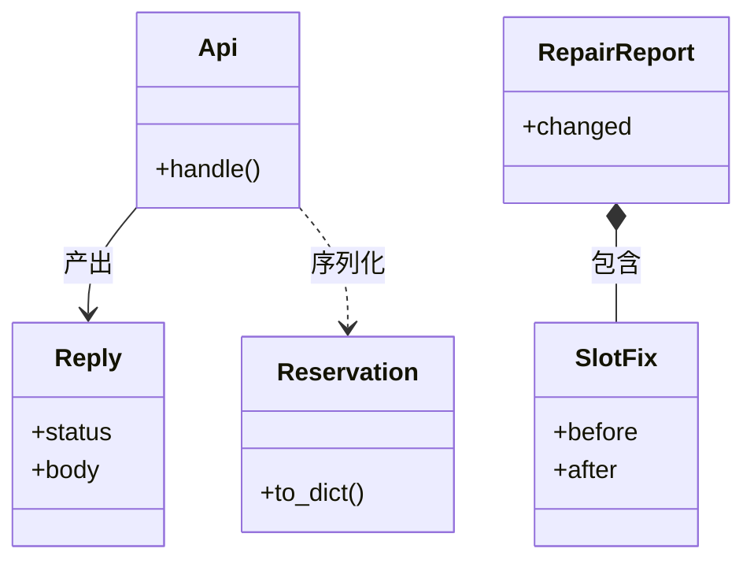

# 设计题解：预约服务线上事故（Reservation Service Incident）

## 题目与澄清

预约服务（SlotWise）让用户浏览课程场次、预约、取消，并在 Dashboard 看到自己"进行中"和"已取消"的预约。服务已经上线，客服反馈三件事：用户手机上响应慢，自动重试之后名额被占了两次；热门场次放票时，页面上有的说还有位置、有的说满了；取消之后，列表、名额和提示互相矛盾。生产库里还躺着一批历史记录，和产品展示的数字对不上，而且生产库不能重置，只能原地修。
你要做的是一整条线：找到根因、修好预约与取消、补回归测试、写一个可预演也可重复运行的数据修复，再按"先排练、再预演、再应用、再检查"的节奏碰生产库。

先把三条客服反馈和那几行请求日志读成假设，再动手：

- 第一个请求用了 800 多毫秒，一秒后同一用户的重试返回 201：两次都成功，说明服务没有"已持有"的判断，也没有数据库约束兜底。
- 同一条预约连续两次取消，两次都是 200：说明取消没有看状态，每次都释放一个名额，名额会比容量还多。
- 预约一个不存在的场次返回 500：代码把"查不到"当成了"一定存在"。
- 放票时名额冲突：读出名额、在内存里减一、写回绝对值，两个请求同时读到 3，各自写回 2，丢了一次更新。
- Dashboard 的"进行中"列表里出现已取消的预约：过滤条件只处理了 `cancelled` 一边。

把产品合同用自己的话写成可测的规则，这是开工前的第一件事：

1. 一个用户在同一场次至多一条 active 预约；已持有时再预约返回 409，什么都不改：不多一条预约、不多扣名额、不多一行审计。
2. 任何时刻一个场次的 active 预约数不超过容量，不管多少请求同时到。
3. `available_slots` 恒等于容量减 active 预约数。取消之后同一用户可以再预约，那是一条新预约，id 不同。
4. 场次不存在返回 404，正文是 `{"detail": "Session not found"}`，什么都不改。
5. 只有主人能取消。别人的预约与不存在的预约一模一样：404、同样的正文、什么都不改。
6. 取消可以重复：每次都是 200，正文与第一次相同（`cancelled_at` 保持第一次的值），名额只释放一次，只写一行取消审计。
7. Dashboard 的两个列表只含当前用户、只含该状态的预约。
8. 每次成功的预约或取消恰好写一行审计；预约状态、名额与审计要么一起成功，要么一起不留痕。
9. 数据修复：不删记录，id、用户、场次、`created_at` 不变；同一用户同一场次的多条 active 里，最早的留下（相同时刻取 id 小的），其余变 cancelled；之后某场次仍超容量，按同样的顺序留到容量为止。
10. 被修复取消的记录 `cancelled_at` 都是这次修复的时刻，同一个值；不为它们补写审计行；其他预约和已有审计一行不变。
11. 修复之后每个场次 `available_slots = 容量 − active 数`，并且数据库自己拒绝：同一用户同一场次的第二条 active、小于 0 或大于容量的 `available_slots`。
12. 修复中途失败，数据与版本号都回到原样；成功后再运行一遍什么都不改。

真实工作区与这里的区别：真实工作区是 FastAPI、SQLAlchemy、Alembic 和 PostgreSQL，测试与迁移都连一个 PostgreSQL 服务；这里的参考解只用标准库和 sqlite3，规则完全一样，下面几处写法不同。

| 事项 | 真实栈（PostgreSQL） | 这里（sqlite3） |
|---|---|---|
| 串行化同场次的请求 | `SELECT … FOR UPDATE` 锁场次那一行 | `BEGIN IMMEDIATE` 拿整个库的写锁，比行锁粗，但语义一样 |
| 名额不超过容量 | `ADD CONSTRAINT … CHECK (available_slots <= capacity)` | sqlite 不能给已有表补 CHECK，用 `BEFORE INSERT/UPDATE` 触发器抛错 |
| 唯一约束 | 部分唯一索引 `WHERE status = 'active'` | 同样的部分唯一索引 |
| 数据修复 | Alembic 第二个迁移，`row_number()` 窗口函数的两条 UPDATE | `upgrade_0002`：先在 Python 里算计划，再执行 |
| 同一个修复时刻 | 事务内的 `now()` 不变，天然是同一个值 | 函数开头取一次时间，传进每条 UPDATE |
| 失败回滚 | 事务性 DDL：建索引、加约束、改数据、盖版本号同在一个事务 | sqlite 的 DDL 也在事务里，同样整体回滚 |
| 时间 | `timestamptz`，按时刻比较 | 统一成 UTC、定宽的 ISO 文本，文本顺序就是时间顺序 |
| 预演 | `prod-migrate --dry-run` 把生产复制到临时库再迁移，打印差异 | `upgrade_0002(dry_run=True)`：做完同样的事再回滚，返回报告 |

在真实栈上，同一批历史数据跑同一个修复，结果和这里一致（见"测试与自检"里的数字）；这里的参考解是它的可运行缩影。

三个必须当场问清、答案会改代码的澄清问题：

- **找不到场次和已持有同时发生时谁先？** 合同只说各自的状态码。404 与 409 状态码不同，所以顺序要定下来：先判场次存在，再判已持有，再判已满。两个 409 对客户端没有区别，正文分开写（`Already reserved` 与 `Session is full`），排查才快。
- **重复取消返回什么？** 合同说"与第一次相同"。要问清楚的是：别人的预约取消也是 404（不泄露存在性），主人重复取消才是 200；两种情况的判断顺序是先看主人，再看状态。
- **修复要不要补审计？** 审计表记录的是"用户做了什么"。被修复取消的预约没有用户动手，补一行就是编造；合同也明确不补。要问的是：修复自己要不要留痕？答案在变更记录里，不在审计表里。

范围之外：前端页面、登录体系（`X-User-ID` 头只是开发用的鉴权）、候补队列、支付、通知。

## 需求与分级

**第 1 关（约 12 分钟，复现并修好单请求的规则）**：先不改代码，把日志和反馈翻成失败的测试：重试得到两条 active、重复取消后名额超过容量、不存在的场次返回 500、他人取消成功、"进行中"列表里有已取消。再逐条修：场次存在与重复预约的判断、取消只看主人、只有 active 才释放名额、列表按状态过滤。
示例：`reserve(db, session_id=1, user_id=1)` 两次，第二次抛 `ReservationConflict`，预约表仍是一行、名额是 2、审计一行。

**第 2 关（约 12 分钟，原子与并发）**：三件事同一个事务；放票时十几个请求同时到。这一关决定预约流程的骨架：先锁场次、再检查、后写；名额用相对更新。
示例：12 个用户同时抢容量 3 的场次，恰好 3 个成功、9 个收到 `ReservationConflict`，名额是 0，审计 3 行。

**第 3 关（约 12 分钟，让数据库守住规则，并修数据）**：新增迁移：部分唯一索引、`available_slots <= capacity`；同一个迁移里先修历史数据再建约束。
示例：同一用户在同一场次有两条 active 时，最早的留下；容量为 0 的场次里的 active 全部取消；所有被取消的记录 `cancelled_at` 相同。

**第 4 关（约 9 分钟，对生产库的节奏）**：先用本地快照排练，再 dry-run 看差异，再应用，再用只读检查验证，最后写变更记录：改了什么、预演看到什么、回滚方案、验证结果。这一关考的不是代码，而是你在不可逆环境里的习惯。
示例：dry-run 打印会取消的预约和会改的计数；应用后一致性检查全部通过；再运行一遍迁移，没有任何行变化。

每一关对应设计里的一块：第 1 关是服务函数的判断顺序，第 2 关是 `transaction` 与相对更新，第 3 关是 `plan_repair` 与 `upgrade_0002`，第 4 关是 `dry_run` 与 `violations`。

## 核心对象与职责



- **服务函数 `reserve` / `cancel` / `list_reservations`**：这是模块级函数，不是类。每个函数拥有一次请求的事务：开始、判断、写、提交或回滚。不变量：返回时，预约状态、名额、审计三者一致。
- **`Reservation`**：一条预约的冻结快照（`@dataclass(frozen=True)`）。`to_dict()` 只给六个字段，和 API 响应一致。调用方改它不会影响存储，因为存储里没有这个对象。
- **`ReservationConflict` / `ReservationNotFound`**：只有两个异常类型，对应 409 与 404，公开签名不能变。"别人的预约"与"不存在的预约"用同一个 `ReservationNotFound`，这正是不泄露存在性的实现。
- **`RepairReport` 与 `SlotFix`**：修复的结果值。`cancelled` 是被取消的预约 id，`slot_fixes` 是每个场次计数器从多少改成多少，`changed` 告诉你"这次有没有动任何行"。dry-run 和真跑返回同样形状的报告，区别只在 `dry_run`。
- **`transaction`**：一个上下文管理器，开始时拿写锁，异常回滚，正常提交；`rollback=True` 时正常结束也回滚，dry-run 就靠它。
- **`plan_repair`**：只读函数，算出要取消的 id 和要改的计数，不写任何东西。它让"预演"和"真跑"共用同一份判断，不会出现预演说一套、真跑做另一套。
- **`upgrade_0002`**：迁移本身：计划 → 取消 → 重算计数 → 建约束 → 盖版本号，在一个事务里。它是整个设计里唯一同时碰数据和结构的地方。
- **`violations`**：一致性检查，每条不变量一条只读 SQL，返回违反的行数。它在 dry-run 之后、应用之后、定时对账时都能用。
- **`Api` / `Reply`**：把函数接到 HTTP 合同上：`X-User-ID` 鉴权先于参数校验，异常翻成状态码和 `{"detail": …}`。真实栈里这一层是 FastAPI 的路由，没有业务逻辑。

所有权关系很简单：连接由调用方创建、传进来；服务函数不保存状态，一次请求结束事务就结束。这让并发测试可以给每个线程一条自己的连接，像真实服务里一个请求一个会话。

## 关键设计决策

### 决策一：先锁场次那一行，再检查，再写

**问题。** 预约要同时满足三条：场次存在、用户没有 active、还有名额。三个检查读的是同一批数据；如果检查之后、写入之前有别的请求插进来，检查的结论就过期了。原代码是"读出名额、内存里减一、写回绝对值"，SQLAlchemy 对 `available_slots -= 1` 发出的是 `UPDATE sessions SET available_slots=<算好的值>`，两个请求同时读到 3，各自写回 2。

**选项。**

1. 先查后写，不加锁（有缺陷的 `starter.py` 就是这样写的）。12 个线程同时抢容量 3 的场次，12 个全部成功，名额停在 2，12 条 active 预约。
2. 条件更新：`UPDATE sessions SET available_slots = available_slots - 1 WHERE id = ? AND available_slots > 0`，看影响行数。名额这一件事是原子的，不用显式锁。代价：404、"已持有"、"已满"三种失败要靠额外查询来区分，判断顺序更难读；其他检查（是否已持有）仍然需要在同一个事务里读到稳定的数据。
3. 乐观并发：读出版本号，写时比较，失败重试。放票时冲突率高，会大量重试；还要给客户端定义"重试耗尽"的语义。
4. 进程内的锁（`threading.Lock`）。多个实例或多个进程时完全无效，而且服务本来就是多实例的。
5. 先锁场次行，再检查，再写。所有同场次的请求在锁上排队，检查和写入之间没有缝隙。

**选择：第 5 种。** 锁的是"名额"这个共享的稀缺资源所在的那一行；同场次的请求串行，不同场次互不影响。检查顺序也因此变得清晰：场次存在 → 是否已持有 → 是否已满，每一步读到的都是锁住之后的值。在 PostgreSQL 里是 `SELECT … FOR UPDATE`：

```python
event_session = db.scalar(
    select(EventSession).where(EventSession.id == session_id).with_for_update()
)
if event_session is None:
    raise ReservationNotFound("Session not found")
```

sqlite 没有行锁，`BEGIN IMMEDIATE` 一开始就拿整个库的写锁，更粗，语义相同。名额递减写成相对更新（`available_slots = available_slots - 1`），这样即使将来有别的路径改计数，也不会写回过期的绝对值。取消也遵守同一个加锁顺序：先场次，后预约；规定一个固定顺序，任何两个请求拿锁的先后就一致，不需要再逐个论证会不会互相等待。

**这是什么模式。** 悲观锁（Pessimistic Locking），一个并发技术，不是 GoF 模式。没有引入别的抽象。

### 决策二：数据库约束是最后一道防线，应用检查在前

**问题。** 即使应用代码都对，也会有人手工写 SQL、有别的服务写这张表、有未来的代码路径忘了检查。规则只活在应用里，等于规则只活在一个人的记忆里。

**选项。**

1. 只靠应用检查。快，错误信息好，但任何绕过它的写入都会制造脏数据，生产库里的那批历史记录就是这样来的。
2. 只靠约束，捕获 `IntegrityError` 当作 409。数据库永远对，但"场次不存在"和"已满"是另外的错误，仍然要查；而且捕获范围一大，就会误判。
3. 两者并用：应用先检查（给出精确的 404/409 和正文），数据库约束兜底。

**选择：第 3 种，并且捕获要窄。** 部分唯一索引 `(user_id, session_id) WHERE status = 'active'` 与 `available_slots <= capacity` 的 CHECK 是兜底；应用的检查产生精确的错误。兜底触发的唯一情形是别的写入者绕过了检查，这时只把唯一冲突（PostgreSQL 的 SQLSTATE `23505`）翻成 409：

```python
except IntegrityError as exc:
    db.rollback()
    if getattr(exc.orig, "sqlstate", None) == "23505":  # 只认唯一冲突
        raise ReservationConflict("Already reserved") from exc
    raise
```

一个真实的坑：最初写成 `except IntegrityError: raise ReservationConflict(...)`，在审计表上放一条一定失败的约束再预约，PostgreSQL 返回的是 409，而这是一次内部故障，应该是 500。把所有 `IntegrityError` 当成"重复预约"，就把别的故障伪装成了客户端的错误，监控上看不到它。修成只认 `23505` 之后，同一个测试返回 500，名额与预约表都没有残留。

**这是什么模式。** 防御纵深（Defence in Depth），不是类层次上的模式。

### 决策三：取消的幂等来自"状态判断"，不引入幂等键表

**问题。** 客户端会重试取消，日志里同一条预约连续两次取消都返回 200。要求是：每次响应相同，名额只释放一次，审计只一行。

**选项。**

1. 幂等键表：每个请求带一个 key，服务存 key → 响应，重复的直接回放。通用，但要多一张表、过期策略、key 冲突的语义，而这个合同里并没有请求 key。
2. 先判断状态：只有 `active` 才改状态、释放名额、写审计；已经是 `cancelled` 的，原样返回当前这条预约。
3. 每次都执行（原代码）：每次释放一个名额，`cancelled_at` 每次被改写，每次一行审计。名额最后超过容量。

**选择：第 2 种。** 取消是一个状态机上的转移：`active → cancelled`；`cancelled` 上再取消是自环，什么都不改。状态本身就是幂等的"记忆"，不需要另一张表。这个选择能成立的前提是判断与转移在同一个事务里，否则两个并发的取消都读到 `active`：

```python
if row["status"] == "active":          # 只有这一次真的转移
    db.execute("UPDATE reservations SET status='cancelled', cancelled_at=? WHERE id=?", ...)
    db.execute("UPDATE sessions SET available_slots = available_slots + 1 WHERE id = ?", ...)
```

"别人的预约"的处理放在状态判断之前：`row is None or row["user_id"] != user_id` 一起抛 `ReservationNotFound`。顺序不能倒：如果先看状态，别人的已取消预约会回 200，泄露它存在。

**这是什么模式。** 状态机里的幂等转移（见知识树的「非法转移与幂等（Illegal Transitions）」）；幂等键是更重的另一种方案，这里被拒绝，因为合同没有给出请求 key。

### 决策四：修复写成"计划 + 应用"，在一个事务里，dry-run 就是回滚

**问题。** 生产库有脏数据，不能重置；修复必须能预演、能重复运行、中途失败不能留下一半。

**选项。**

1. 用管理员账号在 psql 里手写 UPDATE。快，但没有预演、没有记录、没有回滚，也绕过了迁移记录的版本号。
2. 应用之外的一次性脚本：能写测试，但和迁移版本脱节，生产与本地各跑各的。
3. 放进迁移：数据修复与约束在同一个修订里，一个事务，版本号同事务更新。预演就是"做完同样的事，然后回滚"。

**选择：第 3 种。** 事务里的顺序固定为：计划（只读）→ 取消违规预约 → 重算计数 → 建约束 → 盖版本号。几条要点：

- **先数据后约束**：脏数据上建部分唯一索引会失败（输出：`UNIQUE constraint failed: reservations.user_id, reservations.session_id`）。顺序倒过来，迁移根本过不去。
- **规则有先后**：先去重，再按容量。同一用户在一个容量为 2 的场次里有 A(10:00)、B(10:01)，别人有 C(10:02)：先去重取消 B，A 和 C 都能留下；如果先按容量留前两个（A、B），再去重取消 B，C 白白被取消。
- **一个时刻**：`stamp` 在函数开头取一次，所有被取消的记录用同一个值。PostgreSQL 里 `now()` 是事务开始时间，天然如此。
- **幂等**：计划只选择违反规则的行；干净的库上计划是空的，什么都不更新，`cancelled_at` 也不会被覆盖。`CREATE … IF NOT EXISTS` 让建约束也能重复运行。
- **dry-run**：同样的代码路径，最后回滚而不是提交。它连"建约束会不会失败"都演练到了，比只打印计划更可信。
- **不补审计**：被修复取消的预约没有用户动手，审计行记录的是用户动作；伪造一行就是在审计表里说谎。修复自己的痕迹放在变更记录里。

**这是什么模式。** 计划/执行分离（先算要做什么，再做）；不是 GoF 模式。

### 决策五：不引入仓储类、工作单元类，保留"函数 + 连接"

**问题。** 预约服务只有三个操作、四张表。照着分层教科书，会想到 `ReservationRepository`、`SessionRepository`、`UnitOfWork`。

**选项。** 一是加一层仓储：每个 `SELECT`/`UPDATE` 包成一个方法；二是继续用函数，事务由 `transaction` 上下文管理器表达。

**选择：函数。** 仓储类的每个方法只会把一条 SQL 转发一次，没有自己的不变量；而这里真正需要的"工作单元"就是一个事务，`with transaction(db):` 已经表达了它。多出的类还会把"先锁、再查、后写"的顺序切碎到几个对象里，读代码的人要跳来跳去才看得出锁在哪里。只有出现第二种存储或要换数据库时才值得加一层，到那时再抽，成本很低。这是一个拒绝模式的决策：类越少，加锁顺序越容易审。

## 代码走读

下面是完整的参考解，之后挑四个地方说明设计决策在代码里的样子。

%% code:begin solution.py %%
```python
"""预约服务（SlotWise）线上事故：修好的预约/取消流程，加上对已有脏数据的原地修复。

设计一句话：一次请求 = 一个事务，里面按"先锁、再查、后写"的顺序做完所有事。
  1. 事务从 BEGIN IMMEDIATE 开始：先拿写锁，检查和写入之间不会被别的请求插进来（PostgreSQL 里对应 SELECT … FOR UPDATE 锁场次那一行）。
  2. 预约状态、场次的 available_slots、审计行三件事在同一个事务里提交，任何一步失败全部回滚。
  3. 取消是幂等的：只有 active 的预约才会释放名额、写审计；重复取消原样返回第一次的结果。
  4. 数据库自己拒绝坏数据：同一用户同一场次至多一条 active（部分唯一索引）；available_slots 不得大于容量（触发器，PostgreSQL 里是 CHECK）。
  5. 数据修复 upgrade_0002 先修数据、再建约束，整件事一个事务；dry_run 做完同样的事后回滚，只返回会改什么。
"""

from __future__ import annotations

import re
import sqlite3
from collections import Counter
from collections.abc import Iterator, Mapping
from contextlib import contextmanager
from dataclasses import asdict, dataclass
from datetime import UTC, datetime
from urllib.parse import parse_qs, urlsplit

REVISION_1 = "0001_initial"
REVISION_2 = "0002_repair_reservations"
STATUSES = ("active", "cancelled")


class ReservationConflict(Exception):
    """重复预约或场次已满（HTTP 409）。"""


class ReservationNotFound(Exception):
    """场次不存在、预约不存在或不属于当前用户（HTTP 404）。"""


@dataclass(frozen=True)
class Reservation:
    """一条预约的快照；字段与 API 的响应一一对应。"""

    id: int
    user_id: int
    session_id: int
    status: str
    created_at: str
    cancelled_at: str | None

    @classmethod
    def from_row(cls, row: sqlite3.Row) -> Reservation:
        return cls(**{key: row[key] for key in cls.__dataclass_fields__})

    def to_dict(self) -> dict[str, object]:
        return asdict(self)


@dataclass(frozen=True)
class SlotFix:
    session_id: int
    before: int
    after: int


@dataclass(frozen=True)
class RepairReport:
    """修复做了什么（或 dry_run 时会做什么）。"""

    dry_run: bool
    cancelled: tuple[int, ...]
    slot_fixes: tuple[SlotFix, ...]
    cancelled_at: str | None

    @property
    def changed(self) -> bool:
        return bool(self.cancelled or self.slot_fixes)


# ---------------------------------------------------------------- 连接与事务 ----


def connect(path: str = ":memory:") -> sqlite3.Connection:
    """自动提交模式的连接：事务由 transaction() 显式开关，不依赖驱动的隐式行为。"""
    db = sqlite3.connect(path, timeout=30, isolation_level=None, check_same_thread=False)
    db.row_factory = sqlite3.Row
    db.execute("PRAGMA foreign_keys = ON")
    return db


@contextmanager
def transaction(db: sqlite3.Connection, *, rollback: bool = False) -> Iterator[None]:
    """BEGIN IMMEDIATE 先拿写锁；正常结束提交（rollback=True 时回滚），异常一律回滚。"""
    db.execute("BEGIN IMMEDIATE")
    try:
        yield
    except BaseException:
        db.execute("ROLLBACK")
        raise
    db.execute("ROLLBACK" if rollback else "COMMIT")


def _stamp(moment: datetime | None) -> str:
    """统一成 UTC、定宽的 ISO 文本：按文本排序就等于按时间排序。"""
    return (moment or datetime.now(UTC)).astimezone(UTC).isoformat(timespec="microseconds")


# ------------------------------------------------------------ 建表与演示数据 ----

LEGACY_SCHEMA = (
    "CREATE TABLE users (id INTEGER PRIMARY KEY, name TEXT NOT NULL)",
    """CREATE TABLE sessions (
        id INTEGER PRIMARY KEY, title TEXT NOT NULL, starts_at TEXT NOT NULL,
        capacity INTEGER NOT NULL, available_slots INTEGER NOT NULL,
        CONSTRAINT ck_sessions_capacity_nonnegative CHECK (capacity >= 0),
        CONSTRAINT ck_sessions_slots_nonnegative CHECK (available_slots >= 0))""",
    """CREATE TABLE reservations (
        id INTEGER PRIMARY KEY, user_id INTEGER NOT NULL REFERENCES users (id),
        session_id INTEGER NOT NULL REFERENCES sessions (id), status TEXT NOT NULL,
        created_at TEXT NOT NULL, cancelled_at TEXT,
        CONSTRAINT ck_reservation_status CHECK (status IN ('active', 'cancelled')))""",
    """CREATE TABLE reservation_audits (
        id INTEGER PRIMARY KEY, reservation_id INTEGER NOT NULL REFERENCES reservations (id),
        action TEXT NOT NULL, actor_user_id INTEGER NOT NULL REFERENCES users (id),
        created_at TEXT NOT NULL)""",
    "CREATE TABLE alembic_version (version_num TEXT NOT NULL PRIMARY KEY)",
    f"INSERT INTO alembic_version VALUES ('{REVISION_1}')",
)

# 0002 加的约束。SQLite 不能给已有表补 CHECK，所以"available_slots 不超过容量"用触发器；
# PostgreSQL 里一条 ADD CONSTRAINT … CHECK (available_slots <= capacity) 就够。
CONSTRAINTS = (
    """CREATE UNIQUE INDEX IF NOT EXISTS uq_reservations_one_active
       ON reservations (user_id, session_id) WHERE status = 'active'""",
    """CREATE TRIGGER IF NOT EXISTS trg_slots_within_capacity_insert BEFORE INSERT ON sessions
       WHEN NEW.available_slots > NEW.capacity
       BEGIN SELECT RAISE(ABORT, 'available_slots exceeds capacity'); END""",
    """CREATE TRIGGER IF NOT EXISTS trg_slots_within_capacity_update BEFORE UPDATE ON sessions
       WHEN NEW.available_slots > NEW.capacity
       BEGIN SELECT RAISE(ABORT, 'available_slots exceeds capacity'); END""",
)


def create_legacy_schema(db: sqlite3.Connection) -> None:
    """生产库现在的样子：只有 0001 的表和 CHECK，没有 0002 的约束。"""
    for statement in LEGACY_SCHEMA:
        db.execute(statement)


def seed(db: sqlite3.Connection) -> None:
    """演示数据：三个用户、三个场次（容量 3、1、2）；已存在的 id 不重复插入。"""
    start = _stamp(datetime(2026, 12, 1, 9, tzinfo=UTC))
    db.executemany("INSERT OR IGNORE INTO users (id, name) VALUES (?, ?)",
                   [(1, "Ada"), (2, "Lin"), (3, "Sam")])
    db.executemany(
        "INSERT OR IGNORE INTO sessions (id, title, starts_at, capacity, available_slots) VALUES (?, ?, ?, ?, ?)",
        [(1, "Morning Yoga Flow", start, 3, 3), (2, "Pottery Wheel", start, 1, 1),
         (3, "Hand-Drip Coffee", start, 2, 2)])


# ------------------------------------------------------------------ 预约流程 ----


def _holds_active(db: sqlite3.Connection, user_id: int, session_id: int) -> bool:
    row = db.execute("SELECT 1 FROM reservations WHERE user_id = ? AND session_id = ? AND status = 'active'",
                     (user_id, session_id)).fetchone()
    return row is not None


def _write_reservation(db: sqlite3.Connection, user_id: int, session_id: int, stamp: str) -> sqlite3.Row:
    """名额减一（相对更新）、插入预约、写 created 审计：三件事在调用者的事务里一起成败。"""
    db.execute("UPDATE sessions SET available_slots = available_slots - 1 WHERE id = ?", (session_id,))
    reservation_id = db.execute(
        "INSERT INTO reservations (user_id, session_id, status, created_at) VALUES (?, ?, 'active', ?)",
        (user_id, session_id, stamp)).lastrowid
    db.execute("INSERT INTO reservation_audits (reservation_id, action, actor_user_id, created_at) "
               "VALUES (?, 'created', ?, ?)", (reservation_id, user_id, stamp))
    return db.execute("SELECT * FROM reservations WHERE id = ?", (reservation_id,)).fetchone()


def reserve(db: sqlite3.Connection, *, session_id: int, user_id: int,
            now: datetime | None = None) -> Reservation:
    """预约：先锁、再查（场次在不在、是否已持有、是否满）、后写（名额、预约、审计）。"""
    stamp = _stamp(now)
    with transaction(db):
        session = db.execute("SELECT available_slots FROM sessions WHERE id = ?",
                             (session_id,)).fetchone()  # PostgreSQL：加 FOR UPDATE
        if session is None:
            raise ReservationNotFound("Session not found")
        if _holds_active(db, user_id, session_id):
            raise ReservationConflict("Already reserved")
        if session["available_slots"] <= 0:
            raise ReservationConflict("Session is full")
        row = _write_reservation(db, user_id, session_id, stamp)
    return Reservation.from_row(row)


def cancel(db: sqlite3.Connection, *, reservation_id: int, user_id: int,
           now: datetime | None = None) -> Reservation:
    """取消：别人的预约和不存在一样（404）；已取消的原样返回；只有 active 才释放名额并写审计。"""
    stamp = _stamp(now)
    with transaction(db):
        row = db.execute("SELECT * FROM reservations WHERE id = ?", (reservation_id,)).fetchone()
        if row is None or row["user_id"] != user_id:
            raise ReservationNotFound("Reservation not found")
        if row["status"] == "active":
            db.execute("UPDATE reservations SET status = 'cancelled', cancelled_at = ? WHERE id = ?",
                       (stamp, reservation_id))
            db.execute("UPDATE sessions SET available_slots = available_slots + 1 WHERE id = ?",
                       (row["session_id"],))
            db.execute("INSERT INTO reservation_audits (reservation_id, action, actor_user_id, created_at) "
                       "VALUES (?, 'cancelled', ?, ?)", (reservation_id, user_id, stamp))
            row = db.execute("SELECT * FROM reservations WHERE id = ?", (reservation_id,)).fetchone()
    return Reservation.from_row(row)


def list_reservations(db: sqlite3.Connection, *, user_id: int, status: str) -> list[Reservation]:
    """Dashboard：只看自己、只看这个状态，新的在前（同时刻按 id 倒序，结果是确定的）。"""
    if status not in STATUSES:
        raise ValueError(f"status must be one of {STATUSES}")
    rows = db.execute("SELECT * FROM reservations WHERE user_id = ? AND status = ? "
                      "ORDER BY created_at DESC, id DESC", (user_id, status))
    return [Reservation.from_row(row) for row in rows]


def list_sessions(db: sqlite3.Connection) -> list[dict[str, object]]:
    rows = db.execute("SELECT id, title, starts_at, capacity, available_slots FROM sessions ORDER BY starts_at, id")
    return [dict(row) for row in rows]


# -------------------------------------------------------------- 一致性检查 ----

CHECKS = {
    "no_duplicate_active_reservation":
        "SELECT count(*) FROM (SELECT 1 FROM reservations WHERE status = 'active' "
        "GROUP BY user_id, session_id HAVING count(*) > 1)",
    "active_within_capacity":
        "SELECT count(*) FROM sessions s WHERE (SELECT count(*) FROM reservations r "
        "WHERE r.session_id = s.id AND r.status = 'active') > s.capacity",
    "available_slots_matches_active_count":
        "SELECT count(*) FROM sessions s WHERE s.available_slots <> s.capacity - "
        "(SELECT count(*) FROM reservations r WHERE r.session_id = s.id AND r.status = 'active')",
    "available_slots_within_range":
        "SELECT count(*) FROM sessions WHERE available_slots < 0 OR available_slots > capacity",
}


def violations(db: sqlite3.Connection) -> dict[str, int]:
    """每条不变量的违反行数；空字典表示库是一致的。"""
    counts = {name: db.execute(sql).fetchone()[0] for name, sql in CHECKS.items()}
    return {name: n for name, n in counts.items() if n}


# ------------------------------------------------------------------ 数据修复 ----


def plan_repair(db: sqlite3.Connection) -> tuple[tuple[int, ...], tuple[SlotFix, ...]]:
    """只读：算出要取消的预约 id 和要改的 available_slots，不写任何东西。"""
    active = db.execute(
        "SELECT r.id, r.user_id, r.session_id, s.capacity FROM reservations r "
        "JOIN sessions s ON s.id = r.session_id WHERE r.status = 'active' "
        "ORDER BY r.created_at, r.id").fetchall()
    cancelled: list[int] = []
    holders: set[tuple[int, int]] = set()
    survivors = []
    for row in active:  # 规则 1：同一用户同一场次，最早的留下
        key = (row["user_id"], row["session_id"])
        if key in holders:
            cancelled.append(row["id"])
        else:
            holders.add(key)
            survivors.append(row)
    kept: Counter[int] = Counter()
    for row in survivors:  # 规则 2：规则 1 之后仍超容量，按同样的顺序留到容量为止
        if kept[row["session_id"]] >= row["capacity"]:
            cancelled.append(row["id"])
        else:
            kept[row["session_id"]] += 1
    fixes = tuple(SlotFix(s["id"], s["available_slots"], s["capacity"] - kept[s["id"]])
                  for s in db.execute("SELECT id, capacity, available_slots FROM sessions ORDER BY id")
                  if s["available_slots"] != s["capacity"] - kept[s["id"]])
    return tuple(sorted(cancelled)), fixes


def upgrade_0002(db: sqlite3.Connection, *, now: datetime | None = None,
                 dry_run: bool = False) -> RepairReport:
    """修数据、再建约束、再盖版本号，一个事务；幂等：干净的库上什么都不改。"""
    stamp = _stamp(now)  # 整个修复只取一次时间：所有被取消的记录 cancelled_at 相同
    with transaction(db, rollback=dry_run):
        cancelled, fixes = plan_repair(db)
        db.executemany("UPDATE reservations SET status = 'cancelled', cancelled_at = ? WHERE id = ?",
                       [(stamp, reservation_id) for reservation_id in cancelled])
        db.executemany("UPDATE sessions SET available_slots = ? WHERE id = ?",
                       [(fix.after, fix.session_id) for fix in fixes])
        for statement in CONSTRAINTS:  # 数据已干净，建唯一索引才不会失败
            db.execute(statement)
        db.execute("UPDATE alembic_version SET version_num = ?", (REVISION_2,))
    return RepairReport(dry_run, cancelled, fixes, stamp if cancelled else None)


# ------------------------------------------------------------------- HTTP 层 ----


@dataclass(frozen=True)
class Reply:
    status: int
    body: object


_ROUTES = (
    ("GET", re.compile(r"/api/sessions"), "sessions", False),
    ("POST", re.compile(r"/api/sessions/(\d+)/reservations"), "reserve", True),
    ("GET", re.compile(r"/api/reservations/me"), "mine", True),
    ("POST", re.compile(r"/api/reservations/(\d+)/cancel"), "cancel", True),
)


class Api:
    """把服务函数接到 HTTP 合同上：路径、X-User-ID、状态码和 {"detail": …} 错误体。"""

    def __init__(self, db: sqlite3.Connection) -> None:
        self._db = db

    def handle(self, method: str, path: str, headers: Mapping[str, str] | None = None) -> Reply:
        parts = urlsplit(path)
        for verb, pattern, name, needs_user in _ROUTES:
            match = pattern.fullmatch(parts.path)
            if match and verb == method:
                break
        else:
            return Reply(404, {"detail": "Not Found"})
        user_id = 0
        if needs_user:  # 鉴权先于参数校验
            failure, user_id = self._authenticate(headers or {})
            if failure is not None:
                return failure
        ids = [int(group) for group in match.groups()]
        try:
            if name == "sessions":
                return Reply(200, list_sessions(self._db))
            if name == "reserve":
                return Reply(201, reserve(self._db, session_id=ids[0], user_id=user_id).to_dict())
            if name == "cancel":
                return Reply(200, cancel(self._db, reservation_id=ids[0], user_id=user_id).to_dict())
            wanted = parse_qs(parts.query).get("status", [""])[0]
            if wanted not in STATUSES:
                return Reply(422, {"detail": "status must be active or cancelled"})
            return Reply(200, [r.to_dict() for r in list_reservations(self._db, user_id=user_id, status=wanted)])
        except ReservationNotFound as exc:
            return Reply(404, {"detail": str(exc)})
        except ReservationConflict as exc:
            return Reply(409, {"detail": str(exc)})

    def _authenticate(self, headers: Mapping[str, str]) -> tuple[Reply | None, int]:
        raw = {key.lower(): value for key, value in headers.items()}.get("x-user-id")
        if raw is None:
            return Reply(401, {"detail": "Authentication required"}), 0
        if not raw.lstrip("-").isdigit():
            return Reply(422, {"detail": "X-User-ID must be an integer"}), 0
        if self._db.execute("SELECT 1 FROM users WHERE id = ?", (int(raw),)).fetchone() is None:
            return Reply(401, {"detail": "Unknown user"}), 0
        return None, int(raw)


if __name__ == "__main__":
    demo = connect()
    create_legacy_schema(demo)
    seed(demo)
    upgrade_0002(demo)
    api = Api(demo)
    print(api.handle("POST", "/api/sessions/2/reservations", {"X-User-ID": "1"}))
    print(api.handle("POST", "/api/sessions/2/reservations", {"X-User-ID": "1"}))
    print(api.handle("POST", "/api/sessions/2/reservations", {"X-User-ID": "2"}))
```
%% code:end %%

**第一处：`transaction` 与 `reserve` 的顺序（决策一）。** `transaction` 以 `BEGIN IMMEDIATE` 开头：一进入就拿写锁，所以 `with` 块里的"读名额—判断—写"是不可分的。`reserve` 里三个检查的顺序就是合同的优先级：先 `session is None`，再 `_holds_active`，最后名额。失败是抛异常，异常经过 `transaction` 的 `except BaseException` 回滚，所以失败的请求什么都没写。成功路径上，`_write_reservation` 一次做三件事：相对更新、插入、审计；因为都在同一个事务里，要么都在，要么都不在。

**第二处：`cancel` 的两个判断（决策三）。** `row is None or row["user_id"] != user_id` 把"不存在"和"不是你的"合并成一个分支；`row["status"] == "active"` 才进入转移分支，已经取消的请求直接落到 `return`，返回的正是库里当前那一行，所以重复取消的正文和第一次逐字相同。

**第三处：`plan_repair` 的两个循环（决策四）。** 第一个循环按 `created_at, id` 的顺序遍历 active 预约，`holders` 记录已经出现过的 (用户, 场次)，再次出现的是重复，放进 `cancelled`，其余是 `survivors`。第二个循环只在幸存者里数每个场次，数到容量就不再保留。最后的 `fixes` 对每个场次比较"现在的计数器"与"容量减幸存者数"，只记录不相等的，这就是幂等的来源。容量为 0 的场次里，`kept[session] >= 0` 一开始就成立，所有预约都被取消。

**第四处：`upgrade_0002` 的顺序与 `rollback=dry_run`（决策四）。** `stamp` 在 `with` 之前取一次；`executemany` 先改预约、再改计数；`CONSTRAINTS` 在数据干净之后才建；最后更新版本号。`transaction(db, rollback=dry_run)` 让同一段代码既能提交也能回滚。返回值里的 `cancelled_at` 只在真的取消了东西时才有值，所以第二次运行的报告是 `changed == False`。

在真实栈上，PostgreSQL 版本的修复是两条用 `row_number()` 的 UPDATE：

```sql
UPDATE reservations r SET status = 'cancelled', cancelled_at = now()
  FROM (SELECT id, row_number() OVER (
          PARTITION BY user_id, session_id ORDER BY created_at, id) AS rn
          FROM reservations WHERE status = 'active') ranked
 WHERE r.id = ranked.id AND ranked.rn > 1;
```

第二条把 `PARTITION BY` 换成 `session_id`、再 `JOIN sessions` 比较 `rn > capacity`；随后重算计数、建索引、加 CHECK。同一批数据在 PostgreSQL 与 sqlite 上取消的预约集合一致。

## 测试与自检

测试文件有 35 条，分成几组，每组钉住一类规则：

- **单请求规则**：预约写一行审计并减一个名额；已持有 409 且整库快照不变；不存在的场次 404 与精确正文；已满 409；取消后可再预约；404 先于其他判断。
- **取消**：他人取消与不存在逐字相同；重复取消三次，整库快照与第一次之后一模一样，名额只释放一次，审计恰好 `created, cancelled` 两行；`cancelled_at` 保持第一次的值。
- **Dashboard 与鉴权**：只含自己、只含该状态；新的在前，同一时刻按 id 倒序；非法 `status` 返回 422；缺少头或用户不存在返回 401；场次列表公开且名额等于容量减 active 数。
- **属性**：固定种子的 200 次随机预约和取消，每一步之后 `violations(db) == {}`，失败的请求不增加审计行。
- **失败不留痕**：给审计表装一个一定失败的触发器，预约和取消各一条测试，断言整库快照不变。
- **并发**：每个线程自己一条连接，屏障让它们同时出发。12 个用户抢容量 3 的场次：恰好 3 个成功，名额 0，审计 3 行；同一个用户 8 次并发重试：恰好 1 个成功；8 次并发取消：全部拿到同一个 `cancelled_at`，名额只加一。断言的都是不变量，不是耗时。
- **数据库约束**：绕过应用直接插第二条 active、把名额改成容量加一或负数，都会被拒绝。
- **修复**：一份 0001 状态的"生产库"夹具，含重复预约、去重之后仍超容量、容量为 0 的场次、计数器错位、不该动的已取消记录。断言：取消集合是 `(200, 202, 204, 209, 212)`，计数修复是 20: 7→0、22: 0→3、23: 5→0、25: 2→0、26: 1→0；所有被取消的行 `cancelled_at` 相同；审计表只剩原来一行；其余行逐字不变；规则先后（用户 2 的预约 210 要保住）；同一时刻按 id 取小的；dry-run 之后整库快照不变且报告与真跑相同；连跑两次、再 dry-run 一次，快照不变；中途失败（给某场次的计数更新装一个失败触发器）之后数据、表结构和版本号都回到原样，去掉触发器重跑成功；修复之后数据库拒绝旧的错误。

夹具在修复前违反的不变量，来自 `violations` 的输出：`{'no_duplicate_active_reservation': 2, 'active_within_capacity': 4, 'available_slots_matches_active_count': 6, 'available_slots_within_range': 2}`；修复之后是空字典。

有缺陷的 `starter.py` 的行为，是写回归测试时的第一批失败：

```text
重试预约：两条预约，id 1 和 2，active 行数 2，名额 1（容量 3）
不存在的场次：TypeError 'NoneType' object is not subscriptable（对应线上的 500）
连续取消两次：cancelled_at 从 09:00 被改写成 09:05，名额变成 4（容量 3），审计 created, cancelled, cancelled
别人取消：返回 cancelled
取消之后的 active 列表：['cancelled']
12 个用户抢容量 3：12 个成功，12 条 active，名额 2（重复 5 次结果相同）
```

起始代码的缺陷共八处，三个函数里：

| 位置 | 症状 | 对应规则 |
|---|---|---|
| `reserve` | 场次不存在时直接崩溃，线上是 500 | 4 |
| `reserve` | 同一用户重试，两条 active，名额 3→1 | 1 |
| `reserve` | 读名额与写名额之间没有锁：三个用户抢容量 1 的场次，可以两个都成功，名额 0、active 2 条 | 2、3 |
| `reserve` | 审计在预约提交之后另起一次提交，中间失败就只留下预约 | 9 |
| `cancel` | 别人能取消，返回 200，状态变 cancelled | 5 |
| `cancel` | 重复取消每次都释放名额（2→3→4，容量才 3），`cancelled_at` 被改写，审计写了三行 | 6 |
| `cancel` | 状态与名额一次提交，审计另一次提交，同一个原子性缺陷 | 9 |
| 列表 | `status=active` 时没有过滤，已取消的混在里面 | 7 |

**起始代码已经做对的**：缺 `X-User-ID` 与未知用户是 401，场次列表公开并按开始时间排序；已满是 409；取消不存在的预约是 404；取消之后同一个用户可以再预约；预约的状态与名额在同一次提交里；审计的 `action` 与 `actor_user_id` 写得对；每个请求一个会话，出错回滚。修复要保住这些。

**起始代码没有的**：生产库只有 0001 的三条 CHECK，没有"一人一场一条 active"的唯一索引，没有 `available_slots <= capacity`；也没有任何修复历史数据的代码，要自己新增一个迁移。`starter.py` 里的 `plan_repair` 与 `upgrade_0002` 因此是空桩。

在真实栈（PostgreSQL，FastAPI 的 `TestClient` 加线程）上，同样的回归测试针对原代码有 7 条失败（超卖、重复释放、他人取消、404、重复取消正文不同、列表过滤、审计失败的回滚），修复后全部通过；PostgreSQL 上 3 个用户各发 4 个请求抢容量 3 的场次，同样恰好 3 个成功、名额 0、审计 3 行。

**两分钟演示给面试官：**

1. 打开 `starter.py`，说出五类缺陷，各指一行：`reserve` 开头没有 `None` 判断，也没有重复预约的检查；名额写回绝对值；审计在 `with` 之外；`cancel` 不看主人也不看状态；`list_reservations` 只在 `cancelled` 时过滤。再说一句：修复与约束在起始代码里没有，要你新增。
2. 跑 12 个线程的并发测试，失败信息里是 12 个成功。
3. 切到 `solution.py`，指 `transaction` 的 `BEGIN IMMEDIATE` 和 `_write_reservation` 的三件事，再跑一遍全绿。
4. 展示 `upgrade_0002(dry_run=True)` 的报告，随后真跑，再跑一遍报告为空。

## 扩展与追问

### 新需求

- **候补队列**：容量满时排队，有人取消就按顺序补上。新增 `waitlist` 表和一个 `promote` 步骤；`cancel` 在释放名额的同一个事务里调用它。`reserve` 的检查与锁不变，因为锁的仍然是场次那一行。
- **取消截止时间**：场次开始前 N 小时不能取消。在 `cancel` 里状态判断之前加一个时间判断，抛一个新的异常（比如 `CancellationClosed`，409）；注入的 `now` 让它可测。注意顺序：主人判断仍在最前面，截止时间不能泄露别人预约的存在。
- **一次预约多个名额**：`reservations` 增加 `seats`，计数器改成减 `seats`；唯一约束不变；"已满"变成 `available_slots < seats`。恒等式变成容量减 active 预约的 `seats` 之和，`violations` 的检查要跟着改。
- **调整容量**：管理员把容量改小时，要先检查当前 active 数不超过新容量，否则拒绝；CHECK `available_slots <= capacity` 恰好会拦住一半的错误，但另一半（`active` 超过新容量）要应用层判断。

### 并发与线程安全

- **多个实例**：锁在数据库里，所以多个实例仍然正确；进程内锁不行（决策一第 4 种）。
- **隔离级别**：PostgreSQL 默认 READ COMMITTED，加上 `FOR UPDATE` 足够；改成 SERIALIZABLE 可以省掉显式锁，但要处理序列化失败并重试。
- **锁的粒度与热点**：热门场次那一行是串行点，吞吐受限于一个事务的时长。把事务写短：别在锁里调外部服务；需要通知用户就放事务提交之后。
- **锁顺序**：预约与取消都是先场次后预约；将来新增"批量取消"也要沿用这个顺序，否则才需要依赖死锁检测。
- **锁等待超时**：给事务设锁等待上限，超时返回 503 而不是无限等。

### 持久化与规模

- **大表修复**：窗口函数的两条 UPDATE 在大表上要持有写锁，要么选在低峰执行，要么按场次分批；先 dry-run 看行数。
- **在线建索引**：生产上建唯一索引用 `CREATE UNIQUE INDEX CONCURRENTLY`，它不能放在事务里，所以要拆成独立的迁移：先修数据、再并发建索引，期间的新违规要靠应用检查挡住。
- **expand/contract 迁移**：先加约束再收紧代码，反向则相反；本例里约束对旧代码是向前兼容的（旧代码本来就不该违反它）。
- **定时对账**：把 `violations` 的四条 SQL 放进定时任务和告警，任何一条非零就报警；计数器是冗余，冗余必须有对账。
- **备份**：应用迁移之前先有可恢复的备份；dry-run 不能替代备份，因为它只演练迁移，不演练"迁移之后发现业务有问题"。

## 常见错误

- **只修代码，不修数据**：代码修好之后，生产库里的历史脏数据还在，新建的唯一索引会因此建不起来。
- **先建约束再修数据**：迁移直接失败。顺序是数据、约束、版本号。
- **在应用里捕获所有 `IntegrityError` 当 409**：把审计失败等内部故障变成"客户端错误"（决策二）。
- **用进程内锁解决并发**：单进程测试全绿，多实例上线就超卖。
- **先看状态再看主人**：别人的已取消预约回 200，泄露存在性。
- **取消不判断状态**：每次都释放名额，名额超过容量；这也是"重复取消"测试要抓的缺陷。
- **读出名额再写回绝对值**：即使在事务里，读和写之间没有锁时仍会丢更新。用相对更新，并且先锁。
- **为修复补写审计行，或者给每个被取消的记录取一次当前时间**：违背"同一个时刻、不编造用户动作"。
- **修复里先按容量、再去重**：顺序倒了会取消不该取消的预约。
- **把本地快照当全部生产数据**：快照是节选，容量为 0 的场次或某些已取消的记录可能不在里面；排练通过只说明迁移能跑，不说明你看见了所有会被改的行。
- **dry-run 只打印计划，不演练迁移**：建约束失败要到应用时才发现。
- **在 Java 习惯里为三个函数写 Repository 加 UnitOfWork**：决策五。
- **让智能体"修好所有问题"**：它会把几类缺陷混在一个改动里，测试再全绿你也说不清哪行修了什么；一次给一个失败测试，期望值自己写。
- **改了公开契约**：重命名函数、改响应字段或状态值、改已经应用到生产的 0001 迁移，这些都等于破坏了外部依赖。

## 45 分钟怎么分配

- **0–6 分钟｜读材料，形成假设**：读规则、读日志、读 `reservation_service.py` 和模型；把五条线索写成五个假设（重试重复、重复取消、404 变 500、读改写丢更新、过滤漏了）。口头说："我先不改代码，先把每个假设变成一个会失败的测试。"
- **6–14 分钟｜复现**：让智能体一次写一个失败测试，你给规则和期望值；跑一遍，确认失败的原因正是假设，而不是测试本身有错。并发的那条要用线程和屏障。
- **14–26 分钟｜修服务**：一类缺陷一个改动：先锁场次再检查；取消看主人再看状态；列表过滤；三件事一个事务。每个改动之后立刻跑测试。设计决定（锁的位置、检查顺序）留给自己，不交给智能体。
- **26–36 分钟｜迁移与修复**：新迁移：先修数据再建约束；先写 `plan_repair` 的失败测试：重复、超容量、容量 0、规则先后、同刻取小 id、同一个时刻、不补审计、跑两次；再实现。
- **36–42 分钟｜生产的节奏**：本地用快照排练 → dry-run 读差异（几行变、哪些场次、有没有意外）→ 应用 → 只读一致性检查 → 再运行一次迁移确认没有变化；先把变更记录填好再应用，不要事后补。
- **42–45 分钟｜总结**：说清根因、修复、验证、剩余风险（快照不是全部、热点锁、多实例）。

时间不够时的取舍：先砍候补和扩展讨论，再砍 Dashboard 排序的细节，再砍随机属性测试。**绝不能砍**：先锁再检查再写、取消的状态判断、先数据后约束、dry-run 与第二次运行不变、变更记录。

和智能体的分工：你写规则、期望值和设计决定；它写样板、SQL 草稿和测试夹具；每次让它改之前，先说清"只改这个函数、不动测试、不动公开签名"，改完立刻运行测试；它说"全部修好"时，要看测试输出，而不是相信这句话。

## 延伸阅读

- [[problems.booking.movie-booking|电影订票（Movie Booking）]]：同样是稀缺资源的预订，对照座位锁与这里的场次行锁。
- [[problems.booking.hotel-booking|酒店预订（Hotel Booking）]]：对照"按日期区间的库存"与"一个计数器"两种建模。
- [[solution-lcp-issue-creation-api|可重试的工单服务（Retry-Safe Issue Service）]]：用幂等键解决重试；对照这里用状态判断解决重复取消。
- 复合操作（Compound Actions）、非法转移与幂等（Illegal Transitions）、捕获的范围（Narrow Catch）：这个服务依赖的三个知识点，见知识树对应的叶子。
- [PostgreSQL 文档：显式锁定](https://www.postgresql.org/docs/current/explicit-locking.html)：`FOR UPDATE`、行级锁的冲突表。
- [PostgreSQL 文档：部分索引](https://www.postgresql.org/docs/current/indexes-partial.html)：`WHERE` 子句的唯一索引。
- [PostgreSQL 文档：错误码](https://www.postgresql.org/docs/current/errcodes-appendix.html)：`23505` 是唯一冲突。
- [SQLAlchemy 文档：with_for_update](https://docs.sqlalchemy.org/en/20/core/selectable.html#sqlalchemy.sql.expression.GenerativeSelect.with_for_update)：ORM 里加行锁。
- [Alembic 文档：操作参考](https://alembic.sqlalchemy.org/en/latest/ops.html)：`create_index`、`create_check_constraint` 与 `execute`。
- [SQLite 文档：事务](https://www.sqlite.org/lang_transaction.html)：`BEGIN IMMEDIATE` 与延迟事务的区别。
- [Python 文档：sqlite3](https://docs.python.org/3/library/sqlite3.html)：`isolation_level=None` 的自动提交模式与 `IntegrityError`。
