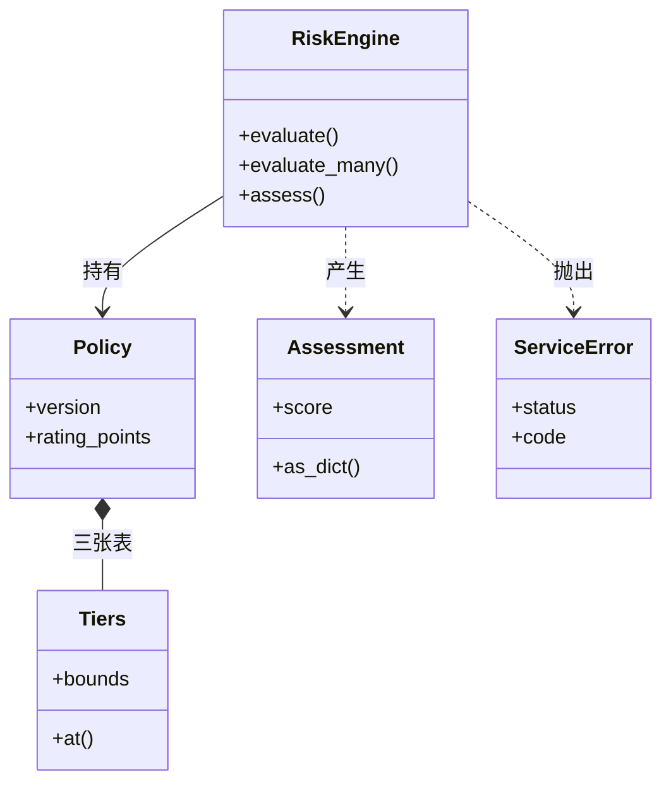

# 设计题解：退货风险评分修复（Return Risk Assessment）

## 题目与澄清

一家电商的退货团队发现，同样条件的退货请求，在政策的边界上会得到前后不一致的决定。评分引擎 `RiskEngine` 根据三个数判断一次退货该自动通过、转人工复核还是拒绝：顾客给订单打的星级评分（1 到 5）、订单金额（以分为单位）、账号注册至今的天数。它有两个入口：`evaluate(rating, value_cents, account_age_days)` 评一笔，`evaluate_many(records)` 评一批。现有代码能运行，也过得了三个公开测试，但在校验、评分表、阈值边界、决定和批量处理上有错。你的任务是读懂规则、找出差异、修好它，并回答三个书面问题。这是一个修复型项目：没有新功能，难点在于"规则很简单，每一条都有一个让粗心的人踩进去的边界"。

先把合同写成十一条，按"一个粗心的读者最容易漏掉"的顺序：

1. **三个入参必须恰好是 `int`**：评分在 1 到 5，金额与账龄不小于 0。`True`、`False`、`3.0`、`"3"`、`None` 都是无效输入，抛 `ServiceError(400, "invalid_input")`。`bool` 是 `int` 的子类，`True == 1` 成立，所以光写 `isinstance(x, int)` 挡不住它。
2. **校验发生在任何计算之前**：评分 0 不能先被当成 0 分算一遍再拒绝。
3. **整数没有人为的上界**（评分除外）：金额与账龄写成 10 的 100 次方，照常得到最高档的分项。
4. **评分分项**：1 星 40 分、2 星 30 分、3 星 20 分、4 星 10 分、5 星 0 分。这是一张表，不是一个线性公式。
5. **金额分项**：0 到 9999 分得 0 分；10000 到 49999 得 15 分；50000 及以上得 30 分。下界含在本段内。
6. **账龄分项**：0 到 29 天得 25 分；30 到 179 天得 10 分；180 天及以上得 0 分。
7. **总分是三个分项之和**，不归一、不取整、不截断；最大是 40 + 30 + 25 = 95。
8. **决定**：总分小于 30 是 `"approve"`；30 以上、60 以下是 `"manual_review"`；60 及以上是 `"reject"`。
9. **返回恰好** `{"score": int, "decision": str, "components": {"rating": int, "value": int, "age": int}}`，不多不少。
10. **`evaluate_many`**：把有限的可迭代对象只遍历一次，按输入顺序为每条记录返回一个结果。记录必须是字典且键恰好是 `rating`、`value_cents`、`account_age_days`。合法的记录是 `{"result": <evaluate 的结果>, "error": None}`，无效的是 `{"result": None, "error": "invalid_input"}`。坏记录不影响后面的记录；空输入返回 `[]`；输入迭代器自己抛出的异常不能被吞掉。
11. **无状态**：调用之间互不影响，返回的嵌套字典之间也互不影响，传入的记录不被修改；没有时钟、网络、汇率、学习模型这类外部依赖。

规则里给了两个数字例子，它们是你的第一批测试：`evaluate(2, 50000, 5)` 是 30 + 30 + 25 = 85 分、`reject`；`evaluate(5, 900, 400)` 是 0 分、`approve`。

开口前值得问的澄清问题，每个答案都会改变代码：

- **金额恰好等于 10000 或 50000 时归哪一档？** 规则里的区间写成 `10000..49999`、`>= 50000`，所以下界含在本段。这条决定所有阈值的写法：全部是"大于等于下界"，没有任何一处是"大于"。
- **总分恰好是 30 或 60 呢？** 同一条规则：30 是 `manual_review`，60 是 `reject`。顺带算一下可达性：三个分项的取值都是 5 的倍数，所以总分只会是 0、10、15、20、25、30、35……，29 和 59 取不到。这影响测试怎么选点，见"测试与自检"。
- **`True` 算整数吗？** 规则明说"拒绝布尔值"。这一条是判断：`bool` 在 Python 里是 `int`，在业务里不是数量。
- **`int` 的子类（比如 `IntEnum`）算整数吗？** 规则没有说。严格比较类型（`type(x) is int`）会拒绝它们，`isinstance` 再排除 `bool` 则会接受。没有测试能钉死这一点，选前者更保守，并在决策二里说明代价。
- **批量里的记录多了一个键怎么办？** 规则说键"恰好"是三个，所以多键也是无效记录，不能悄悄忽略多余的键。
- **迭代器在中途抛了自己的异常怎么办？** 规则说不能吞掉。这条与"坏记录不影响后面"看起来矛盾，其实不矛盾：前者是数据坏了，后者是上游坏了，决策三会讲清楚。
- **批量里无效记录的 `error` 用什么？** 字符串 `"invalid_input"`，与单条调用抛出的 `ServiceError.code` 一致，不能是 `None`。

范围之外：币种换算（金额已经是分）、按地区或品类区分的规则、把结果写进数据库、认证与限流。

动手前先做一件事：把现有代码和这十一条逐行对照，列出差异。现有代码有五处与合同不符，下表是它们各自的症状与合同条目；表中数字都来自对同一段代码的实际运行：

| 位置 | 症状 | 对应条目 |
|---|---|---|
| 校验 | `evaluate(0, 100, 30)` 通过并得到 35 分；`evaluate(True, 100, 30)` 通过并当成评分 1 | 1、2 |
| 评分分项 | 用 `(5 - rating) * 5`，评分 1 只得 20 分而不是 40 | 4 |
| 金额阈值 | 用 `>`，金额 10000 得 0 分、50000 得 15 分 | 5 |
| 决定 | 用 `score > 60`，总分 60 变成 `manual_review` | 8 |
| 批量 | 无效记录的 `error` 是 `None` | 10 |

这五处会互相叠加：同样一次 `evaluate(2, 50000, 5)`，应得 85 分、`reject`，现有代码给出 55 分、`manual_review`，三个分项里有两个是错的，决定又被第四处错误改了一次。只看最后的结果无法知道哪处错了，所以修复要一次一处，每处先写一个会失败的测试。

## 需求与分级

修复型项目没有新功能，分关就是修复的顺序：先让输入可信，再让每一步的数字可信，最后处理批量和隔离。每一关都能单独运行测试。

**第 1 关（约 10 分钟，校验）**：入参必须恰好是 `int`，评分在 1 到 5，金额与账龄不小于 0。错误是 `ServiceError(400, "invalid_input")`，发生在任何计算之前。这一关的陷阱有两个：`bool` 是 `int` 的子类；比较要写在类型检查之后（`and` 短路），否则 `"3" >= 1` 会抛 `TypeError`，调用方看到的是 500 而不是 400。

**第 2 关（约 10 分钟，三个分项）**：评分是一张表，金额和账龄是带下界的分段。示例：`evaluate(3, 10000, 0)` 的分项是评分 20、金额 15、账龄 25。要当场把每个下界的两侧算清楚：金额 9999 得 0 分、10000 得 15 分、49999 得 15 分、50000 得 30 分；账龄 29 得 25 分、30 得 10 分、179 得 10 分、180 得 0 分。

**第 3 关（约 10 分钟，总分与决定）**：总分是三项之和，决定按分段取。`evaluate(3, 10000, 0)` 总分正好是 60，必须是 `reject`；`evaluate(3, 0, 30)` 总分正好是 30，必须是 `manual_review`。这一关最容易被前两关的缺陷遮住：如果金额阈值还是错的，总分就不是 60，决定的缺陷就看不见。所以前两关修完再来。

**第 4 关（约 15 分钟，批量、隔离、书面回答）**：批量要保序、每条一个 `{result, error}`、坏记录不影响后面、输入只遍历一次、上游异常照常抛出；所有返回值每次新建。最后再写 REFLECTION 的三个问题（阈值测试怎么选、策略版本怎么保留解释、指标怎么区分无效输入与策略拒绝），每个约一百字。

## 核心对象与职责

| 类 | 单一职责 | 它拥有的不变量 |
|---|---|---|
| `ServiceError` | 对外的错误：HTTP 状态码加稳定的错误码字符串 | `status` 是整数，`code` 是字符串，`str(error)` 就是 `code` |
| `Tiers` | 一张"下界（含）→ 值"的分段表，用二分查找取段 | 从 0 起、下界严格升序、每段恰好一个值：任何非负整数有且只有一个归属 |
| `Policy` | 一版完整的评分策略：评分表、金额表、账龄表、决定表，加版本号 | 创建后不可变；改规则就发新版本 |
| `Assessment` | 一次判定的完整记录：输入、策略版本、三个分项、决定 | 不可变；对外字典由它每次现建 |
| `RiskEngine` | 校验、查表、定级，以及批量的逐项隔离 | 无状态：结果只由入参和所持的策略决定 |

`RiskEngine` 持有一个 `Policy`，但从不写它；`Policy` 里的三个 `Tiers` 与它同生共死，是组合（composition）；`Assessment` 是 `RiskEngine` 每次调用产生的值，不被引擎保存。`ServiceError` 与其余几个类没有继承关系。



评分表为什么是一个元组而不是第四个 `Tiers`：评分是 1 到 5 的离散值，下标就是答案（`rating_points[rating - 1]`）；用分段表去表示"恰好等于 3"是把简单的事写复杂。

## 关键设计决策

### 决策一：规则是数据，还是 if 链

**问题**：规则里有六个数字阈值（10000、50000、30、180、30、60）。它们散落在代码里，每一处都要独立地写对"大于"还是"大于等于"。

**选项 A：if 链**。最直白的写法，也是现有代码的写法：

```python
if value_cents > 50000:
    value_points = 30
elif value_cents >= 10000:
    value_points = 15
else:
    value_points = 0
```

读者要在每个分支里自己判断边界：这一句的 `>` 对吗，下一句的 `>=` 对吗？同一串判断里比较符不一致，就是缺陷。每多一个阈值，就多一个出错的机会，并且测试要对每个阈值各写一遍。

**选项 B：分段表加二分**。把阈值写成 (下界, 值) 的有序表，边界规则只在 `Tiers.index` 里出现一次：

```python
value=Tiers.of((0, 0), (10_000, 15), (50_000, 30))
```

`bisect_right(bounds, x) - 1` 把恰好等于下界的 `x` 归到这一段，左闭右开，三张表共用一个实现。表本身读起来和政策文档一一对应，改规则就是改一个数字。代价是多了一个小类和一次二分，对三个段来说是"杀鸡用牛刀"的性能，换来的是边界规则不会写错。

**选择**：B。依据是"错误出现的频率"：这个项目的缺陷几乎全在边界上，把边界集中到一个地方，缺陷的数量就从"每个阈值一个"变成"全表一个"。三张表还有同一个结构，所以 `Tiers` 带类型参数，值可以是分数，也可以是决定字符串。

**被拒绝的模式**：策略模式（Strategy）。有人会为"评分规则""金额规则""账龄规则"各写一个类，继承同一个 `ScoringRule` 基类。拒绝它的理由：三个"策略"的行为完全相同，只有数据不同；有三个实现但只有一份逻辑，是把数据伪装成多态。真正会变的是数值，所以让它是数据，并且放进可版本化的 `Policy`（见决策五）。只有当某一项的计算方式本身不同（比如按时间曲线连续计分）才值得引入策略对象。相关的经典讨论见 [[patterns.strategy|策略模式与可替换算法（Strategy）]]。

### 决策二：怎么挡住 `bool`，以及校验顺序

**问题**：`True` 是 `int` 的子类，`isinstance(True, int)` 为真，`True >= 1` 也为真。写成 `isinstance(x, int) and 1 <= x <= 5` 的校验会放过 `True`，并把它当作评分 1，错误的数据被悄悄接受。

**选项 A：`isinstance` 再单独排除 `bool`**：`isinstance(x, int) and not isinstance(x, bool)`。接受 `int` 的其他子类。

**选项 B：比较类型本身**：`type(x) is int`。一行解决，拒绝所有子类，包括 `bool` 和 `IntEnum`。

**选项 C：先转换成 `int` 再校验**：`int(x)`。`int(True)` 是 1，`int(3.9)` 是 3，`int("3")` 是 3：无效输入被悄悄修正成有效输入，违反"拒绝而不是纠正"。

**选择**：B。理由是规则只列了"整数"，业务里没有任何需要 `int` 子类的场景；选项 A 要写两个判断，留下的灰色地带没有任何业务收益。代价要说出来：如果上游传来 `numpy` 的整数或 `IntEnum`，会被当成无效输入；这是合同的取舍，不确定时回头问需求，而不是自己放宽。

**顺序**同样关键。把三个入参的校验写成一个条件，类型检查在前、范围比较在后，用 `and` 短路：

```python
_is_int(rating) and 1 <= rating <= policy.max_rating and _is_int(value_cents) and value_cents >= 0 ...
```

写反的话，`"3" >= 1` 会抛 `TypeError`，调用方看到的是 500 而不是合同的 400。校验失败也不在中途留下任何痕迹：它发生在查表之前，没有写入任何状态。

这是"在边界上校验（Validate at the Boundary）"的标准做法，见 边界校验（Validate at the Boundary）。这里不需要任何设计模式。

### 决策三：批量里 `try` 包在哪里，输入遍历几次

**问题**：`evaluate_many` 有两种"失败"：一条记录的数据坏了（预期失败，要隔离），输入迭代器本身出了故障（上游缺陷，要暴露）。一个 `try/except` 要同时满足两种相反的要求。

**选项 A：整个循环包在 `try` 里**：

```python
try:
    for record in records:
        ...
except Exception:
    ...
```

迭代器抛出的 `RuntimeError` 被吞掉，调用方拿到一份被截断的结果，还以为是完整的。这比报错更糟：数据悄悄丢了。

**选项 B：`try` 只包"处理一条记录"，取下一条放在 `try` 之外**：

```python
for record in records:  # 取下一条在 try 之外
    try:
        outcomes.append({"result": self._evaluate_record(record), "error": None})
    except ServiceError as error:
        outcomes.append({"result": None, "error": error.code})
```

`for` 的头部在 `try` 外面，所以生成器的异常没人捕获，原样抛给调用方；`except` 只接 `ServiceError`，别的异常（真正的程序缺陷）也不会被吞。这是"捕获的范围（Narrow Catch）"：捕获的范围等于"你知道该怎么处理的失败"。

**遍历次数**：规则要求"只遍历一次"。生成器第二次遍历是空的，所以不要先 `list(records)` 再遍历一遍，也不要为了判断"是不是空"而先 `len(records)`；空输入的结果 `[]` 是自然的：循环体一次也没进。

**错误码从哪来**：`error.code` 取自异常本身，不硬编码。现有代码的缺陷正是把它写成 `None`。非字典、缺键、多键、值无效，四种坏记录走同一条路径，因为它们在 `_evaluate_record` 里都以同一个 `ServiceError` 的形式出现。

**选择**：B。没有什么模式可言，这里的重点是放对一个缩进。相关阅读：捕获的范围（Narrow Catch）、[[python.context-iterators|上下文管理器、迭代器与生成器]]。

### 决策四：怎么保证返回值互不影响

**问题**：规则要求调用之间、返回的嵌套字典之间互不影响。调用方完全可能把返回的字典拿去修改（加个字段、改个分数），如果两次调用共享同一个字典对象，第二次调用就会看到第一次的修改。

**选项 A：缓存加 `deepcopy`**：用 `lru_cache` 缓存结果，返回前 `copy.deepcopy`。每次调用多一次递归拷贝；任何一个出口忘了拷贝，就会泄漏共享对象。

**选项 B：不缓存，每次现建**：引擎内部用不可变的 `Assessment`（`frozen` 数据类）保存一次判定，对外交出时 `as_dict()` 现建字典和嵌套的 `components` 字典。每次调用都是一份全新的对象，调用方怎么改都碰不到引擎。

**选项 C：返回不可变映射**：`MappingProxyType` 或冻结的字典。规则要求"返回字典"，调用方可能做 `result["x"] = ...`，会直接报错，与合同不符。

**选择**：B。引擎里本来就没有需要缓存的重计算（三次查表和两次加法），缓存省不了什么，却要为"共享"付出拷贝的代价。从源头不共享，比到处防御更简单。它的前提是引擎本身不保存可变状态：策略是不可变数据（元组和冻结的数据类），`Assessment` 是不可变值，所以没有任何东西可以被一次调用改动并影响下一次调用。对应的知识点是 防御性拷贝（Defensive Copying） 和 [[oop.values|值对象与不可变性（Value Objects）]]。

批量里同一条记录出现两次时同理：两次调用各自现建结果，所以两个 `components` 是两个不同的对象；传入的记录只被读取，不被修改。

### 决策五：策略要不要做成可版本化的值（取舍：简单优先）

**问题**：规则里的所有数字（评分表、阈值、决定边界）将来会调整。调整以后，历史上的决定怎么解释？

**选项 A：模块级常量**。最简单：`RATING_POINTS = (40, 30, 20, 10, 0)` 等散在模块里。对一次性的评分脚本，这就够了。改规则就是改常量，历史决定无法回溯。

**选项 B：不可变的 `Policy` 值加版本号**：所有数字收进一个冻结的数据类，引擎持有它，默认是 `POLICY_V1`。改规则就新建 `v2`，旧版本保留不动。`assess` 返回的 `Assessment` 带着策略版本和原始输入，事后能重放。

**选择**：B，而且只做到这一步：没有策略注册表，没有从配置文件加载，没有运行时切换。B 的代价是多一个小类和一个带默认值的构造参数；它买到的是回答书面问题二的能力：历史决定可解释，且回放是一个能写成测试的操作。多做的部分（注册表、热加载）在没有需求时是过度设计，留在"扩展与追问"里讨论。

## 代码走读

下面是完整的参考解，它通过了自己的全部测试，也通过了工作区的公开测试。

%% code:begin solution.py %%
```python
"""退货风险评分引擎（ReturnGuard）参考解：三个分项相加、按分数段做决定、批量逐项隔离。

设计五句话：
1. 评分规则是数据，不是 if 链：每个分项一张"下界（含）→ 分数"的分段表（`Tiers`），查表用二分，边界只有一种写法。
2. 整套规则装进不可变的 `Policy`（带版本号）；`RiskEngine` 只持有它，不持有任何会变的状态，所以天然无状态、线程安全。
3. 校验在任何计算之前：类型必须恰好是 `int`（`bool` 是 `int` 的子类，要单独挡住），再看范围；不合格抛 `ServiceError(400, "invalid_input")`。
4. 引擎内部用不可变的 `Assessment` 记录一次判定（含输入与策略版本），对外才变成合同规定的字典，每次新建，调用之间不共享任何对象。
5. `evaluate_many` 只在"处理一条记录"这一步 try；遍历输入迭代器本身不在 try 里，迭代器的异常原样抛出，输入只被遍历一次。
"""

from __future__ import annotations

from bisect import bisect_right
from collections.abc import Iterable
from dataclasses import dataclass
from typing import Generic, TypeGuard, TypeVar

T = TypeVar("T")
INVALID_INPUT = "invalid_input"
RECORD_KEYS = frozenset({"rating", "value_cents", "account_age_days"})


class ServiceError(Exception):
    """对外的服务错误：status 是 HTTP 状态码，code 是稳定的错误码字符串。"""

    def __init__(self, status: int, code: str) -> None:
        self.status, self.code = status, code
        super().__init__(code)


@dataclass(frozen=True)
class Tiers(Generic[T]):
    """分段表：`bounds` 是严格升序的下界（含），x 落在 [bounds[i], bounds[i+1]) 就取 `values[i]`。

    不变量：第一段从 0 开始（所以任何非负整数都有归属），最后一段没有上界，相邻两段之间没有缝也不重叠。
    """

    bounds: tuple[int, ...]
    values: tuple[T, ...]

    def __post_init__(self) -> None:
        increasing = all(a < b for a, b in zip(self.bounds, self.bounds[1:]))
        if not (self.bounds[:1] == (0,) and increasing and len(self.bounds) == len(self.values)):
            raise ValueError("分段表必须从 0 起、下界严格升序、每段一个值")

    @classmethod
    def of(cls, *steps: tuple[int, T]) -> Tiers[T]:
        """按 (下界, 值) 逐段书写，读起来和策略文档一一对应。"""
        return cls(tuple(bound for bound, _ in steps), tuple(value for _, value in steps))

    def index(self, x: int) -> int:
        """x 所在的段号。恰好等于下界的 x 属于这一段（左闭右开），这是全表唯一的边界规则。"""
        if x < self.bounds[0]:
            raise ValueError(f"{x} 小于第一段的下界")
        return bisect_right(self.bounds, x) - 1

    def at(self, x: int) -> T:
        return self.values[self.index(x)]


@dataclass(frozen=True)
class Policy:
    """一版完整的评分策略，创建后不可变；改规则就发新版本，不原地改。"""

    version: str
    rating_points: tuple[int, ...]  # 下标 0 对应评分 1
    value: Tiers[int]  # 下界单位：分
    age: Tiers[int]  # 下界单位：天
    decision: Tiers[str]  # 下界单位：总分

    @property
    def max_rating(self) -> int:
        return len(self.rating_points)


POLICY_V1 = Policy(
    version="v1",
    rating_points=(40, 30, 20, 10, 0),
    value=Tiers.of((0, 0), (10_000, 15), (50_000, 30)),
    age=Tiers.of((0, 25), (30, 10), (180, 0)),
    decision=Tiers.of((0, "approve"), (30, "manual_review"), (60, "reject")),
)


@dataclass(frozen=True)
class Assessment:
    """一次判定的完整记录：输入、策略版本、三个分项和决定。事后解释一个决定，靠的就是这些字段。"""

    policy_version: str
    rating: int
    value_cents: int
    account_age_days: int
    rating_points: int
    value_points: int
    age_points: int
    decision: str

    @property
    def score(self) -> int:
        return self.rating_points + self.value_points + self.age_points

    def as_dict(self) -> dict[str, object]:
        """合同规定的返回形状。每次调用都新建字典和嵌套字典，调用方改它不会影响任何别的结果。"""
        return {
            "score": self.score,
            "decision": self.decision,
            "components": {
                "rating": self.rating_points,
                "value": self.value_points,
                "age": self.age_points,
            },
        }

    def explain(self) -> str:
        """一行可读的解释：哪版策略、什么输入、各得几分、总分与决定。"""
        return (
            f"{self.policy_version}: rating={self.rating}→{self.rating_points}, "
            f"value={self.value_cents}→{self.value_points}, age={self.account_age_days}→{self.age_points}; "
            f"score={self.score} → {self.decision}"
        )


def _is_int(x: object) -> TypeGuard[int]:
    """恰好是 int：`bool` 是 `int` 的子类，`isinstance(True, int)` 为真，所以要比较类型本身。"""
    return type(x) is int


class RiskEngine:
    """无状态的评分引擎：同样的输入永远得到同样的输出，实例之间、调用之间互不影响。"""

    def __init__(self, policy: Policy = POLICY_V1) -> None:
        self._policy = policy

    def assess(self, rating: object, value_cents: object, account_age_days: object) -> Assessment:
        """校验、查表、定级，返回不可变的判定记录。"""
        policy = self._policy
        # `and` 短路：类型不对就不会去做大小比较，否则 "a" >= 0 会抛 TypeError 而不是 ServiceError
        if not (
            _is_int(rating)
            and 1 <= rating <= policy.max_rating
            and _is_int(value_cents)
            and value_cents >= 0
            and _is_int(account_age_days)
            and account_age_days >= 0
        ):
            raise ServiceError(400, INVALID_INPUT)
        rating_points = policy.rating_points[rating - 1]
        value_points = policy.value.at(value_cents)
        age_points = policy.age.at(account_age_days)
        return Assessment(
            policy_version=policy.version,
            rating=rating,
            value_cents=value_cents,
            account_age_days=account_age_days,
            rating_points=rating_points,
            value_points=value_points,
            age_points=age_points,
            decision=policy.decision.at(rating_points + value_points + age_points),
        )

    def evaluate(self, rating: object, value_cents: object, account_age_days: object) -> dict[str, object]:
        return self.assess(rating, value_cents, account_age_days).as_dict()

    def evaluate_many(self, records: Iterable[object]) -> list[dict[str, object]]:
        """逐条处理，每条一个 `{result, error}`；坏记录只影响它自己。"""
        outcomes: list[dict[str, object]] = []
        for record in records:  # 取下一条在 try 之外：迭代器自己的异常不属于"坏记录"，原样抛出
            try:
                outcomes.append({"result": self._evaluate_record(record), "error": None})
            except ServiceError as error:
                outcomes.append({"result": None, "error": error.code})
        return outcomes

    def _evaluate_record(self, record: object) -> dict[str, object]:
        # 必须是字典，且键恰好是三个：缺键、多键都算无效，不能悄悄忽略多余的键
        if not isinstance(record, dict) or record.keys() != RECORD_KEYS:
            raise ServiceError(400, INVALID_INPUT)
        return self.evaluate(record["rating"], record["value_cents"], record["account_age_days"])


if __name__ == "__main__":
    engine = RiskEngine()
    print(engine.evaluate(2, 50000, 5))
    print(engine.evaluate(5, 900, 400))
    print(engine.assess(3, 10_000, 0).explain())
    for outcome in engine.evaluate_many([{"rating": 3, "value_cents": 10_000, "account_age_days": 0}, {"rating": 0}]):
        print(outcome)
```
%% code:end %%

值得逐处看的四个地方：

1. **`Tiers.__post_init__` 与 `Tiers.index`**：构造时就检查"从 0 起、严格升序、每段一个值"，所以后面查表时不可能出现"没有归属"或"两段重叠"；`index` 里 `bisect_right(...) - 1` 是整个程序里唯一的边界规则。`x < bounds[0]` 的检查是安全不变量，用异常而不是 `assert`：`python -O` 会去掉 `assert`，而校验之外的调用者一旦传入负数，没有它就会静默地取到最后一段（索引 -1）。
2. **`RiskEngine.assess` 的校验条件**：一个长长的 `and`，类型在前、范围在后。读它要读成三个"类型对且范围对"的合取。校验之后才查表，所以校验失败时没有任何半成品。
3. **`evaluate_many` 的循环头在 `try` 外面**：缩进只差一层，行为差一个"能不能发现上游故障"。`except` 只接 `ServiceError`。
4. **`Assessment.as_dict`**：每次现建字典和嵌套字典；`Assessment` 自己是冻结的，没有人能通过它改动引擎。`explain` 是同一个记录的另一种出口，一行文字解释"哪版策略、什么输入、各得几分、总分与决定"，支撑书面问题二。

模块底部的 `__main__` 演示：两个合同例子输出 85 分与 0 分；`(3, 10000, 0)` 的解释是 `v1: rating=3→20, value=10000→15, age=0→25; score=60 → reject`；一个有效记录加一个无效记录，得到一个结果和一个 `{'result': None, 'error': 'invalid_input'}`。

## 测试与自检

测试文件有三十个测试函数，参数化展开后共八十八个用例，没有一个依赖时钟或随机数。按合同条目分组：

- **合同例子**：85 分与 0 分的两个例子逐字断言，包括三个分项。
- **逐个下界**：金额 0、1、9999、10000、10001、49999、50000、50001、10 的 18 次方；账龄 0、1、29、30、31、179、180、181、10 的 9 次方；评分五个值各一个。
- **总分与决定**：九个参数化用例钉住总分恰好 30、60 与它们前一档，例如 `(3, 0, 100)` 是 30 分 `manual_review`，`(5, 0, 29)` 是 25 分 `approve`，`(3, 10000, 0)` 是 60 分 `reject`，`(1, 10000, 180)` 是 55 分 `manual_review`。再加一个把评分五档、金额六个点、账龄六个点共一百八十种组合全部与测试里独立写出的期望表比对的用例。
- **校验**：评分 0、6、-1、100、10 的 30 次方；`True`、`False`、`3.0`、`"3"`、`None`、列表、元组、字典、`Decimal`、字节串，每一种都在三个位置各试一次；负数；巨大整数是有效的；失败后引擎照常可用。
- **批量**：保序、混合有效与无效；`error` 是字符串不是 `None`；空输入；十三种坏记录（非字典、缺键、多键、值是 `None` 或 `True` 或浮点或负数、键名不对）各自夹在好记录前面；生成器只被拉取三次；上游 `RuntimeError` 原样抛出；元组与生成器两种输入。
- **无状态**：改返回值之后再算得到原值；两次相同输入得到相等但不同一的对象；批量里同一条记录出现两次，两个 `components` 不是同一个对象，传入的记录不变；一个引擎抛过错误后，与新引擎行为一致；八个线程用屏障（`threading.Barrier`）同时起跑，把四十五种输入组合各调用五十遍，并且各自修改自己的返回值，不出现任何不一致。
- **扩展**：新建 `v2` 策略只改决定边界、同一输入得到不同决定；`Assessment.explain()` 的文字；`Tiers` 拒绝不从 0 起或未升序的表。这三个只在解答里存在，骨架没有 `Policy` 时自动跳过。

选点的两条原则。第一，期望值来自测试里独立写出的表，不是从引擎里抄来的；这样引擎和期望表错成同一个样子的概率才低。第二，决定边界要用金额与账龄都不压边界的输入：总分都是 5 的倍数，所以决定的边界是 25 与 30、55 与 60，用 `(3, 0, 100)` 和 `(3, 20000, 0)` 这样的输入（账龄 30 天本身就是分档边界：29 天得 45 分，30 天得 30 分），失败时只可能是决定的缺陷。

怎么知道这些测试够用？把解答改坏几处再运行，看红的数量：

| 改动 | 失败用例数 |
|---|---|
| `bisect_right` 改成 `bisect_left` | 63 |
| 批量的 `error` 改成 `None` | 15 |
| 评分范围改成 0 到 5 | 5 |
| 类型检查改成 `isinstance` | 4 |
| 决定的 60 改成 61 | 4 |
| 把整个循环包进 `except Exception` | 1 |
| 批量允许多余的键 | 1 |

最后两行只有一个用例捕获，说明它们钉住的是特定的一条规则（上游异常、多键），每条规则都要有它自己的测试，不能指望别的用例顺便覆盖。

两分钟演示：先运行两个合同例子，再运行 `(3, 10000, 0)` 说出"恰好 60 分，所以是 `reject`"；然后传入 `True` 说明为什么是 400；最后展示批量里一条坏记录夹在两条好记录之间，以及生成器中途抛异常时调用方能看到异常。

公开测试要跑：把 `solution.py` 里的 `ServiceError` 定义删掉、改成 `from models import ServiceError`，放进工作区的 `service.py`，运行 `python3 -m unittest`，三个公开用例全过；再用自己的测试补全公开测试没覆盖的部分：公开测试只覆盖了一个低风险例子、一个高风险例子和评分 0 的拒绝。

## 扩展与追问

**新需求**

- *新增第四个评分项（近 30 天的退货次数，三次及以上加 15 分）*：次数是有状态的信息，不应由引擎保存，而是由上游传入，作为第四个入参；`Policy` 多一张 `Tiers`，`Assessment` 多一个分项，`assess` 多一次查表。`Tiers`、决定分段、`evaluate_many` 的 `try` 位置都不动。要同步约定的是合同：`components` 多一个键，批量记录的键集合变成四个，老调用方怎么办。
- *不同地区用不同的规则*：多个 `Policy` 实例，调用方按地区选一个传给 `RiskEngine`；引擎本身不动。
- *决定边界改成 25*：改 `POLICY_V1` 里决定表的一个数字？不是。发 `v2`，旧版本保留。
- *返回每个分项的原因*：`Assessment` 已经带着输入与版本，`explain()` 是一个出口，需要结构化的话再加一个。

**并发与线程安全**

引擎没有可变状态：策略是元组与冻结的数据类，`Assessment` 是冻结的，每次调用只用局部变量。所以多线程调用不需要任何锁；这不是靠全局解释器锁（GIL）碰巧安全，而是没有共享的可变数据。测试里八个线程各自修改自己的返回值，另一个线程的结果不受影响。唯一的共享对象是 `POLICY_V1`，而它是不可变的。

如果以后加了"结果缓存"，才会引入共享可变状态：那时要么缓存不可变的 `Assessment` 并在出口现建字典，要么给缓存加锁。

**持久化与规模**

- *存判定记录*：`Assessment` 的字段就是一行表：输入、策略版本、三个分项、决定。回放时按版本取出策略，重新算一遍，应得相同的结果；不同就说明旧版本被改过。
- *策略存哪里*：版本表加生效时间，旧版本永不删除；运行时按订单时间选版本。
- *批量规模*：`evaluate_many` 返回列表，对很大的输入内存会随输入增长；需要时改成生成器，输入仍然只遍历一次，"坏记录隔离"的语义不变。
- *指标*：无效输入（错误码 `invalid_input`）与策略拒绝（成功评估、`decision` 为 `reject`）是两件事，分开计数、分开告警：前者多半指向上游缺陷或攻击，后者指向业务或策略变化。标签只用错误码与决定这样的有限枚举，不放用户编号或原始数值。

## 常见错误

- **`isinstance(x, int)` 不排除 `bool`**：`True` 被当成评分 1，得到 40 分。
- **评分范围写成 0 到 5**：评分 0 被接受并算出 35 分。
- **用线性公式代替表**：`(5 - rating) * 5` 只在个别点碰巧对，评分 1 得 20 分而不是 40。
- **阈值里 `>` 与 `>=` 混用**：金额 10000 得 0 分、50000 得 15 分；`score > 60` 让总分 60 变成人工复核。
- **先比较范围再检查类型**：字符串在 `"3" >= 1` 处抛 `TypeError`，调用方看到的是 500。
- **先 `int()` 转换再校验**：`3.9` 与 `"3"` 变成有效值，违反"拒绝而不是纠正"。
- **批量里无效记录的 `error` 是 `None`**：调用方分不清"没有错误"和"错误但没说"。
- **整个循环包进 `except Exception`**：上游故障被吞掉，调用方拿到一份被截断的结果。
- **为了数长度或判断空而先 `list(records)`**：生成器被消耗，后面的循环是空的；或者内存里多一份拷贝。
- **缓存结果并返回同一个字典**：调用方改了一个，下一次调用也变了。
- **用 `deepcopy` 到处补**：忘了一个出口，就泄漏一个共享对象。
- **多键的记录被悄悄接受**：规则说"键恰好是三个"，多出来的键意味着调用方以为在传一个引擎不认识的字段。
- **一次让智能体修所有缺陷**：五处缺陷互相叠加，改好一处，结果仍然不对，分不清哪处是哪处；一次一类缺陷、每次一个失败测试。
- **让智能体"把测试改成通过"**：先判断是代码错还是测试错，两个合同例子是不能改的。
- **用被测代码生成期望值**：引擎与期望表错成同一个样子，测试永远是绿的。

## 45 分钟怎么分配

- **0 到 5 分钟｜读规则、列差异**：不要先改代码。把十一条规则用自己的话写成注释，运行现有代码，对每条规则找一个反例。给智能体的第一句话也是这份清单，加两个数字例子，要求它先列出现有代码与规则的差异、不改代码；你核对这份清单有没有漏掉批量。
- **5 到 15 分钟｜校验**：先写失败的测试（评分 0、`True`、`"3"`、`None`），再让智能体修；你自己决定 `bool` 是否有效、类型用 `type(x) is int`。
- **15 到 25 分钟｜三个分项与决定**：每处先写下界两侧的测试，再改；评分用表，金额与账龄与决定用同一个分段写法。测决定边界时用金额与账龄都不压边界的输入。
- **25 到 35 分钟｜批量**：自己写生成器与上游异常的测试；`try` 的位置自己定；让智能体帮忙补坏记录的各种形状。
- **35 到 40 分钟｜隔离与回归**：改返回值再算一次；传入记录不被修改；跑公开测试与自己的全部测试。
- **40 到 45 分钟｜书面回答**：三个问题各约一百字：阈值取三点加独立期望表；策略不可变加版本号加判定记录加重放；错误码与决定分开计数。不要留到最后一分钟。

时间不够时的取舍：先砍策略版本的讨论（口述）、再砍并发测试；绝不能砍的是两个合同例子、每个下界的两侧、`bool` 的校验、`try` 的位置、返回值每次新建。

## 延伸阅读

- [[solution-amz-discount-engine]]：同样是"一组规则加边界"的引擎，讨论了整数分、舍入与叠加；这里的规则更小，重点是边界与批量。
- [[solution-amz-parking-fees]]：分段计费与边界的另一种写法，可对照这里的分段表。
- 边界校验（Validate at the Boundary）、防御性拷贝（Defensive Copying）、接口的错误契约（Error Contract）：校验、不共享、错误码这三件事的原理。
- 验证输出（Verification）、AI 的典型错误（Failure Modes）：怎么验证智能体的改动，它最常在哪里出错。
- [Python 文档：bisect](https://docs.python.org/3/library/bisect.html)：`bisect_right` 的定义与左闭右开的语义。
- [Python 文档：数据模型中的 bool](https://docs.python.org/3/library/functions.html#bool)：`bool` 是 `int` 的子类。
- [Python 文档：dataclasses 的 frozen 参数](https://docs.python.org/3/library/dataclasses.html#frozen-instances)：不可变数据类。
