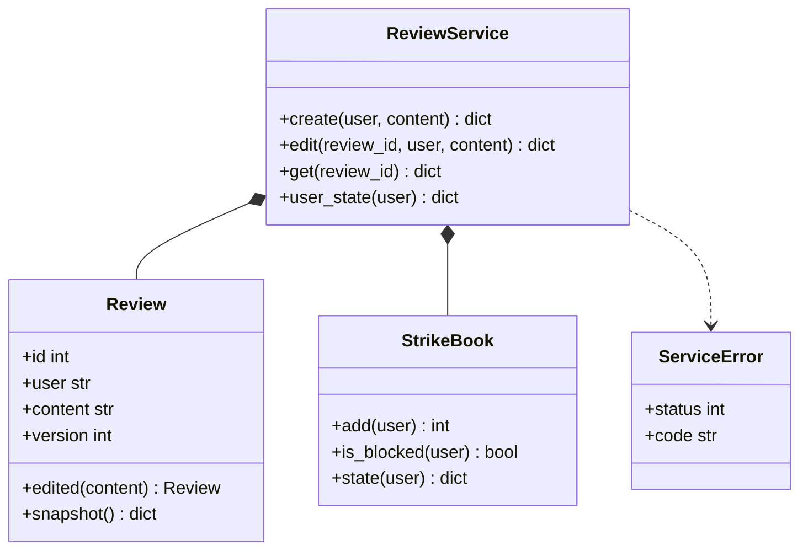
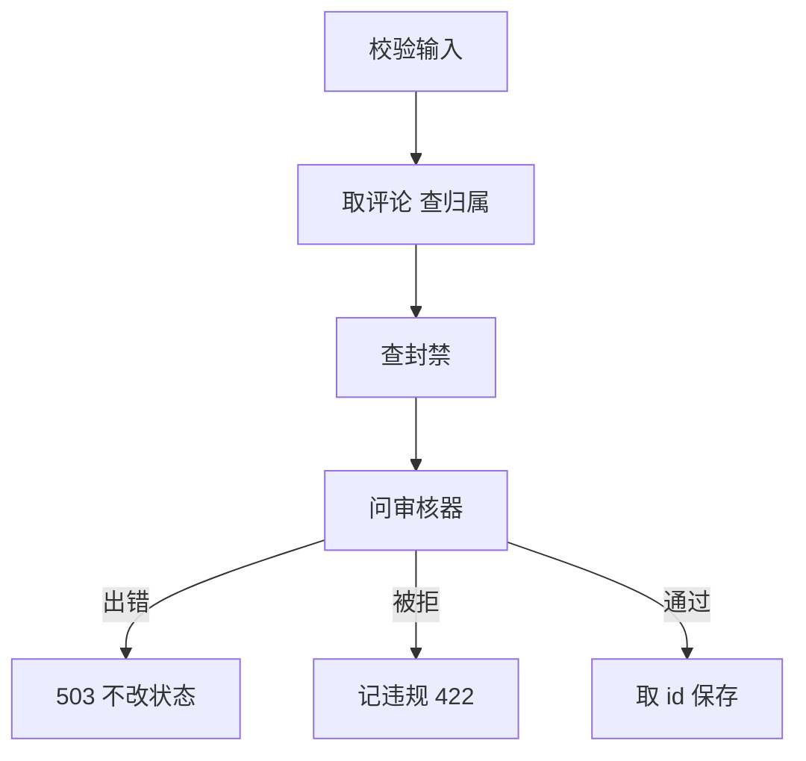

# 设计题解：评论审核修复（Comment Moderation）

## 题目与澄清

ReviewDesk 是一个商品评论服务：用户发评论、改自己的评论，每一次写入都要先交给一个注入进来的审核器（一个接收文本、返回布尔值的函数）。审核器说"不行"，这次写入就被拒，用户记一次违规；累计三次被拒，这个用户永久封禁，之后写什么都不行。线上的症状有三个：违规内容漏过审核；屡次违规的人还在发；审核器宕机的那几分钟里，评论照样发布出去了。
你拿到的是一个能跑但有缺陷的内存服务，要修好它，并保持对外的类名、方法签名和错误码不变。这类题评的不是你会不会写 CRUD，而是你会不会把"一次写入"拆成固定顺序的几步，让每一种失败都停在合适的一步、什么都不留下，并且在多线程下让"问审核器"与"记违规"成为一个整体。

公开接口是一个类和四个方法：`ReviewService(checker)`，`create(user, content)`，`edit(review_id, user, content)`，`get(review_id)`，`user_state(user)`。失败一律是 `ServiceError`，带整数 `status` 与字符串 `code`。

先把合同用自己的话写成八条，这是开工前的第一件事：

1. **输入**：`user` 与 `content` 必须是字符串且去掉空白后非空，空白按 `str.strip` 的口径（含 U+001C 到 U+001F）；否则 `(400, "invalid_input")`；`user_state` 的参数同样。存下来、交给审核器的都是原值，首尾空白不动。
2. **新建与读取**：成功返回 `{id, user, content, version: 1}`，id 从 1 连续；被拒、被封、审核器出错的写入不占 id；`get` 找不到是 `(404, "review_not_found")`；所有返回值都是独立快照。
3. **被拒与违规**：审核器返回 `False` 就是 `(422, "content_rejected")`，该用户违规数恰好加一，不保存新内容；被拒的编辑不改内容与版本；成功写入永远不清零；`user_state` 恰好返回 `{strikes, flagged}`。
4. **封禁**：第三次被拒仍然报 `content_rejected`，结果是 `strikes=3`、`flagged=True`；之后每一次通过校验的写入都是 `(403, "user_blocked")`，哪怕内容干净，不调用审核器，不加违规。没有解封。
5. **顺序**：新建是 输入 → 封禁 → 审核器；编辑是 输入 → 评论存在 → 归属（`(403, "forbidden")`）→ 封禁 → 审核器。
6. **编辑成功**：id 与作者不变，版本加一，内容与原来相同也加一。
7. **审核器出错**：`Exception` 变成 `(503, "checker_unavailable")`，评论、违规数、id 都不变，也不算违规；`BaseException` 不拦。每次合格的写入恰好问一次审核器，参数是原内容。
8. **并发**：同一实例上的调用像一个接一个执行；第三次拒绝记下之后，该用户别的写入到不了审核器，所以并发的被拒写入恰好是三个 `content_rejected` 与三次审核器调用；不同实例、不同用户互不影响。

一个完整的例子，后面每一节都会回到它。审核器是 `lambda text: "scam" not in text`：

- 用户 `mira` 新建 `"Solid battery life"`，得到 `{id: 1, version: 1}`；编辑成 `"Solid battery, loud fan"` 得到 `version: 2`。
- 她连续三次提交 `"total scam"`，依次得到 `422 content_rejected`，状态依次是 `strikes=1`、`2`、`3`，第三次之后 `flagged=True`。
- 她再提交 `"perfectly fine"`，得到 `403 user_blocked`；审核器这一次没有被问到。

几个必须当场问清、答案会改代码的澄清问题：

- **第三次被拒报什么？** 报 `content_rejected`，不是 `user_blocked`。这次写入本身是被审核器拒绝的，封禁是它的后果，从下一次写入起才生效。把这两件事混在一起，就会让调用方第三次看到 403，却不知道是自己的内容有问题。
- **审核器出错算违规吗？** 不算。用户没有做错事，是服务的依赖坏了；记违规会让一次宕机把一批好用户推向封禁。也不能放行：放行等于宕机期间不设防。所以是 503，什么都不改，让调用方重试。
- **被封的用户去编辑别人的评论呢？** 得到 `forbidden`，因为编辑的顺序是"存在 → 归属 → 封禁"：归属是便宜的、与审核无关的检查，排在封禁之前。被封的用户读评论（`get`）不受影响，封禁只管写。
- **相同内容的编辑要不要加版本？** 要。版本数的含义是"成功写入的次数"，不是"内容变化的次数"；加了就能让并发的编辑一个都不丢（并发测试靠这一点数版本）。
- **审核器看到的是什么？** 原文：不转小写、不去空白。审核器自己决定要不要大小写不敏感；服务替它改写，就是替它做了一个它没要求的决定。

**修复清单**：起始代码有五个缺陷，每一个都用一个小例子在起始代码上跑过：

| 症状 | 缺陷 | 违反的规则 |
|---|---|---|
| 审核器只认大写的 `SCAM`，用户提交 `"SCAM item"`，违规漏过；审核器收到的是 `"scam item"` | 交给审核器的内容先 `lower()` 了 | 1 |
| 同一个用户被拒三次、四次，`strikes` 始终是 1，永远不会被封 | 被拒时把违规数赋成 1，不是在原值上加一 | 3 |
| 违规数是 3 时 `flagged` 仍是 `False`；到 4 才变 `True` | 门槛写成"大于三"，规则是"达到三" | 4 |
| 审核器抛 `TimeoutError`，`create` 仍然返回评论，`get(1)` 能读到它 | `except Exception` 之后把结果当成"通过" | 7 |
| 编辑之后 `version` 还是 1，再编辑一次还是 1 | 内容换了，版本没加 | 6 |

前两个缺陷叠在一起，最常见的"三次被拒"场景（规则 4）根本触发不了：违规数永远停在 1。所以只看最后一次调用的返回值，分不清是哪一处错了；这也是为什么第 1 关要先把差异清单列出来，每个缺陷各写一个最小例子。

**起始代码已经做对的**：输入校验（含 `user_state`）；编辑的顺序 输入 → 存在 → 归属 → 封禁 → 审核器（封禁检查在审核器之前）；`get` 与写入返回的是副本；被拒的写入不占 id（id 在审核通过之后才取）；被拒的编辑不改内容；`BaseException` 没有被拦（`KeyboardInterrupt` 照常穿过）；整个写入在一把可重入锁里，审核器也在锁里调用。隐藏测试仍然检查这些，修缺陷时不能改坏它们。

**公开测试**一共三个：保存并读回一条评论；被拒后违规数为 1；编辑后版本为 2。起始代码只挂最后一个，前两个本来就过，所以"公开测试全绿"不能说明五个缺陷都修好了，五个里只有版本那一个被它抓到。

**和真实工作区的差别**：这里没有数据库，也没有 HTTP 层。`ServiceError` 在真实工作区由 `models.py` 提供，放进去时把 `solution.py` 里 `errors:begin` 到 `errors:end` 之间那一段换成 `from models import ServiceError`，其余原样使用；测试比较的是那个类。

范围之外：真正的内容审核算法、申诉与解封、评论删除、按时间窗口衰减违规数、审核器的重试与熔断（最后一项在"扩展与追问"里回答）。

## 需求与分级

修复型项目没有新功能，分关就是修复的顺序：先让审核器看到对的东西、让计数是对的，再让失败的写入什么都不留，最后让并发下的结论仍然成立。每一关都能单独运行测试。

**第 1 关（约 15 分钟，先看清缺陷）**：不改代码，把八条规则逐条对照起始代码，每条找一个反例，列出差异清单；再把五个缺陷用最小例子各跑一遍。这一关的产出是上面那张五行的修复清单，加上"已经做对的"一行。然后修最直接的两处：审核器收原文，违规数在原值上加一。例子：`mira` 提交三次 `"total scam"`，起始代码上三次后 `strikes` 仍是 1；修完之后依次是 1、2、3。

**第 2 关（约 15 分钟，封禁与顺序）**：封禁门槛改成"达到三"；第三次仍报 `content_rejected`；被封之后合格的写入报 `user_blocked`、不问审核器、不加违规。顺序要用"同时犯两个错"的请求逐步钉住：内容是空白、目标评论又不存在的编辑得到 400 而不是 404；编辑不存在的评论得到 404 而不是 403；被封的用户编辑别人的评论得到 `forbidden` 而不是 `user_blocked`；被封的用户编辑自己的评论得到 `user_blocked`，而不是去问审核器。

**第 3 关（约 15 分钟，审核器出错、版本与并发）**：`Exception` 变 503、什么都不改、不算违规；`KeyboardInterrupt` 照常穿过；编辑成功版本加一。然后是并发：十六个线程同一个用户同时提交违规内容。这一关最容易被前两关遮住：如果违规数还是赋值 1，并发测试"三次拒绝"根本走不到。所以前两关修完再来。

**第 4 关（选做，约 15 分钟，书面回答）**：三个问题，各约一百字：被拒的编辑与那一次违规计数之间的原子边界；审核器变成远程服务、可能超时，写入的合同怎么变；违规数怎样跨重启保留。不要实现，只需要说清楚思路；每一问各有一张同主题的卡片。

## 核心对象与职责

| 类 | 单一职责 | 它拥有的不变量 |
|---|---|---|
| `ServiceError` | 带状态码与错误码的服务错误 | 对外只暴露整数 `status` 与字符串 `code` |
| `Review` | 一条已发布的评论，冻结 | 编辑是造新值（`edited`）再替换；对外只给 `snapshot()` 新建的字典 |
| `StrikeBook` | 每个用户一个永久违规计数 | 只增不减；是否封禁由计数现算（`>= 3`），没有第二份标志位 |
| `ReviewService` | 按固定顺序编排一次写入，持有锁、评论表和下一个 id | 判决与那一次违规计数在同一个临界区；id 在审核通过之后才取 |

`ReviewService` 是唯一持有可变状态的对象，也是唯一加锁的地方：`Review` 冻结，不需要锁；`StrikeBook` 的方法不自己加锁，由调用者（服务）已经持锁的前提保证它们的"读—改—写"不被打断。把锁放在服务一层而不是每个小对象里，是因为要保护的不变量跨了好几个对象：违规本、评论表、下一个 id 要一起落定。

`StrikeBook` 是否值得单独成类？它只有三个方法，但它有自己的一条规则（封禁线）和自己的一份状态（计数），把它拿出来之后，`ReviewService` 里就不会再出现"`strikes >= 3`"这类字面量，改封禁线只改一个常量。这是给它一个职责，不是把一个字典包起来。



一次写入的路径，编辑比新建多"存在"和"归属"两步；每个箭头都是一个会提前结束的检查，提前结束时什么都没写：



## 关键设计决策

### 决策一：锁要罩多大，审核器调用在锁里还是锁外

**问题**：规则 8 要求"第三次拒绝记下之后，该用户别的写入到不了审核器"。而"查封禁、问审核器、记违规"是三步，审核器可能很慢。锁怎么放，才能既让这条规则成立，又不让一个慢审核器拖死所有人？

**选项 A：一把锁罩住整个写入，包括审核器调用**：

```python
with self._lock:
    self._moderate(user, content)   # 查封禁、问审核器、记违规
    ...                             # 取 id、保存
```

三步之间没有别的线程能插进来，所以"被封之后到不了审核器"可以直接证明：封禁状态在查与记之间不会变。代价：审核器慢的时候，所有用户的所有写入都排队，包括与这个用户无关的人。

**选项 B：只锁状态，审核器在锁外调用**：

```python
with self._lock:
    if blocked: raise ...
verdict = self._checker(content)     # 锁外
with self._lock:
    ...记违规或保存
```

吞吐好，但"被封之后到不了审核器"不再成立：十六个线程同时读到"未封禁"，都去问审核器。让审核器睡 5 毫秒、十六个线程同时提交违规内容：没有锁时审核器被问 16 次、`strikes=16`；有锁时 3 次、`strikes=3`。要补救，就得在第二段锁里复核封禁，并把规则改弱成"违规数不超过三"，合同变了，不再是这个项目的合同。

**选项 C：每个用户一把锁**：同一用户串行、不同用户并行，规则 8 依然成立（它只谈同一用户）。代价：要有一个"用户到锁"的字典，且这个字典本身要线程安全、要回收；id 与评论表另需一把短锁；一次写入要拿两把锁，要规定拿锁的顺序，否则有死锁的可能。

**选择**：A。规则写的是"像一个接一个执行"，A 就是字面实现；C 是在 A 的吞吐不够之后才要做的优化（见"扩展与追问"），没有数字说明需要它之前就做，是过早优化。选 A 要认两个事实：审核器是在锁里被调用的，所以审核器回头读本服务（`get`、`user_state`）时，普通的 `Lock` 会把自己锁死，因此用可重入锁（`RLock`）；Python 的全局解释器锁（GIL）不会替你做这件事，它只保证单条字节码不被打断，"查、问、记"是几十条字节码。

**被拒绝的模式**：不需要任何模式。把"问审核器"包装成责任链、把"封禁"做成观察者，都是在一个没有第二种实现的地方造扩展点；审核器本来就是一个注入的函数，已经是策略。

### 决策二：封禁标志存一份，还是从计数算出来

**问题**：`user_state` 要返回 `flagged`。它是一个要存的状态，还是从 `strikes` 现算的函数？

**选项 A：计数之外另存一个 `blocked` 集合**：第三次被拒时往集合里加人。读起来快、直观。代价：两份状态要保持一致，任何一条路径忘了更新其中一份（或者在计数被改动时没动集合），就出现"计数是 3，没被封"或"被封了计数是 2"。起始代码的两个缺陷（赋值 1、门槛 `> 3`）都是"计数与封禁线之间的关系"写错了；有两份状态，就多出一种它们互相矛盾的错法。

**选项 B：只存计数，`flagged = strikes >= BLOCK_AT`**：

```python
def is_blocked(self, user: str) -> bool:
    return self._count.get(user, 0) >= BLOCK_AT
```

没有第二份状态可以对不上；封禁线只出现在这一行；"没有解封操作"自然成立（没有任何方法会减少计数）。代价：每次判断都要查一次字典，这是 O(1)，可以忽略。

**选择**：B。依据是不变量的数量：一份状态只有一条要守的规则（只增不减），两份状态有三条（各自的规则加上它们之间的一致性）。这是把标志位改成状态的反方向：这里的"状态"本来就是计数，标志位是派生量，派生量不存。

**被拒绝的模式**：状态模式（State）。一个用户只有"可写"与"被封"两种状态，转移只有一条（第三次被拒）且不可逆，没有进入、退出动作；做成状态类层级，就是把一个 `>=` 伪装成多态。

### 决策三：审核器出错时，放行、拒绝，还是翻译成错误

**问题**：审核器抛了异常。服务可以做三件事之一：当作通过（起始代码的做法）、当作拒绝并记违规、或者翻译成一个错误并且什么都不改。

**选项 A：当作通过**：用户体验最好，宕机时服务照常工作。代价：宕机期间等于没有审核，违规内容全部进入；而且没有任何痕迹显示这些评论没被审核过，事后无法补审。线上的第三个症状就是它。

**选项 B：当作拒绝并记违规**：安全，但冤枉用户：一次宕机几分钟，期间被"拒绝"的好用户每人加一次违规，三次宕机就能把一批人封禁，而且这个状态是永久的。

**选项 C：翻译成 `(503, "checker_unavailable")`，评论、违规数、id 都不变**：

```python
try:
    allowed = self._checker(content)
except Exception as exc:
    raise ServiceError(503, "checker_unavailable") from exc
```

调用方得到一个明确的"现在不能处理，稍后重试"，服务的状态与调用之前一模一样，重试是安全的。`from exc` 保留原因，日志里还能看到审核器真实的异常。

**选择**：C。依据是失败的代价不对称：A 的代价是不可见的安全漏洞，B 的代价是永久的、对无辜用户的惩罚，C 的代价是一次可重试的失败。还有两个细节：只拦 `Exception`，不拦 `BaseException`，所以 `KeyboardInterrupt` 与 `SystemExit` 照常穿过（用户按下 Ctrl+C 不应该被翻译成 503）；也不在服务里自己重试：规则 7 说每次合格的写入恰好问审核器一次，重试要由调用方决定，而且要带幂等键才安全（见卡片）。

**被拒绝的模式**：重试装饰器与熔断器（Circuit Breaker）。它们解决的是"依赖不稳定"，那是接入真实审核服务之后的问题；在一个注入函数上叠这些，规则 7 的"恰好一次"立刻被破坏，而测试没有任何一条能受益。

### 决策四：评论是可变记录，还是冻结值

**问题**：编辑要改内容、加版本。把评论存成字典就地改，还是存成冻结的值，每次造新的？

**选项 A：字典，就地 `update`**：写起来最短。代价：审核在改写之前还是之后？如果先改后审，被拒的编辑要回滚；如果先审后改，每一处"先审后改"的顺序都要靠人记住。起始代码走的是后一种，也确实对；但它在改写时没有加版本，改写的位置分散，一个版本的缺陷就藏在里面。

**选项 B：冻结 `dataclass`，`edited` 造新值，替换进字典**：

```python
def edited(self, content: str) -> Review:
    return replace(self, content=content, version=self.version + 1)
```

"评论改动"只有一个入口，版本加一与内容替换在同一行里发生，不可能只做一半。审核失败的路径根本没有碰过旧值：不是"改了再回滚"，而是"还没造新值"。对外只给 `snapshot()` 新建的字典，调用方改它不会影响服务。

**选择**：B，依据是失败路径不需要任何回滚代码。代价是每次编辑多分配一个小对象，在内存里的评论服务里可以忽略。

**被拒绝的模式**：命令模式加撤销（Command + undo）。一个可以撤销的"编辑命令"是为了处理"改了一半失败"；冻结值让"改了一半"这个状态不存在，就不需要撤销。

## 代码走读

下面是完整的参考解，运行 `__main__` 可以看到前面例子里的输出。

%% code:begin solution.py %%
```python
"""评论审核服务（ReviewDesk）修复版：评论的创建、编辑与读取都要先过一个外部审核器，累计三次被拒的用户永久封禁。

产品规则（编号即测试编号，每一条都有测试）：

1. 输入：`user` 与 `content` 必须是字符串，且去掉空白后非空（空白按 `str.strip` 的口径，含 U+001C 到 U+001F）；
   否则抛 `ServiceError(400, "invalid_input")`。`user_state` 的参数同样处理。保存与交给审核器的都是原值，首尾空白也不动。
2. 新建：成功返回 `{id, user, content, version: 1}`，id 从 1 开始连续递增；被拒、被封、审核器出错的写入都不占 id。
   `get` 找不到评论抛 `(404, "review_not_found")`。`get`、`user_state` 与写入的返回值都是独立快照，改它们不影响服务。
3. 审核器返回 `False`：抛 `(422, "content_rejected")`，该用户的违规数恰好加一，不保存任何新内容；被拒的编辑不改内容与版本；
   成功的写入永远不清零违规数。`user_state` 恰好返回 `{strikes, flagged}`，没见过的用户是 `0` 与 `False`。
4. 封禁：第三次被拒的那一次仍然抛 `content_rejected`，结果是 `strikes=3`、`flagged=True`；之后该用户每一次通过校验的写入都抛
   `(403, "user_blocked")`，哪怕内容干净，也不调用审核器、不加违规数。没有解封操作；状态与实例同寿。
5. 校验顺序：`create` 是 输入 → 封禁 → 审核器；`edit` 是 输入 → 评论存在（404）→ 归属（403 `forbidden`）→ 封禁 → 审核器。
6. 编辑成功：id 与作者不变，内容换成新的，版本加一；内容与原来相同也加一。
7. 审核器抛 `Exception`：抛 `(503, "checker_unavailable")`，评论、违规数、id 都不变，也不算违规；`BaseException` 不拦截。
   每一次合格的写入恰好调用审核器一次，参数就是原内容。
8. 并发：同一实例上的调用像一个接一个执行；第三次拒绝记下之后，该用户的其他写入到不了审核器，所以并发的被拒写入恰好产生
   三个 `content_rejected` 与三次审核器调用。不同实例、不同用户互不影响。

设计五句话：
1. 一个 `RLock` 罩住每一次写入，审核器在锁里被调用：规则 8 的"第三次之后到不了审核器"只有"查封禁、问审核器、记违规"不被打断才成立。
2. 违规数只存在 `StrikeBook` 里，`flagged` 永远从计数算出（`>= 3`），没有第二份状态可以和计数对不上。
3. 评论是冻结的 `Review`；编辑造一个新的再换进字典，所以被拒或出错的编辑根本没有碰过旧值。
4. 所有检查都在写入之前，id 在审核通过之后才取：失败路径没有任何需要回滚的东西。
5. 对外只交 `snapshot()` 新建的字典，内部对象不出门。
"""

from __future__ import annotations

import threading
from collections.abc import Callable
from dataclasses import dataclass, replace
from typing import Any

BLOCK_AT = 3  # 累计被拒到这个次数，用户永久封禁


# ---- errors:begin（真实工作区里 ServiceError 在 models.py，放进去时换成 `from models import ServiceError`）----
class ServiceError(Exception):
    """对外的服务错误：整数 `status` 加稳定的字符串 `code`。"""

    def __init__(self, status: int, code: str) -> None:
        super().__init__(code)
        self.status = status
        self.code = code


# ---- errors:end ----


def _require_text(value: object) -> None:
    """必须是字符串且去空白后非空；`strip` 只用来判空，不改值。"""
    if not isinstance(value, str) or not value.strip():
        raise ServiceError(400, "invalid_input")


@dataclass(frozen=True, slots=True)
class Review:
    """一条已发布的评论。冻结：编辑是造新值再替换，旧值从不被改写。"""

    id: int
    user: str
    content: str
    version: int = 1

    def edited(self, content: str) -> Review:
        return replace(self, content=content, version=self.version + 1)

    def snapshot(self) -> dict[str, Any]:
        return {"id": self.id, "user": self.user, "content": self.content, "version": self.version}


class StrikeBook:
    """每个用户一个永久的违规计数。是否封禁由计数现算，不另存标志位。"""

    def __init__(self) -> None:
        self._count: dict[str, int] = {}

    def add(self, user: str) -> int:
        self._count[user] = self._count.get(user, 0) + 1
        return self._count[user]

    def is_blocked(self, user: str) -> bool:
        return self._count.get(user, 0) >= BLOCK_AT

    def state(self, user: str) -> dict[str, Any]:
        return {"strikes": self._count.get(user, 0), "flagged": self.is_blocked(user)}


class ReviewService:
    """评论服务：状态是评论字典、违规本、下一个 id；一把可重入锁保护全部写入。"""

    def __init__(self, checker: Callable[[str], bool]) -> None:
        self._checker = checker
        self._reviews: dict[int, Review] = {}
        self._strikes = StrikeBook()
        self._next_id = 1
        # 审核器在锁里运行；可重入，是为了让审核器回头读本服务（get、user_state）时不把自己锁死
        self._lock = threading.RLock()

    def user_state(self, user: str) -> dict:
        _require_text(user)
        with self._lock:
            return self._strikes.state(user)

    def get(self, review_id: int) -> dict:
        with self._lock:
            return self._find(review_id).snapshot()

    def create(self, user: str, content: str) -> dict:
        _require_text(user)
        _require_text(content)
        with self._lock:
            self._moderate(user, content)
            review = Review(self._next_id, user, content)  # 通过审核之后才取 id
            self._reviews[review.id] = review
            self._next_id += 1
            return review.snapshot()

    def edit(self, review_id: int, user: str, content: str) -> dict:
        _require_text(user)
        _require_text(content)
        with self._lock:
            current = self._find(review_id)
            if current.user != user:
                raise ServiceError(403, "forbidden")
            self._moderate(user, content)
            updated = current.edited(content)
            self._reviews[review_id] = updated
            return updated.snapshot()

    def _find(self, review_id: int) -> Review:
        review = self._reviews.get(review_id)
        if review is None:
            raise ServiceError(404, "review_not_found")
        return review

    def _moderate(self, user: str, content: str) -> None:
        """封禁检查 → 问审核器 → 被拒就记一次违规。调用者必须已经持锁。"""
        if self._strikes.is_blocked(user):
            raise ServiceError(403, "user_blocked")
        try:
            allowed = self._checker(content)
        except Exception as exc:  # 审核器坏了不等于内容违规：不记违规，也不放行
            raise ServiceError(503, "checker_unavailable") from exc
        if not allowed:
            self._strikes.add(user)
            raise ServiceError(422, "content_rejected")


if __name__ == "__main__":
    desk = ReviewService(lambda text: "scam" not in text)
    first = desk.create("mira", "Solid battery life")
    print(desk.edit(first["id"], "mira", "Solid battery, loud fan"))
    for _ in range(BLOCK_AT):
        try:
            desk.create("mira", "total scam")
        except ServiceError as error:
            print(error.status, error.code, desk.user_state("mira"))
    try:
        desk.create("mira", "perfectly fine")
    except ServiceError as error:
        print(error.status, error.code)
```
%% code:end %%

三个决策在代码里的位置：

**`_moderate` 是整个服务的核心，只有十来行**。它按固定顺序做三件事：先查封禁，再问审核器，再根据结果记违规。三个出口各自只做一件事：`user_blocked` 不碰计数，`checker_unavailable` 不碰计数，`content_rejected` 先记违规再抛错。注意记违规在抛错之前：抛出的异常会让调用者的 `with` 块退出，如果顺序反过来，计数就丢了。`create` 与 `edit` 都只在 `_moderate` 返回之后才动状态，所以任何一种失败都不会留下半成品。

**id 的分配藏在一行注释里**：`Review(self._next_id, ...)` 之后才 `self._next_id += 1`，两步都在 `_moderate` 之后、同一把锁里。被拒、被封、审核器出错的写入在 `_moderate` 里就已经抛出，走不到这里，所以不占号。如果把 `+= 1` 提前到 `_moderate` 之前，每一次失败都会让后面的 id 跳号。

**`user_state` 返回的是新字典**：`StrikeBook.state` 每次构造一个 `{strikes, flagged}`，调用方改它不影响计数。`get` 与写入的返回值同理，都走 `Review.snapshot()`。这是起始代码本来就对的部分（它用 `deepcopy`），这里换成了一个只含四个字段的显式快照，因为 `Review` 冻结、字段都是不可变值，不需要深拷贝。

**锁的写法**：`with self._lock` 包住的是"校验之后的全部"，输入校验在锁外：它只读参数，不读共享状态，放在锁外可以让无效请求不排队。这是一个可以被攻击者利用的差别吗？不会：校验失败不改状态，也不问审核器。

## 测试与自检

测试文件有二十二个测试函数，参数化展开后共三十个用例，不依赖真实时间或随机数：审核器是一个记录调用的函数，并发测试用栅栏（`threading.Barrier`）让线程同时出发，并让审核器睡 5 毫秒，使没有加锁的实现来得及被别的线程插进来。按合同条目分组：

- **输入**：九种无效值（空串、纯空白、制表与换行、U+001C 与 U+001F、全角空格与不换行空格、`None`、整数、字节串、列表）在 `create`、`edit`、`user_state` 的每个参数位上都得到 400，审核器一次都没被问到；用户 `" Noah "` 与内容 `"\tLoud FAN \n"` 原样存下、原样交给审核器；`"Noah"` 与 `" Noah "` 是两个用户。
- **新建与读取**：id 从 1 连续；被拒、无效输入、审核器出错之后，下一次成功拿到的都是下一个号；`get` 找不到是 404；改返回的字典（新建、读取、编辑、`user_state` 四处）不影响服务。
- **违规与封禁**：第一次被拒 `strikes=1`，一次成功写入之后再被拒是 2（没有清零）；被拒的编辑保留内容与版本；第三次仍报 `content_rejected` 并变成 `3 / True`；之后两轮、每轮三种尝试（干净的新建、干净的编辑、违规的新建）全是 `user_blocked`，审核器的调用次数不再增加，违规数停在 3，`get` 仍然可读，别的用户不受影响。
- **顺序**：新建三步、编辑五步各用"同时犯两个错"的请求钉住；被拒绝的"归属"检查既不问审核器也不记违规。
- **编辑**：id 与作者不变；内容相同的编辑也加版本（2、再 3）。
- **审核器出错**：创建与编辑各五次 503，评论、违规数不变，之后审核器恢复，新建拿到下一个号；`KeyboardInterrupt` 穿过，锁没有留着；已经被封的用户在审核器宕机时得到 `user_blocked` 而不是 503；审核器在运行中回头调 `user_state` 不死锁。
- **并发**：十六个线程同一用户的违规内容，恰好三个 `content_rejected`、十三个 `user_blocked`、三次审核器调用；二十四个用户同时新建，id 恰好是 1 到 24 各一次；二十个线程同时编辑一条评论，版本恰好是 2 到 21 各一次；五个编辑与五个新建混在一起同时违规，仍然恰好三次拒绝。

选点的两条原则。第一，"失败不留痕"不只看返回值，还看后续行为：被拒之后下一次成功拿到的是几号 id、`get` 读到的内容与版本、违规数是几。第二，并发测试不靠运气：在审核器里睡一小会儿，让没有加锁的实现几乎必然出错，再把期望值写成表达式（恰好三次、恰好 1 到 24），不是"跑出来大概是几"。

怎么知道这些测试够用？把参考解改坏几处再运行，看红的用例数：

| 改动 | 失败用例数 |
|---|---|
| 违规数写成赋值 1，不加一 | 7 |
| 封禁门槛改成 `>` | 6 |
| 被拒时不记违规 | 10 |
| 不检查封禁，直接问审核器 | 5 |
| 版本不加一 | 5 |
| 把 id 在审核之前就取走 | 5 |
| 审核器出错当作通过 | 2 |
| 交给审核器的内容转小写 | 2 |
| 先问审核器，后查归属 | 2 |
| 新建不加锁 | 2 |
| 编辑不加锁 | 2 |
| 把 `except Exception` 改成 `except BaseException` | 1 |

只有一两个用例捕获的行，说明它们钉住的是一条特定的规则，每条规则都要有它自己的测试，不能指望别的用例顺便覆盖。"不加锁"两行是并发测试的功劳，在没有睡眠的审核器下它们都不会红，因为单条 Python 调用很短，线程几乎不会在中间被切走。

公开测试要跑：把 `errors:begin` 到 `errors:end` 换成 `from models import ServiceError`，另存为工作区的 `service.py`，运行 `python3 -m pytest` 或 `python3 -m unittest`，三个公开用例全过。公开测试只覆盖保存读回、一次被拒、一次编辑三件事，其余规则靠自己的测试补全。

两分钟演示：先运行 `__main__`，对着输出说"三次被拒，违规数 1、2、3，第三次起封禁"；再说"第四次干净的内容也是 `user_blocked`，审核器没被问"；最后指着 `_moderate` 说"这三步在同一把锁里，所以并发下也是恰好三次"。

## 扩展与追问

**新需求**

- **按严重程度记违规**：审核器改成返回一个分值或枚举。改动在 `StrikeBook.add(user, weight)` 与 `_moderate` 里对返回值的判断；`Review`、`create`、`edit` 的流程不变。封禁线仍是一个常量。
- **申诉与解封**：加 `StrikeBook.clear(user)` 与一个有权限的入口。规则 4 说"没有解封"，这是显式取消的一条合同，所以要有人决定；`flagged` 是现算的，清零之后自然恢复，不需要同步第二份状态。
- **违规随时间衰减**：`StrikeBook` 里把计数换成"带时间戳的事件列表"，`is_blocked` 数窗口内的事件。要注入时钟（本服务没有读时钟，所以没有它）；`ReviewService` 与 `Review` 不变。
- **删除评论**：`ReviewService.delete`，顺序与编辑一致（输入、存在、归属，不需要审核）。违规数不因删除而回退。

**并发与线程安全**

- **一个慢审核器拖住所有人**：先量，再动。把锁改成每用户一把（决策一的选项 C）：同一用户仍然串行，规则 8 依然成立；评论表与 id 另用一把短锁，在审核通过之后才拿。要点是规定拿锁的顺序，永远先用户锁后全局锁，避免死锁。
- **审核器变成远程调用**：不能再把调用罩在锁里。锁外问审核器、锁内复核封禁再提交；代价是合同变弱：到达审核器的次数不再恰好是三次，只保证违规数不超过三。见同主题卡片。
- **多个进程**：进程内的锁没用。违规数与评论放进数据库，"记一次违规"是一条原子的自增语句，封禁以返回值为准。见持久化那一张卡。

**持久化与规模**

- **违规数跨重启保留**：加一张 `strikes(user PRIMARY KEY, count)` 表，用一条 `INSERT … ON CONFLICT DO UPDATE SET count = count + 1 RETURNING count` 记一次违规。对 `mira` 连续执行三次，返回值是 1、2、3；对 `noah` 第一次是 1。评论表同理，id 用整数主键，审核通过之后才插入。
- **评论很多**：`get` 是按 id 的字典查，O(1)；如果要"某用户的所有评论"，加一个按用户的二级索引，写入时和评论表一起更新、在同一把锁里。

## 常见错误

- **把审核器的输入先规整一下**：`lower()`、`strip()`、归一化 Unicode，看起来无害。审核器区分大小写时，大小写敏感的规则就被服务悄悄改了。规则是"原文"。
- **违规数用赋值，不用加一**：`strikes[user] = 1` 与 `strikes[user] += 1` 只差一个符号；只有"同一个用户被拒两次"的测试才能分辨，一个用例里只被拒一次的测试永远是绿的。
- **封禁门槛差一**：`> 3` 与 `>= 3`。写两个测试：违规数 2 时未封禁、3 时已封禁，并且第三次那一次本身还是 `content_rejected`。
- **审核器出错当作通过，或者当作违规**：前者宕机时不设防，后者冤枉用户。正确的是 503，什么都不改。
- **`except:` 或 `except BaseException`**：会吞掉 `KeyboardInterrupt` 与 `SystemExit`。只翻译 `Exception`。
- **先取 id，后审核**：被拒的写入会让 id 跳号，规则 2 说失败的写入不占号。id 在审核通过之后才取。
- **把审核器放到锁外，又不复核**：并发下封禁形同虚设（决策一给出了数字：16 次调用、`strikes=16`）。
- **校验顺序写成"先审核再查归属"**：别人的评论被你问了一次审核器，还可能给你记一次违规。归属是便宜的、与审核无关的检查，排在封禁与审核器之前。
- **用 `assert` 保证规则**：`python -O` 会把它删掉；规则是异常。
- **返回内部对象**：`get` 直接返回字典本体，调用方改一个字段就改了服务的状态。
- **Java 的习惯**：给 `ReviewService` 写 `getStrikes`、`setBlocked`；为审核器写一个只有一个实现的接口与工厂。审核器是一个函数，封禁是一个比较。

## 45 分钟怎么分配

- **0 到 5 分钟｜读规则、列差异**：不要先改代码。把八条规则用自己的话写成注释，运行起始代码，对每条规则找一个反例。给智能体的第一句话也是这份清单，加上"三次被拒后 `strikes=3`、第四次干净内容是 `user_blocked`"两个数字例子，要求它先列出差异、不改代码；你核对清单有没有漏掉审核器出错与版本。
- **5 到 15 分钟｜审核器与计数**：先写测试：大小写敏感的审核器、同一用户被拒两次的计数两个会红；输入校验、404 先于 403、被拒不占号这些起始代码本来就对，测试照样留下，防止智能体改的时候改坏。
- **15 到 25 分钟｜封禁与顺序**：先写 2 与 3 两个边界，再写编辑的五步顺序，每一步一个"同时犯两个错"的请求；封禁之后审核器的调用次数用计数器断言。
- **25 到 33 分钟｜审核器出错与版本**：宕机之后检查评论、违规数与下一个 id 都没变；`KeyboardInterrupt` 穿过；版本含相同内容的编辑。
- **33 到 40 分钟｜并发**：栅栏加会睡的审核器，十六个线程同一用户，断言恰好三次拒绝、三次调用；把锁去掉确认它会红。
- **40 到 45 分钟｜书面回答**：三个问题各约一百字：原子边界（判决与计数同一个临界区）；超时之后合同怎么变（503、锁外调用加复核、幂等键）；违规数跨重启（原子自增、以返回值为准、同一个事务）。不要留到最后一分钟。

时间不够时的取舍：先砍书面回答的展开（口述要点）、再砍并发测试的变体；绝不能砍的是"同一用户被拒两次"的计数测试、第三次仍是 `content_rejected`、封禁后审核器零调用、审核器出错什么都不留、版本加一。

## 延伸阅读

- [[solution-lcp-password-reset]]：同样是"失败不留痕、先检查后写"的修复型项目；那里的一次性消耗与这里的"判决与计数在同一个临界区"是同一类不变量。
- [[solution-rate-limiter]]：按用户计数、到上限就拒绝的结构；可以对照"计数只增不减"与"窗口内计数"的差别。
- [[solution-lcp-issue-creation-api]]：失败路径不占 id 的另一个例子，那里的重试靠幂等键，这里的重试靠 503 与调用方。
- 异常与错误值（Exceptions vs Values）、保留原因（Wrapping & Chaining）、捕获的范围（Narrow Catch）：审核器出错为什么翻译成 503、为什么 `from exc`、为什么只拦 `Exception`。
- 复合操作（Compound Actions）、测试并发代码（Testing Concurrency）：为什么"查、问、记"要在同一个临界区，以及怎样让没有加锁的实现在测试里稳定地红。
- 不变量与封装（Invariants）、把标志位改成状态（Flags to States）：派生量不存。
- [Python 文档：threading（Lock 与 RLock）](https://docs.python.org/3/library/threading.html#lock-objects)：可重入锁与普通锁的区别。
- [Python 文档：内置异常的层次](https://docs.python.org/3/library/exceptions.html#exception-hierarchy)：`Exception` 与 `BaseException` 各自包含什么。
- [Python 文档：dataclasses 的冻结与 replace](https://docs.python.org/3/library/dataclasses.html#dataclasses.replace)：冻结值与"造新值"的写法。
- [SQLite 文档：UPSERT](https://www.sqlite.org/lang_upsert.html)：原子自增违规数用到的语法。
