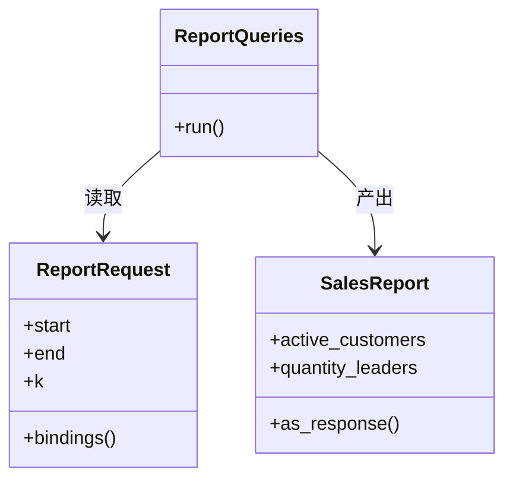

# 设计题解：销售报表（Sales Reporting）

## 题目与澄清

销售报表是一个只读的统计接口：数据库里有一张销售表，每一行是一次购买，同一个客户可以出现在很多行里；运营给一个日期区间和几个可选筛选，要拿回三个总数和三个排行榜。
难点不在 SQL 有多花哨，而在"哪些行算数、区间怎么切、平局怎么排、值怎么传"这些小规则，每一条都会被隐藏测试单独卡一次。
另一个约束是数据库要自己把活干完：过滤、去重计数、分组、求和、排序、限量都留在 SQL 里，应用只做校验和字段映射，一次请求所有查询返回的行数合计不能超过 `32 + 3k`。
这个项目只有一个函数要写：`handle(request, context)`；`context.query(语句, 参数字典)` 返回字典行，`context.keyspace` 是受信任的带引号表名 `"sales"`。

表有九列，列名与排序规则如下（数量与金额是 `INTEGER`，文本列按 `BINARY` 比较，也就是按 UTF-8 字节比较）：

```sql
CREATE TABLE sales (
    type TEXT COLLATE BINARY,
    customerId TEXT COLLATE BINARY,
    customerName TEXT COLLATE BINARY,
    customerStatus TEXT COLLATE BINARY,
    itemName TEXT COLLATE BINARY,
    itemQuantity INTEGER,
    totalPrice INTEGER,
    saleDate TEXT COLLATE BINARY,
    region TEXT COLLATE BINARY
);
```

其中 `customerName` 只用来展示，不参与计数或排序；`customerStatus` 是 `active` 或 `termed`，记在这一笔销售上；`totalPrice` 是这一笔的总价（分），不是单价；`saleDate` 是 `YYYY-MM-DD` 文本；`region` 可以是 NULL。

开工前先把合同用自己的话写成规则，按"粗心的人最容易丢分"的顺序：

1. **谁算数**：`type` 是 `sale`、日期非空、状态是 `active` 或 `termed`。缺日期、缺状态、状态写成别的词的行，对任何请求都不存在。
2. **区间**：`start` 含，`end` 不含，二者都是真实存在的日期，`start` 在 2020–2099 年；`end` 在 2020–2099 年，或者恰好是 `2100-01-01`，且必须晚于 `start`。
   多出来的这个 `2100-01-01` 只能做 `end`：没有它，2099-12-31 这一天永远没有一个"不含"的终点可以报出来。
3. **`k`**：整数 1–20，不给就是 10。显式 `null`、布尔、小数、字符串都是 400；`1`、`1.0`、`1e0` 解码后都是整数 1，合法。
4. **三个可选筛选**：`status`、`region`、`item`。不给或 `null` 表示不筛选；给了就必须有效：`status` 恰好是 `"active"` 或 `"termed"`，
   `region` 与 `item` 是非空文本、至多 100 个码点。匹配是精确的：区分大小写，不去空白，`%`、`_`、引号和 SQL 语法都只是普通字符。
   给了具体的 `region`，地区缺失（NULL）的行匹配不上；不给 `region`，这些行照常参与。
5. **筛选作用于一切**：总数和三个排行看的是同一批行。
6. **三个数各算各的**：`active_customers` 是匹配行里状态为 `active` 的不同客户数，一个客户有几条 active 销售都只数一次，按销售行的状态算，不去猜客户"最新"是什么状态；
   总量是 `itemQuantity` 的和，总额是 `totalPrice` 的和，二者各自独立，不做乘法。
7. **三个排行**：按客户分组的数量、按客户分组的金额、按商品分组的数量；数值降序，平局按键升序（UTF-8 字节序，不折叠大小写），**先排好再截到 k**。
8. **空结果**：没有匹配行时三个标量是 0，三个数组是空数组。
9. **错误形状**：非法请求 400 `{"error":"invalid_request"}`；方法或路径不对 404 `{"error":"not_found"}`；坏 JSON 由适配器给 400 `invalid_json`；数据库异常由适配器给 500，响应里不带内部细节。

下面是示例库：十行，故意放了几种"不该算"的行。

| 行 | 客户 | 状态 | 商品 | 数量 | 金额（分） | 日期 | 地区 |
|---|---|---|---|---|---|---|---|
| 1 | u1 | active | tea | 4 | 800 | 2026-03-02 | east |
| 2 | u1 | termed | tea | 1 | 150 | 2026-03-09 | east |
| 3 | u2 | termed | cake | 6 | 1200 | 2026-03-10 | west |
| 4 | u3 | active | cake | 6 | 900 | 2026-03-15 | NULL |
| 5 | u3 | active | tea | 2 | 300 | 2026-03-31 | east |
| 6 | u4 | active | jam | 9 | 450 | 2026-04-01 | east |
| 7 | u5 | pending | tea | 5 | 500 | 2026-03-05 | east |
| 8 | u6 | active | tea | 7 | 700 | NULL | east |
| 9 | u7 | active（类型 refund） | tea | 3 | 100 | 2026-03-12 | east |
| 10 | u8 | NULL | tea | 3 | 100 | 2026-03-12 | east |

请求 `{"start":"2026-03-01","end":"2026-04-01","k":2}` 的响应（示例库上的实际输出）：

```json
{"active_customers": 2, "total_quantity": 19, "total_spend_cents": 3350,
 "quantity_leaders": [{"customer_id": "u3", "quantity": 8}, {"customer_id": "u2", "quantity": 6}],
 "spend_leaders": [{"customer_id": "u2", "spend_cents": 1200}, {"customer_id": "u3", "spend_cents": 1200}],
 "item_leaders": [{"item": "cake", "quantity": 12}, {"item": "tea", "quantity": 7}]}
```

怎么读这份输出：

- **匹配的是第 1–5 行**。第 6 行的日期恰好是 `end`，不含；第 7 行状态未知、第 8 行没有日期、第 9 行不是销售、第 10 行没有状态，都不是合格的行。
- **`active_customers` 是 2**：第 1、4、5 行是 active，来自 u1 与 u3；u3 有两条 active 销售，只数一次；u2 只有 termed。
  如果按"每个客户最近一笔销售的状态"来算，u1 最近一笔（03-09）是 termed，答案会变成 1；合同说的是按匹配的销售行算，所以是 2。
- **数量和金额是两回事**：u3 数量 8（6 + 2）、金额 1200（900 + 300）；u2 数量 6、金额 1200。金额排行里 u2 与 u3 并列 1200，按客户编号升序 u2 在前。
- **加上 `"region":"east"`**：只剩第 1、2、5 行；第 4 行地区是 NULL，匹配不上具体地区，所以 `total_quantity` 是 7，不是 19。
- **加上 `"status":"termed"`**：只剩第 2、3 行，`active_customers` 是 0（报表里根本没有 active 行），总量 7、总额 1350。

先问清的几件事和各自改变的设计：

- **"`end` 能不能是 2100-01-01，`start` 呢？"** 只有 `end` 可以。所以日期校验是一个带开关的函数，而不是两份规则。
- **"空字符串的 `region` 是'不筛选'还是非法？"** 非法。`null` 与缺省才是"不筛选"，这和 `k` 不同：`k` 的显式 `null` 是非法而不是缺省。
- **"一个客户的状态会变吗？"** 状态记在销售行上，同一个客户的不同行可以不同；报表按行算，不需要客户表。
- **"并发更新呢？"** 每份报表看到的数据是稳定的，不在范围内，所以处理函数不持有任何可变状态，也不加锁。
- **范围之外**：分页、时区、币种、退款、按客户汇总后再筛选、缓存、写入。

## 需求与分级

**第 1 关（约 15 分钟，校验与标量）**：路由、请求体校验、资格与区间、三个标量。这一关决定"哪些行算数"。
示例：示例库上 `{"start":"2026-03-01","end":"2026-04-01"}` 得到 `active_customers` 2、`total_quantity` 19、`total_spend_cents` 3350；
`{"start":"2026-02-30","end":"2026-03-01"}` 是 400；`{"start":"2026-05-01","end":"2026-06-01"}` 三个标量都是 0。

**第 2 关（约 15 分钟，三个排行）**：按客户和按商品分组、数值降序、平局按键升序、先排序再截断。
示例：金额排行里 u2 与 u3 并列 1200，`k=1` 必须是 u2；把排序写成只有 `ORDER BY total DESC` 的实现这一关就丢分。

**第 3 关（约 15 分钟，筛选与注入）**：`status`、`region`、`item` 三个筛选与"NULL 地区"的处理，所有值走绑定参数。
示例：`"item":"x' OR '1'='1"` 只会得到零匹配，而不是整张表；`"item":"te%"` 不是通配符。

**第 4 关（约 15 分钟，行数预算与加固）**：数出四条查询合计返回的行数并核对 `32 + 3k`；补边界：`2099-12-31`、`k` 的各种写法、100 个码点的上限、闰日、方法与路径。
这一关检验"聚合留在数据库里"这个决定（决策一）。

## 核心对象与职责



- **`ReportRequest`**：校验之后的请求，冻结的 dataclass。它的存在让"四条查询看到同一个请求"成为类型保证：字段不会在中途被改，`bindings()` 每次给出同一份命名参数。日期保存为 `YYYY-MM-DD` 文本：定宽的 ISO 文本，字典序就是日期顺序，也正是数据库里列的存法，比较时不需要转换。
- **`SalesReport`**：一份报表的值，冻结的 dataclass。排行用元组的元组存，`as_response()` 把它映射成响应字段。它让"数据库行 → 响应形状"这一步集中在一个地方：字段名（`customer_id`、`spend_cents`）只在这里出现。
- **`ReportQueries`**：持有 `context.query` 与表名，守住"四条查询共用同一个 `MATCHING`"这条不变量。它不知道 HTTP，也不校验输入。
- **`ServiceError` 与 `fail`、`reply`、`integer`**：真实工作区里由 `support.py` 提供的适配器接口，参考解里复制一份，让代码可以独立运行；文件里用标记围出，换回真实工作区时整段换成一行导入。
- **`parse_report_request` 与三个小的 `_parse_*` 函数**：纯函数，不碰数据库。非法请求在这里就以 `invalid_request` 结束，所以非法请求不会产生任何查询。
- **`handle`**：路由加三步：路由检查、校验、查询并回复。它不捕获数据库异常，由适配器翻成 500。

关系上，`handle` 每次请求新建一个 `ReportQueries`，请求结束它就没有了：没有缓存、没有连接、没有锁，所以多线程或多进程同时服务时互不影响。
`ReportQueries` 与 `ReportRequest` 之间只有"读取"：请求是只读值，查询类不修改它。

## 关键设计决策

### 决策一：过滤、去重、分组、排序、限量都留在数据库里

要解决的问题：一份报表要从很多行里得到三个总数和三个至多 k 项的榜单，而且所有查询返回的行数合计不能超过 `32 + 3k`。

- **选项 A：一次 `SELECT *` 把匹配的行全部拉回 Python，再用字典、`Counter`、`sorted` 算。** 写起来最直白，但返回的行数等于匹配的行数。
  示例库里匹配行只有 5 行，在预算之内；但匹配行一旦超过 `32 + 3k`（`k=2` 时是 38 行）就越界，真实数据里匹配行可以是几万行，不但突破行数预算，还把整批数据搬过网络、放进内存。
  这条路还让"排序规则"落到 Python：Python 的字符串比较按码点，和数据库的 BINARY 字节序碰巧一致，但一换成 `casefold` 或区域排序就悄悄变了。
- **选项 B：三条排行查询加一条标量查询，每条自己 `WHERE … GROUP BY … ORDER BY … LIMIT $k`。** 标量查询聚合成 1 行，每个排行至多 k 行，合计至多 `1 + 3k`。
- **选项 C：合成一条带 CTE 的 `UNION ALL`。** 行数同样是 `1 + 3k`，表只扫一遍；代价是结果是一张"稀疏的万能表"：`part` 列区分种类、几列在不同种类里意思不同，映射代码反而更难读。

选 B。合同给的行数预算是 `32 + 3k`，选 B 只用了其中的 `1 + 3k`，余量足够再加几条标量查询；可读性优先。
示例库上 `k=2` 的请求实际返回了 `1 + 2 + 2 + 2 = 7` 行（每个榜单的分组数都不少于 2，所以恰好 k 行），预算是 38。
C 是同样正确的另一种做法，如果表大到四次扫描不可接受，就换 C 或加索引（见扩展与追问）；这是被量出来的问题时才付的代价，不是预先付的。

这不需要设计模式：没有可替换的算法，只有几条查询。

### 决策二：资格与筛选写一份 WHERE，"不筛选"用 `$x IS NULL OR …`

要解决的问题：总数与排行必须看同一批行。如果每条查询各自拼一份 WHERE，漏掉一处就会出现"筛选 region 以后总数对、排行不对"这种最难查的错误。另外三个筛选都是可选的。

- **选项 A：按请求动态拼 WHERE。** 先放一个条件列表，请求里给了哪个筛选就追加哪个片段（片段是固定文本，值仍然是绑定参数），最后 `" AND ".join`。语句只含用到的条件，优化器可以对它们用索引。
  代价是多一个"构建器"：要保证四条查询拿到同一份 `(where, params)`，而且语句文本随请求变化，审计和缓存都更麻烦。
- **选项 B：一份固定的 WHERE 常量，每个可选筛选写成 `($region IS NULL OR region = $region)`。** 语句文本永远一样，请求只改参数；"不筛选"传 `NULL`。四条查询把同一个常量拼进去。
- **选项 C：把资格与筛选放进视图或 CTE，查询只读它。** 在这里等价于 B，但表只读、没有权限边界，多一个数据库对象反而分散了规则的位置。

选 B。一个常量 `MATCHING` 就是整份合同的 SQL 形式，读它就能核对第 1、2、4、5 条规则；它只有一份，写错一处就是四条查询一起错，测试马上抓到，而不是只错其中一条。
同一个命名参数可以出现多次（`$status` 在 `IS NULL` 与 `=` 里各出现一次），传一份字典就行。没用到的参数也允许存在，所以标量查询不用删掉 `k`。

B 有一个真实的代价，量过：在一张 2000 行、只在 `region` 上有索引的表上，`region = $region` 的计划是 `SEARCH … USING INDEX (region=?)`，而
`($region IS NULL OR region = $region)` 的计划是 `SCAN`。原因是条件里有一支 `OR`，其中 `$region IS NULL` 与 `region` 无关，优化器不能把整个条件当成对 `region` 的等值查找，只能全扫。
这份报表以日期区间为主过滤，题目提供的表也没有任何索引，所以这个代价目前是理论上的；一旦要在 `region` 上建索引，就换 A。
B 的另一半收益在审计上：语句文本里永远不会出现任何请求值，只要检查"值在参数里、不在语句里"。
这条审计是按子串查的，所以语句里的常量也要绑定：`status` 的合法取值 `active` 与 `termed` 恰好也是资格条件里的常量，如果写成 `IN ('active', 'termed')`，请求 `"status":"active"` 的值就以字面量出现在了语句里。
参考解把 `sale`、`active`、`termed` 作为 `$kind`、`$live`、`$gone` 传入，参数名与结果列别名（`live_customers`）也不拼成这些词；表名 `"sales"` 本身含 `sale`，这个词没法从语句里去掉。

另外两处细节：

- **资格条件里不需要写 `saleDate IS NOT NULL`**：`NULL >= '2026-03-01'` 的结果是 NULL，在 WHERE 里和假等价，行被过滤。`customerStatus IN ($live, $gone)` 同理挡住 NULL 与未知状态。
- **具体的 `region` 为什么匹配不到 NULL**：`NULL = 'east'` 也是 NULL。合同要的就是这个结果，所以不需要任何额外代码；反过来，如果写成 `COALESCE(region, '') = $region`，空串之类的值就会误匹配。

### 决策三：平局顺序写进 ORDER BY，排序在 LIMIT 之前，排序规则用列自带的 BINARY

要解决的问题：金额排行里 u2 与 u3 并列 1200。合同说平局按客户编号升序，且"先排好再截断"。商品名是任意 Unicode 文本，"升序"指 UTF-8 字节序，不折叠大小写。

- **选项 A：`ORDER BY total DESC LIMIT $k`，平局靠数据库默认。** 并列时哪个先出来由查询计划决定。在示例库上去掉 `customerId`，`k=1` 的结果是 u3，而合同要的是 u2；换一个索引或数据库版本，答案可能又变。
- **选项 B：`ORDER BY total DESC, 键 ASC LIMIT $k`。** 排序键完整地决定了顺序，`LIMIT` 作用在已排好的结果上，所以被截掉的只是榜单末尾。
- **选项 C：多取几行，在 Python 里 `sorted` 再截。** 要取几行才够？平局可能任意长，所以"多取几行"永远有一个更大的反例，而且违反行数预算。

选 B。示例库上同一条语句加上 `customerId`，`k=2` 得到 u2、u3。
`ORDER BY` 里用的是列本身（`customerId`、`itemName`），它的排序规则是列声明的 `BINARY`，即逐字节比较 UTF-8：`Z` 排在 `a` 前面，`é`（`C3 A9`）排在所有 ASCII 之后，全角的 `ｚ`（`EF BD 9A`）排在 emoji `😀`（`F0 9F 98 80`）之前。
如果写成 `ORDER BY LOWER(itemName)` 或 `COLLATE NOCASE`，大小写就被折叠了，合同明确不要。UTF-8 字节序与码点序一致，但与 UTF-16 码元序不一致：`ｚ`（U+FF5A）和 `😀`（U+1F600，UTF-16 里是代理对 `D83D DE00`）在 UTF-16 里顺序相反，用 Java 或 JavaScript 的默认字符串比较会得到另一个答案。

用同一个模板生成三个排行：`键` 与 `度量` 是固定常量（`customerId`、`itemQuantity` 等），不来自请求，所以可以格式化进语句；这是整个文件里唯一拼接列名的地方，值依然全部绑定。
没有为"三种排行"建策略类：三个查询只有两个字符串参数不同，一个带参数的方法就够了。

### 决策四：校验是一层只做校验的纯函数，而且先于一切数据库访问

要解决的问题：请求字段的规则有很多坑，散在各处就会漏；而且非法请求不应该占用数据库。

- **选项 A：让数据库来拒绝。** 把值直接绑定进查询，不合法就让 SQLite 报错。这个做法不行：多数非法值（`2026-02-30`、`k=1.5`、超长文本）在 SQLite 里根本不是错误，只是匹配不到或被悄悄转换。
- **选项 B：一个函数 `parse_report_request` 先把请求体变成冻结的 `ReportRequest`，两个小函数管日期与可选文本，`k` 与 `status` 就地判断。** 非法就 `fail(400, "invalid_request")`，数据库一次都没碰到。

选 B。每条规则里值得记住的坑：

- **布尔不是 `k`**：`isinstance(True, int)` 为真，必须显式排除；工作区提供的 `integer(value)` 就是做这件事。`k` 的 `1.0` 与 `1e0` 由适配器的解码器变成整数 1，所以处理函数只需要检查 `integer`。
- **`null` 对 `k` 和对三个筛选意思不同**：`k` 缺省才是 10，显式 `null` 是 400，所以代码判断的是 `"k" in body` 而不是 `body.get("k")`；`status`、`region`、`item` 的 `null` 与缺省一样，是"不筛选"。
- **日期先看形状再交给 `date.fromisoformat`**：Python 3.11 的 `fromisoformat` 还接受 `20260101` 与 `2026-W01-1`，合同只要 `YYYY-MM-DD`，所以先用 `[0-9]{4}-[0-9]{2}-[0-9]{2}` 的 `fullmatch` 卡形状（`[0-9]` 而不是 `\d`，后者会放过全角数字），再由 `fromisoformat` 判断日子是否真实存在，最后检查年份。
- **文本长度数码点**：`len(str)` 是码点数，100 个 emoji 是 400 字节但合法，101 个就不合法。孤立的代理码点（JSON 里的 `"\ud800"`）编码不成 UTF-8，也存不进数据库，匹配不到任何行，所以当作非法请求，而不是等绑定时抛 `UnicodeEncodeError` 变成 500。
- **未知字段是非法**：用 `FIELDS.issuperset(body)` 一次判断，请求体不是对象时也是同一个结果。

### 决策五：这里不用设计模式，也不引入查询构建器、ORM 或仓储类

要解决的问题：习惯 Java 的人会想为"报表"建一个 `ReportService`、三个 `RankingStrategy`、一个 `QueryBuilder` 和一个 `SalesRepository` 接口。

选择：一个冻结的请求、一个冻结的报表、一个带三个方法的查询类、一堆纯函数。理由：

- 没有多种实现的变化点：排行种类固定三个，且共用一个模板。写 `Protocol` 加三个实现，是把三行 SQL 换成三个类。
- 仓储（Repository）在这里没有可隔离的东西：表是只读的、调用方唯一，`context.query` 本身就是需要的那一个接缝，测试里换一个记下每次查询的上下文就行。
- 构建器的收益是动态 WHERE（决策二的选项 A）；选了固定 WHERE，构建器就没有存在的理由。

`ReportQueries` 之所以保留成类，是因为它有一个明确的职责：持有 `query` 与表名，让"四条查询共用同一个 `MATCHING`"集中在一处；它不是一个只转发一次调用的包装。

## 代码走读

%% code:begin solution.py %%
```python
"""销售报表（Sales Reporting）参考解：校验请求，再用参数化 SQL 在 SQLite 里算出一份报表。

设计（五行）：
1. `parse_report_request` 在碰数据库之前把请求体校验成冻结的 `ReportRequest`；任何不合规的字段都是 400 `invalid_request`。
2. 资格条件与请求筛选只写一次（`MATCHING`），四条查询共用同一段 WHERE，所以总数与三个排行永远看同一批文档。
3. 过滤、去重计数、分组、求和、排序、限量全在数据库里做；Python 只把结果行映射成响应字段。
4. 请求里的值一律是 `$name` 绑定参数，SQL 文本里只有表名（来自上下文）和固定的列名；连 `sale`、`active`、`termed` 这些常量也绑定，
   所以任何请求能带来的值（包括 `status` 的 "active"）都不会以字面量出现在语句里。
5. 排行的平局顺序写进 `ORDER BY`（数值降序，再按键升序），先排序再 `LIMIT`；四条查询共返回至多 `1 + 3k` 行。

`ServiceError`、`fail`、`reply`、`integer` 在真实工作区里由 `support.py` 提供；这里复制一份，让参考解可以独立运行。
"""

from __future__ import annotations

import json
import re
from dataclasses import dataclass
from datetime import date
from typing import Any, NoReturn

# ---- 导入面开始：真实工作区里这一段换成 from support import ServiceError, fail, reply, integer ----


class ServiceError(Exception):
    """带状态码与错误代码的业务错误；适配器把它翻成 `{"error": code}`。"""

    def __init__(self, status: int, code: str) -> None:
        super().__init__(code)
        self.status, self.code = status, code


def fail(status: int, code: str) -> NoReturn:
    raise ServiceError(status, code)


def reply(status: int, value: Any, content_type: str = "application/json") -> tuple[int, str, bytes]:
    return status, content_type, json.dumps(value, ensure_ascii=False).encode()


def integer(value: Any) -> bool:
    """布尔在 Python 里是 int 的子类，必须显式排除。"""
    return isinstance(value, int) and not isinstance(value, bool)


# ---- 导入面结束 ----

DATE_SHAPE = re.compile(r"[0-9]{4}-[0-9]{2}-[0-9]{2}")  # 先卡形状：3.11 的 fromisoformat 还收 20260101 和 2026-W01-1
FIRST_YEAR, LAST_YEAR = 2020, 2099
END_ONLY_SENTINEL = "2100-01-01"  # 只能做 end：让 2099-12-31 的销售也能被报表覆盖
DEFAULT_K, MAX_K = 10, 20
MAX_TEXT_LENGTH = 100
ROW_BUDGET_BASE = 32  # 一次请求所有查询返回的行数合计不得超过 32 + 3k
FIELDS = frozenset({"start", "end", "k", "status", "region", "item"})
STATUSES = ("active", "termed")
CONSTANTS = {"kind": "sale", "live": "active", "gone": "termed"}  # 语句里的常量，作为绑定参数传入；参数名不能含常量本身的字样

# 资格（type、日期、状态）与请求筛选：所有查询共用这一段。
# 日期或状态为 NULL 时比较结果是 NULL，行自然被过滤掉；`$x IS NULL OR …` 让"不筛选"也走同一条语句。
# `$kind`、`$live`、`$gone` 是常量 sale、active、termed，也走绑定：请求能带来的任何值都不会以字面量出现在语句里（参数名与列别名也不拼成这些词）。
MATCHING = """
    type = $kind
    AND saleDate >= $start AND saleDate < $end
    AND customerStatus IN ($live, $gone)
    AND ($status IS NULL OR customerStatus = $status)
    AND ($region IS NULL OR region = $region)
    AND ($item IS NULL OR itemName = $item)
"""


@dataclass(frozen=True, slots=True)
class ReportRequest:
    """校验之后的请求：日期是 YYYY-MM-DD 文本（定宽，文本顺序就是日期顺序）。"""

    start: str
    end: str
    k: int
    status: str | None
    region: str | None
    item: str | None

    def bindings(self) -> dict[str, Any]:
        """SQL 的命名参数；没用到的参数允许存在，所以四条查询共用一份。"""
        return {"start": self.start, "end": self.end, "k": self.k,
                "status": self.status, "region": self.region, "item": self.item}


@dataclass(frozen=True, slots=True)
class SalesReport:
    """一份报表：三个标量，三个排行（每项是 (键, 数值)，已经排好序并截到 k）。"""

    active_customers: int
    total_quantity: int
    total_spend_cents: int
    quantity_leaders: tuple[tuple[str, int], ...]
    spend_leaders: tuple[tuple[str, int], ...]
    item_leaders: tuple[tuple[str, int], ...]

    def as_response(self) -> dict[str, Any]:
        return {
            "active_customers": self.active_customers,
            "total_quantity": self.total_quantity,
            "total_spend_cents": self.total_spend_cents,
            "quantity_leaders": [{"customer_id": c, "quantity": n} for c, n in self.quantity_leaders],
            "spend_leaders": [{"customer_id": c, "spend_cents": n} for c, n in self.spend_leaders],
            "item_leaders": [{"item": i, "quantity": n} for i, n in self.item_leaders],
        }


def _invalid() -> NoReturn:
    fail(400, "invalid_request")


def _parse_date(value: Any, *, allow_sentinel: bool = False) -> str:
    if not isinstance(value, str) or not DATE_SHAPE.fullmatch(value):  # 形状不对（连空白、换行）一律 400
        _invalid()
    if allow_sentinel and value == END_ONLY_SENTINEL:
        return value
    try:
        parsed = date.fromisoformat(value)  # 2026-02-30 在这里抛 ValueError
    except ValueError:
        _invalid()
    if not FIRST_YEAR <= parsed.year <= LAST_YEAR:
        _invalid()
    return value


def _parse_text(value: Any) -> str | None:
    """可选的非空文本，至多 100 个码点；None 表示不筛选。"""
    if value is None:
        return None
    if not isinstance(value, str) or not 1 <= len(value) <= MAX_TEXT_LENGTH:
        _invalid()
    try:
        value.encode("utf-8")  # 孤立代理码点存不进 UTF-8 数据库，也就匹配不到任何行：当作非法
    except UnicodeEncodeError:
        _invalid()
    return value


def parse_report_request(body: Any) -> ReportRequest:
    """请求体 → `ReportRequest`；先于一切数据库访问。"""
    if not isinstance(body, dict) or not FIELDS.issuperset(body):
        _invalid()
    if "start" not in body or "end" not in body:
        _invalid()
    start = _parse_date(body["start"])
    end = _parse_date(body["end"], allow_sentinel=True)
    if end <= start:
        _invalid()
    k = body["k"] if "k" in body else DEFAULT_K  # 显式 null 不是缺省：下一行会拒绝它
    if not integer(k) or not 1 <= k <= MAX_K:
        _invalid()
    status = body.get("status")
    if status is not None and status not in STATUSES:
        _invalid()
    return ReportRequest(start, end, k, status, _parse_text(body.get("region")), _parse_text(body.get("item")))


class ReportQueries:
    """把一个 `ReportRequest` 变成四条参数化查询，并把结果行映射成 `SalesReport`。"""

    def __init__(self, context: Any) -> None:
        self._query = context.query
        self._table = context.keyspace  # 受信任的带引号表名，可以拼进语句

    def run(self, request: ReportRequest) -> SalesReport:
        scalars = self._rows(f"""
            SELECT COUNT(DISTINCT CASE WHEN customerStatus = $live THEN customerId END) AS live_customers,
                   COALESCE(SUM(itemQuantity), 0) AS total_quantity,
                   COALESCE(SUM(totalPrice), 0) AS total_spend_cents
            FROM {self._table} WHERE {MATCHING}""", request)[0]
        return SalesReport(
            scalars["live_customers"], scalars["total_quantity"], scalars["total_spend_cents"],
            self._leaders(request, "customerId", "itemQuantity"),
            self._leaders(request, "customerId", "totalPrice"),
            self._leaders(request, "itemName", "itemQuantity"),
        )

    def _leaders(self, request: ReportRequest, key: str, measure: str) -> tuple[tuple[str, int], ...]:
        """按 key 分组求和；数值降序、再按 key 升序（BINARY 排序规则 = UTF-8 字节序），之后才 LIMIT。"""
        rows = self._rows(f"""
            SELECT {key} AS leader, SUM({measure}) AS total
            FROM {self._table} WHERE {MATCHING}
            GROUP BY {key} ORDER BY total DESC, {key} ASC LIMIT $k""", request)
        return tuple((row["leader"], row["total"]) for row in rows)

    def _rows(self, statement: str, request: ReportRequest) -> list[dict[str, Any]]:
        return self._query(statement, {**request.bindings(), **CONSTANTS})


def handle(request: dict[str, Any], context: Any) -> tuple[int, str, bytes]:
    """`POST /report`；其余方法与路径都是 404。数据库异常原样上抛，由适配器翻成 500。"""
    if request["method"] != "POST" or request["path"] != "/report":
        fail(404, "not_found")
    parsed = parse_report_request(request.get("json"))
    return reply(200, ReportQueries(context).run(parsed).as_response())


if __name__ == "__main__":  # 演示：内存库里放五行销售，打印一份 k=2 的报表
    import sqlite3
    from types import SimpleNamespace

    demo = sqlite3.connect(":memory:")
    demo.row_factory = sqlite3.Row
    demo.execute("CREATE TABLE sales (type TEXT, customerId TEXT, customerName TEXT, customerStatus TEXT, itemName TEXT,"
                 " itemQuantity INTEGER, totalPrice INTEGER, saleDate TEXT, region TEXT)")
    demo.executemany("INSERT INTO sales VALUES ('sale', ?, NULL, ?, ?, ?, ?, ?, ?)", [
        ("u1", "active", "tea", 4, 800, "2026-03-02", "east"), ("u1", "termed", "tea", 1, 150, "2026-03-09", "east"),
        ("u2", "termed", "cake", 6, 1200, "2026-03-10", "west"), ("u3", "active", "cake", 6, 900, "2026-03-15", None),
        ("u3", "active", "tea", 2, 300, "2026-03-31", "east")])
    demo_context = SimpleNamespace(keyspace='"sales"', query=lambda sql, params: [dict(r) for r in demo.execute(sql, params)])
    print(handle({"method": "POST", "path": "/report", "json": {"start": "2026-03-01", "end": "2026-04-01", "k": 2}},
                 demo_context)[2].decode())
```
%% code:end %%

看四个地方：

1. **`MATCHING`**：整份合同的 SQL 形式。前三行是规则 1 与 2（`type`、日期区间、状态资格），后三行是规则 4（三个筛选）。四条查询都用 f 字符串把它拼进去，所以只有一个地方需要读、一个地方需要改。
2. **`ReportQueries.run` 的标量查询**：`COUNT(DISTINCT CASE WHEN customerStatus = $live THEN customerId END)`（`$live` 绑定的值是 `active`） 是"匹配行里 active 的不同客户数"：`CASE` 对非 active 行产生 NULL，`COUNT` 不数 NULL，`DISTINCT` 去重。
   `SUM` 在没有行时返回 NULL，用 `COALESCE(…, 0)` 变成合同要的 0；`COUNT` 本身不会是 NULL，所以空结果的 `active_customers` 自然是 0。整条语句无论数据多少都只返回 1 行。
3. **`_leaders`**：`ORDER BY total DESC, {key} ASC LIMIT $k` 中，平局键与 `LIMIT` 的先后是决策三；`key` 与 `measure` 来自固定常量，值全部在参数里。
4. **`parse_report_request` 里的 `k`**：`body["k"] if "k" in body else DEFAULT_K` 再 `integer(k)`；这一行把"缺省是 10、显式 `null` 是 400"变成一个判断。

参考解共 214 行，其中代码 144 行（含五行销售的演示）。示例库上一次请求的实际 SQL 是四条，行数分别是 1、2、2、2：

```text
-- 标量 (1 行)   SELECT COUNT(DISTINCT CASE WHEN … END) …, COALESCE(SUM(…), 0) …            -> 1 行
-- 排行 (≤ k 行) SELECT customerId …, SUM(itemQuantity) … GROUP BY customerId ORDER BY … LIMIT $k
-- 排行 (≤ k 行) SELECT customerId …, SUM(totalPrice) …   GROUP BY customerId ORDER BY … LIMIT $k
-- 排行 (≤ k 行) SELECT itemName …,   SUM(itemQuantity) … GROUP BY itemName   ORDER BY … LIMIT $k
```

## 测试与自检

参考解的测试共 32 个函数、89 个用例（参数化展开后），分六组：

- **例子**：合同给的六文档例子（`k=2` 的完整响应）、空区间、不存在的 2 月 30 日，加上示例库（含不合格的行）。
- **区间**：`start` 含、`end` 不含；`2099-12-31` 只有 `end=2100-01-01` 能报；`2100-01-03` 与 `2100-01-01` 作 `start` 是 400；20 种非法日期写法（`20260101`、ISO 周日期、全角数字、带空白与换行、2019 年、不存在的日子、`end` 不晚于 `start`、缺字段、类型不对）；2020 与 2099 的边界；闰日。
- **`k` 与其他字段**：用适配器同样的规则解码，`1`、`1.0`、`1e0`、`10e-1`、`0.1e1` 都当 1；0、21、-1、1.5、`1e30`、字符串、`true`、`false`、`null`、数组、对象都是 400；默认 10；未知字段、`status` 的大小写与布尔、空的 `region` 与 `item`、101 个字符、孤立代理码点；`null` 筛选等价于缺省；非法请求之后上下文里没有任何查询。
- **统计规则**：混合状态的客户只数一次且只在有 active 销售时才算；状态筛选作用于所有部分；价格不乘数量；0 元销售照常计数；地区精确、区分大小写、不匹配 NULL；商品筛选里的 `%`、`_`、`x' OR '1'='1` 都是普通字符；不合格的行永远不算。
- **排名**：平局按键升序且先于 `LIMIT`（含大写排在小写前）；商品名按 UTF-8 字节序（`Zebra`、`apple`、`é`、日文、全角 `ｚ`、emoji）；先按数值排再截；大于 32 位的整数求和精确。
- **查询的形状**：`k` 取 1、2、10、20 时，所有查询返回的行数合计在 `32 + 3k` 以内；请求里的值在参数里、不在语句里，且注入式的商品名没有破坏表；`status` 取 `active` 或 `termed` 时，这两个词也不出现在任何语句里（语句里的常量 `sale`、`active`、`termed` 同样绑定，参数名与列别名也避开这些词）；数据库异常原样上抛，不是 `ServiceError`；八个线程同时请求，响应完全一致。

用一个记下每次查询的上下文（`trace`）是关键：行数预算与"值不在语句里"这两条规则，只有看查询才测得出，看响应测不出。

自检：把参考解改错，下面的改动都应当让测试变红。实际跑了 26 种改动，24 种被抓到：

| 改动 | 变红的用例数 |
|---|---|
| 总额写成 `SUM(totalPrice * itemQuantity)` | 9 |
| `COUNT(DISTINCT …)` 去掉 `DISTINCT` | 3 |
| `saleDate < $end` 改成 `<=` | 7 |
| `saleDate >= $start` 改成 `>` | 7 |
| 排序去掉平局键 `{key} ASC` | 5 |
| `LIMIT $k` 改成固定的 `LIMIT 10` | 13 |
| 地区条件多加 `OR region IS NULL` | 2 |
| 去掉 `customerStatus IN (…)` | 2 |
| 去掉 `$status` 筛选 | 3 |
| 去掉 `type = $kind` | 2 |
| 排序键加 `COLLATE NOCASE` | 2 |
| `k` 取 `body.get("k") or 10` | 5 |
| 允许未知字段 | 2 |
| 去掉日期的形状检查 | 2 |
| 商品值拼进语句 `'{request.item}'` | 3 |
| `LIMIT $k + 40`（超出行数预算） | 14 |
| `end <= start` 改成 `<` | 1 |
| 去掉年份范围检查 | 3 |
| 长度按字节算 | 2 |
| 允许 GET、允许末尾斜杠 | 各 1 |

另外两处改动测试不变红，因为它们是等价的：把形状检查的 `fullmatch` 改成 `match`（`fromisoformat` 本身会拒绝多余的尾巴），以及让 `start` 也接受 `2100-01-01`（"`end` 必须晚于 `start`"已经把它拒绝了）。
这两处是"双重保险"，不是漏洞：删掉其中任何一层，另一层还在。

两分钟演示：运行 `python solution.py` 会在内存库里放五行销售并打印一份 `k=2` 的报表（与上面的响应相同）。再口述三句：资格与筛选只写一份 `MATCHING`；平局键与 `LIMIT` 的先后；值只在参数里。

## 扩展与追问

**新需求**

- **按月或按天的趋势**：新增一条 `GROUP BY substr(saleDate, 1, 7)` 的查询，复用 `MATCHING`；示例库上得到 `[('2026-03', 3350)]`。`handle` 多一个字段，其他查询不动。
- **多个地区（`regions: ["east", "west"]`）**：参数是一个 JSON 文本，条件写成 `region IN (SELECT value FROM json_each($regions))`；示例库上 `["east","west"]` 在 3 月报表里的总量是 13。值依然绑定，不拼进语句。
- **分页或更大的 `k`**：把 `LIMIT $k` 换成 `LIMIT $k OFFSET $offset`，行数预算要同时放宽；只改 `ReportRequest` 与三条排行查询。
- **"按客户最新状态"算活跃客户**：这是另一个口径，要窗口函数或客户表（示例库上得到 1，而不是 2），而且要先问清口径；`active_customers` 查询换一条，其他不动。
- **退款（负数金额）**：`type = 'refund'` 进入 `SUM`，`MATCHING` 的第一行变成 `type IN ($kind, $refund)`，但三个排行是否把退款算进去要先问清。

**并发与线程安全**

- 处理函数没有可变状态，每次请求读一份稳定的数据；多线程测试里八个线程的响应完全一致。
- 如果数据会在报表期间被更新：四条查询要在同一个读事务里执行，才能保证总数与排行来自同一份快照（SQLite 的读事务给出一致的快照）；这需要上下文暴露事务，是对接口的改动。

**持久化与规模**

- **四次扫描嫌慢**：先在 `saleDate` 上建索引（这时 `WHERE saleDate >= $start AND saleDate < $end` 走 `SEARCH`）；再不够就合成一条 `WITH m AS MATERIALIZED (…)` 加 `UNION ALL` 的查询，表只扫一遍，行数仍是 `1 + 3k`。
- **在 `region` 上建索引**：这时要放弃 `$region IS NULL OR …`，改成按请求拼固定片段的 WHERE（决策二的选项 A）。
- **换 PostgreSQL**：`$name` 换成驱动的占位符；`COUNT(DISTINCT CASE …)` 可以改写成 `COUNT(DISTINCT customerId) FILTER (WHERE …)`；`BINARY` 对应的字节序排序规则是 `COLLATE "C"`（取决于数据库的编码和排序规则设置）；日期列换成 `DATE` 类型后区间写法不变。
- **数据大到现算不可接受**：按天预聚合成汇总表；代价是汇总与明细要同步，筛选维度要提前定下。

## 常见错误

- **在 Python 里算**：`SELECT *` 拉回全部匹配行再 `Counter`。行数预算和内存一起超。
- **按行数数客户**：`COUNT(customerId)` 或 `COUNT(*)`；示例里 u3 的两条 active 销售会被数两次。
- **客户去重但没限定 active**：`COUNT(DISTINCT customerId)` 把只有 termed 的客户也数进去。
- **价格乘数量**：`totalPrice` 已经是这一笔的总价；乘上 `itemQuantity` 之后示例库的总额变成 16550，而不是 3350。
- **`end` 含当天**：`<= $end` 把 4 月 1 日的第 6 行算进 3 月的报表。
- **没有平局键**：`ORDER BY total DESC LIMIT 1` 返回 u3，合同要 u2；这类错误在公开例子里可能碰巧不暴露，隐藏测试用平局卡。
- **先 `LIMIT` 再排序**：在子查询里先截断再排序，榜单就是错的。
- **排序时折叠大小写**：`LOWER(...)`、`COLLATE NOCASE`，或在应用里用 `casefold`。合同要的是 UTF-8 字节序。
- **把值拼进 SQL**：`f"… itemName = '{item}'"`。`x' OR '1'='1` 会把全表带出来；绑定参数让它只是一个不匹配的商品名。
- **用 `\d` 校验日期**：它会放过全角数字；日期形状用 `[0-9]`。
- **把 `isinstance(k, int)` 当成整数检查**：`True` 通过；用工作区提供的 `integer`。
- **`k` 的 `null` 当缺省**：`body.get("k") or 10` 把 `null`、`0` 都变成 10。
- **`region` 为 NULL 的行被具体 `region` 匹配**：写成 `COALESCE(region, '') = $region` 之类，空串会误匹配。
- **把数据库异常吞成 200 或把异常文本放进响应**：错误由适配器翻成 500；响应里不能出现路径、SQL 或错误文本。
- **让智能体"写一个销售报表"**：没有第 1–9 条规则与示例库，生成的代码会在其中几条上违反；把规则和一个失败的测试交给它，自己写平局与 NULL 地区的测试。

## 45 分钟怎么分配

- **0–7 分钟｜读合同，写规则**：把上面九条写成注释或断言；先问清 `end=2100-01-01`、`null` 的两种含义、空字符串地区。对智能体：只给规则和示例库，不给"写完整实现"的指令。
- **7–17 分钟｜校验与标量**：先写 `parse_report_request` 与路由，再写标量查询；每写完一块就跑公开测试，把示例写成自己的断言。
- **17–27 分钟｜三个排行**：先自己写"平局取 u2"的测试，再让智能体写 SQL；读它的 `ORDER BY` 有没有平局键、`LIMIT` 是不是绑定参数。
- **27–36 分钟｜筛选与注入**：加三个筛选；写 `te%`、`x' OR '1'='1` 与 NULL 地区的测试；检查值是不是都在参数里。
- **36–42 分钟｜行数预算**：用一个记录查询的上下文数合计行数，核对 `32 + 3k`；补 `k` 的各种写法与 `2099-12-31`。
- **42–45 分钟｜收尾与口述**：口述三句：资格与筛选只写一份；平局键在 `LIMIT` 之前；值只绑定不拼接。

时间不够时的取舍顺序：先砍趋势与多地区之类的扩展，再砍孤立代理码点等极端输入，再砍 100 码点的上限测试。
**绝不能砍的是**：区间左闭右开与哨兵、按行判断的 active 去重计数、平局键、值只在参数里、行数预算。

## 延伸阅读

- [[solution-amz-in-memory-db|内存数据库（In-Memory Database）]]：同样是按条件过滤、排序、聚合，对照内存里自己实现与这里交给 SQLite 的分工。
- [[solution-lcp-url-shortener|短链服务（URL Shortener）]]：同样是 SQLite 加严格校验，对照"值不进语句"与错误形状。
- [[solution-lcp-issue-creation-api|可重试的工单服务（Retry-Safe Issue Service）]]：同样带 HTTP 合同，对照错误优先级。
- [SQLite 文档：聚合函数](https://www.sqlite.org/lang_aggfunc.html)：`COUNT(DISTINCT …)`、`SUM` 在空集上返回 NULL 的规定。
- [SQLite 文档：SELECT 语句](https://www.sqlite.org/lang_select.html)：`GROUP BY`、`ORDER BY`、`LIMIT` 的求值顺序。
- [SQLite 文档：数据类型与排序规则](https://www.sqlite.org/datatype3.html)：`BINARY`、`NOCASE` 与比较时的类型亲和性。
- [SQLite 文档：WITH 子句（CTE）](https://www.sqlite.org/lang_with.html)：把四条查询合成一条时用到的 `MATERIALIZED`。
- [SQLite 文档：JSON 函数](https://www.sqlite.org/json1.html)：`json_each` 让一个参数承载一个列表。
- [SQLite 文档：EXPLAIN QUERY PLAN](https://www.sqlite.org/eqp.html)：怎样看一条语句走了索引还是全表扫描。
- [Python 文档：sqlite3](https://docs.python.org/3/library/sqlite3.html)：命名占位符与字典参数。
- [Python 文档：date.fromisoformat](https://docs.python.org/3/library/datetime.html#datetime.date.fromisoformat)：3.11 起接受的 ISO 8601 写法。
