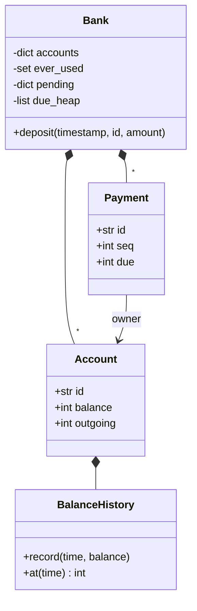

# 设计题解：带定时付款的银行账本（Scheduled Banking Ledger）

## 题目与澄清

一个内存里的银行账本，没有数据库也没有网络，只有一个 `Bank` 类和九个方法。调用方按严格递增的整数时间戳依次调用：开户、存款、转账、整批转账、
安排一笔将来的付款、取消付款、合并两个账户、查支出排名、查某个过去时刻的余额。账本要做对的是**时间**：付款在到期的那一刻才执行，
哪怕下一次调用在很久以后；历史余额查询要回答"某个时刻之后的余额"；一批转账要么全成功、要么什么都没发生。
没有时钟、没有线程、没有定时器：账本里唯一的"现在"就是每次调用带来的 `timestamp`。
这个账本是经典的 [[problems.marketplaces.bank-account|银行账户系统（Bank Account System）]] 的一个变体，经典版见 [[solution-bank-account]]；
这里的合同更细：付款计入支出、取消要核对归属、转账批次是原子的、历史查询带一个任意的过去时刻、被合并的账户整个退役。

开工前先把合同用自己的话写成规则，每一条都会有测试在等着。按"粗心读者最容易漏掉"的顺序：

1. **失败是返回值，不是异常**：开户重复返回 `False`；存款、转账、安排付款、查余额遇到不存在的账户返回 `None`；取消、合并失败返回 `False`。
   整个接口没有任何地方抛异常，评测脚本一遇到异常就判失败。
2. **每个公开方法执行之前先结算到期付款**：到期时间不晚于本次时间戳（等于也算）的待付款项，先按"到期时间、再按创建序号的数值"逐个执行。
   查询要结算，会失败的调用也要结算，空批次也要结算。
3. **一笔付款到期时**：当前归属账户的余额够就扣一次、计入支出、把余额变化记在**到期时刻**；不够就永久失败，什么痕迹都不留。
   同一时刻的存款发生在到期付款之后，所以救不了已经失败的付款。
4. **安排付款不冻结资金**：安排时只看账户是否存在；到期时才看余额。失败的安排不消耗编号，编号 `payment1`、`payment2`…… 在整个银行内全局递增。
5. **取消只对"待付款、且归属于传入的活跃账户"成立**：未知编号、别人的付款、已取消或已处理的付款都是 `False`；到期那一刻再取消已经太晚，因为结算先发生。
6. **转账**：账户不存在、两端相同、余额不足都返回 `None` 且什么都不变；恰好花光是合法的；成功返回转出账户转出后的余额。
7. **支出排名**：累计转出只含成功的转账和成功的定时付款；先按累计降序、再按 ID 的 Python 字符串顺序升序；零支出的活跃账户也在榜上；`n=0` 得 `[]`。
8. **合并 `merge_accounts(id1, id2)`**：先结算；任一账户不存在或两个 ID 相同返回 `False`；成功时 `id2` 的余额、累计转出、待付款项并入 `id1`，
   付款的编号、到期时间、创建序号都不变；`id2` 退役，它的 ID 也永远不能再开户。
9. **历史查询 `get_balance(timestamp, id, time_at)`**：返回 `time_at` 时刻所有事件之后的余额，或此前最近一次变化后的余额；
   账户当前不活跃、`time_at` 时账户还不存在、`time_at` 晚于 `timestamp`，都返回 `None`。
   合并不追溯：存活账户在合并之前的时刻保留自己原来的余额，合并后的总额从合并那个时刻起算；被并掉的账户查任何时刻都是 `None`。
10. **整批转账 `transfer_batch`**：先结算（成功与否都结算）；再按列表顺序在"暂存余额"上演算，后一笔可以花前一笔刚收到的钱；
    任何一笔失败就整批返回 `None`，批内的余额、支出、历史一概不留，批前已结算的付款保留；成功就整批提交，
    返回每笔转出后转出账户的余额；净额为零的批次也计入支出；同一时间戳上的历史只看到批次结束后的余额；空批次返回 `[]`；不改传入的列表。

开口前值得问的澄清问题，每一个都会改变代码：

- **时间戳之间会不会倒退或相等？** 不会：严格递增。所以余额时间线只需要追加，不需要插入；"同一时刻"只可能出现在结算产生的变化和本次调用的变化之间，
  这也是时间线里"同一时刻只留最后一个余额"的来源。
- **被合并掉的 ID 还能不能再用？** 不能，开户返回 `False`。所以除了活跃账户的字典，还要一个"用过的 ID"集合；只看字典会让并掉的 ID 重新变成可开户。
- **合并后，被并掉账户的历史怎么办？** 它整个退役，查询一律 `None`，所以它的时间线可以直接丢掉。存活账户的历史**不**被改写：这条决定了合并时只需要往它的时间线上追加一个点。
- **付款失败后还会不会重试？** 不会，永久失败。因此失败的付款不必留在任何结构里，从待付款项里拿出来就是终点。
- **取消需要账户参数，为什么？** 因为要核对归属：合并之后付款的主人变了，用旧主人的 ID 取消应当是 `False`。
- **批次里的金额是否一定为正？类型是否一定合法？** 合同保证，所以不需要校验金额与类型；要处理的是"领域关系"：账户不存在、两端相同、余额不足。
- **并发呢？** 不在范围内：调用是顺序的。但 REFLECTION 会追问并发下哪些步骤必须不可分割，答案在 `## 扩展与追问`。

范围之外：持久化、并发、利息与手续费、多币种、负余额与透支。

## 需求与分级

**第 1 关（约 15 分钟，账户与转账）**：`create_account`、`deposit`、`transfer`、`top_spenders`。
这一关定下三件事：失败用返回值、账户用"活跃字典 + 用过的 ID 集合"、累计转出放在账户上。
示例：开 `a`、`b`，`a` 存 100，`a` 转 `b` 40 得到 `60`；`top_spenders(…, 1)` 得 `["a(40)"]`。
排名用 `heapq.nsmallest(n, …, key=(-累计, id))`，同时覆盖了 `n=0`、`n` 大于账户数两种边界。

**第 2 关（约 15 分钟，定时付款）**：`schedule_payment`、`cancel_payment`，以及"每个公开方法先结算"。
结算的实现是一个循环：只要到期堆的堆顶不晚于 `now`，就弹出一项并执行。这一关最容易漏的是三处：
入口要统一结算而不是各写各的；创建序号要按整数比较；付款的余额变化要记在到期时刻。
示例：`a` 有 100，第 3 个时刻安排 30 的付款、延迟 2，则第 5 个时刻的存款 10 得到 `80`，因为付款先走。

**第 3 关（约 15 分钟，合并与历史）**：`merge_accounts`、`get_balance`。
每个账户拥有自己的余额时间线，历史查询是一次二分查找；合并只是往存活账户的时间线追加一个点、把待付款项改指向存活账户、丢掉被并掉的账户。
示例：`a` 在第 3 个时刻存 20，`b` 在第 4 个时刻存 30，第 5 个时刻 `b` 并入 `a`（`merge_accounts(5, "a", "b")`）：`get_balance(6, "a", 4)` 得 `20`，`get_balance(7, "a", 5)` 得 `50`，`get_balance(8, "b", 4)` 得 `None`。

**第 4 关（约 10 分钟，原子批次）**：`transfer_batch`。先在暂存余额上完整演算，全部通过才提交；提交只有赋值，不会失败。
这一关还要把"批前已结算的付款保留""空批次也结算""净额为零也计支出"三个细节落到测试里。

**反思（约 5 分钟）**：REFLECTION 的三个问题——崩溃后付款如何安全执行与重试、长期历史如何高效存取、并发下哪些步骤必须原子——
各用一两百字回答，答案骨架在 `## 扩展与追问` 里。

## 核心对象与职责

| 类 | 单一职责 | 它拥有的不变量 |
|---|---|---|
| `BalanceHistory` | 一个账户的余额时间线，追加与二分查询 | 时间不倒退；同一时刻只留最后一个余额；倒退会抛异常而不是静默出错 |
| `Account` | 活跃账户的当前余额、累计转出和时间线 | 当前余额等于时间线的最后一个点；累计转出只增不减 |
| `Payment` | 一笔待付款项的编号、序号、金额、到期时间和当前主人 | 编号、序号、到期时间一生不变；合并时只改主人 |
| `Bank` | 活跃账户、用过的 ID、待付款项、到期堆；每次调用前结算 | 所有写入都发生在校验全部通过之后；待付款项的主人总是活跃账户 |

`Bank` 拥有账户和待付款项，生命周期一致，是组合（composition）；`Payment` 持有主人 `Account` 的引用而不是 ID 字符串，
所以合并时改一个指针就够了，不需要再通过 ID 回查。`Account` 持有自己的 `BalanceHistory`，外部拿不到它的内部列表。
装饰器 `settles` 不是一个类，它是一个函数，只负责"先结算再进方法"这一件事。



## 关键设计决策

### 决策一：谁来触发付款的结算——每次调用前惰性结算，还是后台线程

**问题**：付款在"到期时间"执行，但账本里没有时钟，也没有人保证到期的那一刻会有一次调用。付款什么时候真正动账户？

选项一：**后台线程或定时器**，到期时自己醒来执行。它需要真实时钟，而调用方给的时间戳是虚拟的、严格递增的整数，两者根本不是同一个时间；
它还引入线程安全问题，测试里要 `sleep`，结果不可复现。这个选项在这套合同里不成立。

选项二：**每个公开方法的第一行手写一句 `self._settle(timestamp)`**。可行，也是最直接的写法，缺点是"每个方法都要记得"：
九个方法里漏掉一个，就会出现"某个失败的调用没有先结算"的隐蔽缺陷，而这恰好是隐藏测试喜欢抓的地方——例如到期时刻的一次失败转账。

选项三：**一个装饰器 `settles`** 包住所有公开方法，先结算再进入方法体：

```python
def settles(method):
    @wraps(method)
    def wrapper(self, timestamp, *args, **kwargs):
        self._settle(timestamp)
        return method(self, timestamp, *args, **kwargs)
    return wrapper
```

选择选项三。理由有两条：一是它把"每个入口先结算"从"人人要记得"变成结构，漏一个方法就是漏一个装饰器，一眼可见；
二是 `wrapper` 把 `timestamp` 作为具名参数接住，工作区测试里 `bank.top_spenders(timestamp=6, n=1)` 这种关键字调用照样工作。
这是函数装饰器（Decorator）的朴素用法，不是一个类层次；如果还有第二种"前置动作"，再考虑把它做成可组合的中间件，现在只有一种，不必抽象。
结算本身永远是惰性的：账本只在被调用时才推进，这也让整个系统不依赖真实时间，测试里没有 `sleep`。

### 决策二：历史怎么存——每个账户一条时间线，还是事件日志加归约

**问题**：`get_balance(…, time_at)` 要回答任意过去时刻的余额。合并之后的历史还不能被追溯改写。

选项一：**只存事件，需要时归约**（经典题的做法）。账本是一张只增不减的事件表，余额等于某账户在时刻 `t` 之前所有事件的和：

```python
def balance_at(events, account_id, t):
    return sum(e.delta for e in events if e.account == account_id and e.time <= t)
```

它好理解，但每次查询是 O(事件数)；合并时要决定"被并掉账户的事件算谁的"，规则一乱就会追溯改写历史。

选项二：**每次变化存一份全账户快照**。查询快，但每次写入 O(账户数)，内存按"变化次数 × 账户数"膨胀，显然不合适。

选项三：**每个账户自己拥有一条 `(时间, 余额)` 的追加数组，查询用二分**：

```python
i = bisect_right(self._times, time)
return self._balances[i - 1] if i else None
```

选择选项三。写入 O(1)（追加或覆盖最后一个点），查询 O(log n)。它还让合同里的三条"怪规则"自动成立，不需要任何特殊代码：

- **不追溯**：合并只是往存活账户的时间线追加一个点，旧点不动；合并前的时刻查到的还是它自己原来的余额。
- **被并掉的账户查任何时刻都是 `None`**：它已经不在活跃字典里，查询在字典这一步就返回了，时间线可以直接丢掉。
- **账户在 `time_at` 时还不存在**：它的第一个点是开户时刻，`bisect_right` 在第一个点之前返回 0，于是 `None`。

同一时刻有多个变化时（例如到期付款之后又来了一笔存款）只保留最后一个余额：`record` 遇到相同的时间就覆盖。
时间线还有一个自我保护：时间倒退会抛 `ValueError`。这是一条"不变量即异常"的守卫，不是 `assert`——`python -O` 会把 `assert` 删掉，
而时间线一旦倒退，二分查询就会静默地给出错误答案。当前合同下这个异常永远不会触发，因为时间戳严格递增、结算又按到期时间排序。

### 决策三：整批转账怎么做到全有或全无——暂存余额，还是撤销日志

**问题**：批里第三笔失败时，前两笔已经"做过"，要回到什么都没发生。

选项一：**边做边改，失败时按日志撤销**。

```python
undo = []
for source, target, amount in transfers:
    if not ok(source, target, amount):
        for fn in reversed(undo): fn()      # 回滚
        return None
    do(source, target, amount); undo.append(...)
```

撤销路径本身必须完全正确，而它是最少被走到的代码；累计支出、历史点、余额三套状态都要各写一遍反操作，漏一个就是隐蔽的脏数据。
更糟的是，如果撤销中途又出错，账本就停在半途。

选项二：**深拷贝整个银行，在副本上做，成功了再替换**。简单，但每个批次 O(账户数 + 历史长度)，账本越大越慢，历史长了尤其不合算。

选项三：**暂存覆盖层（overlay）**：只记录"被碰到的账户"的暂存余额和暂存支出，演算期间不碰任何真实状态；全部通过之后再提交。

```python
staged = {}                                    # 账户 ID -> 暂存余额，只含被碰到的账户
available = staged.get(source, accounts[source].balance)
if available < amount: return None             # 真实状态还没有被碰过
staged[source] = available - amount
staged[target] = staged.get(target, accounts[target].balance) + amount
```

选择选项三。失败时直接 `return None`，没有任何东西需要回滚，因为什么都没写；提交阶段只有赋值，不会失败。
"后一笔可以花前一笔刚收到的钱"自然成立：后面的 `staged.get` 读到的是暂存值。"同一时间戳的历史只看到批次结束后的余额"也自然成立：
提交时每个被碰到的账户只写一个点，不会留下中间状态；净额为零的批次，账户的余额不变，但累计转出照常增加。
`transfer` 复用同一个演算函数，把单笔当作长度为 1 的批次，两个入口共用一份校验，不会出现"转账和批次对同一种失败的判断不一致"。
这里没有用命令模式（Command）加撤销栈：撤销栈适合"用户可以反悔的编辑器"，不适合"提交前就已经知道成败"的批处理，简单的暂存覆盖层更对路。

### 决策四：待付款项怎么存——到期堆加字典，合并时改主人指针

**问题**：结算要反复取出"最早到期、同刻按创建序号"的付款；取消要按编号找到并作废；合并要把一批付款换主人；已取消的付款不能让内存无限增长。

选项一：**一个按到期时间排序的列表，每次扫描**。结算是 O(待付款项数)，每次调用都要付；取消要 O(n) 找。

选项二：**每个账户一个付款列表**。合并时拼接，取消时在账户的列表里找，但"全局按到期时间排序"要把所有账户的列表归并，结算反而更复杂。

选项三：**最小堆 + 按编号的字典**：

```python
heapq.heappush(self._due, (payment.due, seq, payment.id))   # 出队顺序
self._pending[payment.id] = payment                          # 取消与归属核对
```

堆里放 `(到期时间, 序号, 编号)`，序号是整数，所以 `payment10` 在 `payment9` 之后（如果用字符串比较，`"payment10" < "payment2"`，顺序就错了）。
取消只删字典，堆里的条目变成残留项，结算弹出时发现字典里已经没有它就跳过——这叫惰性删除。
惰性删除的代价是残留项在到期之前一直占内存：安排五百笔延迟极长的付款再全部取消，堆里仍有五百项。
所以 `cancel_payment` 里有一个 `_compact`：堆比待付款项的两倍多 16 还多，就按字典重建堆。
实际运行：安排 500 笔、全部取消后 `pending_count` 是 0，`queue_size` 是 15，不是 500。
这是"哪个操作负责清理空了的容器"这个问题的答案：容器清空时要有人负责收缩，而不是留一个有界账本里的无界增长。

合并时，`Payment.owner` 是 `Account` 对象的引用，合并只需要遍历待付款项、把指向被并掉账户的改指向存活账户，编号、到期时间、序号一概不动，
所以"付款的创建顺序与到期顺序不变"自动成立。遍历是 O(待付款项数)；如果付款很多、合并很频繁，可以让每个账户额外持有自己的付款集合，合并时小集合并入大集合。
这里不引入这个索引，因为多一份索引就多一个要在取消、结算、合并三处同步的东西。

### 决策五：失败怎么表达——返回值，而不是异常层次

**问题**：经典题把每种失败做成一个异常类（`UnknownAccountError`、`InsufficientFundsError`……）。这里要不要这样做？

选项一：**异常层次**。调用方可以精确捕获，错误信息也丰富。
选项二：**返回 `None` 或 `False`**。调用方用 `if result is None` 判断。

选择选项二，原因来自合同本身：接口的返回类型已经把"失败"编进去了（`int | None`、`list[int] | None`、`bool`），评测脚本只要调用时出现任何异常就判失败；
而且这里的失败都是**预期失败**（账户不存在、余额不足、重复开户），不是程序缺陷。预期失败用返回值、缺陷用异常，是这类接口的惯例。
唯一抛异常的地方是时间线倒退，那是内部不变量被破坏，属于缺陷，不属于调用方可以处理的情况。
没有用 `Result` 类型或自定义错误码枚举：合同只区分"成功的值"和"失败"两种情况，`None` 已经足够，多一层包装只会让每个调用点多一次解包。

## 代码走读

下面是完整的、经过测试的参考实现，可原样放进工作区的 `service.py`。

%% code:begin solution.py %%
```python
"""带定时付款的银行账本（Scheduled Banking Ledger）参考实现，可原样放进工作区的 `service.py`。

五行设计：
1. 没有后台线程也没有时钟：每个公开方法都由 `@settles` 包一层，先把"到期时间不晚于本次时间戳"的定时付款结算完，
   再做自己的事——失败的调用、纯查询也不例外；结算只在调用发生时才发生，但每笔余额变化都记在它的到期时刻。
2. 每个账户自己拥有一条只增不减的余额时间线（`BalanceHistory`），历史查询是一次二分查找；合并只是给存活账户
   在合并时刻追加一个新点，被并掉的账户整个丢弃，所以"合并前的历史不被追溯改写"不需要任何特殊代码。
3. 待付款项放在"到期时间、创建序号"的最小堆里，另有按编号索引的字典；取消只删字典，堆里的残留项到期时被跳过，
   残留过多时重建堆，内存不会无限增长。
4. 转账批次先在"暂存余额"上完整演算，全部通过才一次性写入；演算过程不碰任何真实状态，所以回滚不需要撤销日志。
5. 失败一律用返回值（`None` / `False`）表达，不抛异常；曾经用过的账户 ID 永不复用（`_ever_used`）。
"""

from __future__ import annotations

import heapq
import itertools
from bisect import bisect_right
from collections.abc import Callable, Iterable, Sequence
from dataclasses import dataclass, field
from functools import wraps
from typing import Any


class BalanceHistory:
    """一个账户的余额时间线：时间严格不倒退，同一时刻只保留最后一个余额。"""

    def __init__(self) -> None:
        self._times: list[int] = []
        self._balances: list[int] = []

    def record(self, time: int, balance: int) -> None:
        if self._times and time < self._times[-1]:
            raise ValueError("余额时间线不能倒退")  # 破坏它就会让历史查询静默出错，所以抛异常而不是 assert
        if self._times and self._times[-1] == time:
            self._balances[-1] = balance
        else:
            self._times.append(time)
            self._balances.append(balance)

    def at(self, time: int) -> int | None:
        """`time` 时刻（含）之前最近的余额；那时账户还不存在则为 None。"""
        index = bisect_right(self._times, time)
        return self._balances[index - 1] if index else None


@dataclass(slots=True)
class Account:
    id: str
    balance: int = 0
    outgoing: int = 0  # 成功转出与成功定时付款的累计
    history: BalanceHistory = field(default_factory=BalanceHistory)


@dataclass(slots=True)
class Payment:
    id: str
    seq: int  # 创建序号：同一到期时间内按它的数值排序，不能按字符串排序
    amount: int
    due: int
    owner: Account  # 合并时改指向存活账户，id、due、seq 都不变


def settles(method: Callable[..., Any]) -> Callable[..., Any]:
    """装饰每个公开方法：先结算到期付款，再执行方法体。"""

    @wraps(method)
    def wrapper(self: Bank, timestamp: int, *args: Any, **kwargs: Any) -> Any:
        self._settle(timestamp)
        return method(self, timestamp, *args, **kwargs)

    return wrapper


class Bank:
    def __init__(self) -> None:
        self._accounts: dict[str, Account] = {}  # 只放活跃账户
        self._ever_used: set[str] = set()  # 含已并掉的账户 ID
        self._pending: dict[str, Payment] = {}  # 待付款项，按编号索引
        self._due: list[tuple[int, int, str]] = []  # (到期时间, 序号, 编号) 的最小堆
        self._payment_seq = itertools.count(1)

    @property
    def pending_count(self) -> int:
        return len(self._pending)

    @property
    def queue_size(self) -> int:
        """到期堆里存着的条目数，含已取消、尚未清掉的残留项。"""
        return len(self._due)

    # ---- 结算 ----
    def _settle(self, now: int) -> None:
        while self._due and self._due[0][0] <= now:
            due, _, payment_id = heapq.heappop(self._due)
            payment = self._pending.pop(payment_id, None)
            if payment is None:  # 已取消，残留项
                continue
            owner = payment.owner
            if owner.balance >= payment.amount:  # 不够就永久失败，什么也不留
                owner.balance -= payment.amount
                owner.outgoing += payment.amount
                owner.history.record(due, owner.balance)  # 记在到期时刻，而不是触发结算的这次调用的时刻

    def _compact(self) -> None:
        if len(self._due) > 2 * len(self._pending) + 16:
            self._due = [(p.due, p.seq, p.id) for p in self._pending.values()]
            heapq.heapify(self._due)

    # ---- 账户与转账 ----
    @settles
    def create_account(self, timestamp: int, account_id: str) -> bool:
        if account_id in self._ever_used:
            return False
        self._ever_used.add(account_id)
        account = Account(account_id)
        account.history.record(timestamp, 0)
        self._accounts[account_id] = account
        return True

    @settles
    def deposit(self, timestamp: int, account_id: str, amount: int) -> int | None:
        account = self._accounts.get(account_id)
        if account is None:
            return None
        account.balance += amount
        account.history.record(timestamp, account.balance)
        return account.balance

    @settles
    def transfer(self, timestamp: int, source: str, target: str, amount: int) -> int | None:
        balances = self._apply(timestamp, [(source, target, amount)])
        return None if balances is None else balances[0]

    @settles
    def transfer_batch(
        self, timestamp: int, transfers: Iterable[Sequence[Any]]
    ) -> list[int] | None:
        return self._apply(timestamp, transfers)

    def _apply(self, timestamp: int, transfers: Iterable[Sequence[Any]]) -> list[int] | None:
        """在暂存余额上按顺序演算；任何一笔失败就返回 None，真实状态还没被碰过。"""
        staged: dict[str, int] = {}  # 只含被碰到的账户
        spent: dict[str, int] = {}
        after: list[int] = []
        for source, target, amount in transfers:
            if source == target or source not in self._accounts or target not in self._accounts:
                return None
            available = staged.get(source, self._accounts[source].balance)
            if available < amount:
                return None
            staged[source] = available - amount
            staged[target] = staged.get(target, self._accounts[target].balance) + amount
            spent[source] = spent.get(source, 0) + amount
            after.append(staged[source])
        for account_id, balance in staged.items():  # 提交：只有赋值，不会失败
            account = self._accounts[account_id]
            account.balance = balance
            account.history.record(timestamp, balance)  # 同一时刻只留批次结束后的余额
        for account_id, total in spent.items():
            self._accounts[account_id].outgoing += total
        return after

    @settles
    def top_spenders(self, timestamp: int, n: int) -> list[str]:
        ranked = heapq.nsmallest(n, self._accounts.values(), key=lambda a: (-a.outgoing, a.id))
        return [f"{a.id}({a.outgoing})" for a in ranked]

    # ---- 定时付款 ----
    @settles
    def schedule_payment(
        self, timestamp: int, account_id: str, amount: int, delay: int
    ) -> str | None:
        account = self._accounts.get(account_id)
        if account is None:
            return None  # 失败不消耗编号
        seq = next(self._payment_seq)
        payment = Payment(f"payment{seq}", seq, amount, timestamp + delay, account)
        self._pending[payment.id] = payment
        heapq.heappush(self._due, (payment.due, seq, payment.id))
        return payment.id

    @settles
    def cancel_payment(self, timestamp: int, account_id: str, payment_id: str) -> bool:
        payment = self._pending.get(payment_id)
        account = self._accounts.get(account_id)
        if payment is None or account is None or payment.owner is not account:
            return False
        del self._pending[payment_id]
        self._compact()
        return True

    # ---- 合并与历史 ----
    @settles
    def merge_accounts(self, timestamp: int, id1: str, id2: str) -> bool:
        target, source = self._accounts.get(id1), self._accounts.get(id2)
        if target is None or source is None or target is source:
            return False
        target.balance += source.balance
        target.outgoing += source.outgoing
        for payment in self._pending.values():  # 待付款项改归存活账户，其余字段原样
            if payment.owner is source:
                payment.owner = target
        del self._accounts[id2]  # id2 仍留在 _ever_used 里，永不复用
        target.history.record(timestamp, target.balance)
        return True

    @settles
    def get_balance(self, timestamp: int, account_id: str, time_at: int) -> int | None:
        account = self._accounts.get(account_id)
        if account is None or time_at > timestamp:
            return None
        return account.history.at(time_at)
```
%% code:end %%

**走读一：`settles` 与 `_settle`**。装饰器的 `wrapper` 先调用 `_settle(timestamp)`，再进入方法体。`_settle` 的循环条件是 `self._due[0][0] <= now`，
等于也算到期，所以到期那一刻的取消是 `False`、同刻的存款救不了失败的付款。弹出一项后先从字典里 `pop`：取不到说明它已经被取消，直接跳过；
取到了就看余额，够就扣款、累计转出、**把余额变化记在 `due`**——不是记在 `now`——不够就什么都不留，付款已经从字典里拿走，所以失败是永久的。

**走读二：`BalanceHistory`**。`record` 只有两种情形：时间与最后一个点相同则覆盖，否则追加；时间更早则抛异常。`at` 是一次 `bisect_right`。
注意它只依赖 `_times` 升序这一个事实，而这个事实由"时间戳严格递增 + 结算按到期时间排序"保证：
结算弹出的到期时间一定大于上一次调用的时间戳（否则上一次调用已经结算过它），也一定不晚于本次时间戳。

**走读三：`_apply`**。这是整批转账与单笔转账共用的演算函数。第一个循环只读真实状态、只写 `staged` 与 `spent` 两个局部字典，任何失败直接返回 `None`。
通过之后，第二、第三个循环才写真实状态：先写余额与历史，再写累计转出。输入 `transfers` 只被遍历一次，不被修改；返回的 `after` 是新建的列表。

**走读四：`merge_accounts`**。先判断三种失败（目标不存在、来源不存在、两个 ID 相同——相同时 `target is source`），然后合并三样东西：余额、累计转出、待付款项的主人。
`del self._accounts[id2]` 把被并掉的账户从活跃字典里拿走，但 `id2` 仍留在 `_ever_used` 里，所以不能再开户。
最后在存活账户的时间线上追加一个点：合并时刻的合并后总额。旧的点一个都没有动。

## 测试与自检

自己写的测试覆盖了合同的每一条，包括公开测试没有触及的：

- **合同示例**：README 里的批次示例逐字照做，得到 `[30, 50]`、`None`、`50`。
- **结算顺序**：到期时刻的失败转账必须先看到扣款后的余额；`payment10` 排在 `payment9` 之后：十笔同刻到期、余额 10 的付款，前九笔每笔 1，第十笔 5，
  数值顺序下前九笔成功、第十笔失败，累计转出是 9；字符串顺序下它会排到第二位并成功，累计转出会变成 10。
- **失败的永久性**：到期时刻的存款救不了失败的付款，之后再多存也不会补付。
- **恰好花光**：余额 30 的账户付 30 的款，成功，余额变 0——这条专门盯 `>=` 与 `>` 的区别。
- **历史**：同一时刻只留最后一个余额；`time_at` 晚于 `timestamp`、账户当时不存在、被并掉的账户，都是 `None`；合并边界不追溯。
- **合并**：付款随合并换主人、编号与顺序不变；存活账户可以取消，被并掉的账户取消得 `False`；连环合并。
- **批次**：失败后余额、支出、历史都没有痕迹；批前已结算的付款保留；空批次返回新列表且仍然结算；净额为零也计支出；输入列表不被修改。
- **有界性**：安排五百笔再全部取消，`pending_count` 为 0、`queue_size` 不超过 16。
- **随机回放**：用固定种子做四百步随机操作，每一步当场观察每个账户的余额，事后用历史查询重放，必须逐项相同。这条测试专门防"结算记错时刻"和"合并改写历史"。

测试不读任何私有属性：`pending_count` 与 `queue_size` 是两个只读属性，是为了让"已取消的付款不让内部堆无限增长"这个不变量能被断言。
你可以做一个自检：把 `_settle` 里的 `>=` 改成 `>`，应当恰好有"恰好花光"那条测试变红；把结算里的 `due` 改成 `now`，历史测试会变红。
改完马上改回来。

两分钟演示：

```python
bank = Bank()
bank.create_account(0, "a")            # True
bank.deposit(1, "a", 100)              # 100
bank.schedule_payment(2, "a", 30, 3)   # "payment1"，到期 5
bank.get_balance(20, "a", 4)           # 100：到期之前
bank.get_balance(21, "a", 5)           # 70：付款记在到期时刻 5，虽然是第 20 次调用才触发的结算
```

## 扩展与追问

**新需求**

- **付款计入排名之外的统计（手续费、返现）**：新增的是 `_settle` 里"成功之后"的一小段，以及 `Account` 上的一个字段；`BalanceHistory`、合并和批次不变。
- **付款可以重复（每月扣一次）**：`Payment` 增加 `every`，成功或失败之后若有周期就以新的到期时间重新入堆，编号不变；结算循环不变。
  注意"永久失败"要重新定义：是这一次失败，还是整个周期终止，要先问清楚。
- **按账户查询待付款项**：`Account` 增加自己的付款集合（上面决策四的索引），`cancel`、`_settle`、合并三处同步；其余不变。
- **透支额度**：只改"余额是否够"这一个判断，`_settle` 与 `_apply` 各一处，用一个 `available(account)` 函数收口。

**并发与线程安全**（REFLECTION 第三问）

- 必须不可分割的是**整个公开方法**：先结算、再校验、再写入。只给字典加锁不够：另一个线程可以插在"结算"与"校验"之间，付款顺序就乱了。
  批次的演算与提交必须在同一个临界区，否则演算时看到的余额，提交时已被别的线程改掉；合并的四件事（余额、累计、付款换主人、退役）必须同时可见；
  取消与到期执行必须二选一，谁先拿到锁谁赢。
- 做法：装饰器 `settles` 里 `with self._lock:`（`RLock`，内部方法可以互相调用），整个公开方法在同一把锁下。其余类不用改。
- 代价与降低：所有账户串行。按账户分片、每片一把锁，批次与合并跨账户，要按 ID 排序依次加锁以避免死锁；排名要按固定顺序取全部分片锁。
- 并发之后"严格递增的时间戳"也不能再靠调用方保证，要由锁内的顺序保证，否则结算顺序没有意义。

**持久化与规模**（REFLECTION 第一、二问）

- **崩溃后付款如何安全执行与重试**：付款表带状态（待付款、已付、失败、已取消）存库；"取一笔、扣款、改状态"放在同一个事务里，
  只处理 `state = 待付款` 的行，同一笔再来一次什么也不做，这就是幂等；失败也要把状态写成"失败"，否则重启后拿新余额重试，违背"永久失败"。
  多个工作进程按（到期时间, 序号）取一批并加行锁。对外部系统的真实扣款无法回滚，要拆成"已发出请求""已确认结果"两个状态，重放时带同一个幂等键。
  下面的代码是这个事务的最小形态（SQLite 版）：

```python
def run_payment(conn, pid):
    with conn:                                     # 一个事务：扣款与标记同生共死
        row = conn.execute("SELECT owner, amount FROM payment WHERE id = ? AND state = ?",
                           (pid, "pending")).fetchone()
        if row is None:
            return                                 # 已处理过：重试什么也不做
        owner, amount = row
        paid = conn.execute("UPDATE account SET balance = balance - ? WHERE id = ? AND balance >= ?",
                            (amount, owner, amount)).rowcount
        conn.execute("UPDATE payment SET state = ? WHERE id = ?",
                     ("paid" if paid else "failed", pid))
```

- **长期历史如何高效存取**：内存里是每个账户的升序数组加二分；放到数据库里就是 `(account_id, time)` 的有序索引，"最近的不晚于 t"是一次向下取整查询
  （`WHERE time <= ? ORDER BY time DESC LIMIT 1`）；很老的点按月归档，查询只翻一页；合并仍只追加一个点。
- **付款量很大**：到期堆可以换成按到期时间分桶的表，结算按桶取；这是 `_settle` 内部的事，对外接口不变。

## 常见错误

- **漏掉某个入口的结算**：最常见的是失败的调用、查询、空批次没有先结算。用装饰器统一，或者逐个方法检查第一行。
- **用字符串比较付款编号**：`"payment10" < "payment9"` 为真，十笔以上同刻到期就乱序。排序键要用整数序号。
- **把付款记在触发结算的那次调用的时刻**：历史查询到期之后、触发之前的时刻会得到旧余额。要记在 `due`。
- **到期时刻的取消放过去**：结算先于取消，所以那一刻的取消是 `False`。条件写成 `<` 而不是 `<=` 就会错。
- **冻结资金**：安排付款时检查或扣减余额。合同说安排只看账户是否存在，到期才看余额。
- **失败的安排也消耗了编号**：先自增再检查账户，后面的编号就跳号。要先检查再取号。
- **并掉的 ID 又可以开户**：只用活跃字典判断重复。要有"用过的 ID"集合。
- **合并时追溯历史**：把被并掉账户的时间线拼进存活账户，合并前的时刻查到的就成了总额。合并只追加一个点。
- **批次边做边改再回滚**：撤销路径漏掉累计转出或历史点，留下脏数据。先演算、后提交。
- **批次里每笔都读真实余额**：后一笔看不到前一笔刚收到的钱，或者反过来，失败的批次改了真实状态。要读暂存余额。
- **返回内部列表或修改传入的列表**：批次返回新列表，传入的列表原样不动。
- **排名的排序方向写反或用了大小写不敏感的比较**：累计降序、ID 按 Python 字符串顺序升序，`"B" < "a"`。
- **Java 味**：给每种失败写一个异常类、写 `getBalance()` / `setBalance()`、为单个实现建 `IBank` 接口。这里一个类加三个小数据类就够了。
- **在没有文档要求的地方加锁**：合同明确并发不在范围内。先把顺序语义做对，并发留给反思问答。

## 45 分钟怎么分配

- **0–5 分钟｜读合同，写规则**：把上面十条规则逐条用自己的话改成断言，先问清"时间戳是否严格递增""并掉的 ID 能否复用""失败是否抛异常"。
  对编程智能体说的第一句话也是这份清单，加上 README 里的批次示例，而不是"写一个银行"。
- **5–10 分钟｜定骨架**：口头说出结构：活跃字典加用过的 ID 集合、每账户一条时间线、到期堆加待付款字典、一个先结算的装饰器、暂存覆盖层。
  让智能体起草 `BalanceHistory` 和 `Account`（输入输出清楚、容易验证）；`settles` 的范围、暂存覆盖层、付款记在到期时刻这三个决定自己定。
- **10–22 分钟｜第 1、2 关**：开户、存款、转账、排名先通过公开测试；再做定时付款。每次只给智能体一个失败用例。
  自己写"十笔同刻到期"和"到期时刻的失败转账"两个测试，这两个是智能体最容易写错的地方。
- **22–32 分钟｜第 3、4 关**：合并与历史、原子批次。读智能体的 diff：批次失败时有没有碰真实状态、合并有没有改写历史。
- **32–40 分钟｜补测试**：公开测试只有五条，自己补边界：恰好花光、同刻存款、取消的归属、空批次、净额为零的批次。
- **40–45 分钟｜短文**：REFLECTION 的三问各用一百五十字左右回答：幂等与事务、有序索引上的向下取整查询、整个公开方法持一把锁。不要留到最后一分钟。

时间不够时的取舍：先砍随机回放测试，再砍压缩堆的 `_compact`，再砍分片的口述；
**绝不能砍的是**：每个入口先结算、付款记在到期时刻、批次先演算后提交、被并掉的 ID 不可复用、用返回值表达失败。

## 延伸阅读

- [[solution-bank-account]]：经典银行账户系统的题解，事件日志加归约、异常层次、返回现金回馈；这里的合同不同（付款计入支出、历史带任意时刻、批次原子），以这里为准。
- [[problems.marketplaces.bank-account|银行账户系统（Bank Account System）]]：同一类问题的知识树入口。
- [[problems.components.task-scheduler|任务调度器（Task Scheduler）]]：到期堆与惰性结算的通用形态。
- **复合操作（Compound Actions）**：为什么并发下要锁住"结算 + 校验 + 写入"整个方法。
- [Python 文档：heapq](https://docs.python.org/3/library/heapq.html)：最小堆、`nsmallest`，以及用 `(到期, 序号)` 元组做稳定顺序的写法。
- [Python 文档：bisect](https://docs.python.org/3/library/bisect.html)：`bisect_right` 与"最近的不晚于 t"的查询。
- [Python 文档：sqlite3 的事务控制](https://docs.python.org/3/library/sqlite3.html#sqlite3-controlling-transactions)：用 `with conn:` 让扣款与改状态同生共死。
