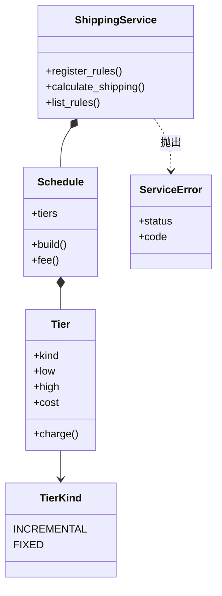
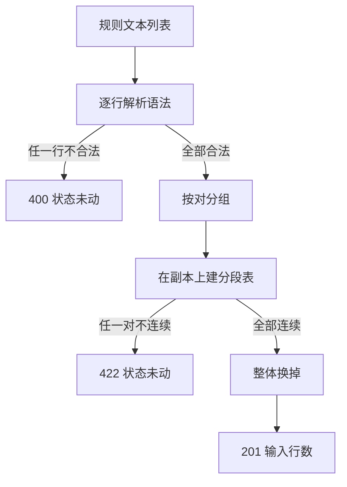
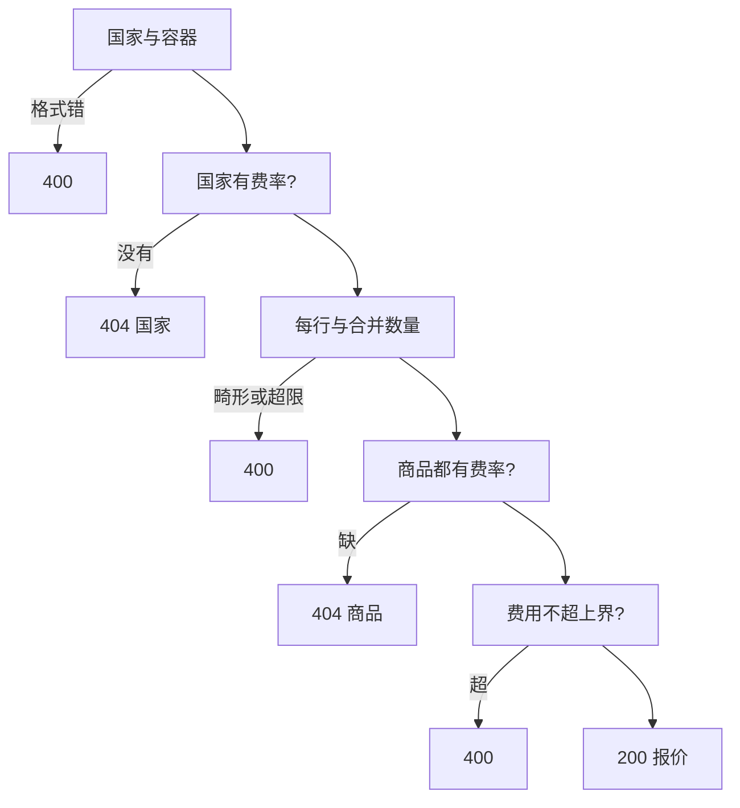

# 设计题解：运费计算（Shipping Cost）

## 题目与澄清

一个电商的运费服务按"目的国加商品"查费率表，给订单报运费。费率不是一个单价，而是一张分段表：买得越多，落进的段越靠后，每一段有自己的算法。`incremental` 段按"进入本段的件数乘单价"收费；`fixed` 段只要有一件进入，就一次性收一笔固定费。一个商品的运费，是它走到的所有段的费用相加。服务有三个方法：`register_rules(规则文本列表)` 整批登记费率，`calculate_shipping(国家, 订单行列表)` 报价，`list_rules(国家=None)` 列出现有费率。成功返回 `(状态码, 内容)`，失败抛 `ServiceError(状态码, 代码)`。这是一个从零实现的项目：模板里三个方法都是 `NotImplementedError`，已写好的 HTTP 适配器把它们暴露出去。同一个服务实例上的调用按顺序执行，所以难点不在并发，而在三件事：输入语法要严，分段表要连续，错误的先后要固定。

先把合同写成十四条，按"一个粗心的读者最容易漏掉"的顺序：

1. **字符的规矩**：国家码是 2 到 5 个大写 ASCII 字母，商品名是 1 到 32 个字母、数字、下划线或连字符；整串匹配，区分大小写，不去空白，不改大小写。
2. **数字的规矩**：十进制数字只含 ASCII 数字，允许前导零，每个数字不超过 1,000,000；金额是整数分。
3. **一条规则六段**：`国家,商品,类型,最小,最大,费用`；类型只有 `incremental` 和 `fixed`；最大写 `*` 表示无上界；费用必须为正；最小和有限的最大可以是 0（是否合法由分段规则判定）。
4. **登记的语法错是 400**：空批次、不是列表、任何一行语法不对，都是 `(400, "invalid_input")`；所有行的语法先检查完，再看分段，所以语法错出现在批次的任何位置，都先于分段错。
5. **分段表连续**：同一（国家，商品）的行归到一起按最小数量排序，每段是整数闭区间；第一段从 1 开始，后一段从前一段的有限最大加 1 开始，有限最大不小于最小，恰好最后一段无上界。缺口、重叠、起点重复、`*` 之后还有段、从 0 起、末段有限，都是 `(422, "invalid_rules")`。
6. **整批原子，按对替换**：失败时什么都不变，包括同批里别的国家和商品；成功时批里出现的每一对用新分段表整体替换旧的，没出现的对原样保留；返回 `(201, {"registered_count": 输入行数})`。
7. **报价的错误顺序**：先查国家语法和订单是不是列表（400）；再查这个国家有没有费率（404 `country_not_found`，空订单也一样）；再查每一行和合并后的数量（400）；再查商品有没有费率（404 `product_not_found`）；最后查金额上界（400）。
8. **订单行**：`商品,数量`，恰好两段，数量是 1 到 1,000,000 的整数；0 不是一件商品，直接拒绝；同一商品的数量先相加，合并后也不得超过 1,000,000。
9. **算价**：从第 1 件开始逐段填，走到的每一段的费用都加起来，后面的段不会取代前面的段；`incremental` 段收"进入本段的件数乘单价"，`fixed` 段只要有件数进入就收一次；末段是无上界的 `fixed` 也合法。
10. **上界**：单个商品的费用、整单总额都不得超过 2,147,483,647 分；用精确整数算，算完整笔再比。
11. **报价的形状**：`{"total_cost", "country", "breakdown"}`；`breakdown` 每行 `{"product", "quantity"（合并后）, "cost"}`，按商品名的 ASCII 升序；已知国家的空订单是总额 0、`breakdown` 为空。
12. **列表的形状**：每行 `country, product, type, min_quantity, max_quantity（无上界是 None）, cost_cents`，按国家、商品、最小数量排序；国家过滤是完全相等，没有匹配（包括空串和格式不对的码）就是空列表，也不会因此多出一个国家。
13. **隔离**：不改调用方传入的列表；返回的容器和行与内部状态无关，之后的登记不改变已经拿到的结果。
14. **实例独立**：两个 `ShippingService` 互不共享状态。

两个例子是第一批测试。登记 `NL,kettle,incremental,1,4,300`、`NL,kettle,fixed,5,9,900`、`NL,kettle,incremental,10,*,150`，订单 `["kettle,6", "kettle,5"]`：先合并成 11 件，第 1 段收 `4*300 = 1200`，第 2 段整段进入、收一次 900，第 3 段进入了第 10、11 两件、收 `2*150 = 300`，合计 2400，返回 `(200, {"total_cost": 2400, "country": "NL", "breakdown": [{"product": "kettle", "quantity": 11, "cost": 2400}]})`。如果不合并、各算各的，6 件收 2100，5 件也收 2100，合计 4200，多收了 1800，因为固定段被收了两次。第二个例子：同一批里先写合法的 `BR,poster,fixed,1,*,10`，再写缺口的 `BR,vase,fixed,1,2,5` 和 `BR,vase,fixed,4,*,5`，整批以 `422` 失败，`poster` 也没有登记，之后给巴西报价是 `country_not_found`。

开口前值得问的澄清问题，每个答案都会改变代码：

- **"最小是 0"是语法错还是分段错？** 数字本身合法（非负），所以语法过得去，由分段规则以 422 拒绝（零锚点）。这决定了语法检查和分段检查必须是两个独立的阶段。
- **"最大小于最小"算哪一类？** 分段错，422；它和缺口、重叠一起在分段阶段处理。
- **同一对的两行完全一样呢？** 起点重复，422，不是"去重"。
- **订单里商品名格式不对（带空格），是 400 还是 404？** 这是一行畸形的订单，属于第三层（400），先于"商品没有费率"。
- **数量是 `0` 呢？** 400。不要造出"第 0 件"的分段去算它。
- **合并后超过 1,000,000，哪怕每行都合法？** 400。
- **空订单、国家未登记？** 404：国家是否存在先于订单内容。
- **登记是替换还是合并？** 按对整体替换：同一对的旧分段全部丢掉，不是在旧表里插新段。
- **返回值能不能不可变？** 可以：可变副本和不可变快照都允许，只要调用方改不动内部状态。
- **要不要线程安全？** 合同说同一实例上的调用按顺序执行，所以不要求；但要能说清"整批原子"和"线程安全"是两回事（见"扩展与追问"）。

## 需求与分级

这个项目没有隐藏的阶段，分关是实现的顺序：先让输入可信，再让价格可信，最后让状态可信。每一关都能单独运行测试。

**第 1 关（约 20 分钟，解析与登记）**：实现 `register_rules`。解析的陷阱集中在三处：数字不能直接 `int(token)`（见决策三）；国家和商品必须整串匹配；语法和分段是两个阶段。分段表的校验写成"排序后扫一遍，维护下一段该有的起点"，这一关就要把整批原子做对，否则后面每一关都建在会漏状态的地基上。示例：`DE,jar,fixed,1,3,40` 加 `DE,jar,incremental,4,*,5` 合法；把第二行的 4 改成 5，就是缺口，422。

**第 2 关（约 15 分钟，报价）**：实现 `calculate_shipping`。先把五层错误顺序写成注释，再写代码；合并数量用一个字典；每一段的收费放在 `Tier.charge` 里，商品的费用是各段之和。示例：`DE,jar,incremental,1,2,10`、`DE,jar,fixed,3,5,100`、`DE,jar,fixed,6,6,1000`、`DE,jar,incremental,7,*,1`，买 1、2、3、5、6、7、10 件分别是 10、20、120、120、1120、1121、1124：每走进一段就多加一笔，没有哪一段取代前面的段。

**第 3 关（约 15 分钟，列表与隔离）**：实现 `list_rules`，并检查返回值和内部状态没有共享。排序键是（国家，商品，最小数量），商品按 ASCII 码点排序，所以大写字母在小写字母之前，`_` 在大写之后、小写之前。示例：`NL` 下的 `B` 排在 `b` 之前。

**第 4 关（选做，约 10 分钟，书面回答）**：三个问题，各约一百字：先验证整批再发布、失败保留旧状态、返回值与输入和内部状态分离，并指出一个回归测试；为什么重复商品要在算固定段之前合并，用明细数、商品数、分段数分析时间和空间，再提一个扩展优化；费率持久化、多实例、费率会变时，怎么让一次报价看到同一个版本。不要实现，只需要说清楚思路。

## 核心对象与职责

| 类型 | 单一职责 | 它拥有的不变量 |
|---|---|---|
| `ServiceError` | 对外的错误：状态码加稳定代码 | 代码是固定字符串，调用方只靠它分支 |
| `TierKind` | 两种计费方式的枚举 | 只有 `incremental` 和 `fixed`，别的字符串构造不出来 |
| `Tier` | 一段闭区间的费率（冻结的值对象），知道"买到 q 件时这一段收多少" | 构造之后不变；`charge` 对没走到的段返回 0 |
| `Schedule` | 一个（国家，商品）的完整分段表 | 从 1 起、首尾相接、末段无上界；只能通过 `build` 构造 |
| `ShippingService` | 编排：解析、校验、替换、合并订单、报价 | 失败的调用不改变 `self._schedules`；成功的登记只赋值一次 |

文本解析（`parse_rule`、`parse_item`、`parse_number`）是模块级函数，不是类：它们没有状态，也不会有第二种实现。`ShippingService` 组合一张"国家到商品到分段表"的字典，字典随服务生灭；`Schedule` 里的 `Tier` 随分段表生灭。`Tier` 把"这一段该收多少"放在自己身上，服务里就没有 `if kind == ...` 的散落分支。



一次登记分三个阶段，前两个阶段失败时服务的状态没有被碰过：



一次报价的错误顺序，每一层只在上一层通过之后才检查：



## 关键设计决策

### 决策一：怎样让整批登记原子

**问题**：一批 50 行规则，前 49 行都合法，第 50 行让某个商品的分段出现缺口；或者第 3 行的语法就错了。服务不能让调用方看到"前 49 行已经生效"，也不能留下半张分段表。

**选项 A：就地修改，出错时回滚。** 逐行把分段写进内部字典，同时记下旧值，出错时按记录恢复：

```python
undo = []
try:
    for country, product, tier in parsed:
        undo.append(((country, product), self._schedules.get((country, product))))
        self._schedules.setdefault((country, product), []).append(tier)
    validate_all(self._schedules)
except ServiceError:
    for key, old in reversed(undo):
        ...  # 旧值是 None 就删除，否则写回
    raise
```

这里还有一个陷阱："替换"要求先丢掉这一对的旧分段，再写新的；就地追加会把旧段和新段混在一起，校验一定失败。回滚代码本身也是一段会出错的代码，而且每个能失败的步骤都要再想一遍"回滚得对不对"。

**选项 B：先深拷贝整张表，改拷贝，通过之后再换掉。** 本质上是对的，但"拷贝、改、校验、换"如果散在方法里，下一个人在中间插一行读旧状态的代码，原子性就悄悄丢了。

**选项 C：分阶段，全部在局部变量里完成，最后一次赋值。** 第一阶段 `parse_rule` 只产出值（`Tier`），不碰服务；第二阶段在局部副本 `staged` 上按对建 `Schedule`；`Schedule.build` 在构造时校验，失败直接抛 422，丢掉的只是局部变量；第三阶段只有一行 `self._schedules = staged`：

```python
parsed = [parse_rule(line) for line in rules]
staged = {c: dict(p) for c, p in self._schedules.items()}
for (country, product), tiers in grouped.items():
    staged.setdefault(country, {})[product] = Schedule.build(tiers)
self._schedules = staged
```

**选择 C。** 原子性变成了一个结构上的事实：只有一处写入，写入之前的所有失败都发生在旧状态之外；`staged[country][product] = 新表` 天然是"整体替换这一对"，没出现在批里的对原样保留。不需要回滚代码，也就没有回滚的缺陷。成本是每次登记复制一次两层字典，登记很少、报价很多，可以忽略。**模式**：先算新状态、再一次换掉（有时叫写时复制，Copy-on-Write）；不需要事务、备忘录（Memento）或命令（Command）模式，这些都是为"必须撤销"准备的，而这里只需要"没有发生"。

### 决策二：怎样证明分段表连续

**问题**：同一对的行是乱序的，要判断它们能不能拼成 `[1, …, *]`。要拒绝的有六种：缺口、重叠、起点重复、`*` 之后还有段、从 0 或 2 起、末段有限；还有一种藏得深："最大小于最小"。

**选项 A：两两比较。** 对每两段检查区间是否相交、是否相邻。`O(T²)`，还要另外证明"没有缺口"，因为两两不相交不等于首尾相接。

**选项 B：位图或逐件标记。** 开一个 1,000,001 长度的数组，把每段盖上去，看有没有漏、有没有重复。一个商品就要一百万个格子，而且"末段无上界"要特殊处理，大材小用。

**选项 C：排序，然后带着"下一段该从哪里开始"扫一遍。**

```python
expected = 1
for tier in sorted(tiers, key=lambda t: t.low):
    if tier.low != expected or (tier.high is not None and tier.high < tier.low):
        raise ServiceError(422, "invalid_rules")
    expected = None if tier.high is None else tier.high + 1
if expected is not None:
    raise ServiceError(422, "invalid_rules")
```

**选择 C。** 一个游标 `expected` 同时表达了所有规则：第一段必须从 1 开始（游标的初值），后一段必须从上一段的末尾加 1 开始（缺口和重叠和起点重复都是 `low != expected`），`*` 之后游标变成 `None`、任何 `low` 都不等于它（所以 `*` 后面不能再有段），循环结束游标仍是数字说明末段有限。游标写成 `None` 而不是 `-1` 之类的魔数，是因为最小数量可以合法地是 0，一个"不可能"的整数在这里并不存在。"最大小于最小"必须单独写在同一个 `if` 里：`fixed,1,2` 加 `fixed,3,2` 加 `fixed,3,*` 排序后，第二段的起点恰好等于游标，第三段又恰好从 `2+1` 开始，只看起点是看不出毛病的。复杂度 `O(T log T)`。**模式**：构造即校验（Parse, don't validate）：`Schedule` 只能通过 `build` 得到，拿到一个 `Schedule` 就等于拿到一份已经证明过的分段表；不需要区间树。

### 决策三：数字怎样解析

**问题**：数字合同很窄：只含 ASCII 数字，允许前导零，不超过 1,000,000。而 Python 的 `int()` 和正则的 `\d` 都比这宽。

**选项 A：`try: int(token)`，再检查范围。** 代码最短，但它放过了 `"1_0"`、`" 7 "`、`"+5"`、`"-5"` 和阿拉伯数字 `"١٢"`（`int("١٢")` 是 12），这些都不在合同里。

**选项 B：正则 `\d+` 再 `int()`。** `\d` 在 Python 里匹配所有 Unicode 十进制数字，`re.fullmatch(r"\d+", "١٢")` 是匹配的，所以和 A 一样宽。

**选项 C：`[0-9]+` 整串匹配，先去前导零、先看长度，再 `int()`。**

```python
if _DIGITS.fullmatch(token) is None:
    raise _invalid()
trimmed = token.lstrip("0")
if len(trimmed) > len(str(MAX_TOKEN)):
    raise _invalid()
value = int(trimmed or "0")
```

**选择 C。** 多出来的两步有来由。"允许前导零"意味着 `"0" * 5000 + "1"` 是合法的 1；而 Python 3.11 的 `int()` 对超过 4300 位的字符串直接抛 `ValueError`（实测 `int("0" * 5000 + "1")` 就抛），所以不能把整串交给 `int()`。先去零，剩下的位数超过 7 位（`len("1000000")`）就已经超界，不必再转换；`trimmed or "0"` 处理全是零的情况。`fullmatch` 而不是 `match` 加 `$`：`$` 会放过末尾的换行，`re.match(r"[A-Z]{2}$", "NL\n")` 是匹配的，`re.fullmatch(r"[A-Z]{2}", "NL\n")` 返回 `None`。**模式**：先校验形状、再转换；一个函数加三条正则，不需要解析器类。

### 决策四：分段怎么收费，要不要策略类

**问题**：两种段（`incremental`、`fixed`）算法不同，将来可能还有第三种。

**选项 A：策略模式。** `FeeStrategy` 基类，`IncrementalStrategy` 和 `FixedStrategy` 各一个类，`Tier` 持有一个策略对象。两种算法各三行，却多了三个类和一层间接。

**选项 B：服务里 `if kind == "fixed"`。** 报价代码里混着区间算术，下一次加新类型要改服务。

**选项 C：把"买到 q 件时这一段收多少"放在 `Tier.charge` 上，用枚举区分两种。**

```python
def charge(self, quantity: int) -> int:
    if quantity < self.low:
        return 0
    if self.kind is TierKind.FIXED:
        return self.cost
    top = quantity if self.high is None else min(quantity, self.high)
    return (top - self.low + 1) * self.cost
```

**选择 C，拒绝策略模式。** 只有两种类型、每种三行、没有状态，一个枚举加一个 `if` 就够；策略模式适合算法多、会在运行时替换、各自带配置的场景，这里一样都不是。`charge` 对"没走到的段"返回 0，于是商品的费用就是 `sum(tier.charge(q) for tier in tiers)`，"走到的每一段都收费、后面的段不取代前面的段"不需要任何分支，也不需要提前 `break`。如果将来出现第三种（比如"每满 5 件收一次"），改的是 `TierKind` 和 `charge`，`Schedule` 和服务都不动。

### 决策五：金额怎样保证精确，上界怎样检查

**问题**：单价最大 1,000,000，件数最大 1,000,000，一个商品就能收 `1000000 * 1000000 = 10^12` 分，远大于上界 2,147,483,647（32 位有符号整数的最大值）；整单还要把多个商品加起来。

**选项 A：边算边截断，或用 32 位思路检查溢出。** 容易在中途就判错，而且要在每一次乘法、每一次加法后检查。

**选项 B：转成浮点数。** `float` 只有 53 位精度，超过 2^53 之后不再能表示每个整数；合同要求"用精确算术，算完再比"。

**选项 C：Python 的任意精度整数，算完一个商品的费用再比、算完整单再比一次。**

```python
fee = book[product].fee(quantities[product])
if fee > MAX_CENTS:
    raise _invalid()
total += fee
...
if total > MAX_CENTS:
    raise _invalid()
```

**选择 C。** 整数不会溢出，所以不需要任何中途检查；两处检查对应合同里的两句话："某商品的费用超限"和"整单总额超限"，缺一处就会放过一类输入：每个商品都合规、合起来超限的订单，`gem,1500` 加 `pearl,1500`，各收 15 亿，合计 30 亿。边界要有一对测试：恰好等于上界通过，多一分失败。**模式**：不需要。语言本身给了精确整数，什么都不用加。

### 决策六：返回值怎样与内部状态隔离

**问题**：调用方拿到列表后可能改它，也可能先拿着旧结果、之后又有新的登记进来。

**选项 A：返回内部对象，靠约定"别改"。** 调用方清空返回的列表，下次查询就是错的。

**选项 B：每次 `copy.deepcopy`。** 正确，但内部存的本来就是冻结的数据类和整数，深拷贝是无谓的成本。

**选项 C：内部只存不可变值；每次现算新的字典和列表。**

**选择 C。** `Schedule` 和 `Tier` 都是冻结的数据类（`frozen=True, slots=True`），`tiers` 是元组，所以内部状态本身改不了；返回的每一行是 `as_row` 新建的字典，`breakdown` 是新列表。之后的登记换掉的是 `self._schedules` 整个字典，不会去改旧结果引用的任何对象。输入这边同理：`rules` 只被读取，解析出来的是新值，调用方事后清空自己的列表，已登记的费率不受影响。

## 代码走读

下面是完整的参考解答（Python 3.11，只用标准库）。

%% code:begin solution.py %%
```python
"""运费计算服务：分段费率整批登记，按订单逐段累计报价。

设计（五行）：
1. `parse_rule` 把一行文本变成 `(国家, 商品, Tier)`；所有行的语法都先检查完，再去看分段是否连续，所以语法错（400）总先于分段错（422）。
2. `Tier` 是冻结的值对象，自己知道"买到 q 件时这一段收多少钱"；`Schedule` 在构造时校验分段从 1 起、无缝、不重叠、末段无上界。
3. 登记在一份局部副本上改，全部校验通过之后整体换掉 `self._schedules`；失败时旧状态一个字节都没变。
4. 报价先按商品合并数量，再逐段累计；金额全用 Python 的精确整数，最后才和 32 位上界比较。
5. 返回值每次新建字典和列表，内部只存不可变的 `Schedule`，调用方碰不到内部状态。
"""

from __future__ import annotations

import re
from collections.abc import Iterable
from dataclasses import dataclass
from enum import Enum

MAX_TOKEN = 1_000_000  # 每个十进制数字最多这么大
MAX_CENTS = 2_147_483_647  # 单个商品的费用、整单总额的上界（分）

_COUNTRY = re.compile(r"[A-Z]{2,5}")  # 一律 fullmatch：`$` 会放过末尾的换行
_PRODUCT = re.compile(r"[A-Za-z0-9_-]{1,32}")
_DIGITS = re.compile(r"[0-9]+")  # 不用 \d：它会匹配 Unicode 数字


class ServiceError(Exception):
    """对外的错误：status 是 HTTP 状态码，code 是稳定的字符串。"""

    def __init__(self, status: int, code: str) -> None:
        self.status, self.code = status, code
        super().__init__(code)


def _invalid() -> ServiceError:
    return ServiceError(400, "invalid_input")


def parse_number(token: str) -> int:
    """纯 ASCII 数字，允许前导零，值不超过 MAX_TOKEN。"""
    if _DIGITS.fullmatch(token) is None:
        raise _invalid()
    trimmed = token.lstrip("0")
    if len(trimmed) > len(str(MAX_TOKEN)):  # 先看长度：一长串零或大数交给 int() 会触发位数上限
        raise _invalid()
    value = int(trimmed or "0")
    if value > MAX_TOKEN:
        raise _invalid()
    return value


def is_country(value: object) -> bool:
    return isinstance(value, str) and _COUNTRY.fullmatch(value) is not None


class TierKind(Enum):
    INCREMENTAL = "incremental"  # 进入本段的每一件都收 cost
    FIXED = "fixed"  # 只要进入本段就一次性收 cost


@dataclass(frozen=True, slots=True)
class Tier:
    """一段闭区间 [low, high] 的费率；high 为 None 表示没有上界。"""

    kind: TierKind
    low: int
    high: int | None
    cost: int

    def charge(self, quantity: int) -> int:
        """买 quantity 件时这一段收多少分：没走到这一段是 0。"""
        if quantity < self.low:
            return 0
        if self.kind is TierKind.FIXED:
            return self.cost
        top = quantity if self.high is None else min(quantity, self.high)
        return (top - self.low + 1) * self.cost

    def as_row(self, country: str, product: str) -> dict:
        return {"country": country, "product": product, "type": self.kind.value,
                "min_quantity": self.low, "max_quantity": self.high, "cost_cents": self.cost}


@dataclass(frozen=True, slots=True)
class Schedule:
    """一个（国家，商品）的完整分段表。不变量：从 1 起、首尾相接、末段无上界；构造之后不再改变。"""

    tiers: tuple[Tier, ...]

    @classmethod
    def build(cls, tiers: Iterable[Tier]) -> Schedule:
        ordered = sorted(tiers, key=lambda tier: tier.low)
        expected: int | None = 1  # 下一段必须从这里开始；None 表示已经无界，后面不许再有段
        for tier in ordered:
            if tier.low != expected or (tier.high is not None and tier.high < tier.low):
                raise ServiceError(422, "invalid_rules")
            expected = None if tier.high is None else tier.high + 1
        if expected is not None:  # 最后一段是有限的
            raise ServiceError(422, "invalid_rules")
        return cls(tuple(ordered))

    def fee(self, quantity: int) -> int:
        return sum(tier.charge(quantity) for tier in self.tiers)


def parse_rule(line: object) -> tuple[str, str, Tier]:
    """一行恰好六段；只看语法，不看分段之间的关系。"""
    if not isinstance(line, str):
        raise _invalid()
    fields = line.split(",")
    if len(fields) != 6:
        raise _invalid()
    country, product, kind, low, high, cost = fields
    if not is_country(country) or _PRODUCT.fullmatch(product) is None:
        raise _invalid()
    try:
        tier_kind = TierKind(kind)
    except ValueError:
        raise _invalid() from None
    amount = parse_number(cost)
    if amount == 0:
        raise _invalid()
    upper = None if high == "*" else parse_number(high)
    return country, product, Tier(tier_kind, parse_number(low), upper, amount)


def parse_item(item: object) -> tuple[str, int]:
    """订单行 `商品,数量`：数量是 1 到 MAX_TOKEN 的整数。"""
    if not isinstance(item, str):
        raise _invalid()
    fields = item.split(",")
    if len(fields) != 2 or _PRODUCT.fullmatch(fields[0]) is None:
        raise _invalid()
    quantity = parse_number(fields[1])
    if quantity == 0:
        raise _invalid()
    return fields[0], quantity


class ShippingService:
    def __init__(self) -> None:
        self._schedules: dict[str, dict[str, Schedule]] = {}  # 国家 -> 商品 -> 分段表

    def register_rules(self, rules: list[str]) -> tuple[int, dict]:
        if not isinstance(rules, (list, tuple)) or not rules:
            raise _invalid()
        parsed = [parse_rule(line) for line in rules]  # 全部语法先过一遍
        grouped: dict[tuple[str, str], list[Tier]] = {}
        for country, product, tier in parsed:
            grouped.setdefault((country, product), []).append(tier)
        staged = {country: dict(products) for country, products in self._schedules.items()}
        for (country, product), tiers in grouped.items():  # 再逐对校验分段，改的是副本
            staged.setdefault(country, {})[product] = Schedule.build(tiers)
        self._schedules = staged  # 唯一的一次写入
        return 201, {"registered_count": len(parsed)}

    def calculate_shipping(self, country: str, items: list[str]) -> tuple[int, dict]:
        if not is_country(country) or not isinstance(items, (list, tuple)):
            raise _invalid()
        book = self._schedules.get(country)
        if book is None:
            raise ServiceError(404, "country_not_found")
        quantities: dict[str, int] = {}
        for item in items:  # 先合并重复商品：固定费率按总量算，分开算会多收
            product, quantity = parse_item(item)
            quantities[product] = quantities.get(product, 0) + quantity
            if quantities[product] > MAX_TOKEN:
                raise _invalid()
        if any(product not in book for product in quantities):
            raise ServiceError(404, "product_not_found")
        breakdown, total = [], 0
        for product in sorted(quantities):
            fee = book[product].fee(quantities[product])  # Python 整数是精确的，不会溢出
            if fee > MAX_CENTS:
                raise _invalid()
            breakdown.append({"product": product, "quantity": quantities[product], "cost": fee})
            total += fee
        if total > MAX_CENTS:
            raise _invalid()
        return 200, {"total_cost": total, "country": country, "breakdown": breakdown}

    def list_rules(self, country: str | None = None) -> tuple[int, list[dict]]:
        rows = [tier.as_row(name, product)
                for name in sorted(self._schedules) if country in (None, name)
                for product in sorted(self._schedules[name])
                for tier in self._schedules[name][product].tiers]
        return 200, rows


if __name__ == "__main__":
    service = ShippingService()
    service.register_rules(["NL,kettle,incremental,1,4,300", "NL,kettle,fixed,5,9,900", "NL,kettle,incremental,10,*,150"])
    print(service.calculate_shipping("NL", ["kettle,6", "kettle,5"]))  # 4*300 + 900 + 2*150 = 2400
```
%% code:end %%

设计决策在代码里出现的四个地方：

- **`parse_number`**：三步（整串匹配、去零后看长度、再转换）对应决策三，也是"语法错先于分段错"能成立的原因，语法错在这里就以 400 抛出，还没有任何分段被看到。
- **`Schedule.build`**：游标 `expected` 和一个 `if` 完成决策二的全部判断；它是 `Schedule` 唯一的构造入口，所以服务里不可能出现一张没验证过的分段表。
- **`register_rules`**：三段式（全部解析、局部副本上建表、一次赋值）是决策一的原子性所在；`staged` 是副本，`Schedule.build` 抛错时它被丢掉。
- **`calculate_shipping`**：循环里先合并，再统一查商品，再逐个商品算价，顺序和合同里的五层错误一一对应；`sorted(quantities)` 让 `breakdown` 的顺序只取决于商品名，和订单行的顺序无关。

## 测试与自检

测试按合同分组，每条规则至少一个测试，边界两侧各一个：

- **登记语法**：四十行非法规则（段数、大小写、长度、空白、Unicode 数字、`+1`、`1.0`、`1e1`、`0x1`、`1_0`、费用为 0、数字超过 1,000,000、末尾换行），每一行都断言服务状态没有变化；批次容器不对（`None`、字符串、空列表、非字符串元素）；数字边界含两端，超长的零串能解析。
- **分段**：十一种非法分段表，每一种都放在一个同批含合法商品的批次里，断言合法的那一对也没有登记；乱序输入、单点段、无上界的 `fixed` 段是合法的。语法错出现在批次末尾时，仍是 400 而不是 422。
- **替换与原子**：只替换出现在批里的对；同一对的行分散在批次各处也能收齐；失败的批次不影响其他国家。
- **报价**：五层错误顺序一个测试走完；畸形订单行十九种；合并后超过 1,000,000 的订单；空订单；固定段合并前后的差别；商品名的 ASCII 排序；单商品费用和整单总额恰好等于上界与多一分。
- **列表**：排序、行的形状、过滤和"没有匹配"。
- **隔离**：清空返回的列表后再查，结果不变；登记之后已拿到的结果不变；两个实例互不影响。
- **对照实现**：十二个固定种子生成随机分段表，用"一件一件地买"的朴素实现独立算价，和服务逐件数比较；订单随机拆成两行。这个对照实现不用任何区间公式，所以和被测代码不会犯同一个错。

两分钟演示：登记 `NL,kettle,…` 三行，报价 `["kettle,6", "kettle,5"]` 得到 2400；再提交一批里夹着缺口的坏批次，说明 422 之后旧费率还在；最后把 `kettle,6` 和 `kettle,5` 分别报价，说明各 2100、合计 4200，所以必须先合并。

自检一个技巧：每条测试都问"如果实现错了，哪一行会失败"。可以故意改坏实现，每一种都应该让至少一个测试变红：把 `[0-9]` 换成 `\d`、让 `fixed` 段按件数收费、去掉合并、去掉"最大不小于最小"、把 `>` 换成 `>=`、让游标从 0 开始、就地修改而不是改副本、列表不排序。

## 扩展与追问

**新需求**

- **加一种"每满 N 件收一次"的段**：只改 `TierKind` 和 `Tier.charge`；`Schedule`、服务不动。
- **费率分国家币种、按币种取整**：`Tier.cost` 仍然是整数分，币种放在 `Schedule` 上；报价按币种分组求和，`breakdown` 增加一个字段。
- **同一订单多个包裹分开报价**：订单行多一列包裹号，合并按（包裹，商品）；`Schedule` 不动。
- **费率生效时间**：`Tier` 或 `Schedule` 增加有效期，`calculate_shipping` 多一个时间参数（注入时钟，不在逻辑里调用 `time.time()`）。

**并发与线程安全**

合同说同一实例上的调用按顺序执行，所以"整批原子"只是"出错不留痕"，不是"并发安全"。区别可以用两个线程说清：线程 A 和线程 B 各自读到同一个旧字典，各自复制出 `staged`，后赋值的那个覆盖了先赋值的，另一批费率就丢了。解法是一把锁包住"复制、校验、赋值"三步，这是一个复合操作（Compound Action）；只给赋值那一行加锁没有用，问题出在"读"和"写"之间。读者那一侧不需要锁：整个字典被整体换掉，报价只要先取一次 `self._schedules` 的引用，就读到一份一致的快照，不会看到登记做到一半的状态。

**持久化与规模**

- **换成数据库**：一张表 `tier(country, product, low, high, kind, cost)`，主键（国家，商品，最小数量）；登记是一个事务：删掉这批涉及的（国家，商品）的旧行、插入新行、在事务里校验连续性，失败就回滚。报价是一次按（国家，商品）的查询，不用扫表。
- **多实例与费率版本**：给每一次成功的登记一个递增的版本号，每个版本一份不可变的分段表快照（或者每行带 `valid_from` 和 `valid_to`）。报价开始时读一次当前版本号，之后所有商品都按这个版本查；这样费率在报价中间被改了，一个报价里也不会出现新旧混用的两种价格，响应里带上版本号，客户就能用它对账或重放。写入端用"比较版本再写"（乐观并发）：两个实例同时登记，后提交的发现版本变了就重试，而不是覆盖。
- **报价量很大**：`Schedule` 里预先算好"走满前 i 段的累计费用"，报价时用二分（`bisect`）找到 q 落进的那一段，`fee` 从 `O(T)` 降到 `O(log T)`；商品的分段表很少超过十几段时，不值得这样做。
- **不信任调用方的输入规模**：单行最长 74 个字符，批次行数要有上限，不然一个请求就能让服务复制一次整张表很多次；上限放在适配器一层。

## 常见错误

- **直接 `int(token)`**：放过空白、`+`、下划线和 Unicode 数字，而且超长的零串会让 `int()` 抛异常。
- **用 `\d`**：它匹配所有 Unicode 十进制数字。
- **用 `re.match` 加 `$`**：`$` 让末尾的换行也能通过；用 `fullmatch`。
- **边写边改再回滚**：回滚本身也会出错，还要先处理"替换"和"追加"的区别；先算出新状态，再一次赋值。
- **语法和分段检查交错**：一行一行解析、一对一对建表，会让位置靠前的分段错先于靠后的语法错，合同要求相反。
- **按行建分段表而不是按对**：同一对的行分散在批次各处，要先分组再排序。
- **只看起点，不看"最大小于最小"**：缺口、重叠检查都通过了，却放过一段倒着的区间。
- **用 `-1` 当"已经无界"的标记**：最小数量可以是 0，魔数迟早和合法值撞上。
- **`fixed` 段按件数收费，或者"后一段取代前一段"**：合同是每走到一段就加一笔，固定段只收一次。
- **先分别算价再合并**：固定段被收了两次；合并必须在算价之前。
- **0 件当作合法**：造出"第 0 件"的分段，或者让 `quantity == 0` 的行悄悄通过。
- **只检查整单总额，不检查单个商品；或相反**：两类超限都存在。
- **用浮点数算金额**：超过 2^53 之后不再精确；用整数。
- **错误顺序写反**：先查商品再查国家，或者空订单对未知国家返回 200。
- **`list_rules` 的过滤用 `startswith` 或不区分大小写**：合同是完全相等。
- **过滤时 `setdefault` 出一个空国家**：查询把国家"创造"出来，之后的报价从 `country_not_found` 变成别的错。
- **返回内部列表或字典**：调用方改了它，服务的下一次查询就错了；每次新建。
- **让编程智能体"把测试改成通过"**：先判断是代码错还是测试错；顺序、边界、替换语义这类决定自己定。

## 45 分钟怎么分配

- **0 到 5 分钟｜读规则、问澄清问题**：把十四条规则写成注释，圈出五个会影响代码的决定：语法和分段的先后、"最小是 0"算哪一层、替换还是合并、订单里商品名畸形算 400 还是 404、金额上界检查几次。给智能体的第一句话也是这份清单，加上 kettle 的数字例子。
- **5 到 15 分钟｜解析与登记**：先写测试（缺口、重叠、零锚点、坏批次后旧费率还在、语法错在批次末尾），再让智能体实现；`Schedule.build` 的游标写法自己定。
- **15 到 28 分钟｜报价**：先写"合并后算价"（4200 对 2400）、五层错误顺序、恰好等于上界的测试，再实现；每段的收费放进 `Tier.charge`。
- **28 到 35 分钟｜列表与隔离**：排序、过滤、"没有匹配也不创造国家"、清空返回值后再查。
- **35 到 40 分钟｜回归**：运行公开测试和自己的全部测试；让智能体另写一个"一件一件地买"的对照实现，在随机分段表上比较。
- **40 到 45 分钟｜书面回答**：三个问题各约一百字：先验证后赋值与隔离、合并先于算价与复杂度、费率版本。

时间不够时的取舍：先砍书面回答的展开，再砍随机对照；绝不能砍的是整批原子（语法先于分段先于赋值）、先合并再算价、五层错误顺序、金额上界两处检查。

## 延伸阅读

- [[solution-amz-parking-fees]]：另一种分段收费（按停车时长分档），那里讲怎样把计价规则做成可扩展的对象；这里的分段区间要从 1 起首尾相接，并且在登记时校验。
- [[solution-lcp-currency-conversion]]：同样是"整批先解析、再合并、一次赋值"的登记，同样把失败不留痕做成结构上的事实。
- 边界校验（Validate at the Boundary）、不变量与封装（Invariants）：先校验形状，再在构造时拒绝非法状态。
- 值对象与不可变性（Value Objects）、防御性拷贝（Defensive Copying）：冻结的分段表和每次新建的返回值。
- 时间与数字（Time & Numbers）：整数、浮点数与精度。
- 复合操作（Compound Actions）：读、复制、赋值为什么要一起加锁。
- [Python 文档：re.fullmatch](https://docs.python.org/3/library/re.html#re.fullmatch)：整串匹配与 `$` 的区别。
- [Python 文档：整数字符串转换的位数上限](https://docs.python.org/3/library/stdtypes.html#int-max-str-digits)：超长的数字字符串为什么会让 `int()` 抛异常。
- [Python 文档：bisect](https://docs.python.org/3/library/bisect.html)：在有序的累计费用上二分查段。
