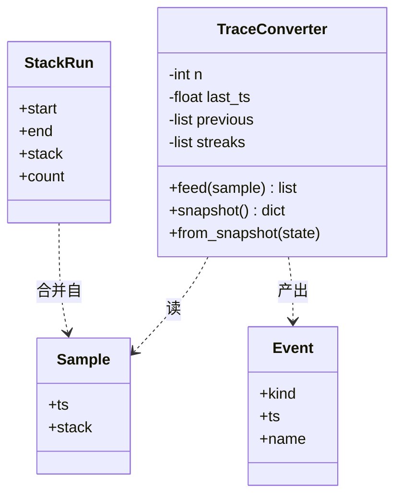

# 设计题解：流式调用栈处理器（Streaming Stack Trace Processor）

## 题目与澄清

采样式性能分析器（sampling profiler）不会记录每次函数调用，它每隔一小段时间看一眼程序此刻的调用栈，得到一个 `Sample(ts, stack)`：`ts` 是时间戳，
`stack` 是从最外层函数到最内层函数的名字列表。把一长串采样变成"哪个函数在什么时候开始、什么时候结束"的事件流，就是这个组件的工作：
相邻两个采样的栈取最长公共前缀，前缀之外的旧部分结束、新部分开始。再加上四件事：可以要求一个函数连续出现 N 次才算数（确认过滤）；
输入可以无限长，处理必须惰性、内存只和栈深有关；相邻相同的栈可以合并成一段；整个状态可以导出成快照，换一个进程接着算，输出要和没中断过的完全一样。
这是一个纯内存的流处理组件：没有数据库、没有网络、没有线程，只有三个只读的记录类（`Sample`、`Event`、`StackRun`）和四个公开入口。

开工前先把合同用自己的话写成规则，每一条都会有测试在等着：

1. **帧由完整前缀识别**：一个栈帧是"从根到它自己的整条有序路径"，不是名字。递归的同名帧在不同深度是不同的帧；根换了，叶子名字一样也是另一个帧，要先结束再开始。
2. **一个采样里先结束后开始**：旧栈里不在公共前缀内的帧，从叶到根依次结束；新栈里不在公共前缀内的帧，从根到叶依次开始。事件的时间戳是当前采样的，名字原样。
3. **没看见的就不写**：栈完全相同不产生任何事件；空栈结束所有已开始的帧；输入耗尽时不补结束事件，因为采样之间程序到底做了什么没人知道。
4. **确认**：`confirmations=N` 时，一个帧要在同一完整前缀连续出现的第 N 个采样才开始，时间戳用这第 N 个采样的，不回填到第一次出现。
   保留下来的父帧在子帧变化时保留自己的次数；一次中断就把受影响的次数清零，分开的几段不会加起来。已确认的帧在前缀消失的那个采样立刻结束，且先于新帧的开始；从未确认的帧没有结束事件。
5. **惰性**：`convert_samples` 在开始迭代之前不读任何采样；当前采样的事件还没产完，就不读下一个。工作状态与最大栈深成正比，不保留全部历史。
6. **压缩**：`compress_samples` 把相邻且完全相同的栈合成 `StackRun(start, end, stack, count)`；`start`、`end` 是第一个和最后一个被合并采样的时间戳，不是推出来的时长；
   读到第一个不同的采样就先产出前一段；空栈合法；不相邻的相同栈是两段；不做确认过滤。
7. **先校验再提交**：时间戳是精确类型 `int` 或 `float`、有限、非负、同一条流内严格递增，`bool`、NaN、无穷、重复或倒退都是 `ValueError`；大整数按精确数值比较；
   名字是非空字符串，空白与 Unicode 合法。整个采样校验并复制完才改状态，失败的 `feed` 不消耗它的时间戳。
8. **快照**：`snapshot()` 返回恰好五个键 `version`、`confirmations`、`last_ts`、`previous`、`streaks`；`from_snapshot` 校验结构、不产生事件、续跑输出与不中断完全一样。

开口前值得问的澄清问题，每一个都会改变代码：

- **时间戳之间会不会相等或倒退？** 合同要求严格递增，违反就抛 `ValueError`。所以转换器只需要记住"上一个时间戳"，不需要缓冲和排序；乱序是调用方在转换器前面解决的问题（见扩展与追问）。
- **`True` 算不算 `1`？** 不算。`bool` 是 `int` 的子类，`isinstance(True, int)` 为 `True`，所以"精确类型"要用 `type(x) is int`。时间戳、`confirmations`、快照里的 `version` 和次数都是同一条规则。
- **时间戳可以是多大的整数？** 任意大，甚至超出 `float` 的范围。`math.isfinite(10**400)` 会抛 `OverflowError`，所以有限性检查只对 `float` 做；`int` 与 `float` 混合比较直接用 Python 的 `<`、`<=`，它按精确数值比较，不先把整数转成 `float`。
- **压缩要不要做确认过滤？** 不要。压缩只看完整栈相等，每一个采样都计入 `count`。
- **失败的调用之前已经产出的结果怎么办？** 不撤回：生成器已经 `yield` 出去的东西收不回来，后面的采样非法就在那一步抛错。
- **快照里的次数从哪里来、能不能还原出历史？** 不需要也不能：次数就是状态本身，只检查结构（范围、父不小于子），不重建历史。
- **并发？** 不在范围内，调用是顺序的。

范围之外：乱序与迟到的采样、多线程调用同一个转换器、持久化格式的版本迁移。后两者和乱序都在 `## 扩展与追问` 里说清楚怎么加、加在哪里。

## 需求与分级

**第 1 关（约 15 分钟，`confirmations=1` 的转换）**：`TraceConverter.feed` 与公共前缀。这一关定下三件事：状态只存"上一个栈"；先算公共前缀长度 `keep`，再从叶到根结束 `keep` 之后的旧帧，最后从根到叶开始 `keep` 之后的新帧；
事件的时间戳与名字原样。示例：`("main","read")` 之后是 `("main","write")`，得到 `end read`、`start write`；`("a","x")` 变成 `("b","x")`，得到 `end x`、`end a`、`start b`、`start x`。

**第 2 关（约 15 分钟，确认）**：每层前缀一个连续次数。保留的前缀次数加一（封顶 N），其余层重新从 1 开始；"已确认"就是次数等于 N。结束只对已确认的帧产生；开始只对本次刚满 N 的帧产生。
示例（`confirmations=2`）：`("m","x")`、`("m","y")`、`("m","y")` 依次进来，得到 `start m`（第 2 个采样）和 `start y`（第 3 个采样）；`x` 只出现一次，从未确认，没有任何事件。

**第 3 关（约 15 分钟，惰性与压缩）**：`convert_samples` 与 `compress_samples` 都是生成器。前者是"逐个 `feed`，把事件 `yield from` 出去"；后者保存当前这一段的首尾时间与计数，遇到不同的栈就产出。
这一关的细节在"什么时候读下一个采样"：转换时是当前采样的事件产完之后，压缩时是读到第一个不同的采样就立刻产出前一段。

**第 4 关（约 15 分钟，校验与快照）**：校验函数（时间戳、名字、整个采样、整个快照）都是只读的纯函数，先全部通过才写状态；`snapshot` 和 `from_snapshot` 互为逆操作，两边都复制列表。
这一关还要把"续跑输出与不中断逐字相同"用随机流证明，而不是只测几个例子。

**反思（约 5 分钟）**：三个问题——采样还原不了哪些事件、只看最后 N 个采样的处理器比长期运行的少知道什么、乱序采样怎么处理而内存不无限增长——答案骨架在 `## 扩展与追问`。

## 核心对象与职责

| 类或函数 | 单一职责 | 它拥有的不变量 |
|---|---|---|
| `Sample` / `Event` / `StackRun` | 冻结的记录，只携带数据 | 不可变；相等按字段比较，所以测试可以直接 `==` |
| `TraceConverter` | 持有"上一个栈、每层连续次数、上一个时间戳"，把一个采样转成事件列表 | `streaks` 与 `previous` 等长；父层次数不小于子层；状态只在校验全部通过之后写 |
| `check_*` 校验函数 | 判断一个值、一个采样或一个快照是否合法，返回干净的拷贝 | 只读：失败时不碰任何状态 |
| `convert_samples` / `compress_samples` | 把采样流变成事件流或段流 | 惰性；只保留当前一个采样与当前一段 |

转换器没有子对象，也没有帧对象：每一层只需要一个名字和一个次数，放在两个等长的列表里。`Sample`、`Event`、`StackRun` 在真实工作区里来自只读的记录文件，解里的写法与之完全相同。
校验函数不是类：它们没有要记住的状态，一个函数一个判断，比"校验器类"少一层没有用处的间接。



## 关键设计决策

### 决策一：状态存成什么——两个等长的列表，还是帧对象的树，还是全部历史

**问题**：转换器要在两个采样之间记住足够的信息，才能算出下一个采样的事件，而且这份信息要能原样导出成快照、恢复后输出不变。

选项一：**保留完整历史**，每来一个采样就回头看最近 N 个采样来判断确认。写法最直白，但内存随 N 线性增长，输入无限长时还得自己裁剪窗口；
快照要把窗口整个存下来，窗口之前的历史又丢了，恢复后的行为和不中断就不一样（反思第二问）。

选项二：**帧对象**：`Frame(name, streak, children)` 组成一棵树或一个链表，每个活动的帧是一个对象。看起来更"面向对象"，但这里的帧只有两个属性，没有行为；
树的形状又被"栈只有一条当前路径"限制成了一条链。这是 Java 式的"每个概念一个类"，换来的是快照要写序列化、恢复要重建对象，没有换到任何能力。

选项三：**两个等长的列表**：`previous` 是上一个栈的名字，`streaks` 是每层前缀的连续次数。状态大小等于栈深；导出快照就是复制这两个列表加两个标量；
恢复就是把它们放回去。

选择选项三。两个列表正好是快照的形状，所以"导出、恢复"没有任何翻译，续跑相同的证明也就只剩"`feed` 只依赖这四项状态"。
不用任何设计模式：没有观察者，没有状态模式。反例就是选项二：它是"为扩展性建类"的典型，扩展性并没有增加。

### 决策二：怎么表示"已确认"——存一个标志，还是由次数推出来

**问题**：N=3 时，一个帧出现第 3 次才开始。之后它出现再多次都不再产生事件，直到它的前缀消失才产生 `end`。转换器必须知道每一层"开过没有"。

选项一：**每层存一个 `opened` 布尔**，和次数并排两个列表。查询直接，但出现了两份可以互相矛盾的状态：次数是 1 而 `opened` 为真，或次数是 N 而 `opened` 为假。
每次修改都要同步两处，快照校验还要多一条"两者一致"的规则；一旦恢复出一个矛盾的快照，之后的输出没有定义。

选项二：**次数封顶 N，已确认就是次数等于 N**。已确认不再是独立的状态，而是次数的函数，两份状态不可能矛盾。
再加一条结构规则——父层的次数不小于子层——已确认的层就恰好是栈的一段前缀，结束事件只要"从最后一个已确认的层往根数到公共前缀为止"。

选择选项二：存的状态越少，要维护的不变量越少。代价是 `feed` 里要算一次"已确认的层数"（对次数列表求和，O(栈深)），
这和公共前缀本来就要走一遍栈同阶，没有额外的复杂度。

### 决策三：惰性怎么做——生成器函数，还是一个迭代器类，还是 `itertools.groupby`

**问题**：`convert_samples` 要在迭代开始前不读任何采样，在当前采样的事件产完之前不读下一个；`compress_samples` 要在读到第一个不同的采样时就产出前一段。

选项一：**一个迭代器类**，自己实现 `__iter__` 和 `__next__`，保存"待产出的事件队列"和"输入迭代器"。可行，但要手写状态机："队列空了就读下一个采样，再空就继续读"。样板代码比逻辑还长。

选项二：**生成器函数**：`for sample in samples: yield from converter.feed(sample)`。`for` 循环只在 `yield from` 里的事件被取完之后才推进输入，两条惰性规则是控制流自然带来的。

压缩有一个类似的选项：**`itertools.groupby`** 按栈分组再合成 `StackRun`。它很短，但校验也要放进去，并且每个分组要先被完整取出来才知道 `end` 和 `count`；
用一个显式的"当前段"（`start`、`end`、`stack`、`count` 四个局部变量）更直接，也更容易看出"读到第一个不同的采样就产出"。

选择生成器函数，并且让 `convert_samples` 是**普通函数加内部生成器**：它在被调用时就校验 `confirmations`（构造转换器，不读采样），
再返回 `_stream_events(...)` 这个生成器。这样 `convert_samples([], 0)` 立即抛错而不是等到第一次迭代，而"迭代开始之前不读采样"这一条依然成立。

### 决策四：怎么做到失败不留痕迹——先校验再提交，还是边改边回滚

**问题**：`feed` 要在名字非法或时间戳非法时抛 `ValueError`，而且这次调用不能消耗它的时间戳，不能影响连续次数。

选项一：**边改边回滚**：先更新状态，出错就 `try/except` 里恢复旧值。要保存的"旧值"一多，回滚就漏；而且异常发生在改了一半之后，别的线程或回调看到的是半成品。

选项二：**先校验、再计算、最后一次赋值**。校验函数只读，返回干净的拷贝（`(ts, names)`）；事件和新的次数列表都是新对象；最后一行把三个状态变量一起赋值。
这样校验通过之后就没有可能失败的步骤，"失败不留痕迹"是结构保证，不靠记性。

选择选项二：这是"先校验再提交"（validate, then commit），`check_sample` 的拷贝同时解决了别名问题——调用方之后再改自己的列表，转换器里的 `previous` 不受影响。
`feed` 里不用 `try/except`，也不用 `assert` 做安全检查；非法就抛具名的 `ValueError`。

### 决策五：快照是什么——一个 dict，还是一个 Memento 类，还是 `pickle`

**问题**：快照要跨进程保存和恢复，字段固定，结构非法就拒绝。

选项一：**`Snapshot` 类（备忘录模式，Memento）**：一个冻结的数据类，转换器返回它，`from_snapshot` 接收它。看上去类型更清楚，
但合同规定了返回普通的 `dict`，字典的五个键就是格式，调用方可能用 JSON 存它；类要多写一次"类到字典"的转换，没有换到东西。

选项二：**`pickle` 整个转换器**：一行搞定，但对象内部结构一变，旧快照就读不回来；`pickle` 还能执行任意代码，不应该用来读外部输入。

选项三：**`dict` 加一个只读的 `check_snapshot` 函数**：导出时复制列表，恢复时先校验、再复制回去。

选择选项三，并且拒绝备忘录模式：这里的"备忘录"就是一个只有五个键的字典，再包一层类只会增加代码，不增加保证。
真正要保证的是两件事：结构校验（五个键、版本、等长、次数范围、父不小于子）和所有权（导出、恢复都复制列表）。

## 代码走读

先看整份参考解，再看五个设计决定在代码里出现的位置：

%% code:begin solution.py %%
```python
"""流式调用栈处理器（Streaming Stack Trace Processor）参考解。

设计五句话：
1. 转换器只记住"上一次观察到的完整栈"和"每一层前缀连续出现了几次（封顶 N）"，状态大小只和栈深有关。
2. 一层栈帧由它的完整前缀识别，所以只比较两个栈的最长公共前缀，前缀之外的旧帧结束、新帧开始。
3. "是否已确认"不单独存：连续次数等于 N 就是已确认，快照因此只有两个数组，恢复后行为逐字相同。
4. 每个采样先整体校验、复制，再一次性写入状态；失败的调用不留任何痕迹。
5. `convert_samples` 与 `compress_samples` 都是生成器：先产出手上已完成的结果，再读下一个采样。
"""

from __future__ import annotations

import math
from collections.abc import Iterable, Iterator
from dataclasses import dataclass
from typing import Any

SNAPSHOT_KEYS = frozenset({"version", "confirmations", "last_ts", "previous", "streaks"})


@dataclass(frozen=True)
class Sample:
    """一次采样：时间戳和从最外层到最内层的栈。"""

    ts: float
    stack: tuple[str, ...]


@dataclass(frozen=True)
class Event:
    """一次观察到的转移：kind 只有 "start" 和 "end"。"""

    kind: str
    ts: float
    name: str


@dataclass(frozen=True)
class StackRun:
    """相邻且完全相同的栈合并成一段：首尾采样时间和采样个数。"""

    start: float
    end: float
    stack: tuple[str, ...]
    count: int


# ---------------------------------------------------------------- 校验：只读、不改任何状态

def check_confirmations(value: Any) -> int:
    """确认次数必须是正的 int；bool 是 int 的子类，所以用 type() 精确比较。"""
    if type(value) is not int or value < 1:
        raise ValueError(f"confirmations must be a positive int, got {value!r}")
    return value


def check_timestamp(ts: Any, last: float | None) -> float:
    """精确类型 int 或 float、有限、非负，并且严格大于上一个时间戳。

    int 与 float 直接用 Python 的精确比较；绝不把 int 转成 float，否则 2**53 与 2**53+1 会变成同一个数。
    `math.isfinite` 只对 float 调用：对超出 float 范围的大整数它会溢出。
    """
    kind = type(ts)
    if kind is not int and kind is not float:
        raise ValueError(f"timestamp must be int or float, got {kind.__name__}")
    if kind is float and not math.isfinite(ts):
        raise ValueError(f"timestamp must be finite, got {ts!r}")
    if ts < 0:
        raise ValueError(f"timestamp must be nonnegative, got {ts!r}")
    if last is not None and ts <= last:
        raise ValueError(f"timestamp must increase: {ts!r} after {last!r}")
    return ts


def check_names(names: Any) -> tuple[str, ...]:
    """栈必须是由非空字符串组成的 list 或 tuple；返回一份拷贝，调用方之后再改也不影响状态。"""
    if not isinstance(names, (list, tuple)):
        raise ValueError(f"stack must be a list or tuple, got {type(names).__name__}")
    copy = tuple(names)
    for name in copy:
        if not isinstance(name, str) or not name:
            raise ValueError(f"frame name must be a nonempty string, got {name!r}")
    return copy


def check_sample(sample: Sample, last: float | None) -> tuple[float, tuple[str, ...]]:
    """校验整个采样并返回干净的 (时间戳, 栈拷贝)；任何一项不合格都在写入之前抛出。"""
    return check_timestamp(sample.ts, last), check_names(sample.stack)


def check_snapshot(state: Any) -> tuple[int, float | None, list[str], list[int]]:
    """快照的结构检查：五个键、版本、数组等长、连续次数在 1..N 且父层不小于子层。"""
    if not isinstance(state, dict) or set(state) != SNAPSHOT_KEYS:
        raise ValueError("snapshot must be a dict with exactly the five snapshot keys")
    if type(state["version"]) is not int or state["version"] != 1:
        raise ValueError(f"unsupported snapshot version {state['version']!r}")
    n = check_confirmations(state["confirmations"])
    previous, streaks, last = state["previous"], state["streaks"], state["last_ts"]
    if not isinstance(previous, list) or not isinstance(streaks, list) or len(previous) != len(streaks):
        raise ValueError("previous and streaks must be lists of equal length")
    names = list(check_names(previous))
    if last is None:
        if names:
            raise ValueError("last_ts is None only when both lists are empty")
    else:
        check_timestamp(last, None)
    for i, count in enumerate(streaks):
        if type(count) is not int or not 1 <= count <= n:
            raise ValueError(f"streak {count!r} must be an int in 1..{n}")
        if i and count > streaks[i - 1]:
            raise ValueError("a parent's streak must be at least its child's")
    return n, last, names, list(streaks)


def shared_prefix(a: list[str], b: tuple[str, ...]) -> int:
    """两个栈从最外层起相同的帧数。"""
    n = 0
    for x, y in zip(a, b):
        if x != y:
            break
        n += 1
    return n


# ---------------------------------------------------------------- 转换器

class TraceConverter:
    """把一串采样逐个转换成 start/end 事件。

    状态只有四项：确认次数 N、上一个时间戳、上一个观察到的栈（含还没确认的帧）、
    每一层前缀的连续观察次数（封顶 N）。已确认的帧恰好是 streaks 中等于 N 的那一段前缀。
    """

    def __init__(self, confirmations: int = 1) -> None:
        self._n = check_confirmations(confirmations)
        self._last_ts: float | None = None
        self._previous: list[str] = []
        self._streaks: list[int] = []

    def feed(self, sample: Sample) -> list[Event]:
        """处理一个采样：先校验，再算事件，最后一次性写入状态。"""
        ts, stack = check_sample(sample, self._last_ts)
        n, old = self._n, self._streaks
        keep = shared_prefix(self._previous, stack)  # 保留的公共前缀
        active = sum(1 for count in old if count == n)  # 旧栈里已确认的层数，总是一段前缀
        # 先结束：只结束已确认且不在公共前缀里的旧帧，从叶子到根
        events = [Event("end", ts, self._previous[i]) for i in range(active - 1, keep - 1, -1)]
        # 公共前缀的连续次数加一，其余层是新前缀，从 1 开始
        streaks = [min(n, old[i] + 1) for i in range(keep)] + [1] * (len(stack) - keep)
        # 再开始：本次刚满 N 的层，从根到叶；已经确认且保留的层不会重复开始
        events += [Event("start", ts, stack[i]) for i in range(min(keep, active), len(stack)) if streaks[i] == n]
        self._last_ts, self._previous, self._streaks = ts, list(stack), streaks
        return events

    def snapshot(self) -> dict:
        """导出全部状态；两个数组是拷贝，调用方改它们不会影响转换器。"""
        return {
            "version": 1,
            "confirmations": self._n,
            "last_ts": self._last_ts,
            "previous": list(self._previous),
            "streaks": list(self._streaks),
        }

    @classmethod
    def from_snapshot(cls, state: dict) -> TraceConverter:
        """校验通过之后恢复出一个新的转换器；不产生任何事件，也不共享调用方的列表。"""
        n, last, previous, streaks = check_snapshot(state)
        converter = cls(n)
        converter._last_ts, converter._previous, converter._streaks = last, previous, streaks
        return converter


# ---------------------------------------------------------------- 惰性流

def convert_samples(samples: Iterable[Sample], confirmations: int = 1) -> Iterator[Event]:
    """惰性转换。确认次数在调用时就校验（不读任何采样）；采样要等第一次迭代才开始读。"""
    return _stream_events(TraceConverter(confirmations), samples)


def _stream_events(converter: TraceConverter, samples: Iterable[Sample]) -> Iterator[Event]:
    for sample in samples:
        yield from converter.feed(sample)  # 当前采样的事件产完，才会读下一个采样


def compress_samples(samples: Iterable[Sample]) -> Iterator[StackRun]:
    """把相邻且完全相同的栈合并成段。读到第一个不同的采样就立刻产出前一段，不再往前看。"""
    last: float | None = None
    start = end = 0.0
    stack: tuple[str, ...] | None = None
    count = 0
    for sample in samples:
        ts, names = check_sample(sample, last)
        last = ts
        if names == stack:
            end, count = ts, count + 1
            continue
        if stack is not None:
            yield StackRun(start, end, stack, count)
        start, end, stack, count = ts, ts, names, 1
    if stack is not None:
        yield StackRun(start, end, stack, count)


if __name__ == "__main__":
    demo = [Sample(1, ("main",)), Sample(2, ("main", "read")), Sample(3, ("main", "write")), Sample(4, ())]
    for event in convert_samples(demo):
        print(event)
```
%% code:end %%

**一、校验是只读的纯函数（决策四）**：`check_timestamp`、`check_names`、`check_sample`、`check_snapshot` 都只返回值或抛 `ValueError`，没有一行写状态。
`check_timestamp` 里的三个细节是整道合同里最容易错的：`type(ts) is int` 排除 `bool`；有限性只对 `float` 检查，因为 `math.isfinite(10**400)` 会抛 `OverflowError`
（对大整数调用它就是在做隐式的 `float` 转换）；`ts <= last` 直接比较 `int` 与 `float`，Python 对它们做精确比较，所以 `2**53+1` 大于 `float(2**53)`，
而先转成 `float` 的实现会把它们当成同一个数。

**二、`feed` 的五步（决策一、二）**：先校验；算公共前缀 `keep` 与已确认的层数 `active`；结束 `[keep, active)` 范围内的帧，从叶到根（`range(active - 1, keep - 1, -1)`）；
更新次数（公共前缀加一并封顶，其余从 1 开始）；开始 `min(keep, active)` 之后本次刚满 N 的帧，从根到叶。
`min(keep, active)` 是一个容易写错的边界：公共前缀里已经确认的层（下标小于 `active`）不会重复开始，公共前缀里还没确认的层（下标在 `[active, keep)`）本次次数加一后可能刚满 N，要算进去。
最后一行才一次性赋值，之前的任何步骤抛错，状态都没有被改。

**三、快照就是状态（决策一、五）**：`snapshot` 复制两个列表，`from_snapshot` 先 `check_snapshot` 再造对象，并把校验返回的新列表放进去，不引用调用方的字典。
`check_snapshot` 的次数规则（1 到 N 的精确整数，父不小于子）正是 `feed` 本来就保持的不变量，所以合法的快照恰好是 `feed` 能到达的状态集合的一个结构化描述。

**四、惰性（决策三）**：`convert_samples` 构造转换器之后返回一个生成器；`_stream_events` 里 `for ... yield from` 保证"当前采样的事件产完才读下一个"；
`compress_samples` 的循环里，只有读到的采样与当前段不同才 `yield`，所以最多比"第一个不同的采样"多读零个。
没有任何容器随输入变长：转换器里是两个栈深长度的列表，压缩里是四个局部变量。

**五、没有做的事**：不拷贝成"帧对象"，不写 `Snapshot` 类，不把校验做成类，不加锁。每一个都在决策里说明了理由。

运行示例（`python solution.py` 的演示）：

```
Event(kind='start', ts=1, name='main')
Event(kind='start', ts=2, name='read')
Event(kind='end', ts=3, name='read')
Event(kind='start', ts=3, name='write')
Event(kind='end', ts=4, name='write')
Event(kind='end', ts=4, name='main')
```

## 测试与自检

测试按合同的八条规则分组，每组都有"边界用例"：

- **转换**：先结束后开始的顺序；递归同名帧；根变了的同名叶子；空栈；输入耗尽不补结束。
- **确认**：第 N 次才开始且不回填；保留的父帧保留次数；中断清零；未确认的帧没有结束；父子同一个采样确认时先父后子；`confirmations` 为 `0`、`-1`、`True`、`1.0`、`"2"`、`None` 都拒绝。
- **惰性与压缩**：用一个会计数的迭代器断言"迭代前读了 0 个、第一个事件之后读了 1 个"；压缩在读到第一个不同的采样（第 3 个）之后立即产出前一段；
  用弱引用断言流过的采样没有被保留（任意时刻最多一个活着）。
- **校验**：各种非法的时间戳、栈、快照用 `parametrize` 逐个断言 `ValueError`；`2**53` 与 `2**53+1`、`10**400` 的时间戳；失败的 `feed` 之后快照不变、同一个时间戳还能用。
- **快照**：形状；封顶；两个列表的所有权；恢复后的时间戳必须更大；合法快照往返相等。

最值得讲的是**属性测试（property test）**：证明"续跑相同"不能靠几个例子，要靠很多随机流和每一个快照点。做法分三层：

1. **参照模型（oracle）**：一个完全不带状态的函数，只看完整历史，直接照定义算。第 `j` 个采样的"已确认前缀集合"是"在最近 N 个采样里都是前缀"的那些前缀；
   `end` 是上一个采样已确认、但不再是当前栈前缀的帧（叶到根），`start` 是本采样已确认、上一个采样没确认的帧（根到叶）。
   它和增量实现的写法完全不同，所以两者一致才有说服力。
2. **随机流**：固定种子，字母表只有三个名字，栈深 0 到 5，故意让相邻栈高概率共享前缀、只改末尾或被截短，让次数、封顶、重置都被频繁触发；`confirmations` 在 1 到 5 之间轮换。
3. **每一个快照点**：对每个流的每个切分点 `k`，先喂前 `k` 个，导出快照，经过 `json.dumps` 与 `json.loads` 往返，恢复后继续喂剩下的，断言事件与最终快照都和不中断的相同；
   另有一个测试在**每个采样之后**都重启一次转换器。

```python
def test_resume_gives_identical_output_at_every_snapshot_point():
    for seed in range(400):
        rng = random.Random(1000 + seed)
        samples = as_samples(random_stacks(rng, rng.randrange(0, 26)))   # 随机流
        reference = TraceConverter(n)
        expected = [reference.feed(s) for s in samples]                  # 不中断的输出
        for split in range(len(samples) + 1):                            # 每一个快照点
            head = TraceConverter(n)
            for s in samples[:split]:
                head.feed(s)
            state = json.loads(json.dumps(head.snapshot()))              # 经过 JSON 往返
            resumed = TraceConverter.from_snapshot(state)
            assert [resumed.feed(s) for s in samples[split:]] == expected[split:]
```

自检时再做两件事：一是把参考解里的关键语句故意改坏（把封顶去掉、把恢复出的次数全设成 1、把结束顺序改成从根到叶、先写状态再校验、把时间戳转成 `float` 再比），看测试是不是都会失败；
二是对 `starter.py` 跑同一套测试，必须全部失败。两分钟的演示讲法：用 `confirmations=2` 的例子，喂一个采样、导出快照、恢复、再喂一个，展示 `start` 出现在第二个采样上，然后说"每个快照点都跑过随机流"。

## 扩展与追问

**新需求**

- **按名字过滤或折叠**（只关心某些函数）：在 `convert_samples` 前面加一个生成器，把每个采样的栈映射成过滤后的栈；转换器、快照、压缩都不动。
  注意过滤后栈可能变空或相邻相同，转换器本来就处理这些情况。
- **每个事件带上深度或完整路径**：`Event` 增加字段，`feed` 里从 `stack[: i + 1]` 取路径；`streaks`、快照、压缩不变。
- **同一时刻多线程来的采样按线程分别处理**：每个线程一个 `TraceConverter`，放在一个以线程号为键的字典里；转换器本来就是"每个实例独立状态"，所以类不用改。
- **确认次数按函数不同**：`confirmations` 变成按名字查的函数；`streaks` 的封顶值变成每层一个，快照里要存每层的 N，这是 `version: 2`。

**并发与线程安全**

- 转换器按顺序使用，不加锁；多线程共享一个转换器没有意义，因为顺序本身就是语义。需要并行就按来源分片，每片一个转换器、一条严格递增的流。
- 如果一定要在一个转换器上收多个线程的采样，应该在前面放一个线程安全的队列加单个消费者，而不是给 `feed` 加锁：加锁只保护了内部状态，并不会让到达的顺序变成时间的顺序。

**持久化与规模**（反思三问的答案骨架）

- **采样还原不了哪些事件**：比采样间隔还短的调用；两个采样之间真正的先后与起止时刻（事件时间只是一个范围，`start` 写在第一次看见的采样上，`end` 写在第一次看不见的采样上）；
  栈在两个采样里相同时，中间有没有返回再重新调用。更多的历史也补不回来，因为信息一开始就没有被采到。要更准只能提高采样频率，或者让程序主动上报进出事件。
- **只收到最后 N 个采样与长期运行的处理器相比**：窗口之前就开着的帧会被当成新出现，它们的 `start` 本应属于更早的输出；
  连续次数丢了：用同一段数据，`confirmations=3` 时从头跑得到 `start m` 在时间戳 3；只给最后两个采样得到空；只给最后三个采样得到 `start m` 在时间戳 4，晚了一个采样。
  长期运行的处理器靠快照里的上一个栈和连续次数带着窗口之前的信息，所以快照的大小只和栈深有关，却保留了全部有用的历史。
- **乱序采样而内存不能无限增长**：转换器要求严格递增，所以乱序要在它前面消掉，转换器不改。放一个**重排缓冲**：最小堆按（时间戳，到达序号）排；
  水位线是"见过的最大时间戳减去允许的迟到 K"；时间戳不超过水位线的采样不会再有更早的，按顺序交给转换器。堆里最多是 K 个时间单位内的采样，与流长度无关，代价是输出延迟 K。
  越过水位线才到的采样不能再插入（转换器已经走过了它的时间），只能计数后丢弃或写进旁路，不能撤回已经产出的事件。同一时刻的重复在缓冲里只留先到的。
  多个来源时每个来源各有水位线、整体取最小，某个来源长期没有数据要有空闲超时，否则全局水位线卡住。

  ```python
  def reorder(samples, lateness):
      heap, newest, emitted, tie = [], -math.inf, -math.inf, itertools.count()
      for s in itertools.chain(samples, [None]):                  # None：输入结束，冲出全部
          if s is not None and s.ts > emitted:                    # 已越过的时间戳不能再插入
              heapq.heappush(heap, (s.ts, next(tie), s))
              newest = max(newest, s.ts)
          mark = math.inf if s is None else newest - lateness     # 水位线之下不会再有更早的
          while heap and heap[0][0] <= mark:
              ts, _, out = heapq.heappop(heap)
              if ts > emitted:                                    # 同刻重复只留先到的
                  emitted = ts
                  yield out
  ```

- **快照落库**：五个键直接是一行 JSON，`version` 用来迁移；恢复用 `from_snapshot`，它拒绝一切结构不对的输入，所以损坏的快照不会悄悄地产出错误的事件。
- **规模**：状态是 O(栈深)，每个采样 O(栈深) 时间；要处理很多条独立的流，就是很多个转换器加很多个快照，不需要改类。

## 常见错误

- **按名字识别帧**：递归的同名帧被当成同一个，`("f",)` 变成 `("f","f")` 就没有任何事件。用完整前缀。
- **根变了只看叶子名字**：`("a","x")` 到 `("b","x")` 时叶子 `x` 没变就不产生事件，漏掉了 `end x`、`start x`。公共前缀是从根起算的。
- **先开始后结束，或结束从根到叶**：同一个采样里的顺序是旧后缀叶到根、再新后缀根到叶。
- **确认时间戳回填**：N=2 时 `start` 写成第一次出现的时间。合同要用确认那个采样的时间。
- **把保留的父帧次数清零**：子帧变化时把整条栈的次数都重置，父帧永远确认不了。只有公共前缀之外的层才从 1 开始。
- **次数不封顶**：N=2 的帧出现 5 次后快照里次数是 5，被"1 到 N"的校验拒绝，恢复失败。
- **用 `isinstance(x, int)` 判断精确类型**：`True` 被当成 `1`。用 `type(x) is int`。
- **对大整数调用 `math.isfinite` 或先转 `float` 再比较**：前者抛 `OverflowError`，后者让 `2**53+1` 和 `2**53` 相等。
- **先改状态再校验**：非法名字出现在栈的最后一个元素时，前面的名字已经写进了状态。
- **返回或保存调用方的列表**：`snapshot()` 返回内部列表，调用方一改就破坏转换器；`from_snapshot` 保存传入的列表，两个恢复出的转换器共享状态。
- **压缩里提前读下一个**：为了"看看是不是最后一段"而多读一个采样，违反"读到第一个不同的采样就产出"，对无限流会卡住。
- **在 `convert_samples` 里把采样收集成列表**：`list(samples)` 让惰性消失，内存也随输入增长。
- **Java 味**：为帧建 `Frame` 类、为快照建 `Snapshot` 类、为校验建 `Validator` 类、写 `getPrevious()`。这里的状态是两个列表，三个记录类加一个转换器就够了。

## 45 分钟怎么分配

- **0–5 分钟｜读合同，写规则**：把八条规则逐条用自己的话改成断言，先问清"时间戳是否严格递增""`True` 算不算 1""大整数怎么比""压缩要不要做确认"。
  对编程智能体说的第一句话也是这份清单，加上两个小例子（`confirmations=1` 的转换和 `confirmations=2` 的确认），而不是"写一个栈处理器"。
- **5–10 分钟｜定骨架**：口头说出结构：两个等长的列表加一个时间戳；已确认是次数等于 N；校验是只读函数；两个入口都是生成器。
  让智能体起草校验函数（输入输出清楚、容易验证）；"已确认由次数推出""先校验再提交"这两个决定自己定。
- **10–22 分钟｜第 1、2 关**：先通过公开测试里的转换与确认；每次只给智能体一个失败用例。自己写"递归同名帧"和"根变了的同名叶子"两个测试，这两个是智能体最容易写错的地方。
- **22–32 分钟｜第 3、4 关**：惰性、压缩、校验、快照。读智能体的 diff：失败的 `feed` 有没有先动状态，`snapshot` 返回的是不是内部列表，`convert_samples` 有没有把输入收集成列表。
- **32–40 分钟｜补测试**：公开测试只有五条。补参照模型加随机流的属性测试，每个快照点续跑一次；补 `2**53` 与 `2**53+1` 的时间戳。
- **40–45 分钟｜短文**：三个问题各一百五十字：采样给不出的信息、窗口处理器缺什么、乱序用水位线加重排堆。不要留到最后一分钟。

时间不够时的取舍：先砍乱序缓冲的代码（口述水位线），再砍压缩的校验细节，再砍弱引用的测试；
**绝不能砍的是**：帧按完整前缀识别、先结束后开始的顺序、确认的次数规则、先校验再提交、快照复制列表、续跑相同的属性测试。

## 延伸阅读

- [[python.context-iterators|上下文管理器、迭代器与生成器]]：生成器、`yield from` 与"产出之后才读下一个"的写法。
- [[problems.components.task-scheduler|任务调度器（Task Scheduler）]]：最小堆按（时间，序号）出队，和乱序缓冲用的是同一种结构。
- [[oop.values|值对象与不可变性（Value Objects）]]：冻结的记录类为什么可以直接用 `==` 比较。
- 知识树里的相关叶子：迭代器设计（Iterator Design）、流式处理大文件（Streaming Large Files）、日志处理与聚合（Log Processing）、持久化与恢复（Persistence & Resume）、边界校验（Validate at the Boundary）、时间与数字（Time & Numbers）。
- [Python 文档：生成器与 yield from](https://docs.python.org/3/reference/expressions.html#yield-expressions)：`yield from` 的语义。
- [Python 文档：heapq](https://docs.python.org/3/library/heapq.html)：最小堆与（优先级，序号，数据）三元组。
- [Python 文档：数值类型的比较](https://docs.python.org/3/library/stdtypes.html#numeric-types-int-float-complex)：`int` 与 `float` 混合比较的精确规则。
