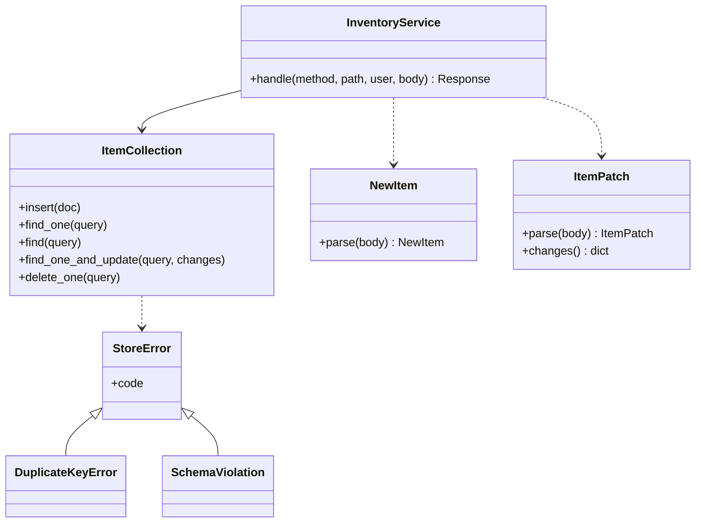
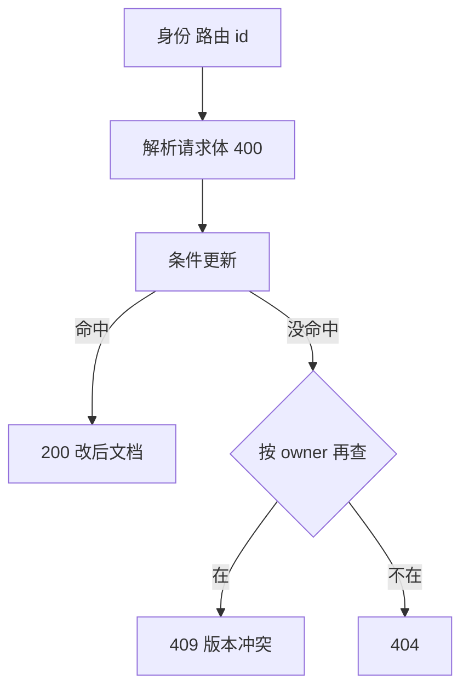

# 设计题解：库存 API 修复（Stockroom Inventory）

## 题目与澄清

Stockroom 是一个私有的库存接口：每个用户管理自己的库存条目（SKU、名称、数量），通过 HTTP 创建、查看、列出、修改、删除。
线上的症状有三个：创建返回成功，条目却不见了；更新返回的是更新之前的数据；用户能读到、改到别人的条目。
你拿到的是一个能跑但有缺陷的 `InventoryService`，它背后是 MongoDB 集合，HTTP 适配器（读请求头、解析 JSON、把 `Response` 写回）已经写好。
任务是修好服务，不换掉持久化，同时保持对外的名字、签名和返回形状不变。这类题评的不是你会不会写 CRUD，而是你会不会读合同、找缺陷、
把"检查"和"修改"放进同一次库操作，并且用测试证明每一条。

公开接口只有两个：`InventoryService(collection)` 和 `handle(method, path, user, body=None) -> Response`。`Response` 有整数 `status` 和 `body`
（条目字典、条目列表、错误字典，或删除时的 `None`）。数量与版本在返回值里必须是 Python 整数。

先把合同用自己的话写成九条，这是开工前的第一件事：

1. **身份**：`user` 必须是字符串，且去掉首尾空白后非空，否则 `401 unauthorized`。存进库的 `owner` 是原样的 `user`，首尾空格也保留，所以 `" alice "` 与 `"alice"` 是两个用户。
2. **路由与顺序**：路径只有 `/items` 和 `/items/{id}`，其余 `404 not_found`；`id` 必须恰好 24 个十六进制字符（大小写都收，返回一律小写），否则 `400 invalid_id`；
   合法路径上不支持的方法 `405 method_not_allowed`。检查顺序是**身份、路由、id、方法**，最后才看 body。
3. **错误体**：恒为 `{"error": 代码}`，不带异常文本、不带堆栈。
4. **创建**：body 的键恰好是 `sku`、`name`、`quantity`。`sku` 是 1 到 24 个大写字母、数字或连字符（区分大小写）；`name` 去掉首尾空白后，按 UTF-16 码元数算，长度 1 到 80，存的是去空白后的名字；
   `quantity` 是 0 到 1000000 的整数，`int`、整数值的 `float`、整数值的 `Decimal` 都算，布尔、字符串、`None` 都不算。违反任何一条 `400 invalid_input`。
   成功必须先写进库，再返回 `201` 和库里的 `{id, owner, sku, name, quantity, version}`，`version` 为 1；调用方不能指定 `owner`、`id`、`version`。
5. **读**：`GET /items` 返回当前用户自己的条目，按 `sku` 升序、再按 `id` 升序，空列表也是 200；`GET /items/{id}` 返回一条；不存在与别人的条目一样，都是 `404 item_not_found`。
6. **删**：只删自己的，成功返回 `Response(204, None)`；再删一次 404。
7. **改**：body 的键只能是 `name`、`quantity`、`version`；`version` 必填，是 1 到 9223372036854775806 的整数；`name` 与 `quantity` 至少给一个。
   顺序是：**先校验整个请求（400），再按 owner 加 id 找条目（404），最后比较版本（409 `version_conflict`）**。成功返回更新后的条目，版本加一，哪怕值没有变化也加；
   任何失败都不能改动任何字段或版本；`owner`、`sku`、`id` 永远不变。
8. **唯一**：同一个用户下 `sku` 唯一，重复创建 `409 sku_conflict` 且不新增条目，并发也一样；不同用户可以用同一个 `sku`。
9. **存储错误**：库的重复键错误码是 11000，对应 409 `sku_conflict`；模式校验失败的错误码是 121，对应 400 `invalid_input`；其余存储错误是 `503 storage_unavailable`。

三个必须当场问清、答案会改代码的澄清问题：

- **孤立代理项算什么？** JSON 里可以写出 `"\ud800"` 这样单独的代理项（surrogate），它在 Python 里是合法字符串，却无法编码成 UTF-8，存进库会抛异常。合同没说，参考解把它当作 `400 invalid_input`：
  这是调用方给的坏数据，不是存储故障。
- **更新没命中时，404 和 409 谁先？** 合同给了：条目不存在或不是你的是 404，是你的但版本不对才是 409。所以一条原子的条件更新没命中之后，还要按 owner 再查一次才能分清；
  对别人的条目发一个错误的版本，得到的是 404，不是 409，否则 409 会泄露"这个 id 存在"。
- **版本的上限为什么是 9223372036854775806？** 64 位有符号整数的最大值是 9223372036854775807，更新要加一，所以请求里的版本最多到少一的那个数。
  `float(9223372036854775806)` 在浮点里会变成 2 的 63 次方，已经越界，所以浮点形式的版本在这个边界上被拒绝，是对的。

**修复清单**：待修的 `starter.py` 里的 `InventoryService` 有五个缺陷，对应开头说的三个症状，每一条都对应上面的某条规则：

| 症状 | 缺陷 | 违反的规则 |
|---|---|---|
| 创建后条目消失 | 拼出字典就返回，没有 `insert` | 4 |
| 非法数量被收下 | `whole_number(...) or 0`：`None` 和 `0` 都是假值，非法数量悄悄变成 0 | 4 |
| 能读到别人的条目 | 查询只按 id，不带 owner；列表、读取、更新、删除都一样 | 2、5、6、7 |
| 更新返回旧值 | 条件更新要求返回更新之前的行（原版是 `ReturnDocument.BEFORE`），响应就是旧的：版本没加、新值也没有 | 7 |
| 重复 SKU 报 503 | `DuplicateKeyError`（码 11000）和别的存储错误一起落进 503，没有按错误码映射成 409 `sku_conflict` | 8、9 |

**起始代码已经做对的**：身份已按 ECMAScript 空白去除（`not trim(user)`）；id 的大小写已经统一成小写；版本比较已经写在条件更新的过滤条件里，是原子的；模式失败（码 121）已经映射成 400；校验与 404、409 的顺序也是对的。
隐藏测试仍然检查这些，修缺陷时不能把它们改坏。

**和 MongoDB 的差别**：原版跑在真实的 MongoDB 8.0 上。题解里的存储是标准库 `sqlite3`，把 MongoDB 里与这道修复有关的语义逐条对上：

| MongoDB | 这里 |
|---|---|
| 集合加 `$jsonSchema` 验证器 | 一张表加 `SCHEMA` 字典，写入前逐字段检查，失败抛 `SchemaViolation`（码 121） |
| `(owner, sku)` 唯一索引 | `UNIQUE (owner, sku)` 约束，违反抛 `DuplicateKeyError`（码 11000） |
| `ObjectId`，序列化为 24 位小写十六进制 | `secrets.token_hex(12)`，同样是 24 位小写十六进制 |
| `find_one_and_update(..., 返回更新后)`，单文档原子 | 一条 `UPDATE ... RETURNING *`，单语句原子 |
| 其他 `PyMongoError`（连不上、超时） | 其他 `StoreError`，测试里用故障注入模拟 |
| 字符串默认按字节序排序 | `TEXT` 默认 `BINARY` 排序，顺序相同 |
| 多个进程、多个服务实例连同一个库 | 同一个文件上的多个连接，由数据库自己的锁串行语句 |

有一条两边**一样**，也是库存接口修复里最值得记的：库的模式校验只是最后一道网，它会放过产品规则要拦的东西。
例如（在 MongoDB 8.0 上实测，文档没有写明这些细节）模式里的正则以 `$` 结尾，会放过末尾带换行的 SKU；模式里的名字长度按字符数算，80 个表情符号（每个占两个 UTF-16 码元）能通过库的检查，却违反"80 个码元"的规则；
模式里的数量只收整数类型，`2.0` 这样的浮点会被库拒绝，所以服务必须先把整数值的浮点转成 `int`。所以服务的校验不能省，也不能指望库替你报出正确的状态码。

范围之外：HTTP 解析（适配器已写好）、鉴权令牌、分页、软删除、库存流水。并发删除与并发更新同一条目的交错，不在这个练习的负载里。

## 需求与分级

**第 1 关（约 15 分钟，先看清缺陷）**：不改代码，先把九条规则逐条对照现有服务，列出差异清单；然后跑一遍现有测试，看哪几个失败。
这一关的产出是上面那张五行的修复清单，同时标出起始代码已经做对的几条。例子：用户 `dana` 创建 `{"sku": "TOOL-9", "name": " Hammer ", "quantity": 7}` 应得到
`Response(status=201, body={'id': …, 'owner': 'dana', 'sku': 'TOOL-9', 'name': 'Hammer', 'quantity': 7, 'version': 1})`，其中名字已去掉空白；紧接着 `GET` 同一个 id 必须得到同一个字典。

**第 2 关（约 20 分钟，创建与所有者限定）**：让创建真正落库并返回库里读出的值；非法数量不能悄悄变 0；所有读、改、删都带 owner。
这一关决定了"把校验写成一个值"和"每个查询带 owner"两个结构（决策一、决策四）。例子：`dana` 创建的条目，`erin` 用同一个 id `GET`、`PATCH`、`DELETE` 都得到 `404 item_not_found`，
并且之后 `dana` 再读，条目的每个字段和版本都没动。

**第 3 关（约 20 分钟，版本与唯一）**：更新返回更新后的文档（版本检查本来就在条件更新里，保持原子）；没命中时区分 404 与 409；重复 SKU 映射成 409；错误码表。
例子：版本为 1 的条目，`PATCH {"version": 1, "quantity": 3}`（值没变）返回版本 2；再用版本 1 发一次得到 `409 version_conflict`；
`bob` 用不存在的版本 9 去改这条，得到 `404 item_not_found`；用同一个 SKU 再创建得到 `409 sku_conflict`。

**第 4 关（选做，约 15 分钟，并发与书面回答）**：用屏障让十六个线程拿同一个版本同时更新，必须恰好一个 200、十五个 409；
再用两个独立的服务实例连同一个数据库文件重做一遍。然后回答三个书面问题：唯一性为什么必须由数据库保证；构造字典、插入、更新三者的区别；重试安全的增量调整与设置绝对值的区别（见同名的三张卡）。

## 核心对象与职责

| 类 | 单一职责 | 它拥有的不变量 |
|---|---|---|
| `Response` | 状态码加正文的值 | 适配器只靠这两个字段写回 HTTP |
| `StoreError` 及两个子类 | 存储层失败，带错误码 | `DuplicateKeyError` 的码是 11000，`SchemaViolation` 的码是 121，基类是未分类 |
| `ItemCollection` | 条目的持久化：插入、条件查询、条件更新、条件删除 | 每个方法是一次原子操作；`(owner, sku)` 唯一；写入前过模式 |
| `NewItem`、`ItemPatch` | 把请求体解析成合格的值，不合格就是 `None` | 拿到值就一定合格：名字已去空白、数字已是 `int`、更新至少改一项 |
| `InventoryService` | 鉴权、路由、分派，把存储错误翻译成状态码 | 每个库查询都带 `owner`；先校验、后碰库；不保存任何状态 |

`InventoryService` 不拥有任何可变状态：条目全在 `ItemCollection` 里，所以同一个集合上可以并存多个服务实例，这正是"多进程"的缩影。
`NewItem` 与 `ItemPatch` 是冻结的数据类（frozen dataclass），它们存在的唯一理由是把"校验"和"执行"分开：执行代码拿到的一定是合格的值，不会在中途再发现一个坏字段。



一次 `PATCH` 的路径：失败在哪一步，库就停在哪一步之前。



## 关键设计决策

### 决策一：先把请求解析成合格的值，再碰库

**问题**：更新的合同要求"整个请求校验完，才去找条目"。常见的写法把校验和库调用写在同一段里：验一个字段、做一点，再验下一个字段。
只要校验夹在库调用之间，某个分支就可能在已经改了一部分之后才返回 400，也很容易让"400 先于 404"的顺序悄悄变成"404 先于 400"。

**选项一**：边校验边执行，每个字段验完就改一点。短，但失败路径有副作用，顺序靠肉眼维护。

**选项二**：先把 body 解析成一个值，解析不过就返回 `None`，解析过了才进入执行。

```python
patch = ItemPatch.parse(body)      # 名字、数量、版本全部合格才得到值
if patch is None:
    return problem(400, "invalid_input")
row = self.collection.find_one_and_update({**query, "version": patch.version}, patch.changes())
```

**选择**：选项二。校验是纯函数，没有副作用，所以可以脱离数据库单独测；"失败不留痕"不再靠小心，而靠结构：执行代码在拿到值之前根本没有写的机会。
**模式**：这是"解析而不是校验"（parse, don't validate）的一个小例子，不需要任何设计模式的类层次；两个冻结数据类各带一个 `parse` 类方法就够了。

校验里有四个值得单独记住的细节：

- **数字**：先取 `kind = type(value)`，只认 `int`、`float`、`Decimal` 三种；用 `type` 而不用 `isinstance`，因为 `True` 是 `int` 的实例，`isinstance(True, int)` 为真，会让布尔混进来。
  浮点要有限且是整数值，`Decimal` 要有限且等于自己取整；范围比较用原值，不先转 `int`。`Decimal("3.0000000000000001")` 不是整数值，被拒绝，这就是 HTTP 适配器要把小数解析成 `Decimal` 而不是 `float` 的原因：`float` 会把它悄悄舍成 3.0。
- **名字**：先 `trim` 再数长度，数的是 UTF-16 码元：`😀` 是 2 个，`é` 是 1 个，40 个 `😀` 刚好 80。
- **去空白**：必须自己列字符表。Python 的 `str.strip()` 会多剥 `\x1c` 到 `\x1f` 和 `\x85`，又不剥 U+FEFF；ECMAScript 的规则正好相反，所以 `"\x85z\x1f"` 要原样保留，`"\ufeffx"` 要变成 `"x"`。
- **SKU**：用 `fullmatch`，不用 `match` 加 `$`。`$` 在正则里允许匹配在末尾换行之前，`re.match(r"^[A-Z0-9-]{1,24}$", "AB\n")` 是真，`re.fullmatch(r"[A-Z0-9-]{1,24}", "AB\n")` 是假。

### 决策二：版本的检查和加一，做成同一次库操作

**问题**：乐观并发（optimistic locking）要求"只有在你读到的版本还是当前版本时，才能改"。两个客户端同时拿版本 1 来改，只能有一个成功。

**选项一**：先读、在代码里比较版本、再写。

```python
current = collection.find_one({"owner": user, "id": item_id})
if current["version"] != patch.version:
    return problem(409, "version_conflict")
collection.find_one_and_update({"owner": user, "id": item_id}, patch.changes())  # 此时版本可能已经变了
```

比较和写之间有一个窗口：两个请求都读到版本 1、都通过比较、都写入，结果两个都成功，后者覆盖前者，版本只加了一次或两次，取决于怎么写。
给这段代码套一把进程内的锁能让单进程正确，但服务一旦有两个进程，锁就没用了；而且 GIL 只保证单条字节码安全，不让"读、比较、写"变成一步。

**选项二**：条件放进库操作里：`WHERE owner = ? AND id = ? AND version = ?`，修改里同时 `version = version + 1`，一次完成。
命中就是你赢了，没命中就是输了。MongoDB 里是 `find_one_and_update` 加"返回更新后"，sqlite 里是 `UPDATE ... RETURNING *`。

**选择**：选项二。比较与修改的原子性由数据库的单语句（单文档）原子性提供，所以不依赖服务有几个进程。
没命中以后，再按 owner 查一次区分 404 与 409：这一步不要求原子，因为"并发删除"不在负载里。
**模式**：乐观锁，由"条件更新"实现；不需要状态模式或锁对象。

### 决策三：唯一性交给唯一约束，服务只翻译错误

**问题**：同一用户下 SKU 唯一，并发创建也一样。

**选项一**：先查有没有，没有再插。两个请求都查到"没有"，都插入，要么重复，要么（有索引时）后一个抛一个未翻译的异常。
**选项二**：直接插入，让唯一索引裁决，捕获"重复键"并翻译成 409。

```python
try:
    self.collection.insert(doc)        # 不先查
except StoreError as error:
    return problem(*STORE_ERRORS.get(error.code, (503, "storage_unavailable")))
```

**选择**：选项二，并且错误按**错误码**映射，不按消息文本，也不按异常类的名字：`STORE_ERRORS` 是一张字典，`{11000: (409, "sku_conflict"), 121: (400, "invalid_input")}`，
没有登记的码一律 503。这样加一个新的错误码只是加一行，而不是加一个 `except` 分支。异常文本从不放进响应体。
原来的服务把重复键映射成 503，运营看到的是"服务不可用"，客户端会不停重试一个永远失败的请求；409 才告诉调用方"这个 SKU 你已经有了"。
**模式**：这是"错误翻译层"（把存储层的失败翻译成接口层的合同），不是策略模式；一张查表字典比一个类层次简单。

### 决策四：每个查询都带 owner，"别人的"与"不存在"同形

**问题**：用户只能操作自己的条目。

**选项一**：先按 id 取出条目，再比较 `owner`，不一致返回 403。这样"别人的"与"不存在"可以区分，意味着 403 会告诉攻击者"这个 id 存在"；而且读到之后再检查，容易漏在某一条路径（原来的服务漏了所有路径）。
**选项二**：`owner` 作为查询条件的一部分，在每一个读、改、删的库调用里；找不到就是 404。

**选择**：选项二。`ItemCollection` 的查询是一个字典，由调用方决定条件，所以集合并不"知道当前用户"，这与 MongoDB 的行为一致，也是风险所在：忘了写 `owner` 就是越权。
结构上的补救是：`InventoryService` 在一个地方构造 `{"owner": user, "id": item_id}`，三个方法共用；更新时再往里加 `"version"`。
**模式**：不需要。把"当前用户"做成一个会自动加条件的代理（装饰器、中间层）在这个规模上是过度设计：只有五个方法，显式写出来读代码的人一眼就能看到每个调用都限定了所有者。

### 决策五：创建后返回库里读出来的，而不是自己拼的

**问题**：书面问题之一问的是"构造字典、插入字典、更新已存文档"的区别。三者是三件事：字典只在内存里；插入把它交给库，库可以拒绝（重复键、模式不合）；
更新是库里对已存文档的条件修改，修改后的文档只有库知道。

**选项一**：插入成功后直接返回自己拼的字典。省一次读，但返回的可能和库里存的不同（例如库里默认值、类型转换）。
**选项二**：插入成功后按 `owner + id` 读一次，返回读出来的。

**选择**：选项二。合同写的是"返回数据库查询的结果"，一次主键读很便宜，换来的是返回值永远是存储的真相。更新也一样：`RETURNING *` 返回的是**更新后**的行，原来的服务选了"更新前"，所以每个更新的响应都是旧值。

### 决策六：这里不用仓储模式、对象映射或状态机

`ItemCollection` 已经是仓储（repository）：它封装了持久化，对服务只暴露五个方法。再包一层 `ItemRepository` 只会多出一个只转发调用的类，这是常见的 Java 习惯。
条目的版本不是状态机：它只增不减，没有"非法转移"，一次比较就够。对象映射也不需要：条目是五个字段的字典，用 `view` 函数挑出字段就够了。
`InventoryService` 的分派用一个以 `(是否带 id, 方法)` 为键的字典，而不是一串 `if`；这一步不是为了扩展，而是让"405"成为一个自然的结果：查不到处理函数就是 405。

## 代码走读

下面是完整的参考解，之后挑四处看设计决策在代码里的位置。

%% code:begin solution.py %%
```python
"""库存 API 修复（Stockroom Inventory）：参考解。

产品规则（编号即测试编号；原版跑在 MongoDB 上，这里的存储是标准库 sqlite3，语义对齐，见题解）：

1. 身份：`user` 必须是 trim 之后非空的字符串，否则 401 unauthorized；存进库的 owner 是原样的 user（含首尾空白）。
2. 路由：`/items` 与 `/items/{id}`；其余路径 404 not_found。id 必须恰好 24 个十六进制字符（大小写都行，返回一律小写），
   否则 400 invalid_id；合法路径上不支持的方法 405 method_not_allowed。检查顺序：身份 → 路由 → id → 方法。
3. 错误体恒为 `{"error": 代码}`。
4. 创建：body 恰好是 {sku, name, quantity}；sku 为 1..24 位大写字母、数字、连字符；name 去首尾空白后按 UTF-16 码元数
   计 1..80，存去空白后的名字；quantity 为 0..1000000 的整数（int、整数值的 float、整数值的 Decimal 都行，bool、
   字符串、None 不行）。任何不合格都是 400 invalid_input；成功先写库再返回 201 与库里读出的
   {id, owner, sku, name, quantity, version}，version 为 1；owner、id、version 不由调用方给。
5. 读：`GET /items` 只返回自己的条目，按 sku 升序再按 id 升序，可为空；`GET /items/{id}` 返回一条；
   不存在与别人的条目都是 404 item_not_found。
6. 删：只删自己的，成功 `Response(204, None)`；再删一次 404。
7. 改：body 的键只能是 name、quantity、version，version 必填且为 1..9223372036854775806 的整数，name 与 quantity 至少一个。
   先校验完整个请求（400），再按 owner+id 找条目（404），最后比较版本（409 version_conflict）。
   成功返回更新后的条目，version 加一（值没变也加）；任何失败都不改任何字段。owner、sku、id 永不改变。
8. 唯一：同一个 owner 下 sku 唯一，重复创建 409 sku_conflict 且不新增条目，并发也一样；不同 owner 可用同一个 sku。
9. 存储错误：重复键（code 11000）409 sku_conflict，模式校验失败（code 121）400 invalid_input，其余 503 storage_unavailable；
   不泄露异常细节。
"""

from __future__ import annotations

import math
import re
import secrets
import sqlite3
import threading
from dataclasses import dataclass
from decimal import Decimal
from typing import Any

# 题目规定的"空白"是 ECMAScript 那一套：str.strip() 默认会多剥 0x1c-0x1f 与 0x85，又剥不掉 0xfeff，只能自己列码点
BLANK_CODEPOINTS = (
    *range(0x09, 0x0E), 0x20, 0xA0, 0x1680, *range(0x2000, 0x200B), 0x2028, 0x2029, 0x202F, 0x205F, 0x3000, 0xFEFF,
)
WHITESPACE = "".join(map(chr, BLANK_CODEPOINTS))
SKU = re.compile(r"[A-Z0-9-]{1,24}")  # 与 fullmatch 配用：`$` 会放过结尾的换行
ITEM_ID = re.compile(r"[0-9a-fA-F]{24}")
ITEM_PATH = re.compile(r"/items/([^/]+)")
MAX_VERSION = 9223372036854775806  # 留一位给 +1，仍在 64 位有符号整数之内
FIELDS = ("owner", "sku", "name", "quantity", "version")
COLUMNS = ("id", *FIELDS)
STORE_ERRORS = {11000: (409, "sku_conflict"), 121: (400, "invalid_input")}  # 错误码 → 状态与代码


@dataclass
class Response:
    status: int
    body: Any


def problem(status: int, code: str) -> Response:
    return Response(status, {"error": code})


def trim(value: str) -> str:
    return value.strip(WHITESPACE)


def utf16_length(text: str) -> int:
    return len(text.encode("utf-16-le", errors="surrogatepass")) // 2


def valid_name(value: Any) -> str | None:
    """合格就返回去空白后的名字，否则 None。"""
    name = trim(value) if isinstance(value, str) else ""
    return name if 1 <= utf16_length(name) <= 80 else None


def whole_number(value: Any, minimum: int, maximum: int) -> int | None:
    """只认 int、整数值的 float、整数值的 Decimal；bool、字符串、None 都不是数。落在 [minimum, maximum] 才返回 int。"""
    kind = type(value)  # 用 type() 而不是 isinstance：bool 是 int 的子类，必须挡在外面
    if kind is int:
        integral = True
    elif kind is float:
        integral = math.isfinite(value) and value.is_integer()
    elif kind is Decimal:
        integral = value.is_finite() and value == value.to_integral_value()
    else:
        return None
    if not integral or not minimum <= value <= maximum:
        return None
    return int(value)


class StoreError(Exception):
    """存储层失败；code 对应 MongoDB 的错误码，None 表示未分类。"""

    code: int | None = None


class DuplicateKeyError(StoreError):
    code = 11000


class SchemaViolation(StoreError):
    code = 121


# 集合的模式：写入前逐字段检查，等价于 MongoDB 的 $jsonSchema 验证器
SCHEMA = {
    "owner": lambda v: isinstance(v, str) and len(v) >= 1,
    "sku": lambda v: isinstance(v, str) and SKU.fullmatch(v) is not None,
    "name": lambda v: isinstance(v, str) and 1 <= len(v) <= 80,
    "quantity": lambda v: type(v) is int and 0 <= v <= 1000000,
    "version": lambda v: type(v) is int and v >= 1,
}


class ItemCollection:
    """库存集合：每个方法是一次原子操作，条件与修改在同一条语句里完成。

    查询是 {字段: 值} 的字典，和 MongoDB 一样由调用方负责把 owner 写进去：集合本身不知道"当前用户"。
    """

    def __init__(self, path: str = ":memory:") -> None:
        self._lock = threading.Lock()  # 同一连接上的语句串行；跨连接靠数据库自己的锁
        self._db = sqlite3.connect(path, check_same_thread=False, isolation_level=None, timeout=10)
        self._db.execute(
            "CREATE TABLE IF NOT EXISTS items (id TEXT PRIMARY KEY, owner TEXT NOT NULL, sku TEXT NOT NULL,"
            " name TEXT NOT NULL, quantity INTEGER NOT NULL, version INTEGER NOT NULL, UNIQUE (owner, sku))"
        )

    def _run(self, sql: str, args: tuple[Any, ...] = ()) -> list[dict[str, Any]]:
        try:
            with self._lock:
                cursor = self._db.execute(sql, args)
                columns = [c[0] for c in cursor.description or ()]
                return [dict(zip(columns, row)) for row in cursor.fetchall()]
        except sqlite3.IntegrityError as error:
            raise DuplicateKeyError(str(error)) from None
        except UnicodeEncodeError as error:  # 孤立代理项存不进去
            raise SchemaViolation(str(error)) from None
        except sqlite3.Error as error:
            raise StoreError(str(error)) from None

    @staticmethod
    def _where(query: dict[str, Any]) -> tuple[str, tuple[Any, ...]]:
        if not set(query) <= set(COLUMNS):  # 列名只来自白名单，值一律绑定参数
            raise StoreError("unknown field in query")
        return " AND ".join(f"{column} = ?" for column in query) or "1 = 1", tuple(query.values())

    def insert(self, doc: dict[str, Any]) -> None:
        if set(doc) != set(COLUMNS) or not all(SCHEMA[f](doc[f]) for f in FIELDS):
            raise SchemaViolation("document failed validation")
        self._run("INSERT INTO items VALUES (?, ?, ?, ?, ?, ?)", tuple(doc[c] for c in COLUMNS))

    def find_one(self, query: dict[str, Any]) -> dict[str, Any] | None:
        where, args = self._where(query)
        rows = self._run(f"SELECT * FROM items WHERE {where}", args)
        return rows[0] if rows else None

    def find(self, query: dict[str, Any]) -> list[dict[str, Any]]:
        where, args = self._where(query)
        return self._run(f"SELECT * FROM items WHERE {where} ORDER BY sku, id", args)

    def find_one_and_update(self, query: dict[str, Any], changes: dict[str, Any]) -> dict[str, Any] | None:
        """条件与修改在一条语句里：命中就改 changes 并把 version 加一，返回改后的行；没命中返回 None。"""
        if not changes or not set(changes) <= {"name", "quantity"} or not all(SCHEMA[f](v) for f, v in changes.items()):
            raise SchemaViolation("update failed validation")
        where, args = self._where(query)
        assignments = ", ".join(f"{column} = ?" for column in changes)
        rows = self._run(
            f"UPDATE items SET {assignments}, version = version + 1 WHERE {where} RETURNING *",
            (*changes.values(), *args),
        )
        return rows[0] if rows else None

    def delete_one(self, query: dict[str, Any]) -> bool:
        where, args = self._where(query)
        return bool(self._run(f"DELETE FROM items WHERE {where} RETURNING id", args))

    def close(self) -> None:
        self._db.close()


def initialize_items(path: str = ":memory:") -> ItemCollection:
    """建好表与 (owner, sku) 唯一约束再返回集合，对应原版的 initialize_items。"""
    return ItemCollection(path)


@dataclass(frozen=True)
class NewItem:
    """通过校验的创建请求。"""

    sku: str
    name: str
    quantity: int

    @classmethod
    def parse(cls, body: Any) -> NewItem | None:
        if not isinstance(body, dict) or body.keys() != {"sku", "name", "quantity"}:
            return None
        sku, name = body["sku"], valid_name(body["name"])
        quantity = whole_number(body["quantity"], 0, 1000000)
        if not isinstance(sku, str) or not SKU.fullmatch(sku) or name is None or quantity is None:
            return None
        return cls(sku, name, quantity)


@dataclass(frozen=True)
class ItemPatch:
    """通过校验的更新请求：版本必填，名字与数量至少一个。"""

    version: int
    name: str | None = None
    quantity: int | None = None

    @classmethod
    def parse(cls, body: Any) -> ItemPatch | None:
        if not isinstance(body, dict) or set(body) - {"name", "quantity", "version"}:
            return None
        if not {"name", "quantity"} & body.keys():
            return None
        version = whole_number(body.get("version"), 1, MAX_VERSION)
        name = valid_name(body["name"]) if "name" in body else None
        quantity = whole_number(body["quantity"], 0, 1000000) if "quantity" in body else None
        if version is None or ("name" in body and name is None) or ("quantity" in body and quantity is None):
            return None
        return cls(version, name, quantity)

    def changes(self) -> dict[str, Any]:
        """要写的字段：只含请求里给了的。"""
        given = {"name": self.name, "quantity": self.quantity}
        return {field: value for field, value in given.items() if value is not None}


def view(row: dict[str, Any]) -> dict[str, Any]:
    return {"id": row["id"], **{field: row[field] for field in FIELDS}}


class InventoryService:
    def __init__(self, collection: ItemCollection) -> None:
        self.collection = collection

    def handle(self, method: str, path: str, user: str | None, body: Any = None) -> Response:
        signed_in = isinstance(user, str) and bool(trim(user))
        if not signed_in:
            return problem(401, "unauthorized")
        item_id = None
        if path != "/items":
            match = ITEM_PATH.fullmatch(path)
            if match is None:
                return problem(404, "not_found")
            if ITEM_ID.fullmatch(match[1]) is None:
                return problem(400, "invalid_id")
            item_id = match[1].lower()
        handler = {
            (False, "POST"): self._create,
            (False, "GET"): self._list,
            (True, "GET"): self._get,
            (True, "PATCH"): self._update,
            (True, "DELETE"): self._delete,
        }.get((item_id is not None, method))
        if handler is None:
            return problem(405, "method_not_allowed")
        try:
            return handler(user, item_id, body)
        except StoreError as error:
            return problem(*STORE_ERRORS.get(error.code, (503, "storage_unavailable")))

    def _create(self, user: str, _item_id: None, body: Any) -> Response:
        new = NewItem.parse(body)
        if new is None:
            return problem(400, "invalid_input")
        item_id = secrets.token_hex(12)
        self.collection.insert(
            {"id": item_id, "owner": user, "sku": new.sku, "name": new.name, "quantity": new.quantity, "version": 1}
        )
        return self._found(user, item_id, 201)  # 返回库里读出的，而不是自己拼的

    def _list(self, user: str, _item_id: None, _body: Any) -> Response:
        return Response(200, [view(row) for row in self.collection.find({"owner": user})])

    def _get(self, user: str, item_id: str, _body: Any) -> Response:
        return self._found(user, item_id, 200)

    def _found(self, user: str, item_id: str, status: int) -> Response:
        row = self.collection.find_one({"owner": user, "id": item_id})
        return Response(status, view(row)) if row else problem(404, "item_not_found")

    def _update(self, user: str, item_id: str, body: Any) -> Response:
        patch = ItemPatch.parse(body)  # 整个请求先校验完，再碰库
        if patch is None:
            return problem(400, "invalid_input")
        query = {"owner": user, "id": item_id}
        row = self.collection.find_one_and_update({**query, "version": patch.version}, patch.changes())
        if row is not None:
            return Response(200, view(row))
        # 没改到：不存在或是别人的（404），还是版本不对（409），只有按 owner 再查一次才分得清
        return problem(409, "version_conflict") if self.collection.find_one(query) else problem(404, "item_not_found")

    def _delete(self, user: str, item_id: str, _body: Any) -> Response:
        if self.collection.delete_one({"owner": user, "id": item_id}):
            return Response(204, None)
        return problem(404, "item_not_found")
```
%% code:end %%

**第一处：`handle` 的前半段**是检查顺序。身份、路由、id 三步各自提前返回，方法放在最后用字典分派：
这就是"401 先于 404 先于 400 先于 405"，所以一个畸形 id 配上 `POST` 得到 400 而不是 405，一个空白用户去访问不存在的路径得到 401 而不是 404。
`match[1].lower()` 把大小写不同的 id 规范成同一个存储键。

**第二处：`ItemCollection.find_one_and_update`**是决策二。查询条件由调用方给，修改里的 `version = version + 1` 写在 SQL 里而不是 Python 里，`RETURNING *` 让"改"和"读改后的值"成为同一条语句。
它还做了两件小事：列名只来自白名单（`_where` 检查），值一律是绑定参数，所以调用方给的字典不会变成注入；更新前再过一遍模式，所以哪怕服务漏校验，库也会拒绝。

**第三处：`ItemCollection._run`**是错误的出口。`sqlite3.IntegrityError` 变成 `DuplicateKeyError`，不能编码的字符变成 `SchemaViolation`，其他变成 `StoreError`。
服务一侧只认 `error.code`，所以换成真正的 MongoDB 时，只需要把 `_run` 里的这三行换成对 `pymongo.errors` 的处理，服务的映射表不动。

**第四处：`_update` 的结尾**是 404 与 409 的分流。条件更新没命中，意味着"不存在、是别人的、版本不对"三种可能之一，最后再用 `{"owner": user, "id": item_id}` 查一次：查得到就是版本不对。
注意这里的第二次查询**也带 owner**：否则对别人的条目发错误的版本会得到 409，泄露 id 的存在。

## 测试与自检

测试文件有 132 个用例（参数化展开后），分成六组：

- **合同的顺序**：坏身份在所有方法与路径上都是 401；畸形 id 在所有方法（包括 `POST`、`PUT`）上都是 400；合法路径上不支持的方法才是 405。
- **输入边界**：SKU 的 11 种坏值（包括末尾换行）；数量的 13 种坏值（`True`、`2.5`、`NaN`、`10**30`……）以及"不能悄悄变成 0"；名字的 UTF-16 边界；去空白的字符表。
- **所有者限定**：别人的条目读、改、删都是 404，并且之后条目的每个字段和版本都没有变；列表只含自己的，按 SKU 的字节序排列。
- **更新**：返回更新后的文档；值没变也加一；失败的更新（版本错、输入错）不改任何东西；`owner`、`sku`、`id` 不变；先 400、再 404、最后 409。
- **存储错误**：用故障注入让五个库操作各自抛出三种错误，断言状态码与错误体恰好是 `{"error": 代码}`，不含异常文本；创建时的存储故障不留下任何条目。
- **并发**：十六个线程在屏障处同时起跑，同一个版本的更新恰好一个 200；四个服务实例连同一个数据库文件，十二个线程也恰好一个赢；十六个线程同 SKU 创建恰好一个 201；
  六个线程各做二十五次"读版本、按版本加一"，最终的版本等于一加成功次数，没有丢失的更新。

断言的是行为，不读任何私有属性：故障注入靠给实例换掉一个方法，而不是去改内部状态。

**两分钟演示**：先 `POST` 一个条目，看 `201` 和小写的 24 位 id；用大写 id `GET` 同一条；用另一个用户读它，得到 `404`；用版本 1 `PATCH`，得到版本 2；再用版本 1 `PATCH` 一次，得到 `409`；
用同一个 SKU 再 `POST`，得到 `409 sku_conflict`；最后启动十六个线程抢版本，看到恰好一个 `200`。

## 扩展与追问

**新需求**

- **增量调整**（"入库 5 件"）：增量不幂等，重放会累加。给每次调整一个客户端生成的操作号，流水表对 `(owner, op_id)` 建唯一索引，插入流水与改数量在同一个事务里；重复键说明已处理，返回当时的结果。
  数量不能为负，把"数量不小于扣减量"写进更新的条件。改动落在 `ItemCollection`（新增方法）和 `InventoryService`（新增路由）；`NewItem`、`ItemPatch`、错误表不动。
- **按条件列表**（按 SKU 前缀、按数量范围）：`find` 的查询字典多几个条件，`_where` 的白名单扩一个运算符；`handle` 的前半段不动。
- **软删除**：加一个 `deleted` 字段，所有查询加上 `deleted = 0`，`DELETE` 变成更新；但"删除后 SKU 可复用"的合同要改成"唯一约束只对未删除的行有效"（部分索引）。

**并发与线程安全**

- 为什么进程内的锁不够？锁只在一个进程里有效；两个服务进程各持一把锁，照样同时通过检查。唯一性和版本的裁决放在数据库里，是这里唯一能随进程数扩展的做法。
- 同一连接上还有一把线程锁，它保护的是 `sqlite3` 连接对象本身（同一连接上的语句不能交错读取结果），不是业务不变量；业务不变量由语句的原子性保证。
- 并发删除与并发更新的交错：更新没命中后再查一次，这之间条目可能被删，结果是 404 而不是 409，是可以接受的结果，因为两者都说明"这次更新没有生效"。

**持久化与规模**

- 切回 MongoDB：`ItemCollection` 换成一个薄的适配（`insert_one`、`find`、`find_one_and_update(..., return_document=AFTER)`、`delete_one`），查询字典里的 `id` 换成 `_id` 的 `ObjectId`；
  `initialize_items` 里创建带验证器的集合和唯一索引，并且在返回集合之前完成。服务一行不改。
- 列表变大：加游标分页（`id` 大于上一页最后一个），排序键就是 `(sku, id)`，由 `(owner, sku)` 的索引提供；一个用户一万条以内，整页返回也能接受。
- 唯一索引在分片集群里必须包含分片键；若要求 SKU 全局唯一而不是按用户唯一，要换成单独的占位集合来裁决。

## 常见错误

- **创建没有落库就返回 201**：返回值是自己拼的字典，所以测试里"创建、再读取"才会失败。先写、后返回，并返回读出来的。
- **`quantity = whole_number(...) or 0`**：`or 0` 把"非法"（`None`）和"合法的 0"混成一件事，非法数量被悄悄收下；而且当数量真的是 0 的时候，这行代码是对的，所以很难被偶然发现。判断 `is None`。
- **查询只带 id**：这是越权的根源。每个读、改、删的查询都要带 owner；没命中后分流 404 与 409 的那次查询也要带。
- **更新返回旧文档**：返回的行在改之前，它就是旧的。让库在改之后把行返回（`RETURNING`，或 `return_document=AFTER`）。
- **先读后写做版本检查**（起始代码没有这个毛病，修的时候别引入）：窗口里会有第二个请求。检查和修改要在同一次库操作里。
- **重复键映射成 503，或根据异常文本判断**：按错误码映射，登记过的码得到明确的状态，其他才是 503。
- **用 `str.strip()` 去空白**：它的字符表与 ECMAScript 不同。用自己列出的字符表。
- **用 `isinstance(x, int)` 判断数字**：布尔通过了。用 `type(x)`。
- **用 `re.match` 加 `$` 判断 SKU**：末尾换行通过。用 `fullmatch`。
- **以为库的模式校验可以代替服务的校验**：MongoDB 8.0 上实测，它放过末尾换行、按字符而不是 UTF-16 码元数名字长度、拒绝整数值的浮点；而且它出错只给你一个 121，没有任何产品语义。
- **把异常文本放进响应体**：泄露内部信息；响应体恒为 `{"error": 代码}`。
- **测试连到真实库**：测试要用独立的临时库，用完只删自己建的那个。

## 45 分钟怎么分配

项目整体约 75 分钟，其中真正写代码的部分按 45 分钟安排：

- **0 到 8 分钟**：读合同，把九条规则抄成测试的名字。对着现有服务找缺陷，列修复清单；对智能体说清"先列差异，不要改代码"。
- **8 到 18 分钟**：创建落库、数量不能变 0、所有查询带 owner。每一类缺陷先让智能体写一个会失败的测试，你核对期望值，再让它改。
- **18 到 30 分钟**：更新返回更新后的文档（条件更新已经是原子的，保持）、没命中时分流 404 与 409；重复键映射成 409，错误码表。这一段由你自己定设计，不交给智能体。
- **30 到 38 分钟**：并发测试：屏障、同版本更新、同 SKU 创建、两个服务实例。
- **38 到 45 分钟**：回答三个书面问题（各留一两分钟），跑全部测试，再看一遍每个库调用有没有带 owner。

说出声的话：先说顺序（身份、路由、id、方法、校验、库），再说"检查与修改在同一次库操作里"，最后说"唯一与版本由数据库裁决，进程内的锁帮不了多进程"。
时间不够时，先砍列表排序的细项、再砍名字的 UTF-16 边界，**绝不能砍**的是：查询带 owner、版本条件更新、重复键映射、先校验后碰库。

## 延伸阅读

- [[problems.components.kv-store|内存键值存储（In-Memory Key-Value Store）]]：同样的"检查与修改要在一步里完成"，对照一把锁与一条条件语句的分工。
- [[problems.marketplaces.online-shopping|在线购物（Amazon）]]：库存扣减不能为负，对照这里的"数量下限写进更新条件"。
- [[solution-lcp-issue-creation-api|可重试的工单服务（Retry-Safe Issue Service）]]：同样的版本号乐观并发与错误契约，存储在进程内；这里换成数据库里的条件更新。
- 边界校验（Validate at the Boundary）、接口的错误契约（Error Contract）、复合操作（Compound Actions）、内存持久化（In-Memory Persistence）：这个服务依赖的四个知识点，见知识树对应的叶子。
- [MongoDB 文档：findOneAndUpdate](https://www.mongodb.com/docs/manual/reference/method/db.collection.findOneAndUpdate/)：条件与修改在一次原子操作里，以及返回更新前还是更新后的选项。
- [MongoDB 文档：唯一索引](https://www.mongodb.com/docs/manual/core/index-unique/)：重复键错误与并发插入的裁决。
- [MongoDB 文档：模式校验](https://www.mongodb.com/docs/manual/core/schema-validation/)：`$jsonSchema` 验证器能拦什么、不能拦什么。
- [SQLite 文档：RETURNING 子句](https://www.sqlite.org/lang_returning.html)：一条语句里修改并取回行。
- [ECMAScript 规范：TrimString](https://tc39.es/ecma262/#sec-trimstring)：去空白用的字符表。
- [Python 文档：re.fullmatch](https://docs.python.org/3/library/re.html#re.fullmatch)：与 `match` 加 `$` 的区别。
