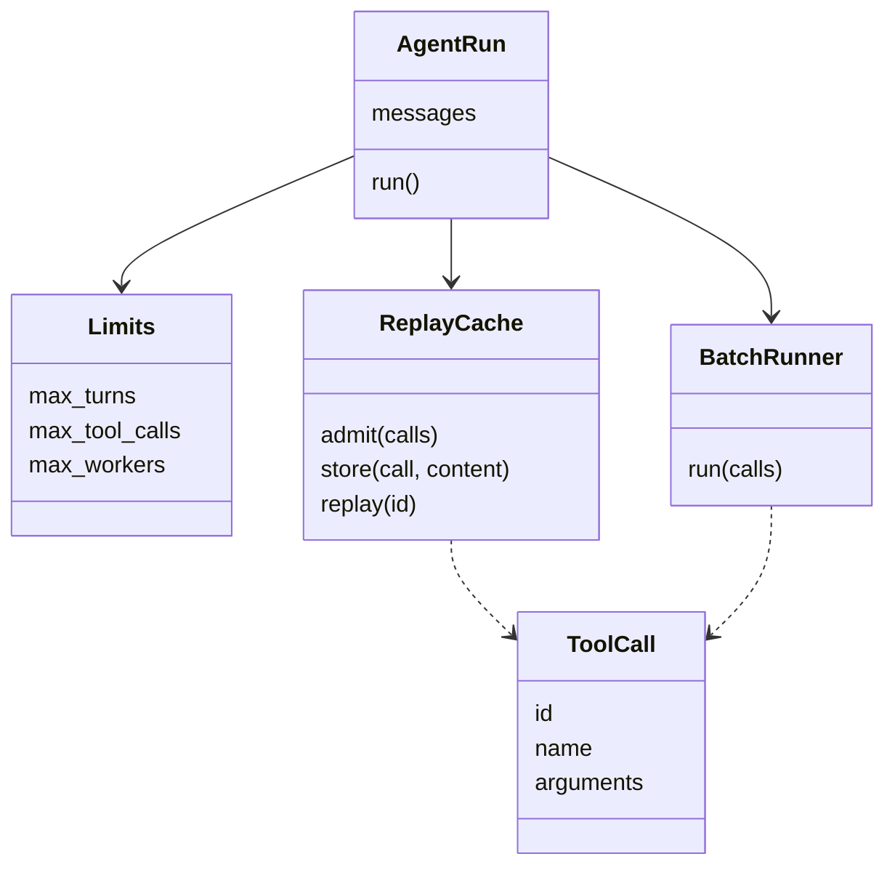

# 设计题解：可靠的工具调用智能体（Reliable Tool-Calling Agent）

## 题目与澄清

智能体（agent）是一个循环：把对话交给模型（model），模型要么直接回答，要么说「我想调用这几个工具」；循环去执行这些工具，把结果写回对话，再把对话交给模型，直到模型给出不带工具请求的回答。
你要写的是这个循环本身：`run_agent(question, model, tools, *, max_turns, max_tool_calls, max_workers)`。模型和工具都是调用方传进来的普通可调用对象，测试里没有真实的模型接口，所以循环必须对它们一无所知，只认协议。

协议很小。模型收到消息列表，返回 `{"text": ..., "tool_calls": [...]}`；每个调用有 `id`、`name`、`arguments`。工具是接收关键字参数的函数。循环要产出一份完整、有序的对话记录，并且在四件事上做到可靠：

1. **并发但有序**：同一批里互相独立的调用同时跑，同时活跃的不超过上限，但结果按请求顺序进入记录。
2. **重放**：同一个调用 ID 只执行一次，再次出现时直接给缓存里的结果。
3. **协议校验**：模型输出畸形就拒绝，工具失败则变成模型能读的错误结果，而不是让循环崩溃。
4. **预算**：模型调用的轮数、工具调用的次数、worker 的个数都有上限，超了怎么报错、报在哪个时刻，都有明确规则。

先把规则用自己的话写下来，这是开工前的第一件事。按「粗心读者最容易漏掉」的顺序：

1. **入口校验在模型之前**：`question` 必须是 `str`，空串可以；预算必须是精确的 `int`（`True` 不算），违规抛 `ValueError`，此时模型一次也没被调用。
2. **终止判据只有一条**：响应里没有工具调用就终止，哪怕文本是空串；有调用时，文本只是中间文字，不是答案。
3. **返回恰好四个键**：`answer`、`messages`、`model_calls`、`tool_calls`；`messages` 含最后一条 assistant 消息。
4. **整个响应先校验，再预检，最后执行**：畸形输出、ID 冲突、预算超额，都在启动任何线程之前判定。
5. **同 ID 同名同参是同一个调用**：不再执行、不再计数，在同一响应内还是之后的响应里都一样；同 ID 但名字或参数不同，抛 `ValueError`。
6. **错误是结果**：未知工具是 `unknown_tool`；已知工具抛出 `Exception`、参数绑定失败、返回非 JSON 值，都是 `tool_error`，不带异常文本。
7. **预算的两个报错时刻不同**：工具预算在执行之前按「新 ID 个数」整响应预留；轮次预算在最后一轮的批次处理完之后才报。
8. **深拷贝四处**：模型响应、传给工具的参数、工具结果、模型看到的快照。

开口前值得问的澄清问题，每一个都会改变代码：

- **「同一个调用」怎么判？** 只看 ID 不够，因为模型可能错用 ID；所以缓存里同时记名字和参数，比较的是参数的规范化 JSON 文本。不能直接比较 `dict`：Python 里 `{"n": 1} == {"n": 1.0}` 与 `{"n": True} == {"n": 1}` 都是 `True`，会把不同的调用当成同一个。
- **未知工具和出错的调用占不占预算？** 占。预算数的是「尝试」，每个不同的 ID 一次，不管结果好坏；命中缓存的重复调用不占。
- **一个响应里既有冲突又超预算，先报哪个？** 预检先判冲突再判预算，所以先是 `ValueError`。最后一轮的响应如果同时超了工具预算，也是工具预算错误先发生，因为它在执行之前就抛了。
- **工具抛出 `KeyboardInterrupt` 这类非 `Exception` 怎么办？** 它不是「工具出错」，而是进程要停了；循环不吞它，等同批已启动的调用结束，再原样抛出。
- **工具注册表在运行中被外部改了怎么办？** 运行开始时复制，运行期间看到的就是开始那一刻的样子。
- **要不要给每个工具限时？** 不要。同步循环等不到卡死的工具，真正的超时必须放在进程边界上，见 `## 扩展与追问`。

范围之外：真实的模型接口、提示词优化、操作系统沙箱、墙钟超时。这些要么由调用方负责，要么放在循环之外。

## 需求与分级

**第 1 关（约 15 分钟，单线程的循环）**：先不管并发，用最朴素的方式把循环跑通。状态是对话记录和一个模型调用计数；每轮把记录的深拷贝交给模型，追加 assistant 消息，没有调用就返回，有调用就逐个执行、按顺序追加 tool 消息。
这一关就要把返回的四个键、终止判据、记录的消息形状钉死，因为后面三关都建立在它上面。示例：模型第一次要求 `x1`、`x2` 两个气温查询（奥斯陆和利马），第二次直接回答，则记录依次是 user、assistant、tool（x1）、tool（x2）、assistant，`model_calls` 是 2，`tool_calls` 是 2。

**第 2 关（约 15 分钟，错误、校验、重放）**：把工具失败收口成两种固定的错误结果；把模型输出的校验写成一个函数，整个响应校验完才进入执行；加上按 ID 的缓存。
这一关的关键是顺序：校验在前，预检在中，执行在后。重放缓存要同时记名字和参数文本，否则无法发现 ID 被错用。

**第 3 关（约 15 分钟，预算与并发）**：加预算，再把一批调用交给线程池。预算的判定要在启动线程之前完成，所以先有「预检」，再有「执行」；并发则只发生在执行这一步，批次结束才回到主线程。
这一关的陷阱最多：结果顺序、上限、重叠、批次结束时没有线程残留、最后一轮的批次要处理完才报错。

**第 4 关（选做，约 10 分钟，所有权与异常）**：深拷贝、注册表复制、`BaseException` 的传播规则。这一关考的是细节上的纪律：每个共享引用都问一句「谁还拿着它」。

每一关对应的类：第 1 关是 `AgentRun` 的循环；第 2 关加 `parse_response` 与 `ReplayCache`；第 3 关加 `Limits` 与 `BatchRunner`；第 4 关是散落在这些类里的深拷贝和异常分支。

## 核心对象与职责

一次运行里有五个对象，各管一件事，各守一条不变量。

- **`Limits`**：三个预算的值对象（Value Object），构造时校验成精确 `int`。不变量：只要它存在，三个数就合法，所以后面的代码不再检查。
- **`ToolCall`**：一次调用请求，冻结的数据类（`frozen=True` 的 `dataclass`）。它持有的 `arguments` 是解析时做的私有拷贝；`signature` 是 `(名字, 参数规范化文本)`，用来判断「是不是同一个调用」。
- **`ReplayCache`**：按 ID 记 `(signature, 结果)`。不变量：每个 ID 至多一条，条目数就是已用的工具尝试数；`admit` 负责预检并返回要执行的新调用，`replay` 每次给出独立的副本。
- **`BatchRunner`**：在 worker 上限内并发执行一批互不相同的调用。不变量：它返回或抛出时，所有已启动的线程都已结束；返回的结果与入参一一对应、顺序相同。
- **`AgentRun`**：一次运行的全部可变状态：对话记录、缓存、模型调用计数。不变量：只有它所在的线程会写记录和缓存，工作线程只返回值。

`parse_response`、`is_json`、`canonical` 是纯函数，没有状态，所以不做成类。



关系上，`AgentRun` 拥有 `ReplayCache` 和 `BatchRunner`（组合）：缓存和执行器的寿命就是一次运行的寿命，所以每次运行有自己的缓存和计数器，不存在跨运行的共享状态。`ToolCall` 只是被它们传来传去的数据（关联），不拥有任何东西。

有没有一个类只是转发？`run_agent` 本身是几行的入口函数：校验入口、构造 `Limits`、交给 `AgentRun`。它存在的理由是保持公开签名不变，真实工作区里测试导入的正是它；`AgentRun` 则有自己的状态和循环，不是转发。

## 关键设计决策

### 决策一：并发用线程池，上限用 `min(max_workers, 批次大小)`

问题：同一批互相独立的工具要并发，同时活跃的不超过 `max_workers`；`max_workers` 大于 1 时它们必须能真正重叠；`max_workers` 为 1 时按首次出现的顺序执行；结束时不能留下线程。

选项：

- **每个调用一个 `threading.Thread`，用 `Semaphore(max_workers)` 限流。** 要自己管线程的创建、结果的收集、异常的带回、`join`。`max_workers=1` 时顺序靠信号量的唤醒顺序，并不保证是请求顺序；收集结果要自己加锁或用队列。
- **`concurrent.futures.ThreadPoolExecutor`。** 提交任务得到 `Future`，按提交顺序取结果就是请求顺序；`with` 块退出时等所有线程结束；`max_workers=1` 时任务按提交顺序排队执行，天然满足「首次出现顺序」。
- **`asyncio`。** 工具是同步函数，要用 `run_in_executor` 才能并发，最终还是线程池，只多了一层事件循环，换来的只有复杂度。

选择线程池，池的大小取 `min(max_workers, 批次大小)`：批次只有两个调用时不必为四个 worker 付代价。`with` 块保证「返回或抛出之前没有线程残留」，这是一条合同规则，用结构而不是纪律来保证。

模式：这是线程池（Thread Pool）模式的直接使用，不是自己实现的，所以没有新类。真正值得自己写的只有 `BatchRunner` 这个薄封装，它把「哪些调用、什么顺序、什么异常规则」集中在一个地方。

### 决策二：并发只在执行这一步，状态只由一个线程写

问题：缓存和对话记录都是共享的可变状态，工作线程怎么碰它们。

选项：

- **工作线程直接写缓存，用一把锁保护。** 能用，但「谁先写」变成不确定的，对话记录的顺序又要另外保证；每多一个共享结构就多一个锁要想。
- **工作线程只返回值，主线程在整批结束后统一写缓存、按序追加消息。** 并发被限制在「执行工具」这一步，其余仍是单线程逻辑，不需要任何锁。

选择第二种。这是线程限制（Thread Confinement）：数据不共享，所以没有竞争可言。代价是结果要等整批结束才能写入，但合同本来就要求整批结束才进入下一步，所以没有损失。
这里拒绝的是「加锁」这个更重的工具：能靠结构消除的竞争，不要靠锁去管理。另外，工具之间共享的状态由工具自己同步，循环不替它们保护。

### 决策三：预检与整响应预留预算，而不是边执行边扣

问题：工具预算超了，这个响应的工具一个都不能执行；同 ID 不同名或参数也要在执行之前拒绝。

选项：

- **逐个执行，每执行一个扣一次预算，扣到零就停。** 前几个已经执行了，副作用收不回来：工具预算超额时，同一响应里排在前面的调用已经下过单。
- **先对整个响应做一遍预检：冲突、新 ID 个数、剩余额度，通过了才启动线程。** 失败时零执行，之前批次的结果保留，不回滚。

选择预检。`ReplayCache.admit` 一次遍历同时做两件事：用缓存和本响应已见的 ID 判冲突，返回新 ID 的首次出现顺序列表；然后比较 `len(fresh)` 与剩余额度。这是「先检查整体，再动手」的两段式，所有后果不可逆的操作都该这么写。
它还顺带解决了重复 ID：同一响应里第二次出现同 ID 的调用不会进入 `fresh`，所以只执行一次、只计一次。

### 决策四：「同一个调用」用规范化 JSON 文本比较，不用 `dict` 相等

问题：缓存命中要求同名同参；参数是字典，Python 的相等规则太宽松。

选项：

- **直接比较 `arguments` 字典。** `{"n": 1} == {"n": 1.0}` 为 `True`，`{"n": True} == {"n": 1}` 也为 `True`。模型传 `1.0` 与 `1` 是两个不同的调用，合同要求保留数字写法。
- **规范化 JSON 文本：`json.dumps(args, sort_keys=True, separators=(",", ":"), ensure_ascii=False)`。** 键顺序被抹平，数组顺序保留，`1` 与 `1.0` 与 `true` 的文本各不相同，非 ASCII 字符不转义，所以同一个汉字的两种写法不会产生歧义。
- **对文本再取哈希。** 省的是内存，丢的是可读性，冲突时还要回头比较；参数很小，不值得。

选择第二种，把它放进 `ToolCall.signature`，缓存里存 `(名字, 文本)` 一个元组。比较只有一个 `!=`，所有细节都在 `canonical` 一个函数里，改规则只改一处。

### 决策五：错误是值，不是异常；谁的异常照原样传出

问题：三类异常各有各的归宿：工具失败、模型失败、进程要停了。

- **工具的 `Exception`**（含参数绑定错误）：模型需要知道这次调用失败了才能改变做法，所以变成 `{"ok": False, "error": "tool_error"}` 这样的值，同批其余调用继续。不带异常文本：异常信息可能含路径、密钥或内部细节，而模型文本进入下一轮就是不可信的输入。
- **模型自己的异常**：循环无从补救，包装只会丢信息，所以原样传出。
- **`BaseException`**（`KeyboardInterrupt`、`SystemExit`）：不是业务失败。在线程里，`Future` 会把它存下来，循环取出后等同批已启动的调用结束再抛出，同时用一个 `Event` 让还没开始的调用不再启动。

这里拒绝的是「全部捕获」：`except BaseException` 吞掉中断，会让用户的 Ctrl-C 失灵；只捕获 `Exception` 又会让线程里的 `BaseException` 悄悄沉进 `Future`。所以代码里是两个并排的 `except`：先 `Exception`，再 `BaseException`，后者记下来而不是吞掉。

### 决策六：拒绝为工具设计抽象基类或命令对象

问题：工具要不要有一个 `Tool` 抽象基类，带 `name`、`schema`、`run()`？要不要把每次调用包成命令对象（Command），带 `execute()` 和 `undo()`？

合同里工具就是「把名字映射到可调用对象」的字典，调用方可以传任何函数。写一个基类，调用方还得为每个函数套一个类；写命令对象，`undo()` 没有任何需求用到。
选择最简单的：普通函数加字典。`ToolCall` 是纯数据，没有行为可以多态，所以也不做成层次结构。模式的价值在于存在多个实现需要替换，这里一个都没有，引入模式只是增加要读的代码。

## 代码走读

完整的参考解如下，下面再挑四个位置看设计决策怎么落在代码上。

%% code:begin solution.py %%
```python
"""可靠的工具调用智能体：模型与工具交替运行的有界循环。

设计分五层，各管一件事：
1. `Limits` 在第一次调用模型之前校验三个预算（精确的 int，布尔无效）。
2. `parse_response` 把模型输出一次性校验完并深拷贝成 `ToolCall`，之后循环只处理自己拥有的数据。
3. `ReplayCache` 按调用 ID 记住已执行的结果，同一 ID 同名同参直接重放，名字或参数不同则拒绝。
4. `BatchRunner` 在 worker 上限内并发执行一批互不相同的调用，结果按请求顺序返回，返回前所有线程已结束。
5. `AgentRun` 持有对话记录与计数器，按「预检 → 执行 → 按序追加」处理每个响应，`run_agent` 只是入口。
"""

from __future__ import annotations

import copy
import json
import math
import threading
from collections.abc import Callable, Mapping, Sequence
from concurrent.futures import ThreadPoolExecutor
from dataclasses import dataclass
from typing import Any

Tool = Callable[..., Any]
Model = Callable[[list[dict[str, Any]]], Any]

UNKNOWN_TOOL: dict[str, Any] = {"ok": False, "error": "unknown_tool"}
TOOL_ERROR: dict[str, Any] = {"ok": False, "error": "tool_error"}


def is_json(value: object) -> bool:
    """协议里的 JSON 值：None、精确的 bool/int/str、有限 float、元素合法的 list、键为 str 的 dict。"""
    kind = type(value)
    if value is None or kind in (bool, int, str):
        return True
    if kind is float:
        return math.isfinite(value)  # type: ignore[arg-type]
    try:
        if isinstance(value, list):
            return all(is_json(item) for item in value)
        if isinstance(value, dict):
            return all(isinstance(k, str) and is_json(v) for k, v in value.items())
    except RecursionError:  # 嵌套过深按非法处理，不让它变成别的异常
        return False
    return False


def canonical(arguments: Mapping[str, Any]) -> str:
    """参数相等的判据：键排序、紧凑分隔符、不转义非 ASCII；数组顺序与数字写法（1 与 1.0）保留。"""
    return json.dumps(arguments, sort_keys=True, separators=(",", ":"), ensure_ascii=False)


@dataclass(frozen=True)
class Limits:
    """三个预算，构造即校验：违规抛 ValueError，此时模型一次也没有被调用。"""

    max_turns: int
    max_tool_calls: int
    max_workers: int

    def __post_init__(self) -> None:
        for name, value, floor in (("max_turns", self.max_turns, 1),
                                   ("max_tool_calls", self.max_tool_calls, 0),
                                   ("max_workers", self.max_workers, 1)):
            if type(value) is not int or value < floor:  # 布尔和浮点都不是精确的 int
                raise ValueError(f"{name} must be an int >= {floor}, got {value!r}")


@dataclass(frozen=True)
class ToolCall:
    """一次工具调用请求。`arguments` 是解析时做的私有深拷贝：执行时再给工具一份拷贝，对话记录直接引用它。"""

    id: str
    name: str
    arguments: dict[str, Any]

    @property
    def signature(self) -> tuple[str, str]:
        return (self.name, canonical(self.arguments))

    def wire(self) -> dict[str, Any]:
        """写进对话记录的形状。"""
        return {"id": self.id, "name": self.name, "arguments": self.arguments}


def parse_response(raw: object) -> tuple[str, list[ToolCall]]:
    """校验整个模型响应（任何工具执行之前），通过后深拷贝；畸形输出抛 ValueError。"""
    if not isinstance(raw, dict) or set(raw) != {"text", "tool_calls"}:
        raise ValueError("model response must be a dict with exactly text and tool_calls")
    text, items = raw["text"], raw["tool_calls"]
    if not isinstance(text, str) or not isinstance(items, list):
        raise ValueError("text must be a str and tool_calls a list")
    calls: list[ToolCall] = []
    for item in items:
        if not isinstance(item, dict) or set(item) != {"id", "name", "arguments"}:
            raise ValueError("a tool call must be a dict with exactly id, name and arguments")
        call_id, name, arguments = item["id"], item["name"], item["arguments"]
        if not (isinstance(call_id, str) and call_id and isinstance(name, str) and name):
            raise ValueError("tool call id and name must be nonempty strings")
        if not isinstance(arguments, dict) or not is_json(arguments):
            raise ValueError("tool call arguments must be a dict of JSON values")
        calls.append(ToolCall(call_id, name, copy.deepcopy(arguments)))
    return text, calls


class ReplayCache:
    """按调用 ID 记住 (名字, 参数文本) 与结果；缓存里的条目数就是已用的工具尝试数。"""

    def __init__(self) -> None:
        self._entries: dict[str, tuple[tuple[str, str], dict[str, Any]]] = {}

    def __len__(self) -> int:
        return len(self._entries)

    def admit(self, calls: Sequence[ToolCall]) -> list[ToolCall]:
        """预检整个响应：同 ID 不同名或不同参数抛 ValueError；返回真正要执行的新 ID（首次出现顺序）。"""
        seen: dict[str, tuple[str, str]] = {}
        fresh: list[ToolCall] = []
        for call in calls:
            known = self._entries.get(call.id)
            previous = known[0] if known else seen.get(call.id)
            if previous is not None and previous != call.signature:
                raise ValueError(f"call id {call.id!r} reused with a different name or arguments")
            if previous is None:
                seen[call.id] = call.signature
                fresh.append(call)
        return fresh

    def store(self, call: ToolCall, content: dict[str, Any]) -> None:
        self._entries[call.id] = (call.signature, content)

    def replay(self, call_id: str) -> dict[str, Any]:
        """每次出现拿到独立的副本，改一份不会影响缓存和别的消息。"""
        return copy.deepcopy(self._entries[call_id][1])


class BatchRunner:
    """在 worker 上限内并发执行一批互不相同的调用；返回或抛出之前，所有已启动的线程都已结束。"""

    def __init__(self, tools: Mapping[str, Tool], max_workers: int) -> None:
        self._tools = dict(tools)  # 运行开始时复制注册表，之后外部改它不影响本次运行
        self._max_workers = max_workers

    def run(self, calls: Sequence[ToolCall]) -> list[dict[str, Any]]:
        if not calls:
            return []
        halted = threading.Event()  # 某个工具抛了非 Exception 的异常后，还没开始的调用不再启动
        with ThreadPoolExecutor(max_workers=min(self._max_workers, len(calls))) as pool:
            futures = [pool.submit(self._invoke, call, halted) for call in calls]
            outcomes = [future.result() for future in futures]  # 离开 with 时线程池 join 全部线程
        for _, fatal in outcomes:
            if fatal is not None:
                raise fatal
        return [content for content, _ in outcomes if content is not None]

    def _invoke(self, call: ToolCall, halted: threading.Event
                ) -> tuple[dict[str, Any] | None, BaseException | None]:
        """返回 (结果内容, 致命异常)；任何工具失败都在这里收口，不会漏出线程。"""
        if halted.is_set():
            return None, None
        tool = self._tools.get(call.name)
        if tool is None:
            return copy.deepcopy(UNKNOWN_TOOL), None
        try:
            value = tool(**copy.deepcopy(call.arguments))
            if not is_json(value):
                return copy.deepcopy(TOOL_ERROR), None
            return {"ok": True, "value": copy.deepcopy(value)}, None
        except Exception:  # 绑定错误、工具自己的异常：只给模型一个固定的错误码，不带异常文本
            return copy.deepcopy(TOOL_ERROR), None
        except BaseException as fatal:  # KeyboardInterrupt 之类：等同批已启动的调用结束后原样抛出
            halted.set()
            return None, fatal


class AgentRun:
    """一次运行的全部可变状态：对话记录、重放缓存、模型调用计数。"""

    def __init__(self, question: str, model: Model, tools: Mapping[str, Tool], limits: Limits) -> None:
        self._model = model
        self._limits = limits
        self._runner = BatchRunner(tools, limits.max_workers)
        self._cache = ReplayCache()
        self._messages: list[dict[str, Any]] = [{"role": "user", "content": question}]
        self._model_calls = 0

    def run(self) -> dict[str, Any]:
        for _ in range(self._limits.max_turns):
            raw = self._model(copy.deepcopy(self._messages))  # 模型拿到的是快照
            self._model_calls += 1
            text, calls = parse_response(raw)
            self._messages.append({"role": "assistant", "content": text,
                                   "tool_calls": [call.wire() for call in calls]})
            if not calls:
                return {"answer": text, "messages": self._messages,
                        "model_calls": self._model_calls, "tool_calls": len(self._cache)}
            self._run_batch(calls)
        raise RuntimeError("model budget exceeded")  # 最后一轮的批次已经处理完才报

    def _run_batch(self, calls: list[ToolCall]) -> None:
        fresh = self._cache.admit(calls)  # 冲突与预算都在启动任何线程之前判定
        if len(fresh) > self._limits.max_tool_calls - len(self._cache):
            raise RuntimeError("tool budget exceeded")
        for call, content in zip(fresh, self._runner.run(fresh)):
            self._cache.store(call, content)
        for call in calls:  # 每次出现各一条结果，顺序与请求一致
            self._messages.append({"role": "tool", "tool_call_id": call.id, "name": call.name,
                                   "content": self._cache.replay(call.id)})


def run_agent(question: str, model: Model, tools: Mapping[str, Tool], *, max_turns: int = 4,
              max_tool_calls: int = 8, max_workers: int = 4) -> dict[str, Any]:
    """运行智能体循环，返回 answer、完整对话记录和两个计数。"""
    if not isinstance(question, str):
        raise ValueError("question must be a string")
    if not isinstance(tools, Mapping) or not all(
            isinstance(name, str) and name and callable(tool) for name, tool in tools.items()):
        raise ValueError("tools must map nonempty names to callables")
    limits = Limits(max_turns, max_tool_calls, max_workers)
    return AgentRun(question, model, tools, limits).run()


if __name__ == "__main__":
    scripted_replies = iter([
        {"text": "Looking up both cities", "tool_calls": [
            {"id": "x1", "name": "temp", "arguments": {"city": "Oslo"}},
            {"id": "x2", "name": "temp", "arguments": {"city": "Lima"}}]},
        {"text": "Lima is warmer", "tool_calls": []},
    ])
    readings = {"Oslo": -3, "Lima": 19}
    result = run_agent("Which is warmer, Oslo or Lima?", lambda messages: next(scripted_replies),
                       {"temp": lambda city: readings[city]}, max_workers=2)
    print(result["answer"], result["model_calls"], result["tool_calls"])
```
%% code:end %%

**位置一：`AgentRun._run_batch`。** 第一行 `admit` 做冲突检查，第二行比较新 ID 个数与剩余额度，两者都在 `self._runner.run` 之前。失败时没有任何线程被启动，也没有任何缓存被写入，这就是「零执行」。`zip(fresh, self._runner.run(fresh))` 之后才写缓存，最后按 `calls` 的原始顺序追加消息，所以重复 ID 各得一条，并且顺序与请求一致。

**位置二：`BatchRunner.run`。** `with ThreadPoolExecutor(...)` 包住提交与取结果；`future.result()` 按提交顺序取，所以输出与入参一一对应；离开 `with` 时线程池等待全部线程，之后才检查致命异常并抛出。这样「返回或抛出之前没有线程残留」是结构保证。

**位置三：`BatchRunner._invoke`。** 先看 `halted`：某个工具抛了 `BaseException` 之后，还没开始的调用直接跳过。未知工具在这里返回固定错误，工具调用前对 `arguments` 深拷贝，返回后先 `is_json` 再深拷贝结果；任何 `Exception` 都收口成固定的 `tool_error`。

**位置四：`ReplayCache.admit` 与 `replay`。** `admit` 里 `previous` 来自缓存或本响应已见的 ID，不同则抛 `ValueError`，相同则跳过，没见过则进入 `fresh`；`replay` 每次深拷贝，所以同一个缓存结果的多次出现互不影响，调用方改一份不会改到别的。

## 测试与自检

测试用真线程和屏障（`threading.Barrier`），断言的都是不变量，不是时间。

- **重叠**：三个工具都要在屏障处会合才能返回。顺序执行的实现，第一个工具永远等不到另外两个，屏障超时，工具变成 `tool_error`，断言失败。所以「能重叠」是确定性地被证明的。
- **上限**：每个工具进入时给活跃计数加一并记录峰值，在屏障处凑齐 `workers` 个再放行。正确的实现峰值恰好等于 `workers`，从不超过；上限被无视的实现会把峰值推高，但是否每次都被抓到取决于线程调度，所以这条断言只会对正确实现通过，对错误实现是尽力而为。
- **反序完成**：第 `i` 个工具等第 `i+1` 个先完成，用事件链制造「完成顺序 3、2、1、0」；断言结果仍是 0、1、2、3。
- **整批结束**：最后一轮的批次里，一个工具在屏障后停一小会儿才写完成标志；预算错误抛出之后标志必须已经写好。`BaseException` 同理：另一个已启动的工具必须已经结束。
- **没有线程残留**：运行前后各取一次 `threading.enumerate()`，之后的集合不能多出新线程。
- **所有权**：模型改它拿到的快照和自己保留的旧响应、工具改自己的参数、工具保留返回值之后再改，这些都不能影响记录与缓存；运行中途清空外部的 `tools` 字典，后面的调用照常执行。
- **校验**：二十八种畸形响应逐个断言 `ValueError`；一个响应里前面合法、后面畸形，前面的工具也不能执行。
- **并行运行**：六个线程同时各跑一个 `run_agent`，各自的答案、记录和计数互不串。

给面试官两分钟演示：先跑文件末尾的两城气温例子，看到 `model_calls` 为 2、`tool_calls` 为 2、两条 tool 消息顺序为 x1、x2；再把 `max_tool_calls` 设成 1，看到 `tool budget exceeded` 且一个工具都没执行；最后让同一个 ID 带不同参数出现第二次，看到 `ValueError`。

## 扩展与追问

**新需求**

- **同一轮要少绕几圈**（独立价格查询很多时）：让模型在一个响应里请求所有独立调用，循环本来就并发执行它们；再提供批量工具（一次给多个代码），一次调用里逐项返回，失败只影响那一项而不是整批。两种办法都不用改循环，改的是工具的提示和工具的返回形状。
- **每个工具各自的并发上限**：`BatchRunner` 按工具名持有信号量；其余的类不动。
- **流式输出、取消**：取消要在进程边界做，见下面的「并发与线程安全」。

**并发与线程安全**

- **工具会卡死**：线程不能被强杀，同步循环也等不出结果。办法是把工具包成「子进程加超时」的普通工具，超时抛异常，被循环变成 `tool_error`；循环本身不改。
- **GIL 的作用**：纯 Python 的工具在 CPython 里一次只有一个线程在跑字节码，所以并发的收益主要来自工具里的 I/O 等待；计算密集的工具需要进程池。竞争条件在真实的调度下是否出现取决于切换时机，不要指望一个测试每次都能把它跑出来，所以这个设计让线程之间不共享可变状态，而不是靠测试去抓。
- **工具自己的共享状态**：由工具自己同步，循环只保证自己的记录和缓存是安全的。

**持久化与规模**

- **不可逆工具加进程可能重启**：内存缓存重启即丢，同一个 ID 会再执行一次。把缓存换成以 ID 为主键的持久化存储；执行前先写 `pending`，完成后写 `done` 和结果；`pending` 表示结果未知，不能直接重跑，要用调用 ID 当幂等键向下游核对。对话记录和计数也要落盘。预检、按序追加这些逻辑都不用改，只换缓存的存取。
- **模型与工具都不可信**：进程沙箱、墙钟超时、按工具授权、输出大小上限、密钥隔离、限流与审计，都放在循环之外。循环只管协议和预算，因为它能保证的只有这些。
- **多轮很长的对话**：记录会无限增长，需要摘要或截断，但这改的是「交给模型的快照」那一步，缓存和预算不受影响。

## 常见错误

- **用顺序循环冒充并发**：公开的小测试全过，只有真并发的屏障测试才能抓到。
- **用 `dict` 相等判断同一个调用**：`1` 与 `1.0`、`True` 与 `1` 被当成相同，缓存错误命中。
- **边执行边扣预算**：超额响应里排在前面的工具已经执行，副作用收不回来。
- **预算错误不等整批结束就抛**：线程还在跑，留下孤儿线程，后面的测试被它们污染。
- **工具失败时把异常文本放进结果**：泄露路径或密钥，而且结果会被喂回模型。
- **缓存里放可变对象再原样发出**：一处改动污染所有出现和缓存本身。每次重放都要拷贝。
- **布尔当整数**：`isinstance(True, int)` 为 `True`，预算校验要看精确类型。
- **只捕获 `Exception` 或捕获一切**：前者让线程里的 `BaseException` 无声消失，后者吞掉中断。
- **工作线程直接写共享缓存**：于是顺序不确定、还要加锁；让线程只返回值，主线程统一写。
- **Java 习惯**：为工具定义抽象基类和 getter、setter；这里字典加函数就够。

## 45 分钟怎么分配

- **0–5 分钟｜读规则并写下来**：把上面八条规则写成自己的断言清单，尤其是预算的两个报错时刻和重放的判据。对智能体说的第一句话也是这份清单，而不是「写个智能体循环」。
- **5–12 分钟｜骨架并分工**：口头说出五个对象。让智能体起草 `parse_response` 与 `canonical`（输入输出清楚，容易验证）；预算的报错时刻、「状态只由主线程写」、`BaseException` 的规则这三个决定自己留着。
- **12–25 分钟｜单线程循环到重放缓存**：先把公开测试跑通，再把示例写成自己的断言；每次只给智能体一个失败的用例。
- **25–35 分钟｜预算与并发**：先写屏障测试再写线程池；让智能体帮忙想边界，但上限、顺序、没有线程残留自己核对。
- **35–40 分钟｜所有权与异常**：深拷贝的四处，注册表复制，`BaseException`。
- **40–45 分钟｜三个反思问题**：独立调用怎么减少轮次、不可逆工具加重启怎么改、不可信环境放哪些保护；各讲三条要点。

时间不够时的取舍：先砍 `max_workers` 的上限峰值测试，再砍注册表复制；**绝不能砍的是**预检在执行之前、结果按请求顺序、整批结束才继续、同 ID 冲突的拒绝。

## 延伸阅读

- [[problems.components.thread-pool|线程池（Thread Pool）]]：线程池的经典题目，这个项目用的是标准库现成的那一个，理解它才知道 `with` 块替你做了什么。
- 复合操作（Compound Actions）、不靠锁的线程安全（Immutability & Confinement）、测试并发代码（Testing Concurrency）：预检、线程限制与屏障测试的原理，见知识树的并发进阶部分。
- 异常与错误值（Exceptions vs Values）、边界校验（Validate at the Boundary）：什么该变成结果、什么该抛出。
- 重试与退避（Retry & Backoff）：幂等键与「结果未知」的处理。
- [Python 文档：concurrent.futures](https://docs.python.org/3/library/concurrent.futures.html)：`ThreadPoolExecutor` 与 `Future` 的行为，包括 `with` 块的收尾。
- [Python 文档：threading.Barrier](https://docs.python.org/3/library/threading.html#threading.Barrier)：让线程同时会合的标准工具，测试里用它证明重叠。
- [Python 文档：json.dumps](https://docs.python.org/3/library/json.html#json.dumps)：`sort_keys`、`separators`、`ensure_ascii` 的含义。
