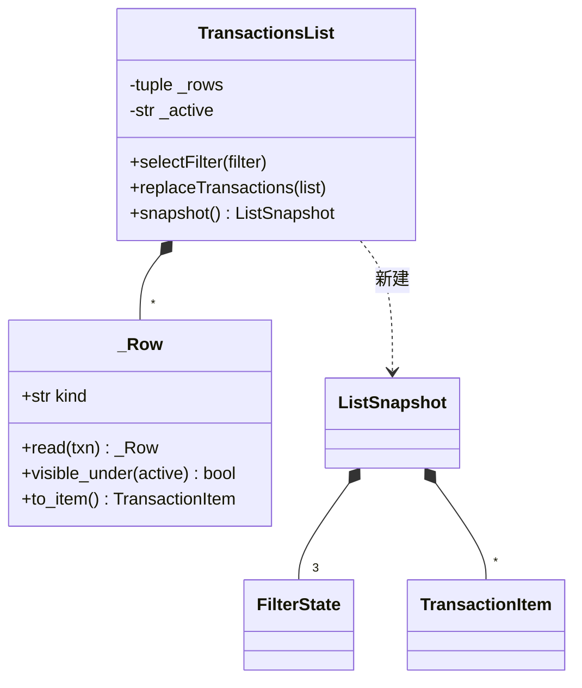

# 设计题解：交易列表视图模型（Transactions List）

## 题目与澄清

银行或钱包应用里有一页「交易记录」：每行显示地点（地址和城市）、金额和日期，页头有三个按钮，分别看全部、只看收入（credit）、只看支出（debit）。
后台来一份新的交易列表时，这一页要整体换成新内容，而用户刚才选的按钮不能跳回「全部」。这页界面和 HTTP 适配层已经写好，要你补的只有一个类 `TransactionsList`，
它是视图模型（View Model）：把后端的记录变成界面直接渲染的形状。四个方法：构造函数收一份交易列表，`selectFilter(filter)` 切换筛选，
`replaceTransactions(transactions)` 换整份列表，`snapshot()` 返回当前要显示的一切。

这个小题目的重心不在筛选，而在两件事：展示字符串一个字符都不能变，以及「谁拥有这些数据」。调用方传进来的是可变对象（`Transaction` 和嵌套的 `Location`），
`snapshot()` 返回的也是可变对象（列表和数据类），所以进口一次、出口一次，边界上各有一次拷贝的责任，见 [[data.defensive-copy|防御性拷贝（Defensive Copying）]]。

开工前先把合同写成自己的话，按「粗心的读者最容易漏掉」的顺序：

1. **快照的形状**：`activeFilter` 是当前筛选的名字；`filters` 恰好三项，顺序固定 `all`、`credit`、`debit`，每项的 `active` 是布尔，且恰好一项为真；`items` 是展示项列表。
2. **筛选的含义**：`all` 显示全部，`credit`、`debit` 只显示 `txnType` 与之相等的交易。重复选择同一个筛选允许，没有副作用。没有匹配的交易时，所选筛选照样生效，`items` 为空，
   不能「自动退回全部」。
3. **展示项的来源**：一条可见交易对应恰好一个展示项，顺序是输入顺序。`id` 取交易自己的 `id`，不是 `location.id`；`address`、`city` 取自地点；`amount`、`date` 取自交易；
   地点的 `id` 和 `zipCode` 不进展示项。
4. **换列表**：新列表整体替换旧列表，当前筛选保持并立刻作用在新列表上；不追加、不合并、不排序、不去重。空列表（初始或替换）都合法。
5. **展示字符串原样**：金额和日期只是文本，不解析、不计算、不去空白、不改格式；Unicode 与首尾空格原样保留。
6. **隔离**：不改传入的任何对象；构造或替换之后调用方再改自己的对象，视图不变；快照随便改，不影响视图和其他快照；旧快照在之后的选择、替换后不变；两个实例互不影响。

开口前值得问的澄清问题，每一个都会改变代码：

- **传入的列表之后还会被调用方改吗？** 会，合同明说了。答案决定「保存引用」不可行，必须在进口把内容读成自己的值。
- **`snapshot()` 返回的对象调用方会改吗？** 会。答案决定内部存储不能直接交出去，每次都要新建。可变快照和不可变快照合同都接受，这里选可变的数据类，因为界面层和适配层的类型已经定了。
- **筛选参数传错了怎么办？** 合同说非法的原生参数不在要求之内，输入保证是三个合法值之一。所以参考解不加检查；如果产品需要，再加一行拒绝未知值（见「扩展与追问」）。
- **列表很大吗？** 至多 1000 条，交易 id 在同一份列表内唯一。每次快照扫一遍 1000 行，在一台普通开发机上实测约 70 微秒（替换一份 1000 行的列表约 220 微秒），没有理由去做增量更新。
- **要并发吗？** 不要，调用是顺序的。这决定了本解不加锁，但要知道哪一行以后会变成临界区。

范围之外：HTTP 适配（已有，只负责校验 JSON 并调用这个类）、网页渲染（已有）、金额与日期的解析和本地化、持久化、并发。

## 需求与分级

**第 1 关（约 10 分钟，投影与筛选）**：先让初始快照对：三个筛选项的顺序、布尔标记、`all` 默认。再做 `selectFilter` 与按 `txnType` 过滤。
用一个小例子把规则定下来：三条交易 `(7, credit)`、`(8, debit)`、`(9, credit)`，选 `credit` 得到 7 和 9，选 `debit` 得到 8，选 `all` 得到 7、8、9。
这一关还要想清楚「展示项是交易与地点的投影」：`id` 是交易的 id，地点的 id 不出现。

**第 2 关（约 10 分钟，换列表）**：`replaceTransactions` 换整份来源，筛选另存一处、换列表时不动。这一关的陷阱是把「当前筛选」和「当前列表」放在同一个重建函数里，
一重建就把筛选重置成默认。测试写法：先选 `debit`，再换成一份只含收入的列表，断言筛选仍是 `debit`、`items` 为空。

**第 3 关（约 15 分钟，隔离）**：这是真正拉开差距的一关。分四个方向各写一个测试：调用方改自己的输入（含嵌套的地点和整个列表被清空）、
调用方改拿到的快照（改字段、增删项、改筛选项）、旧快照在之后的操作中不变、两个实例互不影响。
一个常见的错误是只拷贝了外层列表，而交易和地点还是同一批对象；后面决策一的演示里，浅拷贝版本在调用方改了地址之后读到 `changed`。

**第 4 关（选做，约 10 分钟）**：想一想合同没要求的东西：未知筛选名怎么办、来源列表很大时快照的开销、多线程同时选择与替换。每一项都只要说清楚「改哪一个类、哪一行」，
不要写进主体代码。

## 核心对象与职责

| 类 | 单一职责 | 它拥有的不变量 |
|---|---|---|
| `Location`、`Transaction` | 调用方传入的记录，可变，是界面与后端的约定 | 视图从不持有它们，只在进口读一次 |
| `_Row` | 一条交易里视图真正需要的内容，冻结的值对象（Value Object） | 一旦建好，没有任何代码能改它；列表里放的只能是它 |
| `TransactionItem`、`FilterState`、`ListSnapshot` | 对外的展示结构，可变，是界面与适配层的约定 | 每次 `snapshot()` 都新建，从不复用 |
| `TransactionsList` | 保存当前筛选和一个 `_Row` 元组，产出快照 | 筛选恰好是三个合法值之一；`_rows` 里的每个元素都是冻结的 |

所有权很清楚：`TransactionsList` 拥有它的元组和里面的 `_Row`，是组合（composition）；它不拥有调用方的 `Transaction`，只在进口读它们一次，所以那些对象的生命周期与视图无关。
快照是一个新对象，交给调用方之后与视图再没有关系。



`_Row` 只有三个方法，没有一个是转发：`read` 是进口的拷贝点，`visible_under` 回答「这一行在这个筛选下可见吗」，`to_item` 是出口的拷贝点。
进口与出口各自只在一个地方出现，之后审查隔离的时候，只要看这两处。

## 关键设计决策

### 决策一：进口把来源读成冻结的行，而不是保存调用方的对象

问题：调用方传进来的 `Transaction` 和它里面的 `Location` 都是可变的，调用方之后完全可能改地址、改金额、清空整个列表。视图拿它们做什么？

- **选项甲，直接保存引用**：`self._transactions = transactions`，模板里就是这么写的。省事，但构造之后调用方清空列表，视图就空了；
  演示：调用方改了第一条的地址再 `pop()` 掉最后一条，视图里读到 `[(1, 'changed')]`。这等于把视图的不变量交给了别人。
- **选项乙，浅拷贝**：`list(transactions)` 或 `transactions[:]`。容器独立了，但里面的 `Transaction` 和 `Location` 仍是同一批对象。同样的操作下视图读到 `[(1, 'changed'), (2, 'Pier')]`：
  列表没少，地址却被改了。浅拷贝的危险在于它看起来像是做了防御，而最直观的测试（只清空列表）恰好通过。
- **选项丙，`copy.deepcopy`**：正确，但它拷贝整个对象图，包括视图根本用不到的 `zipCode`、`location.id`，还要在每次快照时从拷贝出的可变对象里再投影一遍，
  而可变对象仍然需要出口再拷贝一次。
- **选项丁，进口就投影成冻结的行**：只读出展示需要的六个字段，放进 `@dataclass(frozen=True, slots=True)` 的 `_Row`，再放进元组。字符串和整数本身不可变，所以读出来就是独立的值，没有第二层。

选丁。它的好处是一个结构同时解决了三件事：进口隔离（读完就与调用方无关）、内部不可变（元组加冻结行，没有任何代码能改它们）、投影只做一次（每次快照不必再翻 `location`）。
代价是 `Transaction` 多出一个内部形状，要多写一个小类。

用到的是值对象（见 [[oop.values|值对象与不可变性（Value Objects）]]），不是某个设计模式。

### 决策二：快照每次现造，不缓存也不复用

问题：`snapshot()` 经常被调用而结果经常不变（界面轮询、同一状态读多次）。要不要缓存上次的快照？

- **缓存**：选择或替换时置空，读时没有就造一份并保存，之后每次直接返回。快，但返回的是同一个可变对象，一个调用方改了 `items`，下一个调用方读到的就是被改过的。
  修复办法是返回前再拷贝，那就回到了每次现造，缓存只省下了过滤，不省拷贝。
- **返回只读视图**：`tuple`、`types.MappingProxyType`、冻结数据类。合同允许不可变结果，但界面层和适配层按 `list` 与数据类写好了，换类型会让它们的类型约定变掉；
  而且 `filters` 里每项是带 `active` 的数据类，要让它不可变就要把数据类也冻结，调用方的 `plain()` 代码仍要能遍历它。可以做，但改变了对外类型，风险大于收益。
- **每次现造**：三个 `FilterState` 加至多 1000 个 `TransactionItem`，一次快照是一遍线性扫描，1000 行约 70 微秒。

选每次现造。没有「缓存失效」这一类问题，也没有「谁改了缓存」这一类问题；性能的上限是 O(n)，n 至多 1000。
如果以后 n 增长到十万并且轮询很频繁，改法是把缓存做成不可变快照加复制，而不是共享可变对象（见「扩展与追问」）。

这是一个不引入模式的决策：缓存是诱人的优化，但这里最简单的做法正好是正确的做法。

### 决策三：筛选单独存，换列表不动它

问题：「换列表时保留当前筛选」怎么落在代码里？

- **一个 `_reset(transactions, filter)` 函数同时设置两者**：简洁，但每个调用点都要记得传当前筛选。忘了传，筛选就回到默认值，而测试里「换列表前从未选过筛选」恰好发现不了。
- **筛选是一个独立字段**：`replaceTransactions` 里压根没有这个字段的名字，所以不可能改它。保留是结构保证出来的，不是靠记性。

选独立字段。换列表只赋值 `self._rows`，选择筛选只赋值 `self._active`，两个方法各写一个属性，互不触碰。
这也让「状态」非常小：两个字段构成整个可变状态，是一个最小的状态机（见 [[structure.state-machines|状态机（State Machines）]]）：状态是（当前筛选，当前列表），事件是选择和替换，
它们各改一半，且彼此交换顺序结果相同。

### 决策四：筛选项用元组常量加推导，拒绝枚举和策略类

问题：三个筛选（`all`、`credit`、`debit`）要不要建模成 `Enum` 或三个策略类，每个类有一个 `matches(txn)`？

- **策略类或 `Enum` 加分派**：形式上扩展性好（加第四个筛选就加一个类）。但合同里筛选是字符串，界面用字符串，JSON 里也是字符串，
  需要在边界上转来转去；而三个筛选里两个其实是同一个规则「`txnType` 等于它」，只有 `all` 是特例。
- **元组常量 `FILTERS` 加一行判断**：`active == "all" or kind == active`。顺序固定的三项直接来自这个元组，`filters` 列表由它推导，
  所以「顺序是 all、credit、debit」这条合同只在一个地方写。

选后者。如果将来筛选变成「本月」「大于 100 元」这类任意谓词，才值得引入策略（见 [[patterns.strategy|策略模式与可替换算法（Strategy）]]）；现在引入是为只有一个实现的接口添加间接层。

## 代码走读

下面是完整的参考解。先看四个落点，再整体读一遍。

第一处是 `_Row.read`：它是整个隔离的进口，也是唯一读调用方对象的地方。它只取六个字段，字符串和整数不可变，所以这一行之后，
调用方对 `txn` 或 `txn.location` 做什么都与视图无关。

第二处是 `_freeze` 与 `replaceTransactions`：先用生成器建出完整的元组，再一次赋值给 `self._rows`。如果生成器在中途失败（比如某个元素缺字段），旧列表还在，
视图不会停在「换了一半」的状态。`selectFilter` 与它们无关，保留筛选不靠记性。

第三处是 `snapshot`：先把 `self._active` 读进局部变量，再用它同时算筛选项和展示项，保证这次快照里的两部分说的是同一个筛选。
`FilterState` 与 `TransactionItem` 都是新建的，列表也是新建的，所以快照与视图、快照与快照之间没有任何共享的可变对象。

第四处是 `visible_under`：「全部」是特例，其余两个筛选是同一条规则。它放在 `_Row` 上，是因为它回答的是关于这一行的问题，调用处因此只剩一行推导。

%% code:begin solution.py %%
```python
"""交易列表视图模型（Transactions List）：参考解。

1. 视图只记两样东西：当前筛选（`all`/`credit`/`debit` 之一）和一份“冻结的行”元组。
2. 来源列表在进入视图的那一刻就被读成冻结的行（`_Row`），之后调用方怎么改自己的对象都碰不到视图。
3. 每次 `snapshot()` 都从冻结的行现造一批新的展示项和筛选项，所以快照之间、快照与视图之间不共享任何可变对象。
4. 换列表时先把新元组完整建好再赋值，旧列表整体丢弃；筛选另存一处，换列表不碰它。
5. 展示用的字符串（金额、日期、地址）一律原样搬运，不解析、不去空白、不重排。
"""
from __future__ import annotations

from dataclasses import dataclass

FILTERS = ("all", "credit", "debit")  # 对外固定的筛选顺序


@dataclass
class Location:
    id: int
    address: str
    city: str
    zipCode: int


@dataclass
class Transaction:
    id: int
    date: str
    txnType: str
    amount: str
    location: Location


@dataclass
class FilterState:
    filter: str
    active: bool


@dataclass
class TransactionItem:
    id: int
    address: str
    city: str
    amount: str
    date: str


@dataclass
class ListSnapshot:
    activeFilter: str
    filters: list[FilterState]
    items: list[TransactionItem]


@dataclass(frozen=True, slots=True)
class _Row:
    """一条交易里视图真正需要的全部内容：冻结，所以放进元组后没有任何代码能再改它。"""

    kind: str
    id: int
    address: str
    city: str
    amount: str
    date: str

    @classmethod
    def read(cls, txn: Transaction) -> _Row:
        # 只在这里碰调用方的对象；字符串和整数本身不可变，读出来就是独立的值
        return cls(txn.txnType, txn.id, txn.location.address, txn.location.city, txn.amount, txn.date)

    def visible_under(self, active: str) -> bool:
        return active == "all" or self.kind == active

    def to_item(self) -> TransactionItem:
        return TransactionItem(self.id, self.address, self.city, self.amount, self.date)


def _freeze(transactions: list[Transaction]) -> tuple[_Row, ...]:
    return tuple(_Row.read(t) for t in transactions)


class TransactionsList:
    def __init__(self, transactions: list[Transaction]) -> None:
        self._rows = _freeze(transactions)
        self._active = "all"

    def selectFilter(self, filter: str) -> None:
        self._active = filter

    def replaceTransactions(self, transactions: list[Transaction]) -> None:
        self._rows = _freeze(transactions)  # 建完再赋值：中途出错时旧列表还在

    def snapshot(self) -> ListSnapshot:
        active = self._active
        return ListSnapshot(
            active,
            [FilterState(name, name == active) for name in FILTERS],
            [row.to_item() for row in self._rows if row.visible_under(active)],
        )
```
%% code:end %%

## 测试与自检

测试按合同的六条组织，加上把示例逐字运行：

- **初始形状**：三个筛选项的顺序、`active` 是真正的布尔（用 `type(...) is bool` 断言）、恰好一项为真。
- **示例逐步运行**：构造、选择支出、换成只含一条的列表、再换成空列表，每一步断言整份快照，包括「空列表时支出仍然生效」。
- **筛选**：用参数化测试覆盖三个筛选；没有匹配时筛选仍生效；重复选择不改变结果。
- **展示项**：输入顺序不被排序（故意放 `50, -4, 0, 12` 这样不递增的 id）；展示项的 `id` 来自交易而不是地点（给地点一个不同的 id 并断言它不出现）；
  接近两端的整数 `±9007199254740991` 原样通过，类型仍是 `int`；带首尾空白、不间断空格、换行、中日文字符和空字符串的显示串原样复制。
- **换列表**：保留筛选并立刻作用于新列表；整体替换而不是追加；替换列表的顺序被保留。
- **隔离**：每个方向各一个测试，不读任何私有属性：调用方在构造后改嵌套地点、改金额、改 `txnType`、替换整个地点对象、清空列表；替换之后同样处理；
  同一个对象被放进两次构造或替换；快照被随意修改后再取快照；旧快照在选择与替换之后不变；两个快照的列表和元素互不为同一个对象；两个实例互不影响。
- **规模**：一千条倒序 id 的列表，过滤后保序且数量正确。

这些测试对两个错误实现各自都会失败，所以它们真的在断言：保存引用的版本在隔离测试里全部崩溃；浅拷贝的版本在三个「调用方事后修改」的测试里失败；
替换时重置筛选、按 id 排序、用 `location.id` 当展示项 id、去空白、缓存同一个快照对象、共享筛选项列表，各被至少一个测试抓住。

两分钟演示：构造两条交易，打印初始快照；选支出，只剩一条；换成空列表，筛选仍是支出；再改调用方的原列表并重新取快照，快照不变。

放进真实工作区时，把文件里的数据类换成 `from models import …`，字段名与方法签名都不用改。

## 扩展与追问

**新需求**

- *未知筛选名怎么处理？* 在 `selectFilter` 开头加 `if filter not in FILTERS: raise ValueError(...)`。只改这一个方法；这条保住「恰好一个筛选生效」，
  因为不加的话，传入 `"refund"` 会让三个筛选项都为假。
- *再加一个筛选，比如「本月」？* 筛选不再是 `txnType` 的相等，`_Row.visible_under` 要变成接受一个谓词。`FILTERS` 与快照的形状不变。这时才该考虑策略。
- *按日期排序？* 排序不是合同的一部分，而且展示的日期是不透明字符串。加排序要先把日期解析成真正的日期类型，放在 `_Row.read` 里一次完成，快照不变。
- *分页？* `snapshot(offset, limit)` 在已过滤的行上切片；筛选与替换不变。

**并发与线程安全**

- *两个线程分别选择和替换？* 现在两个字段分开赋值，快照先读 `_active` 再读 `_rows`，可能读到「新筛选、旧列表」的组合。最小改法：
  把 `(active, rows)` 合成一个冻结的 `_State`，每次改动整体换一个对象，快照开头读一次引用；或者用一把锁包住读写。两种做法中，冻结状态不用锁就能让读者看到一致的版本。
- *GIL 够吗？* 单次属性赋值在 CPython 里是原子的，但「读两个字段」不是，所以需要上面的整体替换。

**持久化与规模**

- *交易有十万条？* 每次快照 O(n) 就不合适了。按 `txnType` 预先分成两个元组，`all` 保留一个，快照只拷贝要显示的那一个；还要分页。
- *快照被频繁轮询？* 缓存一份不可变的快照（元组加冻结数据类）并在每次改动时置空；调用方拿到的是同一个不可变对象，没有共享可变状态的风险。

## 常见错误

- **保存调用方的列表**：`self._transactions = transactions`，模板里就是这样。调用方清空列表，视图空了。
- **只做浅拷贝**：`list(transactions)` 或 `copy.copy`。容器独立了，里面的对象还是共享的；只清空列表的测试通过，改嵌套地址的测试失败。
- **返回内部列表**：快照的 `items` 就是内部的列表，调用方 `append` 之后视图变了。数据类里的 `list` 默认不会帮你拷贝。
- **缓存同一个快照对象**：一个调用方改了它，后面的调用方都读到被改过的值，而且这类缺陷在单个测试里看不出，只有「改完再取一次」的测试才会暴露。
- **换列表时重置筛选**：把构造与替换写成同一个 `_load`，里面顺手 `self._active = "all"`。
- **没有匹配时退回「全部」**：为了「界面好看」自作主张，合同要求所选筛选保持。
- **展示项用 `location.id`**：两个不同交易可以在同一个地点，这会让展示项的 id 重复。合同说展示项的 id 是交易自己的 id。
- **清洗展示字符串**：`strip()`、把金额解析成 `Decimal` 再格式化、日期重排。金额和日期是展示用的文本，格式是上游决定的。
- **按 id 或日期排序**：输入顺序是合同。示例用递增的 id 很容易让排序的错误实现也通过，所以测试要故意用乱序的 id。
- **在方法体里用内置 `filter`**：参数名 `filter` 是合同给定的签名，会遮住内置函数，所以 `selectFilter` 里不能再调用 `filter(...)`。
- **把「`activeFilter`」与「各项 `active`」分开存**：两份状态会不一致。参考解里只存一个名字，`filters` 每次由它推导。
- **与智能体协作时只说「实现这个类」**：它很可能写出选项甲或乙。把「调用方事后会改嵌套地点」这一句和两个测试交给它，让它先写失败的测试，自己读它写的 `__init__`。

## 45 分钟怎么分配

- **0–5 分钟｜读合同**：把六条规则改写成自己的断言清单，标出最可能被隐藏测试盯的三条：隔离、筛选保留、展示串原样。
  对智能体的第一句话是这份清单加一个小例子，不是「写一个交易列表」。
- **5–10 分钟｜定数据形状**：口头说出结构：冻结的 `_Row`、元组、一个筛选名字；快照每次现造。告诉智能体这三个决定是你定的。
- **10–20 分钟｜投影与筛选**：写构造与 `snapshot`，让第 1 关的测试通过；每次只让智能体做一个失败的测试。
- **20–27 分钟｜换列表**：写 `replaceTransactions`，立刻补「选 `debit`、换成只含收入的列表、筛选仍是 `debit`」这条测试。
- **27–38 分钟｜隔离**：自己写四个方向的隔离测试，先让它们在「保存引用」和「浅拷贝」的版本上失败，再修。读智能体写的 `__init__`，确认它不保存调用方的任何对象。
- **38–45 分钟｜反思题**：两个问题各写约一百五十字：怎样保证选择和替换之后筛选仍在；怎样检查嵌套输入的隔离和历史快照。两条都有对应的测试可以点名。

时间不够时的取舍：先砍规模测试和非法筛选名，再砍每个字符串边界的单独测试，最后才砍隔离测试的方向；**绝不能砍的是**：示例逐步运行、嵌套地点被改的隔离测试、快照被改的隔离测试。

## 延伸阅读

- [[data.defensive-copy|防御性拷贝（Defensive Copying）]]：进口一次、出口一次的原则，浅拷贝与深拷贝的取舍。
- [[oop.values|值对象与不可变性（Value Objects）]]：冻结的行为什么让隔离变成结构保证。
- [[structure.state-machines|状态机（State Machines）]]：把「筛选」与「列表」看成两个独立的状态变量。
- [[api.returns|返回值设计（Return Values）]]：返回可变对象和返回只读对象的取舍。
- [Python 文档：dataclasses](https://docs.python.org/3/library/dataclasses.html)：`frozen=True` 与 `slots=True` 的行为和限制。
- [Python 文档：copy 模块](https://docs.python.org/3/library/copy.html)：浅拷贝与深拷贝的定义。
