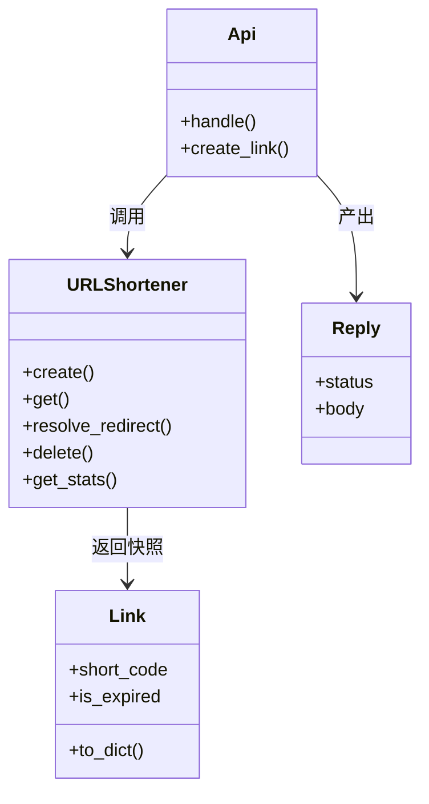

# 设计题解：短链服务（URL Shortener）

## 题目与澄清

短链服务把一个很长的网址换成一个短码：用户拿 `http://host/docs_2026` 这样的短链，服务查表后用 302 把浏览器带到原网址。
这个项目要你写五个接口：创建短链、按短码跳转、查元数据、凭所有者令牌删除、查统计。
后端是 SQLite，多个请求线程共用一条连接；状态码与 JSON 的形状都是合同，一个字都不能错。
你要写的是服务层 `URLShortener`（建表、校验、生成短码、计数、删除、统计）和把它接到 HTTP 上的那一层。
在真实工作区里后一层是 Flask 路由；这里的参考解把"解析请求体、把异常翻成状态码"收在 `Api` 里，Flask 路由只剩一行转发。

先把合同用自己的话写下来，这是开工前的第一件事。按"粗心的人最容易丢分"的顺序：

1. **网址的校验**：必须是字符串；先去掉首尾空白；然后不能含任何 ASCII 空白或控制字符（码点不超过 32，或等于 127）；协议是 `http` 或 `https`；主机名非空。
   `https://bad host/path` 因为中间有空格而非法；`https://` 没有主机名而非法；`ftp://example.com` 协议不对而非法。存下来的是去掉首尾空白后的网址。
2. **自定义短码**：可选；给了就必须完整匹配 `[A-Za-z0-9_-]{3,32}`。被占用返回 409。大小写敏感。
3. **ttl**：可选；给了就必须是正的、有限的、不是布尔的数。`expires_at = created_at + ttl_seconds`。
4. **自动短码**：匹配 `[A-Za-z0-9]{6,10}`；每次创建最多调用五次 `_generate_code`，五个都撞了现有短码就 500。同一个网址缩两次得到两条独立的链接。
5. **令牌**：`tok_` 开头、至少 16 个字符的随机秘密，只在创建响应里出现一次。
6. **跳转**：过期返回 410 且不加点击；否则点击加一并返回 302 与 `Location`；不存在 404。
7. **元数据**：不存在 404；过期的链接照样返回，`is_expired` 为真；不含令牌。
8. **删除**：缺令牌或令牌为空 400，令牌错 403，短码不存在 404；成功后读不到、跳不了、不再计入统计。
9. **统计**：`total_links`、`total_hits`（过期但没删除的也算）、`top_5_links`（`hit_count` 降序，同分按 `short_code` 升序）。
10. **错误形状**：每个错误都是只有一个键的 JSON：`{"error": "说明"}`，包括坏 JSON、不是对象的请求体和 405。

下面是用参考解跑出来的真实交互（时钟固定在 1760000000.0，所以数字可以直接对照）：

```text
POST /links {"long_url": "https://example.com/a/very/long/page", "custom_code": "docs_2026", "ttl_seconds": 3600}
  -> 201 {"short_code": "docs_2026", "long_url": "https://example.com/a/very/long/page", "created_at": 1760000000.0,
          "expires_at": 1760003600.0, "hit_count": 0, "is_expired": false,
          "short_url": "http://localhost:8080/docs_2026", "owner_token": "tok_…"}
GET /docs_2026                      -> 302，Location: https://example.com/a/very/long/page
（时间走过 3600 秒）
GET /docs_2026                      -> 410 {"error": "the link has expired"}
GET /links/docs_2026                -> 200 {…, "hit_count": 1, "is_expired": true}
POST /links {"long_url": "https://bad host/path"}   -> 400
POST /links {…, "custom_code": "docs_2026"}          -> 409
POST /links {…, "ttl_seconds": true}                 -> 400
DELETE /links/docs_2026 {}                           -> 400
DELETE /links/docs_2026 {"owner_token": "x"}         -> 403
DELETE /links/docs_2026 {"owner_token": "tok_…"}     -> 200 {"deleted": "docs_2026"}
PUT /links                                           -> 405 {"error": "method not allowed"}
```

三个必须当场问清、答案会改代码的澄清问题：

- **多个检查同时不通过时谁先赢？** 合同只给了删除的表：缺令牌 400、令牌错 403、短码不存在 404。
  缺令牌和短码不存在同时发生时，参考解先判令牌的形状，所以是 400；如果对方的测试认为"找不到就先 404"，这一条要改成先查再判。要问清并写进测试。
- **`True` 算不算 ttl？** 在 Python 里 `isinstance(True, int)` 为真，`True` 等于 1。合同写的是"非布尔数"，所以要显式排除布尔值。
- **过期的链接算不算在统计里？** 合同说算：过期但没删除的链接照样计入总数和点击。过期不是删除。

范围之外：用户账号体系、自定义域名、点击的来源与时间维度统计、链接的编辑、磁盘以外的存储（PostgreSQL、Redis）。
真实工作区的数据库辅助模块 `db.py` 提供一条按路径共享的连接；这里的参考解只用标准库，自己开一条连接，行为相同，换回 `get_db()` 只要改 `_open` 一个方法。

## 需求与分级

**第 1 关（约 15 分钟，建表与创建）**：建表、三个输入校验、自动与自定义短码、令牌。这一关决定数据长什么样。
示例：`create("https://example.com/path")` 得到一条 `short_code` 匹配 `[A-Za-z0-9]{6,10}`、`hit_count` 为 0、令牌以 `tok_` 开头的链接；
`create("https://bad host/path")` 抛 `ValidationError`，而且表里没有多出任何行。

**第 2 关（约 15 分钟，跳转、计数与过期）**：`get`、`resolve_redirect`、`increment_hits`、`is_expired`。
这一关的核心是"过期判断和加一不能被别的请求插进来"（决策一）。示例：`ttl_seconds=60` 的链接，在创建后第 59.999 秒不过期，第 60 秒过期，此时跳转抛 `ExpiredLinkError` 且点击不变。

**第 3 关（约 15 分钟，删除、统计与 HTTP）**：删除的三种失败与一种成功、统计的排序、状态码与错误形状、405 与 404。
示例：`delete("docs_2026", "x")` 抛 `PermissionDeniedError`，链接仍在；之后 `delete(..., 真令牌)` 返回 `True`，再删一次返回 `False`（路由层翻成 404）。

**第 4 关（约 15 分钟，并发与加固）**：一百个线程同时跳转，计数恰好一百；三十二个线程抢同一个自定义短码，恰好一个成功；
两个连接（相当于两个 worker 进程）同时写同一个文件，计数照样不丢。这一关检验的是决策一与决策二。

## 核心对象与职责



- **`URLShortener`**：服务层，唯一的写入口。它持有一条连接、一把锁，守住三条不变量：短码唯一、点击只在未过期时增加、失败的操作不留痕。它不知道 HTTP。
- **`Link`**：一条短链在某一刻的只读快照（`frozen=True` 的 dataclass）。`is_expired` 是属性，按这份快照被读出的时刻计算（`read_at`），不按你调用属性的时刻，所以同一份快照问两次答案相同。
  `to_dict()` 只给六个公开字段，没有令牌，也没有 `short_url`。
- **`Api`**：HTTP 合同层。它做三件事：把请求体解析成对象、调用服务、把领域异常翻成状态码与 `{"error": ...}`。它不碰 SQL。
- **`Reply`**：一个只含状态码、响应体、可选 `Location` 的小值，让 `Api` 不依赖任何 Web 框架，也让测试不需要起服务。
- **三个 `_clean_*` 函数**：边界校验。它们在任何数据库访问之前运行，所以非法输入连事务都不会开。

关系上，`Api` 拥有对服务的引用但不拥有它的生命周期；`URLShortener` 拥有连接。
异常是一个小的层级：`ShortenerError` 下面六个子类，一类对应一个状态码；`Api` 里的 `_STATUS` 表是唯一写着"哪类异常对应哪个状态码"的地方。

`Api` 里面有一个只做路由的 `handle`：五条路由，静态路径排在 `/<code>` 前面，路径对得上但方法不对是 405，路径对不上是 404。
它对应 Flask 的路由表，让没有 Flask 的测试也能检查这份合同；真实工作区里 Flask 自己做这件事，参考解配的 `flask_app.py` 只有路由与两个错误处理器。

## 关键设计决策

### 决策一：过期判断和加一写进同一条 UPDATE，而不是先查再改

要解决的问题：跳转要"没过期才加一"。两个请求、或者一个请求与时间的流逝，会在"判断"和"加一"之间插进来。

- **选项 A：先 SELECT 看是否过期，再 UPDATE 加一。** 两条语句之间有空隙：线程 1 看到"还剩 1 毫秒"，线程 2 抢先改了数据，线程 1 再加一时链接已经过期，点击被多记。
  在 Python 里"读出 `hit_count`，加一，再写回"更糟：两个线程读到同一个旧值，各写回旧值加一，丢一次点击。
- **选项 B：一条 `UPDATE links SET hit_count = hit_count + 1 WHERE short_code = ? AND (expires_at IS NULL OR ? < expires_at)`，用 `rowcount` 判断。**
  判断与加一发生在数据库的同一条语句里，不可能被别的写入插进来。`rowcount` 为 1 就是成功；为 0 再查一次是否存在，用来区分 404 与 410。

选 B。它是"复合操作"的标准做法：把"检查再行动"压成一次原子的条件写。多一次读只发生在失败路径上，代价很小。
同样的逻辑也适用于 `delete`：先查令牌再删，必须在同一个事务里（决策二）。

这不是一个需要设计模式的地方：没有策略也没有状态机，只是把条件写进 SQL。

### 决策二：一把锁加一个事务，各管一层

要解决的问题：`check_same_thread=False` 的连接可以被多个线程共用，但事务是连接级的：线程 1 的 `BEGIN` 与线程 2 的 `COMMIT` 会交错到同一个事务里。
另一方面，生产环境往往是多个 worker 进程，进程内的锁对别的进程无效。

- **选项 A：只用 Python 的锁。** 单进程下正确，多进程下两个进程各自持有自己的锁，读改写会交错。
- **选项 B：只用数据库事务，不加锁。** 多进程下正确，但同一条连接被多线程同时使用时，`BEGIN IMMEDIATE` 会因为"已经在事务里"而报错，或者把两个请求的语句塞进同一个事务。
- **选项 C：锁串行化这条连接，事务串行化写入。** `_tx()` 先取锁，再 `BEGIN IMMEDIATE`；正常退出 `COMMIT`，抛异常 `ROLLBACK`。

选 C。锁解决"一条连接不能被两个线程同时用"，事务解决"多条语句要么全成功要么全不留痕、并且别的连接要等"。
`busy_timeout` 让另一个连接遇到写锁时最多等 5 秒而不是立刻报 `database is locked`。读用不带 `IMMEDIATE` 的 `BEGIN`：一个读事务里的几条查询看到同一份快照（`get_stats` 的总数与榜单就靠这一点一致）。

锁用 `RLock`：模板就是这么给的，而且 `_tx` 不会重入，换成 `Lock` 也一样。事务里抛异常时失败的操作不留痕：`delete` 在比对令牌失败时抛 `PermissionDeniedError`，事务回滚，行还在。

### 决策三：唯一性交给主键，生成短码"直接插、撞了再来"

要解决的问题：自定义短码被两个请求同时抢，自动生成的短码也可能撞。

- **选项 A：先 `SELECT` 看有没有，没有再 `INSERT`。** 两个请求都查到"没有"，都去插：后插的要么覆盖前一个（`INSERT OR REPLACE`），要么因为主键报错。查询那一步是多余的，而且留下空隙。
- **选项 B：只 `INSERT`，接住 `sqlite3.IntegrityError` 当作"已占用"。** 数据库是唯一的裁判，跨进程也成立。

选 B。自定义短码撞了就是 `ConflictError`（409），不重试、不覆盖；自动短码撞了就重新生成，最多调用五次 `_generate_code`，每个码恰好来自一次调用，全撞抛 `CodeGenerationError`（500）。
`IntegrityError` 在这张表上只可能来自主键，所以捕获它不会吞掉别的错误；如果以后表上加了别的约束，要改成检查错误信息或换成 `INSERT ... ON CONFLICT DO NOTHING` 再看 `rowcount`。

生成器还有两个决定：

- **随机，不由网址推出。** 参数里有 `long_url`，容易让人想到"对网址取哈希"。但合同要求同一个网址再缩一次得到另一条链接，哈希只由网址决定就会次次撞同一个码。所以用 `secrets.choice` 取七位字母数字：`62**7 = 3521614606208` 种。
  存了一百万条链接时，一次生成撞上现有短码的概率是 `10**6 / 62**7 ≈ 2.8e-7`，连撞五次约 `1.8e-33`，所以"五次都撞"在真实流量里等同于生成器坏了。
- **核对生成器的输出。** 测试会替换 `_generate_code`，让它返回 `"bad/code"`；返回值不合格就直接抛 `CodeGenerationError`，不能让不合法的短码进库。

另外 `stats` 与 `links` 是路由里的静态路径，一个叫 `stats` 的自定义短码永远跳转不到（`GET /stats` 先匹配到统计）。自动短码至少六位，不会撞上这两个词；自定义短码最短三位，所以要显式拒绝，参考解按 409 处理。

### 决策四：校验是一层只做校验的函数，而且先于一切数据库访问

要解决的问题：网址与短码的规则有很多"坑"，散在各处就会漏。

- **选项 A：校验写在 `create` 里，边查边判。** 一个函数既管校验又管事务，坏输入可能已经开了事务，回滚虽然保证不留痕，但每个校验分支都在锁里。
- **选项 B：三个纯函数 `_clean_url`、`_clean_code`、`_clean_ttl`，在 `with self._tx()` 之前调用。** 它们没有副作用，好测，非法输入不占锁。

选 B。每个校验里有一个值得记住的坑：

- **网址的空白与控制字符要在 `urlsplit` 之前查。** 实测 `urlsplit("https://exa\tmple.com/a\nb")` 得到主机名 `example.com`、路径 `/ab`：制表符和换行被悄悄吞掉了，如果先解析再查，这个网址就蒙混过关了。
- **短码用 `fullmatch`，不用 `match` 加 `$`。** `re.match(r"^[A-Za-z0-9_-]{3,32}$", "abc\n")` 为真，因为 `$` 能匹配结尾换行之前；`re.fullmatch(r"[A-Za-z0-9_-]{3,32}", "abc\n")` 为假。
- **ttl 排除布尔，再排除 NaN 与无穷。** `float("nan") <= 0` 与 `float("nan") > 0` 都是假，所以只比较大小拦不住 NaN，必须用 `math.isfinite`。`10**400` 转浮点数会抛 `OverflowError`，要当成校验失败而不是让它变成 500。
- **端口也属于网址。** `urlsplit(...).port` 在端口非法时才抛 `ValueError`，所以显式访问一次。

### 决策五：这里不用设计模式，状态靠"由时间推出"而不是存成列

过期可以做成一个状态机（活跃、过期、已删除），再加一个定时任务把到期的行标成"过期"。参考解不这样做：

- **存 `status` 列的代价**：定时任务晚一秒，就有一秒的时间窗口里链接已经过期却还标着活跃；任务挂了，过期永远不生效。
- **由 `expires_at` 与当前时间推出**：没有第二份状态，也就没有不一致。每次读取时现算，成本是一次比较。

所以过期是函数，不是状态。`Link.is_expired` 与 SQL 里的 `? < expires_at` 是同一条规则的两种写法，测试用同一个注入的时钟检查两边在边界上一致：
创建后第 59.999 秒活跃，第 60 秒过期（`now >= expires_at`）。注入时钟还让测试不必 `sleep`。

删除也不用软删除标记：真删行，合同说"完全从公开行为中移除"，而且这样同一个自定义短码可以被重建，旧令牌对新链接无效（测试里有这一条）。
`Reply` 与 `Link` 这类小数据用 `dataclass`，不用 `getXxx`；服务没有接口和多实现，也就不写 `Protocol`。

## 代码走读

%% code:begin solution.py %%
```python
"""短链服务（URL Shortener）：SQLite 存储，严格校验，一条带条件的 UPDATE 同时完成"查过期 + 计一次点击"。
设计：`URLShortener` 是服务层，唯一的真相在 `links` 表里（主键 `short_code` 负责唯一性，不先查再插）；
每个会改数据的操作都在 `_tx()` 里运行——同一把锁串行化共享的那条连接，`BEGIN IMMEDIATE` 再把多条语句并成一次提交；
`_clean_*` 三个函数是边界校验，先于任何数据库访问；`Link` 是只读快照，`is_expired` 按读取那一刻判断；
`Api` 把服务的异常翻成 HTTP 状态码与 `{"error": ...}`，`handle` 是一个只有五条路由的最小路由器（真实工作区里换成 Flask 路由）。
"""

from __future__ import annotations

import json
import math
import os
import re
import secrets
import sqlite3
import string
import threading
import time
from collections.abc import Callable, Iterator
from contextlib import contextmanager
from dataclasses import dataclass, replace
from typing import Any
from urllib.parse import urlsplit

AUTO_CODE_PATTERN = re.compile(r"[A-Za-z0-9]{6,10}")  # 一律 fullmatch：`$` 会放过结尾的换行
CUSTOM_CODE_PATTERN = re.compile(r"[A-Za-z0-9_-]{3,32}")
MAX_GENERATION_ATTEMPTS = 5
CODE_LENGTH = 7
ALPHABET = string.ascii_letters + string.digits
RESERVED_CODES = frozenset({"links", "stats"})  # 和路由撞名的自定义码永远跳转不到，直接拒绝
COLUMNS = "short_code, long_url, created_at, expires_at, hit_count, owner_token"


class ShortenerError(Exception):
    pass


class ValidationError(ShortenerError):
    pass


class NotFoundError(ShortenerError):
    pass


class ConflictError(ShortenerError):
    pass


class ExpiredLinkError(ShortenerError):
    pass


class PermissionDeniedError(ShortenerError):
    pass


class CodeGenerationError(ShortenerError):
    pass


@dataclass(frozen=True)
class Link:
    """一条短链在 `read_at` 那一刻的快照。`is_expired` 随快照走，不随调用 `is_expired` 的时间走。"""

    short_code: str
    long_url: str
    created_at: float
    expires_at: float | None
    hit_count: int
    owner_token: str
    read_at: float | None = None

    @property
    def is_expired(self) -> bool:
        now = time.time() if self.read_at is None else self.read_at
        return self.expires_at is not None and now >= self.expires_at

    def to_dict(self) -> dict[str, Any]:
        """公开的元数据：没有 owner_token，也没有 short_url（后者取决于请求的主机名，由 Api 加）。"""
        return {"short_code": self.short_code, "long_url": self.long_url, "created_at": self.created_at,
                "expires_at": self.expires_at, "hit_count": self.hit_count, "is_expired": self.is_expired}


def _clean_url(value: object) -> str:
    if not isinstance(value, str):
        raise ValidationError("long_url must be a string")
    url = value.strip()
    if any(ord(ch) <= 32 or ord(ch) == 127 for ch in url):  # 必须先查：urlsplit 会悄悄吞掉 \t \r \n
        raise ValidationError("long_url must not contain whitespace or control characters")
    try:
        parts = urlsplit(url)
        parts.port  # 端口非法时这里才抛 ValueError
    except ValueError:
        raise ValidationError("long_url is not a valid URL") from None
    if parts.scheme not in ("http", "https") or not parts.hostname:
        raise ValidationError("long_url must be an http(s) URL with a host")
    return url


def _clean_code(value: object) -> str | None:
    if value is None:
        return None
    if not isinstance(value, str) or not CUSTOM_CODE_PATTERN.fullmatch(value):
        raise ValidationError("custom_code must match [A-Za-z0-9_-]{3,32}")
    return value


def _clean_ttl(value: object) -> float | None:
    if value is None:
        return None
    if isinstance(value, bool) or not isinstance(value, (int, float)):  # True 是 int，要显式排除
        raise ValidationError("ttl_seconds must be a number")
    try:
        ttl = float(value)
    except OverflowError:  # 10**400 这样的整数转不成 float
        raise ValidationError("ttl_seconds is too large") from None
    if not math.isfinite(ttl) or ttl <= 0:  # NaN 与 ±inf 不是"正的有限数"
        raise ValidationError("ttl_seconds must be a positive finite number")
    return ttl


class URLShortener:
    """SQLite 后端的短链服务。一个实例一条连接，连接在线程间共享，所以所有语句都在 `_tx()` 里串行执行。"""

    def __init__(self, db_path: str | None = None, *, clock: Callable[[], float] = time.time) -> None:
        self._db_path = db_path
        self._clock = clock
        self._lock = threading.RLock()
        self._conn = self._open()
        self._init_db()

    def _open(self) -> sqlite3.Connection:
        path = self._db_path or os.environ.get("URL_SHORTENER_DB_PATH") or "shortener.db"
        conn = sqlite3.connect(path, check_same_thread=False, isolation_level=None)  # 自己管事务
        conn.execute("PRAGMA busy_timeout = 5000")  # 另一个进程占着写锁时等，不立刻报错
        if path != ":memory:":
            conn.execute("PRAGMA journal_mode = WAL")  # 读不挡写
        return conn

    def _init_db(self) -> None:
        self._conn.execute(
            "CREATE TABLE IF NOT EXISTS links ("
            " short_code TEXT PRIMARY KEY,"  # 唯一性由数据库保证
            " long_url TEXT NOT NULL,"
            " created_at REAL NOT NULL,"
            " expires_at REAL,"
            " hit_count INTEGER NOT NULL DEFAULT 0 CHECK (hit_count >= 0),"
            " owner_token TEXT NOT NULL)")

    @contextmanager
    def _tx(self, write: bool = True) -> Iterator[sqlite3.Connection]:
        """锁住连接并开一个事务：正常退出就提交，抛异常就回滚，所以失败的操作不留痕。"""
        with self._lock:
            self._conn.execute("BEGIN IMMEDIATE" if write else "BEGIN")
            try:
                yield self._conn
            except BaseException:
                self._conn.execute("ROLLBACK")
                raise
            self._conn.execute("COMMIT")

    def _generate_code(self, long_url: str) -> str:
        """随机而不是由 URL 推出来：同一个网址再缩一次必须得到另一条链接。"""
        return "".join(secrets.choice(ALPHABET) for _ in range(CODE_LENGTH))

    def _generate_owner_token(self) -> str:
        return "tok_" + secrets.token_urlsafe(16)

    def _insert(self, conn: sqlite3.Connection, link: Link) -> bool:
        try:
            conn.execute("INSERT INTO links (" + COLUMNS + ") VALUES (?, ?, ?, ?, 0, ?)",
                         (link.short_code, link.long_url, link.created_at, link.expires_at, link.owner_token))
        except sqlite3.IntegrityError:  # 这张表唯一会违反的约束就是主键：短码已被占用
            return False
        return True

    def create(self, long_url: str, custom_code: str | None = None,
               ttl_seconds: float | None = None) -> Link:
        url, code, ttl = _clean_url(long_url), _clean_code(custom_code), _clean_ttl(ttl_seconds)
        with self._tx() as conn:
            created = self._clock()
            draft = Link("", url, created, None if ttl is None else created + ttl, 0,
                         self._generate_owner_token(), created)
            if code is not None:
                link = replace(draft, short_code=code)
                if code in RESERVED_CODES or not self._insert(conn, link):
                    raise ConflictError("custom_code is already in use")
                return link
            for _ in range(MAX_GENERATION_ATTEMPTS):  # 至多五次，每次恰好调用一次 _generate_code
                candidate = self._generate_code(url)
                if not isinstance(candidate, str) or not AUTO_CODE_PATTERN.fullmatch(candidate):
                    raise CodeGenerationError("the generator returned an invalid code")
                link = replace(draft, short_code=candidate)
                if self._insert(conn, link):
                    return link
            raise CodeGenerationError("could not find a free short code")

    def get(self, short_code: str) -> Link | None:
        with self._tx(write=False) as conn:
            row = conn.execute("SELECT " + COLUMNS + " FROM links WHERE short_code = ?",
                               (short_code,)).fetchone() if isinstance(short_code, str) else None
            return None if row is None else Link(*row, read_at=self._clock())

    def resolve_redirect(self, short_code: str) -> str:
        with self._tx() as conn:
            now = self._clock()
            hit = conn.execute(  # 过期判断和计数在同一条语句里：不会出现"判断时没过期、计数时已过期"
                "UPDATE links SET hit_count = hit_count + 1"
                " WHERE short_code = ? AND (expires_at IS NULL OR ? < expires_at)", (short_code, now))
            if hit.rowcount == 1:
                return conn.execute("SELECT long_url FROM links WHERE short_code = ?", (short_code,)).fetchone()[0]
            exists = conn.execute("SELECT 1 FROM links WHERE short_code = ?", (short_code,)).fetchone()
        if exists:
            raise ExpiredLinkError("the link has expired")
        raise NotFoundError("unknown short code")

    def increment_hits(self, short_code: str) -> None:
        """给已存在的短码加一次点击（不看过期：过期判断是跳转的规则，不是计数的规则）。"""
        with self._tx() as conn:
            done = conn.execute("UPDATE links SET hit_count = hit_count + 1 WHERE short_code = ?", (short_code,))
            if done.rowcount == 0:
                raise NotFoundError("unknown short code")

    def delete(self, short_code: str, owner_token: str) -> bool:
        if not isinstance(owner_token, str) or not owner_token:  # 先校验令牌的形状：缺令牌是 400，不管短码在不在
            raise ValidationError("owner_token is required")
        with self._tx() as conn:
            row = conn.execute("SELECT owner_token FROM links WHERE short_code = ?", (short_code,)).fetchone()
            if row is None:
                return False
            if not secrets.compare_digest(row[0].encode(), owner_token.encode()):  # 常数时间比较
                raise PermissionDeniedError("owner_token does not match")
            conn.execute("DELETE FROM links WHERE short_code = ?", (short_code,))
            return True

    def get_stats(self) -> dict[str, Any]:
        with self._tx(write=False) as conn:  # 两条查询在同一个读事务里，看到的是同一时刻的数据
            total, hits = conn.execute("SELECT COUNT(*), COALESCE(SUM(hit_count), 0) FROM links").fetchone()
            top = conn.execute("SELECT short_code, long_url, hit_count FROM links"
                               " ORDER BY hit_count DESC, short_code ASC LIMIT 5").fetchall()
        return {"total_links": total, "total_hits": hits,
                "top_5_links": [{"short_code": c, "long_url": u, "hit_count": h} for c, u, h in top]}


@dataclass(frozen=True)
class Reply:
    status: int
    body: dict[str, Any]
    location: str | None = None


_STATUS = ((ValidationError, 400), (PermissionDeniedError, 403), (NotFoundError, 404), (ConflictError, 409),
           (ExpiredLinkError, 410), (CodeGenerationError, 500))


def _error(status: int, message: str) -> Reply:
    return Reply(status, {"error": message})


class Api:
    """HTTP 合同：解析请求体、调用服务、把异常翻成状态码。真实工作区里这些方法就是 Flask 路由的函数体。"""

    def __init__(self, service: URLShortener, base_url: str = "http://localhost:8080") -> None:
        self._service, self._base_url = service, base_url

    def _call(self, action: Callable[[], Reply]) -> Reply:
        try:
            return action()
        except ShortenerError as exc:
            status = next(code for kind, code in _STATUS if isinstance(exc, kind))
            return _error(status, str(exc))

    def create_link(self, body: object, base_url: str | None = None) -> Reply:
        if not isinstance(body, dict):
            return _error(400, "request body must be a JSON object")

        def go() -> Reply:
            link = self._service.create(body.get("long_url"), body.get("custom_code"), body.get("ttl_seconds"))
            root = (base_url or self._base_url).rstrip("/")
            return Reply(201, {**link.to_dict(), "short_url": f"{root}/{link.short_code}",
                               "owner_token": link.owner_token})
        return self._call(go)

    def redirect(self, short_code: str) -> Reply:
        def go() -> Reply:
            return Reply(302, {}, self._service.resolve_redirect(short_code))
        return self._call(go)

    def get_link(self, short_code: str) -> Reply:
        link = self._service.get(short_code)
        return _error(404, "unknown short code") if link is None else Reply(200, link.to_dict())

    def delete_link(self, short_code: str, body: object) -> Reply:
        token = body.get("owner_token") if isinstance(body, dict) else None  # 没有请求体和没有令牌是同一种错
        def go() -> Reply:
            if not self._service.delete(short_code, token):
                return _error(404, "unknown short code")
            return Reply(200, {"deleted": short_code})
        return self._call(go)

    def stats(self) -> Reply:
        return Reply(200, self._service.get_stats())

    def handle(self, method: str, path: str, raw_body: bytes = b"") -> Reply:
        """最小路由器：静态路由排在 `/<code>` 前面；路径对得上但方法不对是 405，路径对不上是 404。"""
        try:
            body: object = json.loads(raw_body) if raw_body else None
        except ValueError:  # 含 UnicodeDecodeError
            body = None
        path = path.rstrip("/") or "/"
        routes: list[tuple[str, str, Callable[[re.Match[str]], Reply]]] = [
            ("POST", r"/links", lambda m: self.create_link(body)),
            ("GET", r"/stats", lambda m: self.stats()),
            ("GET", r"/links/([^/]+)", lambda m: self.get_link(m[1])),
            ("DELETE", r"/links/([^/]+)", lambda m: self.delete_link(m[1], body)),
            ("GET", r"/([^/]+)", lambda m: self.redirect(m[1])),
        ]
        matched = False
        for verb, pattern, action in routes:
            found = re.fullmatch(pattern, path)
            matched = matched or found is not None
            if found and verb == method:
                return action(found)
        return _error(405, "method not allowed") if matched else _error(404, "not found")


if __name__ == "__main__":
    api = Api(URLShortener(":memory:"))
    made = api.handle("POST", "/links", b'{"long_url": "https://example.com/a", "custom_code": "demo"}')
    print(made.status, made.body)
    print(api.handle("GET", "/demo"))
    print(api.handle("GET", "/stats").body)
```
%% code:end %%

走读时盯住四个地方：

1. **`_tx`**：`with self._lock` 然后 `BEGIN IMMEDIATE`；`except BaseException` 里回滚再抛；正常走完才 `COMMIT`。所有会写的方法都用它，所以"失败不留痕"是一次写在这里的事实，而不是每个方法各自记得。
2. **`create`**：三个校验在事务外；事务里先生成令牌、再分叉自定义与自动两条路径；两条路径都靠 `_insert` 的返回值判断撞没撞。
   注意 `draft` 是一个没有短码的 `Link`，用 `dataclasses.replace` 填入候选短码，所以每次插入的是一个新的不可变对象。
3. **`resolve_redirect`**：条件 `UPDATE`，`rowcount == 1` 才读网址；失败后的存在性查询放在事务里、`raise` 放在事务外，所以异常不会被误当成要回滚的错误。
4. **`Api._call` 与 `_STATUS`**：异常类到状态码是一张表，`next(code for kind, code in _STATUS if isinstance(exc, kind))` 按顺序匹配。
   没有被表覆盖的异常（真正的缺陷）不会被吞掉：`Api` 不捕获，由外层的"500 兜底"处理，Flask 里是 `errorhandler(Exception)`。

把这份代码放进真实工作区时：`solution.py` 另存为 `shortener.py`，`flask_app.py` 另存为 `app.py`；这样公开的 18 个单元测试与 22 个端到端检查（Flask 测试客户端）全部通过。
两处细节要对上：Flask 里 `request.get_json(force=True, silent=True)` 才会在 `Content-Type` 不是 JSON 或 JSON 损坏时返回 `None`（否则 Flask 自己抛 415 或 400，响应体就不是合同要的 JSON）；
`app.url_map.strict_slashes = False` 让 `/links/` 与 `/links` 等价。

## 测试与自检

参考解的测试共 46 个函数、130 个用例（参数化展开后），分六组：

- **校验**：每个非法网址、非法短码、非法 ttl 一个用例，附带"失败后表里没有多出行"；合法边界（三位与三十二位的短码、IPv6 主机、大写协议）一个用例。
  非法网址里有 `https://bad host/path`、制表符、换行、`\x7f`、没有主机名、端口 99999、`javascript:`；非法短码里有 `abc\n`、`abc\x00`、中文、`True`。
- **短码生成**：替换 `_generate_code`，数出恰好调用五次；撞两次后第三次成功；返回格式不合法的码；自定义与自动共用命名空间。
- **过期与计数**：用注入时钟检查闭区间边界，过期的跳转不加点击，`increment_hits` 对过期链接仍然计数（参考解的选择，写在测试里）。
- **删除与统计**：错误优先级；删后短码可重建而旧令牌无效；同分按短码升序（大写字母排在小写之前）；过期的链接仍计入统计。
- **并发**：一百个线程用 `threading.Barrier` 同时起跑，断言计数恰好一百；三十二个线程抢一个自定义短码，恰好一个成功、三十一个冲突；
  四十个线程在"已到点"的链接上跳转，全部是 410、计数仍为 0；两个连接（相当于两个进程）打开同一个文件，四十次跳转一次不丢。
- **HTTP**：README 示例逐字段对照；坏请求体（空、非 JSON、数组、字符串、`null`、非 UTF-8）全是 400 且只有 `error` 一个键；`NaN` 与 `Infinity` 字面量是 400；
  `PUT /links`、`DELETE /abc123`、`POST /stats` 是 405，`GET /a/b/c` 是 404；`/stats/` 末尾斜杠也能用。

并发测试断言的是不变量（计数恰好、赢家恰好一个），不是时序。
一个值得做的自检：把参考解里的 `fullmatch` 改成 `re.match(r"^…$")`，或者把 `? < expires_at` 改成 `? <= expires_at`，或者去掉统计的 `short_code ASC`，或者删掉 `delete` 开头的令牌形状检查，或者让 ttl 放过布尔，或者拿掉跳转 UPDATE 里的过期条件，测试都应当立刻变红；
这六种改动各让 1 到 3 个用例失败。

两分钟演示：`python solution.py` 会创建一条自定义短码、跳转一次、打印统计。再口述三句：校验在事务外；过期与加一在同一条 UPDATE；唯一性靠主键。

## 扩展与追问

**新需求**

- **点击明细（时间、来源）**：新增 `hits` 表，`resolve_redirect` 在同一个事务里插一行。`links.hit_count` 仍然保留作为汇总，`get_stats` 不变。服务以外的类不用动。
- **续期与改目标**：`PATCH /links/<code>` 带令牌，改 `expires_at` 或 `long_url`；复用 `delete` 的令牌校验，抽成 `_authorize(conn, code, token)`。
- **短码长度可配**：`CODE_LENGTH` 改成构造参数；`AUTO_CODE_PATTERN` 允许 6 到 10 位，已经覆盖。

**并发与线程安全**

- **读多写少、写集中在热点行**：现在每次跳转是一次写事务。热点链接会让写锁排队。办法是把点击先攒在内存，定期批量写；代价是进程崩溃丢最近几秒，合同要求"恰好一次"时不能这么做。
- **换成异步框架**：`sqlite3` 的调用是阻塞的，要放进线程池，或者换异步驱动；`_tx` 的锁要换成异步锁。
- **为什么不用 `check_same_thread=True` 每线程一条连接**：可以，那样不需要进程内的锁，但每条连接独立开事务，同样靠 `BEGIN IMMEDIATE` 与 `busy_timeout` 串行化写；`:memory:` 数据库每条连接是一个独立的库，测试要换成文件。

**持久化与规模**

- **PostgreSQL 或 MySQL**：同样的条件 `UPDATE` 与主键冲突；把 `?` 改成驱动的占位符，`IntegrityError` 换成驱动的唯一冲突异常，`BEGIN IMMEDIATE` 换成事务隔离级别，`rowcount` 的语义相同。
- **统计变慢**：`SUM` 与排序要扫全表。给 `(hit_count, short_code)` 建索引可以让榜单走索引，代价是每次点击多维护一份索引；也可以另存汇总行，每次增删点击同步更新。
- **短码耗尽或被枚举**：七位随机码空间大且不可预测；要保证不重复就换成发号器加 Base62，代价是可以被猜出相邻短码。
- **令牌存哈希**：数据库泄露时令牌不会跟着泄露；创建时返回明文，库里存 `sha256`，删除时哈希后比较。`Link.owner_token` 只会在创建的返回值里有意义。
- **过期的行什么时候清**：合同不要求。清理任务批量删除 `expires_at` 很久以前的行，要注意它会改变统计里的 `total_links`，合同说过期但没删除的仍然计入。

## 常见错误

- **用 `re.match` 加 `^…$` 校验短码**：`"abc\n"` 通过。用 `fullmatch`。
- **先 `urlsplit` 再查空白**：制表符和换行已经被吞掉。
- **`isinstance(ttl, (int, float))` 放过 `True`**：`ttl_seconds: true` 变成一秒钟的有效期。
- **`ttl` 只检查 `> 0`**：`NaN > 0` 为假、`nan <= 0` 也为假，两种写法都会放过 NaN；用 `math.isfinite`。
- **先读 `hit_count` 再写回**：两个线程读到同一个旧值，丢一次点击；用 `hit_count = hit_count + 1`。
- **先查过期、再加一**：两条语句之间过期的链接被多记一次。
- **加了锁但读不加锁**：Python 里 `sqlite3` 共用连接，读与写交错也会在同一个事务里看到半截状态，读也走 `_tx`。
- **先 `SELECT` 再 `INSERT` 判断短码重复**：并发时两个请求都通过检查。直接插，接 `IntegrityError`。
- **自动短码由网址哈希得到**：同一网址再缩必撞；合同要求两条独立链接。
- **忘了与路由重名的短码**：叫 `stats` 的链接建得出来，跳转不到。
- **用 `==` 比令牌**：理论上有时序泄露；用 `secrets.compare_digest`（比较前把两边 `encode` 成字节，非 ASCII 字符串直接比会抛 `TypeError`）。
- **删除先查短码再校验令牌形状**：缺令牌时短码不存在也该是 400。
- **把 405 写成 404，或把 HTML 错误页漏给客户端**：框架默认的 404、405、415、500 都是 HTML；每一种都要接成 `{"error": ...}`，包括未预期的异常。
- **让 Flask 的 `HEAD` 与链接预览机器人计数**：Flask 会给 `GET` 路由自动加 `HEAD`，浏览器预取和聊天软件的预览也会触发跳转，点击数会偏高；合同没要求处理，但值得向面试官提一句。
- **用智能体时只说"实现一个短链服务"**：没有合同里的十条规则与数字例子，生成的代码会在其中几条上违反；把例子与错误顺序逐条交给它，再用自己写的测试验收。
- **让智能体"把测试改成通过"**：测试失败时先判断是代码错还是测试错；合同里的例子不能改。

## 45 分钟怎么分配

- **0–5 分钟｜读合同**：先别写代码。把上面的十条规则写成注释，标出哪几条最可能被隐藏测试针对：校验的细节、错误优先级、过期的边界、统计的排序、405 与 404。对智能体说的第一句话也是这份清单。
- **5–10 分钟｜定骨架并分工**：口头说出结构：`URLShortener`（连接、锁、事务）、`Link`、三个校验函数、`Api`。让智能体起草三个校验函数（输入输出清楚，易验证）；
  事务的范围、条件 `UPDATE`、"直接插入"这三个决定自己定。
- **10–22 分钟｜建表、创建、校验**：先写 `_init_db` 与 `create`，每写完一块就跑公开测试，再把示例写成自己的断言。每次只给智能体一个失败的用例。
- **22–32 分钟｜跳转、计数、删除、统计**：先自己写"过期的跳转不加点击""缺令牌先于 404""同分按短码升序"三个测试，再让智能体实现；它最容易漏的是把过期判断拆成独立的一条语句。
- **32–40 分钟｜HTTP 与错误形状**：路由、请求体解析、异常到状态码的表；检查每一种错误都只有 `error` 一个键。
- **40–45 分钟｜并发与收尾**：自己写屏障测试：一百个线程跳转计数恰好一百。留出时间向面试官口述两件事：为什么条件 `UPDATE` 比先查再改安全；换成多进程后哪里变化。

时间不够时的取舍顺序：先砍统计的索引讨论，再砍令牌哈希的讨论，再砍边缘的校验。
**绝不能砍的是**：过期与加一在同一条语句里、直接插入加接住冲突、校验先于数据库、所有错误的 JSON 形状。

## 延伸阅读

- [[problems.components.ttl-cache|带过期时间的缓存（TTL Cache）]]：同样是"过期由时间推出"，对照懒删除与注入时钟。
- [[problems.components.rate-limiter|限流器（Rate Limiter）]]：另一个"检查与更新必须原子"的组件，对照条件写与锁的范围。
- [[problems.components.kv-store|内存键值存储（In-Memory Key-Value Store）]]：把存储换成字典后同样的并发问题，对照一把锁与事务的分工。
- [[solution-lcp-issue-creation-api|可重试的工单服务（Retry-Safe Issue Service）]]：同样是带授权的 HTTP 合同，对照错误优先级与幂等键。
- [SQLite 文档：事务（BEGIN IMMEDIATE）](https://www.sqlite.org/lang_transaction.html)：延迟、立即、独占三种事务的区别，以及什么时候取得写锁。
- [SQLite 文档：WAL 模式](https://www.sqlite.org/wal.html)：读不挡写的原因，以及多进程共用一个文件时的限制。
- [Python 文档：sqlite3](https://docs.python.org/3/library/sqlite3.html)：`isolation_level=None`、`check_same_thread`、`rowcount` 与 `IntegrityError`。
- [Python 文档：re.fullmatch](https://docs.python.org/3/library/re.html#re.Pattern.fullmatch)：与 `match` 加 `$` 的区别，`$` 会匹配结尾换行之前。
- [Python 文档：secrets](https://docs.python.org/3/library/secrets.html)：`token_urlsafe`、`choice` 与 `compare_digest`。
- [RFC 9110 第 15.4.3 节：302 Found](https://www.rfc-editor.org/rfc/rfc9110#name-302-found)：重定向的语义与 `Location` 头。
