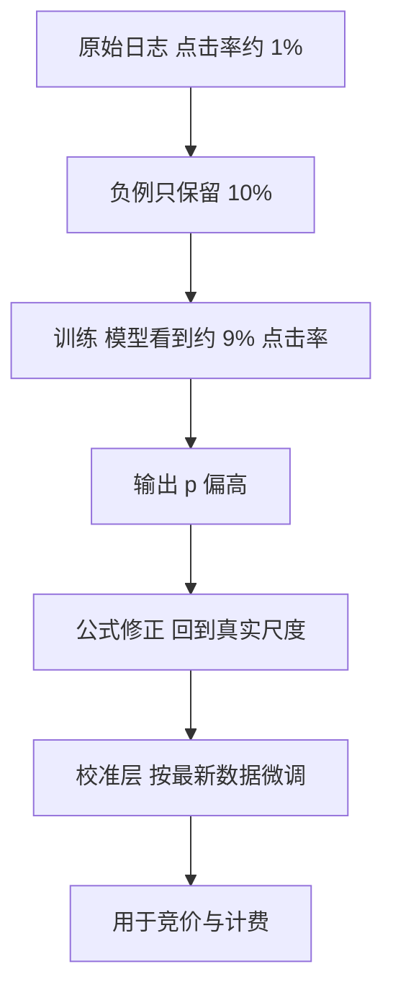

## Q
**深挖 · 校准与负采样修正**｜广告点击率预测

面试官：「为什么广告的点击率预测必须校准，而推荐排序不太在意？训练时把负例只保留 10%，模型输出的概率会怎样，怎么修正回来？」

## A
**一句话。** 广告按"出价 × 预测点击率"竞价并计费，预测值高估 20% 就会让广告主多付钱、平台排错广告，所以要的是准确的概率，不只是正确的顺序；负例下采样会让模型系统性高估，需要用公式 q = p ÷ (p + (1 − p) ÷ w) 修正（w 是负例保留比例），之后再用保序回归之类的校准层按最新数据微调。

**下采样为什么会高估。**
- 原始数据：100 次展示里 1 次点击（1%）。
- 负例保留 10%：训练集里是 1 次点击 + 9.9 次未点，模型学到的点击率约 9.2%。
- 模型在训练分布下是对的，但真实世界的负例多了 10 倍。

**修正公式（小例子）。** w = 0.1。模型在下采样数据上输出 p = 0.5，则 q = 0.5 ÷ (0.5 + 0.5 ÷ 0.1) = 0.5 ÷ 5.5 ≈ 0.091。预测"一半会点"，实际约 9%。

**校准层。**
1. **测量：** 把预测分成若干区间，每个区间比较平均预测值与实际点击率；也看总体比值"预测总和 ÷ 实际点击数"，理想是 1。
2. **保序回归（isotonic regression）：** 学一个单调不减的映射，把模型输出映射到实际点击率；不改变排序，只改数值。
3. **分维度检查：** 总体校准好，某个广告位或某类广告主可能仍偏差很大；按维度拆分监控，必要时分维度校准。
4. **更新：** 校准层用最近几小时的数据频繁重拟合，比重训模型便宜得多。

**故障与处理。**
- **新模型上线后收入异常：** 排序更准但整体预测偏高 10%，扣费和竞价全跟着偏。处理：上线前校准度是硬门槛，金丝雀阶段监控"预测 ÷ 实际"。
- **延迟点击导致低估：** 最近的展示还没来得及被点。处理：等待窗口或延迟反馈修正。

**为什么推荐不太在意。** 推荐只用分数排序，所有分数整体乘 2 顺序不变；广告的分数直接变成钱，数值本身必须准。
