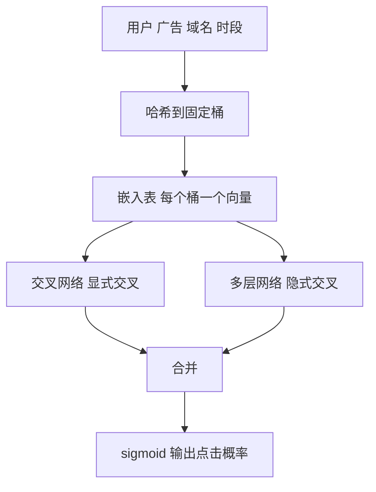

## Q
**深挖 · 海量稀疏特征与模型演进**｜广告点击率预测

面试官：「广告点击率预测的特征多是用户 ID、广告 ID、网站域名这类有上亿种取值的类别特征。怎么把它们喂给模型？从逻辑回归到深度模型，每一步解决了什么问题？」

## A
**一句话。** 类别特征通过特征哈希（把任意取值哈希到固定数量的桶里）或词表映射成编号，每个编号对应一个可学习的向量（嵌入）；模型演进的主线是"怎么学特征交叉"：逻辑回归靠人工写交叉特征，因子分解机用向量内积自动学两两交叉，深度模型再用专门的交叉网络和多层网络学更高阶的交叉。

**特征。**
- **类别：** 用户 ID、广告 ID、广告主、创意类型、网站或应用、广告位、设备、地区。
- **统计：** 广告过去 1 小时、1 天的点击率；用户过去 7 天对这类广告的点击次数。
- **交叉：** "这个用户 × 这个广告主"、"这个广告位 × 这个创意尺寸"；交叉特征往往最有预测力。
- **哈希：** 上亿种取值哈希到例如 2²⁴（约 1,677 万）个桶；冲突会让少数取值共享一个向量，桶数越多冲突越少、内存越大。

**模型演进。**
1. **逻辑回归：** 每个特征一个权重，简单、快、天然输出概率；但只能学人工列出来的交叉，组合多了特征爆炸。
2. **因子分解机（FM）：** 每个特征一个短向量，任意两个特征的交叉强度 = 两个向量的内积；没见过的组合也能估计，因为两边的向量是从别的组合里学来的。
3. **深度模型：** 嵌入层之上，一边用交叉网络显式学几阶交叉，一边用多层网络学任意复杂的组合；再加入用户最近行为序列，用注意力找出和当前广告相关的历史行为。

**故障与处理。**
- **嵌入表巨大：** 上亿个向量 × 每个 16–64 维，几十到几百 GB。处理：哈希压缩、低频特征共享向量、参数服务器分片存储。
- **低频 ID 过拟合：** 只出现过几次的 ID 向量学不准。处理：频次阈值以下合并成"未知"桶，正则化。
- **统计特征泄漏：** 用包含当前样本点击的统计量做特征，离线分数虚高。处理：统计特征只用样本时间点之前的数据计算。

**为什么这样，不那样。** 逻辑回归至今仍常作为基线和兜底：便宜、可解释、校准好；深度模型提升精度，但训练与服务成本、调试难度都更高，收益要用在线收入实验验证。
