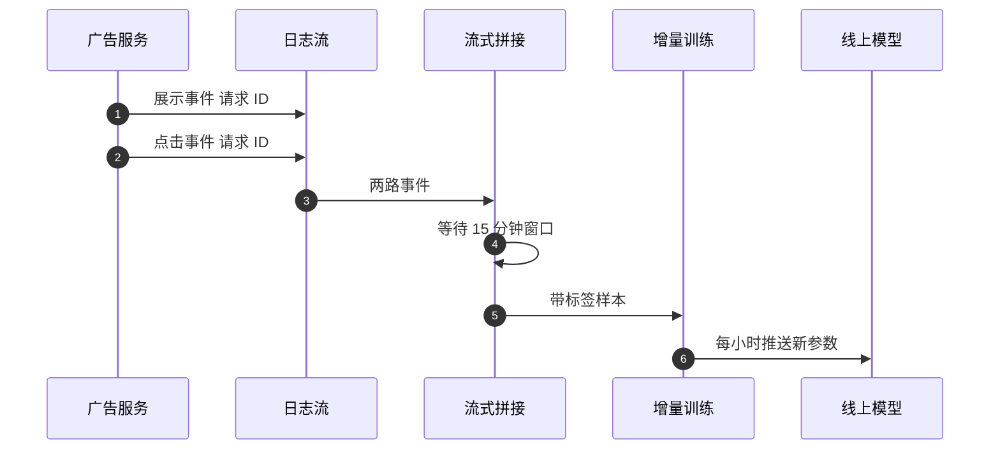

## Q
**深挖 · 新鲜度、在线学习与延迟反馈**｜广告点击率预测

面试官：「广告每天都有大量新上线的，用户兴趣也随时在变。点击率模型多久更新一次？怎么做在线学习？点击发生在展示几分钟后，训练数据什么时候算'没点'？」

## A
**一句话。** 用"每天全量重训 + 分钟到小时级增量更新"的组合：全量训练保证稳定，增量更新让新广告和新趋势快速进入模型；展示和点击通过流式拼接生成样本，等一个固定窗口（例如 15 分钟）后没有点击才记为负例；窗口外的迟到点击用修正样本补回。

**步骤。**
1. **流式拼接：** 展示事件和点击事件都带同一个请求 ID；拼接服务把展示缓存在状态存储里，窗口内来了点击就输出正例，窗口到期仍没有就输出负例。
2. **增量训练：** 从全量模型的参数出发，用最近一小时的样本继续训练几步，只更新嵌入表里出现过的行和部分层；新广告 ID 第一次出现时初始化为同类广告的平均向量。
3. **发布：** 新参数先在小流量上对比校准度和点击率，再推送全量；保留上一版以便秒级回滚。
4. **全量重训：** 每天用过去几周的数据从头训一次，纠正增量更新累积的偏差。

**延迟反馈。**
- **窗口太短：** 很多真实点击被记成负例，模型低估。
- **窗口太长：** 样本晚到，新鲜度下降。
- **折中：** 选覆盖绝大多数点击的窗口；窗口外的迟到点击作为"修正样本"再发一次，训练时对它做加权补偿。转化（购买）可能晚几天，延迟问题更严重，通常单独建模。

**故障与处理。**
- **坏数据一小时内污染模型：** 拼接服务故障导致全是负例。处理：训练前检查样本的点击率和数量是否在正常范围，异常就暂停增量更新。
- **新广告预估不准：** 处理：用广告主、创意类型等泛化特征给新广告初始预估，并留少量探索流量收集数据。

**为什么这样，不那样。** 只做每天全量，新广告要等一天才被正确估计；只做在线更新，模型会逐渐被短期噪声带偏且难以复现；两者结合兼顾新鲜和稳定。增量更新带来的收益要通过"模型年龄 vs 对数损失"的离线实验量化：模型每晚一小时，损失涨多少。
