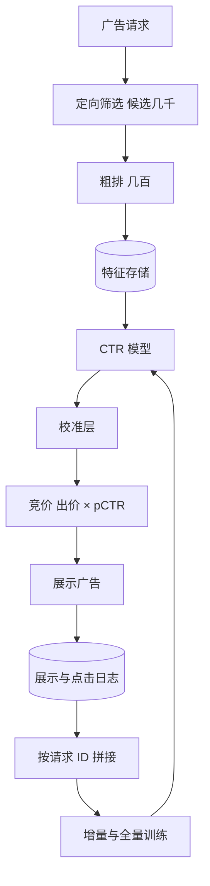

## Q
**全景**｜完整答案 · 广告点击率预测

面试官：「设计广告系统里的点击率预测：每次用户刷到一个广告位，要从几千个候选广告里选一个展示，按"出价 × 预测点击率"排序。按 ML 系统设计的七步讲。」

## A
**一句话。** 点击率预测（CTR prediction）是一个二分类：给定用户、广告、上下文，预测点击的概率。和推荐不同的是，这个概率要直接乘以出价去竞价、去计费，所以它必须是"校准"的（预测 2% 就真的约 2% 被点）；数据是海量稀疏的类别特征，广告和用户兴趣变化快，模型需要频繁甚至在线更新。

**① 需求。** 每次请求 P99 < 50 ms 内为几千个候选打分；每天千亿级展示；新广告上线几分钟内就要有合理预估；预测概率要校准。

**② 定义成 ML 任务。** 二分类，输出点击概率；损失用对数损失（log loss，预测概率离真实结果越远罚得越重），因为它直接惩罚概率不准。

**③ 数据。** 展示日志与点击日志按请求 ID 拼接（点击晚于展示，要等一个时间窗口）；点击率通常只有 1% 左右，正例极少，负例常按比例下采样以节省训练成本。

**④ 模型。** 从逻辑回归加人工交叉特征，到因子分解机（为每个特征学一个向量，用向量内积自动表示两两交叉），再到深度模型（嵌入层 + 自动学交叉的网络 + 多层网络）。

**⑤ 评估。** 离线：对数损失、归一化交叉熵（模型的对数损失除以"只按平均点击率预测"的对数损失，越小越好）、AUC、校准度（预测平均值 ÷ 实际点击率，越接近 1 越好）。在线：收入、点击率、广告主转化成本，以及用户体验护栏。

**⑥ 部署。** 候选广告先按定向条件和粗排筛到几百个；精排模型批量打分；特征从低延迟特征存储读取；模型每天全量训练，加上分钟到小时级的增量更新。

**⑦ 监控。** 校准度按广告主和广告位拆分、预测分布漂移、特征缺失率、日志拼接延迟、收入异常。

**必讲深挖。** 稀疏特征与模型演进；校准与负采样修正；新鲜度、在线学习与延迟反馈。

**数字（假设）。** 每天 1,000 亿次展示约 116 万次/秒；每次 300 个候选进入精排，就是每秒 3.5 亿次模型打分，所以精排模型必须很轻，重计算放在离线。
