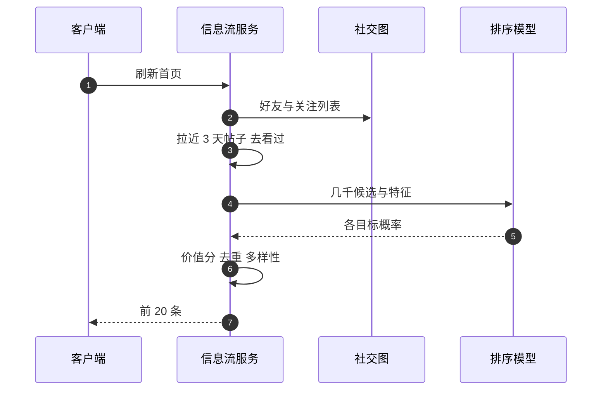

## Q
**深挖 · 信息流排序：价值分、去重与多样性**｜个性化信息流

面试官：「信息流每次有几千条候选帖子。排序模型预测什么、怎么合成一个分数？同一条新闻被五个好友转发，怎么避免刷屏？怎么防止整屏都是同一个人的帖子？」

## A
**一句话。** 排序模型同时预测点赞、评论、分享、停留时长和隐藏的概率，按权重合成价值分（评论和分享这类"有意义的互动"权重高，隐藏是负权重）；排序后做重排：同一内容的多次转发合并成一条并显示"某某等 5 人分享"，同一作者、同一类型的帖子之间设最小间隔，并保留位置给新鲜内容。

**步骤。**
1. **召回：** 拉取好友、关注对象、所在群组最近几天的帖子；去掉已看过的（服务端记录每个用户已展示的帖子 ID）。
2. **特征：** 用户与作者的互动强度（最近 30 天点赞评论次数）、帖子类型（图片、视频、链接）、帖子年龄、帖子当前的互动速度、用户对该类型的历史偏好。
3. **预测与合成：** 价值分 = Σ 权重 × 概率；权重来自产品目标和在线实验，比如评论权重是点赞的数倍。
4. **去重：** 同一个链接或同一条原始帖子的多次转发，只保留价值分最高的那一条，并聚合转发者信息。
5. **多样性：** 贪心逐条选择，若与上一两条是同一作者或同一类型就扣分，保证整屏有变化。
6. **新鲜度：** 帖子年龄作为特征，同时在重排中给最近一小时的帖子少量加分。

**故障与处理。**
- **热门帖子刷屏：** 处理：同一原始帖子去重；同一作者每屏最多出现 N 次。
- **"互动诱饵"：** "点赞就能……"类帖子骗互动。处理：专门的分类器识别并降权。
- **冷启动的新用户：** 好友少、候选不足。处理：补充热门公共内容和推荐关注。

**为什么这样，不那样。**
- **不按时间倒序：** 好友多的用户一次刷新有几千条，按时间排会让重要的帖子（好友结婚）被大量低价值内容淹没。
- **不只优化点赞：** 点赞成本低，最大化它会偏向轻浮内容；评论、分享、停留更能反映真正的兴趣。代价是权重需要持续用长期指标（留存、满意度调查）校准。
