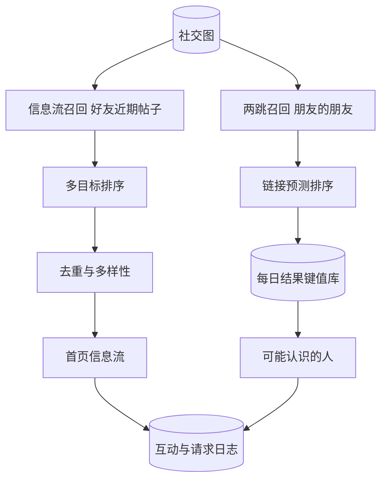

## Q
**全景**｜完整答案 · 个性化信息流与"你可能认识的人"

面试官：「社交平台有两个功能：首页信息流，把好友和关注对象的帖子按对用户的价值排序；'你可能认识的人'，推荐用户可能想加的好友。设计这两个系统，按 ML 系统设计的七步讲，并说清它们的共同点和区别。」

## A
**一句话。** 两者都是召回加排序。信息流的候选来自社交关系（好友、关注、群组近几天的帖子），排序是多目标的"互动价值"预测，再做去重和多样性；"你可能认识的人"把问题定义为社交图上的链接预测（预测两个人之间将来会不会出现好友关系），候选主要来自"朋友的朋友"，排序用共同好友等图特征，评估看发出请求后被接受的比例。

**① 需求。**
- **信息流：** 打开即刷，P95 < 300 ms；同一帖子不重复；新帖子几分钟内可见。
- **可能认识的人：** 每天离线更新为主，加实时补充（刚加了好友后立即推相关的人）；被接受率高、骚扰少。

**② 定义成 ML 任务。**
- **信息流：** 预测用户对每条候选帖子的点赞、评论、分享、停留、隐藏的概率，加权得到价值分。
- **可能认识的人：** 二分类：给定 (用户 A, 用户 B)，预测 A 发出好友请求且 B 接受的概率。

**③ 数据。** 互动日志（展示、点赞、评论、隐藏、停留时长）；社交图（好友、关注、互动强度）；好友请求的发出和接受记录。

**④ 模型。** 信息流：多任务深度排序模型。可能认识的人：基于图特征的梯度提升树，或图神经网络（让每个人的向量汇总其好友的向量，从而表达"在图里的位置"）。

**⑤ 评估。**
- **离线：** 信息流用 AUC、NDCG；可能认识的人用召回率@k（之后真的成为好友的人有多少出现在前 k 个推荐里）。
- **在线：** 信息流看会话时长、互动、隐藏率；可能认识的人看请求发出率和被接受率。

**⑥ 部署。** 信息流在请求时实时召回和排序；可能认识的人每天离线批量算候选和分数，结果存键值库，线上直接读取，再按实时事件小量更新。

**⑦ 监控。** 信息流：空流率、重复率、隐藏率；可能认识的人：被拒绝或被举报的比例。

**必讲深挖。** 信息流的多目标价值分、去重与多样性；可能认识的人的两跳召回、图特征与评估。
