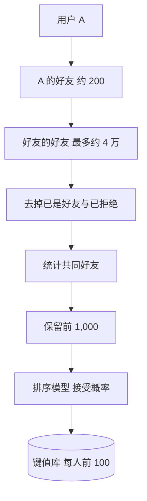

## Q
**深挖 · "你可能认识的人"：两跳召回与图特征**｜可能认识的人

面试官：「平台 10 亿用户，每人平均 200 个好友。怎么为每个人找出可能认识的人？用哪些特征？为什么通常离线批量计算？怎么评估？」

## A
**一句话。** 候选主要来自"朋友的朋友"（社交图上两跳内的人），再补充同学校、同公司、通讯录匹配；排序用图特征（共同好友数、共同好友的"稀有程度"）加个人特征，训练目标是"请求被发出并被接受"；由于每人两跳候选可达几万，全量每天离线计算，结果存键值库供线上读取。

**步骤。**
1. **两跳召回：** 每个好友的好友都是候选，200 × 200 = 4 万（有大量重叠，实际更少）；在分布式图计算框架上按用户分片批量算。
2. **初筛：** 按共同好友数保留前 1,000，去掉已是好友、已拒绝过、被屏蔽的。
3. **特征：** 共同好友数；Adamic–Adar 分（每个共同好友按 1 ÷ log(他的好友数) 加权，"只有 30 个好友的共同好友"比"有 5,000 个好友的共同好友"更说明问题）；同学校、同公司、同城市；互相看过主页；对方的好友数和活跃度。
4. **模型：** 梯度提升树或图神经网络，标签是历史推荐中"发出请求且被接受"。
5. **服务：** 每天把每人的前 100 个写进键值库；用户刚加了新好友时，实时触发对其两跳邻居的小规模重算。

**评估。**
- **离线：** 按时间切分：用某一天之前的图预测之后 30 天新出现的好友关系，量召回率@k；不能随机切边，否则未来的边泄漏进特征。
- **在线：** 请求发出率、被接受率、被拒绝或举报率；最终看新用户的好友数增长和留存。

**故障与处理。**
- **隐私与骚扰：** 推荐暴露敏感关系（就诊、前任）。处理：敏感来源不作为召回依据，用户可以移除推荐，被拒绝过的不再出现。
- **超级节点：** 有几万好友的账号让两跳爆炸。处理：从超级节点出发的两跳只采样或跳过。
- **富者更富：** 好友多的人被推荐得更多。处理：对候选的曝光次数设上限。

**为什么这样，不那样。** 实时为每次请求做两跳遍历，延迟和成本都太高；而好友推荐的时效要求不高，每天离线加事件触发的小增量就够。
