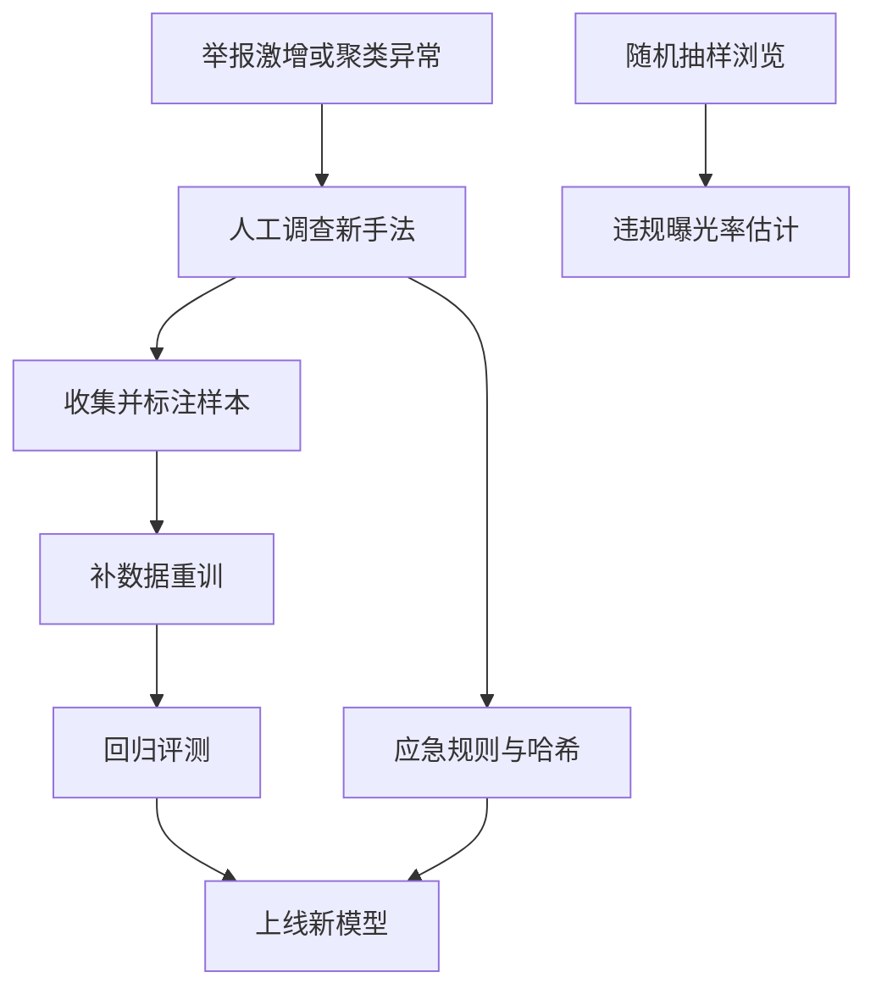

## Q
**深挖 · 对抗、新型违规与违规比例的测量**｜有害内容检测

面试官：「违规者会故意改写文字、在图片上加噪点来绕过模型；新的诈骗手法模型从没见过。怎么发现和应对？又怎么知道平台上到底还剩多少违规内容？」

## A
**一句话。** 对抗靠多层信号（内容、行为、账号、传播）和快速迭代：一种绕过手法被发现后，先上规则和哈希应急，再补数据重训；新型违规靠异常检测发现（举报激增、某类内容突然聚集）；剩余违规比例靠对全站浏览随机抽样人工标注来估计，这是唯一不受模型偏差影响的指标。

**对抗手法与对策。**
- **文字变形：** 谐音、插入符号、用相似字符替换（"ｆｒｅｅ"）。对策：文字归一化（全角转半角、相似字符映射），训练数据中加入变形增强。
- **图片扰动：** 加噪点、裁剪、翻转、叠加图层让哈希失效。对策：用对扰动不敏感的感知哈希和向量相似度，训练时做同样的增强。
- **把内容拆开：** 文字放在图片里，或拆成多条评论。对策：图中文字识别，按账号聚合多条内容一起判断。
- **换号：** 被封后注册新账号。对策：设备、支付、网络等账号关联信号，新账号的内容门槛更严。

**发现新型违规。**
1. **举报异常：** 某类举报数突然升高，但模型分数普遍很低，说明出现了模型不认识的内容。
2. **聚类：** 对近期内容的向量聚类，出现迅速增长、高度相似的新簇时人工查看。
3. **应急：** 先用规则和哈希挡住已发现的样本（几小时内），再收集上千条样本训练（几天到几周）。

**测量违规曝光率。**
- 每天从全部浏览中随机抽几千次，人工判断被浏览的内容是否违规。
- 违规曝光率 = 违规浏览数 ÷ 抽样浏览数。抽样 1 万次、发现 15 次违规，估计为 0.15%，95% 置信区间约 ±0.08 个百分点（1.96 × √(0.0015 × 0.9985 ÷ 10,000) ≈ 0.00076）。
- 模型自己的分数不能用来测这个数：模型漏掉的内容，模型的分数也看不出来。

**为什么这样，不那样。** 只靠一个越来越大的模型，每次重训要几周，追不上对手几天一换的手法；规则和哈希快但脆，模型慢但泛化，两者叠加才同时兼顾速度和覆盖。
