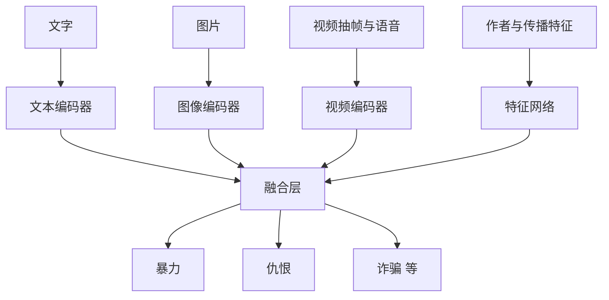

## Q
**深挖 · 多模态融合与多标签模型**｜有害内容检测

面试官：「一张普通风景图配上一句仇恨文字，单看图、单看字都可能判不出来。有害内容模型怎么把文字、图片、视频融合？十几个违规类别用一个模型还是十几个？」

## A
**一句话。** 各模态先用各自的编码器变成向量，再在融合层合在一起判断（晚期融合只合并各自的结论，抓不住"图文合起来才违规"；融合表示能抓住）；输出层每个类别一个独立的二分类头，共享底层表示，这样一个模型覆盖所有类别，新增类别只加一个头。

**步骤。**
1. **编码器：** 文本和图像用预训练好的模型（在海量数据上学过通用表示），视频抽帧后逐帧编码再聚合，语音先转文字。
2. **融合：** 把各模态向量拼接，或用注意力让文字和图片互相"看"，再经几层网络得到帖子的整体表示。
3. **多标签输出：** 每个类别一个 sigmoid 输出（各自独立的 0–1 概率，可以同时多个为高），而不是只能选一个类别的 softmax。
4. **损失：** 每个类别的二分类交叉熵相加；稀有类别加大权重，防止被常见类别淹没。
5. **非内容特征：** 账号年龄、历史违规、短时间内的转发和举报速度；诈骗类很依赖这些。

**故障与处理。**
- **某一模态缺失：** 纯文字帖没有图片。处理：缺失模态用一个专门的"空"向量，训练时随机丢掉模态，让模型不依赖某一个。
- **类别间相互影响：** 共享底层后，为某一类加数据可能让另一类变差。处理：每类单独的评测和回归门槛。
- **计算量：** 视频完整处理最贵。处理：先用便宜的文字和封面模型筛，分数可疑或传播快的再跑完整视频模型。

**为什么这样，不那样。**
- **融合对比各模态独立判断：** 独立判断后取最大值实现简单、每个模型可单独升级，但抓不住"组合起来才违规"的内容。
- **一个多头模型对比每类一个模型：** 多头共享计算，推理成本约为一份；类别间共享知识（暴力和仇恨的线索相关）；代价是改动互相影响，需要更严格的回归测试。
