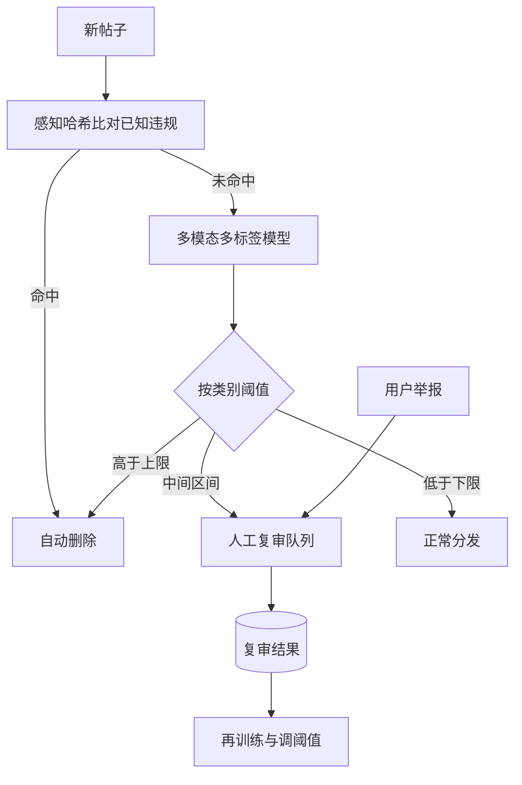

## Q
**全景**｜完整答案 · 有害内容检测

面试官：「一个社交平台每天有 5 亿条新帖子（文字、图片、视频）。设计系统自动发现暴力、仇恨、成人、诈骗等违规内容，决定删除、降低分发或送人工复审。按 ML 系统设计的七步讲。」

## A
**一句话。** 分层处理：已知违规内容用感知哈希（图片缩小去色后算出的短指纹，近似的图指纹也相近）直接匹配；其余内容由一个多模态、多标签分类模型打出各违规类别的概率；按类别设两条阈值：高于上限自动处理，中间区间送人工复审队列，复审结果回流成训练数据。精确率与召回率的取舍按类别的危害程度决定。

**① 需求。** 发布前或发布后几分钟内判定；支持十几个违规类别；用户可申诉；人工复审能力有限（例如每天 50 万条）。

**② 定义成 ML 任务。** 多标签分类（一条帖子可以同时属于多个类别）：输入文字、图片、视频、作者和传播信号，输出每个类别的概率。

**③ 数据。** 人工复审的判定（最可靠，但偏向"模型送审的那部分"）；用户举报（量大、噪声大）；按随机抽样人工标注的样本，用于无偏评估和估计平台上违规内容的真实比例。

**④ 模型。** 各模态的编码器（文本、图像、视频抽帧）→ 融合层 → 每个类别一个输出头；加上作者历史违规次数、账号年龄、转发速度等非内容特征。

**⑤ 评估。** 离线：每个类别的精确率（判为违规的里面真违规的比例）、召回率（真违规的里面被抓到的比例）、PR 曲线下面积。在线：违规内容曝光率（违规内容的浏览次数占总浏览的比例，靠随机抽样估计）、申诉推翻率、复审队列积压。

**⑥ 部署。** 发帖时同步跑快速的哈希匹配和文字模型；图片视频异步跑完整模型；传播很快的帖子提高优先级重新检查。

**⑦ 监控。** 每类的自动处理量与送审量、申诉推翻率、新型违规的出现（某类举报突然增多但模型分数低）。

**必讲深挖。** 多模态融合与多标签模型；阈值、复审队列与申诉；对抗与新型违规。

**数字（假设）。** 5 亿条/天，模型若把 1% 送审就是 500 万条，远超每天 50 万条的复审能力，所以送审比例必须压到 0.1% 左右，并按危害和传播速度排序。
