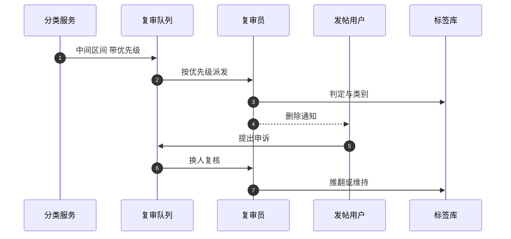

## Q
**深挖 · 阈值、人工复审队列与申诉**｜有害内容检测

面试官：「模型给出每个类别的违规概率之后，阈值怎么定？人工复审员有限，送审的内容怎么排序？误删了用户申诉怎么处理？」

## A
**一句话。** 每个类别两条阈值：上限以上自动处理（要求精确率很高，例如 ≥ 95%），下限以下放行，中间送人工；阈值按类别的危害、复审容量和申诉推翻率定，用 PR 曲线（精确率随召回率变化的曲线）在固定的评估集上选点。复审队列按"违规概率 × 危害程度 × 预计曝光量"排序；申诉由另一位复审员复核，推翻的样本作为高价值训练数据。

**定阈值的步骤。**
1. **评估集：** 按随机抽样加人工标注建立，不能只用复审过的样本（那些都是模型已经怀疑的，分布有偏）。
2. **自动处理阈值：** 在 PR 曲线上找精确率达到目标（例如 95%）的最低分数。
3. **送审阈值：** 从上往下放宽，直到送审量等于每天的复审容量。
4. **按危害调整：** 儿童安全、恐怖主义这类高危害类别，宁可多送审、自动处理阈值也更低；轻微违规（垃圾广告）可以只降低分发而不删除。

**复审队列。**
- **优先级：** 违规概率 × 危害权重 × 预计曝光（作者粉丝数、当前转发速度）。传播快的内容先处理，因为多等一小时就多几万次浏览。
- **分工：** 按语言和类别派给有相应培训的复审员；复审员看到的图片默认模糊处理，降低心理伤害。
- **一致性：** 一部分样本同时派给两人，量一致率；不一致的交给专家裁决，也用来更新标注指南。

**申诉。**
- 用户申诉后，由另一位复审员复核，不能是原判的人。
- 推翻率按类别和按模型版本统计；某类推翻率突然升高，说明阈值或模型出了问题。
- 推翻的样本是"模型错得很自信"的例子，加大权重进入训练集。

**故障与处理。**
- **复审积压：** 处理：临时提高送审阈值，只送高危害类别；低危害类别先降低分发、等待处理。
- **阈值漂移：** 新模型的分数尺度和旧模型不同。处理：每次换模型都在评估集上重新选阈值，而不是沿用数字。

**为什么这样，不那样。** 单一阈值只能在"误删很多"和"漏掉很多"之间二选一；两条阈值加人工中间层，让模型处理有把握的大头，人处理不确定的少数。
