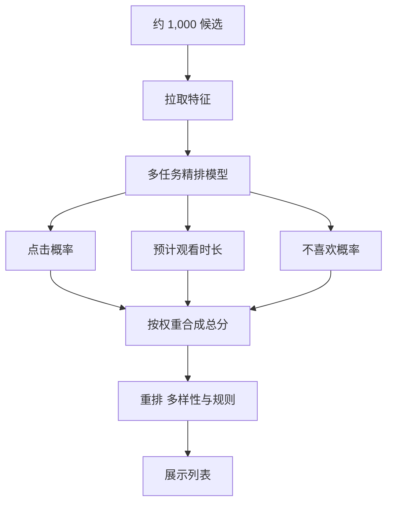

## Q
推荐系统的精排和重排阶段做什么？精排模型用哪些特征、预测哪些目标？多个目标怎么合成一个分数？

## A
**一句话。** 精排对召回来的约 1,000 个候选逐个打分：输入用户、内容、上下文和两者的交叉特征，同时预测点击、观看时长、点赞、分享、不喜欢等多个概率（多任务模型），再按业务权重加权成一个总分；重排在总分之上加入多样性、去重、新鲜度和平台规则，得到最终展示顺序。

**特征。**
- **用户：** 年龄段、语言、长期兴趣、最近 50 次行为序列。
- **内容：** 类别、作者、时长、发布时间、历史点击率。
- **交叉：** 这个用户看这个作者的次数、这个类别的历史完播率；交叉特征通常是最强的一类信号。
- **上下文：** 时间、设备、网络、在哪个页面。
- **一致性：** 线上取特征的代码和训练时的特征必须是同一份定义，否则模型线上表现变差（训练与服务不一致）。

**多目标合成。**
1. 模型为每个目标输出一个概率或预测值，共享底层网络，各目标有自己的输出层。
2. 总分例如：w₁ × 点击概率 + w₂ × 预计观看分钟数 + w₃ × 点赞概率 − w₄ × 不喜欢概率。
3. 权重不是模型学的，是产品决策：通过在线实验调，看长期指标（留存、满意度调查）。

**重排。**
- **多样性：** 贪心地依次选：每次选"分数高、又和已选内容不太像"的那个（MMR 一类方法）。
- **规则：** 同一作者不连续出现、看过的不再出现、限制敏感内容比例、给新内容留固定位置。
- **校准：** 如果下游要用概率本身（例如广告竞价），要确保预测的 0.1 真的是 10% 的点击率。

**取舍。**
- **模型大小与延迟：** 1,000 个候选在 30 ms 内打完分，决定了模型能有多复杂；候选更多就要加粗排。
- **只优化点击的问题：** 标题党点击高、看完率低；多目标和"不喜欢"惩罚就是为了纠正这一点。
- **权重靠实验：** 离线指标无法回答"观看时长和点赞哪个更重要"，只能看在线长期指标。
