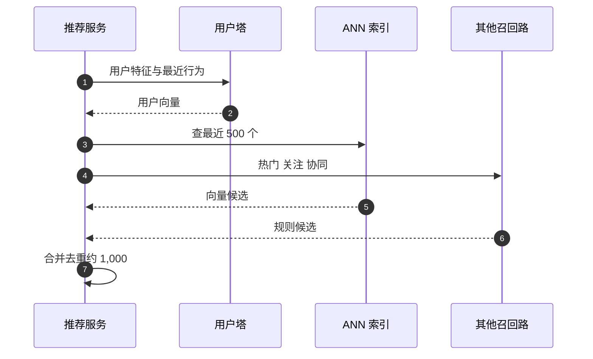

## Q
推荐系统的召回阶段通常用双塔模型加向量检索。双塔模型怎么训练、线上怎么用？为什么还要多路召回？

## A
**一句话。** 双塔模型（two-tower）有两个独立的网络：用户塔把用户特征变成一个向量，内容塔把内容特征变成一个同样长度的向量，两者内积越大表示越可能感兴趣。训练用"用户实际点过的内容"做正例、其他内容做负例；上线后内容向量离线全部算好放进近似最近邻索引（ANN，用少量精度换几十倍速度的相似度搜索），请求时只算一次用户向量去查。再并上几路规则召回，补上模型的盲区。

**训练。**
1. **样本：** 每条正例是"用户、他点过或看完的内容"。
2. **批内负例：** 一批 4,096 条正例里，其他用户点的内容就当作这个用户的负例，不用额外采样，非常省。
3. **纠偏：** 热门内容在批里出现得多，被当负例的次数也多，模型会被压得不推热门；按内容出现频率修正分数（采样偏差修正）。
4. **困难负例：** 加入"很像但用户没点"的内容，让模型学会细分。

**线上。**
- **内容向量：** 每天或每小时用内容塔批量重算全部内容，构建新索引；新内容上架时单独算向量增量插入。
- **用户向量：** 请求时实时算，包含最近几分钟的行为，所以召回能跟上用户兴趣变化。
- **索引：** 1 亿 × 128 维 × 4 字节 ≈ 51 GB，可以压缩或分片；HNSW、IVF 一类索引单次查询毫秒级。

**为什么要多路召回。**
- **协同过滤路（"看了 A 的人也看了 B"）：** 擅长捕捉内容之间的共现关系。
- **热门和新内容路：** 新内容没有互动数据，向量不准，需要专门的通道给曝光机会。
- **关注路：** 用户关注的作者的新作品，必须出现。
- **多路合并：** 每路有配额，去重后交给排序；某一路出问题时其他路兜底。

**取舍。**
- **双塔的局限：** 用户和内容只在最后一步内积时"见面"，学不到复杂的交互（"这个用户只在周末看长视频"），所以只适合召回，精细判断交给排序。
- **索引新鲜度与成本：** 全量重建越频繁，内容向量越新，算力越贵；常见做法是全量每天、增量实时。
