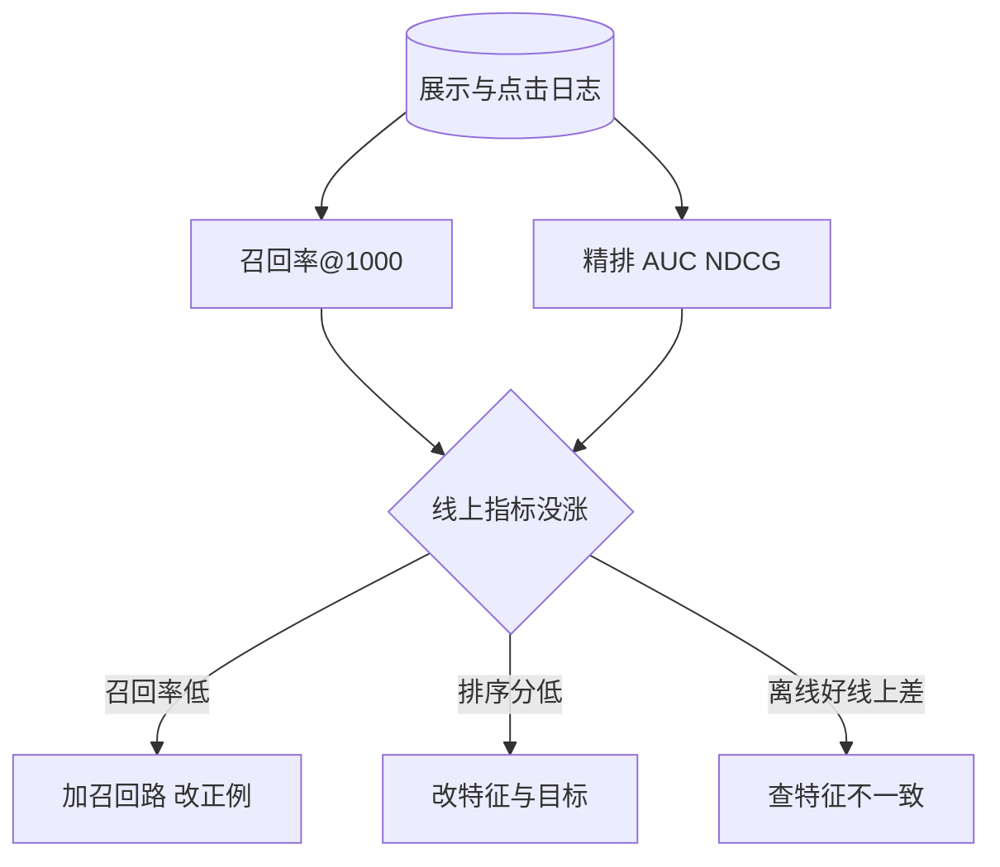

## Q
面试里被问"召回加排序的两阶段架构有哪些坑，你怎么评估每个阶段"，怎么答？

## A
按这个顺序说：

- **先说结构和理由：** 全库上亿、重模型逐个打分要十几分钟，所以召回从全库快速取约 1,000 个，精排精打分，重排加规则。召回追求不漏，精排追求排准。
- **坑一，召回是上限：** 召回漏掉的内容，精排再准也排不出来。评估召回要单独量：用户最终点击的内容有多大比例出现在召回结果里（召回率@1,000）；精排提升有限时，先查召回。
- **坑二，两阶段目标不一致：** 召回按"会点"训练，精排按"看得久"排，召回送来的大量候选被精排压到底部，浪费名额。做法：召回也引入观看时长作为正例权重，或用精排的打分结果蒸馏召回模型。
- **坑三，曝光偏差与反馈回路：** 模型只从"被展示过的内容"里学，从没展示过的内容永远没数据，推荐越来越窄。做法：留一小部分流量做探索（随机或按不确定性给新内容曝光），训练时修正"位置越靠前越容易被点"的位置偏差。
- **坑四，延迟预算：** 整条链路约 100–200 ms：召回约 10–20 ms、取特征约 20 ms、精排约 30 ms、重排约 5 ms。超时的召回路直接丢弃，其他路照常；精排超时退回粗排分数。
- **评估：** 离线分阶段：召回率@k、精排的 AUC（随机取一正一负，模型把正例排前面的概率）和 NDCG（排名越靠前的命中权重越大的排序质量分）；在线看点击率、观看时长、留存，以及护栏指标（不喜欢率、多样性）。离线涨了线上不涨时，优先怀疑训练与服务的特征不一致。

