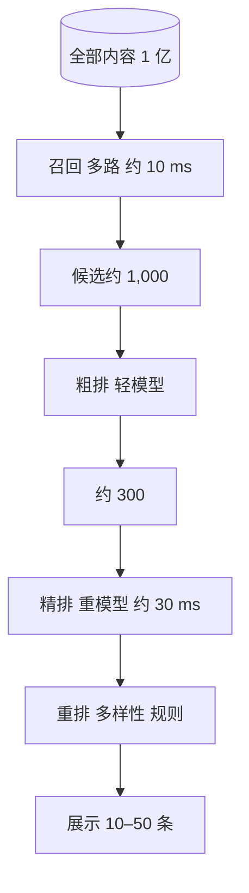

## Q
推荐和搜索系统为什么几乎都分成"召回 + 排序"两个阶段？每一阶段处理多少候选、花多少时间？为什么不能用一个最准的模型给全部内容打分？

## A
**一句话。** 用准确的重模型给上亿个内容逐个打分太慢，所以先用便宜的方法从全库里快速找出约一千个"可能相关"的候选（召回，candidate generation / retrieval），再用重模型给这一千个精细打分（排序，ranking），最后按业务规则做重排（re-ranking）。这是一个越往后候选越少、模型越重的漏斗。

**手算为什么必须分阶段。**
- **一步到位：** 假设精排模型批量计算后每个内容约 10 微秒，1 亿 × 10 μs = 1,000 秒，一次请求要 17 分钟。
- **两阶段：** 召回用向量近似检索在 1 亿个向量里找最近的 1,000 个，约 10 ms；精排 1,000 × 10 μs = 10 ms，加上取特征的时间，整个链路在 100 ms 内。

**各阶段的分工。**
- **召回：** 目标是"别漏掉好的"，看重召回率；模型简单（用户和内容各自变成一个向量，算内积），内容向量可以提前算好建索引；常有多路：向量召回、"看过 A 的人也看 B"、热门、关注的作者、新内容。
- **粗排（可选）：** 候选多到几千上万时，用小模型先砍到几百。
- **精排：** 目标是"排得准"，用几百上千个特征，包括用户与内容的交叉特征（这个用户过去看这个作者的次数），模型重，同时预测点击、观看时长、点赞等多个目标。
- **重排：** 不是只按分数排：同一作者不连续出现、类别多样、去掉看过的、插入新内容和广告、满足平台规则。

**为什么召回不能直接用精排模型。** 精排模型依赖"用户 × 内容"的交叉特征，必须对每一对现场计算，无法提前为内容建索引；召回模型把用户和内容分开算，内容向量可以离线算好放进索引，查询时只算用户向量一次。

**代价。** 召回漏掉的内容，后面再准的排序也救不回来；两阶段的模型目标不一致时，召回送来的候选未必是精排最喜欢的。
