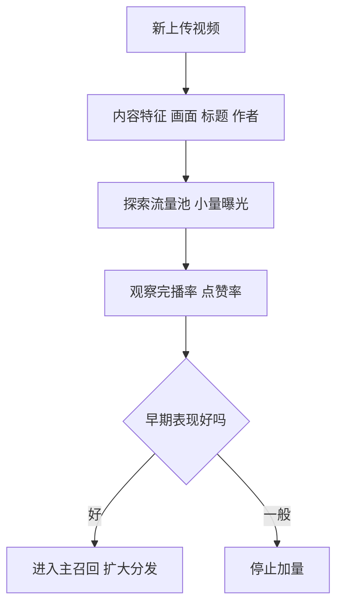

## Q
**深挖 · 冷启动与探索**｜视频推荐

面试官：「一个刚上传、没有任何播放数据的视频，怎么才能被推荐出去？一个刚注册的新用户，第一屏推什么？怎么在"推已知好的"和"试新的"之间平衡？」

## A
**一句话。** 新视频没有行为数据，就用内容本身（标题、画面向量、作者历史表现）预测它的潜力，并从专门的探索流量池里给它少量曝光，按早期表现决定是否放大；新用户用注册时选的兴趣、地区、设备和热门内容开场，前几次交互后快速更新用户向量。探索和利用的平衡用固定比例的探索名额或按不确定性加分的方法控制。

**新视频的步骤。**
1. **内容向量：** 上传后用画面和标题编码器算出向量，可以立刻放进向量召回，和相似的老视频站在一起。
2. **作者先验：** 作者过去视频的平均表现作为初始预估。
3. **探索池：** 每个用户的推荐列表里留 1–2 个位置给新视频；新视频先获得例如 500 次曝光。
4. **放大：** 达到阈值（完播率、点赞率高于同类平均）就进入下一级、更大的流量池；否则停止加量。

**新用户的步骤。**
1. **开场：** 注册时选的兴趣、地区和语言下的热门内容，加上多样化的类别，尽快探测偏好。
2. **快速更新：** 用户向量由最近行为序列实时计算，看完几个视频后推荐就开始个性化。

**探索与利用（exploration vs exploitation）。**
- **ε-贪心：** 以小概率 ε（例如 5%）随机放一个候选，其余按分数；简单，但随机内容质量参差。
- **按不确定性加分：** 曝光次数少的视频预测不确定性大，给它的分数加一个随不确定性增大的奖励，越少被看过越有机会；比随机更省流量。
- **代价：** 探索名额是短期指标的成本（这些位置点击率较低），换来长期的内容供给和新作者留存。

**故障与处理。**
- **探索池被刷：** 作者用小号刷早期互动。处理：早期指标只计可信账号，异常增长人工核查。
- **好视频被早期噪声埋没：** 500 次曝光的统计误差大。处理：用作者先验做平滑（贝叶斯平均，把观测到的比例向同类平均拉近），表现接近阈值的再给一轮曝光。

**为什么这样，不那样。** 只推已有数据的视频，系统会越来越集中在少数老视频上，新作者得不到反馈就离开，内容供给萎缩，长期留存下降。
