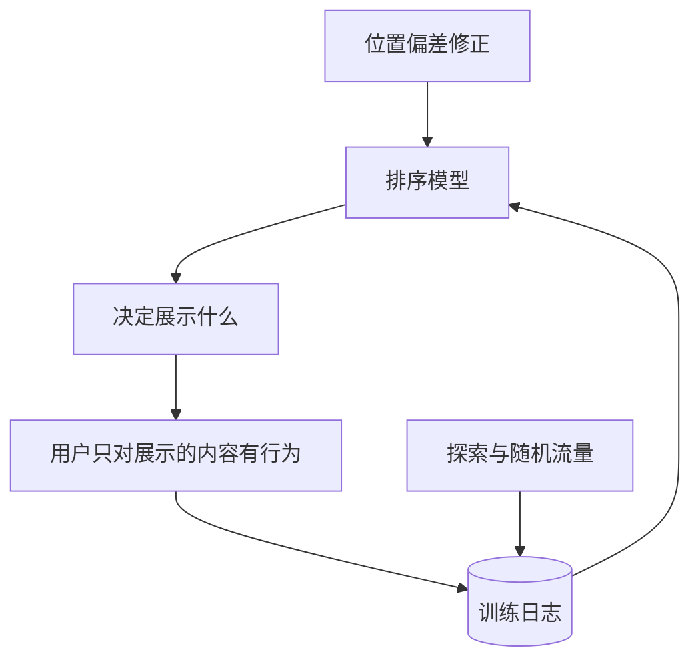

## Q
**深挖 · 多目标排序与反馈回路**｜视频推荐

面试官：「只优化点击率会推出标题党，只优化观看时长会偏向长视频和让人上瘾的内容。视频推荐的排序目标怎么定？模型推什么用户就看什么，再用这些数据训练模型，这个循环有什么问题？」

## A
**一句话。** 用一个多任务模型同时预测点击、观看时长、完播、点赞、分享、不喜欢，把它们按产品权重合成"价值分"，并加入满意度调查这类直接反映"值不值得看"的信号；权重用长期留存的在线实验来定。反馈回路的问题是模型只从自己推过的内容里学习，所以要留探索流量、修正位置偏差、并用随机流量的数据做无偏评估。

**多目标的做法。**
1. **预测：** 点击概率、预计观看分钟数、完播概率、点赞和分享概率、不喜欢概率；共享底层网络，每个目标一个输出头。
2. **合成：** 价值分 = Σ 权重 × 预测值，"不喜欢"的权重为负。观看时长要按视频长度归一，否则一个 30 分钟视频看一半，比一个 1 分钟视频看完还"好"。
3. **满意度信号：** 定期给少量用户弹出"这个推荐你满意吗"，训练一个满意度预测头，纳入价值分；它直接对抗标题党和成瘾内容。
4. **定权重：** 离线无法回答"点赞和时长谁更重要"；用多组权重做在线实验，看 30 天留存和满意度。

**反馈回路的问题与对策。**
- **曝光偏差：** 从没被推过的视频没有标签，模型永远学不到它们。对策：探索流量。
- **位置偏差：** 第 1 位天然被看得多，模型把"位置好"误认为"内容好"。对策：训练时把位置作为特征输入，线上预测时统一设为第 1 位；或按每个位置被看到的概率反向加权。
- **兴趣收窄：** 越推越像，用户被困在少数类别里。对策：重排加多样性约束，监控用户看到的类别数。
- **无偏评估：** 离线评估用的日志本身就是旧模型选出来的；保留一小份随机推荐的流量，用它的数据评估新模型更可靠。

**为什么这样，不那样。** 单一目标容易被"投机"：点击可以靠封面骗，时长可以靠长视频堆；多目标加满意度让模型很难只靠一个漏洞拿高分。代价是权重需要持续在线实验校准，且各目标之间会互相牵制。
