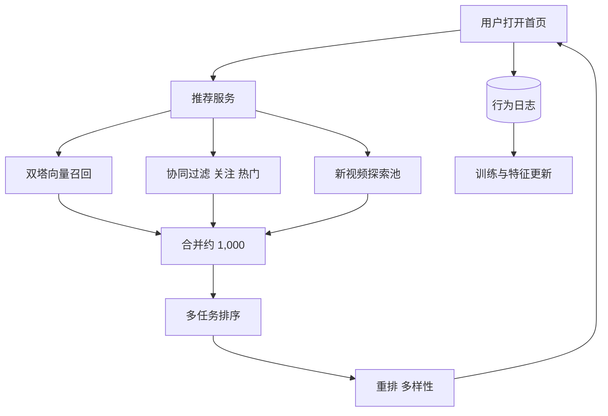

## Q
**全景**｜完整答案 · 视频推荐

面试官：「设计视频平台首页的个性化推荐：用户打开应用，看到一列为他挑选的视频。平台有 10 亿个视频、5 亿日活。按 ML 系统设计的七步讲。」

## A
**一句话。** 召回加排序：多路召回（双塔向量、协同过滤、关注、热门、新内容）从 10 亿视频里取约 1,000 个候选；多任务排序模型预测点击、观看时长、点赞、不喜欢，按业务权重合成一个分数；重排保证多样性和新内容曝光；用户行为实时回流到特征和训练。核心难点是冷启动、多目标和"模型影响自己训练数据"的反馈回路。

**① 需求。** 首页一次返回 20 个，下拉加载更多；P95 < 200 ms；新上传的视频几小时内能被推荐；目标是长期满意度和留存，而不是单次点击。

**② 定义成 ML 任务。** 召回是表示学习加最近邻搜索；排序是多任务预测（点击概率、预计观看时长、点赞概率、不喜欢概率）；最终排序按加权总分。

**③ 数据。** 展示日志与行为（点击、观看时长、跳过、点赞、不喜欢、分享）；视频的类别、时长、作者、标题和画面向量；用户画像与最近行为序列。按时间切分训练和评估数据。

**④ 模型。** 召回用双塔模型（用户向量和视频向量内积）；排序用深度多任务模型，输入用户最近几十次行为序列；重排用规则加多样性算法。

**⑤ 评估。** 离线：召回率@k、排序 AUC 和 NDCG。在线 A/B：人均观看时长、留存、满意度调查分、不喜欢率；护栏：内容多样性、新作者曝光比例。

**⑥ 部署。** 视频向量离线批算加增量；用户向量和排序实时算；特征存储同时供训练和线上使用，保证定义一致；模型每天全量重训，部分参数小时级增量更新。

**⑦ 监控。** 点击率、观看时长、空结果率、各路召回的贡献比例、特征缺失率、预测分数分布漂移。

**必讲深挖。** 冷启动与探索：新视频和新用户怎么办；多目标排序与反馈回路：观看时长的陷阱、满意度、曝光偏差。

**数字（假设）。** 5 亿日活 × 每天刷新 10 次 = 50 亿次请求/天，约 5.8 万次/秒，峰值约 15 万次/秒；每次精排 1,000 个候选，就是每秒上亿次模型打分。
