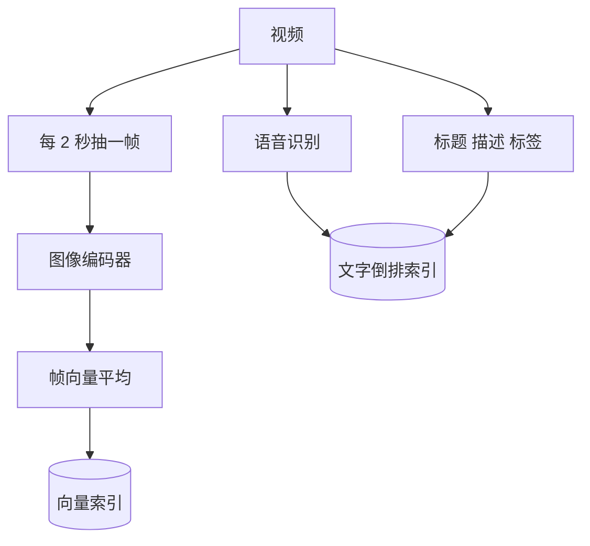

## Q
**深挖 · 把画面、语音和文字变成可搜索的信号**｜视频搜索

面试官：「视频标题只写了"VID_0423"。怎么让"猫咪跳上钢琴"这样的查询搜到它？画面、语音、文字三种信息怎么处理、怎么融合？」

## A
**一句话。** 三种信息各自变成可检索的形式：语音经语音识别（把说话变成文字）进入文字索引；画面按时间抽帧，用图文对比学习模型编码成向量，平均成视频向量进入向量索引；标题描述照常进文字索引。查询时文字路和向量路分别召回，按排名融合后交给排序模型，排序模型再把各路的相关分当作特征一起学。

**步骤。**
1. **抽帧：** 每 1–2 秒一帧，或只在镜头切换处取关键帧，减少重复画面的计算。
2. **帧编码：** 图文对比学习模型（用数亿个图文对训练，让图片和描述它的文字向量接近）的图像部分编码每一帧；查询用同一模型的文字部分编码，两者在同一空间里可以直接比距离。
3. **聚合：** 最简单是对帧向量取平均得到一个视频向量；长视频可以按片段各存一个向量，搜索命中某个片段时还能直接跳到对应时间点。
4. **语音：** 语音识别得到带时间戳的转写，进入文字索引；讲解、教程类视频的大部分信息在语音里。
5. **画面中的文字：** 文字识别（OCR）提取字幕和画面里的字，也进文字索引。
6. **融合：** 两路召回各取几百个，用倒数排名融合合并；排序模型的特征里同时有 BM25 分、向量相似度、语音命中次数，由模型学各信号的权重。

**故障与处理。**
- **平均向量丢失细节：** 一个 20 分钟的旅行视频里猫只出现 5 秒，平均后几乎看不出来。处理：片段级向量。
- **语音识别出错：** 专有名词识别错。处理：转写结果只作为特征之一，不单独决定排序。
- **编码模型升级：** 全库数千亿帧重新编码成本极高。处理：只对新视频和热门视频优先重算，或新旧模型之间训练一个向量映射过渡。

**为什么这样，不那样。**
- **不训练"视频分类器"打固定标签：** 标签集合有限，用户的查询千变万化；共享嵌入空间能匹配任意文字描述。
- **不只靠向量：** 人名、品牌、型号这类精确词，文字索引远比向量可靠。
