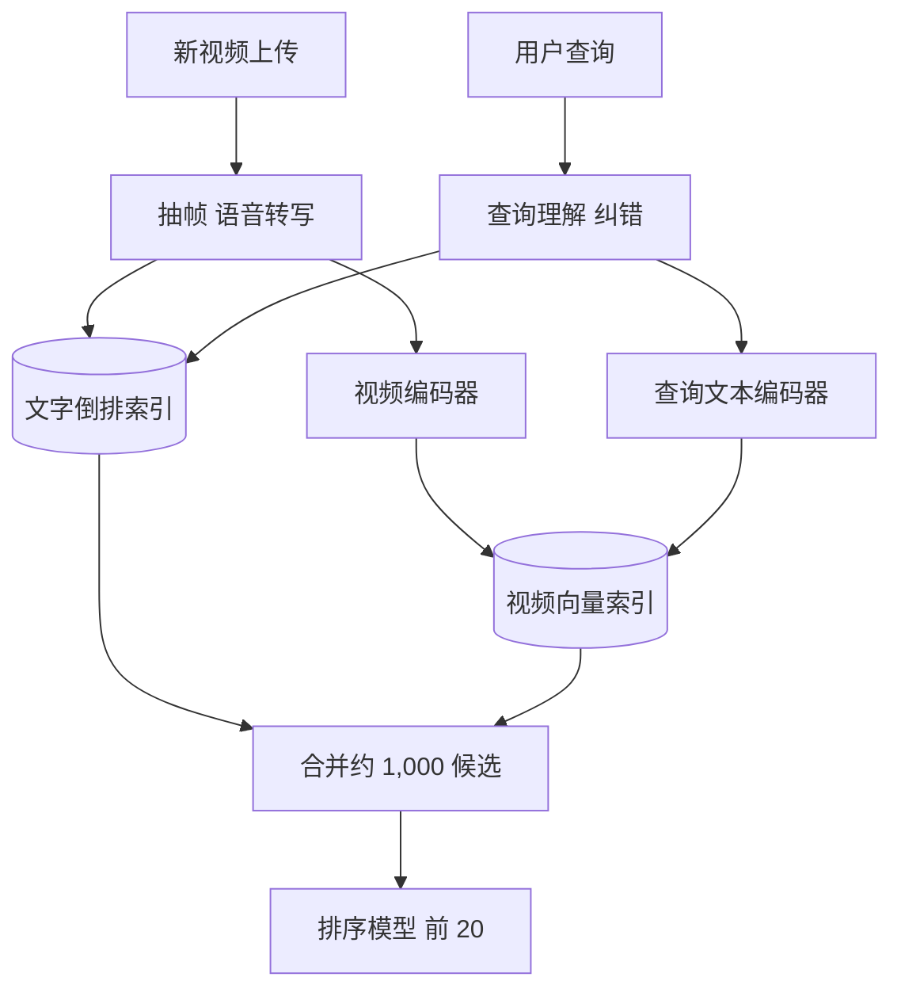

## Q
**全景**｜完整答案 · 视频搜索

面试官：「用户输入文字（例如"猫咪跳上钢琴"），从 10 亿个视频里返回最相关的结果。很多视频的标题和描述很简陋。设计视频搜索，按 ML 系统设计的七步讲。」

## A
**一句话。** 两路召回加一个排序：文字路用倒排索引搜标题、描述、字幕和语音转写；视觉路用文本—视频共享嵌入空间（文字和视频画面都变成同一空间里的向量，描述同一件事的离得近）做向量检索，找到标题没写但画面里有的内容；两路合并后由排序模型结合相关性、质量和新鲜度打分。

**① 需求。** 文字查询；返回 20 个结果并可翻页；P95 < 300 ms；新视频上传后约 1 小时内可搜到；过滤违规和私密视频。

**② 定义成 ML 任务。** 排序问题：给定查询和候选视频，预测相关程度；其中视觉召回是表示学习（让匹配的文字和视频向量接近）。

**③ 数据。** 视频的标题、描述、标签；语音识别得到的转写文本；画面抽帧；搜索日志里"查询—点击且看了较久的视频"作为弱标签；人工标注的相关性分级（0–3 分）用于评估。

**④ 模型。** 视觉路：图文对比学习模型分别编码抽帧和查询，帧向量平均成视频向量。文字路：BM25 打分。排序：梯度提升树或神经网络，输入几十到几百个特征。

**⑤ 评估。** 离线：NDCG@10（排序质量分，相关度高的结果越靠前分越高，以人工相关性分级为准）、召回率@k。在线：点击率、点击后的观看时长、无点击搜索的比例、改写重搜率。

**⑥ 部署。** 上传后异步处理：抽帧、语音转写、编码、写两种索引；查询时：查询理解（纠错、同义扩展）、两路召回、合并、取特征、排序。

**⑦ 监控。** 无结果率、无点击率、延迟、索引积压；按查询长度和语言拆分。

**必讲深挖。** 多模态表示：画面、语音、文字怎么变成可搜的信号；排序与评估：特征、NDCG、在线指标。

**数字。** 10 亿视频 × 每 2 秒抽一帧，视频平均 5 分钟时每个视频 150 帧，共 1,500 亿帧要编码，这是一次性的大批量离线任务，之后只处理新上传的视频。
