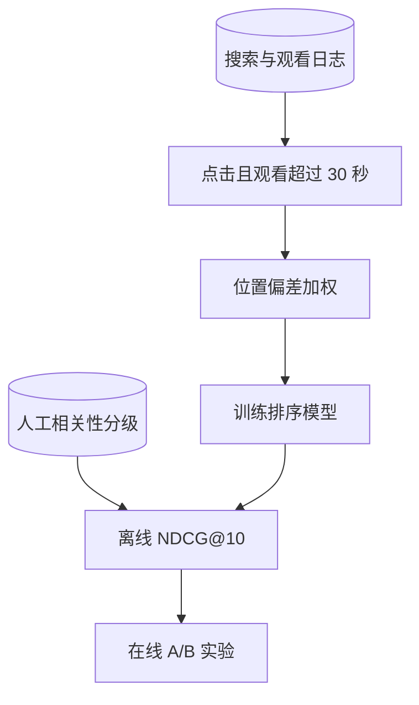

## Q
**深挖 · 排序特征、标签与 NDCG**｜视频搜索

面试官：「视频搜索的排序模型用哪些特征？训练标签从哪来？NDCG 是怎么算的，为什么用它而不是准确率？」

## A
**一句话。** 特征分相关性（BM25 分、向量相似度、语音命中）、质量（完播率、点赞率、清晰度）、新鲜度和个性化；标签用搜索日志里"点击并观看超过一定时长"作为正例，按位置偏差加权，并用人工相关性分级做评估；NDCG 给排名靠前的相关结果更高的权重，正好对应"用户主要看前几条"。

**特征。**
- **相关性：** 标题和描述的 BM25 分、查询与视频向量的相似度、语音转写中查询词的命中次数。
- **质量：** 完播率、点赞与不喜欢比例、上传者信誉、分辨率。
- **新鲜度：** 发布时长；"今天的比赛"这类查询要特别偏向新视频。
- **个性化：** 用户语言、对该频道的历史观看。

**标签与偏差。**
- **点击不等于相关：** 点进去 3 秒就退出说明不相关，所以要求观看超过一定时长才算正例。
- **位置偏差：** 排在第 1 位的结果天然被点得多。处理：少量流量随机交换相邻结果，估计每个位置的"被看到的概率"，训练时按它的倒数加权。

**NDCG 怎么算（小例子）。**
- 人工分级：前 3 个结果的相关度分别为 3、2、0。
- 每一位的得分 = (2^相关度 − 1) ÷ log₂(位置 + 1)：第 1 位 7 ÷ 1 = 7，第 2 位 3 ÷ 1.585 ≈ 1.89，第 3 位 0。合计 DCG ≈ 8.89。
- 理想排序就是 3、2、0，所以 NDCG = 8.89 ÷ 8.89 = 1；如果排成 0、2、3，DCG = 0 + 1.89 + 7 ÷ 2 = 5.39，NDCG ≈ 0.61。

**为什么用 NDCG。** 准确率不管顺序；NDCG 同时考虑"相关程度有分级"和"越靠前越重要"。在线指标仍然是最终裁判：无点击率、改写重搜率、搜索后的观看时长。

**故障与处理。** 优化观看时长会偏向长视频，短而精准的答案视频被压低；所以主指标要和"是否满足需求"（例如不再改写重搜）一起看。
