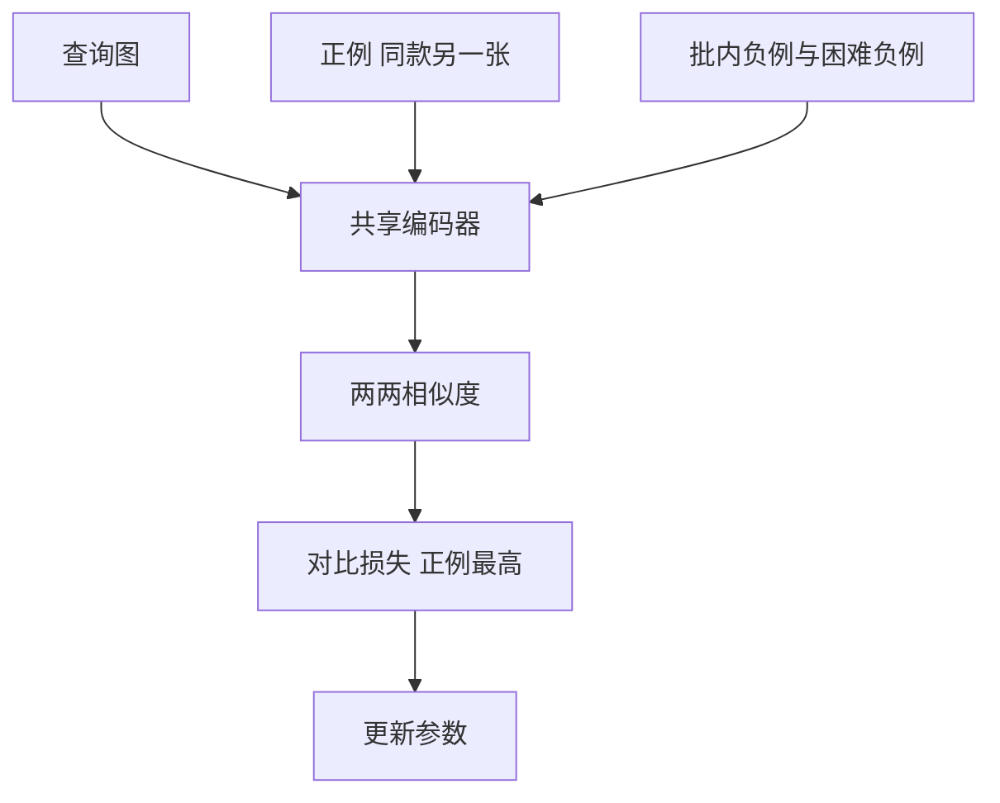

## Q
**深挖 · 图像嵌入模型的训练**｜以图搜图

面试官：「以图搜图的嵌入模型怎么训练？正例负例从哪来？为什么困难负例重要？换了新模型以后线上索引怎么办？」

## A
**一句话。** 用对比学习：一批里每张图都有一个正例（同一商品的另一张照片，或同一张图的增强版本），其余图都当负例；训练目标让查询向量和正例最近、和所有负例更远。再混入"长得很像但不是同一款"的困难负例，模型才学会区分细节。新模型的向量与旧索引不兼容，必须全量重算、建新索引、对比评测后切换。

**步骤。**
1. **正例：** 同一商品 ID 的不同图片；用户搜索后点击并购买的结果；同一张图做随机裁剪、翻转、调色得到的版本（让模型对拍摄条件不敏感）。
2. **批内负例：** 一批 1,024 对时，每个查询有 1,023 个现成负例。
3. **损失：** 对每个查询，把它与正例、所有负例的相似度做成一个"选出正例"的分类问题（softmax 交叉熵），正例概率越高损失越低。
4. **困难负例挖掘：** 用当前模型在库里搜索，取排名靠前却不是同款的结果，作为下一轮的负例；只有随机负例时，模型很快就能区分"鞋和杯子"，学不到"这双鞋和那双鞋"。
5. **评测：** 固定一个查询集和标注好的同款集合，量召回率@k 和 mAP。

**故障与处理。**
- **假负例：** 两个不同商品 ID 其实是同一款（不同卖家）。被当负例后模型学乱。处理：用商品标题、图片近似重复检测合并同款，或降低极高相似度负例的权重。
- **困难负例太难：** 几乎一样的图被当负例，训练不稳定。处理：只取排名在一定区间内的，而不是第 1 名。
- **模型升级：** 新旧向量空间不同，不能混用。处理：后台全量重算（10 亿张图要大规模批任务），双索引并存，按查询分流对比，确认后切换并保留旧索引一段时间以便回滚。

**为什么这样，不那样。**
- **对比学习对比分类模型：** 分类模型只学会区分固定的几千个类别，新类别的商品无法表示；对比学习学的是"相似度"本身，对新商品也有效。
- **用户行为当正例的代价：** 量大、贴近业务，但有位置偏差和噪声，需要和人工确认的同款数据混合使用。
