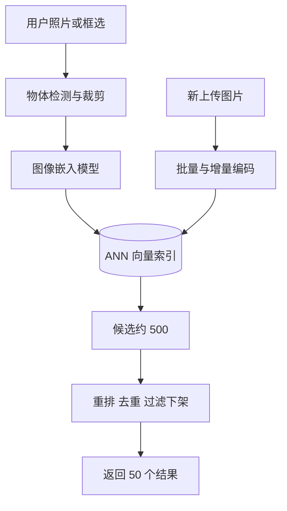

## Q
**全景**｜完整答案 · 以图搜图

面试官：「用户拍一张照片或在图片上框选一块区域，系统返回视觉上相似的图片（例如相似的商品）。设计以图搜图，按 ML 系统设计的七步讲。」

## A
**一句话。** 用一个图像嵌入模型（把图片变成一串数字，看起来相似的图片数字也接近）把全库图片离线变成向量建近似最近邻索引；查询时把用户的图（或框选区域）变成向量，取最近的几百个，再按相关性和业务信号重排。本质是召回加排序，召回靠向量。

**① 需求。** 支持拍照和框选；返回 50 个结果；P95 < 300 ms；库里 10 亿张图，每天新增 1,000 万张，几分钟内可被搜到；隐藏违规和下架内容。

**② 定义成 ML 任务。** 表示学习加排序：训练一个模型，使"同一物体或同款商品"的图向量接近、无关图远离；搜索时按向量距离排序。

**③ 数据。** 正例对：同一商品的不同照片、同一张图的裁剪和调色版本（数据增强）、用户搜索后点击的结果；负例：同批里的其他图，外加"相似但不同款"的困难负例。

**④ 模型。** 视觉 Transformer 或卷积网络做编码器，用对比学习训练；输出 256–512 维向量。框选查询先用物体检测模型定位物体再裁剪编码。

**⑤ 评估。** 离线：召回率@k（同款商品出现在前 k 个里的比例）、mAP（对每个查询按排名算的平均精确率，再对所有查询平均）。在线：点击率、点击后的加购或保存率、"无相关结果"反馈。

**⑥ 部署。** 离线批量为全库算向量；新图上传时实时算向量增量写入索引；查询路径：编码约 20 ms，ANN 查询约 10 ms，重排约 20 ms。

**⑦ 监控。** 零点击率、延迟、索引新鲜度；模型升级时要全量重算向量，新旧向量不能混在一个索引里。

**必讲深挖。** 嵌入模型怎么训练（正负例与困难负例）；重排、去重与评估。索引内部结构是向量数据库的通用知识，提一句容量估算即可：10 亿 × 256 维 × 4 字节 ≈ 1 TB，需要压缩（例如乘积量化，把向量切段后每段用一个编号代替）和分片。
