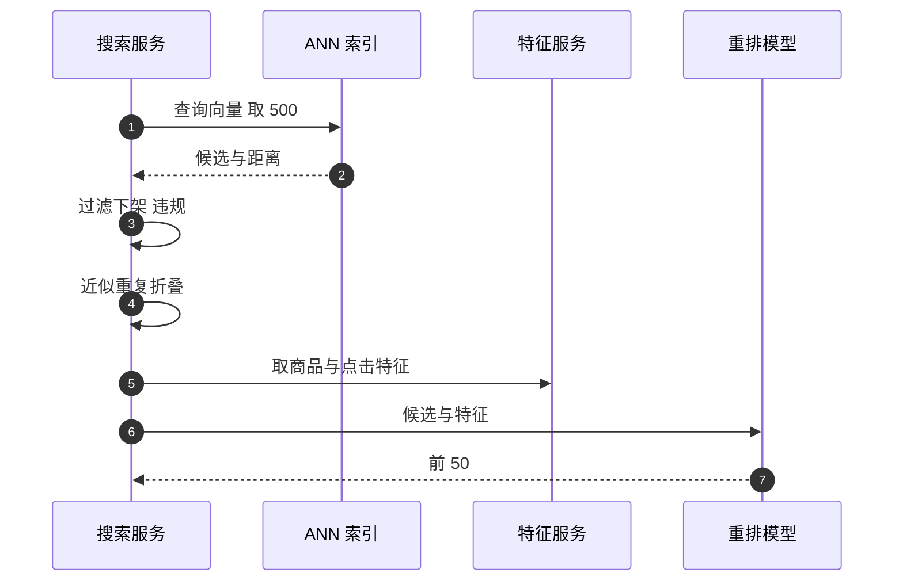

## Q
**深挖 · 重排、去重与评估**｜以图搜图

面试官：「向量检索已经按相似度排好了，为什么还要重排？结果里全是同一张图的转发版本怎么办？离线和在线怎么评估以图搜图？」

## A
**一句话。** 向量相似只代表"看起来像"，不代表"用户想要"：重排要加入点击率、商品质量、是否有货、是否下架等信号，并把近似重复的图合并成一个结果；评估离线用标注的同款集合量召回率@k 和 mAP，在线看点击、点击后的转化和"无相关结果"反馈。

**重排的步骤。**
1. **过滤：** 下架、违规、地区不可售的结果在这一步剔除（也可以在索引查询时带过滤条件）。
2. **去重：** 用感知哈希（对图片缩小、去色后计算的短指纹，近似重复的图指纹相同或相近）或向量距离极小作为判断，把同一张图的多个版本折叠成一个，保留质量最好的那张。
3. **特征：** 向量距离、商品历史点击率、价格区间、卖家评分、是否有货。
4. **模型：** 一个轻量的排序模型（例如梯度提升树）学习"用户会点哪个"，标签来自搜索日志的点击和购买。

**评估。**
- **召回率@k：** 对每个查询，标注好的同款中有多少出现在前 k 个结果里。
- **mAP：** 每个查询在每个命中位置算一次精确率再平均，然后对所有查询平均；命中越靠前分越高。
- **人工评测：** 抽 500 个查询，评分员对前 10 个结果标"同款 / 相似 / 无关"。
- **在线：** 点击率、点击后加购率、零点击率；按查询类型（服装、家具、植物）拆分看。

**故障与处理。**
- **离线好线上差：** 离线查询是整洁的商品图，线上是用户随手拍的照片，光线、角度、背景完全不同。处理：评测集用真实用户上传的查询图。
- **流行商品霸屏：** 点击率特征让热门商品总排前面。处理：相似度作为强约束，热门度只在相似度接近时起作用。

**为什么这样，不那样。** 只按向量距离排，结果是同一张图的十个转发版本排在一起；重排和去重让前几位的每一个都是不同的、可买的选择。
