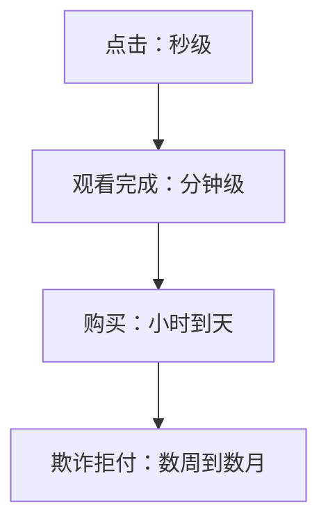

## Q
用用户行为当标签（隐式反馈）有哪些偏差和延迟？以推荐和风控为例给出量级，并说明怎么处理。

## A
**偏差一：位置偏差**（position bias）。排在第 1 位的视频即使不比第 5 位好，点击率也可能高出几倍，因为用户先看到它。直接用点击当标签，模型会学到"旧模型排在前面的就是好的"。
- 处理：把展示位置作为训练特征、预测时统一设成第 1 位；或少量随机打乱顺序，估计每个位置被看到的概率，给样本加权。

**偏差二：曝光偏差**（exposure bias）。用户只能对展示过的东西有反馈，没展示的视频永远是"没有标签"，不等于"不喜欢"。
- 处理：负例只取"展示了但没点"的，而不是全库随机；留一小部分流量随机探索。

**偏差三：噪声**。误点、点进去 2 秒就退出。处理：把"看了 30 秒以上"或"看完一半"当正例，比"点击"更干净。

**延迟：标签多久之后才知道**（反馈回路长度）。

- 推荐：观看标签几分钟到 24 小时就齐了，可以每天甚至每小时再训练。
- 风控：一笔交易是否欺诈，往往要等持卡人发起拒付才确认，可能是几周到几个月后。最近几周的交易标签不全，训练时要么丢弃，要么只用已确认的部分。

**设计时必说的一句**：确定"多久之后标签算定下来"，例如"曝光后 24 小时内看过一半记为正"。窗口太短，迟到的正例被记成负例；窗口太长，模型用的数据太旧。
